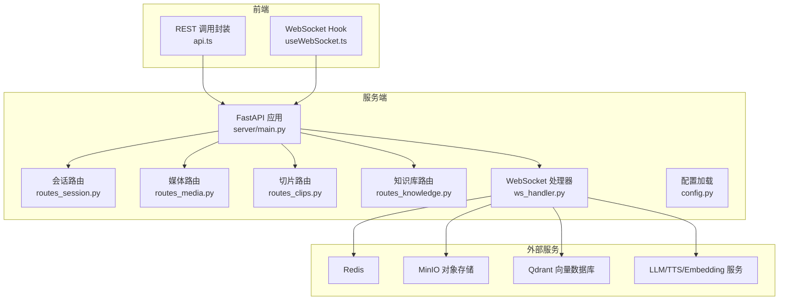
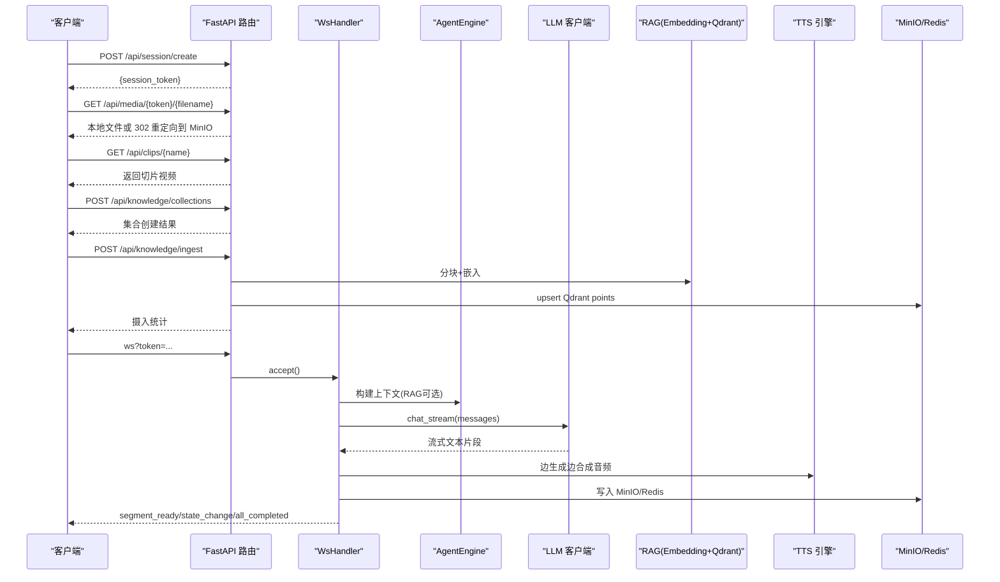
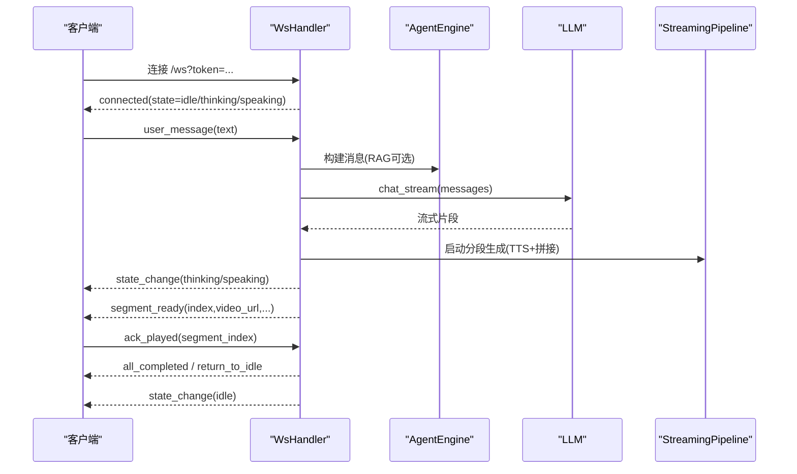
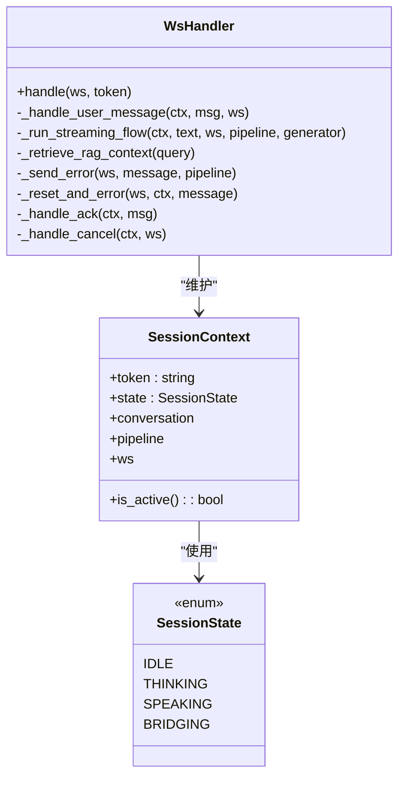

# API 接口文档

<cite>
**本文引用的文件**   
- [server/main.py](file://server/main.py)
- [server/api/routes_session.py](file://server/api/routes_session.py)
- [server/api/routes_media.py](file://server/api/routes_media.py)
- [server/api/routes_clips.py](file://server/api/routes_clips.py)
- [server/api/routes_knowledge.py](file://server/api/routes_knowledge.py)
- [server/api/ws_handler.py](file://server/api/ws_handler.py)
- [server/models/session.py](file://server/models/session.py)
- [client/src/services/api.ts](file://client/src/services/api.ts)
- [client/src/hooks/useWebSocket.ts](file://client/src/hooks/useWebSocket.ts)
- [client/src/types/events.ts](file://client/src/types/events.ts)
- [config.json](file://config.json)
</cite>

## 目录
1. [简介](#简介)
2. [项目结构](#项目结构)
3. [核心组件](#核心组件)
4. [架构总览](#架构总览)
5. [详细组件分析](#详细组件分析)
6. [依赖关系分析](#依赖关系分析)
7. [性能与扩展性](#性能与扩展性)
8. [故障排查指南](#故障排查指南)
9. [结论](#结论)
10. [附录：协议规范与示例](#附录协议规范与示例)

## 简介
本文件为 RealTimeTalk 系统的完整 API 接口文档，覆盖以下范围：
- RESTful API：会话管理、媒体文件访问、切片资源访问、知识库管理
- WebSocket 实时通信：连接建立、消息格式、事件类型、交互流程
- 认证与安全：Admin Token、CORS、重放保护建议
- 错误处理策略、版本信息、速率限制建议
- 常见用例、客户端实现指南、调试与监控方法
- 向后兼容性与弃用迁移说明（如适用）

## 项目结构
后端采用 FastAPI 模块化路由组织，REST 路由按功能拆分，WebSocket 通过统一端点接入。前端使用 React + TypeScript，封装了 REST 调用与 WebSocket Hook。

图表来源
- [server/main.py:114-133](file://server/main.py#L114-L133)
- [server/api/routes_session.py:14](file://server/api/routes_session.py#L14)
- [server/api/routes_media.py:15](file://server/api/routes_media.py#L15)
- [server/api/routes_clips.py:14](file://server/api/routes_clips.py#L14)
- [server/api/routes_knowledge.py:24](file://server/api/routes_knowledge.py#L24)
- [server/api/ws_handler.py:31-47](file://server/api/ws_handler.py#L31-L47)

章节来源
- [server/main.py:114-133](file://server/main.py#L114-L133)
- [config.json:1-39](file://config.json#L1-L39)

## 核心组件
- 会话管理：创建、查询历史、销毁；状态持久化到 Redis；支持清理 MinIO 数据
- 媒体访问：优先本地文件代理，回退到 MinIO presigned URL 重定向
- 切片资源：静态视频片段与待机动画的受控路径访问
- 知识库管理：集合 CRUD、知识摄入（自动分块+嵌入+写入）、统计与清空、调试搜索
- WebSocket：基于 token 的会话级双向通信，流式 LLM→TTS→分段推送，ack 驱动播放

章节来源
- [server/api/routes_session.py:28-123](file://server/api/routes_session.py#L28-L123)
- [server/api/routes_media.py:18-65](file://server/api/routes_media.py#L18-L65)
- [server/api/routes_clips.py:23-75](file://server/api/routes_clips.py#L23-L75)
- [server/api/routes_knowledge.py:81-268](file://server/api/routes_knowledge.py#L81-L268)
- [server/api/ws_handler.py:49-444](file://server/api/ws_handler.py#L49-L444)

## 架构总览
RealTimeTalk 提供两类对外接口：
- REST API：用于会话生命周期、媒体与切片资源访问、知识库管理
- WebSocket：用于实时对话、流式生成与分段音视频推送

图表来源
- [server/main.py:146-170](file://server/main.py#L146-L170)
- [server/api/ws_handler.py:130-341](file://server/api/ws_handler.py#L130-L341)
- [server/api/routes_session.py:28-47](file://server/api/routes_session.py#L28-L47)
- [server/api/routes_media.py:18-65](file://server/api/routes_media.py#L18-L65)
- [server/api/routes_clips.py:23-75](file://server/api/routes_clips.py#L23-L75)
- [server/api/routes_knowledge.py:134-186](file://server/api/routes_knowledge.py#L134-L186)

## 详细组件分析

### 会话管理 REST API
- 基础路径：/api/session
- 认证：无（生产环境建议在网关层增加鉴权或限流）
- 版本：v1（由 FastAPI 全局 version 控制）

| 方法 | 路径 | 描述 | 请求体/参数 | 响应体 | 状态码 |
| --- | --- | --- | --- | --- | --- |
| POST | /api/session/create | 创建新会话，返回 session_token | 无 | { session_token: string } | 200/503 |
| GET | /api/session/{token}/history | 获取会话对话历史 | 路径参数 token | { messages: Array<{role,content,timestamp}>, count: number } | 200/404/503 |
| DELETE | /api/session/{token} | 销毁会话并清理资源 | 路径参数 token | { status: "deleted", session_token: string } | 200/404/503 |

- 行为要点
  - 创建会话时在 Redis 初始化状态 idle
  - 历史读取从 Redis 恢复，若不存在则返回 404
  - 销毁时取消活跃 Pipeline、关闭 WebSocket、清理 Redis 与 MinIO 前缀

章节来源
- [server/api/routes_session.py:28-123](file://server/api/routes_session.py#L28-L123)
- [server/models/session.py:14-41](file://server/models/session.py#L14-L41)

### 媒体文件访问 REST API
- 基础路径：/api/media
- 用途：获取生成的视频/音频片段
- 策略：优先本地文件代理，失败则尝试 MinIO presigned URL 重定向

| 方法 | 路径 | 描述 | 参数 | 响应 | 状态码 |
| --- | --- | --- | --- | --- | --- |
| GET | /api/media/{session_token}/{filename:path} | 获取媒体文件 | session_token, filename | 直接返回文件或 302 重定向 | 200/302/404 |

- 注意
  - 文件名映射：segment_X.webm → output_X.webm（拼接输出）
  - 媒体类型根据后缀推断 video/webm 或 audio/mpeg

章节来源
- [server/api/routes_media.py:18-65](file://server/api/routes_media.py#L18-L65)

### 切片资源访问 REST API
- 基础路径：/api/clips
- 用途：访问预置切片与待机动画

| 方法 | 路径 | 描述 | 参数 | 响应 | 状态码 |
| --- | --- | --- | --- | --- | --- |
| GET | /api/clips/{name:path} | 获取切片或待机动画 | name | 返回视频文件 | 200/404 |

- 安全
  - 路径解析后校验位于 clips 目录下，防止越权访问

章节来源
- [server/api/routes_clips.py:23-75](file://server/api/routes_clips.py#L23-L75)

### 知识库管理 REST API
- 基础路径：/api/knowledge
- 认证：请求头 X-Knowledge-Admin-Token（未配置时放行）
- 版本：v1

| 方法 | 路径 | 描述 | 请求体/参数 | 响应体 | 状态码 |
| --- | --- | --- | --- | --- | --- |
| GET | /api/knowledge/collections | 列出集合及统计 | 无 | { collections:[{name,points_count,vector_size,distance}], total_count:number } | 200/500 |
| POST | /api/knowledge/collections | 创建集合 | { name:string, vector_size:int } | 创建结果 | 200/400/500 |
| DELETE | /api/knowledge/collections/{name} | 删除集合 | 路径参数 name | { status:"deleted", name:string } | 200/500 |
| POST | /api/knowledge/ingest | 知识摄入（自动分块+嵌入+写入） | { collection:string, documents:[{text,source}] } | { ingested:number, total_points:number, collection:string } | 200/400/500 |
| GET | /api/knowledge/stats | 统计信息 | 可选 query collection | 单集合或全部集合统计 | 200/500 |
| DELETE | /api/knowledge/clear | 清空集合内容 | query collection | { status:"cleared", collection:string } | 200/400/500 |
| GET | /api/knowledge/search | 调试语义搜索 | query q,collection,k | { results:[{score,text,source,collection}], query,total } | 200/500 |

- 行为要点
  - ingest 自动将长文本按段落或窗口切分（默认最大 500 字，重叠 100 字）
  - 批量嵌入后写入 Qdrant，返回统计
  - search 支持指定集合或全集合检索，返回 top-k 结果

章节来源
- [server/api/routes_knowledge.py:81-268](file://server/api/routes_knowledge.py#L81-L268)

### WebSocket 协议规范
- 端点：/ws?token={session_token}
- 认证：通过 token 关联会话（token 需先通过 /api/session/create 创建）
- 传输：JSON 文本帧

#### 客户端 → 服务端消息
- user_message：发送用户文本
  - 字段：type="user_message", text:string
- ack_played：确认某段已播放
  - 字段：type="ack_played", segment_index:number
- cancel：中断当前生成
  - 字段：type="cancel"

#### 服务端 → 客户端事件
- connected：连接成功
  - 字段：type="connected", session_token:string, state:string
- state_change：状态变更
  - 字段：type="state_change", state:"thinking"|"speaking"|"bridging"|"idle"
- segment_ready：一段音视频准备就绪
  - 字段：type="segment_ready", index:number, video_url:string, duration_ms:number, text:string
- bubble_char：逐字气泡推进（可选）
  - 字段：type="bubble_char", char:string, segment_index:number
- bubble_dismiss：气泡消失（可选）
  - 字段：type="bubble_dismiss", segment_index:number
- play_analysis：进入分析/思考循环
  - 字段：type="play_analysis", loop:boolean
- all_completed：全部完成
  - 字段：type="all_completed"
- return_to_idle：回到空闲
  - 字段：type="return_to_idle"
- error：错误
  - 字段：type="error", message:string

#### 交互流程（简化）

图表来源
- [server/api/ws_handler.py:49-129](file://server/api/ws_handler.py#L49-L129)
- [server/api/ws_handler.py:130-341](file://server/api/ws_handler.py#L130-L341)
- [client/src/types/events.ts:15-92](file://client/src/types/events.ts#L15-L92)

章节来源
- [server/api/ws_handler.py:49-444](file://server/api/ws_handler.py#L49-L444)
- [client/src/hooks/useWebSocket.ts:68-117](file://client/src/hooks/useWebSocket.ts#L68-L117)
- [client/src/types/events.ts:15-92](file://client/src/types/events.ts#L15-L92)

## 依赖关系分析
- 路由注册与生命周期
  - main.py 中 lifespan 初始化 Redis、MinIO、Qdrant、Embedding，注入路由与 RAG 依赖
  - 健康检查 /api/health 返回运行状态与会话数
- 模块耦合
  - routes_* 仅依赖配置与服务客户端
  - ws_handler 聚合 AgentEngine、LLM、Redis、MinIO、Qdrant、Embedding、Pipeline 等

图表来源
- [server/api/ws_handler.py:31-47](file://server/api/ws_handler.py#L31-L47)
- [server/models/session.py:14-41](file://server/models/session.py#L14-L41)

章节来源
- [server/main.py:42-110](file://server/main.py#L42-L110)
- [server/main.py:136-143](file://server/main.py#L136-L143)

## 性能与扩展性
- 流式处理
  - LLM 流式输出触发分段生成，降低首字节延迟
  - ack 机制确保服务端按客户端播放进度推送，避免堆积
- 并发与资源
  - 每个会话独立 Pipeline，销毁时主动取消任务与关闭连接
  - MinIO 大文件通过 presigned URL 直连，减轻服务器带宽压力
- 缓存与降级
  - RAG 不可用时自动降级为纯 LLM 回复
  - 媒体优先本地文件，失败再回退 MinIO
- 建议
  - 在网关层实施速率限制（例如按 IP 或 token）
  - 对 ingest 与 search 设置超时与重试上限
  - 监控 LLM/TTS/Embedding 调用耗时与错误率

[本节为通用指导，不直接分析具体文件]

## 故障排查指南
- 健康检查
  - GET /api/health 返回服务状态、Redis 可用性与会话数量
- 常见问题
  - 4001：WebSocket 连接时 token 无效或未创建会话
  - 404：会话不存在或媒体/切片文件不存在
  - 503：Redis 不可用或服务未就绪
  - 500：知识库操作异常（Qdrant/Embedding 错误）
- 日志定位
  - 关注各路由与 ws_handler 中的错误日志，包含异常信息与堆栈
- 调试工具
  - 浏览器开发者工具查看 WebSocket 消息
  - curl 测试 REST 端点，携带必要请求头（知识库 Admin Token）

章节来源
- [server/main.py:136-143](file://server/main.py#L136-L143)
- [server/api/ws_handler.py:72-73](file://server/api/ws_handler.py#L72-L73)
- [server/api/routes_session.py:61-66](file://server/api/routes_session.py#L61-L66)
- [server/api/routes_media.py:61-64](file://server/api/routes_media.py#L61-L64)
- [server/api/routes_clips.py:74](file://server/api/routes_clips.py#L74)
- [server/api/routes_knowledge.py:100-102](file://server/api/routes_knowledge.py#L100-L102)

## 结论
RealTimeTalk 提供了完整的 REST 与 WebSocket 接口，覆盖会话管理、媒体访问、切片资源与知识库管理。系统采用流式处理与 ack 驱动模式，兼顾低延迟与可控的资源消耗。在生产部署中建议结合网关进行鉴权与限流，完善监控与告警，保障稳定性与可观测性。

[本节为总结，不直接分析具体文件]

## 附录：协议规范与示例

### 版本与兼容性
- 版本标识：FastAPI 全局 version="1.0.0"
- 向后兼容：当前未引入显式版本路径前缀，后续如需升级可在路由 prefix 中引入 v2 等

章节来源
- [server/main.py:114-118](file://server/main.py#L114-L118)

### 认证与安全
- 知识库管理：X-Knowledge-Admin-Token 请求头（未配置时跳过鉴权）
- CORS：开发阶段允许所有来源，生产应严格限定 allow_origins
- 建议
  - 在网关层对 /api/session/* 与 /ws 做 IP/Token 白名单与速率限制
  - 对 MinIO presigned URL 设置合理 TTL，避免长期有效链接泄露

章节来源
- [server/api/routes_knowledge.py:43-51](file://server/api/routes_knowledge.py#L43-L51)
- [server/main.py:120-127](file://server/main.py#L120-L127)

### 速率限制建议
- 针对 /api/knowledge/ingest 与 /api/knowledge/search 建议限制频率
- 针对 /ws 连接建议限制每 IP 的最大并发会话数
- 针对 /api/media 与 /api/clips 建议启用 CDN 缓存与边缘加速

[本节为通用指导，不直接分析具体文件]

### 客户端实现指南
- REST 调用
  - 使用 api.ts 封装的请求函数，统一 Content-Type 与错误处理
- WebSocket 连接
  - 使用 useWebSocket.ts Hook，内置指数退避重连与事件回调
  - 发送 user_message、ack_played、cancel 三类消息
  - 监听 connected、state_change、segment_ready、all_completed、error 等事件

章节来源
- [client/src/services/api.ts:12-51](file://client/src/services/api.ts#L12-L51)
- [client/src/hooks/useWebSocket.ts:34-189](file://client/src/hooks/useWebSocket.ts#L34-L189)
- [client/src/types/events.ts:15-92](file://client/src/types/events.ts#L15-L92)

### 典型用例
- 新建会话并发起对话
  - POST /api/session/create → 获取 token
  - 连接 /ws?token=... → 发送 user_message → 接收 segment_ready 与 state_change
  - 播放完成后发送 ack_played
- 获取媒体文件
  - GET /api/media/{token}/{filename} → 直接下载或 302 重定向
- 管理知识库
  - POST /api/knowledge/collections → 创建集合
  - POST /api/knowledge/ingest → 上传文档并入库
  - GET /api/knowledge/search → 调试检索效果

章节来源
- [server/api/routes_session.py:28-47](file://server/api/routes_session.py#L28-L47)
- [server/api/ws_handler.py:130-341](file://server/api/ws_handler.py#L130-L341)
- [server/api/routes_media.py:18-65](file://server/api/routes_media.py#L18-L65)
- [server/api/routes_knowledge.py:105-186](file://server/api/routes_knowledge.py#L105-L186)

### 错误处理策略
- HTTP 错误
  - 400：参数缺失或非法（如集合名为空、documents 为空）
  - 401：知识库 Admin Token 无效或缺失
  - 404：资源不存在（会话、媒体、切片）
  - 503：Redis 不可用或服务未就绪
  - 500：内部异常（Qdrant/Embedding/MinIO 等）
- WebSocket 错误
  - type="error" 携带 message 字符串
  - 发生错误后通常伴随 state_change("idle") 重置状态

章节来源
- [server/api/routes_knowledge.py:43-51](file://server/api/routes_knowledge.py#L43-L51)
- [server/api/routes_session.py:61-66](file://server/api/routes_session.py#L61-L66)
- [server/api/routes_media.py:61-64](file://server/api/routes_media.py#L61-L64)
- [server/api/routes_clips.py:74](file://server/api/routes_clips.py#L74)
- [server/api/ws_handler.py:402-413](file://server/api/ws_handler.py#L402-L413)

### 配置与环境变量
- 配置文件：config.json（环境变量优先级更高）
- 关键项
  - llm/tts/minio/redis/qdrant/embedding/server/ffmpeg/rag
  - knowledge_admin_token（知识库管理令牌）

章节来源
- [config.json:1-39](file://config.json#L1-L39)
- [server/config.py:148-241](file://server/config.py#L148-L241)