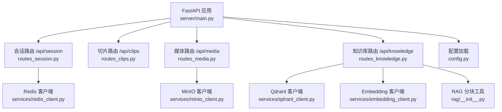
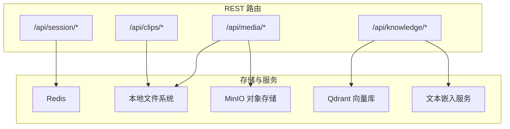
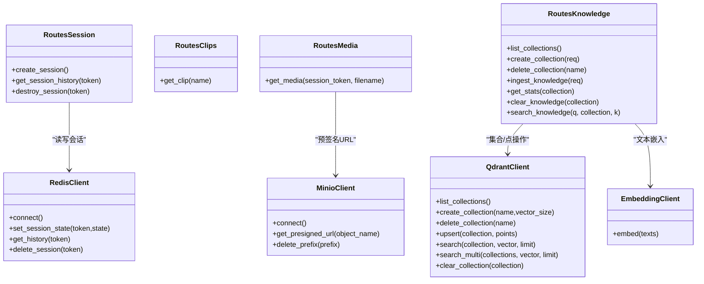

# REST API 参考

<cite>
**本文引用的文件**   
- [server/main.py](file://server/main.py)
- [server/api/routes_session.py](file://server/api/routes_session.py)
- [server/api/routes_clips.py](file://server/api/routes_clips.py)
- [server/api/routes_media.py](file://server/api/routes_media.py)
- [server/api/routes_knowledge.py](file://server/api/routes_knowledge.py)
- [server/config.py](file://server/config.py)
- [server/models/message.py](file://server/models/message.py)
- [server/services/redis_client.py](file://server/services/redis_client.py)
- [server/services/minio_client.py](file://server/services/minio_client.py)
- [server/services/qdrant_client.py](file://server/services/qdrant_client.py)
- [server/services/embedding_client.py](file://server/services/embedding_client.py)
- [server/rag/__init__.py](file://server/rag/__init__.py)
</cite>

## 目录
1. [简介](#简介)
2. [项目结构](#项目结构)
3. [核心组件](#核心组件)
4. [架构总览](#架构总览)
5. [详细接口说明](#详细接口说明)
6. [依赖关系分析](#依赖关系分析)
7. [性能与速率限制](#性能与速率限制)
8. [故障排查指南](#故障排查指南)
9. [结论](#结论)
10. [附录：版本兼容性与向后兼容](#附录版本兼容性与向后兼容)

## 简介
本参考文档面向 RealTimeTalk 系统的 REST API，覆盖以下分组：
- 会话管理：/api/session/*
- 虚拟形象切片：/api/clips/*
- 媒体文件访问：/api/media/*
- 知识库管理：/api/knowledge/*

同时记录认证方式、数据校验规则、错误处理策略、典型请求/响应示例以及版本兼容性说明。

## 项目结构
后端基于 FastAPI，路由按功能拆分到独立模块；服务启动时初始化 Redis、MinIO、Qdrant、Embedding 等外部依赖，并注册路由。

图表来源
- [server/main.py:114-133](file://server/main.py#L114-L133)
- [server/api/routes_session.py:14-26](file://server/api/routes_session.py#L14-L26)
- [server/api/routes_clips.py:14-21](file://server/api/routes_clips.py#L14-L21)
- [server/api/routes_media.py:15-18](file://server/api/routes_media.py#L15-L18)
- [server/api/routes_knowledge.py:24-38](file://server/api/routes_knowledge.py#L24-L38)
- [server/services/redis_client.py:22-30](file://server/services/redis_client.py#L22-L30)
- [server/services/minio_client.py:21-32](file://server/services/minio_client.py#L21-L32)
- [server/services/qdrant_client.py:26-34](file://server/services/qdrant_client.py#L26-L34)
- [server/services/embedding_client.py:26-40](file://server/services/embedding_client.py#L26-L40)
- [server/rag/__init__.py:10-23](file://server/rag/__init__.py#L10-L23)
- [server/config.py:148-241](file://server/config.py#L148-L241)

章节来源
- [server/main.py:114-133](file://server/main.py#L114-L133)
- [server/config.py:148-241](file://server/config.py#L148-L241)

## 核心组件
- 会话管理（Redis）：负责创建、查询历史、销毁会话，状态持久化在 Redis，TTL 可配置。
- 切片代理（本地文件系统）：提供虚拟形象动画与待机视频文件的静态访问。
- 媒体代理（本地优先 + MinIO 回退）：优先从本地工作目录返回生成结果，否则通过 MinIO 预签名 URL 重定向。
- 知识库管理（Qdrant + Embedding）：集合 CRUD、知识摄入（自动分块+嵌入+写入）、统计、清空、调试搜索。

章节来源
- [server/api/routes_session.py:28-123](file://server/api/routes_session.py#L28-L123)
- [server/api/routes_clips.py:23-75](file://server/api/routes_clips.py#L23-L75)
- [server/api/routes_media.py:18-65](file://server/api/routes_media.py#L18-L65)
- [server/api/routes_knowledge.py:81-268](file://server/api/routes_knowledge.py#L81-L268)
- [server/services/redis_client.py:64-122](file://server/services/redis_client.py#L64-L122)
- [server/services/minio_client.py:69-139](file://server/services/minio_client.py#L69-L139)
- [server/services/qdrant_client.py:35-235](file://server/services/qdrant_client.py#L35-L235)
- [server/services/embedding_client.py:47-149](file://server/services/embedding_client.py#L47-L149)
- [server/rag/__init__.py:10-53](file://server/rag/__init__.py#L10-L53)

## 架构总览
下图展示了各 REST 端点与其依赖服务的交互关系。

图表来源
- [server/api/routes_session.py:28-123](file://server/api/routes_session.py#L28-L123)
- [server/api/routes_clips.py:23-75](file://server/api/routes_clips.py#L23-L75)
- [server/api/routes_media.py:18-65](file://server/api/routes_media.py#L18-L65)
- [server/api/routes_knowledge.py:81-268](file://server/api/routes_knowledge.py#L81-L268)
- [server/services/redis_client.py:22-30](file://server/services/redis_client.py#L22-L30)
- [server/services/minio_client.py:21-32](file://server/services/minio_client.py#L21-L32)
- [server/services/qdrant_client.py:26-34](file://server/services/qdrant_client.py#L26-L34)
- [server/services/embedding_client.py:26-40](file://server/services/embedding_client.py#L26-L40)

## 详细接口说明

### 通用约定
- 基础路径：根据部署环境确定主机与端口，例如 http://host:port
- 内容类型：JSON 请求/响应默认使用 application/json
- 字符编码：UTF-8
- 统一错误体：HTTP 异常由框架返回 JSON 错误体，包含 detail 字段描述错误原因
- 健康检查：GET /api/health 返回服务状态、Redis 可用性与会话数量

章节来源
- [server/main.py:136-143](file://server/main.py#L136-L143)

---

### 会话管理接口 /api/session/*

#### POST /api/session/create
- 功能：创建新会话，返回 session_token
- 请求体：无
- 成功响应（200）：
  - 字段：session_token（字符串）
- 失败响应：
  - 503：Redis 不可用或写入失败
- 示例
  - 请求：POST /api/session/create
  - 响应：{"session_token": "xxxxxxxx-xxxx-xxxx-xxxx-xxxxxxxxxxxx"}

章节来源
- [server/api/routes_session.py:28-47](file://server/api/routes_session.py#L28-L47)
- [server/services/redis_client.py:72-78](file://server/services/redis_client.py#L72-L78)

#### GET /api/session/{token}/history
- 功能：获取指定会话的对话历史
- 路径参数：
  - token：会话标识符
- 成功响应（200）：
  - messages：消息数组，每条包含 role、content、timestamp
  - count：消息条数
- 失败响应：
  - 404：会话不存在
  - 503：服务不可用（Redis 未连接）
- 示例
  - 请求：GET /api/session/{token}/history
  - 响应：{"messages": [{"role":"user","content":"你好","timestamp":"..."}, {"role":"assistant","content":"您好","timestamp":"..."}], "count": 2}

章节来源
- [server/api/routes_session.py:50-72](file://server/api/routes_session.py#L50-L72)
- [server/models/message.py:16-32](file://server/models/message.py#L16-L32)
- [server/services/redis_client.py:89-100](file://server/services/redis_client.py#L89-L100)

#### DELETE /api/session/{token}
- 功能：销毁会话，清理 Redis、内存上下文与 MinIO 前缀
- 路径参数：
  - token：会话标识符
- 成功响应（200）：
  - status："deleted"
  - session_token：被删除的 token
- 失败响应：
  - 404：会话不存在
  - 503：服务不可用（Redis 未连接）
- 示例
  - 请求：DELETE /api/session/{token}
  - 响应：{"status": "deleted", "session_token": "xxxxxxxx-xxxx-xxxx-xxxx-xxxxxxxxxxxx"}

章节来源
- [server/api/routes_session.py:75-123](file://server/api/routes_session.py#L75-L123)
- [server/services/minio_client.py:126-139](file://server/services/minio_client.py#L126-L139)

---

### 虚拟形象接口 /api/clips/*

#### GET /api/clips/{name:path}
- 功能：获取切片文件或待机动画
- 路径参数：
  - name：文件名或子路径（支持 .webm 转换后的路径与 idle 目录）
- 成功响应（200）：
  - 返回 video/webm 流，附带缓存控制头
- 失败响应：
  - 404：切片文件不存在
- 示例
  - 请求：GET /api/clips/idle/idle_breathing.webm
  - 响应：二进制视频流（video/webm）

章节来源
- [server/api/routes_clips.py:23-75](file://server/api/routes_clips.py#L23-L75)
- [server/config.py:200-204](file://server/config.py#L200-L204)

---

### 媒体文件接口 /api/media/*

#### GET /api/media/{session_token}/{filename:path}
- 功能：获取生成的视频/音频文件
- 路径参数：
  - session_token：会话标识符
  - filename：文件名（如 segment_0.webm）
- 行为：
  - 优先从本地工作目录 _work/{session_token} 返回（若存在）
  - 否则尝试通过 MinIO 预签名 URL 重定向
- 成功响应：
  - 200：直接返回媒体流（video/webm 或 audio/mpeg）
  - 302：重定向至 MinIO 预签名 URL
- 失败响应：
  - 404：媒体文件不存在
- 示例
  - 请求：GET /api/media/{session_token}/segment_0.webm
  - 响应：二进制视频流或 302 重定向

章节来源
- [server/api/routes_media.py:18-65](file://server/api/routes_media.py#L18-L65)
- [server/services/minio_client.py:102-124](file://server/services/minio_client.py#L102-L124)

---

### 知识库管理接口 /api/knowledge/*

鉴权要求：
- 所有端点受 X-Knowledge-Admin-Token 请求头保护
- 若配置中 knowledge_admin_token 为空，则跳过鉴权
- 无效或缺失 Token 将返回 401

#### GET /api/knowledge/collections
- 功能：列出所有集合及各自文档数
- 成功响应（200）：
  - collections：集合信息列表，每项包含 name、points_count、vector_size、distance
  - total_count：集合总数
- 失败响应：
  - 500：列出集合失败
- 示例
  - 请求：GET /api/knowledge/collections
  - 响应：{"collections": [{"name":"pulan_default","points_count":120,"vector_size":1024,"distance":"Cosine"}], "total_count": 1}

章节来源
- [server/api/routes_knowledge.py:81-102](file://server/api/routes_knowledge.py#L81-L102)
- [server/services/qdrant_client.py:74-102](file://server/services/qdrant_client.py#L74-L102)

#### POST /api/knowledge/collections
- 功能：创建新集合
- 请求体：
  - name：集合名称（必填）
  - vector_size：向量维度（可选，默认 1024）
- 成功响应（200/201）：
  - 返回创建结果（包含 status、name）
- 失败响应：
  - 400：集合名称为空
  - 500：创建集合失败
- 示例
  - 请求体：{"name": "my_collection", "vector_size": 1024}
  - 响应：{"status": "created", "name": "my_collection"}

章节来源
- [server/api/routes_knowledge.py:105-117](file://server/api/routes_knowledge.py#L105-L117)
- [server/services/qdrant_client.py:37-59](file://server/services/qdrant_client.py#L37-L59)

#### DELETE /api/knowledge/collections/{name}
- 功能：删除集合及其全部文档
- 路径参数：
  - name：集合名称
- 成功响应（200）：
  - status："deleted"
  - name：被删除的集合名
- 失败响应：
  - 500：删除集合失败
- 示例
  - 请求：DELETE /api/knowledge/collections/my_collection
  - 响应：{"status": "deleted", "name": "my_collection"}

章节来源
- [server/api/routes_knowledge.py:120-128](file://server/api/routes_knowledge.py#L120-L128)
- [server/services/qdrant_client.py:61-72](file://server/services/qdrant_client.py#L61-L72)

#### POST /api/knowledge/ingest
- 功能：将知识文档摄入指定集合（自动分块、批量嵌入、写入 Qdrant）
- 请求体：
  - collection：目标集合（必填）
  - documents：文档列表，每项包含 text（必填）、source（可选）
- 处理流程：
  - 文本分块：超过阈值按段落或窗口切分
  - 批量嵌入：调用 Embedding 服务生成向量
  - 写入 Qdrant：upsert 点集
- 成功响应（200）：
  - ingested：本次摄入点数
  - total_points：集合当前总点数
  - collection：目标集合名
- 失败响应：
  - 400：collection 或 documents 为空
  - 500：知识摄入失败
- 示例
  - 请求体：{"collection": "pulan_default", "documents": [{"text": "欢迎使用 RealTimeTalk...", "source": "docs/welcome.md"}]}
  - 响应：{"ingested": 3, "total_points": 123, "collection": "pulan_default"}

章节来源
- [server/api/routes_knowledge.py:134-186](file://server/api/routes_knowledge.py#L134-L186)
- [server/rag/__init__.py:10-53](file://server/rag/__init__.py#L10-L53)
- [server/services/embedding_client.py:47-70](file://server/services/embedding_client.py#L47-L70)
- [server/services/qdrant_client.py:115-134](file://server/services/qdrant_client.py#L115-L134)

#### GET /api/knowledge/stats
- 功能：获取知识库统计信息
- 查询参数：
  - collection：可选，指定集合名；不传则返回全部集合统计
- 成功响应（200）：
  - 当指定 collection：{"collection": "...", "points_count": N}
  - 当不指定：{"total_collections": N, "total_points": M, "collections": [...]}
- 失败响应：
  - 500：获取统计失败
- 示例
  - 请求：GET /api/knowledge/stats?collection=pulan_default
  - 响应：{"collection": "pulan_default", "points_count": 120}

章节来源
- [server/api/routes_knowledge.py:192-217](file://server/api/routes_knowledge.py#L192-L217)
- [server/services/qdrant_client.py:104-111](file://server/services/qdrant_client.py#L104-L111)

#### DELETE /api/knowledge/clear
- 功能：清空指定集合（保留集合定义）
- 查询参数：
  - collection：必填
- 成功响应（200）：
  - status："cleared"
  - collection：被清空的集合名
- 失败响应：
  - 400：collection 为空
  - 500：清空集合失败
- 示例
  - 请求：DELETE /api/knowledge/clear?collection=pulan_default
  - 响应：{"status": "cleared", "collection": "pulan_default"}

章节来源
- [server/api/routes_knowledge.py:220-230](file://server/api/routes_knowledge.py#L220-L230)
- [server/services/qdrant_client.py:206-212](file://server/services/qdrant_client.py#L206-L212)

#### GET /api/knowledge/search
- 功能：调试用语义搜索知识库
- 查询参数：
  - q：搜索文本（必填）
  - collection：可选，指定集合；不指定则搜索全部集合
  - k：返回条数（可选，范围 1-20，默认 5）
- 成功响应（200）：
  - results：匹配结果列表，每项包含 score、text、source、collection
  - query：原始查询文本
  - total：返回条数
- 失败响应：
  - 500：搜索失败
- 示例
  - 请求：GET /api/knowledge/search?q=欢迎&k=3
  - 响应：{"results": [{"score": 0.85, "text": "欢迎使用 RealTimeTalk...", "source": "docs/welcome.md", "collection": "pulan_default"}], "query": "欢迎", "total": 1}

章节来源
- [server/api/routes_knowledge.py:233-267](file://server/api/routes_knowledge.py#L233-L267)
- [server/services/qdrant_client.py:136-186](file://server/services/qdrant_client.py#L136-L186)
- [server/services/embedding_client.py:47-70](file://server/services/embedding_client.py#L47-L70)

---

### 认证方法
- 知识库管理端点：
  - 请求头：X-Knowledge-Admin-Token
  - 校验逻辑：若配置项 knowledge_admin_token 为空则放行；否则必须匹配
  - 失败：401 无效或缺失的知识管理 Token
- 其他端点：
  - 当前未实现统一的 JWT/Bearer 鉴权中间件
  - 建议在生产环境增加统一鉴权中间件（见“建议与最佳实践”）

章节来源
- [server/api/routes_knowledge.py:43-51](file://server/api/routes_knowledge.py#L43-L51)
- [server/config.py:124-126](file://server/config.py#L124-L126)

### 数据验证规则
- Pydantic 模型校验：
  - IngestRequest：collection 非空，documents 非空
  - CreateCollectionRequest：name 非空，vector_size 整数
  - search 查询参数：k 范围 1-20
- 业务校验：
  - 集合名规范化：小写、空格替换为下划线、连字符替换为下划线
  - 文本分块：max_chars 与 overlap 控制

章节来源
- [server/api/routes_knowledge.py:56-75](file://server/api/routes_knowledge.py#L56-L75)
- [server/api/routes_knowledge.py:108-112](file://server/api/routes_knowledge.py#L108-L112)
- [server/rag/__init__.py:10-23](file://server/rag/__init__.py#L10-L23)

### 错误处理策略
- HTTP 异常：
  - 400：参数缺失或非法
  - 401：知识库管理 Token 无效或缺失
  - 404：资源不存在（会话、切片、媒体、集合）
  - 500：服务端内部错误（外部服务异常、未知错误）
  - 503：服务暂时不可用（如 Redis 不可用）
- 日志：
  - 关键操作与异常均记录日志，便于定位问题

章节来源
- [server/api/routes_session.py:42-44](file://server/api/routes_session.py#L42-L44)
- [server/api/routes_session.py:61-66](file://server/api/routes_session.py#L61-L66)
- [server/api/routes_clips.py:74](file://server/api/routes_clips.py#L74)
- [server/api/routes_media.py:64](file://server/api/routes_media.py#L64)
- [server/api/routes_knowledge.py:43-51](file://server/api/routes_knowledge.py#L43-L51)
- [server/api/routes_knowledge.py:100-102](file://server/api/routes_knowledge.py#L100-L102)

## 依赖关系分析

图表来源
- [server/api/routes_session.py:28-123](file://server/api/routes_session.py#L28-L123)
- [server/api/routes_clips.py:23-75](file://server/api/routes_clips.py#L23-L75)
- [server/api/routes_media.py:18-65](file://server/api/routes_media.py#L18-L65)
- [server/api/routes_knowledge.py:81-268](file://server/api/routes_knowledge.py#L81-L268)
- [server/services/redis_client.py:22-122](file://server/services/redis_client.py#L22-L122)
- [server/services/minio_client.py:21-139](file://server/services/minio_client.py#L21-L139)
- [server/services/qdrant_client.py:26-235](file://server/services/qdrant_client.py#L26-L235)
- [server/services/embedding_client.py:26-149](file://server/services/embedding_client.py#L26-L149)

## 性能与速率限制
- 文本嵌入批处理：
  - 单次最多 10 条文本，超出自动分批
  - 对 429 与 5xx 进行有限重试与退避
- Qdrant 并发搜索：
  - 多集合搜索采用并发 gather，合并后排序取 top_k
- 媒体访问优化：
  - 优先本地文件直出，减少跨网络访问
  - MinIO 预签名 URL 避免服务端中转大文件
- 建议：
  - 在生产环境引入网关层限流（如 Nginx 或 API Gateway）
  - 针对 ingest 与 search 设置合理的超时与并发上限
  - 监控外部服务（Redis、MinIO、Qdrant、Embedding）可用性与延迟

章节来源
- [server/services/embedding_client.py:38-70](file://server/services/embedding_client.py#L38-L70)
- [server/services/embedding_client.py:84-135](file://server/services/embedding_client.py#L84-L135)
- [server/services/qdrant_client.py:164-186](file://server/services/qdrant_client.py#L164-L186)
- [server/api/routes_media.py:32-51](file://server/api/routes_media.py#L32-L51)

## 故障排查指南
- 健康检查：
  - GET /api/health 查看服务状态、Redis 是否可用、活跃会话数
- 常见错误码与处理：
  - 401：知识库管理 Token 无效或缺失 → 检查请求头与配置
  - 404：资源不存在 → 确认 token、文件名、集合名是否正确
  - 500：服务端错误 → 查看日志，检查外部服务连通性
  - 503：服务暂时不可用 → 检查 Redis 连接与配置
- 外部服务连通性：
  - Redis：连接失败会阻止服务启动
  - MinIO：上传/预签名 URL 失败需检查 endpoint、bucket、凭证
  - Qdrant：集合不存在或权限问题会导致 upsert/search 失败
  - Embedding：API Key 无效或频率限制导致 401/429

章节来源
- [server/main.py:136-143](file://server/main.py#L136-L143)
- [server/api/routes_knowledge.py:43-51](file://server/api/routes_knowledge.py#L43-L51)
- [server/services/redis_client.py:31-50](file://server/services/redis_client.py#L31-L50)
- [server/services/minio_client.py:34-63](file://server/services/minio_client.py#L34-L63)
- [server/services/qdrant_client.py:37-72](file://server/services/qdrant_client.py#L37-L72)
- [server/services/embedding_client.py:84-135](file://server/services/embedding_client.py#L84-L135)

## 结论
RealTimeTalk 的 REST API 围绕会话、虚拟形象、媒体与知识库四大能力构建，采用模块化路由与清晰的服务分层。生产部署建议补充统一鉴权与网关限流，完善监控告警与错误追踪，以提升稳定性与可观测性。

## 附录：版本兼容性与向后兼容
- 版本信息：
  - 应用标题与版本：v1.0.0
- 向后兼容考虑：
  - 新增字段应默认值兼容旧客户端
  - 变更响应结构时需保持旧字段稳定，必要时提供过渡期兼容
  - 对外暴露的 API 路径保持稳定，废弃端点需提前公告与迁移指引

章节来源
- [server/main.py:114-118](file://server/main.py#L114-L118)