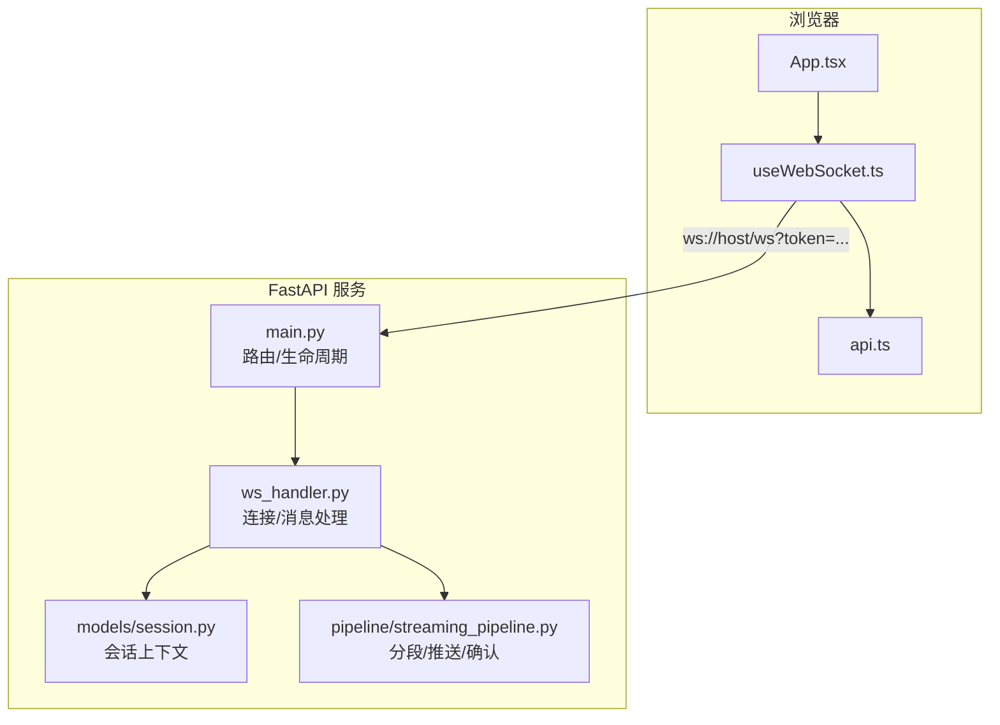
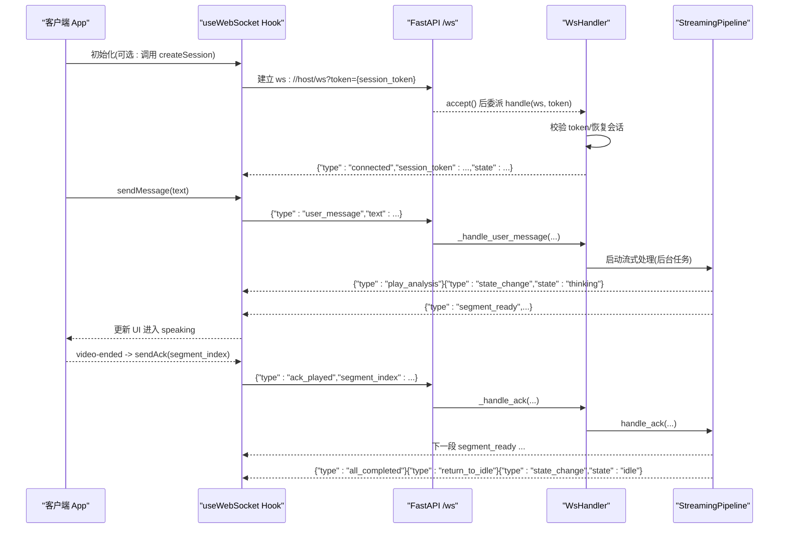
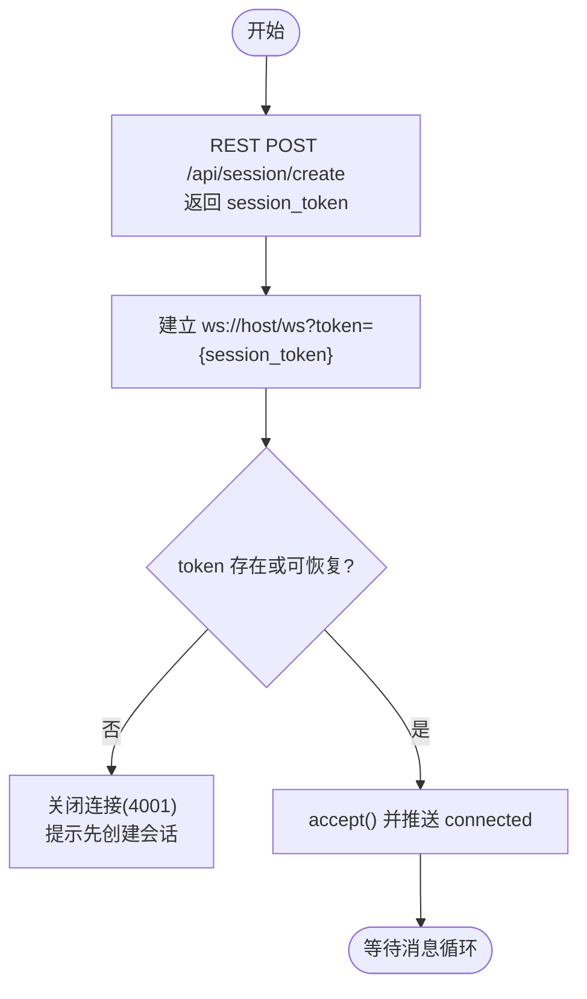
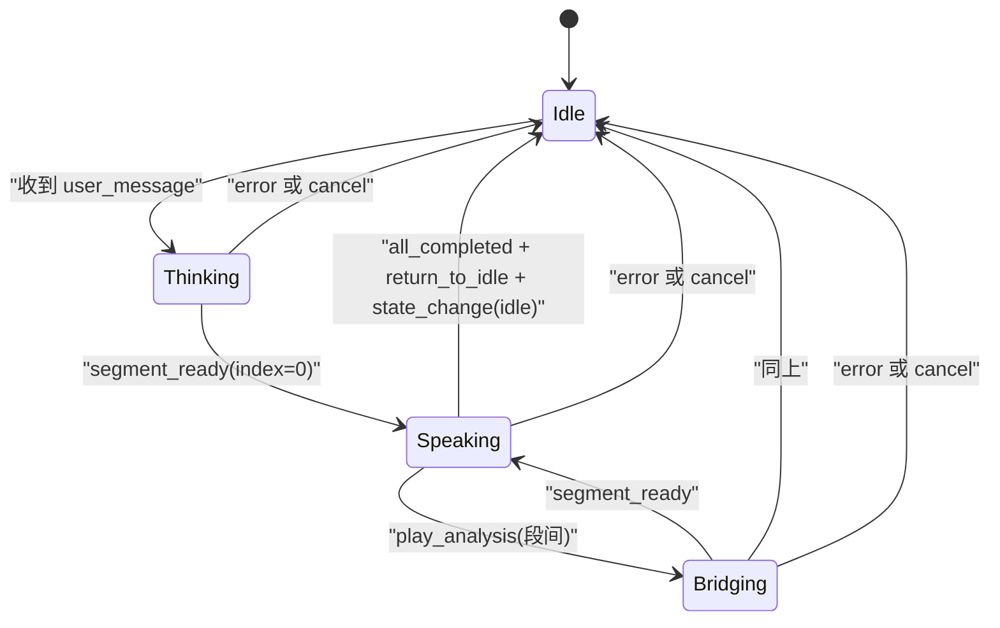
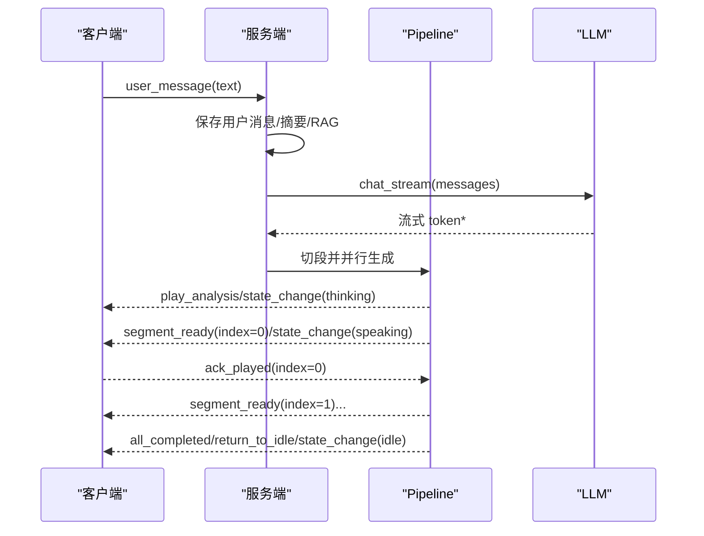
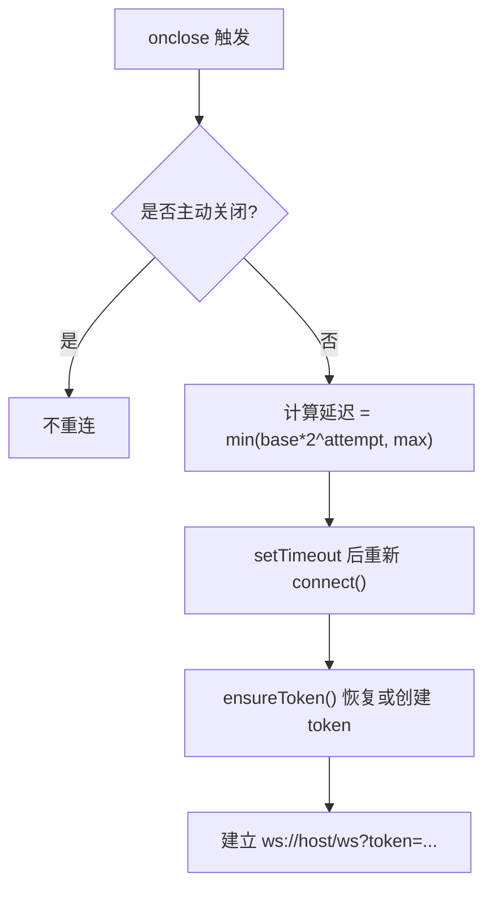
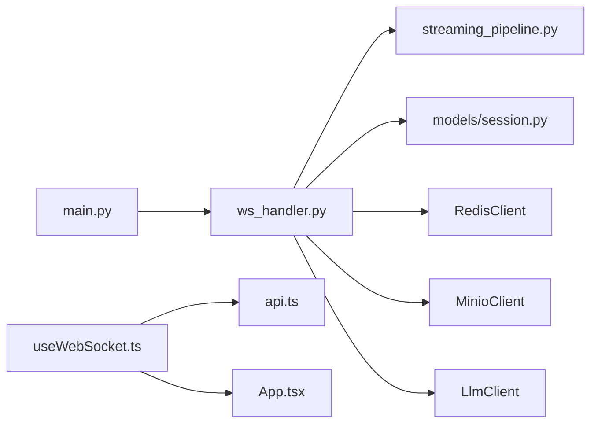

# WebSocket 协议规范

<cite>
**本文引用的文件列表**
- [server/main.py](file://server/main.py)
- [server/api/ws_handler.py](file://server/api/ws_handler.py)
- [server/models/session.py](file://server/models/session.py)
- [server/pipeline/streaming_pipeline.py](file://server/pipeline/streaming_pipeline.py)
- [client/src/hooks/useWebSocket.ts](file://client/src/hooks/useWebSocket.ts)
- [client/src/types/events.ts](file://client/src/types/events.ts)
- [client/src/App.tsx](file://client/src/App.tsx)
- [client/src/services/api.ts](file://client/src/services/api.ts)
</cite>

## 目录
1. [简介](#简介)
2. [项目结构](#项目结构)
3. [核心组件](#核心组件)
4. [架构总览](#架构总览)
5. [详细组件分析](#详细组件分析)
6. [依赖关系分析](#依赖关系分析)
7. [性能考虑](#性能考虑)
8. [故障排查指南](#故障排查指南)
9. [结论](#结论)
10. [附录](#附录)

## 简介
本规范定义 RealTimeTalk 系统的 WebSocket 通信协议，覆盖连接建立、认证与会话恢复、消息格式（客户端到服务端）、事件类型（服务端到客户端）、断线重连与生命周期管理、错误处理策略、确认机制与性能优化建议。文档同时提供端到端交互序列图与客户端实现要点，便于快速集成与调试。

## 项目结构
RealTimeTalk 采用前后端分离架构：
- 后端基于 FastAPI，提供 REST API 与 WebSocket 端点；会话状态通过 Redis 持久化；流式生成由 Pipeline 驱动。
- 前端使用 React + TypeScript，封装 useWebSocket Hook 管理连接、重连与消息收发；App 组件负责事件分发与 UI 状态机。

图表来源
- [server/main.py:146-170](file://server/main.py#L146-L170)
- [server/api/ws_handler.py:31-129](file://server/api/ws_handler.py#L31-L129)
- [server/models/session.py:14-41](file://server/models/session.py#L14-L41)
- [server/pipeline/streaming_pipeline.py:16-131](file://server/pipeline/streaming_pipeline.py#L16-L131)
- [client/src/hooks/useWebSocket.ts:67-117](file://client/src/hooks/useWebSocket.ts#L67-L117)
- [client/src/App.tsx:78-183](file://client/src/App.tsx#L78-L183)

章节来源
- [server/main.py:146-170](file://server/main.py#L146-L170)
- [client/src/hooks/useWebSocket.ts:67-117](file://client/src/hooks/useWebSocket.ts#L67-L117)

## 核心组件
- 连接入口与路由：FastAPI 在 /ws 暴露 WebSocket 端点，接收 token 查询参数并委派给 WsHandler。
- 会话上下文：SessionContext 维护 token、状态、对话历史引用、活跃 Pipeline 与 WebSocket 引用。
- 流式管道：StreamingPipeline 负责分句切段、并行生成、首段即时推送、逐段确认式推进、完成收尾。
- 客户端 Hook：useWebSocket 负责创建/恢复 session_token、建立连接、自动重连、发送消息与 ack/cancel。
- 应用层：App 组件将服务端事件映射为 UI 状态（idle/thinking/speaking/bridging），并触发用户交互。

章节来源
- [server/main.py:146-170](file://server/main.py#L146-L170)
- [server/models/session.py:14-41](file://server/models/session.py#L14-L41)
- [server/pipeline/streaming_pipeline.py:16-131](file://server/pipeline/streaming_pipeline.py#L16-L131)
- [client/src/hooks/useWebSocket.ts:34-117](file://client/src/hooks/useWebSocket.ts#L34-L117)
- [client/src/App.tsx:78-183](file://client/src/App.tsx#L78-L183)

## 架构总览
下图展示从连接建立到消息处理的完整链路，包括认证、会话恢复、流式生成与确认机制。

图表来源
- [server/main.py:146-170](file://server/main.py#L146-L170)
- [server/api/ws_handler.py:49-129](file://server/api/ws_handler.py#L49-L129)
- [server/pipeline/streaming_pipeline.py:44-131](file://server/pipeline/streaming_pipeline.py#L44-L131)
- [client/src/hooks/useWebSocket.ts:67-117](file://client/src/hooks/useWebSocket.ts#L67-L117)
- [client/src/App.tsx:78-183](file://client/src/App.tsx#L78-L183)

## 详细组件分析

### 连接建立与认证流程
- 客户端先通过 REST 接口创建会话，获取 session_token，再携带 token 建立 WebSocket 连接。
- 服务端收到连接后：
  - 若内存中无该 token，则检查 Redis 是否存在历史；不存在则拒绝连接并关闭。
  - 若存在历史，则从 Redis 恢复会话上下文。
  - 接受连接后立即推送 connected 事件，包含 session_token 与当前 state。

图表来源
- [client/src/services/api.ts:31-35](file://client/src/services/api.ts#L31-L35)
- [client/src/hooks/useWebSocket.ts:67-117](file://client/src/hooks/useWebSocket.ts#L67-L117)
- [server/api/ws_handler.py:49-95](file://server/api/ws_handler.py#L49-L95)
- [server/main.py:146-170](file://server/main.py#L146-L170)

章节来源
- [client/src/services/api.ts:31-35](file://client/src/services/api.ts#L31-L35)
- [client/src/hooks/useWebSocket.ts:67-117](file://client/src/hooks/useWebSocket.ts#L67-L117)
- [server/api/ws_handler.py:49-95](file://server/api/ws_handler.py#L49-L95)
- [server/main.py:146-170](file://server/main.py#L146-L170)

### 客户端到服务端消息格式（ClientMessage）
所有消息均为 JSON 对象，必须包含 type 字段以区分消息类型。

- user_message
  - 用途：提交用户文本，触发一次完整的流式回复。
  - 字段：
    - type: "user_message"
    - text: string，非空字符串
  - 验证规则：
    - text 去除首尾空白后不能为空，否则服务端返回 error 事件。
  - 副作用：
    - 若已有活跃 Pipeline，会先取消旧任务。
    - 立即进入 thinking 状态，推送 play_analysis 与 state_change(thinking)。

- ack_played
  - 用途：通知服务端某一段已播放完毕，允许继续推送下一段。
  - 字段：
    - type: "ack_played"
    - segment_index: number，对应 segment_ready.index
  - 行为：
    - 服务端通过 StreamingPipeline.handle_ack 推进队列。

- cancel
  - 用途：中断当前正在进行的流式生成与播放。
  - 字段：
    - type: "cancel"
  - 行为：
    - 服务端取消 Pipeline，重置状态为 idle，并推送 state_change(idle)。

章节来源
- [client/src/types/events.ts:17-31](file://client/src/types/events.ts#L17-L31)
- [server/api/ws_handler.py:112-120](file://server/api/ws_handler.py#L112-L120)
- [server/api/ws_handler.py:130-188](file://server/api/ws_handler.py#L130-L188)
- [server/api/ws_handler.py:415-443](file://server/api/ws_handler.py#L415-L443)

### 服务端到客户端事件类型（ServerEvent）
所有事件均为 JSON 对象，必须包含 type 字段。

- connected
  - 含义：连接成功，附带会话标识与当前状态。
  - 字段：
    - type: "connected"
    - session_token: string
    - state: string（如 "idle"）

- state_change
  - 含义：会话状态变更。
  - 字段：
    - type: "state_change"
    - state: "thinking" | "speaking" | "bridging" | "idle"

- segment_ready
  - 含义：某一段视频就绪，客户端应开始播放。
  - 字段：
    - type: "segment_ready"
    - index: number
    - video_url: string（代理路径，避免跨域问题）
    - duration_ms: number
    - text: string

- bubble_char
  - 含义：打字机效果字符增量。
  - 字段：
    - type: "bubble_char"
    - char: string
    - segment_index: number

- bubble_dismiss
  - 含义：气泡消失信号（聊天模式下用于追加换行）。
  - 字段：
    - type: "bubble_dismiss"
    - segment_index: number

- play_analysis
  - 含义：进入衔接动画（思考/过渡）。
  - 字段：
    - type: "play_analysis"
    - loop: boolean

- all_completed
  - 含义：全部段落已完成。
  - 字段：
    - type: "all_completed"

- return_to_idle
  - 含义：指示回到待机状态（结合 state_change 使用）。
  - 字段：
    - type: "return_to_idle"

- error
  - 含义：发生错误。
  - 字段：
    - type: "error"
    - message: string

章节来源
- [client/src/types/events.ts:35-92](file://client/src/types/events.ts#L35-L92)
- [server/api/ws_handler.py:89-95](file://server/api/ws_handler.py#L89-L95)
- [server/api/ws_handler.py:152-159](file://server/api/ws_handler.py#L152-L159)
- [server/pipeline/streaming_pipeline.py:132-168](file://server/pipeline/streaming_pipeline.py#L132-L168)
- [server/pipeline/streaming_pipeline.py:185-197](file://server/pipeline/streaming_pipeline.py#L185-L197)

### 连接生命周期与状态机
- 状态枚举：idle、thinking、speaking、bridging。
- 典型流转：
  - Idle → Thinking：收到 user_message 后，服务端推送 play_analysis 与 state_change(thinking)。
  - Thinking → Speaking：首个 segment_ready 到达时切换为 speaking。
  - Speaking → Bridging：段间衔接时可能推送 play_analysis。
  - Speaking/Bridging → Idle：收到 all_completed 与 return_to_idle，随后 state_change(idle)。
  - 任意非 Idle → Idle：收到 cancel 或 error。

图表来源
- [server/models/session.py:14-20](file://server/models/session.py#L14-L20)
- [server/api/ws_handler.py:148-159](file://server/api/ws_handler.py#L148-L159)
- [server/pipeline/streaming_pipeline.py:92-126](file://server/pipeline/streaming_pipeline.py#L92-L126)
- [client/src/App.tsx:87-183](file://client/src/App.tsx#L87-L183)

章节来源
- [server/models/session.py:14-20](file://server/models/session.py#L14-L20)
- [client/src/App.tsx:87-183](file://client/src/App.tsx#L87-L183)

### 消息发送与事件监听流程
- 客户端发送 user_message 后，服务端保存用户消息、必要时进行摘要压缩、检索 RAG 上下文，然后流式调用 LLM。
- 边接收 LLM 输出边按句子边界切段，立即启动 TTS+语义分析+拼接等任务。
- 首段完成后立即推送 segment_ready 与 state_change(speaking)，后续段等待 ack_played 后再推送。
- 全部完成后推送 all_completed、return_to_idle、state_change(idle)。

图表来源
- [server/api/ws_handler.py:130-188](file://server/api/ws_handler.py#L130-L188)
- [server/api/ws_handler.py:189-341](file://server/api/ws_handler.py#L189-L341)
- [server/pipeline/streaming_pipeline.py:44-131](file://server/pipeline/streaming_pipeline.py#L44-L131)

章节来源
- [server/api/ws_handler.py:130-188](file://server/api/ws_handler.py#L130-L188)
- [server/api/ws_handler.py:189-341](file://server/api/ws_handler.py#L189-L341)
- [server/pipeline/streaming_pipeline.py:44-131](file://server/pipeline/streaming_pipeline.py#L44-L131)

### 断线重连与连接保活
- 客户端实现指数退避重连（1s→2s→4s→…，上限 30s），并在 onclose 时调度下一次重连。
- 重连时复用 sessionStorage 中的 session_token，服务端根据 Redis 恢复会话上下文。
- 心跳机制：当前未实现显式心跳；如需增强可靠性，可在两端增加 ping/pong 或定时探测。

图表来源
- [client/src/hooks/useWebSocket.ts:95-135](file://client/src/hooks/useWebSocket.ts#L95-L135)
- [client/src/hooks/useWebSocket.ts:46-65](file://client/src/hooks/useWebSocket.ts#L46-L65)
- [server/api/ws_handler.py:57-84](file://server/api/ws_handler.py#L57-L84)

章节来源
- [client/src/hooks/useWebSocket.ts:95-135](file://client/src/hooks/useWebSocket.ts#L95-L135)
- [client/src/hooks/useWebSocket.ts:46-65](file://client/src/hooks/useWebSocket.ts#L46-L65)
- [server/api/ws_handler.py:57-84](file://server/api/ws_handler.py#L57-L84)

### 错误处理策略
- 连接阶段：
  - 服务未就绪：关闭连接并返回特定 code。
  - 会话不存在：关闭连接并返回特定 code。
- 消息阶段：
  - JSON 解析失败：返回 error 事件，message 说明格式错误。
  - 文本为空：返回 error 事件，message 说明内容不能为空。
  - LLM 调用异常：重置状态为 idle，推送 error 与 state_change(idle)。
  - 段生成异常：推送 error 与 state_change(idle)，并取消 Pipeline。
- 客户端：
  - 捕获 error 事件，显示错误提示并回到 idle。

章节来源
- [server/main.py:153-155](file://server/main.py#L153-L155)
- [server/api/ws_handler.py:69-73](file://server/api/ws_handler.py#L69-L73)
- [server/api/ws_handler.py:103-108](file://server/api/ws_handler.py#L103-L108)
- [server/api/ws_handler.py:136-140](file://server/api/ws_handler.py#L136-L140)
- [server/api/ws_handler.py:335-341](file://server/api/ws_handler.py#L335-L341)
- [client/src/App.tsx:165-178](file://client/src/App.tsx#L165-L178)

### 确认机制与背压控制
- 首段完成后立即推送，无需等待 ack。
- 后续每段需等待客户端 ack_played 后才推送下一段，形成背压控制，避免客户端过载。
- 客户端在视频播放结束时发送 ack_played，服务端通过 StreamingPipeline.handle_ack 推进队列。

章节来源
- [server/pipeline/streaming_pipeline.py:92-126](file://server/pipeline/streaming_pipeline.py#L92-L126)
- [server/pipeline/streaming_pipeline.py:199-214](file://server/pipeline/streaming_pipeline.py#L199-L214)
- [client/src/App.tsx:196-220](file://client/src/App.tsx#L196-L220)

### 性能优化建议
- 首段跳过 LLM 语义分析，减少首帧延迟。
- 多段并行生成，首段就绪即推，提升首包时间。
- 打字机速度限制单字间隔，避免过多事件风暴。
- 使用代理路径访问媒体资源，避免跨域与直链不可达问题。
- 建议在网关层启用 gzip 与合理超时；对长连接做健康检查与优雅关闭。

章节来源
- [server/pipeline/streaming_pipeline.py:44-95](file://server/pipeline/streaming_pipeline.py#L44-L95)
- [server/pipeline/streaming_pipeline.py:132-168](file://server/pipeline/streaming_pipeline.py#L132-L168)
- [server/api/ws_handler.py:254-273](file://server/api/ws_handler.py#L254-L273)

## 依赖关系分析
- main.py 注册 /ws 端点，注入 WsHandler 并委派处理。
- WsHandler 依赖 Redis、MinIO、LLM、AgentEngine、Pipeline 等。
- StreamingPipeline 依赖 SegmentGenerator、SegmentSplitter，并通过 WebSocket 推送事件。
- 客户端 useWebSocket 依赖 api.ts 的 createSession，App 组件消费事件并驱动 UI。

图表来源
- [server/main.py:146-170](file://server/main.py#L146-L170)
- [server/api/ws_handler.py:31-47](file://server/api/ws_handler.py#L31-L47)
- [server/pipeline/streaming_pipeline.py:16-43](file://server/pipeline/streaming_pipeline.py#L16-L43)
- [client/src/hooks/useWebSocket.ts:10-12](file://client/src/hooks/useWebSocket.ts#L10-L12)
- [client/src/App.tsx:11-18](file://client/src/App.tsx#L11-L18)

章节来源
- [server/main.py:146-170](file://server/main.py#L146-L170)
- [server/api/ws_handler.py:31-47](file://server/api/ws_handler.py#L31-L47)
- [server/pipeline/streaming_pipeline.py:16-43](file://server/pipeline/streaming_pipeline.py#L16-L43)
- [client/src/hooks/useWebSocket.ts:10-12](file://client/src/hooks/useWebSocket.ts#L10-L12)
- [client/src/App.tsx:11-18](file://client/src/App.tsx#L11-L18)

## 性能考虑
- 首段优先：首段跳过 LLM 语义分析，显著降低首帧延迟。
- 并行生成：多段并发生成，利用 CPU/GPU 并行能力。
- 背压控制：ack_played 驱动推送，防止客户端堆积。
- 事件节流：打字机事件限制最大间隔，避免 UI 抖动。
- 资源代理：媒体资源通过 /api/media 代理，规避跨域与直链失效。
- 连接保活：建议引入心跳检测与优雅关闭，提高稳定性。

[本节为通用指导，不直接分析具体文件]

## 故障排查指南
- 连接失败：
  - 检查是否先调用 POST /api/session/create 获取 token。
  - 检查网络与 CORS 配置。
- 会话不存在：
  - 确认 token 有效且未被销毁；服务端会在无历史时拒绝连接。
- 消息格式错误：
  - 确保 JSON 合法且包含 type 字段。
- 文本为空：
  - 发送前 trim 并校验非空。
- 播放不同步：
  - 确认视频 ended 事件触发后发送 ack_played。
- 错误提示：
  - 关注 error 事件的 message 字段，定位上游异常。

章节来源
- [server/api/ws_handler.py:69-73](file://server/api/ws_handler.py#L69-L73)
- [server/api/ws_handler.py:103-108](file://server/api/ws_handler.py#L103-L108)
- [server/api/ws_handler.py:136-140](file://server/api/ws_handler.py#L136-L140)
- [client/src/App.tsx:165-178](file://client/src/App.tsx#L165-L178)

## 结论
本规范明确了 RealTimeTalk 的 WebSocket 协议细节，涵盖连接建立、认证与会话恢复、消息与事件格式、生命周期与状态机、断线重连、错误处理、确认机制与性能优化。遵循本规范可实现稳定、低延迟的实时对话体验。

[本节为总结性内容，不直接分析具体文件]

## 附录

### 客户端实现示例要点
- 创建会话：调用 POST /api/session/create，保存 session_token。
- 建立连接：ws://host/ws?token={session_token}，监听 onopen/onmessage/onclose/onerror。
- 发送消息：发送 {type:"user_message", text:"..."}。
- 播放确认：视频 ended 后发送 {type:"ack_played", segment_index:...}。
- 中断：发送 {type:"cancel"}。
- 事件处理：
  - connected：记录 session_token 与初始 state。
  - state_change：驱动 UI 状态。
  - segment_ready：开始播放视频片段。
  - bubble_char/bubble_dismiss：实现打字机与气泡效果。
  - play_analysis：衔接动画。
  - all_completed/return_to_idle：回到 idle。
  - error：显示错误并回到 idle。

章节来源
- [client/src/services/api.ts:31-35](file://client/src/services/api.ts#L31-L35)
- [client/src/hooks/useWebSocket.ts:67-117](file://client/src/hooks/useWebSocket.ts#L67-L117)
- [client/src/App.tsx:78-183](file://client/src/App.tsx#L78-L183)

### 调试工具使用指南
- 浏览器开发者工具：
  - Network → WS：查看连接、消息内容与时间戳。
  - Console：查看客户端日志与错误信息。
- 服务端日志：
  - 关注 WsHandler 与 StreamingPipeline 的日志输出，定位异常与耗时。
- 健康检查：
  - GET /api/health：检查服务状态与活跃会话数。

章节来源
- [server/main.py:136-143](file://server/main.py#L136-L143)
- [server/api/ws_handler.py:121-129](file://server/api/ws_handler.py#L121-L129)
- [server/pipeline/streaming_pipeline.py:185-197](file://server/pipeline/streaming_pipeline.py#L185-L197)