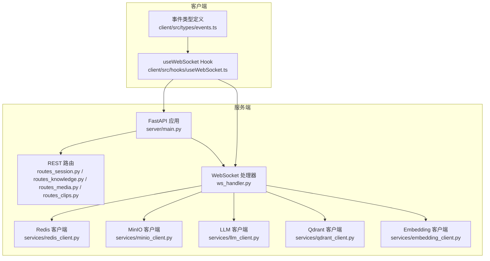
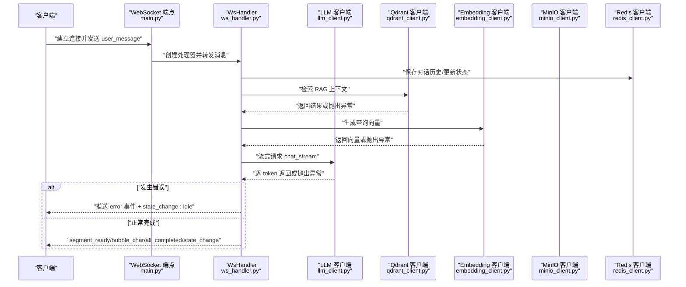
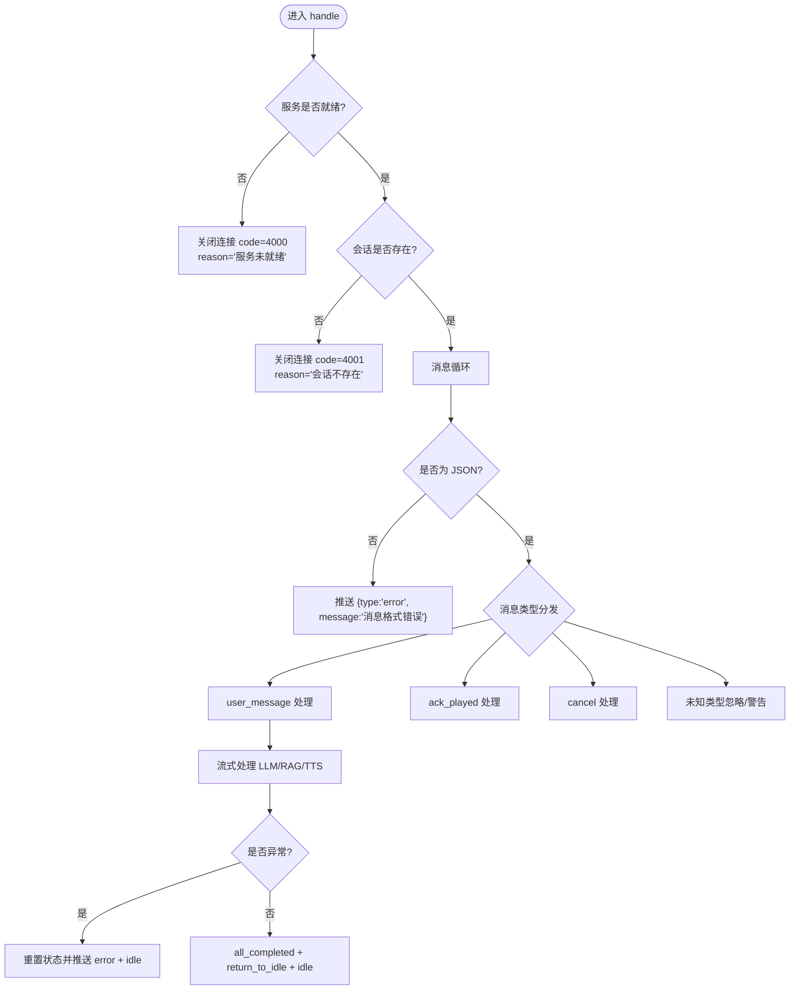
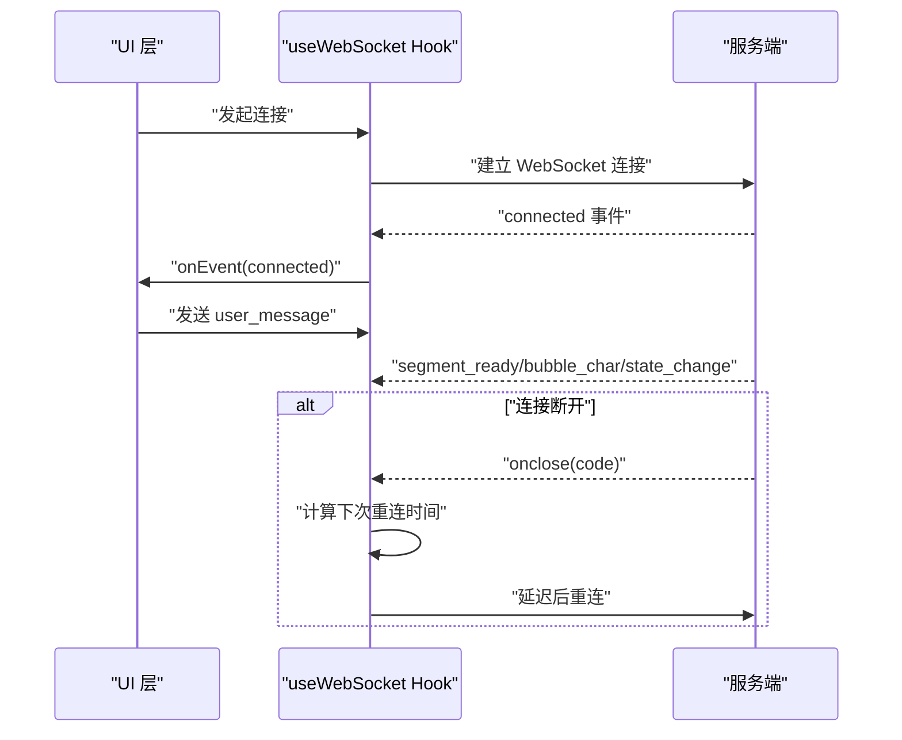
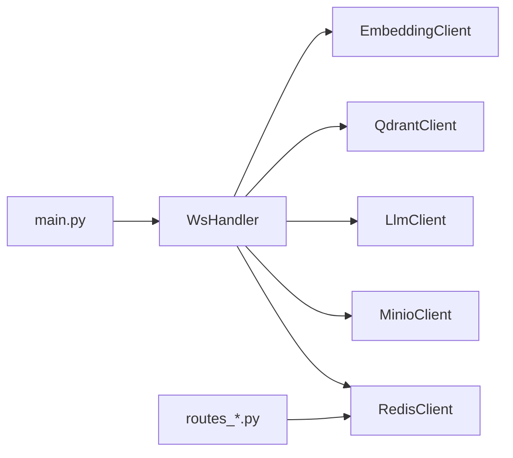

# 错误码与异常处理

<cite>
**本文引用的文件**   
- [server/main.py](file://server/main.py)
- [server/api/ws_handler.py](file://server/api/ws_handler.py)
- [server/api/routes_session.py](file://server/api/routes_session.py)
- [server/services/redis_client.py](file://server/services/redis_client.py)
- [server/services/minio_client.py](file://server/services/minio_client.py)
- [server/services/llm_client.py](file://server/services/llm_client.py)
- [server/services/qdrant_client.py](file://server/services/qdrant_client.py)
- [server/services/embedding_client.py](file://server/services/embedding_client.py)
- [server/models/session.py](file://server/models/session.py)
- [client/src/hooks/useWebSocket.ts](file://client/src/hooks/useWebSocket.ts)
- [client/src/types/events.ts](file://client/src/types/events.ts)
</cite>

## 目录
1. [简介](#简介)
2. [项目结构](#项目结构)
3. [核心组件](#核心组件)
4. [架构总览](#架构总览)
5. [详细组件分析](#详细组件分析)
6. [依赖关系分析](#依赖关系分析)
7. [性能考虑](#性能考虑)
8. [故障排查指南](#故障排查指南)
9. [结论](#结论)
10. [附录](#附录)

## 简介
本文件为 RealTimeTalk 系统的错误码与异常处理规范，覆盖以下范围：
- HTTP 状态码（4xx/5xx）含义与使用场景
- WebSocket 连接中的错误事件类型与错误码
- 常见业务异常（会话不存在、服务不可用、资源不足等）的处理方式与恢复策略
- 错误响应的标准格式与字段约定
- 错误日志记录规范、监控告警建议与故障排查指南
- 客户端错误处理最佳实践与重试机制实现示例

## 项目结构
RealTimeTalk 后端基于 FastAPI，提供 REST API 与 WebSocket 实时通信；前端通过 React Hook 管理连接与重连。错误处理贯穿启动生命周期、路由层、WebSocket 处理器以及各外部服务客户端。

图表来源
- [server/main.py:114-170](file://server/main.py#L114-L170)
- [server/api/ws_handler.py:31-170](file://server/api/ws_handler.py#L31-L170)
- [server/api/routes_session.py:28-123](file://server/api/routes_session.py#L28-L123)
- [server/services/redis_client.py:17-122](file://server/services/redis_client.py#L17-L122)
- [server/services/minio_client.py:16-139](file://server/services/minio_client.py#L16-L139)
- [server/services/llm_client.py:16-204](file://server/services/llm_client.py#L16-L204)
- [server/services/qdrant_client.py:19-235](file://server/services/qdrant_client.py#L19-L235)
- [server/services/embedding_client.py:19-149](file://server/services/embedding_client.py#L19-L149)
- [client/src/hooks/useWebSocket.ts:1-131](file://client/src/hooks/useWebSocket.ts#L1-L131)
- [client/src/types/events.ts:1-66](file://client/src/types/events.ts#L1-L66)

章节来源
- [server/main.py:114-170](file://server/main.py#L114-L170)
- [server/api/ws_handler.py:31-170](file://server/api/ws_handler.py#L31-L170)
- [server/api/routes_session.py:28-123](file://server/api/routes_session.py#L28-L123)

## 核心组件
- 应用生命周期与全局初始化：在启动时检查 Redis、MinIO、Qdrant、Embedding 等依赖可用性，失败则按策略拒绝启动或降级运行。
- REST 路由层：统一抛出 HTTPException，携带明确的状态码与 detail 信息。
- WebSocket 处理器：负责会话校验、消息分发、流式处理、错误推送与状态重置。
- 外部服务客户端：封装 LLM、Qdrant、Embedding、MinIO、Redis 的调用与错误转换，包含重试与限流处理。
- 客户端 Hook：实现指数退避重连、事件回调与断线处理。

章节来源
- [server/main.py:42-110](file://server/main.py#L42-L110)
- [server/api/ws_handler.py:49-170](file://server/api/ws_handler.py#L49-L170)
- [server/api/routes_session.py:28-123](file://server/api/routes_session.py#L28-L123)
- [server/services/llm_client.py:40-113](file://server/services/llm_client.py#L40-L113)
- [server/services/qdrant_client.py:37-112](file://server/services/qdrant_client.py#L37-L112)
- [server/services/embedding_client.py:47-135](file://server/services/embedding_client.py#L47-L135)
- [server/services/minio_client.py:34-139](file://server/services/minio_client.py#L34-L139)
- [server/services/redis_client.py:31-122](file://server/services/redis_client.py#L31-L122)
- [client/src/hooks/useWebSocket.ts:34-131](file://client/src/hooks/useWebSocket.ts#L34-L131)

## 架构总览
下图展示一次用户消息到语音播放的错误路径与关键节点：

图表来源
- [server/main.py:146-170](file://server/main.py#L146-L170)
- [server/api/ws_handler.py:130-341](file://server/api/ws_handler.py#L130-L341)
- [server/services/llm_client.py:115-190](file://server/services/llm_client.py#L115-L190)
- [server/services/qdrant_client.py:164-186](file://server/services/qdrant_client.py#L164-L186)
- [server/services/embedding_client.py:72-135](file://server/services/embedding_client.py#L72-L135)
- [server/services/minio_client.py:69-139](file://server/services/minio_client.py#L69-L139)
- [server/services/redis_client.py:82-122](file://server/services/redis_client.py#L82-L122)

## 详细组件分析

### HTTP 状态码与使用场景
- 400 错误
  - 语义：请求参数错误或消息格式不正确
  - 典型场景：
    - WebSocket 收到非 JSON 文本
    - 知识库接口缺少必填字段（如 collection、documents）
- 401 未授权
  - 语义：鉴权失败或缺失必要凭证
  - 典型场景：
    - 知识管理 Token 无效或缺失
    - LLM/Embedding API Key 无效
- 403 禁止访问
  - 语义：权限不足
  - 典型场景：
    - LLM/Embedding 返回 403（例如配额不足或角色限制）
- 404 未找到
  - 语义：资源不存在
  - 典型场景：
    - 会话不存在（GET/DELETE /api/session/{token}）
    - 切片文件或媒体文件不存在
- 429 请求过于频繁
  - 语义：触发限流
  - 典型场景：
    - LLM/Embedding 返回 429，客户端侧进行短暂等待后重试
- 500 内部服务器错误
  - 语义：服务端异常
  - 典型场景：
    - 知识库操作抛出的通用异常
- 503 服务不可用
  - 语义：依赖服务不可用或系统未就绪
  - 典型场景：
    - Redis 写入失败（创建会话）
    - Redis 未连接（获取历史/销毁会话）

章节来源
- [server/api/ws_handler.py:103-108](file://server/api/ws_handler.py#L103-L108)
- [server/api/routes_knowledge.py:49-127](file://server/api/routes_knowledge.py#L49-L127)
- [server/api/routes_clips.py:73](file://server/api/routes_clips.py#L73)
- [server/api/routes_media.py:59-63](file://server/api/routes_media.py#L59-L63)
- [server/api/routes_session.py:43-90](file://server/api/routes_session.py#L43-L90)
- [server/services/llm_client.py:80-93](file://server/services/llm_client.py#L80-L93)
- [server/services/embedding_client.py:100-115](file://server/services/embedding_client.py#L100-L115)

### WebSocket 错误事件与错误码
- 连接期错误
  - 关闭码 4000：服务未就绪（Redis/MinIO 未初始化）
  - 关闭码 4001：会话不存在（请先创建会话）
- 消息期错误
  - 事件 type=error：消息格式错误、空消息、上游服务异常等
  - 伴随事件 type=state_change，state=idle：确保前端回到空闲态
- 业务中断
  - 用户发送 cancel：取消当前 Pipeline，推送 idle 状态

图表来源
- [server/main.py:146-170](file://server/main.py#L146-L170)
- [server/api/ws_handler.py:49-170](file://server/api/ws_handler.py#L49-L170)
- [server/api/ws_handler.py:402-414](file://server/api/ws_handler.py#L402-L414)

章节来源
- [server/main.py:153-170](file://server/main.py#L153-L170)
- [server/api/ws_handler.py:103-140](file://server/api/ws_handler.py#L103-L140)
- [server/api/ws_handler.py:402-444](file://server/api/ws_handler.py#L402-L444)

### 常见业务异常与恢复策略
- 会话不存在
  - 表现：REST 返回 404；WebSocket 关闭码 4001
  - 恢复：客户端先调用 POST /api/session/create 创建会话，再连接 WebSocket
- 服务不可用
  - 表现：REST 返回 503；WebSocket 关闭码 4000
  - 恢复：客户端延迟重试，必要时提示用户稍后再试
- 上游限流（429）
  - 表现：LLM/Embedding 返回 429
  - 恢复：客户端与服务端均具备短暂等待与重试逻辑
- 上游超时/连接失败
  - 表现：httpx.TimeoutException/ConnectError
  - 恢复：客户端与服务端均具备重试与错误包装
- 资源不足（配额/容量）
  - 表现：上游返回 403/5xx
  - 恢复：记录错误详情，提示用户或管理员扩容/调整配置

章节来源
- [server/api/routes_session.py:61-90](file://server/api/routes_session.py#L61-L90)
- [server/api/ws_handler.py:69-73](file://server/api/ws_handler.py#L69-L73)
- [server/services/llm_client.py:80-113](file://server/services/llm_client.py#L80-L113)
- [server/services/embedding_client.py:100-135](file://server/services/embedding_client.py#L100-L135)

### 错误响应标准格式
- REST 错误
  - 由 FastAPI 的 HTTPException 统一返回，包含 status_code 与 detail 字段
- WebSocket 错误事件
  - 事件体包含 type="error" 与 message 字段
  - 错误后通常伴随 type="state_change", state="idle"，用于重置前端状态

章节来源
- [server/api/routes_session.py:43-90](file://server/api/routes_session.py#L43-L90)
- [server/api/ws_handler.py:103-140](file://server/api/ws_handler.py#L103-L140)
- [server/api/ws_handler.py:402-414](file://server/api/ws_handler.py#L402-L414)

### 错误日志记录规范
- 日志级别
  - INFO：正常流程（连接成功、会话创建、RAG 检索统计等）
  - WARNING：可降级场景（Qdrant 不可用、RAG 跳过、MinIO 删除失败）
  - ERROR：关键失败（Redis 连接失败、LLM/Embedding 调用异常、流式处理异常）
  - CRITICAL：启动阶段致命错误（Redis 不可用导致拒绝启动）
- 日志内容
  - 包含模块名、错误原因、关键上下文（如 token、集合名、对象名）
  - 避免输出敏感信息（如 API Key）
- 日志位置
  - main.py：应用生命周期与全局依赖初始化
  - ws_handler.py：WebSocket 连接与消息处理
  - 各服务客户端：连接、上传、检索、嵌入等操作

章节来源
- [server/main.py:27-32](file://server/main.py#L27-L32)
- [server/main.py:58-77](file://server/main.py#L58-L77)
- [server/api/ws_handler.py:121-140](file://server/api/ws_handler.py#L121-L140)
- [server/services/redis_client.py:48-50](file://server/services/redis_client.py#L48-L50)
- [server/services/minio_client.py:44-63](file://server/services/minio_client.py#L44-L63)
- [server/services/llm_client.py:95-113](file://server/services/llm_client.py#L95-L113)
- [server/services/embedding_client.py:117-135](file://server/services/embedding_client.py#L117-L135)

### 监控告警配置建议
- 指标采集
  - WebSocket 连接数、断开率、错误事件频率
  - REST 接口错误率（4xx/5xx）、P95/P99 延迟
  - 上游服务错误率（LLM/Embedding/Qdrant/MinIO/Redis）
- 告警阈值
  - 5xx 错误率超过阈值（如 1%）持续 N 分钟
  - WebSocket 错误事件突增（如 10 分钟内 > 50 次）
  - 上游限流（429）或超时比例升高
- 可视化
  - 仪表盘展示健康检查、会话数量、错误分布
  - 链路追踪标注关键步骤（RAG 检索、LLM 流式、TTS 生成）

[本节为通用指导，不直接分析具体文件]

### 客户端错误处理最佳实践与重试机制
- 指数退避重连
  - 基础间隔 1s，最大 30s，倍数 2
  - 在 onclose/onerror 中调度下一次重连
- 会话恢复
  - 若 token 仍有效，优先尝试重连；否则先创建新会话
- 事件处理
  - 监听 error 事件并提示用户；确保 state_change:idle 后恢复交互
- 取消与确认
  - 支持 cancel 中断；对 segment_ready 进行 ack_played 以推进播放

图表来源
- [client/src/hooks/useWebSocket.ts:34-131](file://client/src/hooks/useWebSocket.ts#L34-L131)
- [client/src/types/events.ts:35-66](file://client/src/types/events.ts#L35-L66)

章节来源
- [client/src/hooks/useWebSocket.ts:119-131](file://client/src/hooks/useWebSocket.ts#L119-L131)
- [client/src/types/events.ts:35-66](file://client/src/types/events.ts#L35-L66)

## 依赖关系分析
- 耦合与内聚
  - WsHandler 聚合多个服务客户端，承担编排职责；对外暴露统一的错误事件
  - 各服务客户端独立封装错误与重试，降低上层复杂度
- 外部依赖
  - Redis：会话状态与历史持久化
  - MinIO：媒体对象存储与预签名 URL
  - LLM/Embedding：文本生成与向量嵌入
  - Qdrant：向量检索（RAG）
- 潜在循环依赖
  - 无直接循环导入；类型引用通过 TYPE_CHECKING 规避运行时依赖

图表来源
- [server/api/ws_handler.py:31-47](file://server/api/ws_handler.py#L31-L47)
- [server/main.py:146-170](file://server/main.py#L146-L170)
- [server/api/routes_session.py:21-26](file://server/api/routes_session.py#L21-L26)

章节来源
- [server/api/ws_handler.py:31-47](file://server/api/ws_handler.py#L31-L47)
- [server/main.py:146-170](file://server/main.py#L146-L170)
- [server/api/routes_session.py:21-26](file://server/api/routes_session.py#L21-L26)

## 性能考虑
- 流式处理
  - LLM 流式返回片段，边接收边分段生成 TTS，减少首帧延迟
- 并发与限流
  - 多集合并发检索（search_multi），合并排序后取 top_k
  - 429 限流场景下采用短暂等待与重试
- 资源清理
  - 会话销毁时取消 Pipeline、关闭 WebSocket、清理 Redis 与 MinIO 前缀

章节来源
- [server/api/ws_handler.py:214-334](file://server/api/ws_handler.py#L214-L334)
- [server/services/qdrant_client.py:164-186](file://server/services/qdrant_client.py#L164-L186)
- [server/api/routes_session.py:91-122](file://server/api/routes_session.py#L91-L122)

## 故障排查指南
- 快速定位
  - 查看健康检查端点，确认 Redis 与活跃会话数
  - 观察 WebSocket 关闭码与 error 事件 message 字段
- 常见问题
  - Redis 不可用：启动阶段会拒绝启动；检查连接 URL 与网络连通性
  - Qdrant 不可用：RAG 功能降级，不影响基本对话
  - MinIO 不可用：媒体上传/URL 生成失败，需检查凭据与桶存在性
  - LLM/Embedding 限流或超时：关注 429/超时日志，适当调大超时或降低并发
- 日志关键字
  - “Redis 不可用”、“Qdrant 连接失败”、“MinIO 上传失败”、“LLM 流式调用失败”、“流式处理异常”

章节来源
- [server/main.py:58-77](file://server/main.py#L58-L77)
- [server/api/ws_handler.py:335-341](file://server/api/ws_handler.py#L335-L341)
- [server/services/minio_client.py:88-90](file://server/services/minio_client.py#L88-L90)
- [server/services/llm_client.py:95-113](file://server/services/llm_client.py#L95-L113)

## 结论
RealTimeTalk 的错误处理体系围绕“明确状态码、统一错误事件、健壮的重试与降级”展开。通过分层封装与标准化日志，既保证了用户体验（及时错误反馈与自动重连），也便于运维监控与故障定位。建议在后续迭代中完善结构化日志与指标埋点，进一步提升可观测性与稳定性。

## 附录

### WebSocket 事件类型速查
- connected：连接成功，附带 session_token 与 state
- state_change：状态变更（thinking/speaking/bridging/idle）
- segment_ready：段落就绪（index/video_url/duration_ms/text）
- bubble_char：逐字推送（char/segment_index）
- bubble_dismiss：气泡消失（segment_index）
- play_analysis：段落衔接（loop=true）
- all_completed：全部完成
- return_to_idle：返回空闲
- error：错误事件（message 字段描述错误原因）

章节来源
- [client/src/types/events.ts:35-66](file://client/src/types/events.ts#L35-L66)
- [server/api/ws_handler.py:90-120](file://server/api/ws_handler.py#L90-L120)
- [server/api/ws_handler.py:402-414](file://server/api/ws_handler.py#L402-L414)