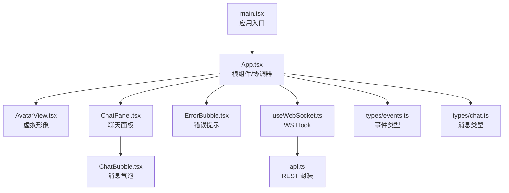
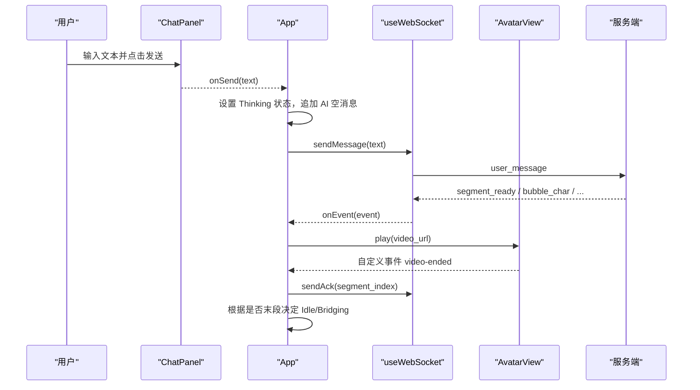
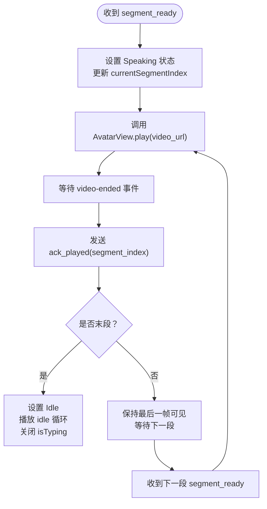
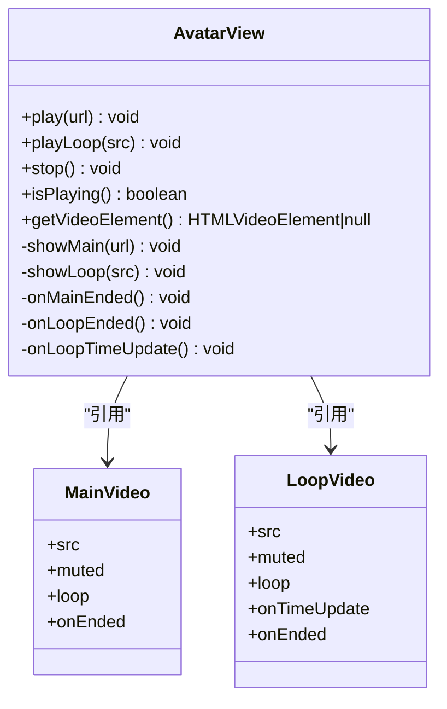
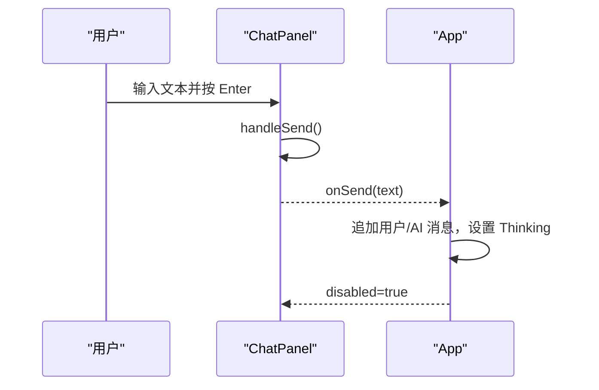
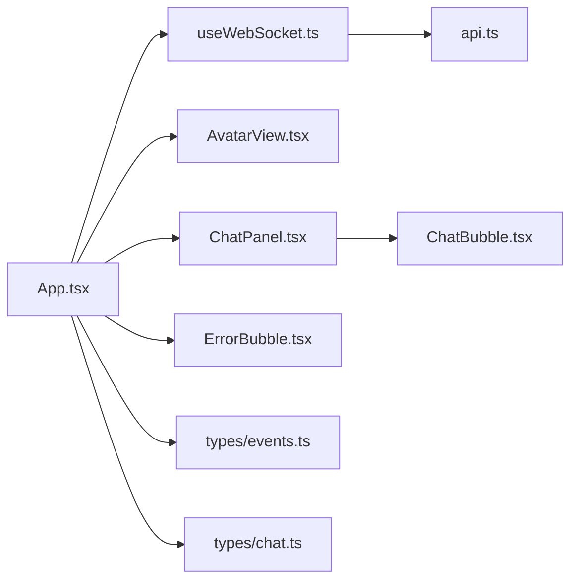

# React 组件架构

<cite>
**本文引用的文件**
- [client/src/main.tsx](file://client/src/main.tsx)
- [client/src/App.tsx](file://client/src/App.tsx)
- [client/src/components/AvatarView.tsx](file://client/src/components/AvatarView.tsx)
- [client/src/components/ChatPanel.tsx](file://client/src/components/ChatPanel.tsx)
- [client/src/components/ChatBubble.tsx](file://client/src/components/ChatBubble.tsx)
- [client/src/components/ErrorBubble.tsx](file://client/src/components/ErrorBubble.tsx)
- [client/src/hooks/useWebSocket.ts](file://client/src/hooks/useWebSocket.ts)
- [client/src/services/api.ts](file://client/src/services/api.ts)
- [client/src/types/events.ts](file://client/src/types/events.ts)
- [client/src/types/chat.ts](file://client/src/types/chat.ts)
</cite>

## 目录
1. [简介](#简介)
2. [项目结构](#项目结构)
3. [核心组件](#核心组件)
4. [架构总览](#架构总览)
5. [详细组件分析](#详细组件分析)
6. [依赖关系分析](#依赖关系分析)
7. [性能考虑](#性能考虑)
8. [故障排查指南](#故障排查指南)
9. [结论](#结论)
10. [附录：使用示例与扩展点](#附录使用示例与扩展点)

## 简介
本文件面向 RealTimeTalk 的 React 前端，聚焦于组件架构、状态管理、事件分发与渲染优化。文档重点覆盖：
- 组件树结构与父子通信模式（受控组件、回调提升、ref 命令式调用）
- App 根组件作为应用协调器的职责（状态机、事件路由、生命周期控制）
- AvatarView 虚拟形象组件与 ChatPanel 聊天面板组件的接口设计、Props 定义与事件处理机制
- 组件间依赖关系与数据流向
- 性能优化策略（memoization、懒加载、渲染优化）
- 初学者友好的概念说明与高级开发者的实现细节和最佳实践

## 项目结构
前端采用 Vite + React + TypeScript 构建，入口挂载到 DOM，App 为根组件，负责全局状态与 WebSocket 连接；子组件包括 AvatarView（虚拟形象）、ChatPanel（聊天面板）、ChatBubble（单条消息气泡）、ErrorBubble（错误提示）。

图表来源
- [client/src/main.tsx:1-13](file://client/src/main.tsx#L1-L13)
- [client/src/App.tsx:1-326](file://client/src/App.tsx#L1-L326)
- [client/src/components/AvatarView.tsx:1-594](file://client/src/components/AvatarView.tsx#L1-L594)
- [client/src/components/ChatPanel.tsx:1-200](file://client/src/components/ChatPanel.tsx#L1-L200)
- [client/src/components/ChatBubble.tsx:1-86](file://client/src/components/ChatBubble.tsx#L1-L86)
- [client/src/components/ErrorBubble.tsx:1-70](file://client/src/components/ErrorBubble.tsx#L1-L70)
- [client/src/hooks/useWebSocket.ts:1-190](file://client/src/hooks/useWebSocket.ts#L1-L190)
- [client/src/services/api.ts:1-52](file://client/src/services/api.ts#L1-L52)
- [client/src/types/events.ts:1-113](file://client/src/types/events.ts#L1-L113)
- [client/src/types/chat.ts:1-11](file://client/src/types/chat.ts#L1-L11)

章节来源
- [client/src/main.tsx:1-13](file://client/src/main.tsx#L1-L13)
- [client/src/App.tsx:1-326](file://client/src/App.tsx#L1-L326)

## 核心组件
- App 根组件
  - 职责：应用协调器，维护全局状态（会话状态、消息列表、错误信息、当前片段索引），统一处理 WebSocket 事件，驱动 AvatarView 播放与 ChatPanel 交互。
  - 状态提升：将消息与发送逻辑提升到 App，通过 props 下发给 ChatPanel，通过 ref 命令式控制 AvatarView。
  - 生命周期：在 useEffect 中监听视频结束事件并执行 ack 与状态回退；在组件卸载时由 useWebSocket 清理连接。
- AvatarView 虚拟形象组件
  - 职责：双 video 叠加切换（主视频用于 segment 播放，循环视频用于 idle/analysis），提供无缝切换与静音过渡，暴露 play/playLoop/stop/isPlaying/getVideoElement 等命令式方法。
  - 事件：内部通过自定义事件 'video-ended' 通知父组件段播放完成。
- ChatPanel 聊天面板组件
  - 职责：展示历史消息、输入框与发送按钮，自动滚动到底部，支持 Enter 发送与输入自适应高度。
  - 事件：通过 onSend 回调向父组件提交文本。
- ChatBubble 消息气泡
  - 职责：渲染单条消息，区分用户/AI 样式，AI 消息支持打字动画占位。
  - 优化：使用 memo 避免重复渲染。
- ErrorBubble 错误提示
  - 职责：居中显示错误信息，自动淡出并在指定时间后通知父组件移除。

章节来源
- [client/src/App.tsx:60-326](file://client/src/App.tsx#L60-L326)
- [client/src/components/AvatarView.tsx:1-594](file://client/src/components/AvatarView.tsx#L1-L594)
- [client/src/components/ChatPanel.tsx:1-200](file://client/src/components/ChatPanel.tsx#L1-L200)
- [client/src/components/ChatBubble.tsx:1-86](file://client/src/components/ChatBubble.tsx#L1-L86)
- [client/src/components/ErrorBubble.tsx:1-70](file://client/src/components/ErrorBubble.tsx#L1-L70)

## 架构总览
整体采用“状态提升 + 事件总线 + 命令式 ref”的组合模式：
- 状态集中在 App，通过 props 向下传递（ChatPanel），通过 ref 向上暴露能力（AvatarView）。
- 服务端事件经 useWebSocket Hook 解析后，由 App 统一分发到 UI 状态与媒体播放。
- 媒体播放通过自定义事件 'video-ended' 从 AvatarView 冒泡至 App，触发 ack 与状态机推进。

图表来源
- [client/src/App.tsx:78-183](file://client/src/App.tsx#L78-L183)
- [client/src/hooks/useWebSocket.ts:137-157](file://client/src/hooks/useWebSocket.ts#L137-L157)
- [client/src/components/AvatarView.tsx:463-481](file://client/src/components/AvatarView.tsx#L463-L481)

## 详细组件分析

### App 根组件（应用协调器）
- 状态管理
  - 应用状态：AppState（Idle/Input/Thinking/Speaking/Bridging）
  - 消息列表：ChatMessage[]（含 isTyping 标记）
  - 错误信息：errorMessage
  - 当前片段索引：currentSegmentIndex
- 事件分发
  - connected：记录会话 token
  - state_change：仅在非 Speaking 时回到 Idle
  - segment_ready：切换到 Speaking，更新 currentSegmentIndex，驱动 AvatarView.play
  - bubble_char/bubble_dismiss：增量更新最后一条 AI 消息文本或插入换行
  - play_analysis：进入 Bridging，驱动 AvatarView.playLoop(analysis)
  - all_completed：清除 currentSegmentIndex，关闭 isTyping
  - return_to_idle：延迟回 Idle（末段）或立即回 Idle（非末段）
  - error：清空 isTyping，重置为 Idle，播放 idle 循环
- 生命周期控制
  - 监听 window 'video-ended'：发送 ack，判断是否末段，决定是否回 Idle
  - 音频解锁：首次交互创建 AudioContext 并尝试恢复，以绕过浏览器自动播放策略
- 组件通信
  - 向 ChatPanel 传入 messages/onSend/disabled
  - 通过 ref 调用 AvatarView.play/playLoop/stop

图表来源
- [client/src/App.tsx:78-183](file://client/src/App.tsx#L78-L183)
- [client/src/App.tsx:194-220](file://client/src/App.tsx#L194-L220)

章节来源
- [client/src/App.tsx:60-326](file://client/src/App.tsx#L60-L326)
- [client/src/types/events.ts:1-113](file://client/src/types/events.ts#L1-L113)
- [client/src/types/chat.ts:1-11](file://client/src/types/chat.ts#L1-L11)

### AvatarView 虚拟形象组件
- 接口设计
  - 暴露方法：play(url)、playLoop(src)、stop()、isPlaying()、getVideoElement()
  - Props：idleSrc（默认 idle 循环视频地址）
- 渲染架构
  - 双 <video> 绝对定位叠加：主视频（segment 播放，有声音）+ 循环视频（idle/analysis，静音）
  - 通过 opacity 与 pointerEvents 控制显隐，避免黑闪与空白帧
  - 首段切换：等待 analysis 循环自然结束再切 segment，防止思考动画被跳过
- 关键逻辑
  - showMain：预加载新段到目标元素，canplay 后立即播放，同帧隐藏旧元素并显示新元素
  - showLoop：idle 模式 JS 接管无缝循环（timeupdate seek），analysis 模式原生 loop
  - ended/timeupdate：segment 结束派发 'video-ended'；idle 兜底 seek(0)；检查 pending 段队列
- 竞态保护
  - thinkingModeRef：当处于 analysis 或 pending 段时，阻止 segment_ready 直接打断思考动画
  - 超时兜底：5s 内未切换则强制播放 segment

图表来源
- [client/src/components/AvatarView.tsx:10-21](file://client/src/components/AvatarView.tsx#L10-L21)
- [client/src/components/AvatarView.tsx:63-150](file://client/src/components/AvatarView.tsx#L63-L150)
- [client/src/components/AvatarView.tsx:152-405](file://client/src/components/AvatarView.tsx#L152-L405)
- [client/src/components/AvatarView.tsx:463-504](file://client/src/components/AvatarView.tsx#L463-L504)

章节来源
- [client/src/components/AvatarView.tsx:1-594](file://client/src/components/AvatarView.tsx#L1-L594)

### ChatPanel 聊天面板组件
- Props 定义
  - messages：ChatMessage[]
  - onSend：(text: string) => void
  - disabled：boolean（可选，禁用输入与发送）
- 行为
  - 自动滚动到最新消息
  - Enter 发送，Shift+Enter 换行
  - 输入框自适应高度，最大高度限制
  - 发送后清空输入框并重置高度
- 事件处理
  - handleSend：读取输入值，校验非空且未禁用，调用 onSend，清空输入
  - handleKeyDown：拦截 Enter 键
  - handleInput：动态调整 textarea 高度

图表来源
- [client/src/components/ChatPanel.tsx:17-51](file://client/src/components/ChatPanel.tsx#L17-L51)
- [client/src/App.tsx:224-252](file://client/src/App.tsx#L224-L252)

章节来源
- [client/src/components/ChatPanel.tsx:1-200](file://client/src/components/ChatPanel.tsx#L1-L200)
- [client/src/types/chat.ts:1-11](file://client/src/types/chat.ts#L1-L11)

### ChatBubble 消息气泡组件
- Props 定义
  - role：'user' | 'assistant'
  - text：string
  - isTyping：boolean（可选）
- 行为
  - 用户消息右对齐蓝色背景，AI 消息左对齐白色边框
  - AI 消息在 isTyping 时显示三点跳动动画
  - 使用 memo 包裹，减少不必要的重渲染

章节来源
- [client/src/components/ChatBubble.tsx:1-86](file://client/src/components/ChatBubble.tsx#L1-L86)

### ErrorBubble 错误提示组件
- Props 定义
  - message：string
  - onDismiss：() => void
- 行为
  - 出现时淡入，3.5s 后淡出，4s 后通知父组件移除
  - 居中悬浮显示，带模糊背景

章节来源
- [client/src/components/ErrorBubble.tsx:1-70](file://client/src/components/ErrorBubble.tsx#L1-L70)

## 依赖关系分析
- 模块依赖
  - App 依赖 useWebSocket、AvatarView、ChatPanel、ErrorBubble、事件与消息类型
  - useWebSocket 依赖 api.ts（创建/获取/销毁会话）与事件类型
  - ChatPanel 依赖 ChatBubble 与消息类型
  - AvatarView 无外部模块依赖，仅使用浏览器 API
- 耦合与内聚
  - App 承担高内聚的状态管理与事件路由，子组件低耦合、职责单一
  - 通过类型约束（events.ts、chat.ts）保证契约稳定
- 外部集成点
  - REST API：/api/session/create、/api/session/{token}/history、/api/session/{token}
  - WebSocket：/ws?token=...

图表来源
- [client/src/App.tsx:1-326](file://client/src/App.tsx#L1-L326)
- [client/src/hooks/useWebSocket.ts:1-190](file://client/src/hooks/useWebSocket.ts#L1-L190)
- [client/src/services/api.ts:1-52](file://client/src/services/api.ts#L1-L52)
- [client/src/components/ChatPanel.tsx:1-200](file://client/src/components/ChatPanel.tsx#L1-L200)
- [client/src/components/ChatBubble.tsx:1-86](file://client/src/components/ChatBubble.tsx#L1-L86)
- [client/src/components/ErrorBubble.tsx:1-70](file://client/src/components/ErrorBubble.tsx#L1-L70)
- [client/src/types/events.ts:1-113](file://client/src/types/events.ts#L1-L113)
- [client/src/types/chat.ts:1-11](file://client/src/types/chat.ts#L1-L11)

章节来源
- [client/src/hooks/useWebSocket.ts:1-190](file://client/src/hooks/useWebSocket.ts#L1-L190)
- [client/src/services/api.ts:1-52](file://client/src/services/api.ts#L1-L52)

## 性能考虑
- 渲染优化
  - ChatBubble 使用 memo 包裹，避免每次消息数组变化导致整列重渲染
  - AvatarView 通过双 video 叠加与 opacity 过渡，避免黑闪与空白帧，降低视觉抖动带来的重排
- 状态与事件
  - App 使用 useCallback 缓存事件处理器，减少子组件不必要重渲染
  - 使用 useRef 保存最新状态（appStateRef、currentSegmentIndexRef），避免闭包过期导致的竞态
- 媒体播放
  - 预加载与 canplay 时机控制，确保首帧快速呈现
  - idle 模式 JS 接管无缝循环，避免原生 loop 的首尾跳变
- 网络与连接
  - useWebSocket 指数退避重连，避免雪崩式重连
  - Token 持久化到 sessionStorage，减少重复创建会话开销

[本节为通用性能建议，不直接分析具体文件]

## 故障排查指南
- WebSocket 连接问题
  - 现象：无法接收事件或频繁断开
  - 排查：检查 ensureToken 是否成功、wsUrl 是否正确、后端是否返回 200
  - 参考路径：[client/src/hooks/useWebSocket.ts:46-117](file://client/src/hooks/useWebSocket.ts#L46-L117)
- 自动播放策略
  - 现象：头像无声或无法自动播放
  - 排查：确认 unlockAudio 是否在用户交互后调用，AudioContext 是否 resume
  - 参考路径：[client/src/App.tsx:32-58](file://client/src/App.tsx#L32-L58)
- 视频切换闪烁
  - 现象：段间出现黑屏或空白帧
  - 排查：检查 showMain/showLoop 的透明度与 pointerEvents 切换顺序，确认 canplay 与定时器兜底
  - 参考路径：[client/src/components/AvatarView.tsx:63-150](file://client/src/components/AvatarView.tsx#L63-L150), [client/src/components/AvatarView.tsx:152-405](file://client/src/components/AvatarView.tsx#L152-L405)
- 思考动画被跳过
  - 现象：segment_ready 直接打断 analysis 循环
  - 排查：thinkingModeRef 与 pendingSrcRef 是否生效，5s 兜底是否触发
  - 参考路径：[client/src/components/AvatarView.tsx:408-437](file://client/src/components/AvatarView.tsx#L408-L437)
- 错误提示不消失
  - 现象：错误气泡一直显示
  - 排查：确认 ErrorBubble 的 onDismiss 是否被调用，父组件是否正确清除 errorMessage
  - 参考路径：[client/src/components/ErrorBubble.tsx:18-35](file://client/src/components/ErrorBubble.tsx#L18-L35), [client/src/App.tsx:254-257](file://client/src/App.tsx#L254-L257)

章节来源
- [client/src/hooks/useWebSocket.ts:118-135](file://client/src/hooks/useWebSocket.ts#L118-L135)
- [client/src/App.tsx:32-58](file://client/src/App.tsx#L32-L58)
- [client/src/components/AvatarView.tsx:63-150](file://client/src/components/AvatarView.tsx#L63-L150)
- [client/src/components/AvatarView.tsx:152-405](file://client/src/components/AvatarView.tsx#L152-L405)
- [client/src/components/AvatarView.tsx:408-437](file://client/src/components/AvatarView.tsx#L408-L437)
- [client/src/components/ErrorBubble.tsx:18-35](file://client/src/components/ErrorBubble.tsx#L18-L35)
- [client/src/App.tsx:254-257](file://client/src/App.tsx#L254-L257)

## 结论
RealTimeTalk 的前端采用清晰的分层与职责划分：App 作为协调器集中管理状态与事件，AvatarView 与 ChatPanel 分别专注媒体播放与对话交互。通过状态提升、命令式 ref 与自定义事件，实现了复杂的多媒体与实时通信场景下的稳定体验。结合 memoization、预加载与无缝循环等技术，保证了流畅的视觉效果与良好的性能表现。

[本节为总结性内容，不直接分析具体文件]

## 附录：使用示例与扩展点

### 基本用法
- 在页面中引入并渲染 App 即可启动整个应用（main.tsx 已挂载）
- 如需替换默认 idle 视频，可在 App 中修改 IDLE_SRC 常量并传入 AvatarView.idleSrc

章节来源
- [client/src/main.tsx:8-12](file://client/src/main.tsx#L8-L12)
- [client/src/App.tsx:21-24](file://client/src/App.tsx#L21-L24)

### 自定义选项
- AvatarView
  - idleSrc：可配置 idle 循环视频地址
  - 命令式方法：play/playLoop/stop/isPlaying/getVideoElement
- ChatPanel
  - disabled：可禁用输入与发送
  - onSend：自定义发送逻辑（例如接入不同后端或添加本地日志）
- ErrorBubble
  - message/onDismiss：可自定义错误提示样式与自动消失时长

章节来源
- [client/src/components/AvatarView.tsx:10-21](file://client/src/components/AvatarView.tsx#L10-L21)
- [client/src/components/ChatPanel.tsx:11-15](file://client/src/components/ChatPanel.tsx#L11-L15)
- [client/src/components/ErrorBubble.tsx:10-13](file://client/src/components/ErrorBubble.tsx#L10-L13)

### 扩展点
- 新增服务端事件
  - 在 types/events.ts 中扩展 ServerEvent 联合类型，并在 App.handleWsEvent 中增加分支处理
- 新增消息类型
  - 在 types/chat.ts 中扩展 ChatMessage 字段，并在 ChatBubble 中适配渲染
- 自定义媒体资源
  - 在 App 中调整 ANALYSIS_SRC/IDLE_SRC 指向新的视频资源
- 自定义重连策略
  - 在 useWebSocket 中调整 RECONNECT_BASE_MS/RECONNECT_MAX_MS/RECONNECT_MULTIPLIER

章节来源
- [client/src/types/events.ts:83-92](file://client/src/types/events.ts#L83-L92)
- [client/src/App.tsx:87-183](file://client/src/App.tsx#L87-L183)
- [client/src/types/chat.ts:4-10](file://client/src/types/chat.ts#L4-L10)
- [client/src/App.tsx:21-24](file://client/src/App.tsx#L21-L24)
- [client/src/hooks/useWebSocket.ts:16-19](file://client/src/hooks/useWebSocket.ts#L16-L19)