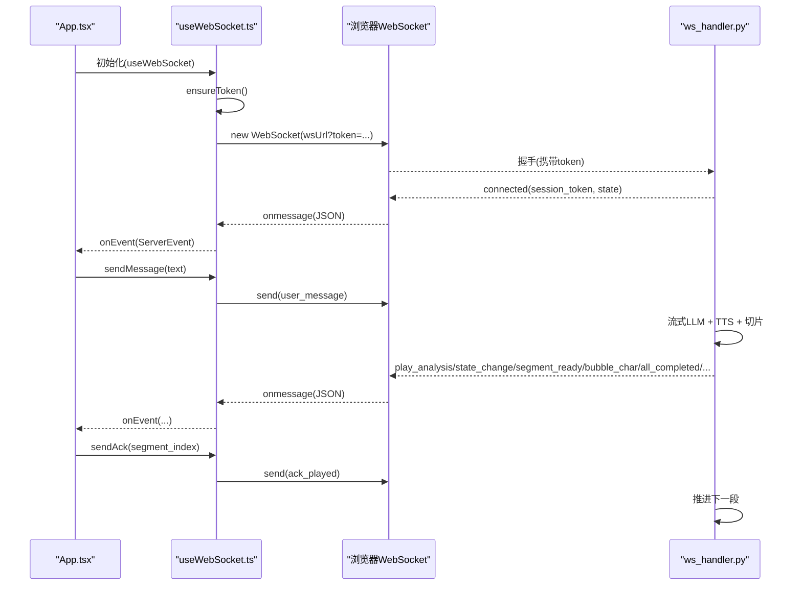
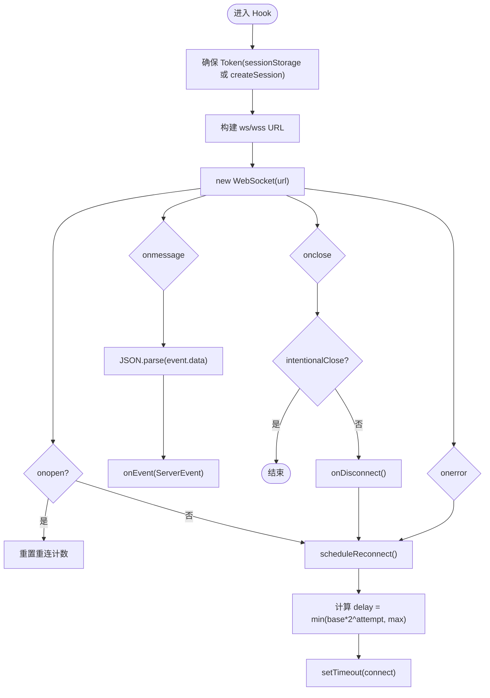
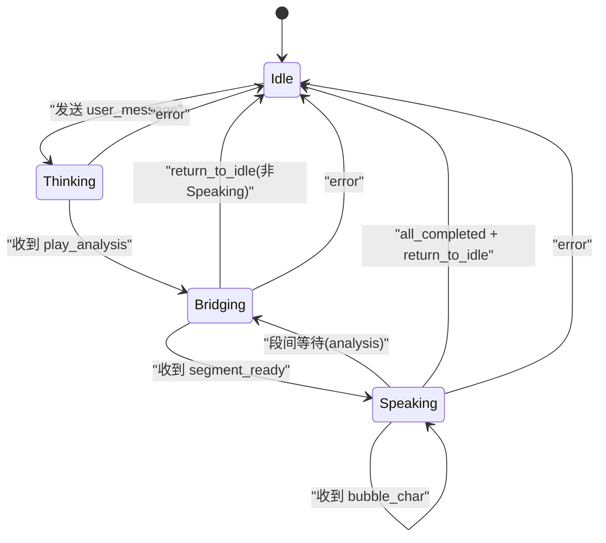
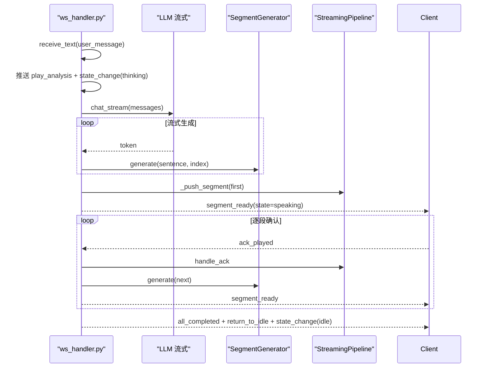
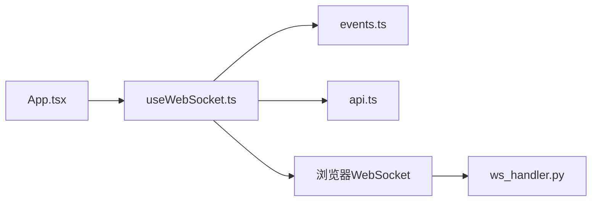

# WebSocket 客户端

<cite>
**本文引用的文件**
- [useWebSocket.ts](file://client/src/hooks/useWebSocket.ts)
- [events.ts](file://client/src/types/events.ts)
- [chat.ts](file://client/src/types/chat.ts)
- [api.ts](file://client/src/services/api.ts)
- [App.tsx](file://client/src/App.tsx)
- [ws_handler.py](file://server/api/ws_handler.py)
- [req-spec.md](file://doc/req-spec.md)
</cite>

## 目录
1. [简介](#简介)
2. [项目结构](#项目结构)
3. [核心组件](#核心组件)
4. [架构总览](#架构总览)
5. [详细组件分析](#详细组件分析)
6. [依赖关系分析](#依赖关系分析)
7. [性能考虑](#性能考虑)
8. [故障排查指南](#故障排查指南)
9. [结论](#结论)
10. [附录](#附录)

## 简介
本文件面向 RealTimeTalk 的实时通信客户端，聚焦于基于 React 的 useWebSocket Hook 的实现与使用。文档将系统阐述连接建立、自动重连机制、消息收发流程、事件监听与错误处理策略；并对服务端协议（ServerEvent 类型定义、消息格式规范）进行说明。同时涵盖断线重连算法、资源清理、性能优化技巧（批处理、去重、缓存）、集成示例与调试方法，以及安全与跨域注意事项。内容兼顾初学者对 WebSocket 基础概念的理解与高级开发者对实现细节和排障的需求。

## 项目结构
客户端侧关键文件组织如下：
- hooks/useWebSocket.ts：封装 WebSocket 生命周期管理、重连、消息发送与回调分发
- types/events.ts：定义客户端与服务端之间的消息类型与状态枚举
- types/chat.ts：聊天消息模型
- services/api.ts：REST API 调用封装（会话创建、历史获取、销毁）
- App.tsx：根组件，负责 UI 状态机、事件处理与视频播放协调

```mermaid
graph TB
subgraph "客户端"
A["App.tsx"]
B["hooks/useWebSocket.ts"]
C["types/events.ts"]
D["types/chat.ts"]
E["services/api.ts"]
end
subgraph "服务端"
F["server/api/ws_handler.py"]
end
A --> B
B --> C
B --> E
A --> C
A --> D
B < --> F
```

图表来源
- [useWebSocket.ts:1-190](file://client/src/hooks/useWebSocket.ts#L1-L190)
- [events.ts:1-113](file://client/src/types/events.ts#L1-L113)
- [chat.ts:1-11](file://client/src/types/chat.ts#L1-L11)
- [api.ts:1-52](file://client/src/services/api.ts#L1-L52)
- [App.tsx:1-326](file://client/src/App.tsx#L1-L326)
- [ws_handler.py:1-444](file://server/api/ws_handler.py#L1-L444)

章节来源
- [useWebSocket.ts:1-190](file://client/src/hooks/useWebSocket.ts#L1-L190)
- [events.ts:1-113](file://client/src/types/events.ts#L1-L113)
- [chat.ts:1-11](file://client/src/types/chat.ts#L1-L11)
- [api.ts:1-52](file://client/src/services/api.ts#L1-L52)
- [App.tsx:1-326](file://client/src/App.tsx#L1-L326)

## 核心组件
- useWebSocket Hook
  - 职责：建立/断开连接、Token 管理与恢复、自动重连（指数退避）、消息发送、事件回调分发、连接状态查询。
  - 对外接口：sendMessage、sendAck、sendCancel、isConnected、getToken。
- 事件与消息类型
  - ClientMessage：user_message、ack_played、cancel
  - ServerEvent：connected、state_change、segment_ready、bubble_char、bubble_dismiss、play_analysis、all_completed、return_to_idle、error
- REST API 封装
  - createSession、getHistory、destroySession，用于会话生命周期管理。

章节来源
- [useWebSocket.ts:1-190](file://client/src/hooks/useWebSocket.ts#L1-L190)
- [events.ts:1-113](file://client/src/types/events.ts#L1-L113)
- [api.ts:1-52](file://client/src/services/api.ts#L1-L52)

## 架构总览
客户端通过 useWebSocket Hook 维护一个 WebSocket 连接，并在连接建立后以 JSON 文本形式双向通信。服务端根据消息类型路由到相应处理器，执行流式 LLM 生成、TTS 合成、语义切片拼接等流程，并通过 segment_ready、bubble_char、state_change 等事件驱动前端渲染。



图表来源
- [useWebSocket.ts:67-117](file://client/src/hooks/useWebSocket.ts#L67-L117)
- [App.tsx:188-252](file://client/src/App.tsx#L188-L252)
- [ws_handler.py:49-129](file://server/api/ws_handler.py#L49-L129)
- [ws_handler.py:130-341](file://server/api/ws_handler.py#L130-L341)

## 详细组件分析

### useWebSocket Hook 实现原理
- 连接建立
  - 优先从 sessionStorage 读取 session_token，若不存在则调用 createSession 创建新会话并持久化 token。
  - 根据当前页面协议选择 ws/wss，拼接 /ws?token=... 地址建立连接。
  - 在 onopen 时重置重连计数；onmessage 解析 JSON 并转发给 onEvent 回调；onclose/onerror 记录日志并触发重连调度。
- 自动重连机制
  - 采用指数退避：delay = min(base * 2^attempt, max)，其中 base=1s，max=30s。
  - 重连前检查 intentionalCloseRef，避免主动关闭时的误重连。
  - 重连成功时重置 attempt 计数，失败继续递增。
- 心跳检测
  - 当前实现未内置心跳/保活逻辑。如需增强，可在 onopen 启动定时器周期性发送轻量 ping，或在 onmessage 中更新最后活跃时间，超时触发重连。
- 消息发送接收
  - sendMessage/sendAck/sendCancel 统一走 send，内部判断 readyState 为 OPEN 才发送。
  - onmessage 解析 JSON 后调用 onEvent，由上层 App 组件按 type 分支处理。
- 事件监听器与错误处理
  - onDisconnect 回调用于通知上层 UI 显示“等待重连”提示。
  - 服务端 error 事件会包含 message 字段，上层可展示错误气泡并回到 idle。
- 资源清理
  - useEffect 返回清理函数：设置 intentionalCloseRef=true、清除重连定时器、关闭 WebSocket 引用。



图表来源
- [useWebSocket.ts:45-117](file://client/src/hooks/useWebSocket.ts#L45-L117)
- [useWebSocket.ts:119-135](file://client/src/hooks/useWebSocket.ts#L119-L135)
- [useWebSocket.ts:167-180](file://client/src/hooks/useWebSocket.ts#L167-L180)

章节来源
- [useWebSocket.ts:1-190](file://client/src/hooks/useWebSocket.ts#L1-L190)

### 消息格式与协议版本兼容
- 客户端 → 服务端
  - user_message{text}：用户输入文本
  - ack_played{segment_index}：某一段落播放完毕确认
  - cancel：中断当前回复流程
- 服务端 → 客户端
  - connected{session_token, state}：连接建立，附带初始状态
  - state_change{state}：状态切换（thinking/speaking/bridging/idle）
  - segment_ready{index, video_url, duration_ms, text}：段落就绪，可开始播放
  - bubble_char{char, segment_index}：逐字追加到气泡
  - bubble_dismiss{segment_index}：段落气泡消隐信号
  - play_analysis{loop}：进入思考动画循环
  - all_completed：全部段落完成
  - return_to_idle：指示回到待机
  - error{message}：错误信息
- 兼容性建议
  - 客户端应忽略未知 type 的事件，保证向前兼容。
  - 新增字段不应破坏现有字段语义，必要时提供默认值。
  - 服务端在升级时可保留旧字段，逐步弃用。

章节来源
- [events.ts:15-92](file://client/src/types/events.ts#L15-L92)
- [ws_handler.py:89-129](file://server/api/ws_handler.py#L89-L129)
- [ws_handler.py:130-341](file://server/api/ws_handler.py#L130-L341)

### 断线重连算法与连接池管理
- 重连算法
  - 指数退避：1s→2s→4s→8s→…，上限 30s。
  - 重连次数无硬限制，但可通过业务层增加最大尝试次数以避免无限重试。
- 连接池管理
  - 当前实现为单连接模式（每个 Hook 实例仅维护一个 WebSocket）。
  - 多标签页隔离通过 session_token 实现，不同标签页各自独立连接。
  - 如需连接复用，可在应用层引入连接池（按 token 复用），但需额外处理并发消息顺序与状态同步。
- 资源清理
  - 组件卸载时设置 intentionalCloseRef=true，取消重连定时器，关闭连接，防止内存泄漏。

章节来源
- [useWebSocket.ts:119-135](file://client/src/hooks/useWebSocket.ts#L119-L135)
- [useWebSocket.ts:167-180](file://client/src/hooks/useWebSocket.ts#L167-L180)

### 事件处理与状态机（App.tsx）
- 状态流转
  - Idle → Thinking（用户发送）→ Bridging（收到 play_analysis）→ Speaking（segment_ready）→ Idle（all_completed + return_to_idle）
- 事件处理
  - connected：记录连接成功
  - state_change：仅在非 speaking 时回 idle
  - segment_ready：切换到 speaking，播放视频
  - bubble_char/bubble_dismiss：控制对话气泡文字追加与分段换行
  - play_analysis：进入 bridging，播放 analysis 循环
  - all_completed：收尾，清除 typing 标记
  - return_to_idle：延迟切 idle，末段完成后播放 idle 循环
  - error：展示错误气泡，回到 idle
- 交互
  - 发送消息：解锁 AudioContext，插入用户与 AI 占位消息，进入 thinking，播放 analysis，发送 user_message
  - 视频播放结束：发送 ack_played，末段切 idle，非末段保持最后一帧等待下一段



图表来源
- [App.tsx:87-183](file://client/src/App.tsx#L87-L183)
- [App.tsx:224-252](file://client/src/App.tsx#L224-L252)
- [App.tsx:194-220](file://client/src/App.tsx#L194-L220)

章节来源
- [App.tsx:1-326](file://client/src/App.tsx#L1-L326)

### 服务端处理流程（ws_handler.py）
- 连接生命周期
  - 校验 token，支持从 Redis 恢复会话上下文，发送 connected 事件。
  - 消息循环解析 JSON，按 type 路由到对应处理器。
- 用户消息处理
  - 立即推送 play_analysis 与 state_change(thinking)。
  - 后台异步流式 LLM，边生成边按句子边界切分，并行生成 TTS+语义切片+视频。
  - 首段就绪后立即推送 segment_ready 与 state_change(speaking)。
  - 后续段落按 ack 推进，最终推送 all_completed、return_to_idle、state_change(idle)。
- 错误处理
  - 捕获 LLM/TTS/视频生成异常，推送 error 与 state_change(idle)，并清理 pipeline。



图表来源
- [ws_handler.py:130-341](file://server/api/ws_handler.py#L130-L341)

章节来源
- [ws_handler.py:1-444](file://server/api/ws_handler.py#L1-L444)

## 依赖关系分析
- 模块耦合
  - App.tsx 依赖 useWebSocket 与事件类型，负责 UI 状态与媒体播放。
  - useWebSocket 依赖 events.ts 的类型定义与 api.ts 的 createSession。
  - ws_handler.py 作为服务端入口，依赖会话上下文、LLM、TTS、MinIO、Redis 等。
- 外部依赖
  - 浏览器 WebSocket API
  - fetch 调用 REST API
  - 服务端 FastAPI WebSocket 与异步任务



图表来源
- [App.tsx:1-326](file://client/src/App.tsx#L1-L326)
- [useWebSocket.ts:1-190](file://client/src/hooks/useWebSocket.ts#L1-L190)
- [events.ts:1-113](file://client/src/types/events.ts#L1-L113)
- [api.ts:1-52](file://client/src/services/api.ts#L1-L52)
- [ws_handler.py:1-444](file://server/api/ws_handler.py#L1-L444)

章节来源
- [App.tsx:1-326](file://client/src/App.tsx#L1-L326)
- [useWebSocket.ts:1-190](file://client/src/hooks/useWebSocket.ts#L1-L190)
- [events.ts:1-113](file://client/src/types/events.ts#L1-L113)
- [api.ts:1-52](file://client/src/services/api.ts#L1-L52)
- [ws_handler.py:1-444](file://server/api/ws_handler.py#L1-L444)

## 性能考虑
- 消息批处理
  - 当前 bubble_char 逐字推送，适合打字机效果。若需降低网络开销，可在客户端合并多次 bubble_char 再批量更新 DOM。
- 去重与缓存
  - segment_ready 的 video_url 可作为键进行本地缓存，避免重复加载相同片段。
  - 对于频繁出现的短回复，可缓存其生成的视频与语音资源。
- 连接与资源
  - 合理设置重连退避上限，避免高频重连造成雪崩。
  - 组件卸载时务必清理定时器与连接引用，减少内存占用。
- 音频策略
  - 首次交互解锁 AudioContext，避免浏览器自动播放策略导致无声。

[本节为通用指导，不直接分析具体文件]

## 故障排查指南
- 常见问题定位
  - 无法连接：检查 token 是否有效、Nginx 反向代理是否正确配置 ws/wss 升级。
  - 消息未到达：确认 onmessage 是否被触发，服务端是否推送了相应事件。
  - 重连频繁：查看 onerror 日志，确认网络稳定性与服务端健康。
  - 播放不同步：核对 ack_played 发送时机与 segment_ready 的顺序。
- 调试方法
  - 在浏览器控制台查看 WebSocket 连接与事件日志。
  - 在服务端日志中搜索 token 对应的处理流程，确认各阶段耗时。
  - 使用 Network 面板观察 /api/session/create 响应与 /ws 升级过程。
- 错误处理
  - 服务端 error 事件包含 message，前端应展示错误气泡并回到 idle。
  - 对未知消息类型进行忽略，避免崩溃。

章节来源
- [useWebSocket.ts:110-117](file://client/src/hooks/useWebSocket.ts#L110-L117)
- [App.tsx:165-178](file://client/src/App.tsx#L165-L178)
- [ws_handler.py:402-414](file://server/api/ws_handler.py#L402-L414)

## 结论
useWebSocket Hook 提供了简洁可靠的 WebSocket 连接管理能力，结合 App.tsx 的状态机实现了流畅的实时对话体验。通过明确的消息类型与事件规范，前后端协作清晰。建议在后续迭代中补充心跳保活、连接池与更完善的错误上报，以提升鲁棒性与可观测性。

[本节为总结，不直接分析具体文件]

## 附录

### WebSocket 基础概念（初学者）
- WebSocket 是一种在单个 TCP 连接上进行全双工通信的协议，适用于实时数据推送。
- 典型流程：客户端发起握手 → 服务器响应升级 → 双方通过消息帧传输数据。
- 常见状态：CONNECTING、OPEN、CLOSING、CLOSED。
- 适用场景：聊天室、实时通知、音视频流控制等。

[本节为概念介绍，不直接分析具体文件]

### 客户端集成示例（步骤）
- 在组件中引入 useWebSocket，传入 onEvent 与可选 onDisconnect。
- 在发送消息时调用 sendMessage(text)，在视频播放结束时调用 sendAck(index)。
- 在组件卸载时无需手动关闭，Hook 会在清理函数中自动处理。

章节来源
- [App.tsx:188-252](file://client/src/App.tsx#L188-L252)
- [useWebSocket.ts:137-165](file://client/src/hooks/useWebSocket.ts#L137-L165)

### 安全考虑、认证机制与跨域处理
- 认证机制
  - 通过 query 参数 token 传递会话标识，服务端校验 token 有效性并恢复会话上下文。
  - 建议在生产环境使用 HTTPS/WSS，避免 token 明文传输。
- 跨域处理
  - Nginx 需正确配置 /ws 的反向代理与 Upgrade 头，确保浏览器与后端之间 WebSocket 升级成功。
- 安全加固
  - 对 token 进行签名与过期校验，服务端拒绝非法请求。
  - 限制单 token 并发连接数，防止滥用。

章节来源
- [useWebSocket.ts:67-76](file://client/src/hooks/useWebSocket.ts#L67-L76)
- [ws_handler.py:49-94](file://server/api/ws_handler.py#L49-L94)
- [req-spec.md:350-360](file://doc/req-spec.md#L350-L360)