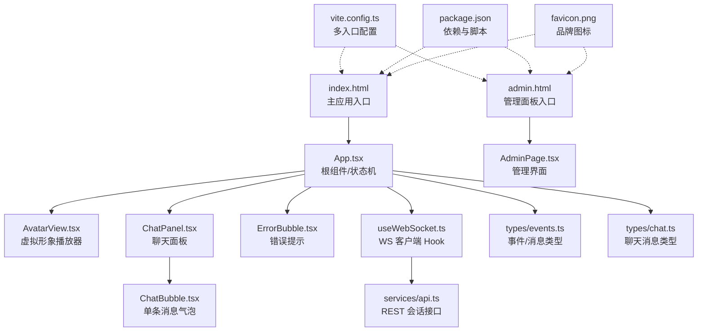
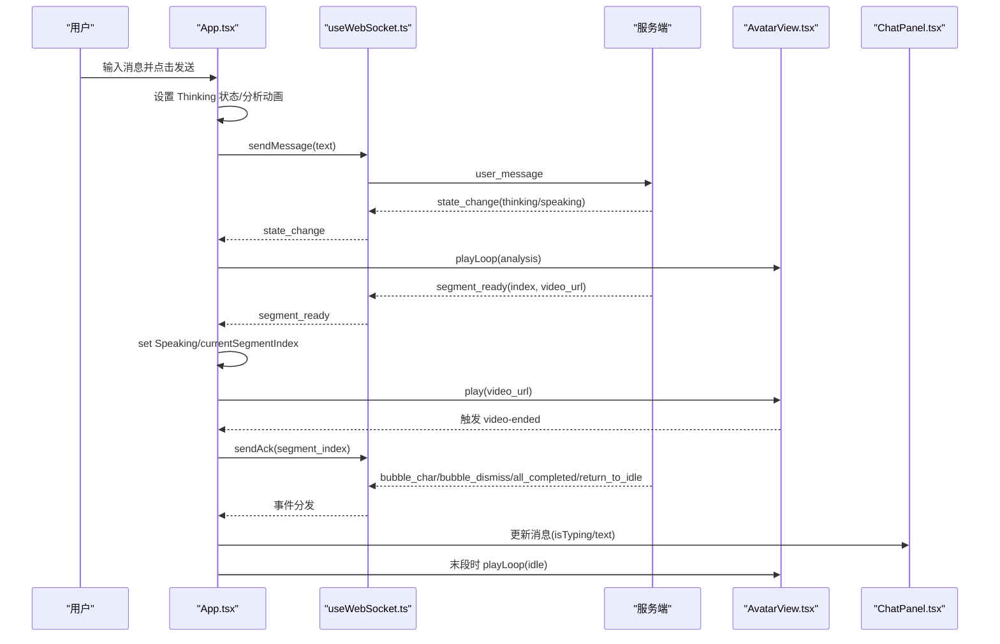
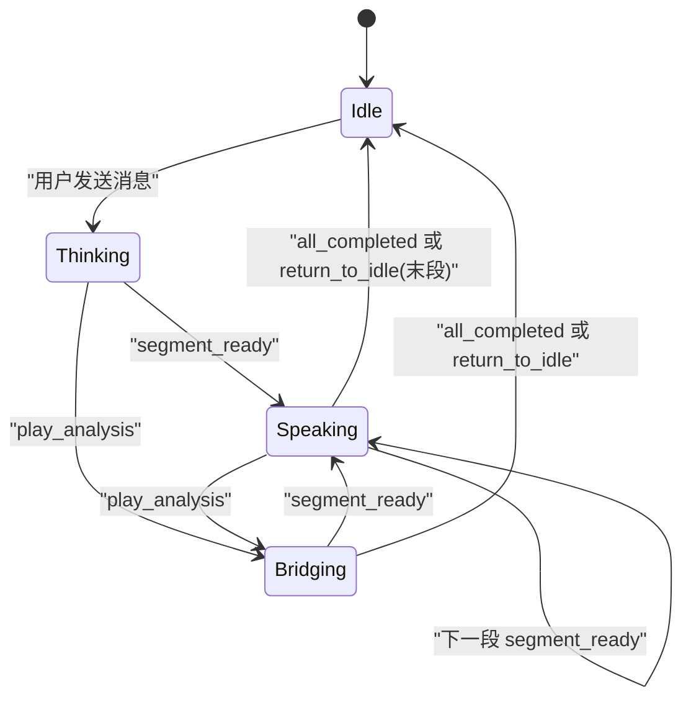
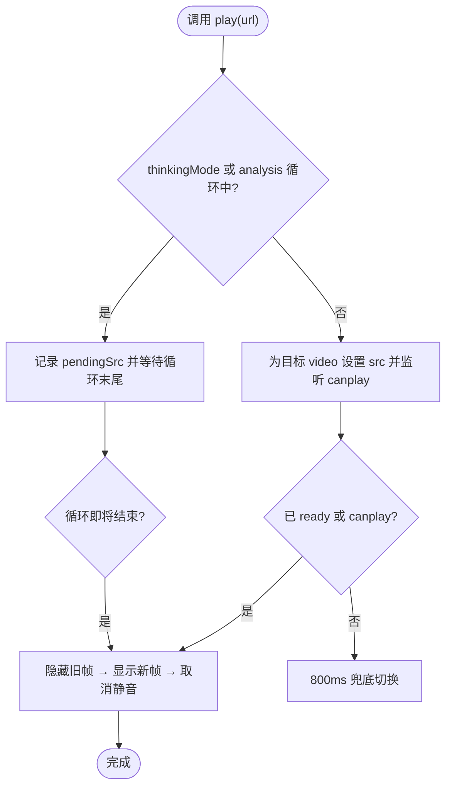
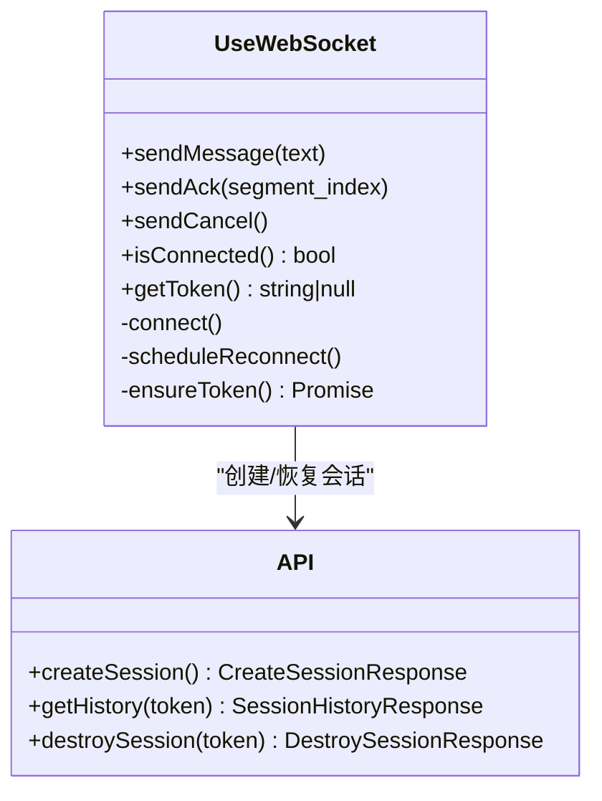
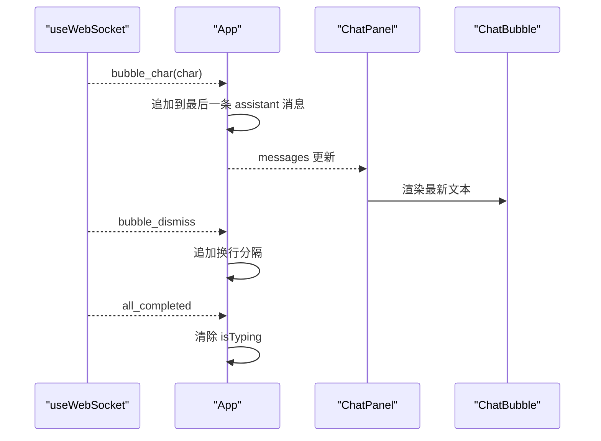
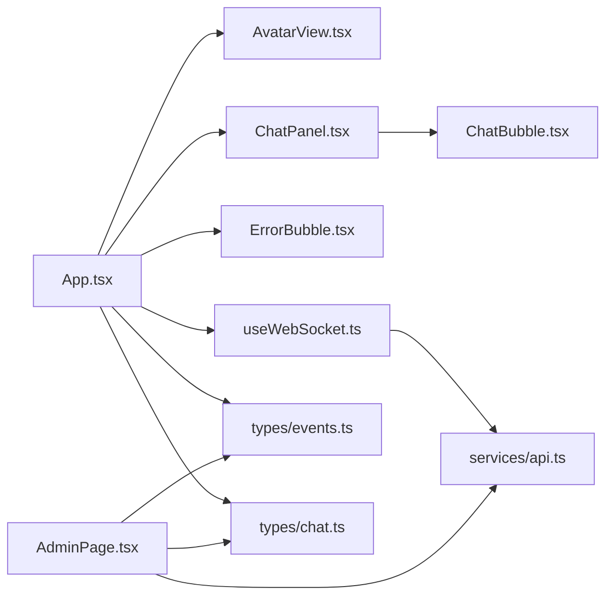

# 前端应用

<cite>
**本文引用的文件**   
- [client/src/App.tsx](file://client/src/App.tsx)
- [client/src/main.tsx](file://client/src/main.tsx)
- [client/src/admin.tsx](file://client/src/admin.tsx)
- [client/src/components/AdminPage.tsx](file://client/src/components/AdminPage.tsx)
- [client/src/components/AvatarView.tsx](file://client/src/components/AvatarView.tsx)
- [client/src/components/ChatPanel.tsx](file://client/src/components/ChatPanel.tsx)
- [client/src/components/ChatBubble.tsx](file://client/src/components/ChatBubble.tsx)
- [client/src/components/ErrorBubble.tsx](file://client/src/components/ErrorBubble.tsx)
- [client/src/hooks/useWebSocket.ts](file://client/src/hooks/useWebSocket.ts)
- [client/src/hooks/useTypewriter.ts](file://client/src/hooks/useTypewriter.ts)
- [client/src/services/api.ts](file://client/src/services/api.ts)
- [client/src/types/events.ts](file://client/src/types/events.ts)
- [client/src/types/chat.ts](file://client/src/types/chat.ts)
- [client/vite.config.ts](file://client/vite.config.ts)
- [client/package.json](file://client/package.json)
- [client/index.html](file://client/index.html)
- [client/admin.html](file://client/admin.html)
</cite>

## 更新摘要
**变更内容**   
- 增强品牌一致性：在主应用和管理面板界面添加 favicon 支持
- 优化多入口构建配置：Vite 配置支持 main 和 admin 两个独立入口
- 完善静态资源管理：favicon.png 文件统一管理，提升用户体验

## 目录
1. [简介](#简介)
2. [项目结构](#项目结构)
3. [核心组件](#核心组件)
4. [架构总览](#架构总览)
5. [详细组件分析](#详细组件分析)
6. [依赖关系分析](#依赖关系分析)
7. [性能与优化](#性能与优化)
8. [故障排查指南](#故障排查指南)
9. [结论](#结论)
10. [附录：使用示例与自定义选项](#附录使用示例与自定义选项)

## 简介
RealTimeTalk 前端是一个基于 React + Vite 的实时对话应用，左侧展示虚拟形象视频（呼吸待机、思考动画、说话片段），右侧为聊天面板。通过 WebSocket 与服务端进行实时通信，接收"分段就绪"、"逐字气泡"、"状态变更"等事件，驱动形象播放与聊天界面更新。整体采用轻量状态管理（React useState/ref）、Hook 封装（useWebSocket、useTypewriter）和组件化设计，兼顾用户体验与可维护性。

**更新** 应用现已增强品牌一致性，在主应用和管理面板界面均支持 favicon 显示，提供统一的品牌视觉体验。

## 项目结构
- 入口与构建
  - 双入口架构：主应用（index.html）和管理面板（admin.html）分别挂载不同根组件
  - Vite 配置开发服务器代理 /api 与 /ws 到后端服务，支持多入口构建
  - 品牌资源管理：favicon.png 统一管理，提升浏览器标签页识别度
- 核心模块
  - App 根组件：编排状态机、事件分发、错误提示、布局
  - AdminPage 管理面板：知识库集合管理、会话监控、系统配置
  - AvatarView 虚拟形象：双 video 叠加、无缝切换、idle/analysis 循环控制
  - ChatPanel/ChatBubble：聊天列表与单条消息渲染，支持自动滚动与输入自适应
  - useWebSocket：连接管理、自动重连、消息发送与回调转发
  - useTypewriter：打字机效果 Hook（当前聊天模式未直接使用，但可作为扩展）
  - services/api：REST 会话创建/历史/销毁
  - types：事件与消息类型定义

**图表来源**
- [client/index.html:1-32](file://client/index.html#L1-L32)
- [client/admin.html:1-28](file://client/admin.html#L1-L28)
- [client/vite.config.ts:11-15](file://client/vite.config.ts#L11-L15)
- [client/src/App.tsx:1-326](file://client/src/App.tsx#L1-L326)
- [client/src/components/AdminPage.tsx:529-547](file://client/src/components/AdminPage.tsx#L529-L547)

**章节来源**
- [client/index.html:1-32](file://client/index.html#L1-L32)
- [client/admin.html:1-28](file://client/admin.html#L1-L28)
- [client/vite.config.ts:1-28](file://client/vite.config.ts#L1-L28)
- [client/package.json:1-24](file://client/package.json#L1-L24)

## 核心组件
- App 根组件
  - 职责：维护应用状态（Idle/Thinking/Speaking/Bridging）、消息列表、错误信息、分段索引；处理 WebSocket 事件；协调 AvatarView 与 ChatPanel；提供用户交互（发送消息、清除错误）
  - 关键点：AudioContext 解锁自动播放策略；window 自定义事件 video-ended 用于段间衔接；deferredIdleRef 控制末段返回 idle 时机
- AdminPage 管理面板
  - 职责：知识库集合管理、会话状态监控、系统配置界面
  - 功能：集合选择、会话列表、状态统计、退出登录
- AvatarView 虚拟形象
  - 职责：双 video 叠加（主视频 segment + 循环视频 idle/analysis），实现无黑闪切换、首段等待 analysis 结束、idle 无缝循环、segment 静音预加载后取消静音
  - 关键点：thinkingModeRef/pendingSrcRef 防竞态；activeElementRef 跟踪可见元素；JS 接管 idle seek(0) 避免跳变；scale(1.7) 保持 speaking→idle 过渡一致性
- ChatPanel/ChatBubble
  - 职责：消息列表渲染、自动滚动到底部、输入框自适应高度、回车发送；单条消息气泡样式与打字指示器
- ErrorBubble
  - 职责：居中显示错误提示，自动淡出并通知父组件移除
- useWebSocket
  - 职责：建立/断开连接、指数退避重连、Token 持久化、消息收发、回调转发
- useTypewriter
  - 职责：逐字追加文本、完成/消失计时、重置状态（当前聊天模式未直接集成，可作为未来扩展）
- services/api
  - 职责：封装 REST 请求，提供 createSession/getHistory/destroySession
- types
  - 职责：统一事件与消息类型，保证前后端契约一致

**章节来源**
- [client/src/App.tsx:1-326](file://client/src/App.tsx#L1-L326)
- [client/src/components/AdminPage.tsx:529-547](file://client/src/components/AdminPage.tsx#L529-L547)
- [client/src/components/AvatarView.tsx:1-594](file://client/src/components/AvatarView.tsx#L1-L594)
- [client/src/components/ChatPanel.tsx:1-200](file://client/src/components/ChatPanel.tsx#L1-L200)
- [client/src/components/ChatBubble.tsx:1-86](file://client/src/components/ChatBubble.tsx#L1-L86)
- [client/src/components/ErrorBubble.tsx:1-70](file://client/src/components/ErrorBubble.tsx#L1-L70)
- [client/src/hooks/useWebSocket.ts:1-190](file://client/src/hooks/useWebSocket.ts#L1-L190)
- [client/src/hooks/useTypewriter.ts:1-77](file://client/src/hooks/useTypewriter.ts#L1-L77)
- [client/src/services/api.ts:1-52](file://client/src/services/api.ts#L1-L52)
- [client/src/types/events.ts:1-113](file://client/src/types/events.ts#L1-L113)
- [client/src/types/chat.ts:1-11](file://client/src/types/chat.ts#L1-L11)

## 架构总览
系统由"UI 层（React 组件）— 状态机（App）— 通信层（useWebSocket + API）— 媒体层（AvatarView）"构成。App 作为中枢，将服务端事件映射为 UI 状态变化与媒体播放指令；AvatarView 负责高性能视频切换；ChatPanel 负责消息流式呈现。

**更新** 应用现支持双入口架构，主应用和管理面板共享相同的通信层和类型定义，确保功能一致性。

**图表来源**
- [client/src/App.tsx:78-220](file://client/src/App.tsx#L78-L220)
- [client/src/hooks/useWebSocket.ts:68-145](file://client/src/hooks/useWebSocket.ts#L68-L145)
- [client/src/components/AvatarView.tsx:408-461](file://client/src/components/AvatarView.tsx#L408-L461)
- [client/src/components/ChatPanel.tsx:17-51](file://client/src/components/ChatPanel.tsx#L17-L51)

## 详细组件分析

### 组件树与状态机
- 组件树
  - 主应用：App → AvatarView + ChatPanel + ErrorBubble
  - 管理面板：AdminPage → LoginView + AdminDashboard
  - ChatPanel → ChatBubble × N
- 状态机（AppState）
  - Idle → Thinking（用户发送）
  - Thinking → Speaking（segment_ready）
  - Speaking → Bridging（play_analysis）或继续 Speaking（下一段）
  - Speaking/Bridging → Idle（all_completed 或 return_to_idle 且末段 ack 后）
  - 任意非 Idle → 点击形象可 cancel（当前代码中保留能力，具体交互可在 App 中扩展）

**图表来源**
- [client/src/types/events.ts:7-13](file://client/src/types/events.ts#L7-L13)
- [client/src/App.tsx:60-183](file://client/src/App.tsx#L60-L183)

**章节来源**
- [client/src/App.tsx:60-183](file://client/src/App.tsx#L60-L183)
- [client/src/types/events.ts:7-13](file://client/src/types/events.ts#L7-L13)

### 虚拟形象系统（AvatarView）
- 双 video 叠加架构
  - 主视频：播放 segment，有声音，默认 scale(1.7) 以匹配 idle 缩放
  - 循环视频：播放 idle/analysis，静音，JS 接管 idle 无缝循环
- 关键流程
  - showMain(url)：预加载目标 video，canplay 后立即切换，先隐藏旧帧再显示新帧，最后取消静音
  - showLoop(src)：根据是否 idle 决定 loop 行为；idle 使用 JS timeupdate 在末尾 seek(0)；analysis 使用原生 loop
  - thinkingModeRef/pendingSrcRef：防止 segment_ready 竞态跳过思考动画；若长时间未切回则强制播放 segment
  - ended 处理：segment 结束时派发 window 'video-ended'，由 App 发送 ack 并决定是否回到 idle

**图表来源**
- [client/src/components/AvatarView.tsx:64-150](file://client/src/components/AvatarView.tsx#L64-L150)
- [client/src/components/AvatarView.tsx:408-461](file://client/src/components/AvatarView.tsx#L408-L461)
- [client/src/components/AvatarView.tsx:463-504](file://client/src/components/AvatarView.tsx#L463-L504)

**章节来源**
- [client/src/components/AvatarView.tsx:1-594](file://client/src/components/AvatarView.tsx#L1-L594)

### WebSocket 客户端（useWebSocket）
- 功能要点
  - 自动获取/恢复 session token（sessionStorage），构造 wsUrl
  - onmessage 解析 JSON 并转发给上层回调
  - 指数退避重连（1s→2s→4s→…≤30s）
  - 暴露 sendMessage/sendAck/sendCancel/isConnected/getToken
- 生命周期
  - useEffect 启动 connect；卸载时清理定时器并关闭连接

**图表来源**
- [client/src/hooks/useWebSocket.ts:34-189](file://client/src/hooks/useWebSocket.ts#L34-L189)
- [client/src/services/api.ts:31-51](file://client/src/services/api.ts#L31-L51)

**章节来源**
- [client/src/hooks/useWebSocket.ts:1-190](file://client/src/hooks/useWebSocket.ts#L1-L190)
- [client/src/services/api.ts:1-52](file://client/src/services/api.ts#L1-L52)

### 聊天界面与气泡动画
- ChatPanel
  - 自动滚动至最新消息；输入框自适应高度；Enter 发送；禁用态控制
- ChatBubble
  - 用户/AI 不同样式；AI 消息支持 isTyping 三点跳动动画；pre-wrap 保持换行一致
- 打字机 Hook（useTypewriter）
  - 提供 addChar/dismiss/reset；当前聊天模式通过服务端 bubble_char 直接拼接文本，未使用该 Hook，但可用于未来悬浮气泡场景

**图表来源**
- [client/src/App.tsx:103-144](file://client/src/App.tsx#L103-L144)
- [client/src/components/ChatPanel.tsx:17-51](file://client/src/components/ChatPanel.tsx#L17-L51)
- [client/src/components/ChatBubble.tsx:15-83](file://client/src/components/ChatBubble.tsx#L15-L83)

**章节来源**
- [client/src/components/ChatPanel.tsx:1-200](file://client/src/components/ChatPanel.tsx#L1-L200)
- [client/src/components/ChatBubble.tsx:1-86](file://client/src/components/ChatBubble.tsx#L1-L86)
- [client/src/hooks/useTypewriter.ts:1-77](file://client/src/hooks/useTypewriter.ts#L1-L77)

### 管理面板组件（AdminPage）
- 登录验证机制
  - 基于 Token 的身份验证，支持登录/登出状态管理
  - 未登录时显示登录视图，登录后显示管理仪表板
- 知识库集合管理
  - 集合选择下拉菜单，支持动态加载集合列表
  - 集合操作：创建、删除、查看详细信息
- 会话监控与管理
  - 实时显示活跃会话列表
  - 会话状态监控和基础管理功能
- 用户界面设计
  - 响应式布局，适配不同屏幕尺寸
  - 统一的视觉风格，与主应用保持一致

**章节来源**
- [client/src/components/AdminPage.tsx:529-547](file://client/src/components/AdminPage.tsx#L529-L547)
- [client/src/admin.tsx:1-50](file://client/src/admin.tsx#L1-L50)

## 依赖关系分析
- 组件耦合
  - App 强依赖 AvatarView 与 ChatPanel，弱依赖 ErrorBubble（条件渲染）
  - AdminPage 独立于主应用组件，仅共享类型定义和服务接口
  - ChatPanel 仅依赖 ChatBubble 与类型定义
  - useWebSocket 依赖 services/api 与类型定义
- 外部依赖
  - React/ReactDOM 运行时；marked 未在当前路径使用；Vite 插件与 TypeScript 工具链
- 潜在循环依赖
  - 未发现循环 import；类型定义独立，避免双向引用

**图表来源**
- [client/src/App.tsx:1-326](file://client/src/App.tsx#L1-L326)
- [client/src/components/AdminPage.tsx:1-547](file://client/src/components/AdminPage.tsx#L1-L547)
- [client/src/components/AvatarView.tsx:1-594](file://client/src/components/AvatarView.tsx#L1-L594)
- [client/src/components/ChatPanel.tsx:1-200](file://client/src/components/ChatPanel.tsx#L1-L200)
- [client/src/components/ChatBubble.tsx:1-86](file://client/src/components/ChatBubble.tsx#L1-L86)
- [client/src/components/ErrorBubble.tsx:1-70](file://client/src/components/ErrorBubble.tsx#L1-L70)
- [client/src/hooks/useWebSocket.ts:1-190](file://client/src/hooks/useWebSocket.ts#L1-L190)
- [client/src/services/api.ts:1-52](file://client/src/services/api.ts#L1-L52)
- [client/src/types/events.ts:1-113](file://client/src/types/events.ts#L1-L113)
- [client/src/types/chat.ts:1-11](file://client/src/types/chat.ts#L1-L11)

**章节来源**
- [client/src/App.tsx:1-326](file://client/src/App.tsx#L1-L326)
- [client/src/hooks/useWebSocket.ts:1-190](file://client/src/hooks/useWebSocket.ts#L1-L190)

## 性能与优化
- 视频播放与切换
  - 双 video 预加载与同帧切换，避免黑闪与空白帧
  - idle 无缝循环通过 timeupdate 在末尾 seek(0)，减少浏览器原生 loop 抖动
  - scale(1.7) 保持 speaking→idle 视觉一致性，减少缩放闪烁
- 音频自动播放策略
  - 首次用户交互时初始化 AudioContext 并尝试播放极短振荡音，解除浏览器限制
- 网络与重连
  - 指数退避重连降低瞬时拥塞压力；token 持久化避免重复创建会话
- 渲染优化
  - ChatBubble 使用 memo 避免不必要的重渲染；消息列表仅追加文本，不重建整表
- 资源缓存
  - idle/analysis 视频 URL 带版本参数，确保缓存失效可控
- **更新** 品牌资源优化
  - favicon.png 静态资源预加载，提升页面加载时的品牌识别速度
  - 双入口共享同一 favicon 资源，减少重复下载

[本节为通用指导，无需源码引用]

## 故障排查指南
- WebSocket 无法连接
  - 检查 vite 代理配置是否正确转发 /ws 与 /api
  - 确认后端服务运行于预期端口，并允许跨域
- 自动播放失败
  - 确认首次用户交互触发了 unlockAudio；移动端需用户手势
- 视频切换出现黑屏/白屏
  - 检查 showMain/showLoop 的透明度与 pointerEvents 切换顺序；确认 canplay 与 800ms 兜底逻辑
- 消息不更新或错乱
  - 检查 bubble_char 是否追加到正确的 assistant 消息；all_completed 是否清除 isTyping
- 错误提示不消失
  - 检查 ErrorBubble 的定时器与父组件清除逻辑
- **更新** favicon 显示问题
  - 确认 client/public/favicon.png 文件存在且路径正确
  - 检查浏览器缓存，必要时清除缓存重新加载
  - 验证 HTML 中的 link rel="icon" 标签语法正确

**章节来源**
- [client/vite.config.ts:17-26](file://client/vite.config.ts#L17-L26)
- [client/src/App.tsx:32-58](file://client/src/App.tsx#L32-L58)
- [client/src/components/AvatarView.tsx:130-150](file://client/src/components/AvatarView.tsx#L130-L150)
- [client/src/components/ErrorBubble.tsx:18-35](file://client/src/components/ErrorBubble.tsx#L18-L35)
- [client/index.html:7](file://client/index.html#L7)
- [client/admin.html:7](file://client/admin.html#L7)

## 结论
RealTimeTalk 前端以 App 为核心状态机，结合 AvatarView 的高性能视频切换与 useWebSocket 的稳定通信，实现了流畅的实时对话体验。组件边界清晰、类型完备、错误处理完善，具备良好的可扩展性与可维护性。**更新** 应用现已增强品牌一致性，通过 favicon 支持和双入口架构，为用户提供更专业的管理体验和统一的品牌识别。建议在后续迭代中引入 useTypewriter 增强悬浮气泡体验，并补充单元测试与端到端测试以提升稳定性。

[本节为总结，无需源码引用]

## 附录：使用示例与自定义选项
- 基本用法（根组件）
  - 在 index.html 的 root 节点挂载 App；Vite 开发服务器会代理 /api 与 /ws
- **更新** 多入口配置
  - 主应用：访问 http://localhost:5173 进入聊天界面
  - 管理面板：访问 http://localhost:5173/admin 进入知识库管理界面
- 自定义虚拟形象源
  - 向 AvatarView 传入 idleSrc 属性，覆盖默认待机视频地址
- 聊天面板定制
  - 通过 ChatPanel 的 disabled 属性控制发送按钮可用状态；onSend 回调接入业务逻辑
- 错误提示
  - 在 App 中根据 errorMessage 条件渲染 ErrorBubble，并可自定义 onDismiss 行为
- 会话管理
  - 使用 services/api.createSession 创建会话，token 由 useWebSocket 自动持久化与复用
- **更新** 品牌资源管理
  - favicon.png 放置在 client/public 目录下，自动被 Vite 构建系统处理
  - 可通过修改 HTML 中的 link 标签自定义 favicon 路径和格式
- **更新** 管理面板使用
  - 访问管理面板需要有效的认证 Token
  - 支持知识库集合的创建、删除和查看操作
  - 提供会话监控和基础管理功能

**章节来源**
- [client/src/main.tsx:8-12](file://client/src/main.tsx#L8-L12)
- [client/src/admin.tsx:1-50](file://client/src/admin.tsx#L1-L50)
- [client/vite.config.ts:11-15](file://client/vite.config.ts#L11-L15)
- [client/src/components/AvatarView.tsx:27-28](file://client/src/components/AvatarView.tsx#L27-L28)
- [client/src/components/ChatPanel.tsx:11-15](file://client/src/components/ChatPanel.tsx#L11-L15)
- [client/src/components/ErrorBubble.tsx:10-13](file://client/src/components/ErrorBubble.tsx#L10-L13)
- [client/src/services/api.ts:31-35](file://client/src/services/api.ts#L31-L35)
- [client/src/hooks/useWebSocket.ts:46-65](file://client/src/hooks/useWebSocket.ts#L46-L65)
- [client/index.html:7](file://client/index.html#L7)
- [client/admin.html:7](file://client/admin.html#L7)