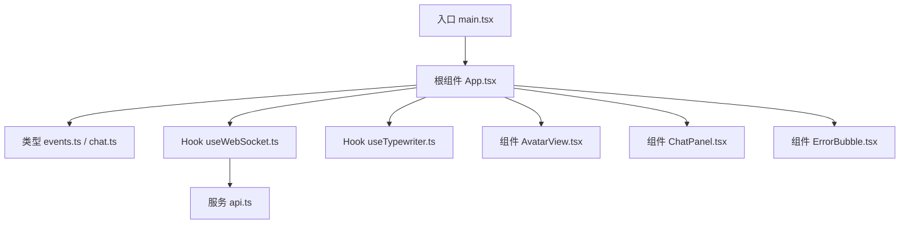
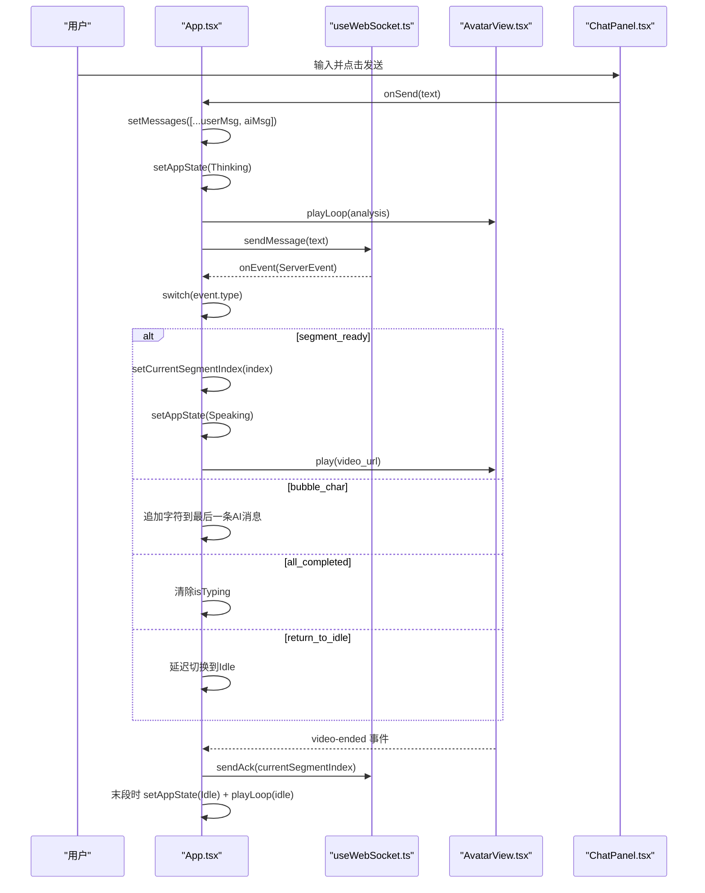
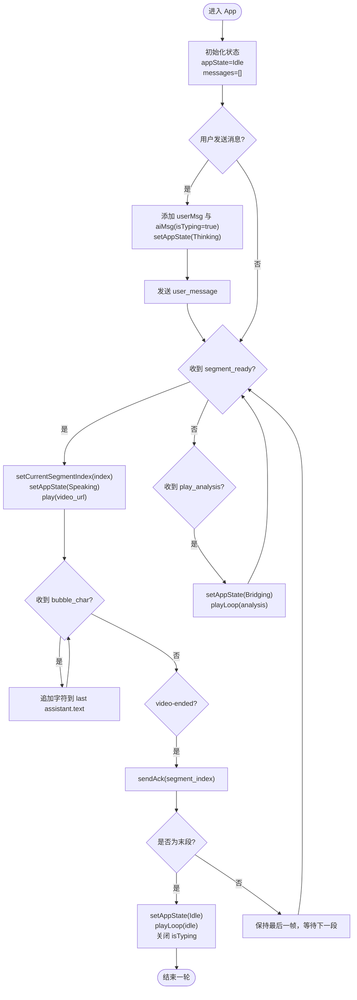
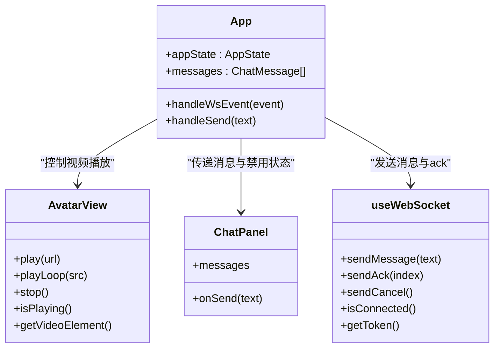
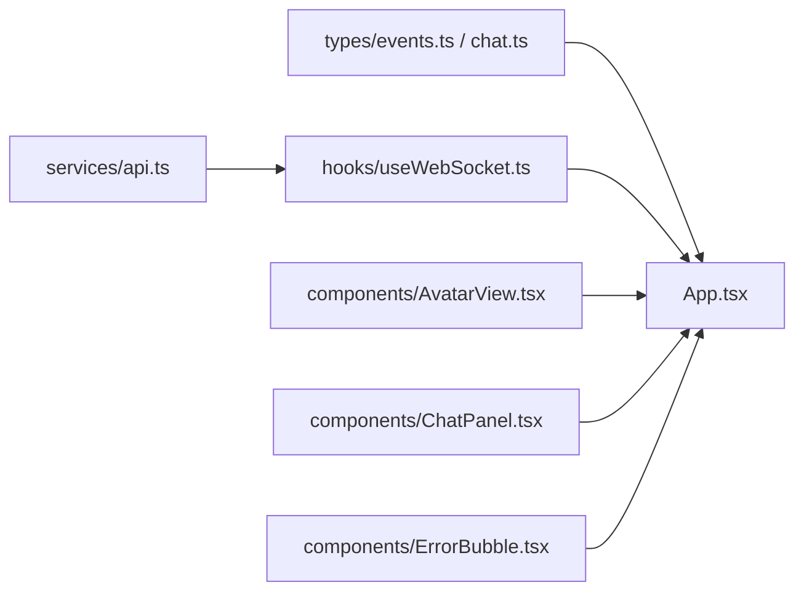

# 状态管理

<cite>
**本文引用的文件**   
- [App.tsx](file://client/src/App.tsx)
- [events.ts](file://client/src/types/events.ts)
- [chat.ts](file://client/src/types/chat.ts)
- [useWebSocket.ts](file://client/src/hooks/useWebSocket.ts)
- [useTypewriter.ts](file://client/src/hooks/useTypewriter.ts)
- [AvatarView.tsx](file://client/src/components/AvatarView.tsx)
- [ChatPanel.tsx](file://client/src/components/ChatPanel.tsx)
- [InputBox.tsx](file://client/src/components/InputBox.tsx)
- [ErrorBubble.tsx](file://client/src/components/ErrorBubble.tsx)
- [api.ts](file://client/src/services/api.ts)
- [main.tsx](file://client/src/main.tsx)
</cite>

## 目录
1. [简介](#简介)
2. [项目结构](#项目结构)
3. [核心组件与数据模型](#核心组件与数据模型)
4. [架构总览](#架构总览)
5. [详细组件分析](#详细组件分析)
6. [依赖关系分析](#依赖关系分析)
7. [性能考虑](#性能考虑)
8. [故障排查指南](#故障排查指南)
9. [结论](#结论)
10. [附录：最佳实践与常见陷阱](#附录最佳实践与常见陷阱)

## 简介
本文件聚焦 RealTimeTalk 前端的状态管理，围绕应用状态机、消息流式更新、视频播放同步、会话上下文持久化与恢复等主题展开。文档从初学者到高级开发者分层说明，涵盖 useState 与 useRef 的使用策略、不可变数据更新模式、批量状态修改、复杂状态逻辑（对话状态机、消息流式更新、视频同步）、本地存储与状态恢复机制、调试工具与性能优化技巧。

## 项目结构
RealTimeTalk 的前端采用 React + TypeScript 组织，状态集中在根组件 App 中，通过自定义 Hook 和子组件进行解耦：
- 类型定义位于 types 目录，明确事件与消息模型
- WebSocket 连接与会话生命周期封装在 useWebSocket Hook
- 打字机动画封装在 useTypewriter Hook
- 形象视频播放封装在 AvatarView 组件
- 聊天面板与输入框分别由 ChatPanel 与 InputBox 负责
- REST API 调用封装在 services/api.ts

图表来源
- [main.tsx:1-13](file://client/src/main.tsx#L1-L13)
- [App.tsx:1-326](file://client/src/App.tsx#L1-L326)
- [events.ts:1-113](file://client/src/types/events.ts#L1-L113)
- [chat.ts:1-11](file://client/src/types/chat.ts#L1-L11)
- [useWebSocket.ts:1-190](file://client/src/hooks/useWebSocket.ts#L1-L190)
- [useTypewriter.ts:1-77](file://client/src/hooks/useTypewriter.ts#L1-L77)
- [AvatarView.tsx:1-594](file://client/src/components/AvatarView.tsx#L1-L594)
- [ChatPanel.tsx:1-200](file://client/src/components/ChatPanel.tsx#L1-L200)
- [ErrorBubble.tsx:1-70](file://client/src/components/ErrorBubble.tsx#L1-L70)
- [api.ts:1-52](file://client/src/services/api.ts#L1-L52)

章节来源
- [main.tsx:1-13](file://client/src/main.tsx#L1-L13)
- [App.tsx:1-326](file://client/src/App.tsx#L1-L326)

## 核心组件与数据模型
- 应用状态枚举 AppState：用于描述当前交互阶段（空闲、输入、思考、说话、桥接）
- 消息模型 ChatMessage：包含 id、角色、文本、是否正在打字、时间戳
- WebSocket 事件 ServerEvent：统一服务端推送事件类型，包括连接、状态变更、片段就绪、逐字气泡、完成、返回空闲、错误等
- 客户端消息 ClientMessage：用户消息、已播放确认、取消等

这些类型定义了前后端交互契约与前端状态机的边界条件，是状态管理的基石。

章节来源
- [events.ts:1-113](file://client/src/types/events.ts#L1-L113)
- [chat.ts:1-11](file://client/src/types/chat.ts#L1-L11)

## 架构总览
整体状态流以 App 为中枢：
- 使用 useState 维护 appState、messages、errorMessage、currentSegmentIndex
- 使用 useRef 保存瞬时或跨渲染的引用（如 appStateRef、deferredIdleRef、currentSegmentIndexRef），避免闭包陈旧值问题
- 通过 useWebSocket Hook 建立连接、自动重连、发送消息与 ack
- 根据服务端事件驱动状态机流转，并触发 AvatarView 的视频切换
- 对消息列表采用不可变更新（复制数组后替换最后一条 AI 消息）

图表来源
- [App.tsx:60-220](file://client/src/App.tsx#L60-L220)
- [useWebSocket.ts:34-190](file://client/src/hooks/useWebSocket.ts#L34-L190)
- [AvatarView.tsx:408-504](file://client/src/components/AvatarView.tsx#L408-L504)
- [ChatPanel.tsx:17-51](file://client/src/components/ChatPanel.tsx#L17-L51)

## 详细组件分析

### 应用状态机与消息流
- 状态机设计
  - Idle → Thinking（用户发送消息）
  - Thinking → Speaking（收到 segment_ready）
  - Speaking → Bridging（收到 play_analysis）
  - Speaking/Bridging → Idle（收到 all_completed 或 return_to_idle，或在视频 ended 且为末段时）
- 消息流式更新
  - bubble_char：将字符追加到最新 AI 消息的 text
  - bubble_dismiss：在聊天模式下不消除气泡，仅追加换行分隔
  - all_completed：关闭 isTyping 标志
- 视频播放同步
  - 主视频播放完毕触发 window 自定义事件 video-ended
  - App 监听该事件，发送 ack，并在末段时切换到 idle 循环
  - 非末段保持最后一帧可见，等待下一个 segment_ready 自然切换

图表来源
- [App.tsx:78-220](file://client/src/App.tsx#L78-L220)
- [AvatarView.tsx:463-504](file://client/src/components/AvatarView.tsx#L463-L504)

章节来源
- [App.tsx:60-220](file://client/src/App.tsx#L60-L220)

### useState 与 useRef 使用策略
- useState 适用场景
  - 需要驱动 UI 更新的值：appState、messages、errorMessage、currentSegmentIndex
  - 子组件内部状态：ChatPanel 的滚动位置、InputBox 的输入内容、ErrorBubble 的淡出透明度
- useRef 适用场景
  - 跨渲染访问最新状态而不触发重渲染：appStateRef、deferredIdleRef、currentSegmentIndexRef
  - DOM 引用：avatarRef、inputRef、listRef
  - 定时器与异步句柄：reconnectTimerRef、dismissTimerRef、loopSwitchTimerRef 等
- 何时选择
  - 若值变化需要重新渲染，使用 useState
  - 若值仅在回调或副作用中使用，且不应触发重渲染，使用 useRef
  - 当需要在事件处理中读取“最新”的状态值，优先使用 ref 同步副本，避免闭包陈旧值

章节来源
- [App.tsx:60-76](file://client/src/App.tsx#L60-L76)
- [useWebSocket.ts:37-43](file://client/src/hooks/useWebSocket.ts#L37-L43)
- [useTypewriter.ts:29-66](file://client/src/hooks/useTypewriter.ts#L29-L66)
- [ChatPanel.tsx:17-51](file://client/src/components/ChatPanel.tsx#L17-L51)
- [InputBox.tsx:19-48](file://client/src/components/InputBox.tsx#L19-L48)
- [ErrorBubble.tsx:15-35](file://client/src/components/ErrorBubble.tsx#L15-L35)

### 不可变数据更新与批量状态修改
- 消息列表更新
  - 使用 prev => [...prev] 复制数组，再替换最后一条 AI 消息对象，确保不可变更新
  - 在 all_completed 与 error 分支中，关闭 isTyping 或移除临时消息
- 批量状态修改
  - 在 handleSend 中先批量插入 userMsg 与 aiMsg，再设置 Thinking 状态与播放 analysis 循环
  - 在 segment_ready 中同时更新 currentSegmentIndex 与 appState，并触发视频播放
- 注意事项
  - 避免直接修改 messages 数组或对象属性
  - 使用函数式 setState 保证基于最新状态的更新

章节来源
- [App.tsx:103-178](file://client/src/App.tsx#L103-L178)
- [App.tsx:224-252](file://client/src/App.tsx#L224-L252)

### 复杂状态逻辑：对话状态机、消息流式更新、视频播放同步
- 对话状态机
  - 通过 appState 与 deferredIdleRef 协调 return_to_idle 的延迟切换，避免中间态闪烁
- 消息流式更新
  - bubble_char 追加字符；bubble_dismiss 在聊天模式下追加换行；all_completed 关闭 isTyping
- 视频播放同步
  - AvatarView 暴露 play 与 playLoop 方法，内部通过双 video 叠加与 opacity 过渡实现无缝切换
  - 主视频 ended 时派发 window 事件，App 接收后发送 ack 并决定是否切回 idle

图表来源
- [App.tsx:60-220](file://client/src/App.tsx#L60-L220)
- [AvatarView.tsx:408-461](file://client/src/components/AvatarView.tsx#L408-L461)
- [ChatPanel.tsx:11-36](file://client/src/components/ChatPanel.tsx#L11-L36)
- [useWebSocket.ts:137-165](file://client/src/hooks/useWebSocket.ts#L137-L165)

章节来源
- [App.tsx:78-220](file://client/src/App.tsx#L78-L220)
- [AvatarView.tsx:63-405](file://client/src/components/AvatarView.tsx#L63-L405)

### 会话上下文管理与持久化
- 会话 Token 持久化
  - useWebSocket 在首次创建 Session 后将 token 写入 sessionStorage，后续启动优先恢复
  - 断线重连时使用指数退避策略，最大间隔 30s
- 状态恢复机制
  - 页面刷新后，通过 sessionStorage 中的 token 重建 WebSocket 连接
  - 注意：当前实现未持久化 messages 与 appState，刷新后状态重置；如需恢复，可在 createSession 成功后拉取历史消息并映射为 ChatMessage

章节来源
- [useWebSocket.ts:46-65](file://client/src/hooks/useWebSocket.ts#L46-L65)
- [useWebSocket.ts:119-135](file://client/src/hooks/useWebSocket.ts#L119-L135)
- [api.ts:31-35](file://client/src/services/api.ts#L31-L35)

### 打字机动画 Hook
- useTypewriter 提供 displayText、isComplete、shouldDismiss 与 addChar/dismiss/reset 方法
- 适用于独立气泡场景；当前聊天模式直接在 App 中追加文本，未使用该 Hook

章节来源
- [useTypewriter.ts:29-76](file://client/src/hooks/useTypewriter.ts#L29-L76)

## 依赖关系分析
- App 依赖
  - types/events.ts 与 types/chat.ts：事件与消息类型
  - hooks/useWebSocket.ts：连接与消息收发
  - components/AvatarView.tsx：视频播放控制
  - components/ChatPanel.tsx：消息展示与输入
  - components/ErrorBubble.tsx：错误提示
- useWebSocket 依赖
  - services/api.ts：创建/获取/销毁会话
- 组件间通信
  - App 通过 props 向 ChatPanel 传递 messages 与 onSend
  - App 通过 ref 调用 AvatarView 的 play/playLoop

图表来源
- [events.ts:1-113](file://client/src/types/events.ts#L1-L113)
- [chat.ts:1-11](file://client/src/types/chat.ts#L1-L11)
- [api.ts:1-52](file://client/src/services/api.ts#L1-L52)
- [useWebSocket.ts:1-190](file://client/src/hooks/useWebSocket.ts#L1-L190)
- [App.tsx:1-326](file://client/src/App.tsx#L1-L326)
- [AvatarView.tsx:1-594](file://client/src/components/AvatarView.tsx#L1-L594)
- [ChatPanel.tsx:1-200](file://client/src/components/ChatPanel.tsx#L1-L200)
- [ErrorBubble.tsx:1-70](file://client/src/components/ErrorBubble.tsx#L1-L70)

章节来源
- [App.tsx:1-326](file://client/src/App.tsx#L1-L326)
- [useWebSocket.ts:1-190](file://client/src/hooks/useWebSocket.ts#L1-L190)

## 性能考虑
- 避免不必要的重渲染
  - 使用 memo 包裹 ChatBubble，减少列表项重复渲染
  - 使用 useCallback 稳定事件处理器引用，避免子组件因 prop 引用变化而重渲染
- 不可变更新
  - 消息列表更新采用浅拷贝与对象替换，避免深层嵌套导致的性能问题
- 视频切换优化
  - AvatarView 使用双 video 叠加与 opacity 过渡，减少黑闪与空白帧
  - 预加载与 canplay 事件结合，确保首帧快速显示
- 自动重连与资源清理
  - useWebSocket 在组件卸载时清理定时器与关闭连接，防止内存泄漏

章节来源
- [ChatBubble.tsx:15-86](file://client/src/components/ChatBubble.tsx#L15-L86)
- [App.tsx:78-220](file://client/src/App.tsx#L78-L220)
- [AvatarView.tsx:63-405](file://client/src/components/AvatarView.tsx#L63-L405)
- [useWebSocket.ts:167-180](file://client/src/hooks/useWebSocket.ts#L167-L180)

## 故障排查指南
- WebSocket 连接失败
  - 检查 ensureToken 是否正确创建并缓存 token
  - 查看控制台日志 with reconnect attempt 信息
- 消息未显示或状态不同步
  - 确认 bubble_char 与 all_completed 分支是否正确更新 messages
  - 检查 appStateRef 与 deferredIdleRef 的值是否与预期一致
- 视频播放异常
  - 观察 AvatarView 的 showMain/showLoop 流程，确认 canplay 与 ended 事件
  - 检查浏览器自动播放策略，必要时通过 unlockAudio 解锁音频上下文
- 错误提示未消失
  - 检查 ErrorBubble 的定时器清理逻辑

章节来源
- [useWebSocket.ts:46-135](file://client/src/hooks/useWebSocket.ts#L46-L135)
- [App.tsx:165-178](file://client/src/App.tsx#L165-L178)
- [AvatarView.tsx:463-504](file://client/src/components/AvatarView.tsx#L463-L504)
- [ErrorBubble.tsx:18-35](file://client/src/components/ErrorBubble.tsx#L18-L35)

## 结论
RealTimeTalk 前端状态管理以 App 为核心，结合 useState 与 useRef 的合理分工，实现了稳健的对话状态机、消息流式更新与视频播放同步。通过 useWebSocket 的自动重连与会话持久化，提升了用户体验与系统健壮性。AvatarView 的双视频叠加与 opacity 过渡有效避免了视觉闪烁。建议在后续迭代中引入消息历史持久化与更细粒度的状态切片，进一步提升可维护性与性能。

## 附录：最佳实践与常见陷阱
- 最佳实践
  - 将易变的 UI 状态放入 useState，将瞬时或跨渲染引用放入 useRef
  - 使用函数式 setState 进行不可变更新，避免直接修改原对象
  - 在复杂状态机中，用 ref 保存最新状态副本，避免闭包陈旧值
  - 对高频更新的消息列表，使用 memo 与 key 稳定化提升渲染性能
- 常见陷阱
  - 在事件处理中读取旧状态导致逻辑不一致（应使用 ref 同步最新值）
  - 忘记清理定时器或事件监听器导致内存泄漏
  - 直接修改数组或对象属性而非创建新引用，导致 React 无法检测到变更
  - 忽略浏览器自动播放策略，导致视频无法自动播放（需用户交互解锁）

[本节为通用指导，不直接分析具体文件]