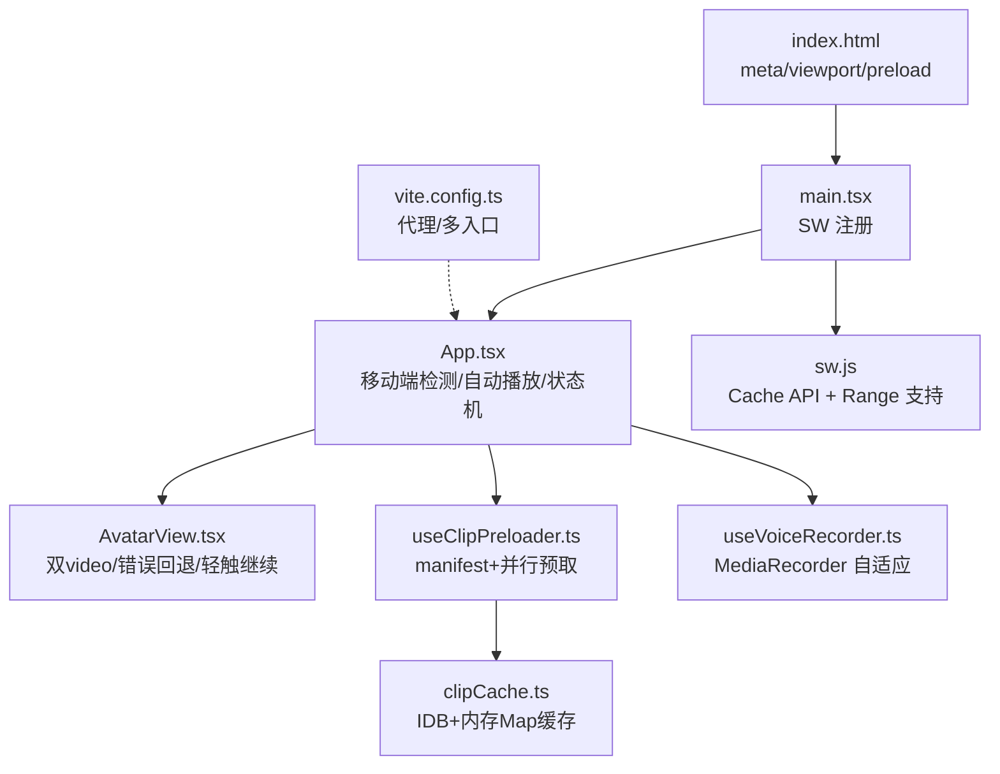
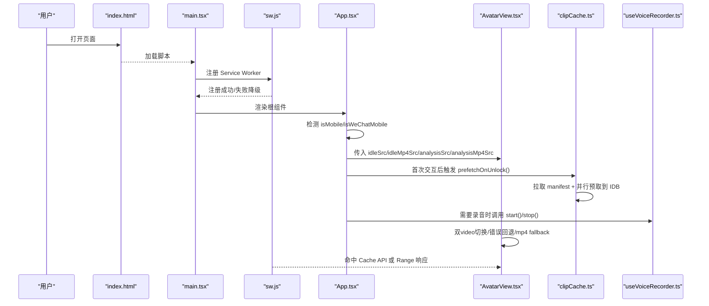
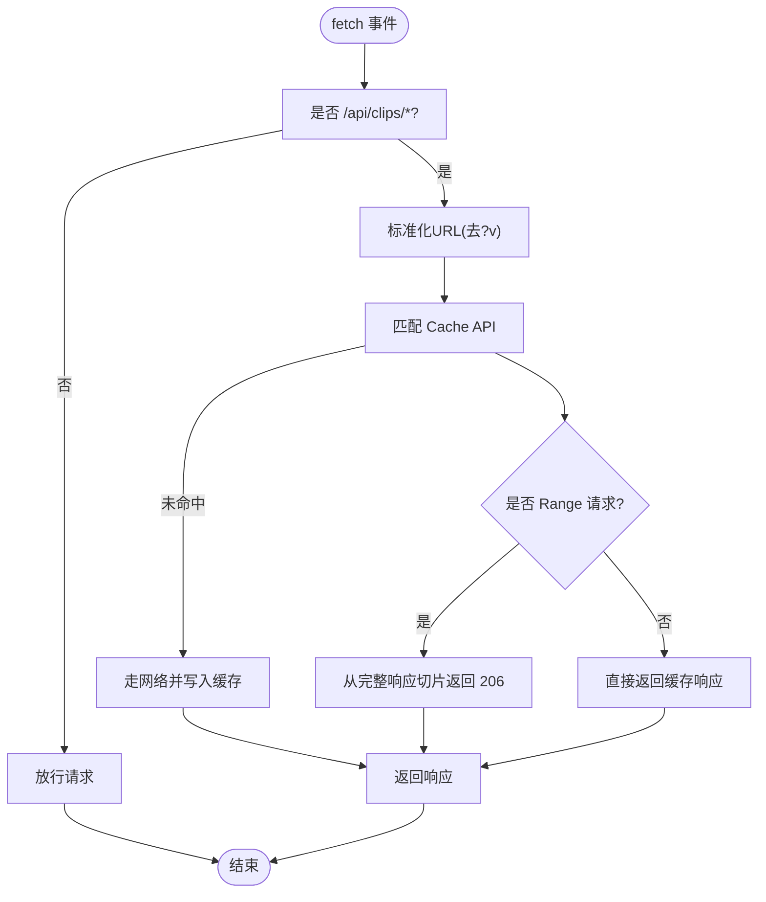
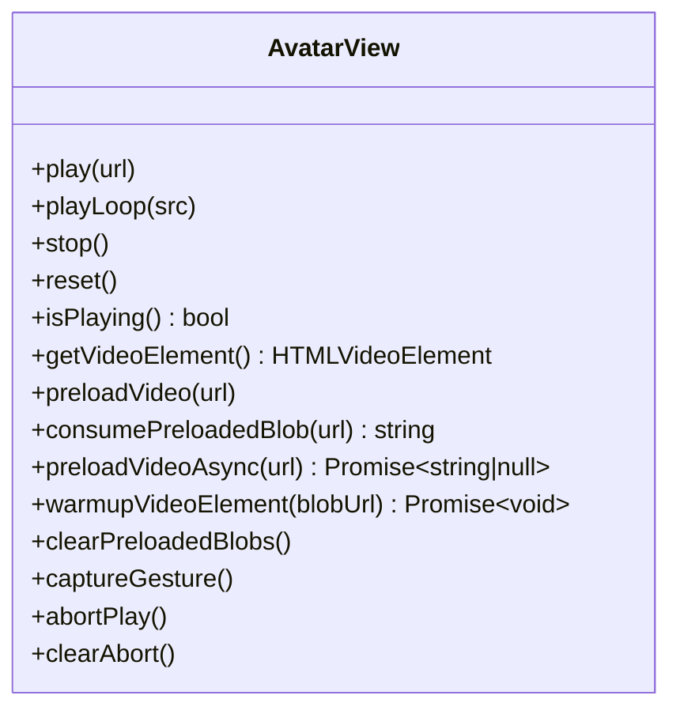
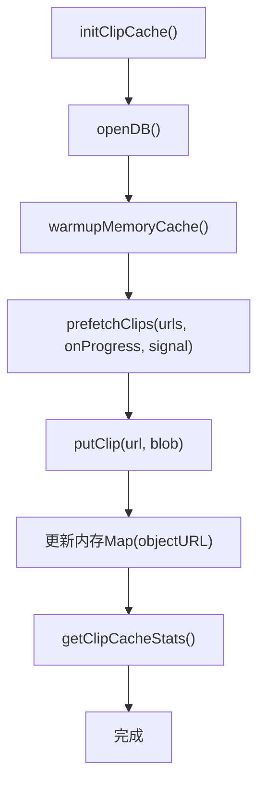
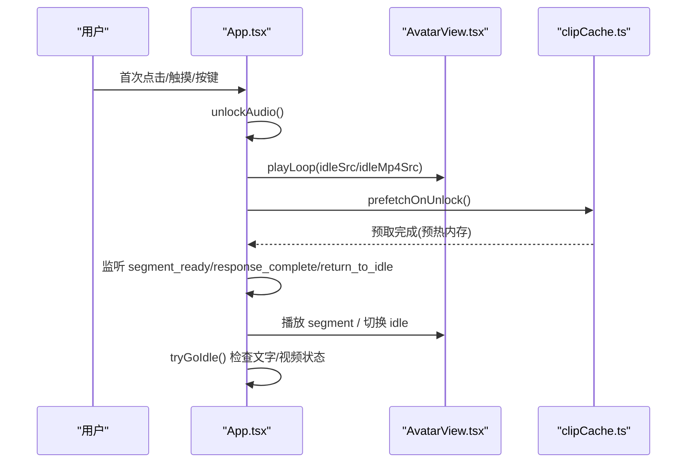
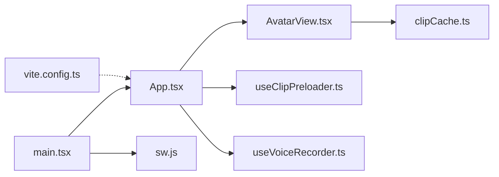

# 移动端浏览器兼容性

<cite>
**本文引用的文件**   
- [client/src/main.tsx](file://client/src/main.tsx)
- [client/public/sw.js](file://client/public/sw.js)
- [client/index.html](file://client/index.html)
- [client/src/App.tsx](file://client/src/App.tsx)
- [client/src/components/AvatarView.tsx](file://client/src/components/AvatarView.tsx)
- [client/src/services/clipCache.ts](file://client/src/services/clipCache.ts)
- [client/src/hooks/useClipPreloader.ts](file://client/src/hooks/useClipPreloader.ts)
- [client/src/hooks/useVoiceRecorder.ts](file://client/src/hooks/useVoiceRecorder.ts)
- [client/vite.config.ts](file://client/vite.config.ts)
</cite>

## 目录
1. [简介](#简介)
2. [项目结构](#项目结构)
3. [核心组件](#核心组件)
4. [架构总览](#架构总览)
5. [详细组件分析](#详细组件分析)
6. [依赖关系分析](#依赖关系分析)
7. [性能考量](#性能考量)
8. [故障排查指南](#故障排查指南)
9. [结论](#结论)
10. [附录](#附录)

## 简介
本文件聚焦于“移动端浏览器兼容性”的完整实现与优化策略，覆盖 iOS Safari、Android Chrome、微信内置浏览器（X5/WKWebView）等环境下的视频播放、自动播放策略、缓存与预取、录音能力、布局适配与首屏体验。文档从系统架构到代码级细节逐层展开，并提供可视化图示与排障建议，帮助读者快速定位问题并落地最佳实践。

## 项目结构
前端采用 React + Vite，关键入口与兼容性相关模块如下：
- 入口与 SW 注册：main.tsx
- Service Worker：sw.js（拦截 /api/clips/* 请求，支持 Range）
- HTML 元信息与预加载：index.html（viewport、iOS WebApp、X5 优化、preload 视频）
- 根组件与状态机：App.tsx（移动端检测、自动播放解锁、打字动画、事件处理）
- 形象视频组件：AvatarView.tsx（双 video 叠加、错误回退、轻触继续覆盖层、JS 无缝循环）
- 客户端缓存：clipCache.ts（IndexedDB + 内存 Map 两级缓存）
- 预取 Hook：useClipPreloader.ts（manifest 驱动并行预取）
- 语音录制：useVoiceRecorder.ts（MediaRecorder 多格式自适应）
- 构建与代理：vite.config.ts（开发代理、多入口）

**图表来源**
- [client/index.html:1-77](file://client/index.html#L1-L77)
- [client/src/main.tsx:1-34](file://client/src/main.tsx#L1-L34)
- [client/src/App.tsx:177-936](file://client/src/App.tsx#L177-L936)
- [client/src/components/AvatarView.tsx:1-1515](file://client/src/components/AvatarView.tsx#L1-L1515)
- [client/src/hooks/useClipPreloader.ts:1-126](file://client/src/hooks/useClipPreloader.ts#L1-L126)
- [client/src/services/clipCache.ts:1-307](file://client/src/services/clipCache.ts#L1-L307)
- [client/public/sw.js:1-127](file://client/public/sw.js#L1-L127)
- [client/vite.config.ts:1-27](file://client/vite.config.ts#L1-L27)

**章节来源**
- [client/index.html:1-77](file://client/index.html#L1-L77)
- [client/src/main.tsx:1-34](file://client/src/main.tsx#L1-L34)
- [client/vite.config.ts:1-27](file://client/vite.config.ts#L1-L27)

## 核心组件
- 服务工作者（Service Worker）：拦截 /api/clips/* 请求，命中 Cache API 直接返回；支持 Range 切片；按版本管理缓存键，失败时降级到 IDB + HTTP 缓存路径。
- 形象视频组件（AvatarView）：双 <video> 叠加（主段 + 循环 idle/analysis），opacity 过渡消除黑闪；对象 URL 预热与错误回退 mp4；X5 自动播放策略下显示“轻触继续”覆盖层；JS 接管 idle 无缝循环。
- 客户端缓存（clipCache）：IndexedDB 持久化 + 内存 Map 两级缓存；预取完成后预热 Map 以消除首段切换延迟；提供统计与清理接口。
- 预取 Hook（useClipPreloader）：页面首次交互后拉取 manifest，并行预取所有片段到 IDB，不阻塞主流程。
- 语音录制（useVoiceRecorder）：封装 MediaRecorder，自动选择最优 MIME（webm/opus 优先，mp4 fallback），音量实时分析，ESC 取消，60s 自动停止。
- 根组件（App）：移动端检测、自动播放解锁、单泡泡消息模式、打字动画、事件统一处理、微信移动端特殊分支（静态图替代视频）。

**章节来源**
- [client/public/sw.js:1-127](file://client/public/sw.js#L1-L127)
- [client/src/components/AvatarView.tsx:1-1515](file://client/src/components/AvatarView.tsx#L1-L1515)
- [client/src/services/clipCache.ts:1-307](file://client/src/services/clipCache.ts#L1-L307)
- [client/src/hooks/useClipPreloader.ts:1-126](file://client/src/hooks/useClipPreloader.ts#L1-L126)
- [client/src/hooks/useVoiceRecorder.ts:1-349](file://client/src/hooks/useVoiceRecorder.ts#L1-L349)
- [client/src/App.tsx:177-936](file://client/src/App.tsx#L177-L936)

## 架构总览
下图展示移动端兼容性相关的关键交互链路：HTML 元信息初始化 → SW 注册 → App 启动与移动端检测 → AvatarView 视频渲染与回退 → clipCache 预取与缓存 → useVoiceRecorder 录音能力。

**图表来源**
- [client/index.html:1-77](file://client/index.html#L1-L77)
- [client/src/main.tsx:1-34](file://client/src/main.tsx#L1-L34)
- [client/public/sw.js:1-127](file://client/public/sw.js#L1-L127)
- [client/src/App.tsx:177-936](file://client/src/App.tsx#L177-L936)
- [client/src/components/AvatarView.tsx:1-1515](file://client/src/components/AvatarView.tsx#L1-L1515)
- [client/src/services/clipCache.ts:1-307](file://client/src/services/clipCache.ts#L1-L307)
- [client/src/hooks/useVoiceRecorder.ts:1-349](file://client/src/hooks/useVoiceRecorder.ts#L1-L349)

## 详细组件分析

### 服务工作者（sw.js）
- 功能要点
  - 拦截 /api/clips/* 请求，命中 Cache API 直接返回，减少网络往返。
  - 支持 Range 请求：从完整响应中切片返回 206 Partial Content。
  - 缓存名带版本号，bump version 自动失效旧缓存。
  - 兼容 iOS WeChat WKWebView 与 Android X5（TBS 版本差异），注册失败时降级到 IDB + HTTP 缓存路径。
- 兼容性策略
  - 通过 normalize URL（剥离 ?v=N）控制缓存键，保证版本更新可刷新。
  - Range 解析失败时回退到网络请求，确保可用性。

**图表来源**
- [client/public/sw.js:1-127](file://client/public/sw.js#L1-L127)

**章节来源**
- [client/public/sw.js:1-127](file://client/public/sw.js#L1-L127)

### 形象视频组件（AvatarView.tsx）
- 设计要点
  - 双 <video> 绝对叠加：主视频（segment）+ 循环视频（idle/analysis），通过 opacity 过渡避免黑闪。
  - 首段切换等待 analysis 循环自然结束，避免突兀切帧。
  - 客户端预缓存：所有 src 赋值前尝试 IndexedDB 命中 → URL.createObjectURL，异常回退原 URL。
  - 错误回退：loopVideo/mainVideo 加载失败时尝试 mp4 变体（仅一次），objectURL 失效回退原始 HTTP URL。
  - X5 自动播放策略：play() 被阻止时显示“轻触继续”覆盖层，在 touchstart 同步栈中解锁播放。
  - JS 接管 idle 无缝循环：避免原生 loop=true 在 restart 时的空白帧。
- 移动端适配
  - 微信移动端：isWeChatMobile=true 时不渲染视频，改为静态 PNG，避免 X5 内核解码不稳定。
  - 尺寸与比例：根据 isMobile/isWeChatMobile 调整高度与 aspectRatio，留出顶部安全空间。

**图表来源**
- [client/src/components/AvatarView.tsx:1-1515](file://client/src/components/AvatarView.tsx#L1-L1515)

**章节来源**
- [client/src/components/AvatarView.tsx:1-1515](file://client/src/components/AvatarView.tsx#L1-L1515)

### 客户端缓存（clipCache.ts）
- 设计要点
  - IndexedDB 存储 clips 表（keyPath=url），失败容忍单条失败不影响整体进度。
  - 内存 Map 缓存 objectURL，避免每次段间切换都查 IDB（5-15ms 开销）。
  - 预取完成后预热 Map，首段切换 0 延迟。
  - 暴露迭代器供 admin panel 查看缓存内容。
- 兼容性
  - 微信浏览器各版本可用 IndexedDB；初始化失败则降级到 HTTP 缓存路径。

**图表来源**
- [client/src/services/clipCache.ts:1-307](file://client/src/services/clipCache.ts#L1-L307)

**章节来源**
- [client/src/services/clipCache.ts:1-307](file://client/src/services/clipCache.ts#L1-L307)

### 预取 Hook（useClipPreloader.ts）
- 功能要点
  - 页面首次交互解锁后并行预取所有切片到 IndexedDB。
  - 拉取 /api/clips/manifest，并发度限制为 4，失败不阻断整体。
  - 完成后自动 warmupMemoryCache 预热内存，提升首段切换速度。
- 使用场景
  - App.tsx 在 onFirstTap 中调用 prefetchOnUnlock()，不阻塞首屏。

**章节来源**
- [client/src/hooks/useClipPreloader.ts:1-126](file://client/src/hooks/useClipPreloader.ts#L1-L126)

### 语音录制（useVoiceRecorder.ts）
- 功能要点
  - 封装 MediaRecorder API，支持音量实时分析（AnalyserNode + getByteFrequencyData）。
  - 浏览器格式自适应：webm/opus 优先（Chrome/Edge/Firefox），mp4 fallback（Safari）。
  - ESC 键取消，60s 自动停止，状态机：idle → requesting-permission → recording → processing → done/error。
- 兼容性
  - getUserMedia 权限处理、设备不可用提示、错误捕获与清理。

**章节来源**
- [client/src/hooks/useVoiceRecorder.ts:1-349](file://client/src/hooks/useVoiceRecorder.ts#L1-L349)

### 根组件（App.tsx）
- 功能要点
  - 移动端检测：isMobile（屏幕宽度 < 768px）、isWeChatMobile（MicroMessenger + Mobile UA）。
  - 自动播放解锁：首次用户交互后 unlockAudio()，并播放 idle 循环。
  - 单泡泡消息模式：整轮对话只维护一条 assistant 消息，文本累积 + 视频队列消费。
  - 打字动画：基于 duration_ms 计算字符间隔，钳位 [50, 160] ms/char，防极端快慢。
  - 微信移动端特殊分支：isWeChatMobile=true 时不调用 playLoop，AvatarView 显示静态图。
  - stuck detector：兜底防止 avatar 卡死（主/从两个方向），超时强制恢复 idle。

**图表来源**
- [client/src/App.tsx:177-936](file://client/src/App.tsx#L177-L936)
- [client/src/components/AvatarView.tsx:1-1515](file://client/src/components/AvatarView.tsx#L1-L1515)
- [client/src/services/clipCache.ts:1-307](file://client/src/services/clipCache.ts#L1-L307)

**章节来源**
- [client/src/App.tsx:177-936](file://client/src/App.tsx#L177-L936)

## 依赖关系分析
- main.tsx 负责 SW 注册与 React 根节点渲染。
- App.tsx 依赖 AvatarView、useClipPreloader、useVoiceRecorder 等模块，协调状态与事件。
- AvatarView 依赖 clipCache 进行对象 URL 解析与缓存命中。
- sw.js 独立拦截 /api/clips/* 请求，与 clipCache 形成双重缓存保障。
- vite.config.ts 配置开发代理与多入口，便于本地调试与构建。

**图表来源**
- [client/src/main.tsx:1-34](file://client/src/main.tsx#L1-L34)
- [client/src/App.tsx:177-936](file://client/src/App.tsx#L177-L936)
- [client/src/components/AvatarView.tsx:1-1515](file://client/src/components/AvatarView.tsx#L1-L1515)
- [client/src/hooks/useClipPreloader.ts:1-126](file://client/src/hooks/useClipPreloader.ts#L1-L126)
- [client/src/hooks/useVoiceRecorder.ts:1-349](file://client/src/hooks/useVoiceRecorder.ts#L1-L349)
- [client/src/services/clipCache.ts:1-307](file://client/src/services/clipCache.ts#L1-L307)
- [client/public/sw.js:1-127](file://client/public/sw.js#L1-L127)
- [client/vite.config.ts:1-27](file://client/vite.config.ts#L1-L27)

**章节来源**
- [client/src/main.tsx:1-34](file://client/src/main.tsx#L1-L34)
- [client/src/App.tsx:177-936](file://client/src/App.tsx#L177-L936)
- [client/src/components/AvatarView.tsx:1-1515](file://client/src/components/AvatarView.tsx#L1-L1515)
- [client/src/hooks/useClipPreloader.ts:1-126](file://client/src/hooks/useClipPreloader.ts#L1-L126)
- [client/src/hooks/useVoiceRecorder.ts:1-349](file://client/src/hooks/useVoiceRecorder.ts#L1-L349)
- [client/src/services/clipCache.ts:1-307](file://client/src/services/clipCache.ts#L1-L307)
- [client/public/sw.js:1-127](file://client/public/sw.js#L1-L127)
- [client/vite.config.ts:1-27](file://client/vite.config.ts#L1-L27)

## 性能考量
- 首屏与预取
  - index.html preload 常用视频资源，SW 命中 Cache API 零网络往返。
  - useClipPreloader 在首次交互后并行预取，预热内存 Map 消除首段切换延迟。
- 视频切换与卡顿
  - AvatarView 双 video 叠加 + opacity 过渡，避免黑闪与白屏。
  - JS 接管 idle 无缝循环，避免原生 loop 重启空白帧。
  - 5G 慢解码场景下 canplay 与 RVFC 兜底，硬超时保障切换。
- 自动播放策略
  - 首次交互解锁 AudioContext，X5 内核下显示“轻触继续”覆盖层。
  - muted autoplay 作为降级策略，必要时重试与超时处理。
- 缓存与内存
  - IDB + 内存 Map 两级缓存，减少 IDB 事务开销。
  - objectURL 生命周期管理，避免内存泄露。

[本节为通用指导，不直接分析具体文件]

## 故障排查指南
- 视频无法播放
  - 检查 isWeChatMobile 分支是否启用静态图替代。
  - 确认 SW 是否注册成功，若失败应降级到 IDB + HTTP 缓存路径。
  - 查看 AvatarView 的错误回退逻辑是否触发 mp4 fallback。
  - 检查“轻触继续”覆盖层是否出现，用户是否在同步调用栈中解锁播放。
- 首段切换卡顿
  - 确认 clipCache 预热是否完成，内存 Map 是否命中。
  - 检查 canplay/RVFC 兜底与硬超时是否生效。
- 自动播放被阻止
  - 确保首次交互后调用 unlockAudio() 并在同步栈中 play()。
  - 在 X5 内核下，muted autoplay 通常不被拒绝，必要时重试。
- 录音失败
  - 检查 getUserMedia 权限与设备可用性。
  - 确认 MediaRecorder.isTypeSupported 选择的 MIME 是否受支持。
  - 查看错误状态与清理逻辑是否正确执行。

**章节来源**
- [client/src/components/AvatarView.tsx:1-1515](file://client/src/components/AvatarView.tsx#L1-L1515)
- [client/src/services/clipCache.ts:1-307](file://client/src/services/clipCache.ts#L1-L307)
- [client/src/hooks/useVoiceRecorder.ts:1-349](file://client/src/hooks/useVoiceRecorder.ts#L1-L349)
- [client/public/sw.js:1-127](file://client/public/sw.js#L1-L127)
- [client/src/App.tsx:177-936](file://client/src/App.tsx#L177-L936)

## 结论
本项目在移动端浏览器兼容性方面实现了多层次保障：HTML 元信息优化、Service Worker 缓存与 Range 支持、AvatarView 双 video 架构与错误回退、clipCache 两级缓存与预热、useVoiceRecorder 多格式自适应、App 状态机与微信移动端特殊分支。通过这些机制，项目在 iOS Safari、Android Chrome、微信内置浏览器（X5/WKWebView）等环境下具备稳定的视频播放、流畅的切换体验与可靠的录音能力。建议在生产环境中持续监控 SW 注册成功率、缓存命中率与卡顿指标，并根据不同 TBS 版本进行针对性优化。

[本节为总结性内容，不直接分析具体文件]

## 附录
- 移动端适配关键点
  - viewport-fit=cover 启用 iOS 刘海屏 safe-area-inset-*。
  - apple-mobile-web-app-capable 启用全屏 WebApp 模式。
  - x5-orientation/x5-fullscreen/x5-page-mode 优化微信 X5 内核。
  - preload 常用视频资源，减少首屏延迟。
- 兼容性检测
  - prefersMp4(): iOS 全系列 + 微信内置浏览器优先 mp4。
  - isWeChatMobileUA(): MicroMessenger + Mobile UA 标记微信移动端。
- 构建与代理
  - vite.config.ts 配置 /api 与 /ws 代理，便于本地调试。

**章节来源**
- [client/index.html:1-77](file://client/index.html#L1-L77)
- [client/src/App.tsx:177-936](file://client/src/App.tsx#L177-L936)
- [client/vite.config.ts:1-27](file://client/vite.config.ts#L1-L27)