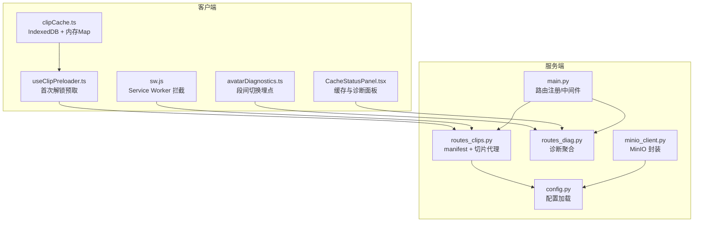
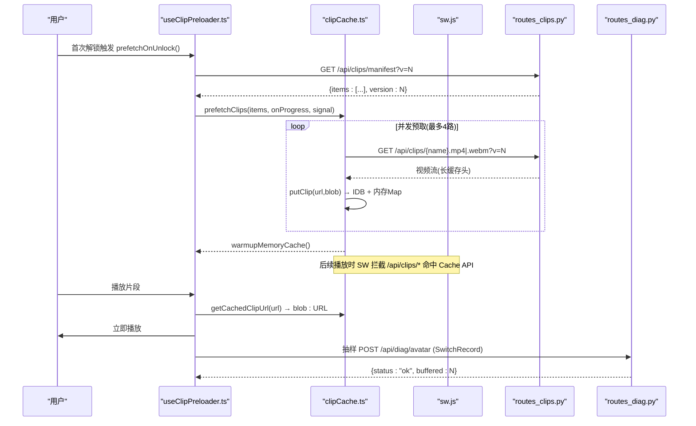
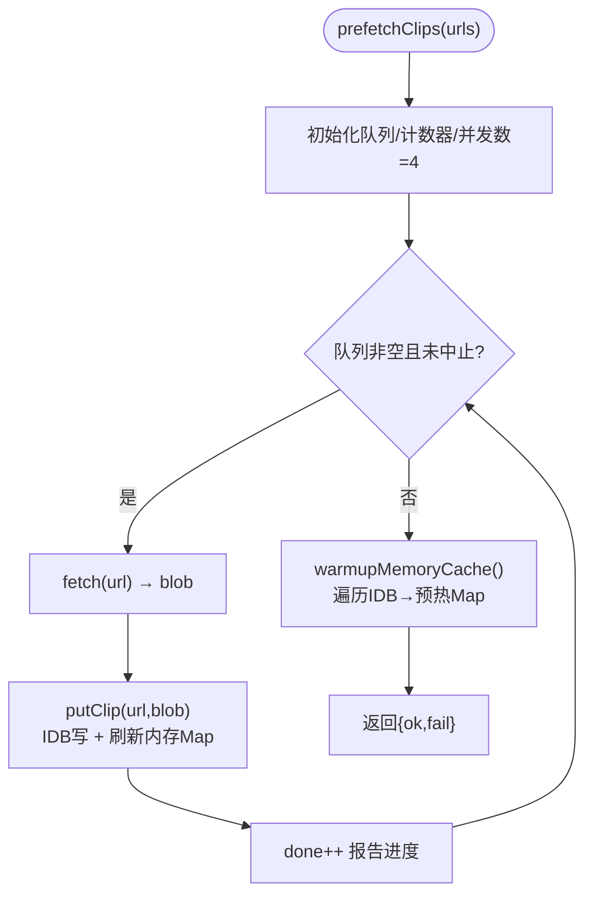
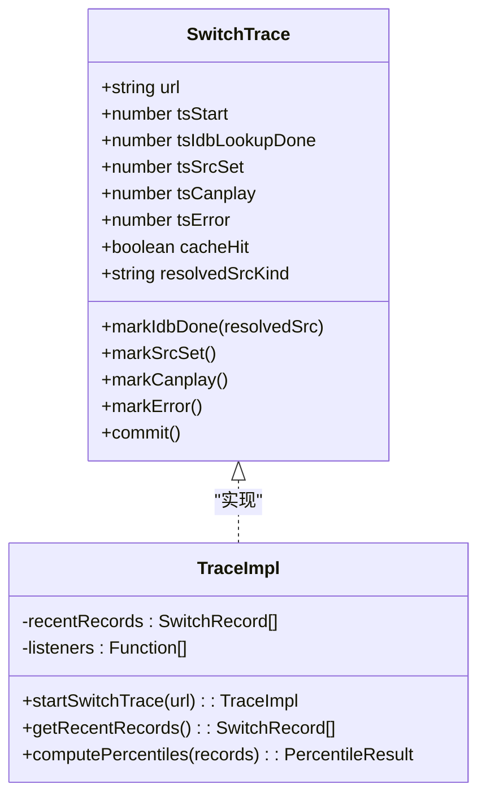
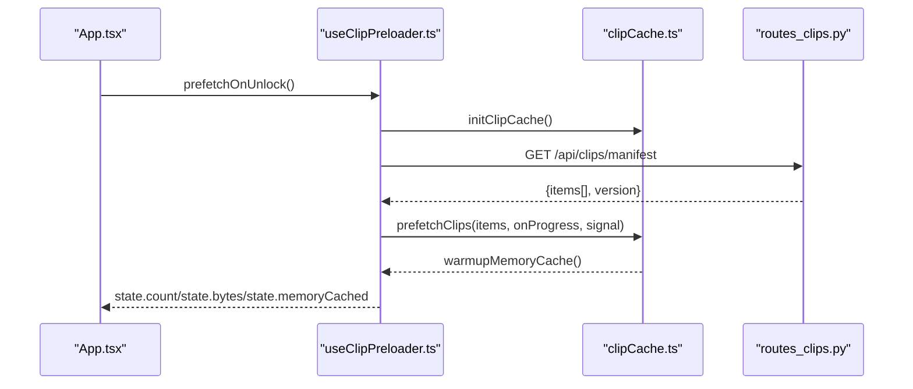
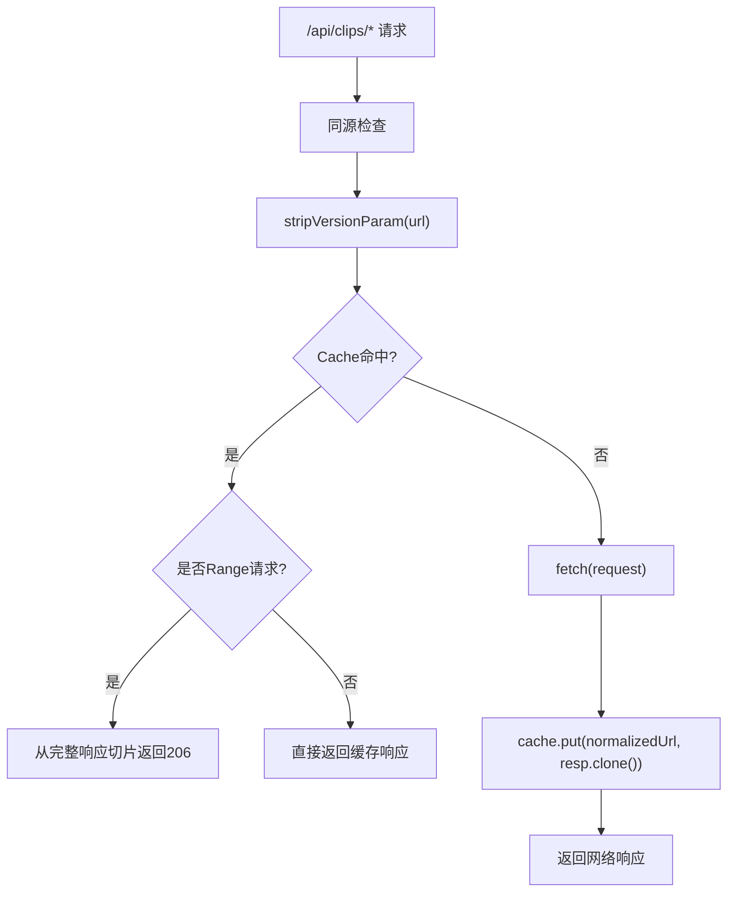
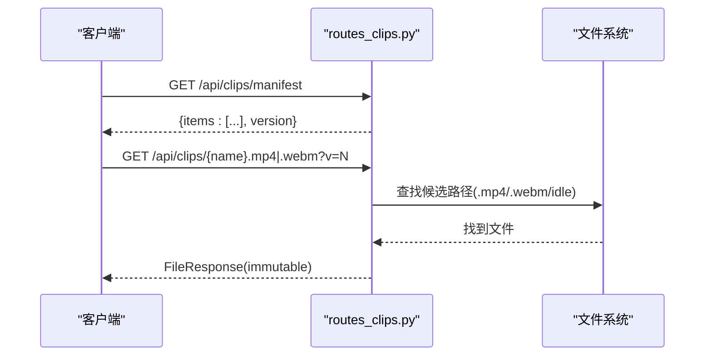
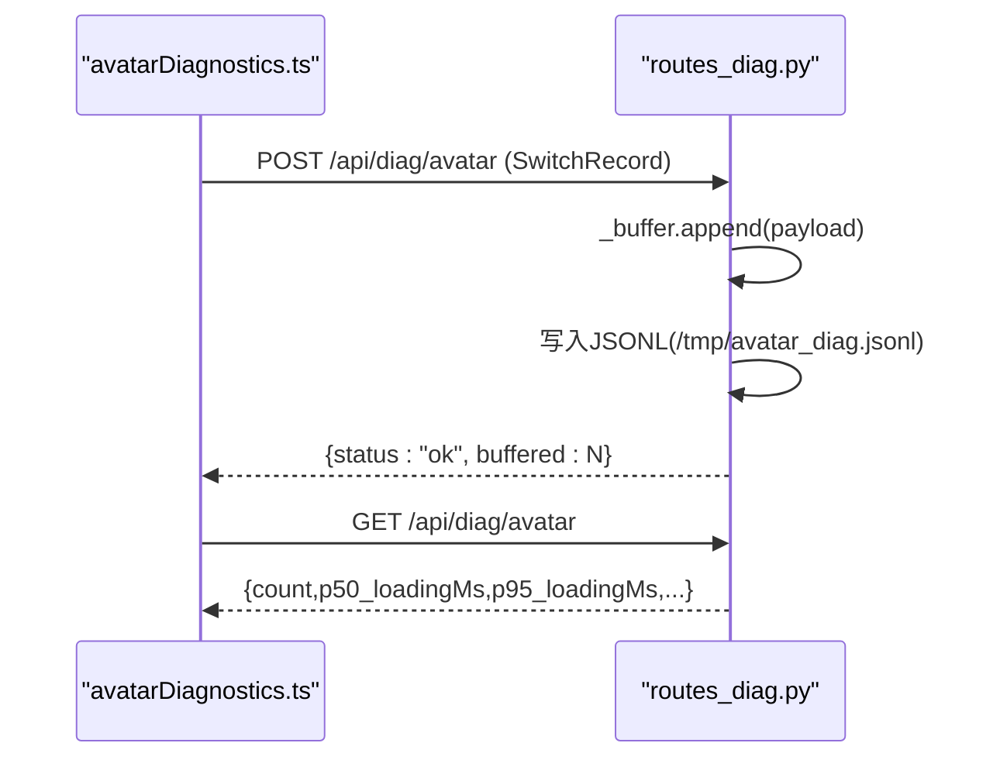
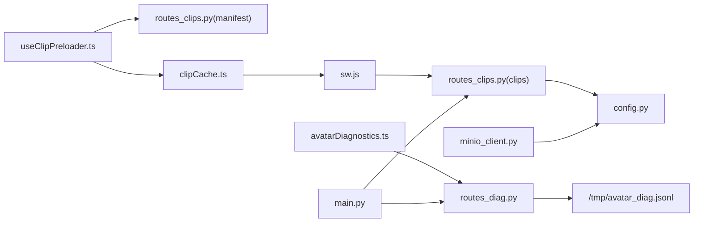

# 缓存管理与诊断系统

<cite>
**本文引用的文件**   
- [client/src/services/clipCache.ts](file://client/src/services/clipCache.ts)
- [client/src/components/CacheStatusPanel.tsx](file://client/src/components/CacheStatusPanel.tsx)
- [client/src/services/avatarDiagnostics.ts](file://client/src/services/avatarDiagnostics.ts)
- [client/src/hooks/useClipPreloader.ts](file://client/src/hooks/useClipPreloader.ts)
- [client/public/sw.js](file://client/public/sw.js)
- [server/api/routes_clips.py](file://server/api/routes_clips.py)
- [server/api/routes_diag.py](file://server/api/routes_diag.py)
- [server/services/minio_client.py](file://server/services/minio_client.py)
- [server/config.py](file://server/config.py)
- [server/main.py](file://server/main.py)
- [clips/short-hair-teacher-girl/clips.toml](file://clips/short-hair-teacher-girl/clips.toml)
</cite>

## 目录
1. [简介](#简介)
2. [项目结构](#项目结构)
3. [核心组件](#核心组件)
4. [架构总览](#架构总览)
5. [详细组件分析](#详细组件分析)
6. [依赖关系分析](#依赖关系分析)
7. [性能考量](#性能考量)
8. [故障排查指南](#故障排查指南)
9. [结论](#结论)

## 简介
本系统围绕“实时对话中的形象视频”提供一套端到端的缓存与诊断方案：
- 客户端通过 IndexedDB + 内存 Map 两级缓存预取并快速播放语义化切片；
- Service Worker 拦截 /api/clips/* 请求，命中 Cache API 直接返回，支持 Range 分片；
- 服务端暴露 manifest 清单、切片代理、以及诊断聚合接口；
- 前端面板展示本地缓存状态、段间切换延迟分布与服务端聚合指标。

该方案在移动端（含微信浏览器）具备良好兼容性，并通过版本号机制实现缓存失效与平滑升级。

## 项目结构
与缓存与诊断相关的关键路径如下：
- 客户端缓存服务：IndexedDB 读写、内存对象 URL 预热、统计与清理
- 客户端诊断埋点：段间切换耗时追踪、抽样上报
- 客户端预加载 Hook：首次解锁后拉取 manifest 并并行预取
- Service Worker：/api/clips/* 拦截、Range 响应、按版本命名缓存
- 服务端切片路由：manifest 生成、切片文件代理、长缓存头
- 服务端诊断路由：环形缓冲 + JSONL 持久化、P50/P95/命中率聚合
- 配置中心：统一读取 config.json 与环境变量，驱动 manifest 版本号等
- 存储后端：MinIO 客户端封装（用于对象存储能力）

图表来源
- [client/src/services/clipCache.ts:1-307](file://client/src/services/clipCache.ts#L1-L307)
- [client/src/hooks/useClipPreloader.ts:1-126](file://client/src/hooks/useClipPreloader.ts#L1-L126)
- [client/src/services/avatarDiagnostics.ts:1-187](file://client/src/services/avatarDiagnostics.ts#L1-L187)
- [client/public/sw.js:1-127](file://client/public/sw.js#L1-L127)
- [server/api/routes_clips.py:1-133](file://server/api/routes_clips.py#L1-L133)
- [server/api/routes_diag.py:1-124](file://server/api/routes_diag.py#L1-L124)
- [server/config.py:1-287](file://server/config.py#L1-L287)
- [server/services/minio_client.py:1-139](file://server/services/minio_client.py#L1-L139)
- [server/main.py:1-238](file://server/main.py#L1-L238)

章节来源
- [client/src/services/clipCache.ts:1-307](file://client/src/services/clipCache.ts#L1-L307)
- [client/src/hooks/useClipPreloader.ts:1-126](file://client/src/hooks/useClipPreloader.ts#L1-L126)
- [client/src/services/avatarDiagnostics.ts:1-187](file://client/src/services/avatarDiagnostics.ts#L1-L187)
- [client/public/sw.js:1-127](file://client/public/sw.js#L1-L127)
- [server/api/routes_clips.py:1-133](file://server/api/routes_clips.py#L1-L133)
- [server/api/routes_diag.py:1-124](file://server/api/routes_diag.py#L1-L124)
- [server/config.py:1-287](file://server/config.py#L1-L287)
- [server/services/minio_client.py:1-139](file://server/services/minio_client.py#L1-L139)
- [server/main.py:1-238](file://server/main.py#L1-L238)

## 核心组件
- 客户端 IndexedDB 缓存服务：提供初始化、查询、写入、预热、并发预取、统计与清理能力
- 客户端诊断埋点：记录段间切换各阶段时间戳、命中率、错误信息，并抽样上报
- 预加载 Hook：首次交互后拉取 manifest，触发并发预取，更新 UI 进度与统计
- Service Worker：拦截 /api/clips/*，命中 Cache API 直接返回，支持 Range 分片，按版本隔离缓存
- 服务端切片路由：返回带版本号的 manifest 清单，代理切片文件并提供长缓存头
- 服务端诊断路由：接收采样数据，维护环形缓冲与 JSONL 日志，计算 P50/P95/命中率
- 配置模块：合并 config.json 与环境变量，驱动 manifest 版本号、资源路径等
- MinIO 客户端：封装连接、上传、存在性检查、预签名 URL、前缀删除等操作

章节来源
- [client/src/services/clipCache.ts:1-307](file://client/src/services/clipCache.ts#L1-L307)
- [client/src/services/avatarDiagnostics.ts:1-187](file://client/src/services/avatarDiagnostics.ts#L1-L187)
- [client/src/hooks/useClipPreloader.ts:1-126](file://client/src/hooks/useClipPreloader.ts#L1-L126)
- [client/public/sw.js:1-127](file://client/public/sw.js#L1-L127)
- [server/api/routes_clips.py:1-133](file://server/api/routes_clips.py#L1-L133)
- [server/api/routes_diag.py:1-124](file://server/api/routes_diag.py#L1-L124)
- [server/config.py:1-287](file://server/config.py#L1-L287)
- [server/services/minio_client.py:1-139](file://server/services/minio_client.py#L1-L139)

## 架构总览
整体流程分为“预取—缓存—播放—诊断—聚合”五个阶段：
- 预取：useClipPreloader 拉取 manifest，调用 clipCache.prefetchClips 并发下载至 IndexedDB
- 缓存：clipCache 维护内存 Map（objectURL）与 IndexedDB（Blob），warmupMemoryCache 预热
- 播放：AvatarView 优先从缓存解析 objectURL，失败回退 HTTP；SW 拦截 /api/clips/* 加速
- 诊断：avatarDiagnostics 记录各阶段时间戳，抽样 POST 到 /api/diag/avatar
- 聚合：routes_diag 维护环形缓冲与 JSONL，GET 返回 P50/P95/命中率等

图表来源
- [client/src/hooks/useClipPreloader.ts:1-126](file://client/src/hooks/useClipPreloader.ts#L1-L126)
- [client/src/services/clipCache.ts:1-307](file://client/src/services/clipCache.ts#L1-L307)
- [client/public/sw.js:1-127](file://client/public/sw.js#L1-L127)
- [server/api/routes_clips.py:1-133](file://server/api/routes_clips.py#L1-L133)
- [server/api/routes_diag.py:1-124](file://server/api/routes_diag.py#L1-L124)

## 详细组件分析

### 客户端 IndexedDB 缓存服务（clipCache.ts）
职责与要点：
- 打开/升级 IndexedDB（real-time-talk-clips / clips store，keyPath=url）
- L1 内存 Map 缓存 objectURL（同步 <1ms），L2 IndexedDB 读 Blob
- 并发预取（MAX_CONCURRENCY=4），单条失败不影响整体，onProgress 回调
- 预取完成后 warmupMemoryCache 预热内存 Map，消除首段切换延迟
- 统计 count/bytes/memoryCached，支持 clear 与 release 单个条目

复杂度与优化：
- 预取为 O(N) 网络 IO，受并发限制；IDB 事务开销被 Map 命中规避
- 内存 Map 避免重复 createObjectURL/revoke，降低 GC 压力

图表来源
- [client/src/services/clipCache.ts:182-227](file://client/src/services/clipCache.ts#L182-L227)
- [client/src/services/clipCache.ts:144-172](file://client/src/services/clipCache.ts#L144-L172)
- [client/src/services/clipCache.ts:111-138](file://client/src/services/clipCache.ts#L111-L138)

章节来源
- [client/src/services/clipCache.ts:1-307](file://client/src/services/clipCache.ts#L1-L307)

### 客户端诊断埋点（avatarDiagnostics.ts）
职责与要点：
- startSwitchTrace(url) 创建追踪器，记录 tsStart/tsIdbLookupDone/tsSrcSet/tsCanplay/tsError
- 自动计算 loadingDurationMs 与 totalSwitchDurationMs，维护最近 200 条内存环缓冲
- 自定义事件 avatar-diag 供面板订阅；1/10 抽样 POST 到 /api/diag/avatar
- computePercentiles 计算 P50/P95 与命中率

图表来源
- [client/src/services/avatarDiagnostics.ts:15-155](file://client/src/services/avatarDiagnostics.ts#L15-L155)
- [client/src/services/avatarDiagnostics.ts:158-187](file://client/src/services/avatarDiagnostics.ts#L158-L187)

章节来源
- [client/src/services/avatarDiagnostics.ts:1-187](file://client/src/services/avatarDiagnostics.ts#L1-L187)

### 预加载 Hook（useClipPreloader.ts）
职责与要点：
- 首次解锁后 initClipCache → fetchManifest → prefetchClips
- 维护 state（count/bytes/memoryCached/prefetching/progress/durationMs）
- 暴露 getMemoryCacheKeys 给诊断面板

图表来源
- [client/src/hooks/useClipPreloader.ts:65-120](file://client/src/hooks/useClipPreloader.ts#L65-L120)
- [server/api/routes_clips.py:41-65](file://server/api/routes_clips.py#L41-L65)

章节来源
- [client/src/hooks/useClipPreloader.ts:1-126](file://client/src/hooks/useClipPreloader.ts#L1-L126)

### Service Worker（sw.js）
职责与要点：
- install/activate：skipWaiting、清理旧缓存、claim 控制
- fetch：拦截 /api/clips/*，先匹配 Cache API，支持 Range 分片
- 缓存名按 SW_VERSION 隔离，剥离 ?v=N 参数归一化 key

图表来源
- [client/public/sw.js:38-85](file://client/public/sw.js#L38-L85)
- [client/public/sw.js:92-120](file://client/public/sw.js#L92-L120)

章节来源
- [client/public/sw.js:1-127](file://client/public/sw.js#L1-L127)

### 服务端切片路由（routes_clips.py）
职责与要点：
- /api/clips/manifest：返回 items（含 ?v=N 版本号）与 version，no-cache
- /api/clips/{name:path}：多候选路径查找（.mp4/.webm/idle），安全校验，返回 FileResponse 并设置 immutable 长缓存头

图表来源
- [server/api/routes_clips.py:41-65](file://server/api/routes_clips.py#L41-L65)
- [server/api/routes_clips.py:68-133](file://server/api/routes_clips.py#L68-L133)

章节来源
- [server/api/routes_clips.py:1-133](file://server/api/routes_clips.py#L1-L133)

### 服务端诊断路由（routes_diag.py）
职责与要点：
- POST /api/diag/avatar：接收 SwitchRecord，追加环形缓冲与 JSONL
- GET /api/diag/avatar：计算 P50/P95/loading/total/hitRate/errors
- DELETE /api/diag/avatar：清空环形缓冲（不清文件）

图表来源
- [server/api/routes_diag.py:54-70](file://server/api/routes_diag.py#L54-L70)
- [server/api/routes_diag.py:73-116](file://server/api/routes_diag.py#L73-L116)

章节来源
- [server/api/routes_diag.py:1-124](file://server/api/routes_diag.py#L1-L124)

### 配置模块（config.py）
职责与要点：
- 合并 config.json 与 pydantic-settings 环境变量，优先级：环境变量 > JSON
- 提供 avatar.clip_version 等字段，驱动 manifest 版本号与资源路径
- 全局懒加载 get_config()，支持 reload_config()

章节来源
- [server/config.py:1-287](file://server/config.py#L1-L287)

### MinIO 客户端（minio_client.py）
职责与要点：
- 连接、ensure_bucket、upload、object_exists、presigned_get_url、delete_prefix
- 可用性标记 _available，异常时降级处理

章节来源
- [server/services/minio_client.py:1-139](file://server/services/minio_client.py#L1-L139)

### 主应用入口（main.py）
职责与要点：
- lifespan 生命周期：初始化 Redis/MinIO/Qdrant/Embedding，注册路由
- HEAD→GET 中间件：兼容浏览器对 video 资源的 HEAD 探测
- 挂载静态文件与 WebSocket 端点

章节来源
- [server/main.py:1-238](file://server/main.py#L1-L238)

### 切片元数据（clips.toml）
职责与要点：
- 定义 speaker、基础约束、每个切片的 file/tags/prompt/speech_hint
- transitions 规则与默认序列建议

章节来源
- [clips/short-hair-teacher-girl/clips.toml:1-148](file://clips/short-hair-teacher-girl/clips.toml#L1-L148)

## 依赖关系分析
- 客户端
  - useClipPreloader.ts 依赖 clipCache.ts（预取/统计）、routes_clips.py（manifest）
  - avatarDiagnostics.ts 依赖 routes_diag.py（POST 上报）
  - sw.js 拦截 routes_clips.py 的 /api/clips/* 请求
- 服务端
  - routes_clips.py 依赖 config.py（avatar.clip_version、clips_dir）
  - routes_diag.py 独立，使用内存环形缓冲与 JSONL 文件
  - minio_client.py 依赖 config.py（minio.*）
  - main.py 聚合所有路由与中间件

图表来源
- [client/src/hooks/useClipPreloader.ts:1-126](file://client/src/hooks/useClipPreloader.ts#L1-L126)
- [client/src/services/clipCache.ts:1-307](file://client/src/services/clipCache.ts#L1-L307)
- [client/public/sw.js:1-127](file://client/public/sw.js#L1-L127)
- [client/src/services/avatarDiagnostics.ts:1-187](file://client/src/services/avatarDiagnostics.ts#L1-L187)
- [server/api/routes_clips.py:1-133](file://server/api/routes_clips.py#L1-L133)
- [server/api/routes_diag.py:1-124](file://server/api/routes_diag.py#L1-L124)
- [server/config.py:1-287](file://server/config.py#L1-L287)
- [server/services/minio_client.py:1-139](file://server/services/minio_client.py#L1-L139)
- [server/main.py:1-238](file://server/main.py#L1-L238)

章节来源
- [client/src/hooks/useClipPreloader.ts:1-126](file://client/src/hooks/useClipPreloader.ts#L1-L126)
- [client/src/services/clipCache.ts:1-307](file://client/src/services/clipCache.ts#L1-L307)
- [client/public/sw.js:1-127](file://client/public/sw.js#L1-L127)
- [client/src/services/avatarDiagnostics.ts:1-187](file://client/src/services/avatarDiagnostics.ts#L1-L187)
- [server/api/routes_clips.py:1-133](file://server/api/routes_clips.py#L1-L133)
- [server/api/routes_diag.py:1-124](file://server/api/routes_diag.py#L1-L124)
- [server/config.py:1-287](file://server/config.py#L1-L287)
- [server/services/minio_client.py:1-139](file://server/services/minio_client.py#L1-L139)
- [server/main.py:1-238](file://server/main.py#L1-L238)

## 性能考量
- 两级缓存策略：内存 Map（L1）O(1) 命中，IDB（L2）异步 IO；warmupMemoryCache 预热消除首段切换延迟
- 并发预取：MAX_CONCURRENCY=4 平衡带宽与 CPU；单条失败不中断整体
- SW Range 支持：减少首帧等待，提升移动端解码体验
- 长缓存头：/api/clips/* 返回 immutable，配合 ?v=N 版本控制，最大化命中
- 诊断采样：1/10 上报，降低网络与存储开销
- 内存管理：releaseMemoryCacheEntry/clearClipCache 及时释放 objectURL，避免泄漏

[本节为通用指导，无需特定文件引用]

## 故障排查指南
常见问题与定位方法：
- 预取失败率高：检查网络连通性与 /api/clips/manifest 返回；查看 clipCache 控制台 warn
- 首段切换卡顿：确认 warmupMemoryCache 是否执行；检查 SW 是否激活与命中
- 移动端无法自动播放：检查 captureGesture 与 X5 策略；必要时显示轻触继续覆盖层
- 诊断数据缺失：确认 avatarDiagnostics 抽样上报是否成功；检查 /api/diag/avatar 可访问性
- 缓存未失效：确保发布新切片时 bump avatar.clip_version，manifest 必须 no-cache

章节来源
- [client/src/services/clipCache.ts:182-227](file://client/src/services/clipCache.ts#L182-L227)
- [client/public/sw.js:18-36](file://client/public/sw.js#L18-L36)
- [client/src/hooks/useClipPreloader.ts:65-120](file://client/src/hooks/useClipPreloader.ts#L65-L120)
- [client/src/services/avatarDiagnostics.ts:139-154](file://client/src/services/avatarDiagnostics.ts#L139-L154)
- [server/api/routes_clips.py:41-65](file://server/api/routes_clips.py#L41-L65)
- [server/api/routes_diag.py:73-116](file://server/api/routes_diag.py#L73-L116)

## 结论
本缓存与诊断系统通过“客户端两级缓存 + Service Worker 拦截 + 服务端清单与诊断聚合”形成闭环，显著提升了实时对话中形象视频的加载速度与切换流畅度。结合版本号机制与完善的监控面板，便于持续优化与问题定位。建议在发布新版本切片时同步 bump clip_version，并确保 SW 正确激活与缓存隔离。

[本节为总结性内容，无需特定文件引用]