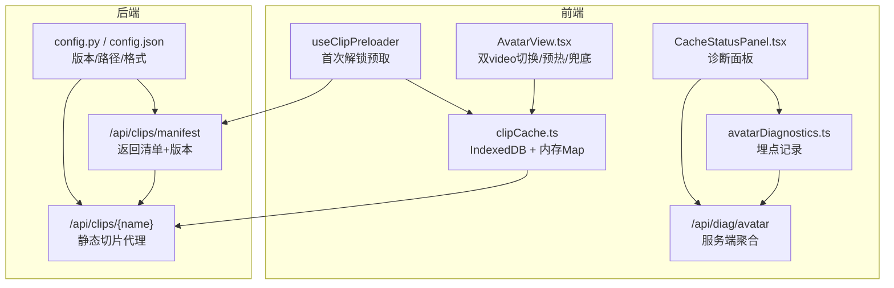
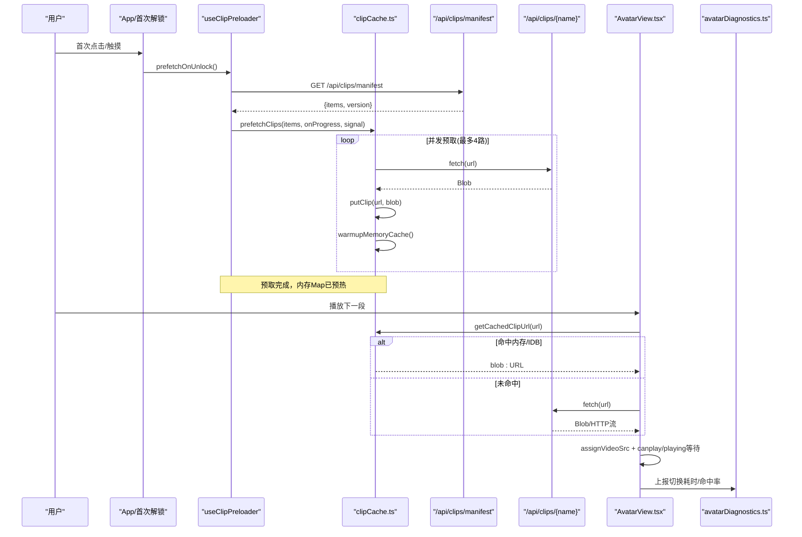
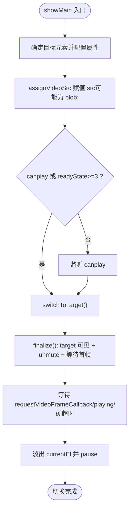
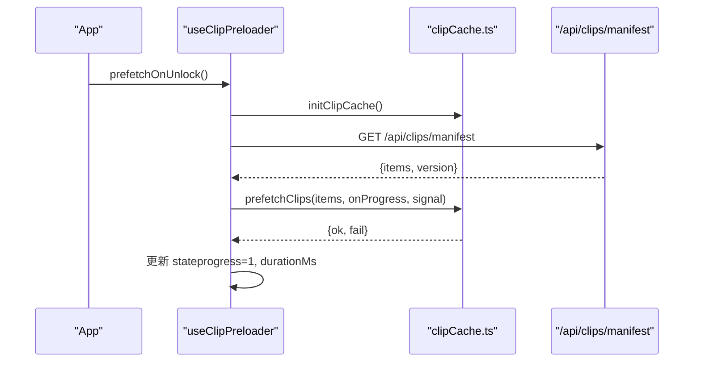
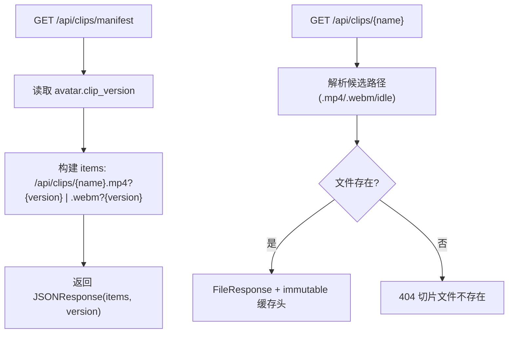
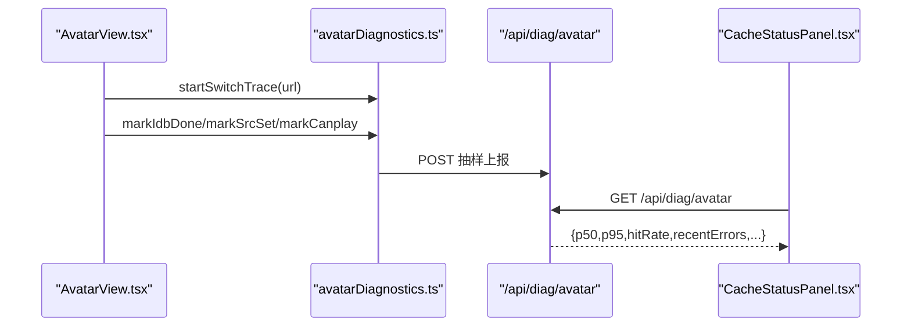
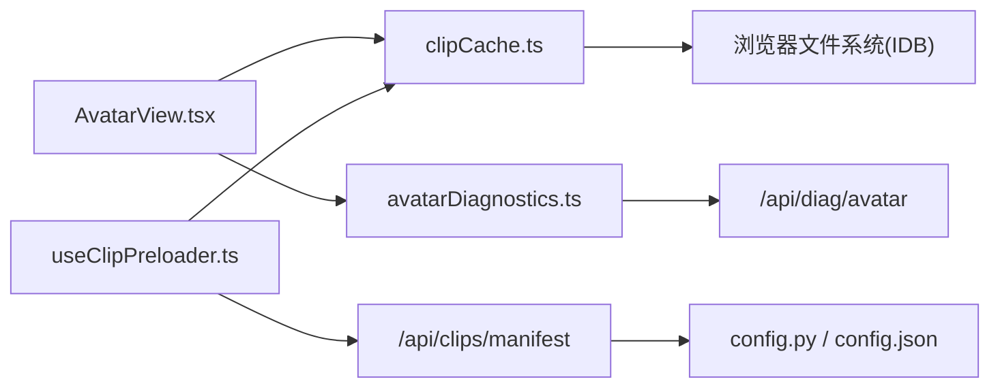

# 缓存管理系统

<cite>
**本文引用的文件列表**
- [clipCache.ts](file://client/src/services/clipCache.ts)
- [AvatarView.tsx](file://client/src/components/AvatarView.tsx)
- [useClipPreloader.ts](file://client/src/hooks/useClipPreloader.ts)
- [routes_clips.py](file://server/api/routes_clips.py)
- [config.py](file://server/config.py)
- [config.json](file://config.json)
- [avatarDiagnostics.ts](file://client/src/services/avatarDiagnostics.ts)
- [routes_diag.py](file://server/api/routes_diag.py)
- [clips.toml](file://clips/short-hair-teacher-girl/clips.toml)
</cite>

## 目录
1. [简介](#简介)
2. [项目结构](#项目结构)
3. [核心组件](#核心组件)
4. [架构总览](#架构总览)
5. [详细组件分析](#详细组件分析)
6. [依赖关系分析](#依赖关系分析)
7. [性能考量](#性能考量)
8. [故障排查指南](#故障排查指南)
9. [结论](#结论)
10. [附录](#附录)

## 简介
本系统为实时对话应用中的“缓存管理系统”，围绕视频切片（语义化短视频片段）的客户端预取、本地持久化与播放切换体验优化展开。其目标是在移动端（尤其是 5G 慢网）环境下，确保卡通形象在段间切换时不出现消失或闪烁，同时提供可观测的诊断面板以监控命中率与延迟分布。

系统采用“服务端清单 + 客户端 IndexedDB 持久化 + 内存 objectURL 预热”的分层缓存策略，配合双视频叠加与首帧等待机制，实现无缝切换与低延迟体验。

## 项目结构
与缓存管理直接相关的代码分布在前后端：
- 前端服务层：IndexedDB 读写、内存 Map 预热、并行预取、统计与清理
- 前端 UI 组件：双 video 叠加、错误兜底、预热与 warmup 机制、诊断埋点
- 前端 Hook：首次解锁后拉取清单并触发预取
- 后端路由：清单接口与切片文件代理（带版本控制与长缓存头）
- 配置：切片版本号、路径、格式等
- 诊断：客户端埋点与服务端聚合统计



图表来源
- [useClipPreloader.ts:65-120](file://client/src/hooks/useClipPreloader.ts#L65-L120)
- [clipCache.ts:182-227](file://client/src/services/clipCache.ts#L182-L227)
- [AvatarView.tsx:255-438](file://client/src/components/AvatarView.tsx#L255-L438)
- [routes_clips.py:41-65](file://server/api/routes_clips.py#L41-L65)
- [routes_clips.py:68-132](file://server/api/routes_clips.py#L68-L132)
- [config.py:219-224](file://server/config.py#L219-L224)
- [config.json:13-18](file://config.json#L13-L18)
- [avatarDiagnostics.ts:158-159](file://client/src/services/avatarDiagnostics.ts#L158-L159)
- [routes_diag.py:54-70](file://server/api/routes_diag.py#L54-L70)

章节来源
- [useClipPreloader.ts:1-126](file://client/src/hooks/useClipPreloader.ts#L1-L126)
- [clipCache.ts:1-307](file://client/src/services/clipCache.ts#L1-L307)
- [AvatarView.tsx:1-800](file://client/src/components/AvatarView.tsx#L1-L800)
- [routes_clips.py:1-133](file://server/api/routes_clips.py#L1-L133)
- [config.py:167-287](file://server/config.py#L167-L287)
- [config.json:1-47](file://config.json#L1-L47)
- [avatarDiagnostics.ts:1-187](file://client/src/services/avatarDiagnostics.ts#L1-L187)
- [routes_diag.py:1-124](file://server/api/routes_diag.py#L1-L124)

## 核心组件
- 客户端缓存服务（IndexedDB + 内存 Map）
  - 负责打开数据库、读取/写入 blob、并行预取、内存预热、统计与清理
- 形象视频组件（双 video 叠加）
  - 负责主视频与循环视频的切换、错误兜底、warmup 预热、首帧等待与淡出桥接
- 预取 Hook
  - 首次解锁后拉取清单并启动并行预取，更新进度与耗时
- 服务端清单与切片代理
  - 返回带版本号的 URL 列表；按路径解析 mp4/webm 并提供长缓存头
- 诊断与可视化
  - 客户端埋点记录切换耗时与命中率；服务端聚合 P50/P95 与错误数；前端面板展示

章节来源
- [clipCache.ts:1-307](file://client/src/services/clipCache.ts#L1-L307)
- [AvatarView.tsx:1-800](file://client/src/components/AvatarView.tsx#L1-L800)
- [useClipPreloader.ts:1-126](file://client/src/hooks/useClipPreloader.ts#L1-L126)
- [routes_clips.py:1-133](file://server/api/routes_clips.py#L1-L133)
- [avatarDiagnostics.ts:1-187](file://client/src/services/avatarDiagnostics.ts#L1-L187)
- [routes_diag.py:1-124](file://server/api/routes_diag.py#L1-L124)

## 架构总览
整体流程分为“预取阶段”和“播放阶段”。预取阶段在用户首次交互后触发，拉取清单并并行下载至 IndexedDB，完成后预热内存 Map；播放阶段在段间切换时优先命中内存/IDB，必要时回退 HTTP，并通过双 video 叠加与首帧等待避免白闪。



图表来源
- [useClipPreloader.ts:65-120](file://client/src/hooks/useClipPreloader.ts#L65-L120)
- [clipCache.ts:182-227](file://client/src/services/clipCache.ts#L182-L227)
- [clipCache.ts:91-108](file://client/src/services/clipCache.ts#L91-L108)
- [routes_clips.py:41-65](file://server/api/routes_clips.py#L41-L65)
- [routes_clips.py:68-132](file://server/api/routes_clips.py#L68-L132)
- [AvatarView.tsx:255-438](file://client/src/components/AvatarView.tsx#L255-L438)
- [avatarDiagnostics.ts:158-159](file://client/src/services/avatarDiagnostics.ts#L158-L159)

## 详细组件分析

### 客户端缓存服务（IndexedDB + 内存 Map）
- 设计要点
  - L1 内存 Map：同步 <1ms 返回 objectURL，避免 IDB 事务开销
  - L2 IndexedDB：持久化 blob，支持跨会话复用
  - 并行预取：最多 4 路并发，单条失败不影响整体
  - 预热：预取完成后批量创建 objectURL 到内存 Map
  - 兼容微信浏览器：IndexedDB 在各版本可用
- 关键能力
  - 初始化、查询、写入、预热、预取、统计、释放、清空
- 复杂度与性能
  - 预取时间复杂度 O(N)，空间复杂度 O(N)（N 为切片数量）
  - 内存 Map 命中 O(1)，IDB 读写为异步事务，存在少量 I/O 开销

```mermaid
classDiagram
class ClipCache {
+initClipCache() Promise<void>
+getCachedClipUrl(url) Promise<string|null>
+putClip(url, blob) Promise<void>
+prefetchClips(urls, onProgress, signal) Promise<{ok,fail}>
+warmupMemoryCache() Promise<number>
+getClipCacheStats() Promise<{count,bytes,memoryCached}>
+getMemoryCachedUrls() string[]
+releaseMemoryCacheEntry(url) void
+clearClipCache() Promise<void>
}
```

图表来源
- [clipCache.ts:44-50](file://client/src/services/clipCache.ts#L44-L50)
- [clipCache.ts:91-108](file://client/src/services/clipCache.ts#L91-L108)
- [clipCache.ts:111-138](file://client/src/services/clipCache.ts#L111-L138)
- [clipCache.ts:144-172](file://client/src/services/clipCache.ts#L144-L172)
- [clipCache.ts:182-227](file://client/src/services/clipCache.ts#L182-L227)
- [clipCache.ts:230-259](file://client/src/services/clipCache.ts#L230-L259)
- [clipCache.ts:264-266](file://client/src/services/clipCache.ts#L264-L266)
- [clipCache.ts:271-281](file://client/src/services/clipCache.ts#L271-L281)
- [clipCache.ts:284-307](file://client/src/services/clipCache.ts#L284-L307)

章节来源
- [clipCache.ts:1-307](file://client/src/services/clipCache.ts#L1-L307)

### 形象视频组件（双 video 叠加与切换）
- 设计要点
  - 双 video 绝对叠加：主视频 + 循环视频（idle/analysis），通过 opacity 过渡消除黑闪
  - 首段切换：等待 analysis 循环自然结束，再切换到主视频
  - 错误兜底：objectURL 失效回退原始 HTTP；webm 失败尝试 mp4 变体
  - 预热与 warmup：提前将下一段 blob 设置到空闲 video 元素，解码完成后零停顿切换
  - 首帧等待：requestVideoFrameCallback → playing → 硬超时，确保旧帧不被过早隐藏
- 关键修复（5G 慢网）
  - showMain 中 canplay 兜底超时从 800ms 延长至 5000ms，避免在 5G 下过早触发导致形象消失
- 复杂度与性能
  - 切换路径包含事件监听与定时器，最坏情况等待硬超时（1500ms）
  - warmup 减少 canplay 等待，显著降低移动端 X5 内核解码停顿



图表来源
- [AvatarView.tsx:255-438](file://client/src/components/AvatarView.tsx#L255-L438)
- [AvatarView.tsx:285-384](file://client/src/components/AvatarView.tsx#L285-L384)
- [AvatarView.tsx:294-354](file://client/src/components/AvatarView.tsx#L294-L354)

章节来源
- [AvatarView.tsx:1-800](file://client/src/components/AvatarView.tsx#L1-L800)

### 预取 Hook（首次解锁后并行预取）
- 调用时机：App 在首次交互解锁后调用
- 流程：初始化 IndexedDB → 拉取清单 → 并行预取 → 预热内存 → 更新状态
- 特性：AbortController 支持中途取消；进度回调用于 UI 反馈



图表来源
- [useClipPreloader.ts:65-120](file://client/src/hooks/useClipPreloader.ts#L65-L120)
- [clipCache.ts:182-227](file://client/src/services/clipCache.ts#L182-L227)
- [routes_clips.py:41-65](file://server/api/routes_clips.py#L41-L65)

章节来源
- [useClipPreloader.ts:1-126](file://client/src/hooks/useClipPreloader.ts#L1-L126)

### 服务端清单与切片代理
- 清单接口
  - 返回所有预取目标的 URL 列表（含 ?v=N 版本号），无缓存头，保证实时获取最新版本号
- 切片代理
  - 根据扩展名推导媒体类型，优先 .mp4（移动端友好），不存在则回退 .webm
  - 对切片文件设置长缓存头（immutable），依赖 URL 版本号进行失效控制
- 配置联动
  - avatar.clip_version 决定清单版本，发布新切片时 bump 该值即可使客户端自动失效旧缓存



图表来源
- [routes_clips.py:41-65](file://server/api/routes_clips.py#L41-L65)
- [routes_clips.py:68-132](file://server/api/routes_clips.py#L68-L132)
- [config.py:219-224](file://server/config.py#L219-L224)
- [config.json:13-18](file://config.json#L13-L18)

章节来源
- [routes_clips.py:1-133](file://server/api/routes_clips.py#L1-L133)
- [config.py:167-287](file://server/config.py#L167-L287)
- [config.json:1-47](file://config.json#L1-L47)

### 诊断与可视化
- 客户端埋点
  - 记录 tsStart、tsIdbLookupDone、tsSrcSet、tsCanplay、cacheHit、resolvedSrcKind
  - 计算 loadingDurationMs 与 totalSwitchDurationMs，抽样上报服务端
- 服务端聚合
  - 环形缓冲最近 1000 条，JSONL 持久化；GET 返回 P50/P95、命中率、错误数
- 前端面板
  - 展示 IndexedDB 记录数/占用字节、内存 objectURL 缓存、SW 状态、客户端与服务端统计



图表来源
- [avatarDiagnostics.ts:158-159](file://client/src/services/avatarDiagnostics.ts#L158-L159)
- [routes_diag.py:54-70](file://server/api/routes_diag.py#L54-L70)
- [routes_diag.py:73-116](file://server/api/routes_diag.py#L73-L116)

章节来源
- [avatarDiagnostics.ts:1-187](file://client/src/services/avatarDiagnostics.ts#L1-L187)
- [routes_diag.py:1-124](file://server/api/routes_diag.py#L1-L124)

## 依赖关系分析
- 组件耦合
  - AvatarView 依赖 clipCache 的 getCachedClipUrl 与 releaseMemoryCacheEntry
  - useClipPreloader 依赖 clipCache 的 init/prefetch/stats/memory keys
  - routes_clips 依赖 config 的 avatar 配置（clip_version、clips_dir、idle_animation）
  - 诊断模块独立于播放逻辑，仅通过事件与 API 通信
- 外部依赖
  - IndexedDB（浏览器存储）
  - Service Worker（可选，用于更进一步的资源缓存）
  - MinIO（对象存储，切片生成与上传链路使用，非本次缓存主线）



图表来源
- [AvatarView.tsx:10-11](file://client/src/components/AvatarView.tsx#L10-L11)
- [clipCache.ts:91-108](file://client/src/services/clipCache.ts#L91-L108)
- [useClipPreloader.ts:14-19](file://client/src/hooks/useClipPreloader.ts#L14-L19)
- [routes_clips.py:41-65](file://server/api/routes_clips.py#L41-L65)
- [config.py:219-224](file://server/config.py#L219-L224)
- [avatarDiagnostics.ts:158-159](file://client/src/services/avatarDiagnostics.ts#L158-L159)
- [routes_diag.py:54-70](file://server/api/routes_diag.py#L54-L70)

章节来源
- [AvatarView.tsx:1-800](file://client/src/components/AvatarView.tsx#L1-L800)
- [clipCache.ts:1-307](file://client/src/services/clipCache.ts#L1-L307)
- [useClipPreloader.ts:1-126](file://client/src/hooks/useClipPreloader.ts#L1-L126)
- [routes_clips.py:1-133](file://server/api/routes_clips.py#L1-L133)
- [config.py:167-287](file://server/config.py#L167-L287)
- [avatarDiagnostics.ts:1-187](file://client/src/services/avatarDiagnostics.ts#L1-L187)
- [routes_diag.py:1-124](file://server/api/routes_diag.py#L1-L124)

## 性能考量
- 预取并发度
  - 默认 4 路并发，平衡网络带宽与 CPU 压力；可根据设备能力调整
- 内存 Map 预热
  - 预取完成后批量创建 objectURL，首段切换 0 延迟
- 首帧等待与硬超时
  - 优先 requestVideoFrameCallback，其次 playing + 微等待，最后硬超时 1500ms
  - showMain 兜底超时 5000ms，覆盖 5G 慢网场景
- 错误兜底
  - webm→mp4 变体回退；objectURL 失效→原始 HTTP 回退
- 诊断指标
  - 命中率、P50/P95 总耗时与加载耗时，便于定位瓶颈

[本节为通用指导，无需特定文件引用]

## 故障排查指南
- 症状：开始说话时卡通形象消失 1-2 秒
  - 根因：showMain 的 canplay 兜底超时过短（原 800ms），在 5G 慢网下早于 canplay 触发，导致 mainVideo 无帧显示且 loopVideo 被隐藏
  - 修复：将 showMain 的超时从 800ms 延长至 5000ms，确保 canplay 先于超时触发
  - 验证：在 5G 移动网络下发送消息，观察是否仍出现消失现象
- 症状：切换卡顿或白闪
  - 检查 warmup 是否生效（warmupPromiseMapRef 与 warmupMapRef）
  - 确认 requestVideoFrameCallback 与 playing 事件是否正常触发
  - 查看诊断面板的 P95 总耗时与命中率
- 症状：缓存未命中或命中率低
  - 检查 manifest 版本是否与 config.json 一致
  - 确认预取是否成功（prefetchClips ok/fail 计数）
  - 查看内存 Map 是否预热（memoryCached 数量）
- 症状：Service Worker 未激活
  - 检查 SW 注册与 scope，确认控制器变更事件
  - 确认页面是否在 HTTPS 或 localhost 环境

章节来源
- [AvatarView.tsx:429-437](file://client/src/components/AvatarView.tsx#L429-L437)
- [useClipPreloader.ts:84-110](file://client/src/hooks/useClipPreloader.ts#L84-L110)
- [routes_clips.py:41-65](file://server/api/routes_clips.py#L41-L65)
- [config.json:13-18](file://config.json#L13-L18)
- [avatarDiagnostics.ts:163-187](file://client/src/services/avatarDiagnostics.ts#L163-L187)

## 结论
本缓存管理系统通过“清单 + 预取 + 持久化 + 预热 + 双视频叠加 + 首帧等待”的组合策略，有效解决了移动端（尤其 5G 慢网）下的视频切换卡顿与形象消失问题。结合完善的诊断与可视化能力，团队可以持续监控命中率与延迟分布，快速定位并优化用户体验。

[本节为总结性内容，无需特定文件引用]

## 附录
- 切片库清单（示例）
  - clips.toml 定义了语义化切片的元数据与过渡规则，服务端据此生成清单与路径映射
- 配置项说明
  - avatar.clip_version：控制清单版本，发布新切片时需 bump
  - avatar.clips_dir：切片资源目录
  - avatar.idle_animation：待机动画路径（支持 mp4/webm 双变体）

章节来源
- [clips.toml:1-148](file://clips/short-hair-teacher-girl/clips.toml#L1-L148)
- [config.py:219-224](file://server/config.py#L219-L224)
- [config.json:13-18](file://config.json#L13-L18)