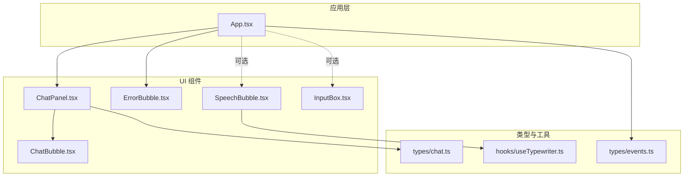
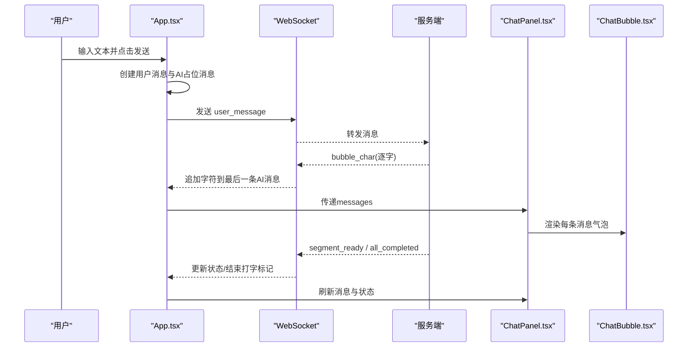
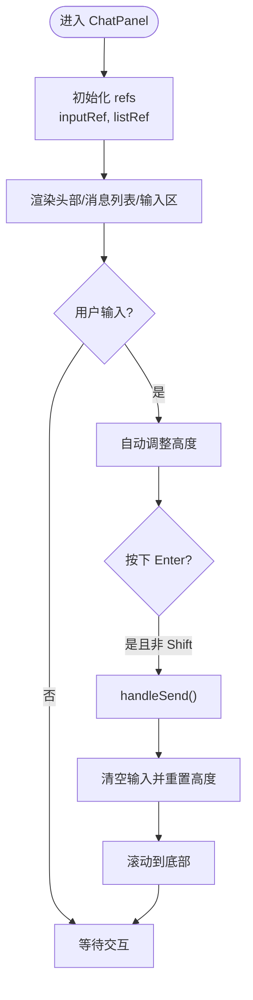
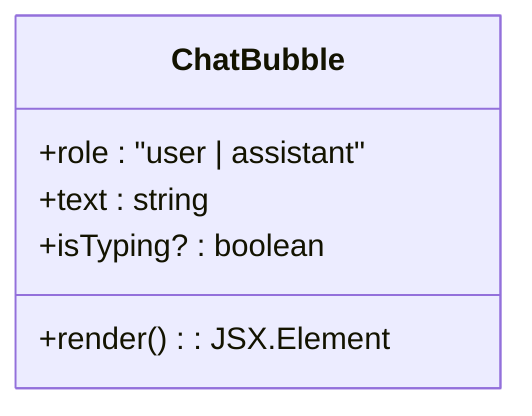
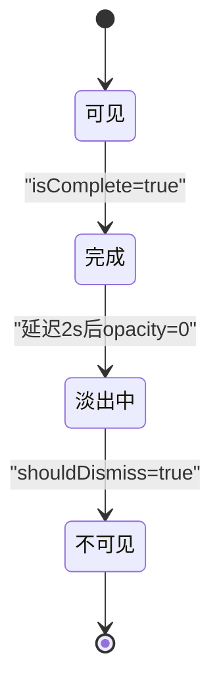
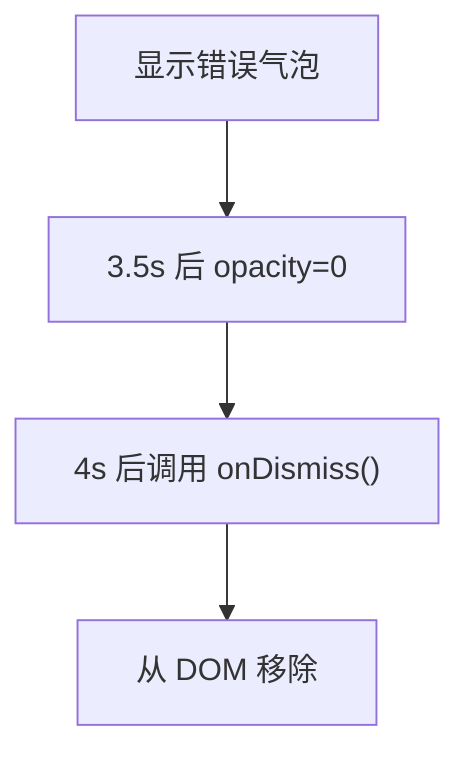
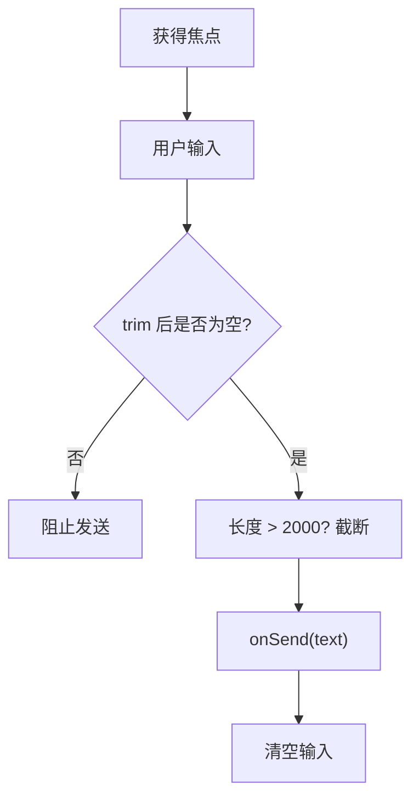
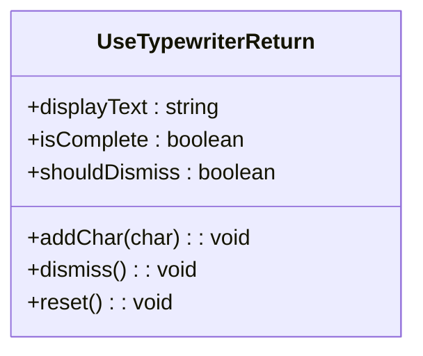
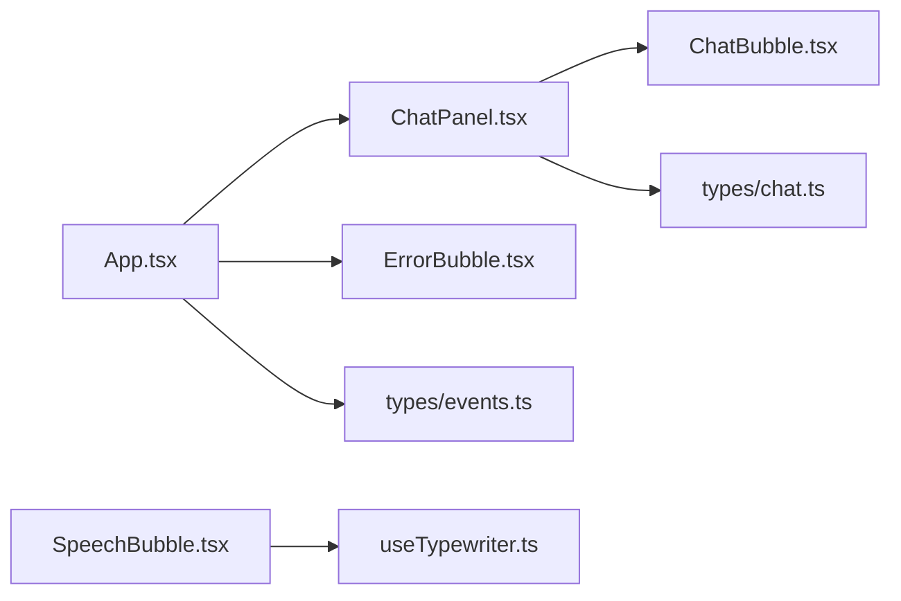

# 聊天界面组件

<cite>
**本文引用的文件**   
- [ChatPanel.tsx](file://client/src/components/ChatPanel.tsx)
- [ChatBubble.tsx](file://client/src/components/ChatBubble.tsx)
- [SpeechBubble.tsx](file://client/src/components/SpeechBubble.tsx)
- [ErrorBubble.tsx](file://client/src/components/ErrorBubble.tsx)
- [InputBox.tsx](file://client/src/components/InputBox.tsx)
- [App.tsx](file://client/src/App.tsx)
- [chat.ts](file://client/src/types/chat.ts)
- [events.ts](file://client/src/types/events.ts)
- [useTypewriter.ts](file://client/src/hooks/useTypewriter.ts)
</cite>

## 目录
1. [简介](#简介)
2. [项目结构](#项目结构)
3. [核心组件](#核心组件)
4. [架构总览](#架构总览)
5. [详细组件分析](#详细组件分析)
6. [依赖关系分析](#依赖关系分析)
7. [性能考虑](#性能考虑)
8. [故障排查指南](#故障排查指南)
9. [结论](#结论)
10. [附录：使用示例与组合模式](#附录使用示例与组合模式)

## 简介
本文件为 RealTimeTalk 聊天界面组件的全面文档，聚焦以下目标：
- 详细说明 ChatPanel 主面板的布局设计与交互逻辑（消息列表渲染、输入框控制、滚动管理）
- 文档化 ChatBubble 消息气泡的消息显示、时间戳格式化与角色标识
- 解释 SpeechBubble 语音气泡的动画效果、打字机效果与视觉反馈
- 说明 ErrorBubble 错误提示的错误展示、用户交互与自动消失机制
- 详细介绍 InputBox 输入框的文本处理、键盘事件与输入验证
- 提供样式定制、主题支持与响应式设计的建议
- 给出具体组件使用示例与组合模式
- 涵盖可访问性支持、国际化适配与性能优化
- 面向初学者提供 UI 组件开发基础，面向高级开发者提供深入定制与扩展指南

## 项目结构
RealTimeTalk 前端采用 React + TypeScript 组织，聊天相关组件位于 client/src/components，类型定义在 types，通用 Hook 在 hooks。根组件 App.tsx 负责状态编排与 WebSocket 事件分发，将消息流驱动到 ChatPanel 与气泡组件。

图表来源
- [App.tsx:1-326](file://client/src/App.tsx#L1-L326)
- [ChatPanel.tsx:1-200](file://client/src/components/ChatPanel.tsx#L1-L200)
- [ChatBubble.tsx:1-86](file://client/src/components/ChatBubble.tsx#L1-L86)
- [SpeechBubble.tsx:1-119](file://client/src/components/SpeechBubble.tsx#L1-L119)
- [ErrorBubble.tsx:1-70](file://client/src/components/ErrorBubble.tsx#L1-L70)
- [InputBox.tsx:1-113](file://client/src/components/InputBox.tsx#L1-L113)
- [chat.ts:1-11](file://client/src/types/chat.ts#L1-L11)
- [events.ts:1-113](file://client/src/types/events.ts#L1-L113)
- [useTypewriter.ts:1-77](file://client/src/hooks/useTypewriter.ts#L1-L77)

章节来源
- [App.tsx:1-326](file://client/src/App.tsx#L1-L326)
- [ChatPanel.tsx:1-200](file://client/src/components/ChatPanel.tsx#L1-L200)
- [ChatBubble.tsx:1-86](file://client/src/components/ChatBubble.tsx#L1-L86)
- [SpeechBubble.tsx:1-119](file://client/src/components/SpeechBubble.tsx#L1-L119)
- [ErrorBubble.tsx:1-70](file://client/src/components/ErrorBubble.tsx#L1-L70)
- [InputBox.tsx:1-113](file://client/src/components/InputBox.tsx#L1-L113)
- [chat.ts:1-11](file://client/src/types/chat.ts#L1-L11)
- [events.ts:1-113](file://client/src/types/events.ts#L1-L113)
- [useTypewriter.ts:1-77](file://client/src/hooks/useTypewriter.ts#L1-L77)

## 核心组件
- ChatPanel：聊天主面板，承载头部信息、消息列表与输入区，负责自动滚动与发送流程
- ChatBubble：单条消息气泡，区分用户与 AI 角色，支持占位“正在输入”动画
- SpeechBubble：语音对话气泡，具备毛玻璃背景、打字光标、淡入淡出与自动消失
- ErrorBubble：错误提示气泡，红色警告风格，固定时长后自动消失
- InputBox：独立输入框组件，支持回车发送、空消息拦截与超长截断

章节来源
- [ChatPanel.tsx:1-200](file://client/src/components/ChatPanel.tsx#L1-L200)
- [ChatBubble.tsx:1-86](file://client/src/components/ChatBubble.tsx#L1-L86)
- [SpeechBubble.tsx:1-119](file://client/src/components/SpeechBubble.tsx#L1-L119)
- [ErrorBubble.tsx:1-70](file://client/src/components/ErrorBubble.tsx#L1-L70)
- [InputBox.tsx:1-113](file://client/src/components/InputBox.tsx#L1-L113)

## 架构总览
整体数据流由 App 驱动：用户输入触发发送，服务端通过 WebSocket 推送字符增量与段完成信号，App 更新本地消息数组并交由 ChatPanel 渲染；同时根据状态切换 Avatar 播放与错误提示。

图表来源
- [App.tsx:87-183](file://client/src/App.tsx#L87-L183)
- [App.tsx:224-252](file://client/src/App.tsx#L224-L252)
- [ChatPanel.tsx:129-136](file://client/src/components/ChatPanel.tsx#L129-L136)
- [ChatBubble.tsx:15-83](file://client/src/components/ChatBubble.tsx#L15-L83)
- [events.ts:54-92](file://client/src/types/events.ts#L54-L92)

## 详细组件分析

### ChatPanel 主面板
职责与特性
- 布局：顶部头像与名称、中间消息列表（可滚动）、底部输入框与发送按钮
- 交互：Enter 发送、Shift+Enter 换行、输入框自适应高度、禁用态控制
- 滚动：新消息到达时自动滚动到底部
- 渲染：遍历 messages 渲染 ChatBubble，空消息时显示引导文案

关键实现要点
- 使用 ref 获取 textarea 与消息列表容器
- useEffect 监听 messages 变化，设置 scrollTop 至 scrollHeight
- handleSend 清理输入值并重置高度
- handleKeyDown 拦截 Enter 键
- handleInput 动态计算内容高度并限制最大高度

图表来源
- [ChatPanel.tsx:17-51](file://client/src/components/ChatPanel.tsx#L17-L51)
- [ChatPanel.tsx:22-26](file://client/src/components/ChatPanel.tsx#L22-L26)
- [ChatPanel.tsx:28-43](file://client/src/components/ChatPanel.tsx#L28-L43)
- [ChatPanel.tsx:45-51](file://client/src/components/ChatPanel.tsx#L45-L51)
- [ChatPanel.tsx:129-136](file://client/src/components/ChatPanel.tsx#L129-L136)

章节来源
- [ChatPanel.tsx:1-200](file://client/src/components/ChatPanel.tsx#L1-L200)
- [chat.ts:4-10](file://client/src/types/chat.ts#L4-L10)

### ChatBubble 消息气泡
职责与特性
- 角色区分：用户消息右对齐蓝色背景，AI 消息左对齐白色背景带边框
- 文本渲染：统一 pre-wrap 保持换行一致性，word-break 防溢出
- 占位动画：当 isTyping 为真时显示三点跳动动画
- 性能：使用 memo 避免不必要的重渲染

图表来源
- [ChatBubble.tsx:9-13](file://client/src/components/ChatBubble.tsx#L9-L13)
- [ChatBubble.tsx:15-83](file://client/src/components/ChatBubble.tsx#L15-L83)

章节来源
- [ChatBubble.tsx:1-86](file://client/src/components/ChatBubble.tsx#L1-L86)

### SpeechBubble 语音气泡
职责与特性
- 视觉：半透明毛玻璃背景、居中定位、阴影与圆角
- 动画：打字光标闪烁、出现时立即显示、完成后延迟 2s 开始淡出、再经 0.5s 完全隐藏
- 状态：isTyping 控制光标，isComplete 控制计时器，shouldDismiss 控制最终移除
- 错误模式：isError 切换红白配色

图表来源
- [SpeechBubble.tsx:23-57](file://client/src/components/SpeechBubble.tsx#L23-L57)
- [SpeechBubble.tsx:67-116](file://client/src/components/SpeechBubble.tsx#L67-L116)

章节来源
- [SpeechBubble.tsx:1-119](file://client/src/components/SpeechBubble.tsx#L1-L119)

### ErrorBubble 错误提示
职责与特性
- 视觉：红色警告色调、毛玻璃背景、居中定位
- 行为：显示后立即开始计时，约 3.5s 开始淡出，4s 后回调 onDismiss 通知父组件移除
- 无交互：pointerEvents 设为 none，不可点击

图表来源
- [ErrorBubble.tsx:15-35](file://client/src/components/ErrorBubble.tsx#L15-L35)
- [ErrorBubble.tsx:39-68](file://client/src/components/ErrorBubble.tsx#L39-L68)

章节来源
- [ErrorBubble.tsx:1-70](file://client/src/components/ErrorBubble.tsx#L1-L70)

### InputBox 输入框
职责与特性
- 交互：回车发送、空消息拦截、自动 focus
- 校验：trim 后为空不允许发送，超过 2000 字符自动截断
- 外观：悬浮胶囊形输入栏，发送按钮随输入状态变色

图表来源
- [InputBox.tsx:19-48](file://client/src/components/InputBox.tsx#L19-L48)
- [InputBox.tsx:52-112](file://client/src/components/InputBox.tsx#L52-L112)

章节来源
- [InputBox.tsx:1-113](file://client/src/components/InputBox.tsx#L1-L113)

### 打字机 Hook：useTypewriter
职责与特性
- 接收逐字事件，按间隔追加字符
- 维护 displayText、isComplete、shouldDismiss 状态
- 提供 addChar、dismiss、reset 方法

图表来源
- [useTypewriter.ts:11-27](file://client/src/hooks/useTypewriter.ts#L11-L27)
- [useTypewriter.ts:29-76](file://client/src/hooks/useTypewriter.ts#L29-L76)

章节来源
- [useTypewriter.ts:1-77](file://client/src/hooks/useTypewriter.ts#L1-L77)

## 依赖关系分析
- ChatPanel 依赖 ChatBubble 与 ChatMessage 类型
- App 管理全局状态与 WebSocket 事件，向 ChatPanel 注入 messages，向 ErrorBubble 注入错误消息
- SpeechBubble 可与 useTypewriter 配合实现语音气泡的打字机效果
- 所有组件均使用内联样式，便于快速定制与主题化

图表来源
- [App.tsx:1-326](file://client/src/App.tsx#L1-L326)
- [ChatPanel.tsx:1-200](file://client/src/components/ChatPanel.tsx#L1-L200)
- [ChatBubble.tsx:1-86](file://client/src/components/ChatBubble.tsx#L1-L86)
- [SpeechBubble.tsx:1-119](file://client/src/components/SpeechBubble.tsx#L1-L119)
- [ErrorBubble.tsx:1-70](file://client/src/components/ErrorBubble.tsx#L1-L70)
- [useTypewriter.ts:1-77](file://client/src/hooks/useTypewriter.ts#L1-L77)
- [chat.ts:1-11](file://client/src/types/chat.ts#L1-L11)
- [events.ts:1-113](file://client/src/types/events.ts#L1-L113)

章节来源
- [App.tsx:1-326](file://client/src/App.tsx#L1-L326)
- [ChatPanel.tsx:1-200](file://client/src/components/ChatPanel.tsx#L1-L200)
- [ChatBubble.tsx:1-86](file://client/src/components/ChatBubble.tsx#L1-L86)
- [SpeechBubble.tsx:1-119](file://client/src/components/SpeechBubble.tsx#L1-L119)
- [ErrorBubble.tsx:1-70](file://client/src/components/ErrorBubble.tsx#L1-L70)
- [useTypewriter.ts:1-77](file://client/src/hooks/useTypewriter.ts#L1-L77)
- [chat.ts:1-11](file://client/src/types/chat.ts#L1-L11)
- [events.ts:1-113](file://client/src/types/events.ts#L1-L113)

## 性能考虑
- 列表渲染
  - 使用稳定 key（如 id）减少重排
  - 对 ChatBubble 使用 memo 避免重复渲染
- 滚动性能
  - 仅在 messages 变化时滚动到底部，避免频繁操作
  - 长列表场景可考虑虚拟滚动（React Window/Virtuoso）
- 输入框高度计算
  - 使用 requestAnimationFrame 或节流优化高频 onInput 计算
- 动画与过渡
  - 合理使用 CSS transition，避免强制同步布局
  - 大量气泡同时淡出时注意 GPU 加速（transform/opacity）
- 内存与定时器
  - 确保 useEffect 返回清理函数，清除 setTimeout 与事件监听

[本节为通用指导，不直接分析具体文件]

## 故障排查指南
常见问题与定位
- 消息未滚动到底部
  - 检查是否监听 messages 变化并在 effect 中设置 scrollTop
  - 确认列表容器 overflowY 为 auto
- 发送无效
  - 检查 disabled 状态与 trim 后是否为空
  - 确认 onKeyDown 是否正确拦截 Enter
- 语音气泡不消失
  - 检查 isComplete 与 shouldDismiss 的状态流转
  - 确认 dismiss 定时器未被后续 addChar 覆盖
- 错误提示不消失
  - 核对 3.5s 与 4s 定时器是否被正确清理
  - 确认父组件 onDismiss 是否清除了错误状态

章节来源
- [ChatPanel.tsx:22-26](file://client/src/components/ChatPanel.tsx#L22-L26)
- [ChatPanel.tsx:28-43](file://client/src/components/ChatPanel.tsx#L28-L43)
- [SpeechBubble.tsx:33-57](file://client/src/components/SpeechBubble.tsx#L33-L57)
- [ErrorBubble.tsx:18-35](file://client/src/components/ErrorBubble.tsx#L18-L35)

## 结论
本套聊天界面组件以清晰的职责划分与稳定的状态流转为基础，实现了消息列表渲染、输入控制、语音气泡动画与错误提示等核心能力。通过合理的性能优化与可扩展的样式方案，既能满足初学者的上手需求，也能支撑高级用户的深度定制与集成。

[本节为总结性内容，不直接分析具体文件]

## 附录：使用示例与组合模式

- 基本组合
  - 在 App 中维护 messages 与发送回调，将 messages 与 onSend 传入 ChatPanel
  - 在 App 中根据错误状态渲染 ErrorBubble
- 语音气泡组合
  - 使用 useTypewriter 管理语音文本与消失状态，结合 SpeechBubble 展示
- 独立输入框
  - 在需要悬浮输入的场景引入 InputBox，并通过 visible 控制显隐
- 主题与样式定制
  - 将颜色、圆角、阴影等常量抽离为配置对象，集中管理
  - 使用 CSS 变量或主题 Provider 注入全局样式
- 响应式设计
  - 使用相对单位与媒体查询适配不同屏幕尺寸
  - 在小屏设备上限制最大宽度与最小间距
- 可访问性
  - 为输入框与按钮添加 aria-label 与 role
  - 为动态内容区域添加 aria-live 以便读屏器播报
- 国际化
  - 将提示文案与占位符抽取为 i18n 资源，按当前语言切换
- 时间戳格式化
  - 在 ChatBubble 或外层包装组件中根据 timestamp 字段进行本地化时间格式化

章节来源
- [App.tsx:287-299](file://client/src/App.tsx#L287-L299)
- [ChatPanel.tsx:129-136](file://client/src/components/ChatPanel.tsx#L129-L136)
- [SpeechBubble.tsx:10-21](file://client/src/components/SpeechBubble.tsx#L10-L21)
- [useTypewriter.ts:29-76](file://client/src/hooks/useTypewriter.ts#L29-L76)
- [InputBox.tsx:14-17](file://client/src/components/InputBox.tsx#L14-L17)
- [chat.ts:4-10](file://client/src/types/chat.ts#L4-L10)