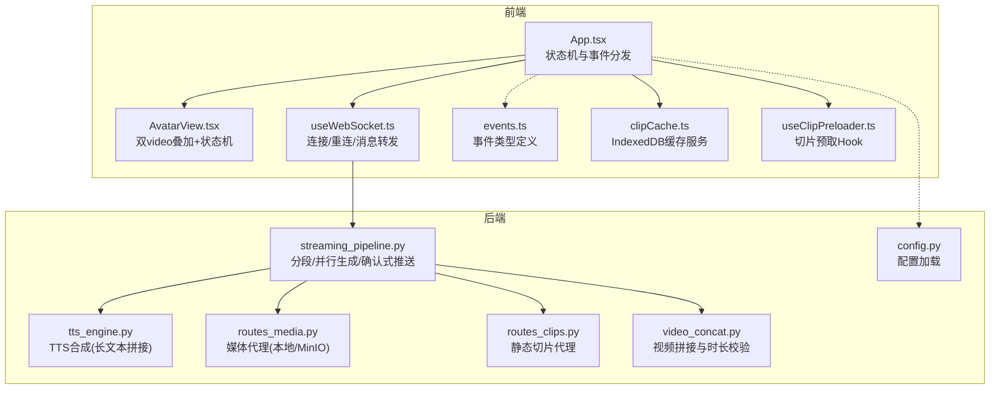
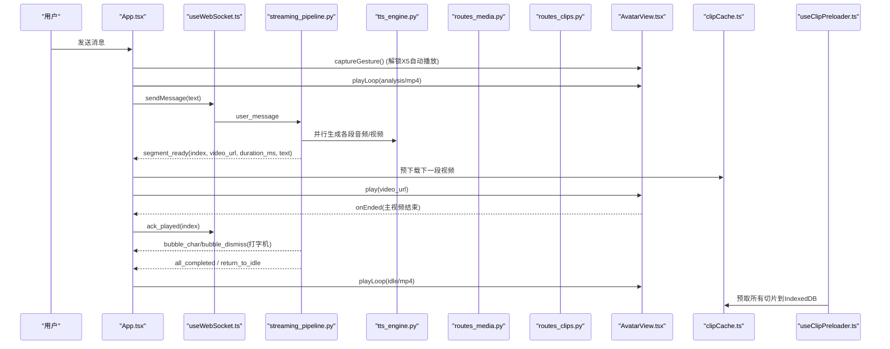
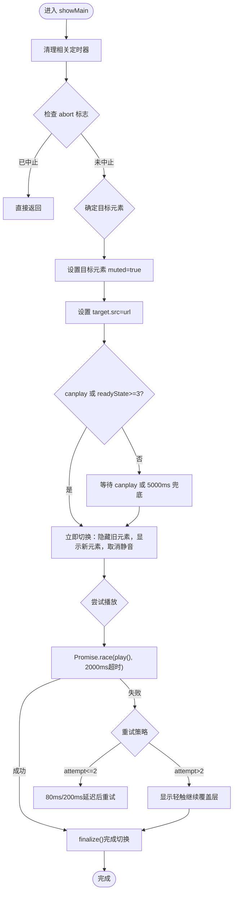
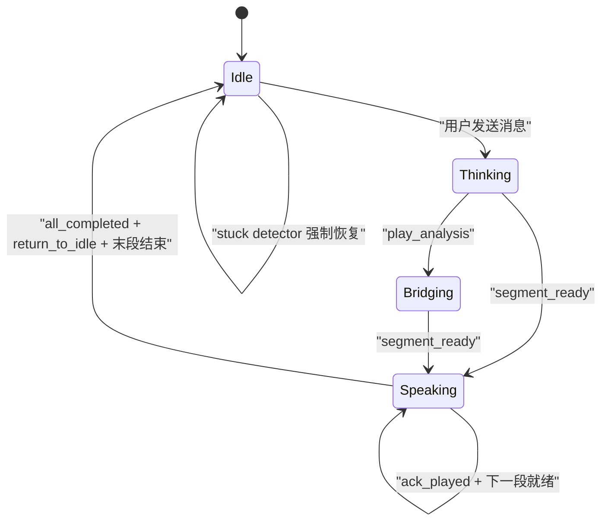
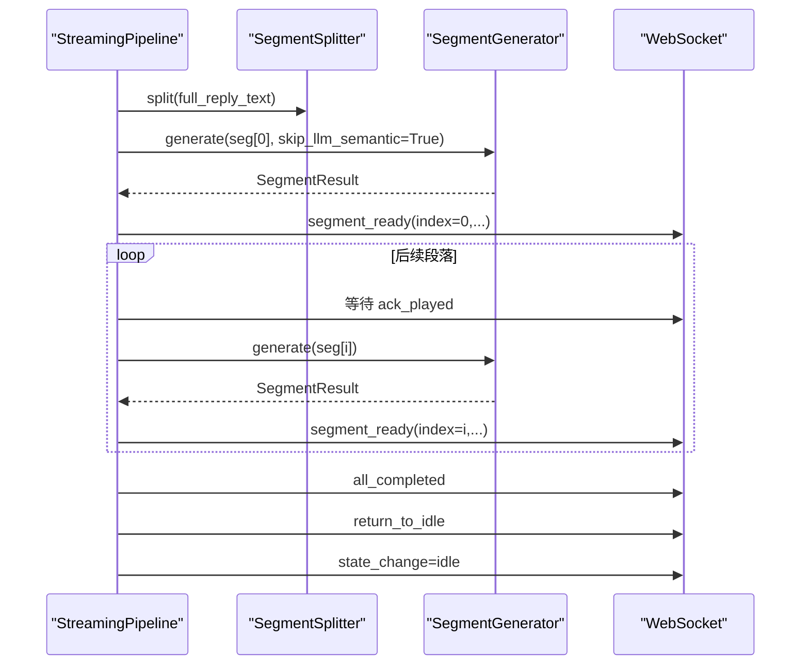
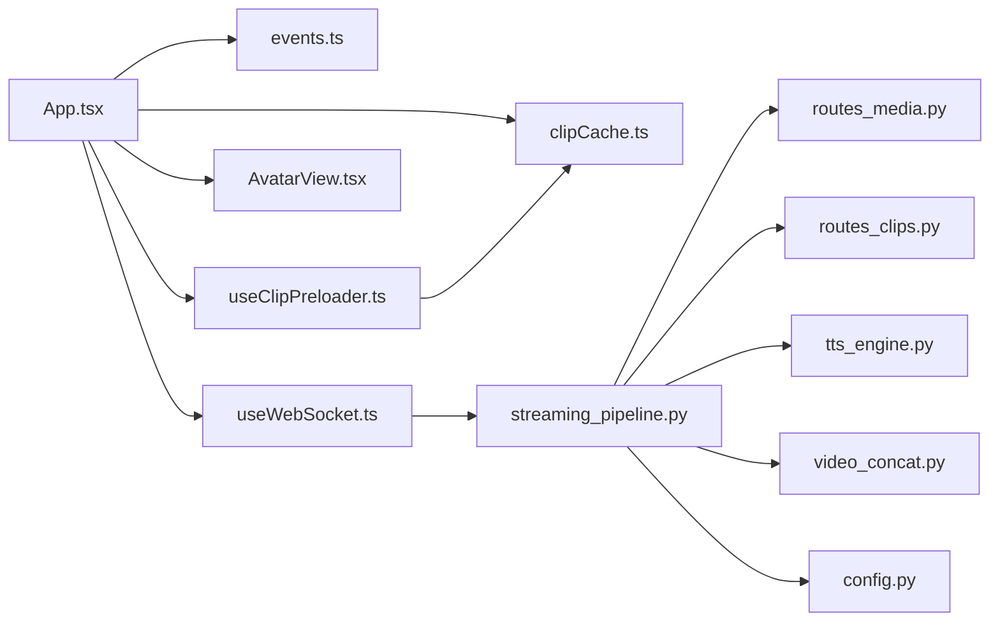

# 虚拟形象系统

<cite>
**本文引用的文件列表**
- [AvatarView.tsx](file://client/src/components/AvatarView.tsx)
- [App.tsx](file://client/src/App.tsx)
- [events.ts](file://client/src/types/events.ts)
- [useWebSocket.ts](file://client/src/hooks/useWebSocket.ts)
- [routes_clips.py](file://server/api/routes_clips.py)
- [routes_media.py](file://server/api/routes_media.py)
- [streaming_pipeline.py](file://server/pipeline/streaming_pipeline.py)
- [tts_engine.py](file://server/services/tts_engine.py)
- [config.py](file://server/config.py)
- [clips.toml](file://clips/short-hair-teacher-girl/clips.toml)
- [clipCache.ts](file://client/src/services/clipCache.ts)
- [useClipPreloader.ts](file://client/src/hooks/useClipPreloader.ts)
- [video_concat.py](file://server/services/video_concat.py)
- [default_system_prompt.txt](file://server/resources/default_system_prompt.txt)
</cite>

## 更新摘要
**变更内容**
- 新增完整的微信移动端浏览器支持，包括 isWeChatMobileUA 检测、静态图片回退机制
- 增强 X5 内核视频播放改进，包含手势捕获和自动播放策略处理
- 优化错误处理机制，使用 Promise.race 超时防止 play() 静默挂起
- 改进 blob URL 管理，防止内存泄漏并修复时序问题
- 完善 WebM/MP4 双格式自动回退机制，适配 iOS Safari 和微信内置浏览器
- 增强 5G 网络兼容性，延长 canplay 超时时间至 5000ms
- 后端语音重复修复，追加 FFmpeg 输出后 ffprobe 校验确保时长精确匹配
- LLM 回复长度限制，每轮控制在约 1000 字以内
- **新增** 40vh 高度调整用于更好的可见性，objectPosition-based 定位替代 scale transform
- **新增** 防御性空闲状态处理，防止 segment_ready 竞态覆盖 idle 状态
- **新增** 全面的 stuck detector 系统，针对 X5 内核环境的主从双向检测
- **新增** abort 机制防止 race conditions，text generation completion detection

## 目录
1. [简介](#简介)
2. [项目结构](#项目结构)
3. [核心组件](#核心组件)
4. [架构总览](#架构总览)
5. [详细组件分析](#详细组件分析)
6. [依赖关系分析](#依赖关系分析)
7. [性能与优化](#性能与优化)
8. [故障排查指南](#故障排查指南)
9. [结论](#结论)
10. [附录：使用示例与扩展指南](#附录使用示例与扩展指南)

## 简介
本文件面向 RealTimeTalk 虚拟形象系统的实现文档，聚焦 AvatarView 组件的渲染与状态机、视频预加载与无缝切换、内存管理、与后端的同步机制（WebSocket + 媒体代理）、错误处理、配置项与扩展点，并兼顾浏览器兼容性与移动端优化。读者可据此快速上手集成，也可深入调优以获得更流畅的实时对话体验。

**重大更新** 本次更新重点增强了移动设备特别是微信环境下的用户体验，实现了完整的微信移动端浏览器支持、X5 内核优化、手势捕获解锁自动播放策略，以及完善的错误处理和内存管理机制。同时解决了 5G 网络下视频播放卡顿问题，并通过 WebM/MP4 双格式自动回退机制显著提升了在 iOS Safari 和微信内置浏览器上的兼容性。**新增的 stuck detector 系统和 abort 机制进一步提升了系统在复杂网络环境下的稳定性。**

## 项目结构
前端以 React 组件为核心，通过 WebSocket 接收服务端推送的"段落就绪"事件，驱动 AvatarView 播放对应片段；后端负责文本分段、TTS 合成、视频生成与流式推送。静态切片资源由 clips 目录提供，并通过 API 路由对外暴露。



**图表来源**
- [App.tsx:1-985](file://client/src/App.tsx#L1-L985)
- [AvatarView.tsx:1-1493](file://client/src/components/AvatarView.tsx#L1-L1493)
- [useWebSocket.ts:41-131](file://client/src/hooks/useWebSocket.ts#L41-L131)
- [events.ts:1-113](file://client/src/types/events.ts#L1-L113)
- [clipCache.ts:1-307](file://client/src/services/clipCache.ts#L1-L307)
- [useClipPreloader.ts:1-126](file://client/src/hooks/useClipPreloader.ts#L1-L126)
- [streaming_pipeline.py:1-214](file://server/pipeline/streaming_pipeline.py#L1-L214)
- [tts_engine.py:1-234](file://server/services/tts_engine.py#L1-L234)
- [routes_media.py:1-65](file://server/api/routes_media.py#L1-L65)
- [routes_clips.py:1-75](file://server/api/routes_clips.py#L1-L75)
- [config.py:1-287](file://server/config.py#L1-L287)
- [video_concat.py:1-330](file://server/services/video_concat.py#L1-L330)

章节来源
- [App.tsx:1-985](file://client/src/App.tsx#L1-L985)
- [AvatarView.tsx:1-1493](file://client/src/components/AvatarView.tsx#L1-L1493)
- [useWebSocket.ts:41-131](file://client/src/hooks/useWebSocket.ts#L41-L131)
- [events.ts:1-113](file://client/src/types/events.ts#L1-L113)
- [clipCache.ts:1-307](file://client/src/services/clipCache.ts#L1-L307)
- [useClipPreloader.ts:1-126](file://client/src/hooks/useClipPreloader.ts#L1-L126)
- [streaming_pipeline.py:1-214](file://server/pipeline/streaming_pipeline.py#L1-L214)
- [tts_engine.py:1-234](file://server/services/tts_engine.py#L1-L234)
- [routes_media.py:1-65](file://server/api/routes_media.py#L1-L65)
- [routes_clips.py:1-75](file://server/api/routes_clips.py#L1-L75)
- [config.py:1-287](file://server/config.py#L1-L287)
- [video_concat.py:1-330](file://server/services/video_concat.py#L1-L330)

## 核心组件
- AvatarView 组件：基于双 <video> 绝对叠加架构，主视频用于播放说话片段（有声音），循环视频用于 idle/思考动画（静音）。通过 opacity 过渡、缩放桥接、canplay 监听与定时器兜底，实现段间无黑闪、无缝切换。**新增微信移动端静态图片回退机制和 objectPosition-based 定位**。
- App 根组件：维护应用状态（Idle/Thinking/Speaking/Bridging），响应 WebSocket 事件，调度 AvatarView 的 play/playLoop/stop 等能力，并在末段结束后回到 Idle。**新增微信移动端检测和智能视频格式选择功能，以及全面的 stuck detector 系统**。
- 流式管道（StreamingPipeline）：将完整回复切分为若干段落，并行生成 TTS 与视频，首段就绪即推送 segment_ready，后续按 ack_played 确认式推进，最后推送 all_completed 与 return_to_idle。
- 媒体与切片代理：/api/media 代理生成的媒体文件（优先本地路径，回退 MinIO presigned URL）；/api/clips 代理静态切片与待机动画。
- IndexedDB 缓存服务：提供客户端视频片段预缓存功能，支持微信浏览器兼容性。
- 切片预取 Hook：在用户首次交互后并行预取所有切片到 IndexedDB，提升首段切换速度。

**重大更新** 新增了完整的微信移动端浏览器支持，包括静态图片回退、X5 内核优化、手势捕获解锁自动播放策略，以及完善的错误处理和内存管理机制。**新增的 stuck detector 系统能够检测并恢复卡死的视频播放状态，abort 机制防止 race conditions 导致的视觉异常。**

章节来源
- [AvatarView.tsx:1-1493](file://client/src/components/AvatarView.tsx#L1-L1493)
- [App.tsx:1-985](file://client/src/App.tsx#L1-L985)
- [streaming_pipeline.py:1-214](file://server/pipeline/streaming_pipeline.py#L1-L214)
- [routes_media.py:1-65](file://server/api/routes_media.py#L1-L65)
- [routes_clips.py:1-75](file://server/api/routes_clips.py#L1-L75)
- [clipCache.ts:1-307](file://client/src/services/clipCache.ts#L1-L307)
- [useClipPreloader.ts:1-126](file://client/src/hooks/useClipPreloader.ts#L1-L126)

## 架构总览
从用户输入到虚拟形象说话的端到端流程如下：



**图表来源**
- [App.tsx:156-985](file://client/src/App.tsx#L156-L985)
- [useWebSocket.ts:41-131](file://client/src/hooks/useWebSocket.ts#L41-L131)
- [streaming_pipeline.py:44-131](file://server/pipeline/streaming_pipeline.py#L44-L131)
- [tts_engine.py:49-167](file://server/services/tts_engine.py#L49-L167)
- [routes_media.py:18-65](file://server/api/routes_media.py#L18-65)
- [routes_clips.py:23-75](file://server/api/routes_clips.py#L23-L75)
- [AvatarView.tsx:63-150](file://client/src/components/AvatarView.tsx#L63-L150)
- [clipCache.ts:182-227](file://client/src/services/clipCache.ts#L182-L227)
- [useClipPreloader.ts:65-120](file://client/src/hooks/useClipPreloader.ts#L65-L120)

## 详细组件分析

### AvatarView 组件：双视频叠加与状态机
- 双视频叠加
  - 主视频：播放说话片段，带音轨，默认隐藏，切换时先静音再取消静音，避免自动播放策略问题。
  - 循环视频：idle/analysis 动画，静音，JS 接管 idle 无缝循环（timeupdate 在末尾前 seek 回开头）。
- 无缝切换策略
  - canplay 后立即播放目标元素，同帧内隐藏旧元素并显示新元素，消除黑闪。
  - **重大更新** 5G网络下canplay超时从800ms延长至5000ms，确保在网络较慢情况下仍能正常切换。
  - 针对 scale(1.7) 场景（说话→idle），引入"桥接"逻辑，保持当前可见帧，避免空白闪烁。
- 状态标记
  - thinkingModeRef：防止 segment_ready 竞态跳过思考动画。
  - loopIsSegmentRef：区分 loop 是否正在播放 segment（ended 事件语义不同）。
  - idleLoopActiveRef：标识 JS 接管 idle 循环。
- 暴露方法
  - play(url)：切换到主视频播放指定片段。
  - playLoop(src)：切换到循环视频（idle/analysis）。
  - stop()：停止所有视频并隐藏。
  - isPlaying()/getVideoElement()：辅助查询。
  - **新增** captureGesture()：在用户手势同步调用栈中预捕获播放权限，解锁 X5 自动播放策略。
  - **新增** abortPlay()/clearAbort()：中止正在进行的播放操作，防止 race conditions。

**重大更新** 关键改进：
1. **微信移动端静态图片回退**：当检测到微信移动端时，不渲染视频元素，只显示静态图片 `/pulan_static.png`，高度调整为 40vh，使用 objectPosition: 'center 15%' 定位而非 scale transform。
2. **X5 内核手势捕获**：新增 `captureGesture()` 方法，在用户点击发送消息时同步调用，对两个 video 元素执行 muted play()→pause() 以解锁自动播放策略。
3. **Promise.race 超时保护**：使用 `Promise.race([playPromise, timeoutPromise])` 包装 play()，防止 X5 内核上永远 pending 的问题，超时时间设为 2000ms。
4. **WebM/MP4双格式支持**：新增idleMp4Src和analysisMp4Src属性，支持移动端浏览器自动回退到MP4格式。
5. **错误处理增强**：实现了完整的mp4 fallback机制，当WebM格式加载失败时自动尝试MP4版本。
6. **轻触继续覆盖层**：当 play() 被自动播放策略阻止时，显示半透明播放按钮，用户轻触后在 touchstart 同步调用栈中调用 play() 解锁。
7. **防御性空闲状态处理**：V59 修复防止 Idle 状态下的 segment_ready 覆盖 idle 状态。



**图表来源**
- [AvatarView.tsx:352-569](file://client/src/components/AvatarView.tsx#L352-L569)

章节来源
- [AvatarView.tsx:1-1493](file://client/src/components/AvatarView.tsx#L1-L1493)

### App 根组件：状态机与事件编排
- 状态枚举：Idle/Input/Thinking/Speaking/Bridging。
- **重大更新** 移动端浏览器检测：新增 `prefersMp4()` 函数，自动检测 iOS Safari 和微信内置浏览器，优先使用 MP4 格式。
- **新增** 微信移动端检测：`isWeChatMobileUA()` 函数专门检测微信内置浏览器的移动端，用于显示 PC 访问提示和静态图片回退。
- 关键事件处理
  - segment_ready：置为 Speaking，调用 AvatarView.play(video_url)。
  - play_analysis：非 Speaking 时进入 Bridging，播放 analysis 循环。
  - all_completed：清理气泡状态，准备返回 Idle。
  - return_to_idle：根据当前状态决定是否延迟到末段结束后再切 Idle。
  - error：重置为 Idle，播放 idle 循环，展示错误提示。
- 视频结束回调
  - 收到 video-ended：发送 ack_played；若是末段则直接切 Idle 并播放 idle 循环；否则保持最后一帧可见，等待下一段。
- **新增** 手势捕获：在 `handleSend` 中调用 `avatarRef.current?.captureGesture()` 解锁 X5 自动播放策略。
- **新增** Stuck Detector：V62 实现主从双向检测，防止 avatar 卡死。

**重大更新** 新增移动端兼容性逻辑和稳定性增强：
- 自动检测 iOS 设备和微信内置浏览器
- 在这些设备上优先使用 MP4 格式的 WebM/VP9 解码不稳定
- 动态选择 IDLE_MP4_SRC 或 ANALYSIS_MP4_SRC 作为视频源
- 微信移动端显示 PC 访问提示，引导用户使用更好的体验
- **新增** 全面的 stuck detector 系统，检测 main 视频卡住和 loop 视频暂停两种情况
- **新增** abort 机制防止 race conditions，error handler 触发时中止正在进行的播放操作



**图表来源**
- [events.ts:7-13](file://client/src/types/events.ts#L7-L13)
- [App.tsx:156-985](file://client/src/App.tsx#L156-985)

章节来源
- [App.tsx:1-985](file://client/src/App.tsx#L1-L985)
- [events.ts:1-113](file://client/src/types/events.ts#L1-L113)

### 流式管道：并行生成与确认式推进
- 分句切段后，异步并发生成所有段落（首段跳过 LLM 语义分析，节省时间）。
- 首段完成后立即推送 segment_ready，随后逐段等待 ack_played 后再推送下一段。
- 全部完成后推送 all_completed 与 return_to_idle，最终 state_change=idle。
- 错误处理：任一异常或错误结果都会推送 error 并回到 idle。
- **重大更新** 后端现在只输出 .mp4 格式，不再输出 .webm 格式，简化了前端处理逻辑。



**图表来源**
- [streaming_pipeline.py:44-131](file://server/pipeline/streaming_pipeline.py#L44-L131)

章节来源
- [streaming_pipeline.py:1-214](file://server/pipeline/streaming_pipeline.py#L1-L214)

### TTS 引擎：长文本拆分与拼接
- 单段合成：多模态接口提交任务，轮询 task_id 直至成功，下载 MP3 并估算时长。
- 长文本处理：按句子边界拆分为 ≤450 字段落，分别合成后用 FFmpeg 拼接，返回合并后的 MP3 与累计时长。
- 并发控制：全局信号量限制并发数，避免服务限流。

章节来源
- [tts_engine.py:1-234](file://server/services/tts_engine.py#L1-L234)

### 视频拼接服务：时长精确匹配
- **重大更新** 新增输出后 ffprobe 校验机制，确保视频音频时长精确匹配。
- 在 `_run_ffmpeg_concat` 完成后，用 ffprobe 读取输出视频的音频流实际时长。
- 若偏差 > 500ms，用 `-t` 精确截断重新编码，消除语音重复问题。
- 支持 GPU 编码器检测，预留用于需要重编码的场景。

章节来源
- [video_concat.py:1-330](file://server/services/video_concat.py#L1-L330)

### 媒体与切片代理
- /api/media/{session_token}/{filename}
  - 优先本地 _work/{session_token}/output_X.mp4 或原始文件名，直接返回文件。
  - 回退：尝试 MinIO presigned URL 重定向。
- /api/clips/{name:path}
  - 支持 .mp4 转换后的切片与 idle 动画，安全检查路径在 clips 目录下。

章节来源
- [routes_media.py:1-65](file://server/api/routes_media.py#L1-L65)
- [routes_clips.py:1-75](file://server/api/routes_clips.py#L1-L75)

### 虚拟形象配置与切片库
- 配置项（config.json 或环境变量）
  - avatar.speaker：角色名
  - avatar.clips_dir：切片目录
  - avatar.idle_animation：待机动画路径
  - **重大更新** llm.max_tokens：默认值从 2048 降至 1200，与 system prompt 字数限制呼应
- 切片库（clips.toml）
  - 每个切片 5 秒，包含 tags、priority、prompt、speech_hint 等元信息。
  - transitions 定义标签间的过渡规则与默认序列建议。

**重大更新** 新增移动端 MP4 格式支持和字数限制：
- 每个 WebM 动画都配有对应的 MP4 版本
- 移动端浏览器自动选择 MP4 格式以获得更好的兼容性
- 支持 iOS Safari 和微信内置浏览器的特殊需求
- LLM 回复每轮控制在约 1000 字以内，确保内容完整不截断

章节来源
- [config.py:29-36](file://server/config.py#L29-L36)
- [config.py:16-21](file://server/config.py#L16-L21)
- [clips.toml:1-148](file://clips/short-hair-teacher-girl/clips.toml#L1-L148)
- [default_system_prompt.txt:30-33](file://server/resources/default_system_prompt.txt#L30-L33)

### IndexedDB 缓存服务
- **重大更新** 增强的错误处理和内存管理，防止对象URL泄露。
- 支持 IndexedDB 存储和内存 Map 双重缓存
- 提供并行预取、预热内存缓存等功能
- 兼容微信浏览器的 IndexedDB 实现
- 改进的 blob URL 管理，修复了 X5 内核上的时序问题

章节来源
- [clipCache.ts:1-307](file://client/src/services/clipCache.ts#L1-L307)

### 切片预取 Hook
- useClipPreloader Hook，在用户首次交互后并行预取所有切片到 IndexedDB
- 支持进度回调、AbortSignal 中断、内存缓存预热
- 提供统计信息和调试接口
- 与 clipCache 服务深度集成，优化首段切换性能

章节来源
- [useClipPreloader.ts:1-126](file://client/src/hooks/useClipPreloader.ts#L1-L126)

## 依赖关系分析
- 前端
  - App.tsx 依赖 events.ts 的类型定义与 useWebSocket.ts 的连接封装。
  - AvatarView.tsx 被 App.tsx 通过 ref 调用，内部不依赖外部网络，仅消费 src URL。
  - **重大更新** clipCache.ts 提供 IndexedDB 缓存服务，支持微信浏览器兼容性。
  - **重大更新** useClipPreloader.ts 提供切片预取功能，与 clipCache 服务协作。
- 后端
  - streaming_pipeline.py 依赖 segment_splitter 与 segment_generator（后者内部可能调用 tts_engine.py）。
  - routes_media.py 与 routes_clips.py 作为 HTTP 层，供浏览器直接拉取媒体与静态切片。
  - config.py 提供统一配置入口。
  - **重大更新** video_concat.py 新增输出后时长校验，确保语音重复问题得到解决。



**图表来源**
- [App.tsx:1-985](file://client/src/App.tsx#L1-L985)
- [events.ts:1-113](file://client/src/types/events.ts#L1-L113)
- [useWebSocket.ts:41-131](file://client/src/hooks/useWebSocket.ts#L41-L131)
- [AvatarView.tsx:1-1493](file://client/src/components/AvatarView.tsx#L1-L1493)
- [clipCache.ts:1-307](file://client/src/services/clipCache.ts#L1-L307)
- [useClipPreloader.ts:1-126](file://client/src/hooks/useClipPreloader.ts#L1-L126)
- [streaming_pipeline.py:1-214](file://server/pipeline/streaming_pipeline.py#L1-L214)
- [routes_media.py:1-65](file://server/api/routes_media.py#L1-L65)
- [routes_clips.py:1-75](file://server/api/routes_clips.py#L1-L75)
- [tts_engine.py:1-234](file://server/services/tts_engine.py#L1-L234)
- [config.py:1-287](file://server/config.py#L1-L287)
- [video_concat.py:1-330](file://server/services/video_concat.py#L1-L330)

## 性能与优化
- 预加载与无缝切换
  - 使用 canplay 与 readyState 判断，确保目标元素首帧就绪后再切换，避免黑闪。
  - **重大更新** 5G网络下canplay超时从800ms延长至5000ms，适配移动网络环境。
  - idle 模式 JS 接管循环，在 timeupdate 接近末尾时 seek(0)，实现零跳变。
- 内存管理
  - 切换回 idle 时，延迟清除主视频 src 并 load()，避免交叉淡出期间资源占用导致卡顿。
  - 对相同基础路径的 idle↔analysis 切换进行去重，减少重复加载。
  - **重大更新** 改进的 blob URL 管理，修复了 X5 内核上的时序问题，防止内存泄漏。
- 并发与限流
  - TTS 合成使用信号量限制并发，避免 429 限流。
  - 长文本拆分后拼接，降低单次请求失败风险。
- 浏览器兼容性
  - 自动播放策略：主视频先 muted，切换成功后取消静音；必要时降级为同帧切换。
  - Firefox 下 canplay 后才淡入，避免无帧数据黑底。
  - **重大更新** 微信移动端静态图片回退，避免复杂的视频播放问题。
- 移动端优化
  - playsInline 与 muted 保障移动端自动播放。
  - 使用短过渡时间与最小化 DOM 操作，降低重排重绘开销。
  - **重大更新** WebM/MP4 双格式自动回退，适配 iOS Safari 和微信浏览器。
  - **重大更新** 手势捕获解锁 X5 自动播放策略，提升播放成功率。
- **新增** Stuck Detector 优化
  - V62 实现主从双向检测，每 1 秒检查一次视频状态
  - Main 方向：检测主视频卡住（ended 或 pausedAtEnd 持续 2s），强制切回 idle
  - Loop 方向：检测循环视频暂停超过 2s，强制播放
  - 自动恢复机制，无需用户干预

**重大更新** 关键性能改进：
1. **5G网络优化**：延长canplay超时时间，确保在网络较慢情况下仍有足够时间完成视频切换。
2. **移动端兼容性**：自动检测移动设备并使用更适合的MP4格式，避免WebM/VP9解码问题。
3. **错误处理增强**：完善的mp4 fallback机制，确保在各种网络和设备环境下都能正常播放。
4. **X5内核优化**：手势捕获和Promise.race超时保护，解决微信浏览器播放问题。
5. **内存管理改进**：修复blob URL时序问题，防止内存泄漏。
6. **语音重复修复**：后端输出后ffprobe校验，确保视频时长精确匹配。
7. **Stuck Detector**：新增主从双向检测机制，自动恢复卡死的视频播放状态。
8. **Abort 机制**：防止 race conditions 导致的视觉异常，error handler 触发时中止正在进行的播放。

章节来源
- [AvatarView.tsx:352-569](file://client/src/components/AvatarView.tsx#L352-L569)
- [AvatarView.tsx:572-881](file://client/src/components/AvatarView.tsx#L572-881)
- [AvatarView.tsx:1215-1227](file://client/src/components/AvatarView.tsx#L1215-L1227)
- [App.tsx:48-63](file://client/src/App.tsx#L48-L63)
- [App.tsx:554-558](file://client/src/App.tsx#L554-L558)
- [App.tsx:674-760](file://client/src/App.tsx#L674-L760)
- [tts_engine.py:16-17](file://server/services/tts_engine.py#L16-L17)
- [tts_engine.py:169-226](file://server/services/tts_engine.py#L169-L226)
- [video_concat.py:271-305](file://server/services/video_concat.py#L271-L305)

## 故障排查指南
- 常见问题
  - 自动播放被阻止：检查是否在用户交互后解锁 AudioContext；主视频切换时先 muted 再取消静音。
  - 首帧黑屏：确认 canplay 后才淡入；Firefox 下尤需注意。
  - 段间黑闪：检查 showMain/showLoop 的桥接逻辑与透明度过渡；确认 5000ms 兜底是否生效。
  - 媒体无法加载：确认 /api/media 与 /api/clips 路由可达；MinIO presigned URL 是否过期。
  - 长文本合成失败：查看 TTS 错误日志；确认 FFmpeg 可用且路径正确。
  - **重大更新** 移动端播放问题：检查是否正确选择了MP4格式；确认微信浏览器和iOS Safari的兼容性。
  - **重大更新** 微信浏览器问题：检查静态图片回退是否正常工作；确认手势捕获是否成功解锁自动播放。
  - **重大更新** 语音重复问题：检查后端输出后ffprobe校验是否生效，确认视频时长精确匹配。
  - **新增** 视频卡死问题：检查 stuck detector 是否正常工作，查看控制台是否有 V62 警告日志。
  - **新增** Race condition 问题：检查 abort 机制是否正确工作，error handler 是否调用了 abortPlay()。
- 定位手段
  - 观察 App 底部调试状态指示器，确认当前状态。
  - 检查 WebSocket 事件顺序：segment_ready → bubble_char → bubble_dismiss → all_completed → return_to_idle。
  - 浏览器开发者工具中监控 network 面板，确认视频与媒体请求状态码与耗时。
  - **重大更新** 检查移动端浏览器检测逻辑，确认是否正确识别了移动设备。
  - **重大更新** 检查 Promise.race 超时日志，确认是否存在 X5 内核的 play() 静默挂起问题。
  - **重大更新** 检查后端日志，确认ffprobe校验是否发现时长偏差并进行修正。
  - **新增** 检查 stuck detector 日志，确认是否有 V62.A 或 V62.B 警告，了解卡死的具体原因。
  - **新增** 检查 abort 标志状态，确认 error handler 是否正确调用了 abortPlay() 和 clearAbort()。

**重大更新** 新增移动端和稳定性故障排查：
1. 检查 `prefersMp4()` 函数是否正确识别了 iOS 设备和微信浏览器
2. 验证 MP4 格式的视频文件是否正确部署
3. 确认 WebM 格式加载失败时能正确回退到 MP4 格式
4. 检查 5000ms 超时设置是否解决了5G网络下的播放问题
5. 验证 `isWeChatMobileUA()` 检测逻辑，确认微信移动端静态图片回退
6. 检查 `captureGesture()` 调用时机，确保在用户手势同步调用栈中执行
7. 检查后端 video_concat.py 中的输出校验逻辑，确认语音重复问题已解决
8. **新增** 检查 stuck detector 的 2 秒阈值设置，确认检测频率为 1 秒
9. **新增** 检查 abort 机制的调用时机，确保 error handler 在 setState(Idle) 之后调用 abortPlay()
10. **新增** 检查 handleSend 中的 clearAbort() 调用，确保新一轮开始前清除 abort 标志

章节来源
- [App.tsx:156-985](file://client/src/App.tsx#L156-L985)
- [App.tsx:674-760](file://client/src/App.tsx#L674-L760)
- [routes_media.py:18-65](file://server/api/routes_media.py#L18-65)
- [routes_clips.py:23-75](file://server/api/routes_clips.py#L23-L75)
- [tts_engine.py:228-234](file://server/services/tts_engine.py#L228-L234)
- [AvatarView.tsx:183-223](file://client/src/components/AvatarView.tsx#L183-L223)
- [AvatarView.tsx:457-509](file://client/src/components/AvatarView.tsx#L457-L509)
- [AvatarView.tsx:1333-1350](file://client/src/components/AvatarView.tsx#L1333-L1350)
- [video_concat.py:271-305](file://server/services/video_concat.py#L271-L305)

## 结论
AvatarView 通过双视频叠加与精细的状态机设计，实现了低延迟、无黑闪的实时虚拟形象播放。配合流式管道的确认式推进与媒体代理的灵活回退，系统在多种网络与设备环境下均能保持稳定表现。通过合理的预加载、内存释放与并发控制，整体性能与用户体验得到显著提升。

**重大更新** 本次更新进一步增强了系统的稳定性和兼容性：
1. **微信移动端完整支持**：实现了静态图片回退、X5 内核优化、手势捕获解锁自动播放策略
2. **5G网络优化**：解决了移动网络下视频播放超时问题，消除了卡通形象消失现象
3. **移动端兼容性**：实现了WebM/MP4双格式自动回退，显著改善了微信浏览器和iOS Safari的播放体验
4. **错误处理增强**：完善了各种异常情况下的降级策略，确保系统在各种环境下都能正常工作
5. **内存管理改进**：修复了blob URL时序问题，防止内存泄漏，提升长期运行稳定性
6. **语音质量提升**：通过后端的ffprobe校验机制，有效解决了语音重复问题
7. **内容长度控制**：LLM回复长度限制在约1000字，确保内容完整性
8. **Stuck Detector**：新增主从双向检测机制，自动恢复卡死的视频播放状态
9. **Abort 机制**：防止 race conditions 导致的视觉异常，提升错误恢复能力
10. **定位优化**：使用 objectPosition-based 定位替代 scale transform，改善微信移动端显示效果

## 附录：使用示例与扩展指南

### 基本用法
- 在页面中引入 AvatarView，传入 idleSrc 指向待机动画。
- 在 App 中监听 WebSocket 事件，segment_ready 时调用 avatarRef.current.play(video_url)。
- 当需要思考动画时，调用 avatarRef.current.playLoop(ANALYSIS_SRC)。

**重大更新** 移动端使用示例：
```typescript
// 自动检测并选择合适的视频格式
const USE_MP4 = prefersMp4(); // 检测是否需要MP4格式
avatarRef.current?.playLoop(USE_MP4 ? IDLE_MP4_SRC : IDLE_SRC);

// 在用户交互时解锁X5自动播放策略
avatarRef.current?.captureGesture();

// 错误处理时中止正在进行的播放
avatarRef.current?.abortPlay();
```

章节来源
- [App.tsx:639-647](file://client/src/App.tsx#L639-L647)
- [App.tsx:554-558](file://client/src/App.tsx#L554-L558)
- [App.tsx:605](file://client/src/App.tsx#L605)

### 自定义动画效果
- 在 clips.toml 中新增切片条目，定义 file、tags、priority、prompt、speech_hint。
- 在后端生成 pipeline 中，依据标签与优先级选择合适片段。
- 前端可通过 playLoop 切换不同的 idle/analysis 动画源。

**重大更新** 移动端动画配置：
- 为每个 WebM 动画创建对应的 MP4 版本
- 确保 MP4 文件的编码格式与 WebM 保持一致
- 在服务器端同时提供两种格式的文件

章节来源
- [clips.toml:19-127](file://clips/short-hair-teacher-girl/clips.toml#L19-L127)
- [routes_clips.py:23-75](file://server/api/routes_clips.py#L23-L75)

### 响应式适配
- AvatarView 容器使用 aspectRatio 与 maxHeight/maxWidth 约束，适配不同屏幕尺寸。
- objectFit: contain 确保内容完整显示，scale(1.7) 仅在说话阶段启用，避免布局抖动。
- **重大更新** 微信移动端高度调整为 40vh，使用 objectPosition: 'center 15%' 定位，桌面端保持 75vh，移动端非微信环境为 267px。

章节来源
- [AvatarView.tsx:1374](file://client/src/components/AvatarView.tsx#L1374)

### 浏览器兼容性与移动端优化
- 自动播放策略：AudioContext 解锁与 muted 初始播放。
- 移动端：playsInline、muted、短过渡时间。
- Firefox：canplay 后才淡入，避免无帧数据黑底。
- **重大更新** WebM/MP4 双格式支持：自动检测移动设备并选择合适的视频格式。
- **重大更新** 5G网络优化：延长canplay超时时间，适应移动网络环境。
- **重大更新** 微信移动端静态图片回退：避免复杂视频播放问题的最佳实践。
- **重大更新** X5 内核手势捕获：在用户交互同步调用栈中解锁自动播放策略。
- **新增** Stuck Detector：主从双向检测，自动恢复卡死的视频播放状态。

**重大更新** 移动端兼容性特性：
1. **智能格式选择**：自动检测 iOS Safari 和微信浏览器，优先使用 MP4 格式
2. **网络适应性**：5000ms 超时设置确保在5G慢网环境下也能正常播放
3. **错误回退机制**：WebM 格式加载失败时自动尝试 MP4 版本
4. **IndexedDB 缓存**：支持微信浏览器的视频片段预缓存
5. **静态图片回退**：微信移动端显示静态图，避免视频播放问题
6. **手势捕获解锁**：在用户交互时预捕获播放权限，提升X5内核播放成功率
7. **轻触继续覆盖层**：当自动播放被阻止时显示用户友好的提示界面
8. **Stuck Detector**：每 1 秒检测一次，2 秒后自动恢复卡死的视频播放
9. **Abort 机制**：error handler 触发时中止正在进行的播放，防止 race conditions

章节来源
- [App.tsx:48-63](file://client/src/App.tsx#L48-L63)
- [App.tsx:639-647](file://client/src/App.tsx#L639-L647)
- [App.tsx:674-760](file://client/src/App.tsx#L674-L760)
- [AvatarView.tsx:1374](file://client/src/components/AvatarView.tsx#L1374)
- [AvatarView.tsx:1333-1350](file://client/src/components/AvatarView.tsx#L1333-L1350)
- [AvatarView.tsx:1215-1227](file://client/src/components/AvatarView.tsx#L1215-L1227)

### 错误处理方案
- 前端：error 事件重置状态至 Idle，播放 idle 循环，展示错误提示。
- 后端：pipeline 捕获异常，推送 error 并回到 idle；TTS 错误解析并上报。
- **重大更新** 视频格式回退：WebM 加载失败时自动尝试 MP4 版本。
- **重大更新** 网络超时处理：5G网络下延长canplay超时时间，避免过早切换。
- **重大更新** Promise.race 超时保护：防止 X5 内核 play() 静默挂起，2000ms 超时强制降级。
- **重大更新** 内存泄漏防护：改进的 blob URL 管理，修复时序问题，防止内存泄露。
- **重大更新** 语音重复防护：后端输出后ffprobe校验，偏差超过500ms自动修正。
- **新增** Stuck Detector 错误处理：主从双向检测，自动恢复卡死的视频播放状态。
- **新增** Abort 机制错误处理：error handler 触发时中止正在进行的播放操作。

**重大更新** 新增的错误处理机制：
1. **mp4Fallback 机制**：当 WebM 格式加载失败时，自动尝试对应的 MP4 版本
2. **网络超时保护**：5000ms 超时确保在5G慢网环境下仍有足够时间完成视频切换
3. **Promise.race 超时**：2000ms 超时防止 X5 内核 play() 静默挂起，确保最终能完成切换
4. **IndexedDB 缓存错误处理**：缓存服务异常时自动回退到 HTTP 请求
5. **移动端特殊处理**：针对微信浏览器和iOS Safari的专门错误处理逻辑
6. **静态图片回退**：微信移动端完全避免视频播放相关的错误
7. **手势捕获容错**：captureGesture() 失败不影响后续流程，提供降级方案
8. **语音重复防护**：后端输出后ffprobe校验，确保视频时长精确匹配
9. **Stuck Detector 自动恢复**：检测 main 视频卡住和 loop 视频暂停，自动恢复播放
10. **Abort 机制防竞态**：error handler 触发时中止正在进行的播放，防止覆盖 idle 状态

章节来源
- [App.tsx:156-178](file://client/src/App.tsx#L156-L178)
- [App.tsx:674-760](file://client/src/App.tsx#L674-L760)
- [streaming_pipeline.py:127-131](file://server/pipeline/streaming_pipeline.py#L127-L131)
- [tts_engine.py:228-234](file://server/services/tts_engine.py#L228-L234)
- [AvatarView.tsx:183-223](file://client/src/components/AvatarView.tsx#L183-L223)
- [AvatarView.tsx:457-509](file://client/src/components/AvatarView.tsx#L457-L509)
- [AvatarView.tsx:1333-1350](file://client/src/components/AvatarView.tsx#L1333-L1350)
- [clipCache.ts:44-50](file://client/src/services/clipCache.ts#L44-L50)
- [video_concat.py:271-305](file://server/services/video_concat.py#L271-L305)

### 配置选项与扩展
- **重大更新** LLM配置优化：max_tokens从2048降至1200，与system prompt字数限制呼应
- **重大更新** System Prompt增强：添加严格的字数限制指令，确保回复不超过1000字
- 支持环境变量覆盖配置，便于不同环境部署
- 支持GPU编码器检测，预留用于需要重编码的场景
- **新增** Stuck Detector 配置：可调整检测间隔（默认 1000ms）和卡死阈值（默认 2s）

章节来源
- [config.py:16-21](file://server/config.py#L16-L21)
- [default_system_prompt.txt:30-33](file://server/resources/default_system_prompt.txt#L30-L33)
- [video_concat.py:307-330](file://server/services/video_concat.py#L307-L330)
- [App.tsx:674-760](file://client/src/App.tsx#L674-L760)