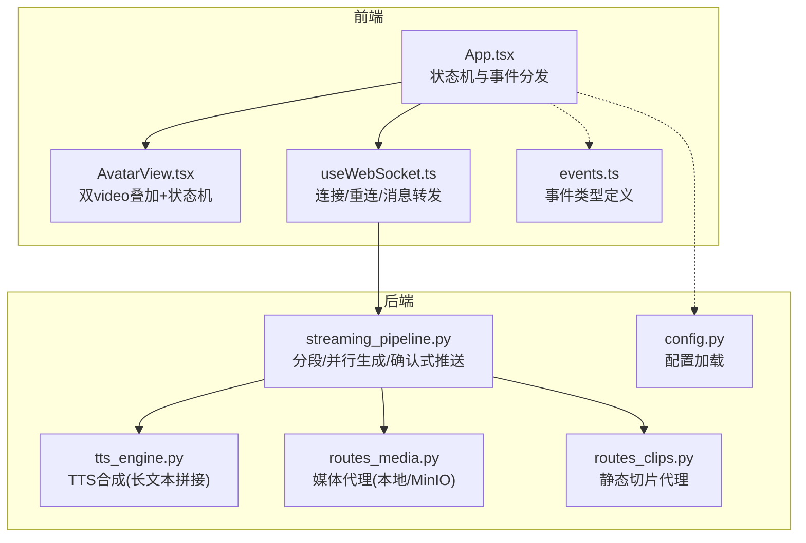
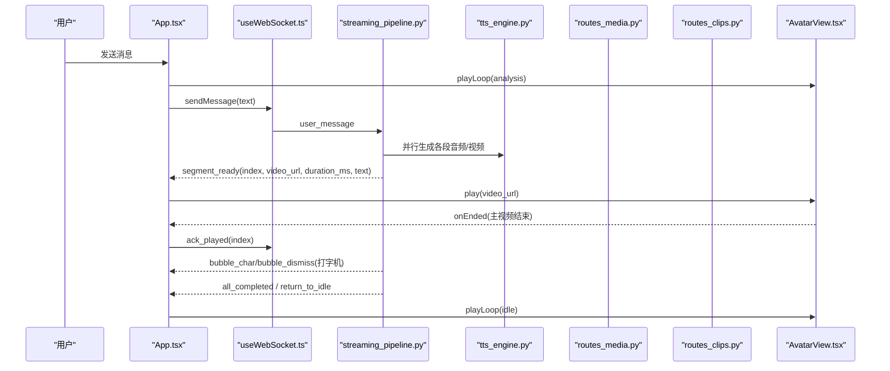
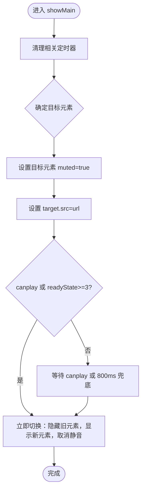
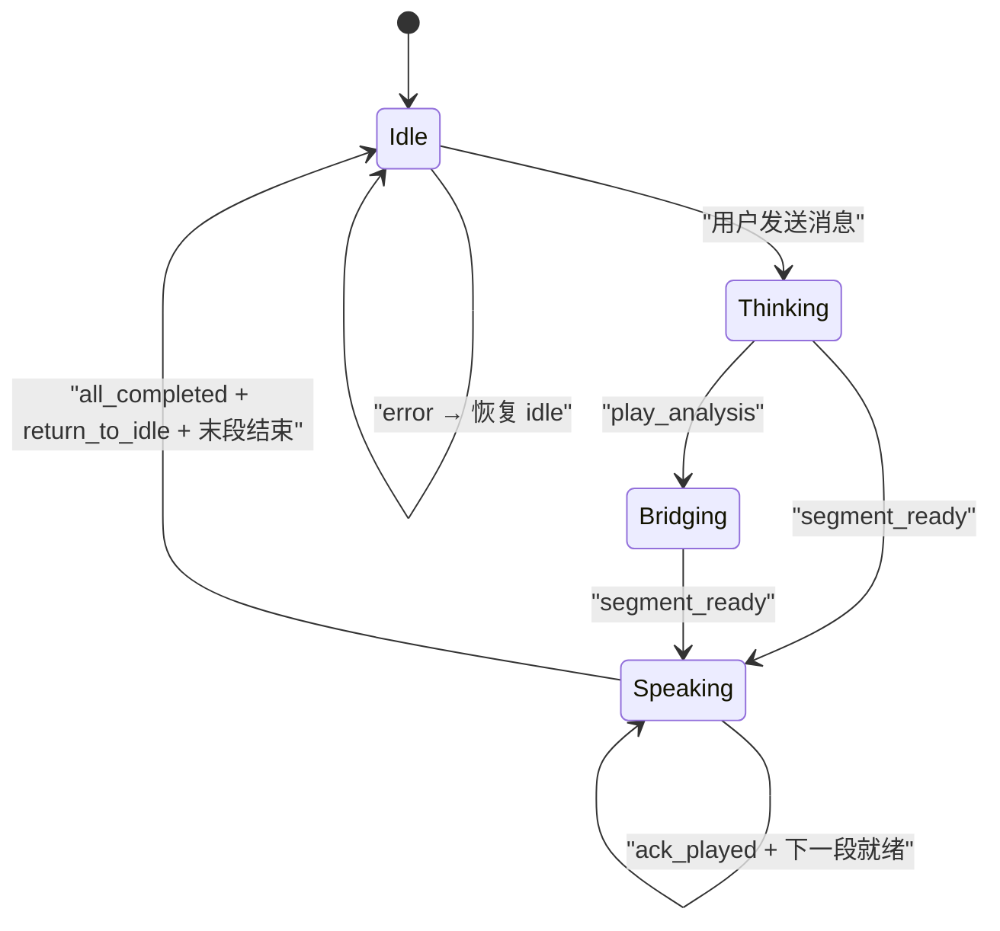
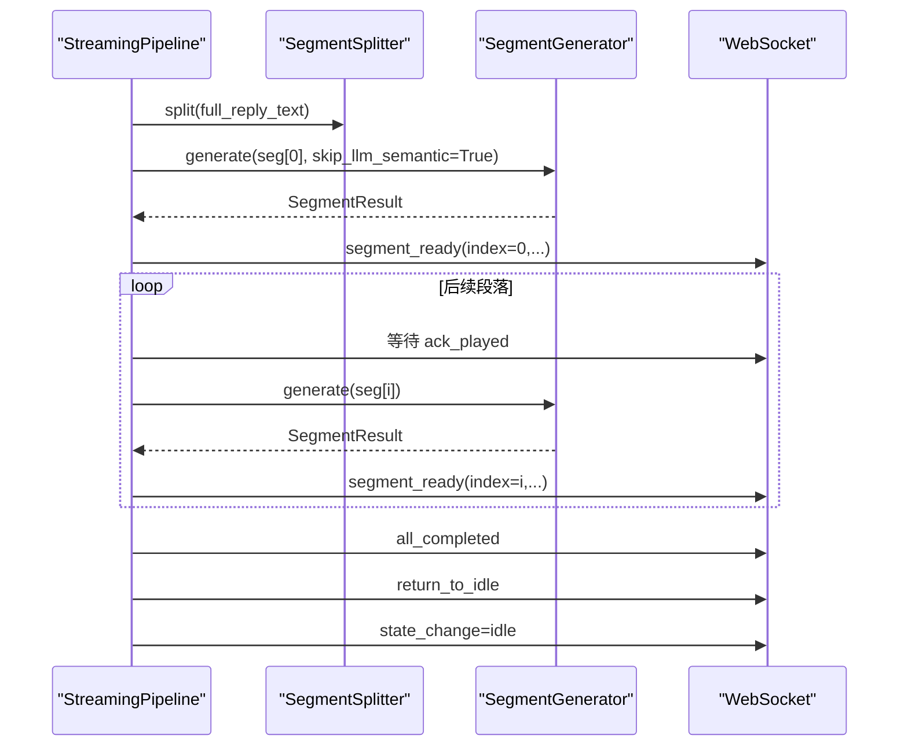
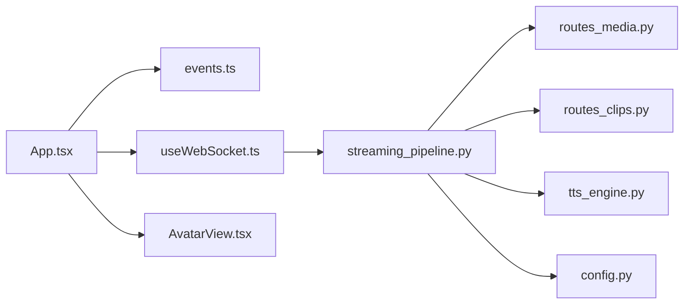

# 虚拟形象系统

<cite>
**本文引用的文件列表**
- [AvatarView.tsx](file://client/src/components/AvatarView.tsx)
- [App.tsx](file://client/src/App.tsx)
- [events.ts](file://client/src/types/events.ts)
- [useWebSocket.ts](file://client/src/hooks/useWebSocket.ts)
- [routes_clips.py](file://server/api/routes_clips.py)
- [routes_media.py](file://server/api/routes_media.py)
- [streaming_pipeline.py](file://server/pipeline/streaming_pipeline.py)
- [tts_engine.py](file://server/services/tts_engine.py)
- [config.py](file://server/config.py)
- [clips.toml](file://clips/short-hair-teacher-girl/clips.toml)
</cite>

## 目录
1. [简介](#简介)
2. [项目结构](#项目结构)
3. [核心组件](#核心组件)
4. [架构总览](#架构总览)
5. [详细组件分析](#详细组件分析)
6. [依赖关系分析](#依赖关系分析)
7. [性能与优化](#性能与优化)
8. [故障排查指南](#故障排查指南)
9. [结论](#结论)
10. [附录：使用示例与扩展指南](#附录使用示例与扩展指南)

## 简介
本文件面向 RealTimeTalk 虚拟形象系统的实现文档，聚焦 AvatarView 组件的渲染与状态机、视频预加载与无缝切换、内存管理、与后端的同步机制（WebSocket + 媒体代理）、错误处理、配置项与扩展点，并兼顾浏览器兼容性与移动端优化。读者可据此快速上手集成，也可深入调优以获得更流畅的实时对话体验。

## 项目结构
前端以 React 组件为核心，通过 WebSocket 接收服务端推送的“段落就绪”事件，驱动 AvatarView 播放对应片段；后端负责文本分段、TTS 合成、视频生成与流式推送。静态切片资源由 clips 目录提供，并通过 API 路由对外暴露。

图表来源
- [App.tsx:1-326](file://client/src/App.tsx#L1-L326)
- [AvatarView.tsx:1-594](file://client/src/components/AvatarView.tsx#L1-L594)
- [useWebSocket.ts:41-131](file://client/src/hooks/useWebSocket.ts#L41-L131)
- [events.ts:1-113](file://client/src/types/events.ts#L1-L113)
- [streaming_pipeline.py:1-214](file://server/pipeline/streaming_pipeline.py#L1-L214)
- [tts_engine.py:1-234](file://server/services/tts_engine.py#L1-L234)
- [routes_media.py:1-65](file://server/api/routes_media.py#L1-L65)
- [routes_clips.py:1-75](file://server/api/routes_clips.py#L1-L75)
- [config.py:1-260](file://server/config.py#L1-L260)

章节来源
- [App.tsx:1-326](file://client/src/App.tsx#L1-L326)
- [AvatarView.tsx:1-594](file://client/src/components/AvatarView.tsx#L1-L594)
- [useWebSocket.ts:41-131](file://client/src/hooks/useWebSocket.ts#L41-L131)
- [events.ts:1-113](file://client/src/types/events.ts#L1-L113)
- [streaming_pipeline.py:1-214](file://server/pipeline/streaming_pipeline.py#L1-L214)
- [tts_engine.py:1-234](file://server/services/tts_engine.py#L1-L234)
- [routes_media.py:1-65](file://server/api/routes_media.py#L1-L65)
- [routes_clips.py:1-75](file://server/api/routes_clips.py#L1-L75)
- [config.py:1-260](file://server/config.py#L1-L260)

## 核心组件
- AvatarView 组件：基于双 <video> 绝对叠加架构，主视频用于播放说话片段（有声音），循环视频用于 idle/思考动画（静音）。通过 opacity 过渡、缩放桥接、canplay 监听与定时器兜底，实现段间无黑闪、无缝切换。
- App 根组件：维护应用状态（Idle/Thinking/Speaking/Bridging），响应 WebSocket 事件，调度 AvatarView 的 play/playLoop/stop 等能力，并在末段结束后回到 Idle。
- 流式管道（StreamingPipeline）：将完整回复切分为若干段落，并行生成 TTS 与视频，首段就绪即推送 segment_ready，后续按 ack_played 确认式推进，最后推送 all_completed 与 return_to_idle。
- 媒体与切片代理：/api/media 代理生成的媒体文件（优先本地路径，回退 MinIO presigned URL）；/api/clips 代理静态切片与待机动画。

章节来源
- [AvatarView.tsx:1-594](file://client/src/components/AvatarView.tsx#L1-L594)
- [App.tsx:1-326](file://client/src/App.tsx#L1-L326)
- [streaming_pipeline.py:1-214](file://server/pipeline/streaming_pipeline.py#L1-L214)
- [routes_media.py:1-65](file://server/api/routes_media.py#L1-L65)
- [routes_clips.py:1-75](file://server/api/routes_clips.py#L1-L75)

## 架构总览
从用户输入到虚拟形象说话的端到端流程如下：

图表来源
- [App.tsx:78-183](file://client/src/App.tsx#L78-L183)
- [useWebSocket.ts:41-131](file://client/src/hooks/useWebSocket.ts#L41-L131)
- [streaming_pipeline.py:44-131](file://server/pipeline/streaming_pipeline.py#L44-L131)
- [tts_engine.py:49-167](file://server/services/tts_engine.py#L49-L167)
- [routes_media.py:18-65](file://server/api/routes_media.py#L18-L65)
- [routes_clips.py:23-75](file://server/api/routes_clips.py#L23-L75)
- [AvatarView.tsx:63-150](file://client/src/components/AvatarView.tsx#L63-L150)

## 详细组件分析

### AvatarView 组件：双视频叠加与状态机
- 双视频叠加
  - 主视频：播放说话片段，带音轨，默认隐藏，切换时先静音再取消静音，避免自动播放策略问题。
  - 循环视频：idle/analysis 动画，静音，JS 接管 idle 无缝循环（timeupdate 在末尾前 seek 回开头）。
- 无缝切换策略
  - canplay 后立即播放目标元素，同帧内隐藏旧元素并显示新元素，消除黑闪。
  - 若 canplay 未触发，800ms 定时器兜底强制切换。
  - 针对 scale(1.7) 场景（说话→idle），引入“桥接”逻辑，保持当前可见帧，避免空白闪烁。
- 状态标记
  - thinkingModeRef：防止 segment_ready 竞态跳过思考动画。
  - loopIsSegmentRef：区分 loop 是否正在播放 segment（ended 事件语义不同）。
  - idleLoopActiveRef：标识 JS 接管 idle 循环。
- 暴露方法
  - play(url)：切换到主视频播放指定片段。
  - playLoop(src)：切换到循环视频（idle/analysis）。
  - stop()：停止所有视频并隐藏。
  - isPlaying()/getVideoElement()：辅助查询。

图表来源
- [AvatarView.tsx:63-150](file://client/src/components/AvatarView.tsx#L63-L150)

章节来源
- [AvatarView.tsx:1-594](file://client/src/components/AvatarView.tsx#L1-L594)

### App 根组件：状态机与事件编排
- 状态枚举：Idle/Input/Thinking/Speaking/Bridging。
- 关键事件处理
  - segment_ready：置为 Speaking，调用 AvatarView.play(video_url)。
  - play_analysis：非 Speaking 时进入 Bridging，播放 analysis 循环。
  - all_completed：清理气泡状态，准备返回 Idle。
  - return_to_idle：根据当前状态决定是否延迟到末段结束后再切 Idle。
  - error：重置为 Idle，播放 idle 循环，展示错误提示。
- 视频结束回调
  - 收到 video-ended：发送 ack_played；若是末段则直接切 Idle 并播放 idle 循环；否则保持最后一帧可见，等待下一段。

图表来源
- [events.ts:7-13](file://client/src/types/events.ts#L7-L13)
- [App.tsx:78-183](file://client/src/App.tsx#L78-L183)
- [App.tsx:194-220](file://client/src/App.tsx#L194-L220)

章节来源
- [App.tsx:1-326](file://client/src/App.tsx#L1-L326)
- [events.ts:1-113](file://client/src/types/events.ts#L1-L113)

### 流式管道：并行生成与确认式推进
- 分句切段后，异步并发生成所有段落（首段跳过 LLM 语义分析，节省时间）。
- 首段完成后立即推送 segment_ready，随后逐段等待 ack_played 后再推送下一段。
- 全部完成后推送 all_completed 与 return_to_idle，最终 state_change=idle。
- 错误处理：任一异常或错误结果都会推送 error 并回到 idle。

图表来源
- [streaming_pipeline.py:44-131](file://server/pipeline/streaming_pipeline.py#L44-L131)

章节来源
- [streaming_pipeline.py:1-214](file://server/pipeline/streaming_pipeline.py#L1-L214)

### TTS 引擎：长文本拆分与拼接
- 单段合成：多模态接口提交任务，轮询 task_id 直至成功，下载 MP3 并估算时长。
- 长文本处理：按句子边界拆分为 ≤450 字段落，分别合成后用 FFmpeg 拼接，返回合并后的 MP3 与累计时长。
- 并发控制：全局信号量限制并发数，避免服务限流。

章节来源
- [tts_engine.py:1-234](file://server/services/tts_engine.py#L1-L234)

### 媒体与切片代理
- /api/media/{session_token}/{filename}
  - 优先本地 _work/{session_token}/output_X.webm 或原始文件名，直接返回文件。
  - 回退：尝试 MinIO presigned URL 重定向。
- /api/clips/{name:path}
  - 支持 .webm 转换后的切片与 idle 动画，安全检查路径在 clips 目录下。

章节来源
- [routes_media.py:1-65](file://server/api/routes_media.py#L1-L65)
- [routes_clips.py:1-75](file://server/api/routes_clips.py#L1-L75)

### 虚拟形象配置与切片库
- 配置项（config.json 或环境变量）
  - avatar.speaker：角色名
  - avatar.clips_dir：切片目录
  - avatar.idle_animation：待机动画路径
- 切片库（clips.toml）
  - 每个切片 5 秒，包含 tags、priority、prompt、speech_hint 等元信息。
  - transitions 定义标签间的过渡规则与默认序列建议。

章节来源
- [config.py:29-33](file://server/config.py#L29-L33)
- [config.py:200-204](file://server/config.py#L200-L204)
- [clips.toml:1-148](file://clips/short-hair-teacher-girl/clips.toml#L1-L148)

## 依赖关系分析
- 前端
  - App.tsx 依赖 events.ts 的类型定义与 useWebSocket.ts 的连接封装。
  - AvatarView.tsx 被 App.tsx 通过 ref 调用，内部不依赖外部网络，仅消费 src URL。
- 后端
  - streaming_pipeline.py 依赖 segment_splitter 与 segment_generator（后者内部可能调用 tts_engine.py）。
  - routes_media.py 与 routes_clips.py 作为 HTTP 层，供浏览器直接拉取媒体与静态切片。
  - config.py 提供统一配置入口。

图表来源
- [App.tsx:1-326](file://client/src/App.tsx#L1-L326)
- [events.ts:1-113](file://client/src/types/events.ts#L1-L113)
- [useWebSocket.ts:41-131](file://client/src/hooks/useWebSocket.ts#L41-L131)
- [streaming_pipeline.py:1-214](file://server/pipeline/streaming_pipeline.py#L1-L214)
- [routes_media.py:1-65](file://server/api/routes_media.py#L1-L65)
- [routes_clips.py:1-75](file://server/api/routes_clips.py#L1-L75)
- [tts_engine.py:1-234](file://server/services/tts_engine.py#L1-L234)
- [config.py:1-260](file://server/config.py#L1-L260)

## 性能与优化
- 预加载与无缝切换
  - 使用 canplay 与 readyState 判断，确保目标元素首帧就绪后再切换，避免黑闪。
  - 800ms 定时器兜底，保证极端情况下仍可切换。
  - idle 模式 JS 接管循环，在 timeupdate 接近末尾时 seek(0)，实现零跳变。
- 内存管理
  - 切换回 idle 时，延迟清除主视频 src 并 load()，避免交叉淡出期间资源占用导致卡顿。
  - 对相同基础路径的 idle↔analysis 切换进行去重，减少重复加载。
- 并发与限流
  - TTS 合成使用信号量限制并发，避免 429 限流。
  - 长文本拆分后拼接，降低单次请求失败风险。
- 浏览器兼容性
  - 自动播放策略：主视频先 muted，切换成功后取消静音；必要时降级为同帧切换。
  - Firefox 下 canplay 后才淡入，避免无帧数据黑底。
- 移动端优化
  - playsInline 与 muted 保障移动端自动播放。
  - 使用短过渡时间与最小化 DOM 操作，降低重排重绘开销。

章节来源
- [AvatarView.tsx:63-150](file://client/src/components/AvatarView.tsx#L63-L150)
- [AvatarView.tsx:152-405](file://client/src/components/AvatarView.tsx#L152-L405)
- [AvatarView.tsx:506-532](file://client/src/components/AvatarView.tsx#L506-L532)
- [tts_engine.py:16-17](file://server/services/tts_engine.py#L16-L17)
- [tts_engine.py:169-226](file://server/services/tts_engine.py#L169-L226)

## 故障排查指南
- 常见问题
  - 自动播放被阻止：检查是否在用户交互后解锁 AudioContext；主视频切换时先 muted 再取消静音。
  - 首帧黑屏：确认 canplay 后才淡入；Firefox 下尤需注意。
  - 段间黑闪：检查 showMain/showLoop 的桥接逻辑与透明度过渡；确认 800ms 兜底是否生效。
  - 媒体无法加载：确认 /api/media 与 /api/clips 路由可达；MinIO presigned URL 是否过期。
  - 长文本合成失败：查看 TTS 错误日志；确认 FFmpeg 可用且路径正确。
- 定位手段
  - 观察 App 底部调试状态指示器，确认当前状态。
  - 检查 WebSocket 事件顺序：segment_ready → bubble_char → bubble_dismiss → all_completed → return_to_idle。
  - 浏览器开发者工具中监控 network 面板，确认视频与媒体请求状态码与耗时。

章节来源
- [App.tsx:194-220](file://client/src/App.tsx#L194-L220)
- [routes_media.py:18-65](file://server/api/routes_media.py#L18-L65)
- [routes_clips.py:23-75](file://server/api/routes_clips.py#L23-L75)
- [tts_engine.py:228-234](file://server/services/tts_engine.py#L228-L234)

## 结论
AvatarView 通过双视频叠加与精细的状态机设计，实现了低延迟、无黑闪的实时虚拟形象播放。配合流式管道的确认式推进与媒体代理的灵活回退，系统在多种网络与设备环境下均能保持稳定表现。通过合理的预加载、内存释放与并发控制，整体性能与用户体验得到显著提升。

## 附录：使用示例与扩展指南

### 基本用法
- 在页面中引入 AvatarView，传入 idleSrc 指向待机动画。
- 在 App 中监听 WebSocket 事件，segment_ready 时调用 avatarRef.current.play(video_url)。
- 当需要思考动画时，调用 avatarRef.current.playLoop(ANALYSIS_SRC)。

章节来源
- [App.tsx:280-284](file://client/src/App.tsx#L280-L284)
- [App.tsx:78-101](file://client/src/App.tsx#L78-L101)
- [App.tsx:127-132](file://client/src/App.tsx#L127-L132)

### 自定义动画效果
- 在 clips.toml 中新增切片条目，定义 file、tags、priority、prompt、speech_hint。
- 在后端生成 pipeline 中，依据标签与优先级选择合适片段。
- 前端可通过 playLoop 切换不同的 idle/analysis 动画源。

章节来源
- [clips.toml:19-127](file://clips/short-hair-teacher-girl/clips.toml#L19-L127)
- [routes_clips.py:23-75](file://server/api/routes_clips.py#L23-L75)

### 响应式适配
- AvatarView 容器使用 aspectRatio 与 maxHeight/maxWidth 约束，适配不同屏幕尺寸。
- objectFit: contain 确保内容完整显示，scale(1.7) 仅在说话阶段启用，避免布局抖动。

章节来源
- [AvatarView.tsx:534-588](file://client/src/components/AvatarView.tsx#L534-L588)

### 浏览器兼容性与移动端优化
- 自动播放策略：AudioContext 解锁与 muted 初始播放。
- 移动端：playsInline、muted、短过渡时间。
- Firefox：canplay 后才淡入，避免无帧数据黑底。

章节来源
- [App.tsx:32-58](file://client/src/App.tsx#L32-L58)
- [AvatarView.tsx:506-532](file://client/src/components/AvatarView.tsx#L506-L532)
- [AvatarView.tsx:548-587](file://client/src/components/AvatarView.tsx#L548-L587)

### 错误处理方案
- 前端：error 事件重置状态至 Idle，播放 idle 循环，展示错误提示。
- 后端：pipeline 捕获异常，推送 error 并回到 idle；TTS 错误解析并上报。

章节来源
- [App.tsx:165-178](file://client/src/App.tsx#L165-L178)
- [streaming_pipeline.py:127-131](file://server/pipeline/streaming_pipeline.py#L127-L131)
- [tts_engine.py:228-234](file://server/services/tts_engine.py#L228-L234)