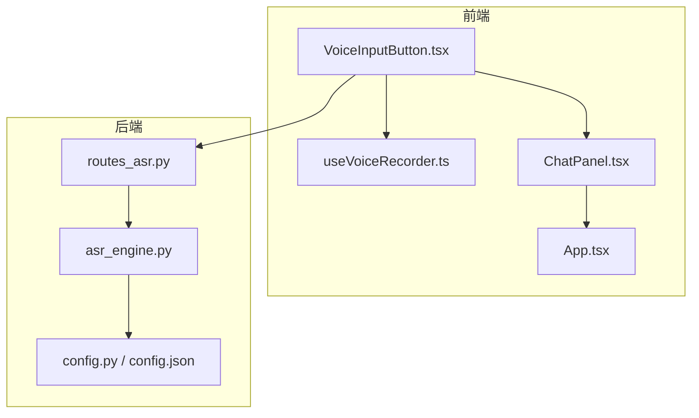
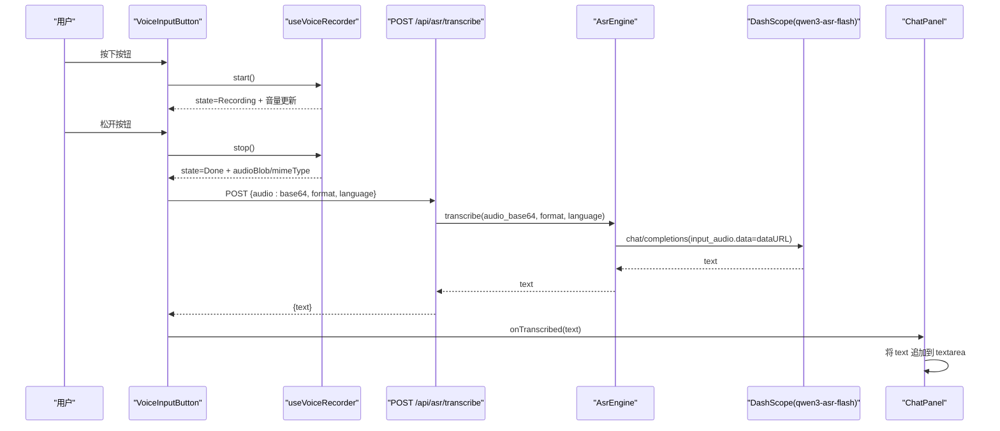
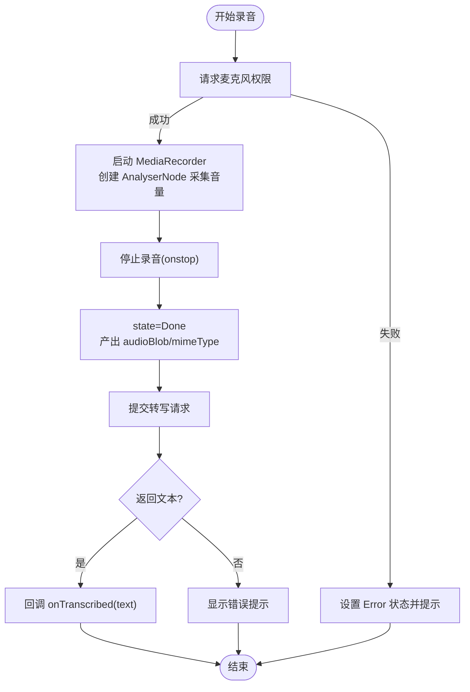
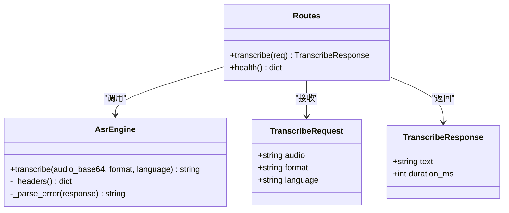
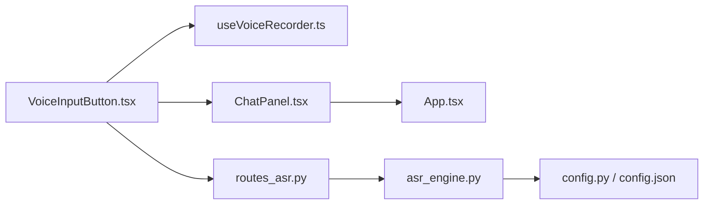

# 语音输入功能

<cite>
**本文引用的文件列表**
- [VoiceInputButton.tsx](file://client/src/components/VoiceInputButton.tsx)
- [useVoiceRecorder.ts](file://client/src/hooks/useVoiceRecorder.ts)
- [ChatPanel.tsx](file://client/src/components/ChatPanel.tsx)
- [routes_asr.py](file://server/api/routes_asr.py)
- [asr_engine.py](file://server/services/asr_engine.py)
- [config.py](file://server/config.py)
- [config.json](file://config.json)
- [App.tsx](file://client/src/App.tsx)
</cite>

## 目录
1. [简介](#简介)
2. [项目结构](#项目结构)
3. [核心组件](#核心组件)
4. [架构总览](#架构总览)
5. [详细组件分析](#详细组件分析)
6. [依赖关系分析](#依赖关系分析)
7. [性能与体验优化](#性能与体验优化)
8. [故障排查指南](#故障排查指南)
9. [结论](#结论)

## 简介
本文件聚焦“语音输入”能力，覆盖从前端录音、转写提交到后端识别的完整链路。该功能支持“按住说话”，在移动端和桌面端均有良好交互；同时结合形象视频播放，确保用户开始说话时卡通形象不闪烁或消失。

## 项目结构
围绕语音输入的关键文件分布如下：
- 前端交互层：按钮组件与录音 Hook
- 聊天面板集成：将转写文本回填至输入框
- 后端 API：接收 base64 音频并调用 ASR 服务
- 配置中心：ASR 模型、超时、最大时长等参数

图表来源
- [VoiceInputButton.tsx:1-468](file://client/src/components/VoiceInputButton.tsx#L1-L468)
- [useVoiceRecorder.ts:1-349](file://client/src/hooks/useVoiceRecorder.ts#L1-L349)
- [ChatPanel.tsx:1-238](file://client/src/components/ChatPanel.tsx#L1-L238)
- [routes_asr.py:1-103](file://server/api/routes_asr.py#L1-L103)
- [asr_engine.py:1-216](file://server/services/asr_engine.py#L1-L216)
- [config.py:1-287](file://server/config.py#L1-L287)
- [config.json:1-47](file://config.json#L1-L47)

章节来源
- [VoiceInputButton.tsx:1-468](file://client/src/components/VoiceInputButton.tsx#L1-L468)
- [useVoiceRecorder.ts:1-349](file://client/src/hooks/useVoiceRecorder.ts#L1-L349)
- [ChatPanel.tsx:1-238](file://client/src/components/ChatPanel.tsx#L1-L238)
- [routes_asr.py:1-103](file://server/api/routes_asr.py#L1-L103)
- [asr_engine.py:1-216](file://server/services/asr_engine.py#L1-L216)
- [config.py:1-287](file://server/config.py#L1-L287)
- [config.json:1-47](file://config.json#L1-L47)

## 核心组件
- 语音输入按钮（VoiceInputButton）
  - 负责“按住说话”交互、提示音、录音中弹层（音量条、倒计时）、错误提示
  - 自动在录音结束时发起转写请求，并将结果回填到输入框
- 录音 Hook（useVoiceRecorder）
  - 封装 MediaRecorder，支持权限申请、格式自适应、实时音量分析、ESC 取消、最长 60s 自动停止
  - 输出状态机：空闲 → 请求权限 → 录音中 → 处理中 → 完成/错误
- 聊天面板（ChatPanel）
  - 提供输入框与发送按钮，集成语音输入按钮，将转写文本追加到 textarea
- 后端 ASR 路由与服务
  - FastAPI 路由接收 base64 音频，调用 AsrEngine 通过 OpenAI 兼容接口调用 DashScope qwen3-asr-flash
  - 统一错误码映射与重试策略

章节来源
- [VoiceInputButton.tsx:1-468](file://client/src/components/VoiceInputButton.tsx#L1-L468)
- [useVoiceRecorder.ts:1-349](file://client/src/hooks/useVoiceRecorder.ts#L1-L349)
- [ChatPanel.tsx:1-238](file://client/src/components/ChatPanel.tsx#L1-L238)
- [routes_asr.py:1-103](file://server/api/routes_asr.py#L1-L103)
- [asr_engine.py:1-216](file://server/services/asr_engine.py#L1-L216)

## 架构总览
语音输入端到端时序如下：

图表来源
- [VoiceInputButton.tsx:125-166](file://client/src/components/VoiceInputButton.tsx#L125-L166)
- [useVoiceRecorder.ts:158-271](file://client/src/hooks/useVoiceRecorder.ts#L158-L271)
- [routes_asr.py:46-92](file://server/api/routes_asr.py#L46-L92)
- [asr_engine.py:65-197](file://server/services/asr_engine.py#L65-L197)
- [ChatPanel.tsx:46-65](file://client/src/components/ChatPanel.tsx#L46-L65)

## 详细组件分析

### 前端录音与交互（VoiceInputButton + useVoiceRecorder）
- 交互流程
  - 鼠标/触摸事件触发 start()/stop()
  - 录音中显示弹层：音量条、倒计时、提示文案
  - 结束录音后自动提交转写，完成后回调父组件
- 关键实现要点
  - 使用 Web Audio API 生成 beep 提示音，避免引入外部音频文件
  - 基于 MediaRecorder 分段收集数据块，onstop 合并为 Blob
  - 浏览器兼容性：优先 webm/opus，Safari 回退 mp4
  - ESC 键取消录音，最长 60s 自动停止
  - 状态机驱动 UI 与行为，避免竞态

图表来源
- [useVoiceRecorder.ts:158-271](file://client/src/hooks/useVoiceRecorder.ts#L158-L271)
- [VoiceInputButton.tsx:125-166](file://client/src/components/VoiceInputButton.tsx#L125-L166)

章节来源
- [VoiceInputButton.tsx:1-468](file://client/src/components/VoiceInputButton.tsx#L1-L468)
- [useVoiceRecorder.ts:1-349](file://client/src/hooks/useVoiceRecorder.ts#L1-L349)

### 聊天面板集成（ChatPanel）
- 语音转写完成后，将文本追加到 textarea，保持光标位置与滚动到底部
- 支持回车发送、空消息拦截、超长截断

章节来源
- [ChatPanel.tsx:46-65](file://client/src/components/ChatPanel.tsx#L46-L65)

### 后端 ASR 路由与服务（routes_asr.py + asr_engine.py）
- 路由职责
  - 校验请求体（非空、格式合法）
  - 调用引擎转写，记录耗时
  - 统一错误码映射（鉴权失败、超时、服务端错误、客户端参数错误）
- 引擎职责
  - 构造 Data URL 格式的 input_audio.data
  - 以 OpenAI 兼容模式调用 DashScope qwen3-asr-flash
  - 内置重试（网络/限流/服务端错误），解析错误信息
  - 估算音频大小并给出上限警告

图表来源
- [routes_asr.py:21-31](file://server/api/routes_asr.py#L21-L31)
- [routes_asr.py:46-92](file://server/api/routes_asr.py#L46-L92)
- [asr_engine.py:44-197](file://server/services/asr_engine.py#L44-L197)

章节来源
- [routes_asr.py:1-103](file://server/api/routes_asr.py#L1-L103)
- [asr_engine.py:1-216](file://server/services/asr_engine.py#L1-L216)

### 配置项（config.py + config.json）
- ASR 相关配置
  - endpoint、model、timeout、max_audio_seconds
  - api_key 复用 TTS 的 DASHSCOPE_API_KEY
- 环境变量优先级高于 JSON 配置

章节来源
- [config.py:76-83](file://server/config.py#L76-L83)
- [config.py:258-264](file://server/config.py#L258-L264)
- [config.json:39-45](file://config.json#L39-L45)

## 依赖关系分析
- 前端
  - VoiceInputButton 依赖 useVoiceRecorder 提供的录音能力与状态
  - ChatPanel 消费 VoiceInputButton 的转写回调
  - App.tsx 管理会话状态与视频播放，与语音输入无直接耦合，但共享页面生命周期与媒体资源
- 后端
  - routes_asr.py 依赖 asr_engine.py 进行实际识别
  - asr_engine.py 依赖 httpx 与配置模块加载 ASR 参数

图表来源
- [VoiceInputButton.tsx:1-468](file://client/src/components/VoiceInputButton.tsx#L1-L468)
- [useVoiceRecorder.ts:1-349](file://client/src/hooks/useVoiceRecorder.ts#L1-L349)
- [ChatPanel.tsx:1-238](file://client/src/components/ChatPanel.tsx#L1-L238)
- [App.tsx:1-725](file://client/src/App.tsx#L1-L725)
- [routes_asr.py:1-103](file://server/api/routes_asr.py#L1-L103)
- [asr_engine.py:1-216](file://server/services/asr_engine.py#L1-L216)
- [config.py:1-287](file://server/config.py#L1-L287)
- [config.json:1-47](file://config.json#L1-L47)

## 性能与体验优化
- 前端
  - 录音格式自适应：webm/opus 优先，Safari 回退 mp4，减少解码失败率
  - 实时音量分析：AnalyserNode 采样频率适中，平滑处理避免跳动
  - 提示音：Web Audio API 合成 beep，零资源开销
  - 自动停止：最长 60s，防止长时间占用麦克风
- 后端
  - 连接复用：httpx.AsyncClient 单例复用，降低握手开销
  - 重试策略：对 429/5xx/超时进行有限次重试，提升稳定性
  - 错误分类：区分鉴权失败、超时、服务端错误与客户端参数错误，便于前端展示

[本节为通用指导，无需具体文件引用]

## 故障排查指南
- 无法录音
  - 检查浏览器是否允许麦克风访问，确认权限未被拒绝
  - 查看 useVoiceRecorder 的错误状态与提示信息
- 转写失败
  - 检查后端日志与 HTTP 状态码
  - 确认 ASR API Key 已正确配置（可复用 TTS 的 key）
  - 检查音频格式是否在支持列表中（webm/mp4/wav/ogg）
- 移动端体验问题
  - 注意 iOS Safari 与微信内置浏览器对 WebM/VP9 的支持不稳定，建议优先使用 mp4 变体
  - 首次交互需解锁自动播放策略（App.tsx 中有相应逻辑）

章节来源
- [useVoiceRecorder.ts:158-271](file://client/src/hooks/useVoiceRecorder.ts#L158-L271)
- [routes_asr.py:60-92](file://server/api/routes_asr.py#L60-L92)
- [asr_engine.py:85-197](file://server/services/asr_engine.py#L85-L197)
- [App.tsx:265-289](file://client/src/App.tsx#L265-L289)

## 结论
语音输入功能在前端通过轻量化的录音 Hook 与直观的按钮交互实现，在后端借助成熟的 ASR 服务完成高质量转写。整体链路清晰、容错完善，兼顾多端兼容与用户体验。建议在弱网环境下关注首帧切换与视频预加载策略，进一步消除可能的视觉闪烁。