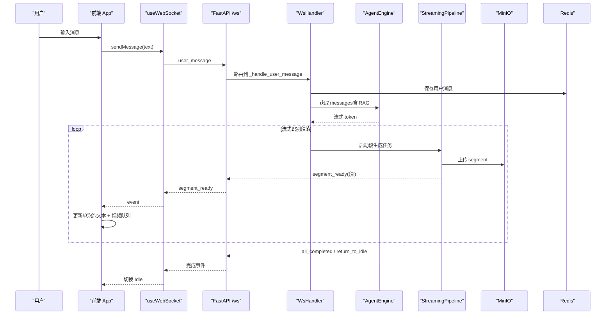
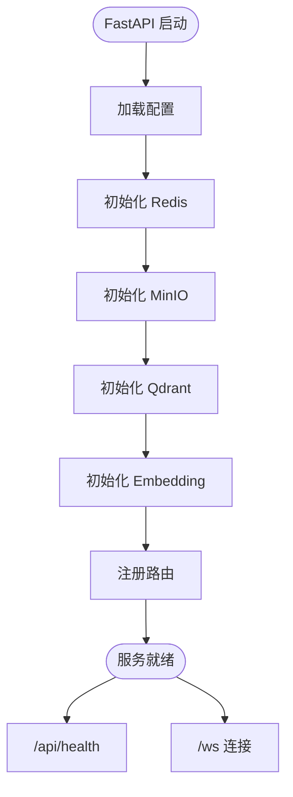
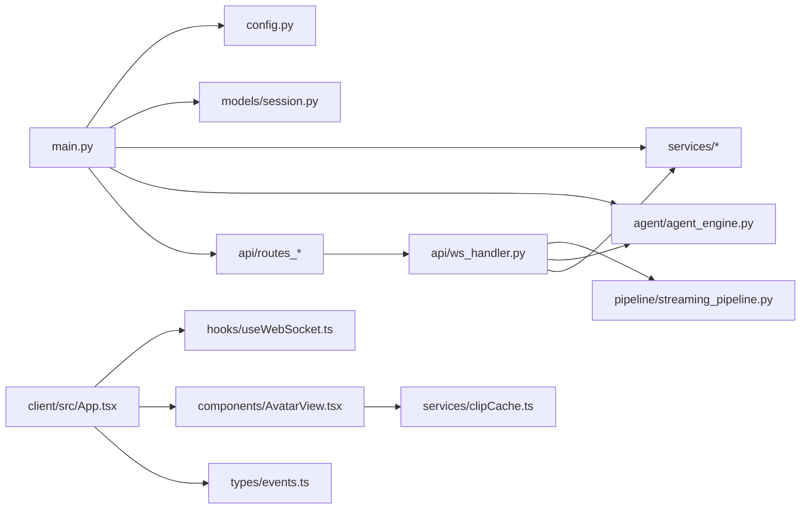

# 语音输入系统

<cite>
**本文引用的文件**   
- [server/main.py](file://server/main.py)
- [server/config.py](file://server/config.py)
- [config.json](file://config.json)
- [server/api/ws_handler.py](file://server/api/ws_handler.py)
- [server/agent/agent_engine.py](file://server/agent/agent_engine.py)
- [server/pipeline/streaming_pipeline.py](file://server/pipeline/streaming_pipeline.py)
- [client/src/App.tsx](file://client/src/App.tsx)
- [client/src/hooks/useWebSocket.ts](file://client/src/hooks/useWebSocket.ts)
- [client/src/components/AvatarView.tsx](file://client/src/components/AvatarView.tsx)
- [client/src/types/events.ts](file://client/src/types/events.ts)
- [server/models/session.py](file://server/models/session.py)
- [docker-compose.yml](file://docker-compose.yml)
- [doc/tech-spec.md](file://doc/tech-spec.md)
</cite>

## 目录
1. [简介](#简介)
2. [项目结构](#项目结构)
3. [核心组件](#核心组件)
4. [架构总览](#架构总览)
5. [详细组件分析](#详细组件分析)
6. [依赖关系分析](#依赖关系分析)
7. [性能与优化](#性能与优化)
8. [故障排查指南](#故障排查指南)
9. [结论](#结论)
10. [附录：接口与配置](#附录接口与配置)

## 简介
本系统是一个基于 Web 的实时语音输入与数字人对话平台。用户通过浏览器与卡通形象进行文字或语音交互，服务端将 LLM 回复切分为多个片段，并行生成 TTS、语义标签与视频拼接，并通过 WebSocket 推送给前端；前端以“语音+动画视频+打字机气泡”三种形式同步输出，实现低延迟、高流畅度的多模态对话体验。系统采用 FastAPI + React/Vite，使用 Redis 做会话状态与历史持久化，MinIO 存储音视频资源，Qdrant 提供向量检索增强（RAG），Nginx 作为反向代理与静态资源服务。

## 项目结构
- 后端（FastAPI）
  - 入口与生命周期管理：main.py
  - 配置加载：config.py（支持 config.json 与环境变量覆盖）
  - WebSocket 处理：api/ws_handler.py
  - Agent 引擎：agent/agent_engine.py
  - 流式分段管道：pipeline/streaming_pipeline.py
  - 模型与状态：models/session.py
- 前端（React + Vite）
  - 根组件与状态机：App.tsx
  - WebSocket Hook：hooks/useWebSocket.ts
  - 形象视频渲染：components/AvatarView.tsx
  - 事件类型定义：types/events.ts
- 基础设施
  - docker-compose.yml 编排 Redis、MinIO、Qdrant、FastAPI、Nginx
  - 技术设计文档 doc/tech-spec.md

```mermaid
graph TB
subgraph "浏览器"
UI["React SPA"]
WS["WebSocket 客户端"]
end
subgraph "Docker Compose"
Nginx["Nginx (:80)"]
FastAPI["FastAPI (:8000)"]
Redis["Redis (:6379)"]
MinIO["MinIO (:9000/:9001)"]
Qdrant["Qdrant (:6333)"]
end
UI --> Nginx
Nginx --> FastAPI
FastAPI --> Redis
FastAPI --> MinIO
FastAPI --> Qdrant
WS < --> FastAPI
```

图表来源
- [docker-compose.yml:1-69](file://docker-compose.yml#L1-L69)
- [server/main.py:116-180](file://server/main.py#L116-L180)

章节来源
- [docker-compose.yml:1-69](file://docker-compose.yml#L1-L69)
- [doc/tech-spec.md:37-113](file://doc/tech-spec.md#L37-L113)

## 核心组件
- 配置中心：统一从 config.json 与环境变量合并加载，提供全局 get_config()
- 会话与会话上下文：SessionContext 维护 token、state、conversation、pipeline、ws 引用、msg_seq
- Agent 引擎：纯文本对话生成，支持 RAG 注入上下文
- 流式分段管道：分句切段、并行生成（TTS/语义/FFmpeg/MinIO）、确认式推送
- WebSocket 处理器：连接建立、消息路由、ack/cancel、错误处理
- 前端 App：状态机（Idle/Thinking/Speaking/Bridging）、单泡泡模式、打字机动画、视频播放队列
- AvatarView：双 video 叠加、预缓存、预热、错误回退、防卡顿与死锁检测
- useWebSocket：自动重连、token 管理、消息发送封装

章节来源
- [server/config.py:167-268](file://server/config.py#L167-L268)
- [server/models/session.py:14-46](file://server/models/session.py#L14-L46)
- [server/agent/agent_engine.py:61-123](file://server/agent/agent_engine.py#L61-L123)
- [server/pipeline/streaming_pipeline.py:16-146](file://server/pipeline/streaming_pipeline.py#L16-L146)
- [server/api/ws_handler.py:66-164](file://server/api/ws_handler.py#L66-L164)
- [client/src/App.tsx:177-230](file://client/src/App.tsx#L177-L230)
- [client/src/components/AvatarView.tsx:59-127](file://client/src/components/AvatarView.tsx#L59-L127)
- [client/src/hooks/useWebSocket.ts:34-117](file://client/src/hooks/useWebSocket.ts#L34-L117)

## 架构总览
系统分层清晰：前端 UI 层负责形象视频与气泡展示；WebSocket 层承载全双工通信；Agent 引擎负责对话生成；StreamingPipeline 负责分段与媒体生成；会话管理层隔离各 Session；存储层由 Redis 与 MinIO 承担；外部服务包括 LLM/TTS/Embedding 与 FFmpeg。



图表来源
- [server/api/ws_handler.py:165-386](file://server/api/ws_handler.py#L165-L386)
- [server/pipeline/streaming_pipeline.py:47-146](file://server/pipeline/streaming_pipeline.py#L47-L146)
- [client/src/App.tsx:347-422](file://client/src/App.tsx#L347-L422)

## 详细组件分析

### 后端主进程与生命周期
- 应用启动时初始化 Redis、MinIO、Qdrant、Embedding 客户端，注册路由与中间件
- 健康检查端点 /api/health
- WebSocket 端点 /ws?token=... 创建 WsHandler 并处理连接
- 静态文件挂载（SPA 模式）



图表来源
- [server/main.py:44-112](file://server/main.py#L44-L112)
- [server/main.py:183-218](file://server/main.py#L183-L218)

章节来源
- [server/main.py:116-227](file://server/main.py#L116-L227)

### 配置模块
- 优先级：环境变量 > config.json
- 支持 LLM、TTS、Avatar、Redis、MinIO、Server、FFmpeg、Qdrant、Embedding、RAG、ASR、Knowledge Admin Token
- 懒加载 get_config()，支持 reload_config()

章节来源
- [server/config.py:167-268](file://server/config.py#L167-L268)
- [config.json:1-47](file://config.json#L1-L47)

### 会话与状态模型
- SessionState：idle/thinking/speaking/bridging
- SessionContext：token、state、created_at、conversation、pipeline、ws、msg_seq

章节来源
- [server/models/session.py:14-46](file://server/models/session.py#L14-L46)

### Agent 引擎（含 RAG）
- process_message：保存用户消息 → 摘要控制 → 组装 messages → 可选 RAG → LLM 调用 → 清理 Markdown → 保存助手回复
- RAG：根据 role_collections 解析集合，嵌入查询，检索 top_k，构建上下文

章节来源
- [server/agent/agent_engine.py:61-123](file://server/agent/agent_engine.py#L61-L123)
- [server/agent/agent_engine.py:125-178](file://server/agent/agent_engine.py#L125-L178)

### 流式分段管道
- run：分句切段 → 并行生成所有段 → 首段就绪立即推送 → 后续段按序推送（不等 ack）→ 全部完成后推送完成事件
- _push_segment：一次性推送 segment_ready（含 text + duration_ms），不再逐字推送 bubble_char
- ack 机制：保留 handle_ack 与 cancel，但当前 ws_handler 已改为直接推送，减少串行等待

章节来源
- [server/pipeline/streaming_pipeline.py:16-146](file://server/pipeline/streaming_pipeline.py#L16-L146)
- [server/pipeline/streaming_pipeline.py:147-226](file://server/pipeline/streaming_pipeline.py#L147-L226)

### WebSocket 处理器
- handle：校验 token（新会话需先创建）、恢复 Redis 会话、发送 connected、消息循环（user_message/ack_played/cancel）
- _handle_user_message：保存用户消息、RAG 检索、流式 LLM、边接收边启动段生成、首段就绪后推送 speaking、后续段直接推送、完成后推送 completion 与 idle
- safe_send_json：安全发送，捕获连接关闭异常

章节来源
- [server/api/ws_handler.py:66-164](file://server/api/ws_handler.py#L66-L164)
- [server/api/ws_handler.py:165-386](file://server/api/ws_handler.py#L165-L386)
- [server/api/ws_handler.py:18-49](file://server/api/ws_handler.py#L18-L49)

### 前端 App（状态机与单泡泡模式）
- 状态机：Idle → Thinking → Speaking → Idle，Bridging 用于衔接
- 单泡泡模式：整轮对话只维护一条 assistant 消息，累积 text，videoPlaylistRef 管理视频队列
- 打字机动画：startTypingAnimation 根据 duration_ms 计算间隔，钳位速度，避免极端快慢
- 事件处理：segment_pending/preload、segment_ready（去重、旧会话过滤、Idle 防御）、response_complete/all_completed/return_to_idle、error（中止播放、恢复 idle）
- stuck detector：主/从双向检测，防止 avatar 卡死

章节来源
- [client/src/App.tsx:177-230](file://client/src/App.tsx#L177-L230)
- [client/src/App.tsx:347-422](file://client/src/App.tsx#L347-L422)
- [client/src/App.tsx:424-509](file://client/src/App.tsx#L424-L509)
- [client/src/App.tsx:525-637](file://client/src/App.tsx#L525-L637)
- [client/src/App.tsx:648-760](file://client/src/App.tsx#L648-L760)

### AvatarView（形象视频组件）
- 双 video 叠加：mainVideo + loopVideo，opacity 过渡消除黑闪
- 预缓存与预热：IndexedDB Blob 缓存、warmupVideoElement、preloadVideoAsync
- 错误回退：objectURL 失效回退 HTTP、mp4 fallback、X5 自动播放策略处理（轻触继续覆盖层）
- 无缝循环：JS 接管 idle 循环，避免原生 loop 导致的空白帧
- 防卡顿：requestVideoFrameCallback、playing 事件、硬超时兜底

章节来源
- [client/src/components/AvatarView.tsx:59-127](file://client/src/components/AvatarView.tsx#L59-L127)
- [client/src/components/AvatarView.tsx:128-248](file://client/src/components/AvatarView.tsx#L128-L248)
- [client/src/components/AvatarView.tsx:351-609](file://client/src/components/AvatarView.tsx#L351-L609)
- [client/src/components/AvatarView.tsx:612-800](file://client/src/components/AvatarView.tsx#L612-L800)

### useWebSocket（连接管理）
- 自动重连：指数退避（1s→2s→4s→8s，最大 30s）
- Token 管理：sessionStorage 持久化，过期重建
- 消息封装：sendMessage/sendAck/sendCancel
- 生命周期：connect/onmessage/onclose/onerror

章节来源
- [client/src/hooks/useWebSocket.ts:34-117](file://client/src/hooks/useWebSocket.ts#L34-L117)
- [client/src/hooks/useWebSocket.ts:119-192](file://client/src/hooks/useWebSocket.ts#L119-L192)

### 事件类型定义
- 客户端消息：user_message、ack_played、cancel
- 服务端事件：connected、state_change、segment_ready、segment_pending、bubble_char/dismiss、play_analysis、all_completed、return_to_idle、error、session_reset、response_complete

章节来源
- [client/src/types/events.ts:1-138](file://client/src/types/events.ts#L1-L138)

## 依赖关系分析
- main.py 依赖 config、models、services、agent、api 路由
- ws_handler.py 依赖 agent、pipeline、services、rag
- streaming_pipeline.py 依赖 segment_splitter、segment_generator
- App.tsx 依赖 hooks、components、types、services
- AvatarView.tsx 依赖 clipCache 与服务端 clips/media 路由



图表来源
- [server/main.py:116-180](file://server/main.py#L116-L180)
- [server/api/ws_handler.py:1-64](file://server/api/ws_handler.py#L1-L64)
- [server/pipeline/streaming_pipeline.py:1-14](file://server/pipeline/streaming_pipeline.py#L1-L14)
- [client/src/App.tsx:1-27](file://client/src/App.tsx#L1-L27)

章节来源
- [server/main.py:116-180](file://server/main.py#L116-L180)
- [server/api/ws_handler.py:1-64](file://server/api/ws_handler.py#L1-L64)
- [client/src/App.tsx:1-27](file://client/src/App.tsx#L1-L27)

## 性能与优化
- 并行生成：StreamingPipeline 使用 asyncio.gather 并行生成所有段，首段就绪即推送，降低端到端延迟
- 取消 ack 串行等待：ws_handler 改为段 ready 后立即推送，客户端自行管理播放列表与预下载，提升吞吐
- 前端预缓存：IndexedDB Blob 缓存 + HTTP immutable 缓存，显著减少弱网下段间停顿
- 视频预热：warmupVideoElement 在段 N 播放期间预热段 N+1，消除解码停顿
- 防卡顿与死锁：stuck detector 双向检测，确保 avatar 不卡死；video-ended 防重入锁
- 打字机速率匹配：duration_ms 驱动显示速度，避免“语音完了字还没打完”

[本节为通用指导，无需具体文件引用]

## 故障排查指南
- WebSocket 连接失败
  - 检查 /api/session/create 是否成功返回 session_token
  - 确认 ws URL 参数 token 正确
  - 查看浏览器控制台 withWebSocket 日志
- 视频无法播放
  - 检查 /api/clips/manifest 与 /api/media/{token}/segment_{n}.mp4 可访问性
  - 确认 IndexedDB 缓存命中与 objectURL 有效性
  - 观察 AvatarView 错误回退路径（mp4 fallback、HTTP 回退）
- 状态卡在 Speaking
  - 检查 response_complete/all_completed/return_to_idle 是否到达
  - 查看 tryGoIdle 守卫条件（isVideoPlayingRef、videoPlaylistRef、textStillTyping）
  - 启用 stuck detector 日志定位主/从方向卡死
- LLM/ASR 调用失败
  - 检查 config.json 中 endpoint/api_key/model 配置
  - 查看 ws_handler 流式处理异常分支与 safe_send_json 丢弃日志

章节来源
- [server/api/ws_handler.py:18-49](file://server/api/ws_handler.py#L18-L49)
- [client/src/App.tsx:424-509](file://client/src/App.tsx#L424-L509)
- [client/src/App.tsx:648-760](file://client/src/App.tsx#L648-L760)

## 结论
本系统通过前后端协同与多层优化，实现了低延迟、高流畅的多模态对话体验。后端采用流式分段与并行生成，前端采用单泡泡模式与视频预缓存，结合 robust 的错误回退与防卡顿机制，有效提升了用户体验。未来可在 RAG 检索质量、TTS 音色多样性、移动端兼容性等方面持续优化。

[本节为总结，无需具体文件引用]

## 附录：接口与配置

### REST API
- POST /api/session/create：创建会话，返回 session_token
- GET /api/session/{token}/history：获取会话历史
- DELETE /api/session/{token}：销毁会话
- GET /api/clips/{name}：获取切片文件
- GET /api/media/{session_token}/{filename}：获取媒体文件（MinIO presigned URL 代理）

章节来源
- [doc/tech-spec.md:687-711](file://doc/tech-spec.md#L687-L711)

### WebSocket 协议
- 端点：ws://host:8000/ws?token={session_token}
- 客户端消息：user_message、ack_played、cancel
- 服务端事件：connected、state_change、segment_ready、segment_pending、bubble_char/dismiss、play_analysis、all_completed、return_to_idle、error、session_reset、response_complete

章节来源
- [client/src/types/events.ts:15-117](file://client/src/types/events.ts#L15-L117)
- [doc/tech-spec.md:294-361](file://doc/tech-spec.md#L294-L361)

### 配置项
- LLM：endpoint、api_key、model、max_tokens
- TTS：api_key、voice、speed
- Avatar：speaker、clips_dir、idle_animation、clip_version
- Redis：url、session_ttl_hours
- MinIO：endpoint、access_key、secret_key、bucket、presigned_url_ttl_seconds
- Server：host、port
- FFmpeg：path、gpu_encoder
- Qdrant：url、api_key
- Embedding：endpoint、api_key、model
- RAG：top_k、role_collections
- ASR：endpoint、api_key、model、timeout、max_audio_seconds
- Knowledge Admin Token：knowledge_admin_token

章节来源
- [config.json:1-47](file://config.json#L1-L47)
- [server/config.py:16-145](file://server/config.py#L16-L145)