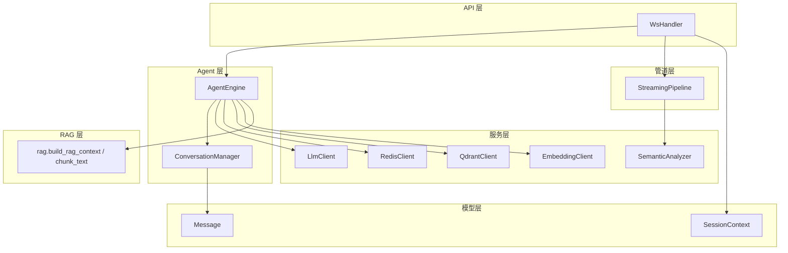
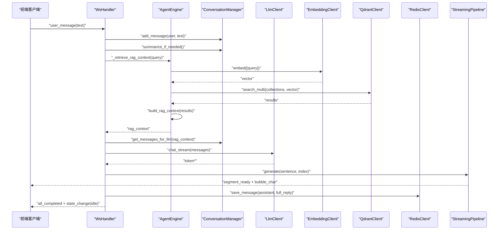
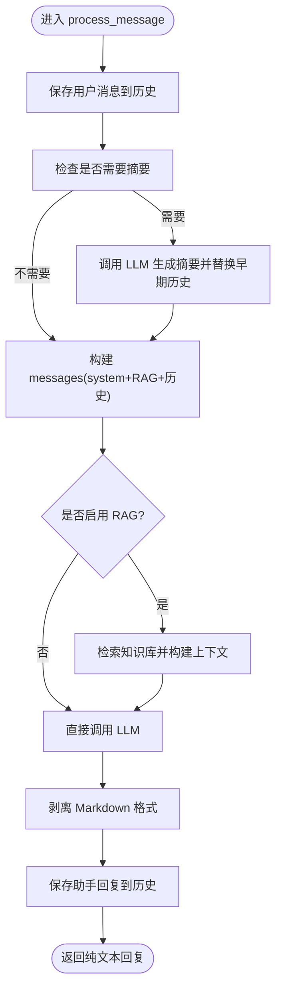
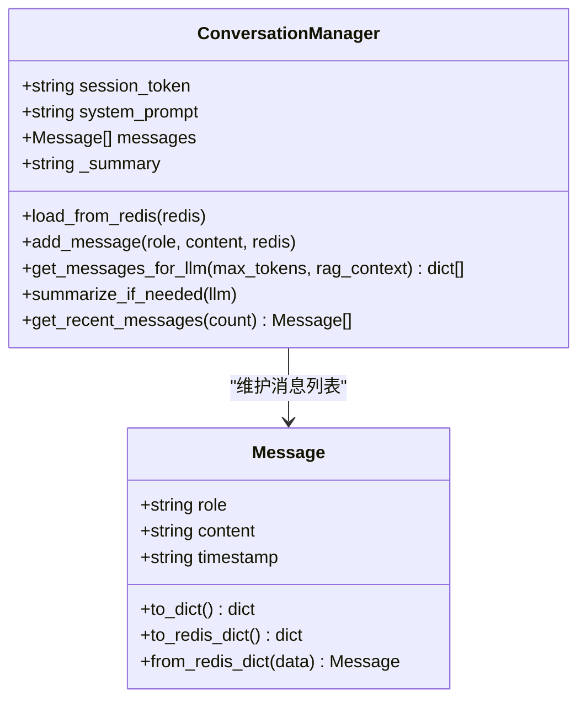
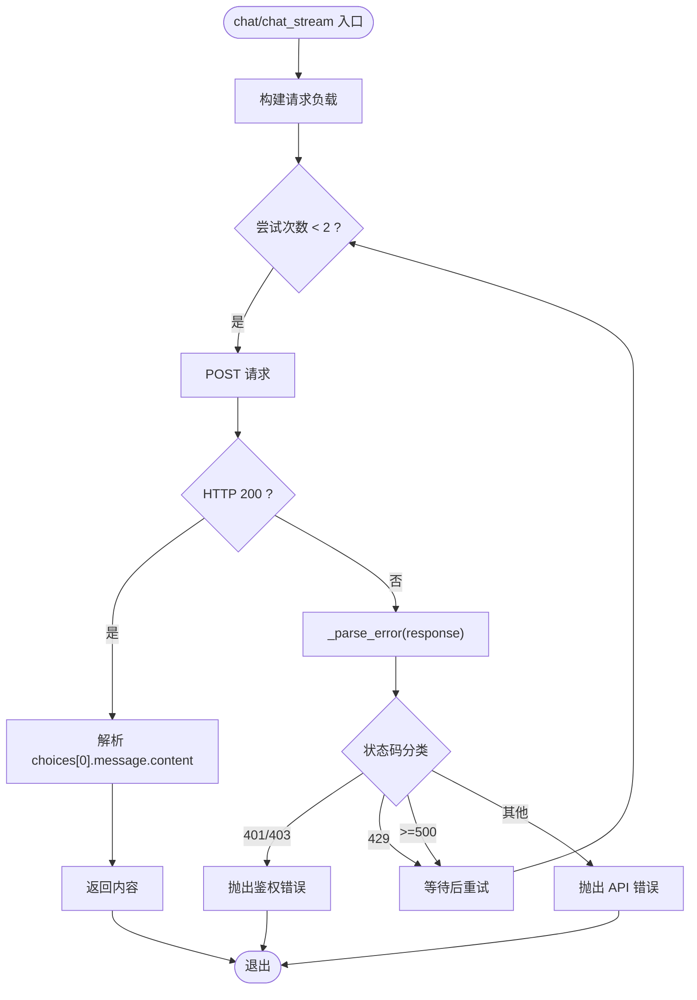
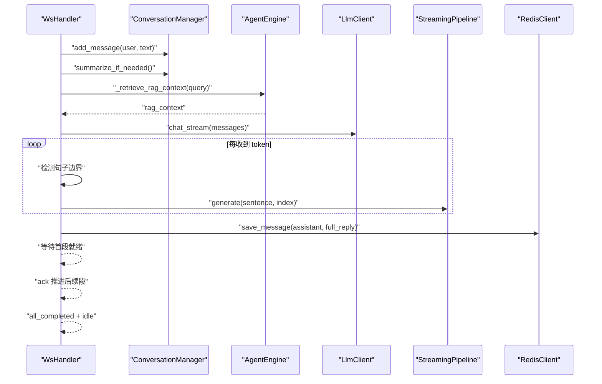
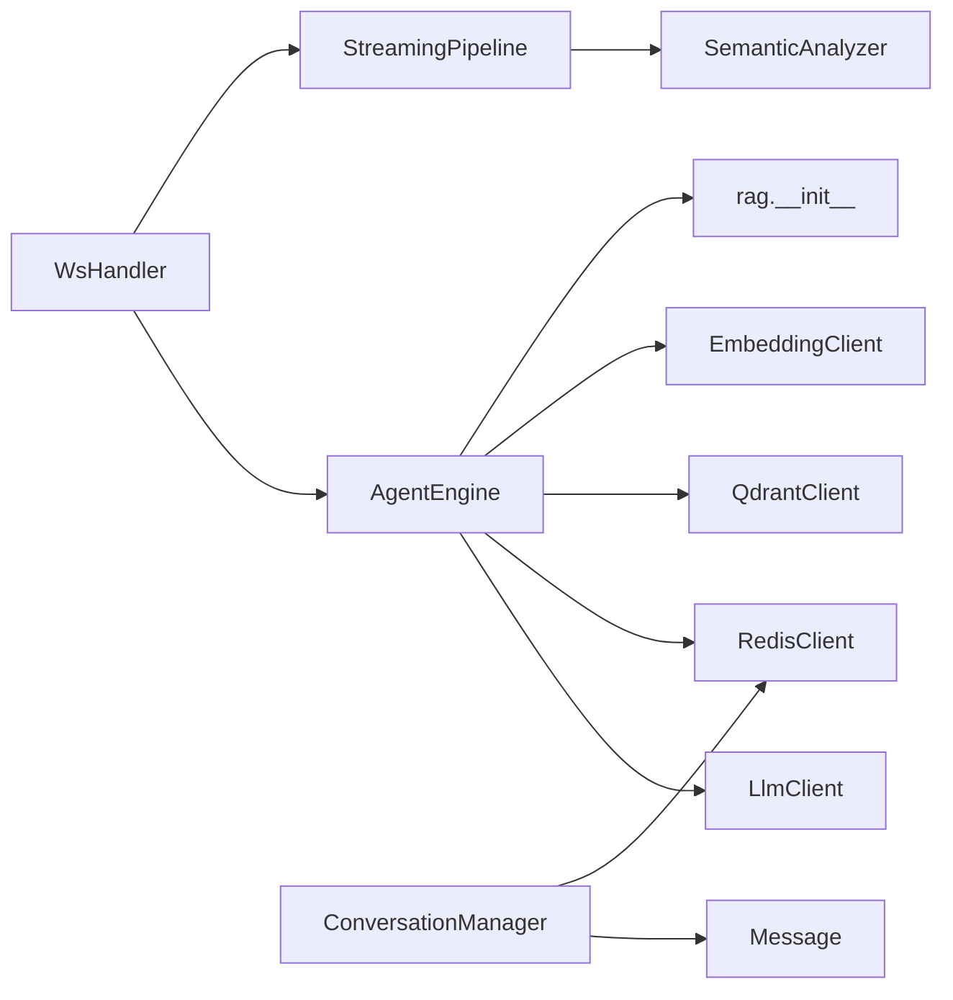

# Agent 引擎设计

<cite>
**本文引用的文件**   
- [agent_engine.py](file://server/agent/agent_engine.py)
- [conversation_manager.py](file://server/agent/conversation_manager.py)
- [llm_client.py](file://server/services/llm_client.py)
- [embedding_client.py](file://server/services/embedding_client.py)
- [qdrant_client.py](file://server/services/qdrant_client.py)
- [__init__.py](file://server/rag/__init__.py)
- [message.py](file://server/models/message.py)
- [session.py](file://server/models/session.py)
- [redis_client.py](file://server/services/redis_client.py)
- [ws_handler.py](file://server/api/ws_handler.py)
- [config.py](file://server/config.py)
- [semantic_analyzer.py](file://server/services/semantic_analyzer.py)
- [streaming_pipeline.py](file://server/pipeline/streaming_pipeline.py)
- [default_system_prompt.txt](file://server/resources/default_system_prompt.txt)
</cite>

## 目录
1. [简介](#简介)
2. [项目结构](#项目结构)
3. [核心组件](#核心组件)
4. [架构总览](#架构总览)
5. [详细组件分析](#详细组件分析)
6. [依赖关系分析](#依赖关系分析)
7. [性能与优化](#性能与优化)
8. [故障排查指南](#故障排查指南)
9. [结论](#结论)
10. [附录：扩展与最佳实践](#附录扩展与最佳实践)

## 简介
本技术文档围绕 RealTimeTalk Agent 引擎，系统性阐述 AI 对话引擎的核心逻辑、会话状态管理、RAG 检索增强实现、多轮对话上下文维护、历史消息管理与智能问答生成流程。同时覆盖 LLM 调用封装、提示词工程、响应格式化机制、流式分段与 TTS 拼接、错误重试策略、以及面向初学者与资深开发者的可操作建议。

## 项目结构
后端采用分层模块化组织：
- agent 层：AgentEngine 负责编排对话流程（含 RAG），ConversationManager 负责消息历史、摘要与 token 窗口控制
- services 层：对外部服务的统一封装（LLM、Embedding、Qdrant、Redis、TTS、语义分析等）
- pipeline 层：流式分段与推送（StreamingPipeline、SegmentSplitter、SegmentGenerator）
- models 层：数据模型（Message、SessionContext、标签解析）
- rag 层：文本分块与上下文构建
- api 层：WebSocket 处理与会话生命周期管理
- config 层：配置加载与环境变量覆盖

图表来源
- [ws_handler.py:1-444](file://server/api/ws_handler.py#L1-L444)
- [agent_engine.py:1-181](file://server/agent/agent_engine.py#L1-L181)
- [conversation_manager.py:1-139](file://server/agent/conversation_manager.py#L1-L139)
- [llm_client.py:1-204](file://server/services/llm_client.py#L1-L204)
- [embedding_client.py:1-149](file://server/services/embedding_client.py#L1-L149)
- [qdrant_client.py:1-235](file://server/services/qdrant_client.py#L1-L235)
- [__init__.py:1-83](file://server/rag/__init__.py#L1-L83)
- [message.py:1-33](file://server/models/message.py#L1-L33)
- [session.py:1-41](file://server/models/session.py#L1-L41)
- [redis_client.py:1-122](file://server/services/redis_client.py#L1-L122)
- [semantic_analyzer.py:1-126](file://server/services/semantic_analyzer.py#L1-L126)
- [streaming_pipeline.py:1-214](file://server/pipeline/streaming_pipeline.py#L1-L214)

章节来源
- [ws_handler.py:1-444](file://server/api/ws_handler.py#L1-L444)
- [config.py:1-260](file://server/config.py#L1-L260)

## 核心组件
- AgentEngine：对话主流程编排，集成 RAG 检索、LLM 调用、Markdown 清理、历史持久化
- ConversationManager：会话历史、系统提示注入、RAG 上下文注入、Token 溢出智能摘要
- LlmClient：OpenAI 兼容 Chat Completions 客户端，支持非流式与流式，内置重试与限流处理
- EmbeddingClient：DashScope 文本嵌入客户端，批量向量化
- QdrantClient：向量数据库 HTTP 客户端，集合管理与并发检索
- RedisClient：会话状态与历史消息的持久化
- StreamingPipeline：流式分段、首段优先推送、确认式推进、打字机气泡动画
- SemanticAnalyzer：基于 LLM 或关键词回退的语义标签分析，驱动视频片段选择
- RAG 模块：文本分块与检索结果上下文构建

章节来源
- [agent_engine.py:1-181](file://server/agent/agent_engine.py#L1-L181)
- [conversation_manager.py:1-139](file://server/agent/conversation_manager.py#L1-L139)
- [llm_client.py:1-204](file://server/services/llm_client.py#L1-L204)
- [embedding_client.py:1-149](file://server/services/embedding_client.py#L1-L149)
- [qdrant_client.py:1-235](file://server/services/qdrant_client.py#L1-L235)
- [redis_client.py:1-122](file://server/services/redis_client.py#L1-L122)
- [streaming_pipeline.py:1-214](file://server/pipeline/streaming_pipeline.py#L1-L214)
- [semantic_analyzer.py:1-126](file://server/services/semantic_analyzer.py#L1-L126)
- [__init__.py:1-83](file://server/rag/__init__.py#L1-L83)

## 架构总览
下图展示一次用户消息从接入到返回的端到端流程，包括 RAG 检索、LLM 流式生成、分段与 TTS 并行处理、以及 WebSocket 事件推送。

图表来源
- [ws_handler.py:130-341](file://server/api/ws_handler.py#L130-L341)
- [agent_engine.py:74-121](file://server/agent/agent_engine.py#L74-L121)
- [conversation_manager.py:39-95](file://server/agent/conversation_manager.py#L39-L95)
- [llm_client.py:115-190](file://server/services/llm_client.py#L115-L190)
- [embedding_client.py:47-70](file://server/services/embedding_client.py#L47-L70)
- [qdrant_client.py:164-186](file://server/services/qdrant_client.py#L164-L186)
- [redis_client.py:82-100](file://server/services/redis_client.py#L82-L100)
- [streaming_pipeline.py:44-131](file://server/pipeline/streaming_pipeline.py#L44-L131)

## 详细组件分析

### AgentEngine：对话主流程与 RAG 集成
- 职责
  - 接收用户输入，保存至对话历史
  - 触发 Token 溢出时的智能摘要
  - 组装 messages（system prompt + RAG 上下文 + 历史）
  - 调用 LLM 并剥离 Markdown，确保纯文本输出
  - 将助手回复持久化到 Redis
- RAG 检索
  - 根据角色-集合映射决定搜索范围（当前固定为“普兰”）
  - 使用 EmbeddingClient 对查询进行向量化
  - 通过 QdrantClient 并发检索多个集合，合并并按分数排序取 top_k
  - 使用 build_rag_context 构造 system 级上下文注入
- 错误降级
  - RAG 失败时记录警告并降级为纯 LLM 回复
  - LLM 调用异常由上层捕获并转为 error 事件

图表来源
- [agent_engine.py:74-121](file://server/agent/agent_engine.py#L74-L121)
- [agent_engine.py:123-181](file://server/agent/agent_engine.py#L123-L181)
- [__init__.py:56-83](file://server/rag/__init__.py#L56-L83)

章节来源
- [agent_engine.py:1-181](file://server/agent/agent_engine.py#L1-L181)
- [__init__.py:1-83](file://server/rag/__init__.py#L1-L83)

### ConversationManager：会话状态与上下文窗口
- 数据结构
  - session_token、system_prompt、messages 列表、_summary 摘要缓存
- 关键能力
  - load_from_redis：恢复历史
  - add_message：追加消息并持久化
  - get_messages_for_llm：组装 system + RAG + 摘要 + 过滤后的历史
  - summarize_if_needed：估算 token 数，超过阈值时对早期消息做摘要，保留最近 N 条
- 过滤规则
  - 跳过语义分析的临时 user 消息与纯标签 assistant 消息，避免污染对话上下文

图表来源
- [conversation_manager.py:21-139](file://server/agent/conversation_manager.py#L21-L139)
- [message.py:9-33](file://server/models/message.py#L9-L33)

章节来源
- [conversation_manager.py:1-139](file://server/agent/conversation_manager.py#L1-L139)
- [message.py:1-33](file://server/models/message.py#L1-L33)

### LlmClient：LLM 调用封装与重试
- 功能
  - chat：非流式请求，返回完整文本
  - chat_stream：流式逐 token 产出
  - 统一错误解析与分类（鉴权失败、限流、服务端错误、超时、连接错误）
  - 自动重试（最多 2 次），限流等待与指数退避简化版
- 配置
  - endpoint、api_key、model、max_tokens、timeout

图表来源
- [llm_client.py:40-113](file://server/services/llm_client.py#L40-L113)
- [llm_client.py:115-190](file://server/services/llm_client.py#L115-L190)
- [llm_client.py:192-204](file://server/services/llm_client.py#L192-L204)

章节来源
- [llm_client.py:1-204](file://server/services/llm_client.py#L1-L204)

### EmbeddingClient：文本嵌入客户端
- 功能
  - embed：批量向量化（默认批大小 10）
  - 按 index 排序保证顺序正确
  - 错误分类与重试（鉴权、限流、服务端错误、超时、连接错误）
- 维度
  - 固定 1024 维（text-embedding-v3）

章节来源
- [embedding_client.py:1-149](file://server/services/embedding_client.py#L1-L149)

### QdrantClient：向量检索客户端
- 功能
  - 集合管理：创建、删除、列出、信息、计数
  - 数据操作：upsert、search、search_multi（并发合并）、delete_points、clear_collection
  - 并发检索：asyncio.gather 聚合各集合结果，按分数排序取 top_k
- 鉴权
  - 可选 api-key 头

章节来源
- [qdrant_client.py:1-235](file://server/services/qdrant_client.py#L1-L235)

### RAG 模块：分块与上下文构建
- chunk_text：按段落切分，超长段落按字符窗口切分，支持重叠
- build_rag_context：过滤低分结果，拼接参考条目，注入 system 级上下文

章节来源
- [__init__.py:1-83](file://server/rag/__init__.py#L1-L83)

### RedisClient：会话与历史持久化
- 功能
  - 会话状态存取（state key）
  - 历史消息存取（history list，rpush/lrange）
  - TTL 管理、存在性检查、清空与删除
- 连接
  - 支持 URL 解析与密码特殊字符处理

章节来源
- [redis_client.py:1-122](file://server/services/redis_client.py#L1-L122)

### WsHandler：WebSocket 处理与流式管线
- 会话生命周期
  - 新会话校验与从 Redis 恢复
  - 发送 connected 事件
- 用户消息处理
  - 更新状态为 thinking，立即通知前端
  - 构建 SegmentGenerator、StreamingPipeline
  - 后台启动流式处理
- 流式处理
  - 边接收 LLM token 边识别句子边界，满长度即启动一段生成
  - 首段完成后立即推送 segment_ready，后续段按 ack 推进
  - 完成时推送 all_completed 与 idle 状态
- 错误与取消
  - 统一错误推送与状态重置
  - 支持用户中断 cancel

图表来源
- [ws_handler.py:130-341](file://server/api/ws_handler.py#L130-L341)
- [streaming_pipeline.py:44-131](file://server/pipeline/streaming_pipeline.py#L44-L131)
- [conversation_manager.py:97-135](file://server/agent/conversation_manager.py#L97-L135)

章节来源
- [ws_handler.py:1-444](file://server/api/ws_handler.py#L1-L444)
- [streaming_pipeline.py:1-214](file://server/pipeline/streaming_pipeline.py#L1-L214)

### SemanticAnalyzer：语义分析与标签回退
- 功能
  - analyze：优先 LLM 分析，失败或首段优化时使用关键词回退
  - 标签验证与重排，确保符合 opening→body→closing 顺序
- 回退策略
  - 基于关键词匹配快速推断标签，节省 LLM 调用时间

章节来源
- [semantic_analyzer.py:1-126](file://server/services/semantic_analyzer.py#L1-L126)

### SessionContext：会话状态机
- 状态枚举
  - IDLE、THINKING、SPEAKING、BRIDGING
- 上下文
  - conversation、pipeline、ws 引用

章节来源
- [session.py:1-41](file://server/models/session.py#L1-L41)

### 提示词工程与响应格式化
- System Prompt
  - 默认系统提示定义在资源文件中，包含角色设定、风格规范、知识库使用规则与纯文本格式要求
- Markdown 清理
  - strip_markdown 去除标题、加粗、斜体、代码、引用、列表、链接、图片、水平线、多余空行等，确保纯文本输出

章节来源
- [default_system_prompt.txt:1-29](file://server/resources/default_system_prompt.txt#L1-L29)
- [agent_engine.py:30-56](file://server/agent/agent_engine.py#L30-L56)

## 依赖关系分析
- 组件耦合
  - WsHandler 依赖 AgentEngine、ConversationManager、StreamingPipeline、RedisClient、MinIO、TTS、语义分析
  - AgentEngine 依赖 LlmClient、RedisClient、QdrantClient、EmbeddingClient、RAG 工具
  - ConversationManager 依赖 Message 模型与 RedisClient
- 外部依赖
  - OpenAI 兼容 LLM API
  - DashScope 嵌入 API
  - Qdrant 向量数据库
  - Redis 会话与历史存储
  - MinIO 媒体对象存储（由 ws_handler 与 pipeline 间接使用）

图表来源
- [ws_handler.py:1-444](file://server/api/ws_handler.py#L1-L444)
- [agent_engine.py:1-181](file://server/agent/agent_engine.py#L1-L181)
- [conversation_manager.py:1-139](file://server/agent/conversation_manager.py#L1-L139)
- [streaming_pipeline.py:1-214](file://server/pipeline/streaming_pipeline.py#L1-L214)
- [semantic_analyzer.py:1-126](file://server/services/semantic_analyzer.py#L1-L126)
- [__init__.py:1-83](file://server/rag/__init__.py#L1-L83)

章节来源
- [ws_handler.py:1-444](file://server/api/ws_handler.py#L1-L444)
- [agent_engine.py:1-181](file://server/agent/agent_engine.py#L1-L181)
- [conversation_manager.py:1-139](file://server/agent/conversation_manager.py#L1-L139)
- [streaming_pipeline.py:1-214](file://server/pipeline/streaming_pipeline.py#L1-L214)

## 性能与优化
- 流式与并行
  - LLM 流式生成，边接收边切段，首段优先推送，显著降低首帧延迟
  - 所有段并行生成，减少整体等待时间
- 语义分析优化
  - 首段使用关键词回退，跳过 LLM 调用，节省 2-6 秒
- Token 窗口管理
  - 估算中文约 1.5 tokens/字，超过阈值触发摘要，保留最近 10 条消息，平衡上下文与成本
- 检索优化
  - 多集合并发检索，按分数排序取 top_k，低分结果过滤
- 网络与重试
  - 统一超时与重试策略，限流等待，提升稳定性
- 内存与持久化
  - Redis 持久化会话历史与状态，支持重连恢复

[本节为通用指导，不直接分析具体文件]

## 故障排查指南
- LLM 调用失败
  - 检查 API Key 与 endpoint 配置
  - 关注 429 限流与 5xx 服务端错误日志
  - 查看重试与错误分类输出
- RAG 检索失败
  - 确认 Embedding 与 Qdrant 客户端已注入
  - 检查 role_collections 配置与集合是否存在
  - 观察检索结果数量与分数分布
- 流式处理异常
  - 检查 WebSocket 连接状态与 ack 队列
  - 确认 Pipeline 未处于 cancel 状态
- Redis 不可用
  - 检查 URL 解析与密码特殊字符
  - 确认 ping 成功与 TTL 设置

章节来源
- [llm_client.py:16-113](file://server/services/llm_client.py#L16-L113)
- [agent_engine.py:123-181](file://server/agent/agent_engine.py#L123-L181)
- [ws_handler.py:335-341](file://server/api/ws_handler.py#L335-L341)
- [redis_client.py:31-50](file://server/services/redis_client.py#L31-L50)

## 结论
RealTimeTalk Agent 引擎以清晰的层次化设计与稳健的外部服务封装为核心，结合 RAG 检索增强与流式分段生成，实现了低延迟、高可用、可扩展的智能对话体验。通过会话状态机、上下文窗口管理与记忆持久化，系统在长对话场景下保持质量与效率。完善的错误重试与降级策略进一步提升了鲁棒性。

[本节为总结，不直接分析具体文件]

## 附录：扩展与最佳实践
- 扩展对话策略
  - 在 AgentEngine.process_message 中增加自定义策略分支（如多模态输入、意图路由）
  - 在 ConversationManager.get_messages_for_llm 中扩展过滤规则与上下文注入点
- 复杂场景处理
  - 引入条件分支：当检测到特定关键词或标签时，切换不同 system prompt 或检索集合
  - 动态调整 top_k 与 SUMMARY_THRESHOLD_TOKENS，适配不同业务需求
- 外部服务集成模式
  - 遵循现有 LlmClient/EmbeddingClient/QdrantClient 的错误分类与重试模式
  - 新增服务时提供统一的异步接口与错误类型
- 提示词工程
  - 在 default_system_prompt.txt 中细化角色与输出规范，强化纯文本约束
  - 针对 RAG 场景，明确知识库优先级与融合方式
- 性能调优
  - 调整流式切句阈值与最大 buffer 长度，平衡首帧延迟与连贯性
  - 评估并发度与批大小，监控 CPU/内存与网络带宽占用
- 示例路径（用于定位实现）
  - 对话主流程：[process_message:74-121](file://server/agent/agent_engine.py#L74-L121)
  - RAG 检索：[_retrieve_rag_context:123-181](file://server/agent/agent_engine.py#L123-L181)
  - 流式处理：[_run_streaming_flow:189-341](file://server/api/ws_handler.py#L189-L341)
  - 流式管线：[StreamingPipeline.run:44-131](file://server/pipeline/streaming_pipeline.py#L44-L131)
  - 语义分析：[SemanticAnalyzer.analyze:41-86](file://server/services/semantic_analyzer.py#L41-L86)
  - 历史与摘要：[ConversationManager.summarize_if_needed:97-135](file://server/agent/conversation_manager.py#L97-L135)

章节来源
- [agent_engine.py:74-181](file://server/agent/agent_engine.py#L74-L181)
- [ws_handler.py:189-341](file://server/api/ws_handler.py#L189-L341)
- [streaming_pipeline.py:44-131](file://server/pipeline/streaming_pipeline.py#L44-L131)
- [semantic_analyzer.py:41-86](file://server/services/semantic_analyzer.py#L41-L86)
- [conversation_manager.py:97-135](file://server/agent/conversation_manager.py#L97-L135)