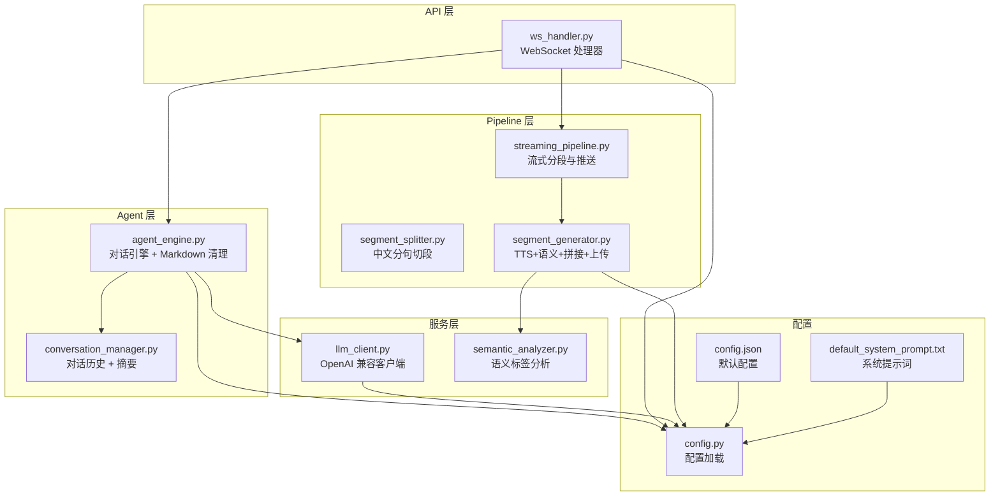
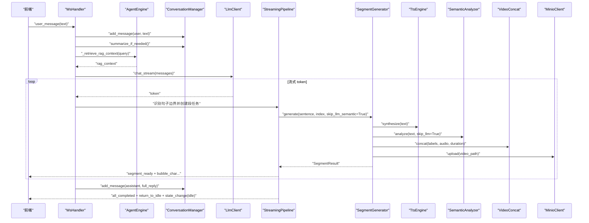
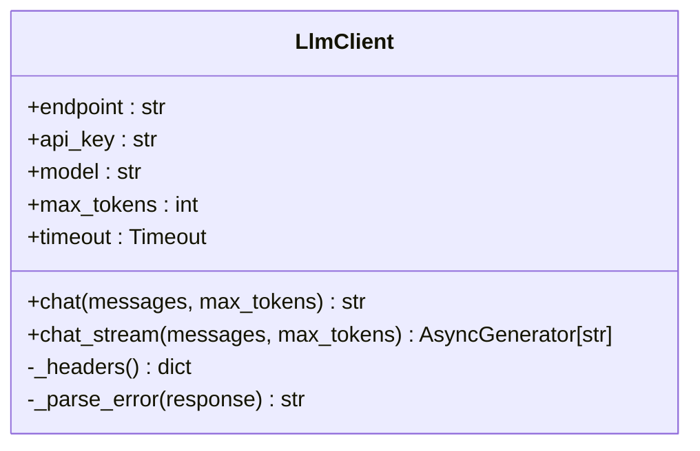
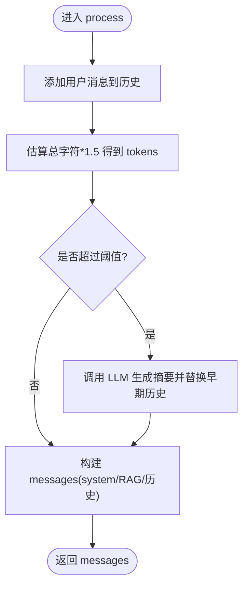
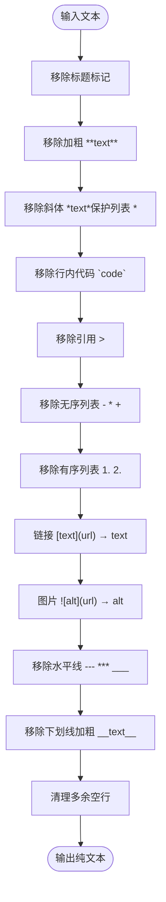
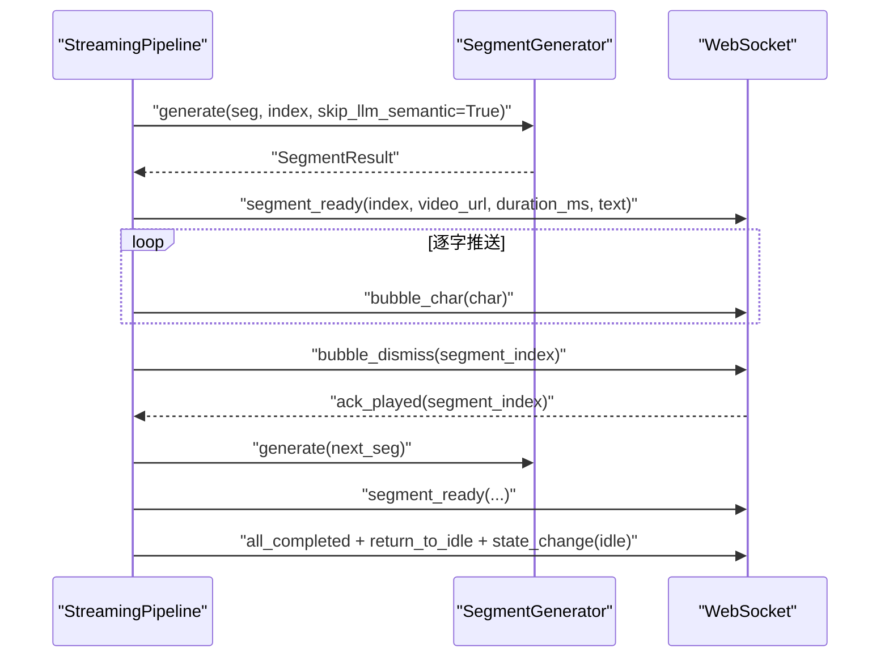
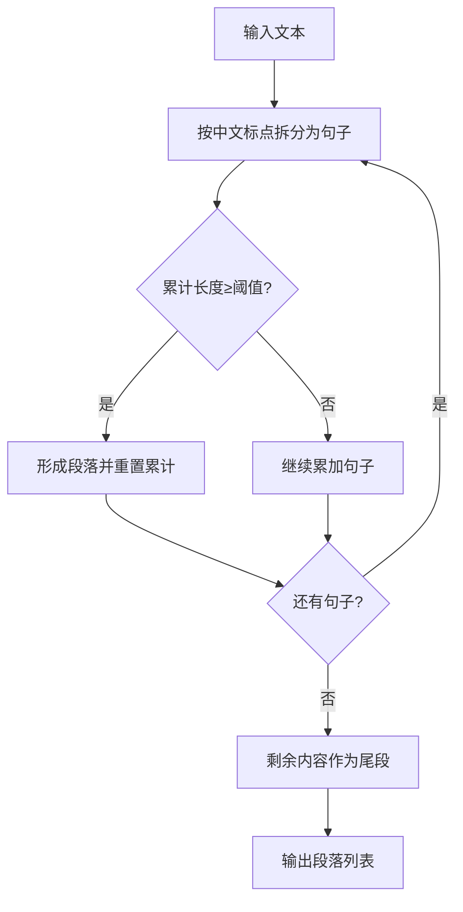
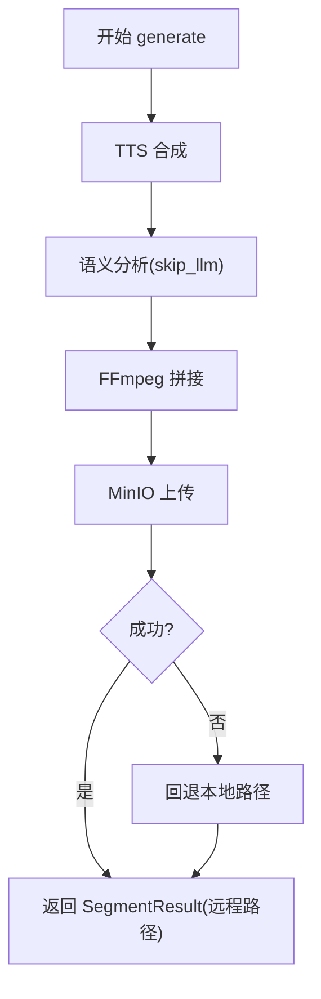
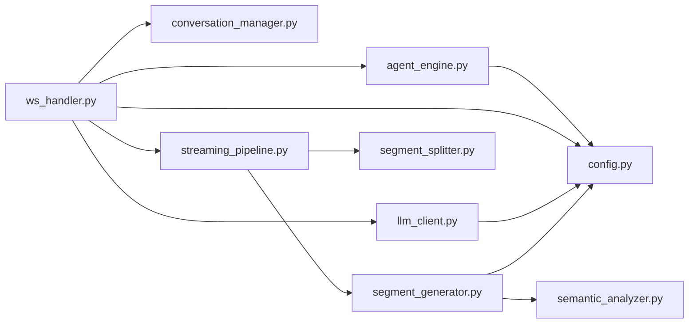

# LLM 服务集成

<cite>
**本文引用的文件**   
- [server/services/llm_client.py](file://server/services/llm_client.py)
- [server/config.py](file://server/config.py)
- [server/resources/default_system_prompt.txt](file://server/resources/default_system_prompt.txt)
- [server/agent/agent_engine.py](file://server/agent/agent_engine.py)
- [server/agent/conversation_manager.py](file://server/agent/conversation_manager.py)
- [server/pipeline/streaming_pipeline.py](file://server/pipeline/streaming_pipeline.py)
- [server/pipeline/segment_splitter.py](file://server/pipeline/segment_splitter.py)
- [server/pipeline/segment_generator.py](file://server/pipeline/segment_generator.py)
- [server/api/ws_handler.py](file://server/api/ws_handler.py)
- [server/services/semantic_analyzer.py](file://server/services/semantic_analyzer.py)
- [server/models/message.py](file://server/models/message.py)
- [config.json](file://config.json)
</cite>

## 目录
1. [简介](#简介)
2. [项目结构](#项目结构)
3. [核心组件](#核心组件)
4. [架构总览](#架构总览)
5. [详细组件分析](#详细组件分析)
6. [依赖关系分析](#依赖关系分析)
7. [性能与稳定性优化](#性能与稳定性优化)
8. [故障排查指南](#故障排查指南)
9. [结论](#结论)
10. [附录：配置与示例](#附录配置与示例)

## 简介
本技术文档围绕 RealTimeTalk 的 LLM 服务集成，系统性阐述大语言模型的调用封装、响应处理机制（含异步请求、流式响应、错误重试）、提示词工程最佳实践、Markdown 文本清理算法实现原理、客户端配置与连接池管理、超时与限流控制、降级策略，以及稳定性与成本调优建议。文档兼顾初学者友好与资深开发者所需的技术深度，并提供可落地的集成示例路径。

## 项目结构
RealTimeTalk 后端采用分层与服务化组织方式：
- 服务层：LLM/TTS/语义分析/视频拼接/对象存储等能力封装
- Agent 层：对话编排、上下文组装、RAG 检索增强、Markdown 清理
- Pipeline 层：流式分段生成与推送（WebSocket）
- API 层：WebSocket 消息路由与会话状态管理
- 配置层：统一加载 JSON 与环境变量，提供全局配置访问

图表来源
- [server/api/ws_handler.py:1-120](file://server/api/ws_handler.py#L1-L120)
- [server/agent/agent_engine.py:1-120](file://server/agent/agent_engine.py#L1-L120)
- [server/pipeline/streaming_pipeline.py:1-120](file://server/pipeline/streaming_pipeline.py#L1-L120)
- [server/pipeline/segment_splitter.py:1-95](file://server/pipeline/segment_splitter.py#L1-L95)
- [server/pipeline/segment_generator.py:1-138](file://server/pipeline/segment_generator.py#L1-L138)
- [server/services/llm_client.py:1-204](file://server/services/llm_client.py#L1-L204)
- [server/services/semantic_analyzer.py:1-126](file://server/services/semantic_analyzer.py#L1-L126)
- [server/config.py:1-260](file://server/config.py#L1-L260)
- [config.json:1-39](file://config.json#L1-L39)
- [server/resources/default_system_prompt.txt:1-29](file://server/resources/default_system_prompt.txt#L1-L29)

章节来源
- [server/api/ws_handler.py:1-120](file://server/api/ws_handler.py#L1-L120)
- [server/agent/agent_engine.py:1-120](file://server/agent/agent_engine.py#L1-L120)
- [server/pipeline/streaming_pipeline.py:1-120](file://server/pipeline/streaming_pipeline.py#L1-L120)
- [server/pipeline/segment_splitter.py:1-95](file://server/pipeline/segment_splitter.py#L1-L95)
- [server/pipeline/segment_generator.py:1-138](file://server/pipeline/segment_generator.py#L1-L138)
- [server/services/llm_client.py:1-204](file://server/services/llm_client.py#L1-L204)
- [server/services/semantic_analyzer.py:1-126](file://server/services/semantic_analyzer.py#L1-L126)
- [server/config.py:1-260](file://server/config.py#L1-L260)
- [config.json:1-39](file://config.json#L1-L39)
- [server/resources/default_system_prompt.txt:1-29](file://server/resources/default_system_prompt.txt#L1-L29)

## 核心组件
- LlmClient：OpenAI 兼容 Chat Completions 客户端，支持同步 chat 与流式 chat_stream，内置重试、限流等待、超时与连接错误处理。
- ConversationManager：维护会话消息、Redis 持久化、Token 溢出智能摘要，负责构建发送给 LLM 的 messages。
- AgentEngine：对话编排入口，注入 RAG 上下文、调用 LLM、执行 Markdown 清理、保存回复到历史。
- StreamingPipeline：接收完整回复文本，按句切段，并行生成各段视频并逐段推送；首段优先返回以降低端到端延迟。
- SegmentSplitter：基于中文标点分句并按阈值合并为段落。
- SegmentGenerator：单段生成管线（TTS → 语义分析 → FFmpeg 拼接 → MinIO 上传），失败回退本地。
- SemanticAnalyzer：通过 LLM 或关键词回退进行语义标签分析，用于视频片段选择。
- WsHandler：WebSocket 消息路由，协调会话恢复、流式处理流程、ack 确认与取消。
- Config：统一从 config.json 与 .env 环境变量加载配置，提供 get_config() 全局访问。

章节来源
- [server/services/llm_client.py:1-204](file://server/services/llm_client.py#L1-L204)
- [server/agent/conversation_manager.py:1-139](file://server/agent/conversation_manager.py#L1-L139)
- [server/agent/agent_engine.py:1-181](file://server/agent/agent_engine.py#L1-L181)
- [server/pipeline/streaming_pipeline.py:1-214](file://server/pipeline/streaming_pipeline.py#L1-L214)
- [server/pipeline/segment_splitter.py:1-95](file://server/pipeline/segment_splitter.py#L1-L95)
- [server/pipeline/segment_generator.py:1-138](file://server/pipeline/segment_generator.py#L1-L138)
- [server/services/semantic_analyzer.py:1-126](file://server/services/semantic_analyzer.py#L1-L126)
- [server/api/ws_handler.py:1-444](file://server/api/ws_handler.py#L1-L444)
- [server/config.py:1-260](file://server/config.py#L1-L260)

## 架构总览
下图展示一次用户消息的端到端流程：WS 接入 → 会话恢复 → 构建 messages（含 system prompt、RAG 上下文、历史）→ 流式 LLM → 边收边切段 → 并行生成视频 → 首段立即推送 → 后续段按 ack 推进 → 完成回到 idle。

图表来源
- [server/api/ws_handler.py:130-340](file://server/api/ws_handler.py#L130-L340)
- [server/agent/agent_engine.py:74-121](file://server/agent/agent_engine.py#L74-L121)
- [server/agent/conversation_manager.py:46-95](file://server/agent/conversation_manager.py#L46-L95)
- [server/services/llm_client.py:115-190](file://server/services/llm_client.py#L115-L190)
- [server/pipeline/streaming_pipeline.py:44-131](file://server/pipeline/streaming_pipeline.py#L44-L131)
- [server/pipeline/segment_generator.py:42-138](file://server/pipeline/segment_generator.py#L42-L138)

## 详细组件分析

### LLM 客户端（LlmClient）
- 功能要点
  - 同步 chat：POST /chat/completions，解析 choices[0].message.content，strip 后返回。
  - 流式 chat_stream：SSE 行读取 data: ...，解析 delta.content 增量产出。
  - 错误处理：区分 401/403、429（限流等待 2s 重试）、5xx（服务端错误等待 1s 重试）、超时与连接错误。
  - 重试策略：最多 2 次尝试，指数退避未使用但可通过 sleep 调整。
  - 超时设置：httpx.Timeout(connect=10s, total=60s)。
- 连接池管理
  - 当前实现每次请求新建 httpx.AsyncClient，并在 with 块中自动关闭。
  - 生产环境建议复用 AsyncClient 实例以启用连接池，减少握手开销。
- 扩展点
  - 新增模型参数（temperature、top_p、presence_penalty 等）可在 payload 中追加。
  - 自定义错误码映射与重试间隔。

图表来源
- [server/services/llm_client.py:23-204](file://server/services/llm_client.py#L23-L204)

章节来源
- [server/services/llm_client.py:23-204](file://server/services/llm_client.py#L23-L204)

### 对话管理与上下文组装（ConversationManager）
- 功能要点
  - 维护 messages 列表与 Redis 持久化。
  - Token 估算与智能摘要：当估计 tokens 超过阈值时，对早期对话压缩为摘要，保留最近 N 条。
  - 构建 messages：system prompt → RAG 上下文 → 可选摘要 → 过滤后的历史消息。
- 复杂度
  - 摘要触发条件 O(n) 遍历消息长度；构造 messages O(n)。
- 优化建议
  - 更精确的 token 估算（按实际 tokenizer）。
  - 摘要 prompt 可加入角色与风格约束，提升一致性。

图表来源
- [server/agent/conversation_manager.py:97-135](file://server/agent/conversation_manager.py#L97-L135)
- [server/agent/conversation_manager.py:46-95](file://server/agent/conversation_manager.py#L46-L95)

章节来源
- [server/agent/conversation_manager.py:1-139](file://server/agent/conversation_manager.py#L1-L139)

### 对话引擎与 Markdown 清理（AgentEngine）
- 功能要点
  - 调用 LLM 获取回复，随后执行 strip_markdown 清理，确保纯文本输出。
  - 支持 RAG 上下文注入（由外部注入 Qdrant/Embedding 客户端）。
- Markdown 清理算法
  - 规则覆盖：标题、加粗、斜体、行内代码、引用、无序/有序列表、链接、图片、水平线、下划线加粗、多余空行。
  - 正则顺序与边界保护：避免误伤列表项开头的星号。
  - 输出规范化：去除多余空行并 strip。

图表来源
- [server/agent/agent_engine.py:30-56](file://server/agent/agent_engine.py#L30-L56)

章节来源
- [server/agent/agent_engine.py:1-181](file://server/agent/agent_engine.py#L1-L181)

### 流式分段与推送（StreamingPipeline）
- 功能要点
  - 接收完整回复文本，按句切段，并行生成所有段。
  - 首段完成后立即推送 segment_ready 与打字机气泡，后续段在收到 ack_played 后推送。
  - 支持取消与错误事件推送。
- 关键优化
  - 首段跳过 LLM 语义分析（关键词回退），显著降低首帧延迟。
  - 打字机速度根据视频时长动态计算，限制单字最大间隔。

图表来源
- [server/pipeline/streaming_pipeline.py:44-214](file://server/pipeline/streaming_pipeline.py#L44-L214)

章节来源
- [server/pipeline/streaming_pipeline.py:1-214](file://server/pipeline/streaming_pipeline.py#L1-L214)

### 文本分段器（SegmentSplitter）
- 算法说明
  - 按中文句号、叹号、问号、分号拆分句子。
  - 累积至 ≥ threshold（默认 50）字符形成一段，尾部不足单独成段。
  - 保证每段以完整句子结尾。

图表来源
- [server/pipeline/segment_splitter.py:25-95](file://server/pipeline/segment_splitter.py#L25-L95)

章节来源
- [server/pipeline/segment_splitter.py:1-95](file://server/pipeline/segment_splitter.py#L1-L95)

### 单段生成器（SegmentGenerator）
- 流程
  - TTS 合成音频并获取时长。
  - 语义分析（首段优化使用关键词回退）。
  - FFmpeg 切片拼接与混音。
  - 上传 MinIO，失败回退本地路径。
- 异常处理
  - 捕获 TTS/拼接/上传异常，返回带 error 的 SegmentResult。

图表来源
- [server/pipeline/segment_generator.py:42-138](file://server/pipeline/segment_generator.py#L42-L138)

章节来源
- [server/pipeline/segment_generator.py:1-138](file://server/pipeline/segment_generator.py#L1-L138)

### WebSocket 处理器（WsHandler）
- 职责
  - 会话恢复与状态初始化。
  - 用户消息处理：更新状态、发送思考动画、启动流式处理。
  - 流式处理：边收边切段、并行生成、首段优先推送、ack 驱动后续段。
  - 错误与取消：统一错误事件与状态复位。
- 与 AgentEngine 的关系
  - 直接走流式 LLM 与 pipeline，不经过 AgentEngine.process_message（后者用于非流式场景）。

章节来源
- [server/api/ws_handler.py:1-444](file://server/api/ws_handler.py#L1-L444)

### 语义分析（SemanticAnalyzer）
- 功能
  - 通过 LLM 或关键词回退分析文本语义结构，输出标签序列。
  - 标签集合包含开场、正文、收尾三类，便于视频片段选择。
- 回退策略
  - 首段优化 skip_llm=True 时使用关键词匹配快速出结果。
  - LLM 失败或解析失败时回退到关键词方案。

章节来源
- [server/services/semantic_analyzer.py:1-126](file://server/services/semantic_analyzer.py#L1-L126)

### 配置与系统提示词
- 配置加载优先级：环境变量 > config.json > 默认值。
- LLM 配置项：endpoint、api_key、model、max_tokens。
- 系统提示词：从 default_system_prompt.txt 加载，强制纯文本输出规范。

章节来源
- [server/config.py:1-260](file://server/config.py#L1-L260)
- [config.json:1-39](file://config.json#L1-L39)
- [server/resources/default_system_prompt.txt:1-29](file://server/resources/default_system_prompt.txt#L1-L29)

## 依赖关系分析
- 模块耦合
  - ws_handler 强依赖 agent_engine、conversation_manager、llm_client、pipeline 与 services。
  - agent_engine 依赖 llm_client、redis_client、qdrant_client、embedding_client。
  - streaming_pipeline 依赖 segment_splitter、segment_generator。
  - segment_generator 依赖 tts_engine、semantic_analyzer、video_concat、minio_client。
- 外部依赖
  - httpx（HTTP 客户端）
  - FastAPI WebSocket
  - Redis、Qdrant、MinIO（可选）
  - FFmpeg（外部工具）

图表来源
- [server/api/ws_handler.py:1-120](file://server/api/ws_handler.py#L1-L120)
- [server/agent/agent_engine.py:1-120](file://server/agent/agent_engine.py#L1-L120)
- [server/pipeline/streaming_pipeline.py:1-120](file://server/pipeline/streaming_pipeline.py#L1-L120)
- [server/pipeline/segment_generator.py:1-138](file://server/pipeline/segment_generator.py#L1-L138)
- [server/services/llm_client.py:1-204](file://server/services/llm_client.py#L1-L204)
- [server/config.py:1-260](file://server/config.py#L1-L260)

章节来源
- [server/api/ws_handler.py:1-120](file://server/api/ws_handler.py#L1-L120)
- [server/agent/agent_engine.py:1-120](file://server/agent/agent_engine.py#L1-L120)
- [server/pipeline/streaming_pipeline.py:1-120](file://server/pipeline/streaming_pipeline.py#L1-L120)
- [server/pipeline/segment_generator.py:1-138](file://server/pipeline/segment_generator.py#L1-L138)
- [server/services/llm_client.py:1-204](file://server/services/llm_client.py#L1-L204)
- [server/config.py:1-260](file://server/config.py#L1-L260)

## 性能与稳定性优化
- 连接池与复用
  - 现状：每次请求新建 httpx.AsyncClient。
  - 建议：在应用生命周期内复用单一 AsyncClient 实例，开启连接池以减少 TCP 握手与 TLS 协商开销。
- 超时与重试
  - 已实现 connect=10s、total=60s；429 等待 2s 重试，5xx 等待 1s 重试。
  - 建议：引入指数退避与抖动，避免雪崩；对 429 增加最大重试次数上限。
- 流式优化
  - 首段跳过 LLM 语义分析，显著降低首帧延迟。
  - 建议：对长文本进一步细化分段策略（如按语义断句），提高首段质量。
- 并发与背压
  - 使用 asyncio.gather 并行生成多段，配合 ack 控制推送节奏。
  - 建议：限制并发段数上限，防止资源耗尽。
- 降级策略
  - MinIO 上传失败回退本地路径。
  - 语义分析失败回退关键词匹配。
  - RAG 不可用时降级为纯 LLM 回复。
- 成本调优
  - 合理设置 max_tokens，避免过长回复。
  - 使用较小模型（如 qwen-turbo）满足日常问答。
  - 首段语义分析使用关键词回退，减少 LLM 调用次数。
  - 对话摘要阈值与保留条数可调，平衡上下文长度与成本。

[本节为通用指导，无需具体文件来源]

## 故障排查指南
- LLM 调用失败
  - 检查 endpoint、api_key、model 配置是否正确。
  - 查看日志中的错误码与消息，定位 401/403/429/5xx 原因。
  - 确认网络连通性与防火墙策略。
- 流式中断
  - 检查 SSE 数据格式是否为 data: ... 且包含 choices.delta.content。
  - 确认前端 ack_played 是否正常回传。
- 视频生成失败
  - 检查 TTS 服务可用性、FFmpeg 安装与 GPU 编码器配置。
  - 确认 MinIO 连接与权限，必要时回退本地路径。
- 会话状态异常
  - 检查 Redis 中 session 是否存在与状态是否一致。
  - 确认 ws_handler 的状态切换逻辑与事件推送顺序。

章节来源
- [server/services/llm_client.py:62-113](file://server/services/llm_client.py#L62-L113)
- [server/services/llm_client.py:139-190](file://server/services/llm_client.py#L139-L190)
- [server/api/ws_handler.py:335-444](file://server/api/ws_handler.py#L335-L444)
- [server/pipeline/segment_generator.py:108-138](file://server/pipeline/segment_generator.py#L108-L138)

## 结论
RealTimeTalk 的 LLM 服务集成通过清晰的模块化设计与完善的错误处理机制，实现了高可用、低延迟的实时对话体验。结合流式响应、首段优先推送、语义分析回退与 RAG 降级策略，系统在稳定性与成本之间取得良好平衡。建议在连接池复用、重试策略精细化、并发控制与监控告警方面持续优化，进一步提升用户体验与运维效率。

[本节为总结性内容，无需具体文件来源]

## 附录：配置与示例

### 配置选项
- LLM
  - endpoint：OpenAI 兼容接口地址
  - api_key：鉴权密钥
  - model：模型名称
  - max_tokens：最大生成长度
- TTS
  - api_key、voice、speed
- 其他
  - redis、minio、ffmpeg、qdrant、embedding、rag 等

章节来源
- [server/config.py:16-123](file://server/config.py#L16-L123)
- [config.json:1-39](file://config.json#L1-L39)

### 集成新 LLM 服务的步骤
- 适配 OpenAI 兼容 API
  - 修改 endpoint 指向新服务。
  - 校验 /chat/completions 响应结构与 SSE 格式。
- 自定义响应处理
  - 在 chat/chat_stream 中解析 choices/delta 字段，按需转换字段名。
  - 若新服务返回字段不同，扩展 _parse_error 与解析逻辑。
- 错误与重试
  - 根据新服务错误码调整重试策略与等待时间。
- 示例参考路径
  - 同步调用：[server/services/llm_client.py:40-113](file://server/services/llm_client.py#L40-L113)
  - 流式调用：[server/services/llm_client.py:115-190](file://server/services/llm_client.py#L115-L190)

### 提示词工程最佳实践
- 系统提示词设计
  - 明确角色、语气、回答风格与知识边界。
  - 强调纯文本输出要求，禁止 Markdown 语法。
- 上下文组装
  - 将 RAG 上下文插入 system 消息，置于历史之前。
  - 使用摘要压缩早期对话，控制 tokens 增长。
- 输出格式化
  - 通过 strip_markdown 确保最终输出为纯文本。
  - 在业务侧二次清洗（如去除多余空白、标准化标点）。

章节来源
- [server/resources/default_system_prompt.txt:1-29](file://server/resources/default_system_prompt.txt#L1-L29)
- [server/agent/conversation_manager.py:46-95](file://server/agent/conversation_manager.py#L46-L95)
- [server/agent/agent_engine.py:30-56](file://server/agent/agent_engine.py#L30-L56)

### 超时、限流与降级
- 超时
  - connect=10s、total=60s，可根据网络状况调整。
- 限流
  - 429 等待 2s 后重试，建议增加指数退避与上限。
- 降级
  - RAG 不可用 → 纯 LLM 回复。
  - 语义分析失败 → 关键词回退。
  - MinIO 上传失败 → 本地路径回退。

章节来源
- [server/services/llm_client.py:80-113](file://server/services/llm_client.py#L80-L113)
- [server/services/semantic_analyzer.py:81-86](file://server/services/semantic_analyzer.py#L81-L86)
- [server/pipeline/segment_generator.py:98-106](file://server/pipeline/segment_generator.py#L98-L106)