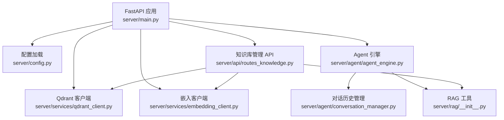
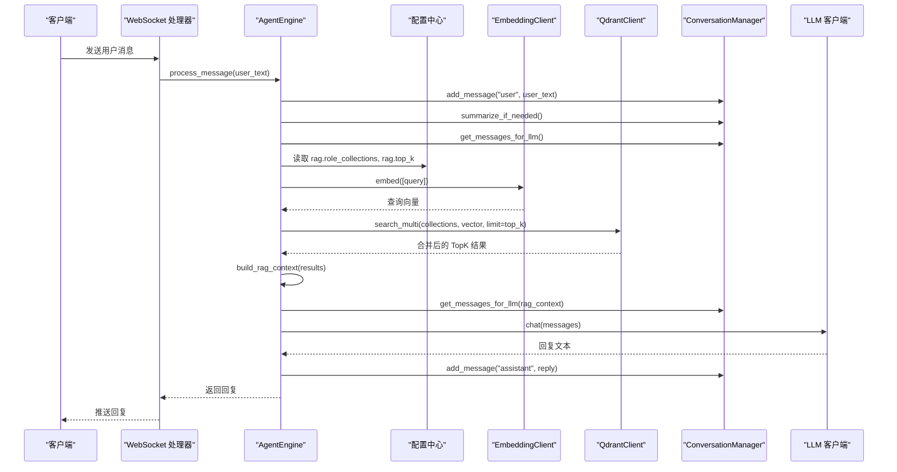
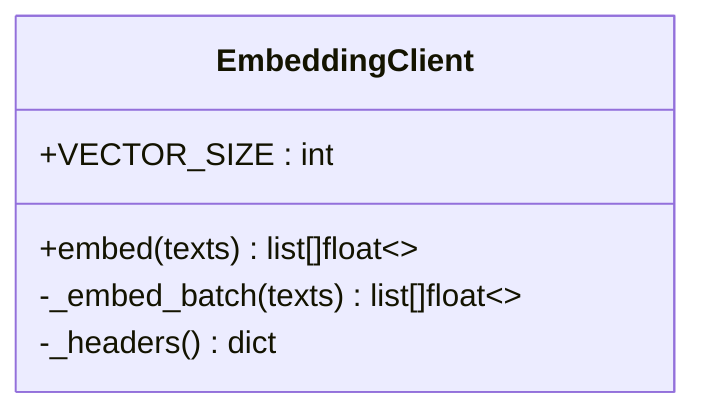
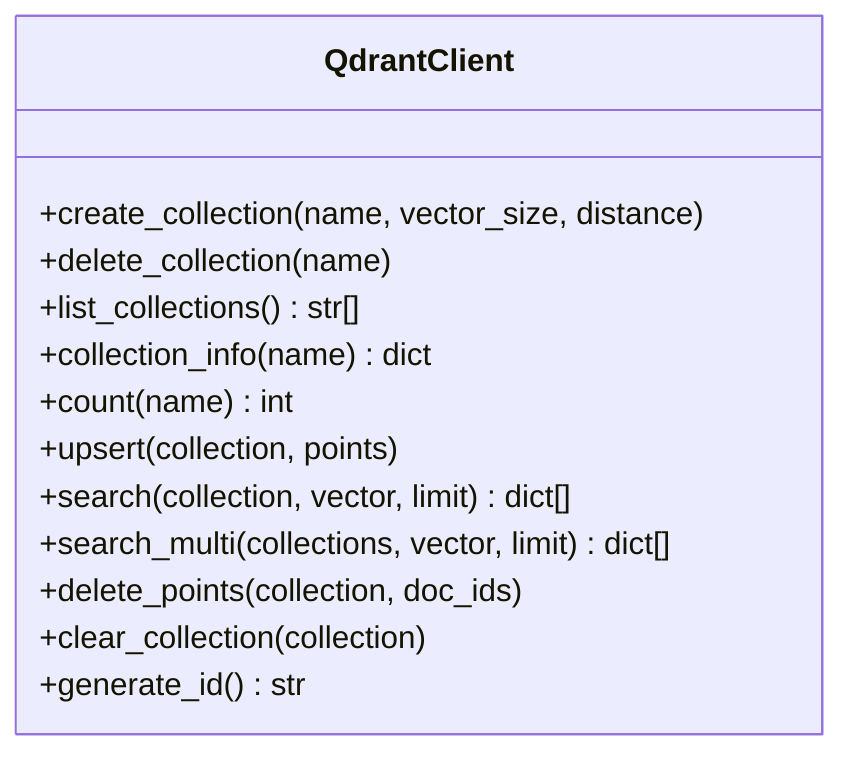
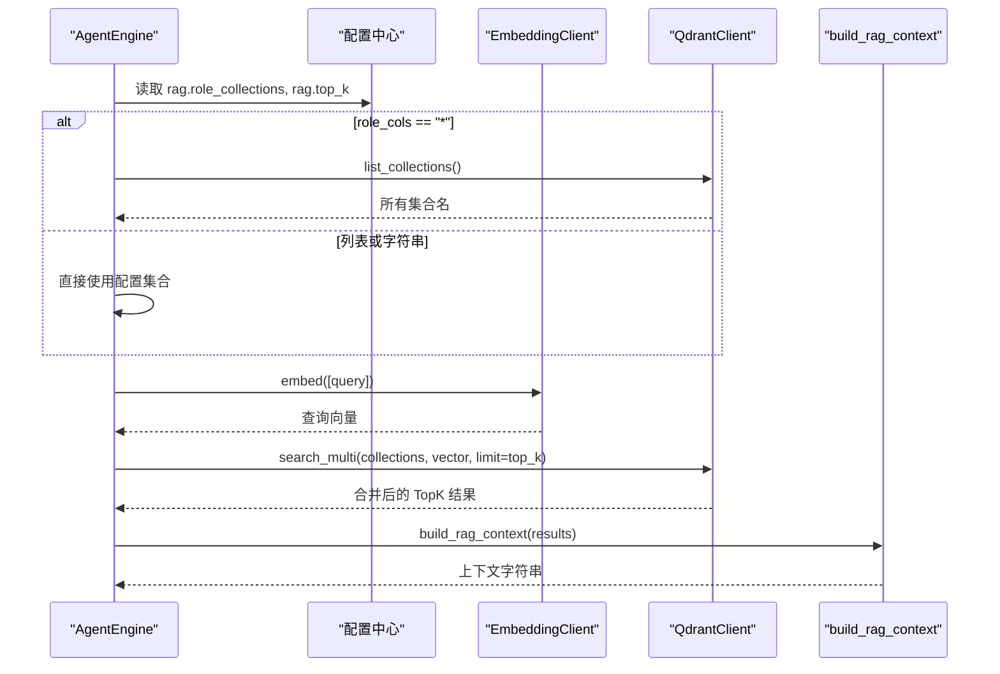
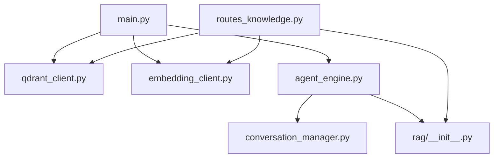

# RAG 检索增强

<cite>
**本文引用的文件**   
- [server/main.py](file://server/main.py)
- [server/config.py](file://server/config.py)
- [server/rag/__init__.py](file://server/rag/__init__.py)
- [server/services/embedding_client.py](file://server/services/embedding_client.py)
- [server/services/qdrant_client.py](file://server/services/qdrant_client.py)
- [server/api/routes_knowledge.py](file://server/api/routes_knowledge.py)
- [server/agent/agent_engine.py](file://server/agent/agent_engine.py)
- [server/agent/conversation_manager.py](file://server/agent/conversation_manager.py)
- [doc/Qdrant知识库操作指南.md](file://doc/Qdrant知识库操作指南.md)
</cite>

## 目录
1. [简介](#简介)
2. [项目结构](#项目结构)
3. [核心组件](#核心组件)
4. [架构总览](#架构总览)
5. [详细组件分析](#详细组件分析)
6. [依赖关系分析](#依赖关系分析)
7. [性能与优化](#性能与优化)
8. [故障排查](#故障排查)
9. [结论](#结论)
10. [附录：扩展与自定义示例](#附录扩展与自定义示例)

## 简介
本技术文档面向 RealTimeTalk 的 RAG（检索增强生成）子系统，系统性阐述其实现原理与工程实践。内容覆盖向量嵌入生成、语义相似度搜索、上下文构建、Qdrant 集合管理与查询优化、嵌入客户端配置与模型选择、角色-集合映射机制、动态检索范围控制、结果质量评估与排序策略，并提供可操作的扩展与调优建议，兼顾初学者友好与资深开发者深度需求。

## 项目结构
RAG 相关代码主要分布在以下模块：
- 服务入口与生命周期管理：负责初始化 Qdrant 与 Embedding 客户端，并将它们注入到 Agent 引擎
- 配置中心：统一加载 JSON 与环境变量，提供 rag_top_k、role_collections 等关键参数
- 检索增强工具：文本分块与上下文构建
- 外部服务客户端：DashScope 文本嵌入、Qdrant 向量数据库
- 知识库管理 API：集合管理、知识摄入、统计与调试搜索
- Agent 引擎：对话流程中触发 RAG 检索并注入上下文

图表来源
- [server/main.py:42-90](file://server/main.py#L42-L90)
- [server/config.py:148-241](file://server/config.py#L148-L241)
- [server/services/qdrant_client.py:26-112](file://server/services/qdrant_client.py#L26-L112)
- [server/services/embedding_client.py:26-70](file://server/services/embedding_client.py#L26-L70)
- [server/agent/agent_engine.py:59-121](file://server/agent/agent_engine.py#L59-L121)
- [server/agent/conversation_manager.py:21-95](file://server/agent/conversation_manager.py#L21-L95)
- [server/rag/__init__.py:10-83](file://server/rag/__init__.py#L10-L83)
- [server/api/routes_knowledge.py:134-186](file://server/api/routes_knowledge.py#L134-L186)

章节来源
- [server/main.py:42-90](file://server/main.py#L42-L90)
- [server/config.py:148-241](file://server/config.py#L148-L241)

## 核心组件
- 嵌入客户端（EmbeddingClient）
  - 功能：调用 DashScope 文本嵌入 API，将文本批量转为固定维度向量（默认 1024 维）
  - 特性：批处理（最多 10 条/批）、重试与限流处理、错误解析
  - 配置项：endpoint、api_key、model；通过 get_config() 读取 embedding.* 字段
- Qdrant 客户端（QdrantClient）
  - 功能：集合 CRUD、点写入（upsert）、单集合搜索、多集合并发搜索（search_multi）、计数与清空
  - 索引策略：创建集合时指定向量维度与距离度量（默认 Cosine）
  - 鉴权：可选 api-key 请求头
- RAG 工具（chunk_text、build_rag_context）
  - chunk_text：按段落优先切分，超长段落使用滑动窗口，支持重叠
  - build_rag_context：过滤低分结果，拼接为 system 消息片段
- Agent 引擎（AgentEngine）
  - 在 process_message 中执行 RAG 检索，根据 role_collections 决定检索范围，合并结果后注入上下文
  - 降级策略：当无集合、无结果或异常时回退纯 LLM 回复
- 对话历史管理（ConversationManager）
  - 维护 messages 列表，支持 Redis 持久化与智能摘要
  - 组装 messages 时插入 RAG 上下文片段
- 知识库管理 API（routes_knowledge）
  - 集合管理、知识摄入（自动分块+嵌入+upsert）、统计、清空、调试搜索
  - 鉴权：X-Knowledge-Admin-Token 请求头

章节来源
- [server/services/embedding_client.py:26-149](file://server/services/embedding_client.py#L26-L149)
- [server/services/qdrant_client.py:26-235](file://server/services/qdrant_client.py#L26-L235)
- [server/rag/__init__.py:10-83](file://server/rag/__init__.py#L10-L83)
- [server/agent/agent_engine.py:59-181](file://server/agent/agent_engine.py#L59-L181)
- [server/agent/conversation_manager.py:21-139](file://server/agent/conversation_manager.py#L21-L139)
- [server/api/routes_knowledge.py:134-267](file://server/api/routes_knowledge.py#L134-L267)

## 架构总览
下图展示从用户提问到返回回答的端到端流程，包括 RAG 检索与上下文注入。

图表来源
- [server/agent/agent_engine.py:74-121](file://server/agent/agent_engine.py#L74-L121)
- [server/agent/agent_engine.py:123-180](file://server/agent/agent_engine.py#L123-L180)
- [server/rag/__init__.py:56-83](file://server/rag/__init__.py#L56-L83)
- [server/services/embedding_client.py:47-70](file://server/services/embedding_client.py#L47-L70)
- [server/services/qdrant_client.py:164-186](file://server/services/qdrant_client.py#L164-L186)
- [server/agent/conversation_manager.py:46-95](file://server/agent/conversation_manager.py#L46-L95)

## 详细组件分析

### 嵌入客户端（EmbeddingClient）
- 设计要点
  - 异步 HTTP 客户端，超时与重试策略完善
  - 批量处理：超过 batch_size 自动分批
  - 错误分类：鉴权失败、限流、服务端错误、网络异常
- 复杂度
  - 时间复杂度：O(N/B)，N 为文本数，B 为批大小
  - 空间复杂度：O(B) 每批缓存
- 配置与模型
  - endpoint、api_key、model 来自配置；默认模型 text-embedding-v3，输出维度 1024
- 使用建议
  - 合理设置 batch_size 以平衡吞吐与延迟
  - 监控 429/5xx 错误，必要时调整重试间隔

图表来源
- [server/services/embedding_client.py:26-149](file://server/services/embedding_client.py#L26-L149)

章节来源
- [server/services/embedding_client.py:26-149](file://server/services/embedding_client.py#L26-L149)

### Qdrant 客户端（QdrantClient）
- 设计要点
  - 集合管理：create/delete/list/info/count/clear
  - 数据操作：upsert、search、search_multi（并发合并排序）、delete_points
  - 索引策略：创建集合时指定向量维度与距离度量（Cosine）
- 复杂度
  - upsert/search：近似 O(1) 写入，O(log N) 检索（取决于底层索引）
  - search_multi：并发度等于集合数量，最终合并排序 O(K log K)
- 使用建议
  - 合理设置 top_k 与 limit，避免过大导致响应变慢
  - 对大集合定期清理无效条目，保持检索精度

图表来源
- [server/services/qdrant_client.py:26-235](file://server/services/qdrant_client.py#L26-L235)

章节来源
- [server/services/qdrant_client.py:26-235](file://server/services/qdrant_client.py#L26-L235)

### RAG 工具（分块与上下文构建）
- 分块策略
  - 优先按段落切分，段落内若超长则使用滑动窗口，保留 overlap 保证连续性
- 上下文构建
  - 过滤低分结果（score < 0.3），拼接为 system 消息片段，便于 LLM 优先参考

图表来源
- [server/rag/__init__.py:10-53](file://server/rag/__init__.py#L10-L53)

章节来源
- [server/rag/__init__.py:10-83](file://server/rag/__init__.py#L10-L83)

### Agent 引擎（RAG 集成）
- 流程
  - 保存用户消息 → 智能摘要 → 获取 messages → RAG 检索 → 注入上下文 → 调用 LLM → 保存助手回复
- 角色-集合映射
  - 从配置读取 role_collections，支持 "*"（全部集合）或列表（限定集合）
- 降级策略
  - 无集合/无结果/异常时跳过 RAG，走纯 LLM 回复

图表来源
- [server/agent/agent_engine.py:123-180](file://server/agent/agent_engine.py#L123-L180)
- [server/rag/__init__.py:56-83](file://server/rag/__init__.py#L56-L83)

章节来源
- [server/agent/agent_engine.py:74-181](file://server/agent/agent_engine.py#L74-L181)

### 对话历史管理（ConversationManager）
- 功能
  - 维护 messages 列表，Redis 持久化，智能摘要
  - 组装 messages 时插入 RAG 上下文片段
- 复杂度
  - 摘要触发基于字符估算 token 数，阈值可控
- 使用建议
  - 合理设置 SUMMARY_THRESHOLD_TOKENS 以平衡上下文长度与成本

章节来源
- [server/agent/conversation_manager.py:21-139](file://server/agent/conversation_manager.py#L21-L139)

### 知识库管理 API（routes_knowledge）
- 能力
  - 集合管理：创建/删除/列出/信息/清空
  - 知识摄入：自动分块 → 批量嵌入 → upsert → 统计
  - 调试搜索：单集合或多集合语义检索
- 鉴权
  - X-Knowledge-Admin-Token 请求头校验

章节来源
- [server/api/routes_knowledge.py:81-267](file://server/api/routes_knowledge.py#L81-L267)

## 依赖关系分析
- 组件耦合
  - main.py 作为装配器，初始化 Qdrant 与 Embedding 客户端，并通过 set_rag_clients 注入到 AgentEngine
  - routes_knowledge 直接依赖 Qdrant 与 Embedding 客户端进行知识摄入与检索
  - AgentEngine 依赖 ConversationManager 与 RAG 工具完成上下文构建
- 外部依赖
  - httpx 用于异步 HTTP 请求
  - Qdrant REST API 与 DashScope Embedding API

图表来源
- [server/main.py:70-87](file://server/main.py#L70-L87)
- [server/api/routes_knowledge.py:134-186](file://server/api/routes_knowledge.py#L134-L186)
- [server/agent/agent_engine.py:59-121](file://server/agent/agent_engine.py#L59-L121)

章节来源
- [server/main.py:70-87](file://server/main.py#L70-L87)
- [server/api/routes_knowledge.py:134-186](file://server/api/routes_knowledge.py#L134-L186)
- [server/agent/agent_engine.py:59-121](file://server/agent/agent_engine.py#L59-L121)

## 性能与优化
- 嵌入批处理
  - 利用 EmbeddingClient 的批处理能力，提高吞吐；注意单次上限（如 10 条）
- 检索并发
  - search_multi 并发检索多个集合，减少整体延迟；需关注集合数量与网络开销
- 结果过滤
  - build_rag_context 内置低分过滤（score >= 0.3），可减少无关上下文对 LLM 的干扰
- 索引与度量
  - 使用 Cosine 距离适合归一化向量；如需不同行为可在集合创建时调整
- 资源与超时
  - 合理设置 httpx 超时与重试策略，避免长尾请求拖慢整体链路
- 容量规划
  - 定期统计集合点数（count），清理过时知识，维持检索精度与性能

[本节为通用指导，不直接分析具体文件]

## 故障排查
- 常见错误
  - 嵌入 API 鉴权失败（401/403）：检查 embedding.api_key 与 endpoint
  - 限流（429）：观察日志中的重试与等待逻辑，必要时降低并发或增加间隔
  - Qdrant 连接失败：确认 qdrant.url 与 api_key（若启用）
  - 检索结果为空：检查集合是否存在、知识是否已摄入、role_collections 是否正确
- 定位方法
  - 使用 /api/knowledge/search 调试检索效果，验证分数与文本相关性
  - 查看日志中的 RAG 相关提示（如“RAG 跳过”、“检索无结果”）
- 降级路径
  - 当 RAG 不可用时，系统自动回退纯 LLM 回复，确保可用性

章节来源
- [server/services/embedding_client.py:84-135](file://server/services/embedding_client.py#L84-L135)
- [server/services/qdrant_client.py:115-186](file://server/services/qdrant_client.py#L115-L186)
- [server/agent/agent_engine.py:178-180](file://server/agent/agent_engine.py#L178-L180)
- [server/api/routes_knowledge.py:233-267](file://server/api/routes_knowledge.py#L233-L267)

## 结论
RealTimeTalk 的 RAG 子系统以清晰的模块化设计与稳健的错误处理为基础，实现了从文本向量化、语义检索到上下文注入的完整链路。通过角色-集合映射与动态检索范围控制，系统具备灵活的知识域隔离与扩展能力。结合合理的索引策略、并发检索与结果过滤，能够在保证检索精度的同时提升整体性能。对于初学者，建议从集合管理与知识摄入入手，逐步理解检索与上下文注入；对于资深开发者，可进一步定制分块策略、检索排序与降级策略，以满足更复杂的业务场景。

[本节为总结性内容，不直接分析具体文件]

## 附录：扩展与自定义示例

### 扩展知识库（新增集合与摄入知识）
- 步骤
  - 创建集合：调用 POST /api/knowledge/collections，传入 name 与 vector_size
  - 摄入知识：调用 POST /api/knowledge/ingest，传入 collection 与 documents（text/source）
  - 验证检索：调用 GET /api/knowledge/search，输入问题验证 TopK 结果
- 注意事项
  - 集合名称会被规范化为小写+下划线
  - 长文本会自动分块，确保检索粒度合适

章节来源
- [server/api/routes_knowledge.py:105-186](file://server/api/routes_knowledge.py#L105-L186)
- [server/api/routes_knowledge.py:233-267](file://server/api/routes_knowledge.py#L233-L267)

### 自定义检索策略（调整 top_k 与过滤阈值）
- 调整 top_k
  - 通过环境变量或 config.json 的 rag.top_k 控制返回条数
- 调整过滤阈值
  - 修改 build_rag_context 中的 score 阈值（默认 0.3），以适应不同领域的相关性要求
- 角色-集合映射
  - 通过 rag.role_collections 配置，支持 "*" 或列表形式，限定检索范围

章节来源
- [server/config.py:234-237](file://server/config.py#L234-L237)
- [server/rag/__init__.py:69-73](file://server/rag/__init__.py#L69-L73)
- [server/agent/agent_engine.py:137-156](file://server/agent/agent_engine.py#L137-L156)

### 嵌入客户端配置与模型选择
- 配置项
  - embedding.endpoint、embedding.api_key、embedding.model
- 模型选择
  - 默认 text-embedding-v3，维度 1024；可根据业务需求切换其他模型
- 参数调优
  - 调整批大小与超时策略，平衡吞吐与稳定性

章节来源
- [server/config.py:229-233](file://server/config.py#L229-L233)
- [server/services/embedding_client.py:29-40](file://server/services/embedding_client.py#L29-L40)

### 检索结果质量评估与排序算法
- 评分与排序
  - Qdrant 返回 score（余弦相似度），search_multi 合并后按 score 降序取 TopK
- 质量评估
  - 使用 /api/knowledge/search 验证相关性；结合业务反馈迭代知识内容与分块策略
- 降级策略
  - 当最高分数低于阈值或无结果时，跳过 RAG，走纯 LLM 回复

章节来源
- [server/services/qdrant_client.py:164-186](file://server/services/qdrant_client.py#L164-L186)
- [server/rag/__init__.py:69-73](file://server/rag/__init__.py#L69-L73)
- [doc/Qdrant知识库操作指南.md:153-171](file://doc/Qdrant知识库操作指南.md#L153-L171)