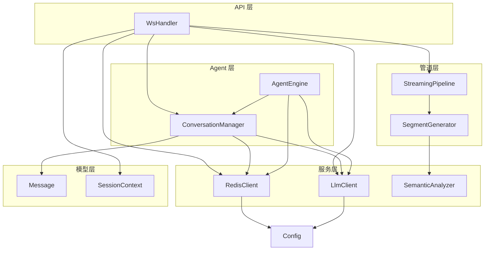
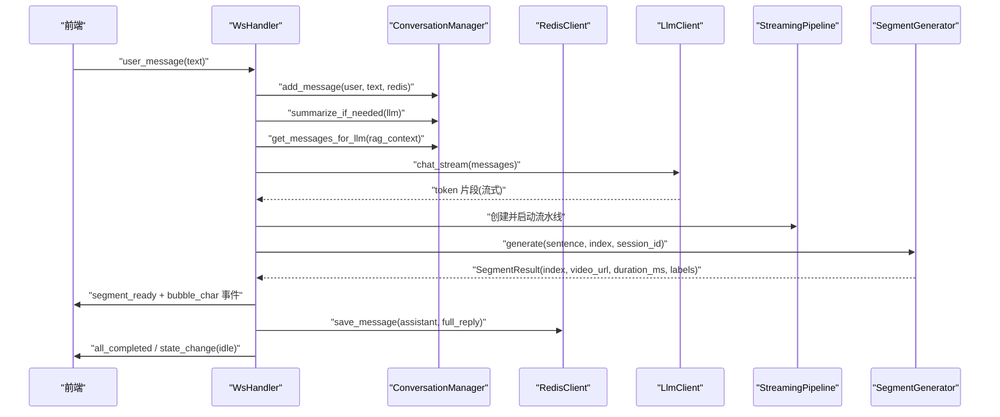
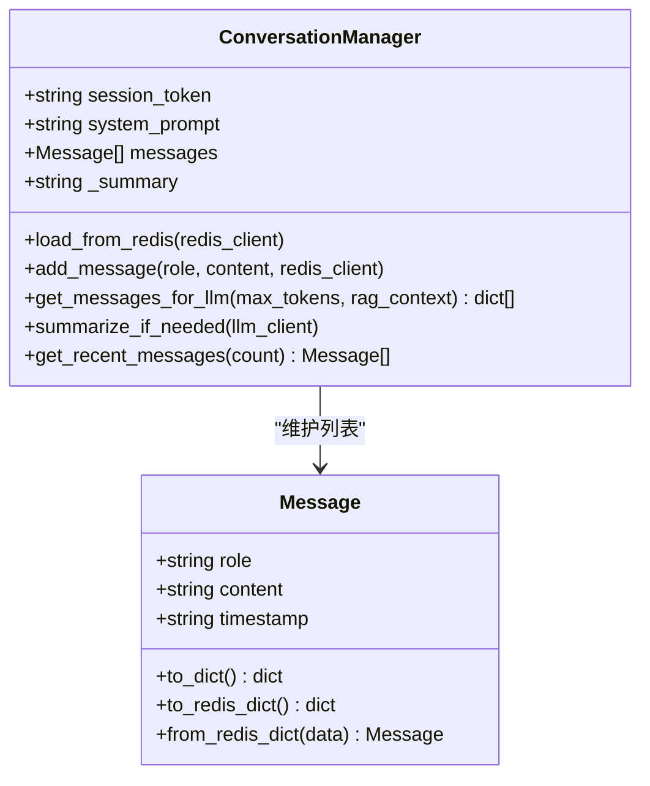
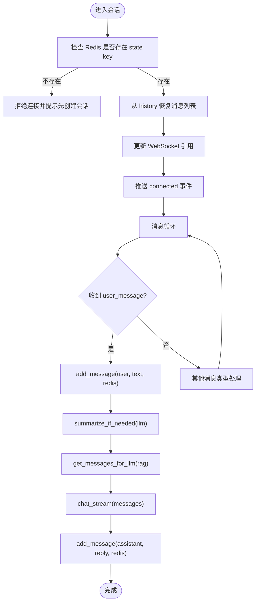
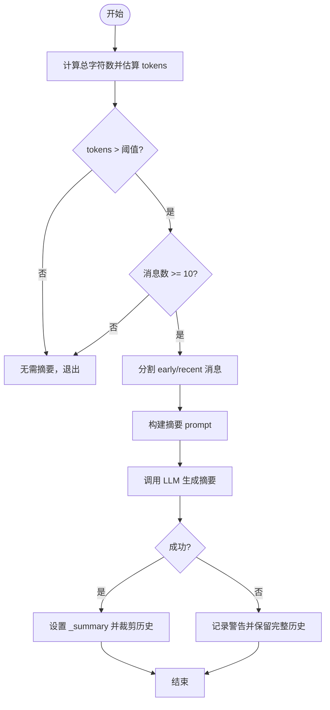
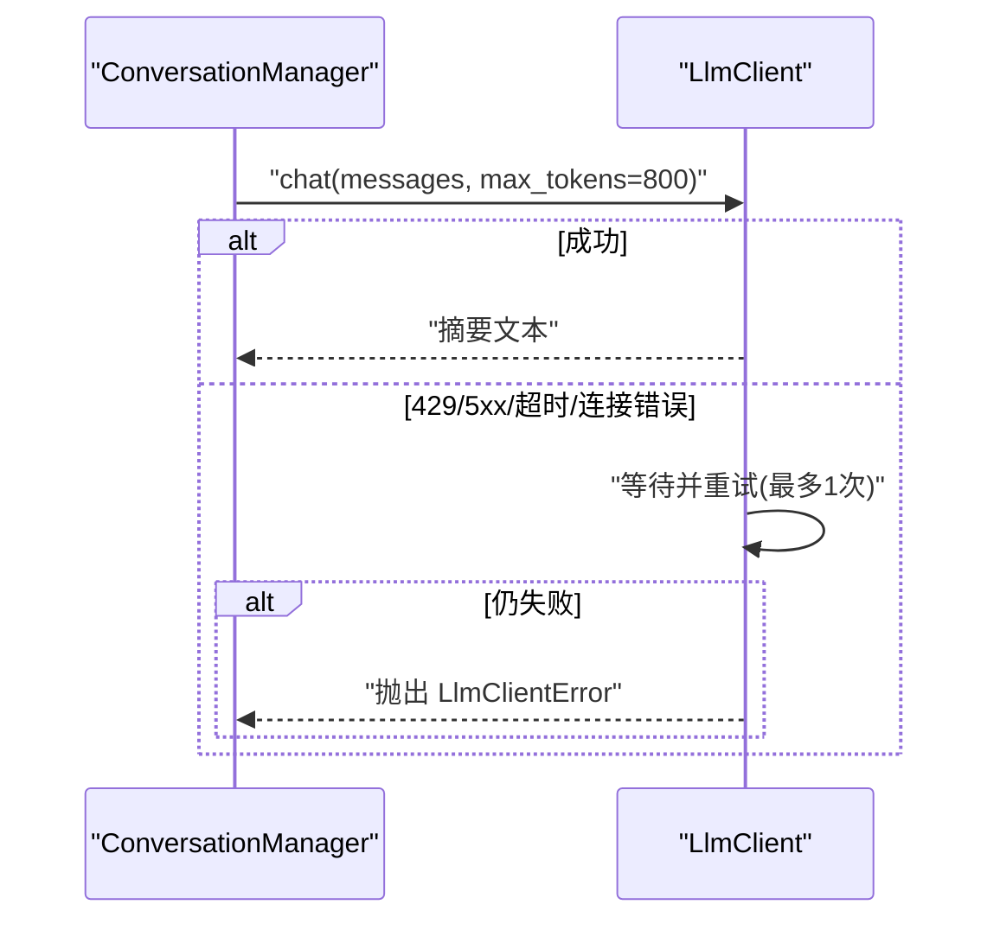
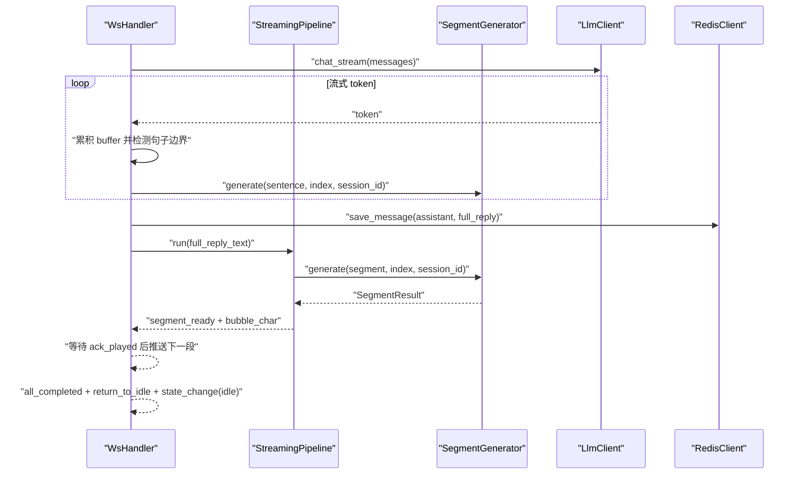
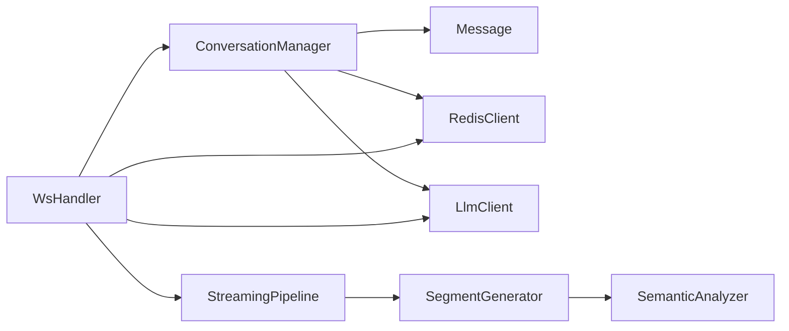

# 对话管理逻辑

<cite>
**本文引用的文件**
- [conversation_manager.py](file://server/agent/conversation_manager.py)
- [redis_client.py](file://server/services/redis_client.py)
- [llm_client.py](file://server/services/llm_client.py)
- [message.py](file://server/models/message.py)
- [session.py](file://server/models/session.py)
- [ws_handler.py](file://server/api/ws_handler.py)
- [agent_engine.py](file://server/agent/agent_engine.py)
- [streaming_pipeline.py](file://server/pipeline/streaming_pipeline.py)
- [segment_generator.py](file://server/pipeline/segment_generator.py)
- [semantic_analyzer.py](file://server/services/semantic_analyzer.py)
- [config.py](file://server/config.py)
</cite>

## 目录
1. [简介](#简介)
2. [项目结构](#项目结构)
3. [核心组件](#核心组件)
4. [架构总览](#架构总览)
5. [详细组件分析](#详细组件分析)
6. [依赖关系分析](#依赖关系分析)
7. [性能与优化](#性能与优化)
8. [故障排查指南](#故障排查指南)
9. [结论](#结论)
10. [附录：扩展与最佳实践](#附录扩展与最佳实践)

## 简介
本技术文档聚焦于 RealTimeTalk 的对话管理逻辑，围绕 ConversationManager 类展开，系统阐述多轮对话的状态维护、消息历史管理与上下文窗口控制；说明消息的添加、获取与持久化机制（Redis），以及会话状态同步策略。进一步深入智能摘要算法的实现原理，包括 token 使用监控、历史压缩触发条件与摘要生成流程。同时给出与 LLM 客户端的集成模式与错误处理机制，并提供扩展对话策略和处理复杂多轮交互场景的实践建议，兼顾初学者友好与资深开发者的技术深度。

## 项目结构
与对话管理相关的核心代码分布在以下模块：
- agent 层：ConversationManager（对话历史与摘要）、AgentEngine（非流式对话封装）
- services 层：RedisClient（会话与历史持久化）、LlmClient（OpenAI 兼容 API 调用）
- models 层：Message（消息模型）、SessionContext（会话上下文）
- api 层：WsHandler（WebSocket 接入与流式处理编排）
- pipeline 层：StreamingPipeline（分段与推送）、SegmentGenerator（TTS+语义+拼接+上传）
- config 层：统一配置加载

图表来源
- [ws_handler.py:1-120](file://server/api/ws_handler.py#L1-L120)
- [conversation_manager.py:1-139](file://server/agent/conversation_manager.py#L1-L139)
- [redis_client.py:1-122](file://server/services/redis_client.py#L1-L122)
- [llm_client.py:1-204](file://server/services/llm_client.py#L1-L204)
- [streaming_pipeline.py:1-214](file://server/pipeline/streaming_pipeline.py#L1-L214)
- [segment_generator.py:1-138](file://server/pipeline/segment_generator.py#L1-L138)
- [semantic_analyzer.py:1-126](file://server/services/semantic_analyzer.py#L1-L126)
- [message.py:1-33](file://server/models/message.py#L1-L33)
- [session.py:1-41](file://server/models/session.py#L1-L41)
- [config.py:1-260](file://server/config.py#L1-L260)

章节来源
- [ws_handler.py:1-120](file://server/api/ws_handler.py#L1-L120)
- [conversation_manager.py:1-139](file://server/agent/conversation_manager.py#L1-L139)
- [redis_client.py:1-122](file://server/services/redis_client.py#L1-L122)
- [llm_client.py:1-204](file://server/services/llm_client.py#L1-L204)
- [message.py:1-33](file://server/models/message.py#L1-L33)
- [session.py:1-41](file://server/models/session.py#L1-L41)
- [config.py:1-260](file://server/config.py#L1-L260)

## 核心组件
- ConversationManager：负责单会话的消息列表维护、RAG 上下文注入、LLM 输入构造、智能摘要与最近消息访问。
- RedisClient：提供会话状态与对话历史的键值存储、过期策略与恢复能力。
- LlmClient：封装 OpenAI 兼容的 chat/chat_stream 接口，内置重试与错误解析。
- Message：消息数据模型，支持序列化到 Redis 与 LLM 请求格式。
- SessionContext：会话上下文，持有 ConversationManager、当前 Pipeline、WebSocket 引用与会话状态。
- WsHandler：WebSocket 接入点，编排用户消息处理、流式 LLM 输出、分段生成与推送。
- StreamingPipeline：将完整回复文本切段，并行生成并逐段确认式推送。
- SegmentGenerator：单段生成管线（TTS → 语义分析 → FFmpeg 拼接 → MinIO 上传）。
- SemanticAnalyzer：基于 LLM 或关键词回退的语义标签分析。
- AgentEngine：非流式对话封装，复用 ConversationManager 与 RAG。

章节来源
- [conversation_manager.py:1-139](file://server/agent/conversation_manager.py#L1-L139)
- [redis_client.py:1-122](file://server/services/redis_client.py#L1-L122)
- [llm_client.py:1-204](file://server/services/llm_client.py#L1-L204)
- [message.py:1-33](file://server/models/message.py#L1-L33)
- [session.py:1-41](file://server/models/session.py#L1-L41)
- [ws_handler.py:1-444](file://server/api/ws_handler.py#L1-L444)
- [streaming_pipeline.py:1-214](file://server/pipeline/streaming_pipeline.py#L1-L214)
- [segment_generator.py:1-138](file://server/pipeline/segment_generator.py#L1-L138)
- [semantic_analyzer.py:1-126](file://server/services/semantic_analyzer.py#L1-L126)
- [agent_engine.py:1-181](file://server/agent/agent_engine.py#L1-L181)

## 架构总览
下图展示一次“用户发送消息 → 流式 LLM 响应 → 边生成边 TTS 播放”的端到端流程，突出 ConversationManager 在消息历史与上下文构建中的作用。

图表来源
- [ws_handler.py:189-341](file://server/api/ws_handler.py#L189-L341)
- [conversation_manager.py:39-95](file://server/agent/conversation_manager.py#L39-L95)
- [redis_client.py:82-100](file://server/services/redis_client.py#L82-L100)
- [llm_client.py:115-190](file://server/services/llm_client.py#L115-L190)
- [streaming_pipeline.py:44-131](file://server/pipeline/streaming_pipeline.py#L44-L131)
- [segment_generator.py:42-138](file://server/pipeline/segment_generator.py#L42-L138)

## 详细组件分析

### ConversationManager：对话历史与上下文窗口控制
- 职责
  - 维护 messages 列表与早期摘要 _summary。
  - 从 Redis 恢复历史，增量保存新消息。
  - 组装发送给 LLM 的完整 messages（system prompt + RAG 上下文 + 摘要 + 过滤后的历史）。
  - 智能摘要：当估算 token 超过阈值时，对早期对话进行压缩，保留近期消息。
- 关键方法
  - load_from_redis：按 session_token 拉取历史并重建内存列表。
  - add_message：追加消息并可选持久化到 Redis。
  - get_messages_for_llm：构造 LLM 输入，包含 system、RAG、摘要与过滤后的历史。
  - summarize_if_needed：估算字符→tokens，判断是否触发摘要；若触发则调用 LLM 生成摘要并裁剪历史。
  - get_recent_messages：返回最近 N 条消息。
- 复杂度与边界
  - 估算 tokens 为 O(n)，n 为消息数；摘要触发后仅保留最近固定数量消息，降低后续构造成本。
  - 过滤逻辑排除内部分析消息，避免污染对话上下文。
- 可扩展点
  - 调整 SUMMARY_THRESHOLD_TOKENS 与保留最近消息数量以平衡上下文长度与质量。
  - 可引入更精确的 token 计数（如 tiktoken）替代字符估算。
  - 可替换摘要策略（如分层摘要、主题聚类摘要）。

图表来源
- [conversation_manager.py:21-139](file://server/agent/conversation_manager.py#L21-L139)
- [message.py:9-33](file://server/models/message.py#L9-L33)

章节来源
- [conversation_manager.py:1-139](file://server/agent/conversation_manager.py#L1-L139)
- [message.py:1-33](file://server/models/message.py#L1-L33)

### Redis 存储策略与会话状态同步
- 键设计
  - 会话状态：session:{token}:state
  - 对话历史：session:{token}:history（Redis List，元素为 JSON 化的 Message）
- 生命周期
  - set_session_state/get_session_state：读写会话状态，带 TTL。
  - save_message/get_history/clear_history：消息的追加、读取与清理。
  - refresh_ttl/delete_session：刷新过期或删除会话数据。
- 连接与容错
  - connect/disconnect：异步连接与关闭，异常包装为 RedisClientError。
  - 解析 URL 以正确处理密码中的特殊字符。
- 与 ConversationManager 的协作
  - load_from_redis：恢复历史。
  - add_message：持久化新增消息。
  - ws_handler 中在用户消息与助手回复处写入历史，并在状态变更时更新 state key。

图表来源
- [ws_handler.py:49-128](file://server/api/ws_handler.py#L49-L128)
- [redis_client.py:64-122](file://server/services/redis_client.py#L64-L122)
- [conversation_manager.py:33-95](file://server/agent/conversation_manager.py#L33-L95)

章节来源
- [redis_client.py:1-122](file://server/services/redis_client.py#L1-L122)
- [ws_handler.py:49-128](file://server/api/ws_handler.py#L49-L128)

### 智能摘要算法：Token 监控、触发条件与生成流程
- Token 估算
  - 采用字符数乘以系数近似 tokens（中文约 1.5 字符/token）。
  - 阈值 SUMMARY_THRESHOLD_TOKENS 用于判断是否需要摘要。
- 触发条件
  - 估算 tokens 超过阈值且消息数大于等于 10。
  - 保留最近固定数量消息（例如 10 条），对更早消息做摘要。
- 摘要生成流程
  - 拼接早期消息为历史文本，构造摘要 prompt。
  - 调用 LLM 生成摘要，成功后将 _summary 赋值并裁剪历史为最近消息。
  - 失败则记录警告并保留完整历史，保证可用性。
- 效果与权衡
  - 有效缓解长对话导致的上下文膨胀与成本上升。
  - 可能丢失部分细节，需结合业务调优阈值与保留条数。

图表来源
- [conversation_manager.py:97-135](file://server/agent/conversation_manager.py#L97-L135)

章节来源
- [conversation_manager.py:1-139](file://server/agent/conversation_manager.py#L1-L139)

### 与 LLM 客户端的集成与错误处理
- 非流式 chat
  - 构造 payload（model、messages、max_tokens、stream=False）。
  - 重试策略：针对 429/5xx/超时/连接错误最多重试一次。
  - 错误解析：提取 error.message 或文本前 200 字符，抛出 LlmClientError。
- 流式 chat_stream
  - stream=True，逐行解析 SSE data，yield content 片段。
  - 同样具备重试与错误处理，确保稳定性。
- 与 ConversationManager 的协作
  - summarize_if_needed 通过 chat 调用生成摘要。
  - ws_handler 通过 chat_stream 接收流式回复，驱动分段生成与推送。

图表来源
- [llm_client.py:40-113](file://server/services/llm_client.py#L40-L113)
- [conversation_manager.py:125-135](file://server/agent/conversation_manager.py#L125-L135)

章节来源
- [llm_client.py:1-204](file://server/services/llm_client.py#L1-L204)
- [conversation_manager.py:97-135](file://server/agent/conversation_manager.py#L97-L135)

### 流式处理与分段生成（WsHandler + StreamingPipeline + SegmentGenerator）
- WsHandler
  - 接收 user_message，更新会话状态为 thinking，立即通知前端。
  - 后台任务执行流式 LLM 调用，边接收边分句，启动段落生成任务。
  - 首段就绪后立即推送 segment_ready 与打字机气泡，随后逐段确认式推送。
  - 完成后推送 all_completed 与 idle 状态。
- StreamingPipeline
  - 将完整文本切分为若干段，并行生成所有段。
  - 首段完成后立即推送 speaking 状态，后续段等待 ack_played 再推送。
  - 支持取消与错误处理。
- SegmentGenerator
  - 顺序执行：TTS → 语义分析（可跳过 LLM 使用关键词回退）→ FFmpeg 拼接 → MinIO 上传（失败回退本地）。
  - 返回 SegmentResult，包含视频路径、时长、标签等。

图表来源
- [ws_handler.py:189-341](file://server/api/ws_handler.py#L189-L341)
- [streaming_pipeline.py:44-131](file://server/pipeline/streaming_pipeline.py#L44-L131)
- [segment_generator.py:42-138](file://server/pipeline/segment_generator.py#L42-L138)
- [redis_client.py:82-100](file://server/services/redis_client.py#L82-L100)

章节来源
- [ws_handler.py:189-341](file://server/api/ws_handler.py#L189-L341)
- [streaming_pipeline.py:1-214](file://server/pipeline/streaming_pipeline.py#L1-L214)
- [segment_generator.py:1-138](file://server/pipeline/segment_generator.py#L1-L138)

### 语义分析与标签序列
- SemanticAnalyzer
  - 优先使用 LLM 分析文本语义结构，输出标签序列。
  - 若 LLM 失败或解析失败，回退到关键词匹配方案。
  - 支持 skip_llm 参数，首段优化直接走关键词回退，显著降低延迟。
- 与 SegmentGenerator 的协作
  - generate 中调用 semantic.analyze，根据结果选择对应动画片段进行拼接。

章节来源
- [semantic_analyzer.py:1-126](file://server/services/semantic_analyzer.py#L1-L126)
- [segment_generator.py:42-138](file://server/pipeline/segment_generator.py#L42-L138)

### 非流式对话封装（AgentEngine）
- 流程
  - 保存用户消息 → 检查摘要 → 组装 messages → RAG 检索 → 调用 LLM → 剥离 Markdown → 保存助手回复。
- 适用场景
  - 不需要实时流式输出的批处理或简单问答场景。

章节来源
- [agent_engine.py:74-121](file://server/agent/agent_engine.py#L74-L121)

## 依赖关系分析
- 组件耦合
  - ConversationManager 依赖 Message、RedisClient、LlmClient。
  - WsHandler 组合 ConversationManager、RedisClient、LlmClient、StreamingPipeline、SegmentGenerator。
  - StreamingPipeline 依赖 SegmentGenerator 与 SegmentSplitter。
  - SegmentGenerator 依赖 TtsEngine、SemanticAnalyzer、VideoConcat、MinioClient。
- 外部依赖
  - Redis（会话状态与历史）、LLM API（OpenAI 兼容）、MinIO（对象存储）、FFmpeg（视频拼接）。
- 潜在环路与解耦
  - 无直接循环依赖；通过构造函数注入与服务注册实现松耦合。
  - RAG 客户端通过全局注入或属性注入方式解耦。

图表来源
- [conversation_manager.py:1-139](file://server/agent/conversation_manager.py#L1-L139)
- [ws_handler.py:1-120](file://server/api/ws_handler.py#L1-L120)
- [streaming_pipeline.py:1-214](file://server/pipeline/streaming_pipeline.py#L1-L214)
- [segment_generator.py:1-138](file://server/pipeline/segment_generator.py#L1-L138)

章节来源
- [conversation_manager.py:1-139](file://server/agent/conversation_manager.py#L1-L139)
- [ws_handler.py:1-120](file://server/api/ws_handler.py#L1-L120)
- [streaming_pipeline.py:1-214](file://server/pipeline/streaming_pipeline.py#L1-L214)
- [segment_generator.py:1-138](file://server/pipeline/segment_generator.py#L1-L138)

## 性能与优化
- 摘要阈值与保留条数
  - 适当提高 SUMMARY_THRESHOLD_TOKENS 可减少频繁摘要带来的额外 LLM 调用；但会增加上下文长度与成本。
  - 保留最近消息数量影响上下文连贯性与资源占用，建议按业务场景调优。
- Token 估算精度
  - 当前使用字符×系数估算，建议引入 tiktoken 等库提升准确性，减少误判。
- 流式分段策略
  - 句子边界检测与强制分割阈值影响首段延迟与用户体验，可根据语言特性与语速调整。
- 语义分析优化
  - 首段使用关键词回退可显著降低延迟；对于重要段落可启用 LLM 分析以提升表现力。
- 并发与背压
  - 并行生成段时需关注后端资源（TTS、FFmpeg、MinIO）压力，必要时限制并发度或增加队列缓冲。
- 缓存与预热
  - 对常用模板或静态素材进行缓存，减少重复 IO 与编码开销。

[本节为通用指导，不直接分析具体文件]

## 故障排查指南
- Redis 不可用
  - 现象：连接失败或无法存取历史。
  - 排查：检查 Redis URL、密码特殊字符解析、端口与网络连通性；查看 RedisClient.connect 日志。
- LLM 调用失败
  - 现象：401/403/429/5xx/超时。
  - 排查：核对 API Key、Endpoint、Model 配置；观察 LlmClient 的重试与错误解析逻辑；必要时降低并发或增大超时。
- 摘要失败
  - 现象：摘要未生成，保留完整历史。
  - 排查：检查 LLM 调用是否成功；确认阈值与消息数量条件；查看 ConversationManager.summarize_if_needed 的异常分支。
- 流式处理中断
  - 现象：前端长时间停留在 thinking/speaking 状态。
  - 排查：检查 cancel 信号、ack 队列、pipeline 取消逻辑；确认 ws_handler 的错误处理与状态重置。
- 视频拼接或上传失败
  - 现象：SegmentResult.error 非空或回退本地路径。
  - 排查：检查 FFmpeg 安装与 GPU 编码器配置；验证 MinIO 权限与桶策略；查看 SegmentGenerator 异常分支。

章节来源
- [redis_client.py:31-51](file://server/services/redis_client.py#L31-L51)
- [llm_client.py:62-113](file://server/services/llm_client.py#L62-L113)
- [conversation_manager.py:125-135](file://server/agent/conversation_manager.py#L125-L135)
- [ws_handler.py:335-341](file://server/api/ws_handler.py#L335-L341)
- [segment_generator.py:108-138](file://server/pipeline/segment_generator.py#L108-L138)

## 结论
ConversationManager 作为对话管理的核心，提供了高效的消息历史维护、上下文窗口控制与智能摘要能力；配合 Redis 的持久化与会话状态同步，实现了跨重连的会话恢复。WsHandler 与 StreamingPipeline、SegmentGenerator 协同，构建了低延迟的流式音视频合成与播放体验。通过合理的阈值调优、并发控制与错误处理，可在保证对话质量的同时显著提升系统性能与鲁棒性。

[本节为总结性内容，不直接分析具体文件]

## 附录：扩展与最佳实践
- 扩展对话策略
  - 在 ConversationManager.get_messages_for_llm 中注入更多上下文（如用户画像、偏好、工具调用结果）。
  - 引入多策略路由：根据用户意图切换不同 system prompt 或知识库集合。
- 复杂多轮交互场景
  - 引入对话状态机（如思考、说话、等待确认、错误恢复），在 SessionContext.state 中统一管理。
  - 对长对话采用分层摘要（主题级摘要 + 段落级摘要），提升信息密度与连贯性。
- 与 LLM 客户端集成模式
  - 统一错误码与重试策略，区分可重试与不可重试错误。
  - 流式与非流式接口保持一致的输入输出契约，便于上层抽象。
- 调试与观测
  - 增加结构化日志（会话 ID、消息索引、token 估算、摘要耗时、段生成耗时）。
  - 暴露指标（QPS、P95/P99 延迟、错误率、Redis/LMM 调用成功率）。

[本节为概念性指导，不直接分析具体文件]