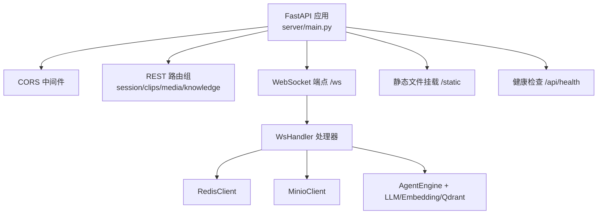
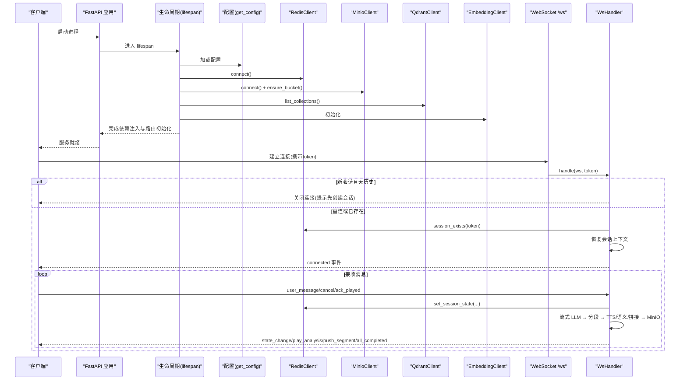
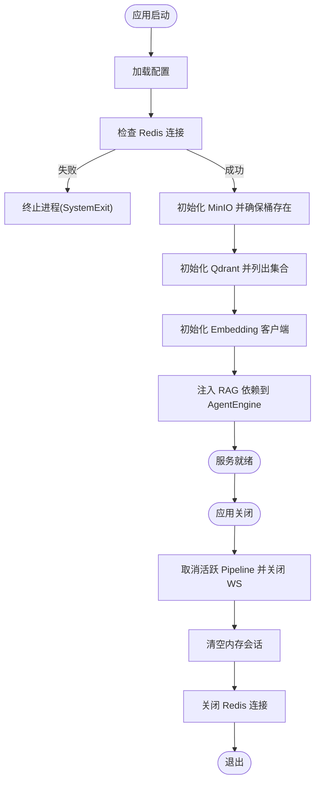
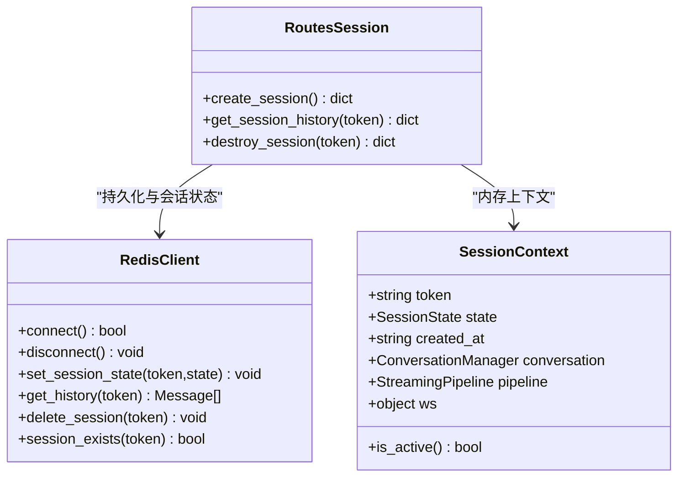
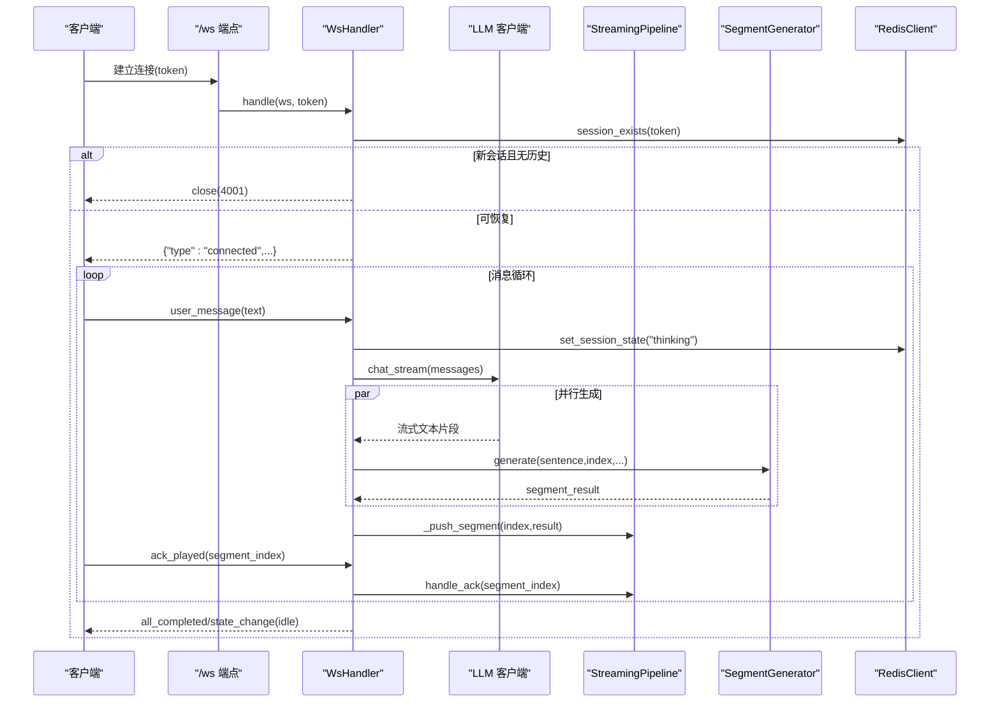
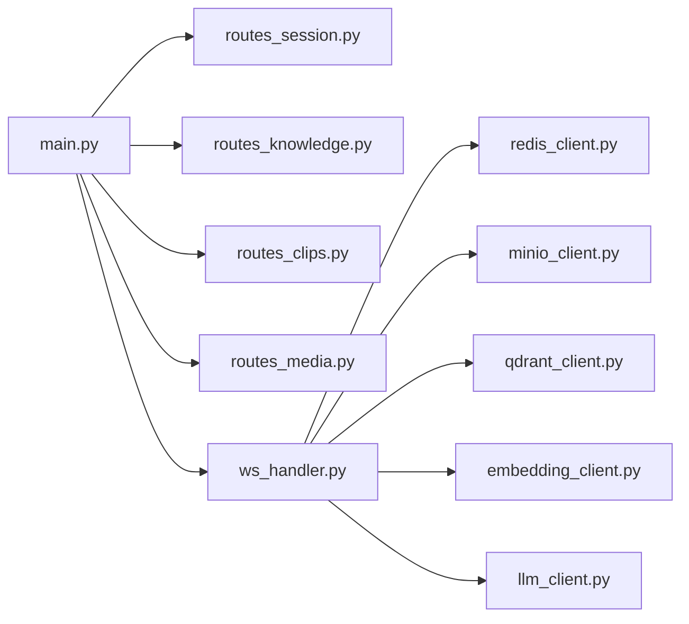

# FastAPI 应用架构

<cite>
**本文引用的文件**   
- [server/main.py](file://server/main.py)
- [server/config.py](file://server/config.py)
- [config.json](file://config.json)
- [server/models/session.py](file://server/models/session.py)
- [server/api/ws_handler.py](file://server/api/ws_handler.py)
- [server/services/redis_client.py](file://server/services/redis_client.py)
- [server/api/routes_session.py](file://server/api/routes_session.py)
- [server/api/routes_knowledge.py](file://server/api/routes_knowledge.py)
- [server/api/routes_clips.py](file://server/api/routes_clips.py)
- [server/api/routes_media.py](file://server/api/routes_media.py)
</cite>

## 目录
1. [简介](#简介)
2. [项目结构](#项目结构)
3. [核心组件](#核心组件)
4. [架构总览](#架构总览)
5. [详细组件分析](#详细组件分析)
6. [依赖关系分析](#依赖关系分析)
7. [性能与扩展性](#性能与扩展性)
8. [故障排查指南](#故障排查指南)
9. [结论](#结论)
10. [附录：最佳实践与示例](#附录最佳实践与示例)

## 简介
本技术文档围绕 RealTimeTalk 的 FastAPI 后端，系统化阐述应用初始化流程、生命周期管理（lifespan）、中间件配置、依赖注入机制、全局状态管理、服务启动检查与资源清理策略；并说明 CORS、静态文件服务与健康检查端点的实现细节。同时提供错误处理、日志记录与性能监控的最佳实践，给出扩展中间件与新增路由模块的具体方法，解释与其他组件的集成模式与依赖关系，帮助初学者快速上手，也为有经验的开发者提供深入的技术参考。

## 项目结构
RealTimeTalk 的后端位于 server 目录，采用“按功能域组织”的结构：
- 入口与生命周期：server/main.py
- 配置加载：server/config.py 与 config.json
- 模型与状态：server/models/session.py
- WebSocket 实时处理：server/api/ws_handler.py
- REST 路由：
  - 会话管理：server/api/routes_session.py
  - 知识库管理：server/api/routes_knowledge.py
  - 切片文件代理：server/api/routes_clips.py
  - 媒体文件代理：server/api/routes_media.py
- 外部服务客户端：
  - Redis：server/services/redis_client.py
  - MinIO、Qdrant、LLM、Embedding、TTS、视频拼接等（在 ws_handler 中组合使用）

图表来源
- [server/main.py:114-177](file://server/main.py#L114-L177)
- [server/api/ws_handler.py:31-170](file://server/api/ws_handler.py#L31-L170)
- [server/services/redis_client.py:22-62](file://server/services/redis_client.py#L22-L62)

章节来源
- [server/main.py:114-177](file://server/main.py#L114-L177)
- [server/config.py:148-241](file://server/config.py#L148-L241)
- [config.json:1-39](file://config.json#L1-L39)

## 核心组件
- 应用入口与生命周期
  - 通过 lifespan 完成配置加载、Redis 连接检查、MinIO 桶存在性保障、Qdrant 集合探测、Embedding 客户端初始化、路由依赖注入、RAG 依赖注入到 AgentEngine，并在关闭阶段取消活跃 Pipeline、关闭 WebSocket、释放 Redis 连接。
- 配置系统
  - 支持从 config.json 与环境变量合并，环境变量优先级更高；提供 get_config/reload_config 懒加载与热重载能力。
- 会话上下文
  - SessionContext 保存 token、状态、对话管理器、Pipeline 引用与 WebSocket 引用，并提供 is_active 判断。
- WebSocket 处理器
  - WsHandler 负责会话恢复、消息分发、流式 LLM 调用、段落切分、边生成边 TTS、语义分析与视频拼接、MinIO 上传、逐段确认推送、错误与中断处理。
- 外部服务客户端
  - RedisClient 封装连接、会话状态与历史持久化、TTL 管理、删除与刷新。
- 路由模块
  - 会话管理：创建、查询历史、销毁（含内存/Redis/MinIO 清理）。
  - 知识库管理：集合 CRUD、知识摄入（分块+嵌入+写入 Qdrant）、统计与搜索，受 Admin Token 保护。
  - 切片与媒体：本地文件优先、MinIO presigned URL 回退。

章节来源
- [server/main.py:42-110](file://server/main.py#L42-L110)
- [server/config.py:148-241](file://server/config.py#L148-L241)
- [server/models/session.py:22-41](file://server/models/session.py#L22-L41)
- [server/api/ws_handler.py:31-170](file://server/api/ws_handler.py#L31-L170)
- [server/services/redis_client.py:22-122](file://server/services/redis_client.py#L22-L122)
- [server/api/routes_session.py:28-123](file://server/api/routes_session.py#L28-L123)
- [server/api/routes_knowledge.py:81-268](file://server/api/routes_knowledge.py#L81-L268)
- [server/api/routes_clips.py:23-75](file://server/api/routes_clips.py#L23-L75)
- [server/api/routes_media.py:18-65](file://server/api/routes_media.py#L18-L65)

## 架构总览
下图展示了 FastAPI 应用启动、依赖注入、中间件、路由注册、WebSocket 处理与外部服务的交互关系。

图表来源
- [server/main.py:42-110](file://server/main.py#L42-L110)
- [server/api/ws_handler.py:49-170](file://server/api/ws_handler.py#L49-L170)
- [server/services/redis_client.py:31-50](file://server/services/redis_client.py#L31-L50)

## 详细组件分析

### 应用初始化与生命周期管理
- 启动阶段
  - 加载配置并记录关键项。
  - 强制检查 Redis 可用性，失败则终止进程。
  - 初始化 MinIO 并确保目标桶存在。
  - 初始化 Qdrant 与 Embedding 客户端，若 Qdrant 不可用仅告警不阻断启动。
  - 注入 RAG 依赖至 AgentEngine，便于后续检索增强。
- 关闭阶段
  - 遍历内存中的会话，取消活跃的 StreamingPipeline，尝试关闭 WebSocket 引用。
  - 清空 sessions 字典，断开 Redis 连接。

图表来源
- [server/main.py:42-110](file://server/main.py#L42-L110)

章节来源
- [server/main.py:42-110](file://server/main.py#L42-L110)

### 中间件与静态文件服务
- CORS 中间件
  - 允许所有来源、方法与头，启用凭据，适用于开发环境跨域访问。
- 静态文件服务
  - 将 static 目录以 HTML 模式挂载到根路径，用于 SPA 前端；必须放在所有 API 路由之后，避免拦截请求。

章节来源
- [server/main.py:120-127](file://server/main.py#L120-L127)
- [server/main.py:173-179](file://server/main.py#L173-L179)

### 健康检查端点
- GET /api/health
  - 返回服务状态、Redis 是否可用、当前活跃会话数量，便于编排系统与负载均衡器进行存活探测。

章节来源
- [server/main.py:136-143](file://server/main.py#L136-L143)

### 会话管理与依赖注入
- 全局状态
  - sessions 字典维护内存中的会话上下文；各服务客户端以模块级变量持有。
- 依赖注入方式
  - 通过 init_session_routes 与 init_knowledge_routes 在 lifespan 中将运行时依赖注入到路由模块的全局引用中，避免在构造时强耦合。
- 会话生命周期
  - 创建：分配 UUID，写入 Redis 初始状态 idle。
  - 查询历史：读取 Redis 列表并反序列化为消息对象。
  - 销毁：取消 Pipeline、关闭 WS、清理 Redis、移除内存、异步清理 MinIO 前缀。

图表来源
- [server/models/session.py:22-41](file://server/models/session.py#L22-L41)
- [server/services/redis_client.py:22-122](file://server/services/redis_client.py#L22-L122)
- [server/api/routes_session.py:28-123](file://server/api/routes_session.py#L28-L123)

章节来源
- [server/main.py:34-40](file://server/main.py#L34-L40)
- [server/api/routes_session.py:21-26](file://server/api/routes_session.py#L21-L26)
- [server/api/routes_session.py:28-123](file://server/api/routes_session.py#L28-L123)

### WebSocket 实时通信与流式处理
- 连接与鉴权
  - 校验 token 是否存在于 Redis 或内存；不存在则拒绝连接并提示先创建会话。
- 消息类型
  - user_message：触发流式 LLM 回复与边生成边播放。
  - ack_played：前端确认某一段落播放完成，驱动下一段推送。
  - cancel：用户主动中断，取消 Pipeline 并重置状态。
- 流式处理流程
  - 保存用户消息、必要时摘要压缩历史、构建 RAG 上下文、流式 LLM 输出。
  - 基于句子边界检测与长度阈值，及时切分段落并并行生成（TTS+语义分析+视频拼接+MinIO 上传）。
  - 首段完成后立即推送，随后按 ack 顺序推送后续段落，全部完成后返回 idle。

图表来源
- [server/api/ws_handler.py:49-170](file://server/api/ws_handler.py#L49-L170)
- [server/api/ws_handler.py:189-334](file://server/api/ws_handler.py#L189-L334)
- [server/services/redis_client.py:72-78](file://server/services/redis_client.py#L72-L78)

章节来源
- [server/api/ws_handler.py:49-170](file://server/api/ws_handler.py#L49-L170)
- [server/api/ws_handler.py:189-334](file://server/api/ws_handler.py#L189-L334)

### 知识库管理（RAG）
- 鉴权
  - 通过 X-Knowledge-Admin-Token 请求头验证，未配置时放行。
- 集合管理
  - 列出、创建、删除集合，返回集合信息与点数。
- 知识摄入
  - 自动分块（默认 500 字，重叠 100），批量嵌入后 upsert 到 Qdrant。
- 统计与搜索
  - 统计集合点数；支持单集合或多集合语义搜索。

章节来源
- [server/api/routes_knowledge.py:43-51](file://server/api/routes_knowledge.py#L43-L51)
- [server/api/routes_knowledge.py:81-128](file://server/api/routes_knowledge.py#L81-L128)
- [server/api/routes_knowledge.py:134-186](file://server/api/routes_knowledge.py#L134-L186)
- [server/api/routes_knowledge.py:192-268](file://server/api/routes_knowledge.py#L192-L268)

### 切片与媒体文件代理
- 切片文件
  - 根据配置动态解析 clips 目录，支持 .webm 转换产物与 idle 动画，包含路径安全校验。
- 媒体文件
  - 优先本地工作目录输出文件，否则回退到 MinIO presigned URL 重定向。

章节来源
- [server/api/routes_clips.py:23-75](file://server/api/routes_clips.py#L23-L75)
- [server/api/routes_media.py:18-65](file://server/api/routes_media.py#L18-L65)

## 依赖关系分析
- 模块内聚与耦合
  - main.py 作为装配中心，集中生命周期与路由注册，低内聚地引入各模块。
  - ws_handler 聚合多服务客户端，形成“编排层”，对上层路由透明。
  - routes_* 模块通过 init_xxx_routes 注入依赖，降低构造期耦合。
- 外部依赖
  - Redis：会话状态与历史持久化，TTL 控制会话生命周期。
  - MinIO：媒体对象存储，提供 presigned URL 直链。
  - Qdrant + Embedding：向量检索与 RAG 上下文构建。
  - LLM/TTS：文本生成与语音合成。
- 潜在风险
  - 全局状态（sessions、客户端实例）需关注并发与生命周期一致性。
  - Qdrant 不可用时降级为纯 LLM 回复，需保证业务逻辑健壮。

图表来源
- [server/main.py:129-133](file://server/main.py#L129-L133)
- [server/api/ws_handler.py:11-26](file://server/api/ws_handler.py#L11-L26)

章节来源
- [server/main.py:129-133](file://server/main.py#L129-L133)
- [server/api/ws_handler.py:11-26](file://server/api/ws_handler.py#L11-L26)

## 性能与扩展性
- 流式与并行
  - 流式 LLM 输出配合段落切分，尽早启动 TTS/拼接任务，减少端到端延迟。
  - 使用 asyncio.ensure_future 并行生成多个段落，结合 ack 机制有序推送。
- 资源管理
  - 生命周期中显式关闭 Redis 连接，取消 Pipeline，避免资源泄漏。
- 可扩展点
  - 新增路由：遵循现有 init_xxx_routes 注入模式，保持低耦合。
  - 新增中间件：在 lifespan 之前添加，注意执行顺序与安全策略。
  - 缓存与限流：可在中间件层增加速率限制与响应缓存。
  - 监控与指标：建议接入 Prometheus/Grafana，暴露关键指标（QPS、延迟、错误率、队列长度）。

[本节为通用指导，无需代码来源]

## 故障排查指南
- 启动失败
  - Redis 不可用：查看 Redis 地址、端口、密码与网络连通性；确认连接字符串格式正确。
  - MinIO 桶不存在：检查 endpoint、access_key、secret_key、bucket 配置。
  - Qdrant 不可用：不影响启动但 RAG 不可用，检查 url 与权限。
- WebSocket 连接被拒
  - 未先创建会话：先调用 POST /api/session/create 获取 token。
  - token 无效或过期：检查 Redis 中会话状态 TTL 与刷新逻辑。
- 媒体文件 404
  - 本地工作目录缺失：确认输出路径与文件名映射规则。
  - MinIO 不可达：检查 presigned URL 生成与网络可达性。
- 日志定位
  - 使用 Python logging 输出级别 INFO/ERROR/Critical，结合名称空间快速定位问题。

章节来源
- [server/main.py:54-60](file://server/main.py#L54-L60)
- [server/main.py:70-77](file://server/main.py#L70-L77)
- [server/api/ws_handler.py:69-73](file://server/api/ws_handler.py#L69-L73)
- [server/api/routes_media.py:53-64](file://server/api/routes_media.py#L53-L64)

## 结论
RealTimeTalk 的 FastAPI 后端以清晰的入口与生命周期管理为核心，结合模块化路由与服务客户端封装，实现了高内聚、低耦合的架构。通过 Redis 持久化会话、MinIO 对象存储、Qdrant 向量检索与 LLM/TTS 流式处理，构建了低延迟的实时对话体验。建议在生产环境中完善鉴权、限流、监控与弹性伸缩策略，进一步提升稳定性与可观测性。

[本节为总结，无需代码来源]

## 附录：最佳实践与示例

### 如何扩展中间件
- 在应用实例创建后、路由注册前添加自定义中间件，例如请求计时、审计日志、限流等。
- 注意中间件执行顺序，确保安全与性能相关中间件优先执行。

章节来源
- [server/main.py:120-127](file://server/main.py#L120-L127)

### 如何添加新的路由模块
- 新建路由文件，定义 APIRouter 与端点函数。
- 在 main.py 中 include_router 注册路由。
- 如需依赖注入，提供 init_xxx_routes 并在 lifespan 中调用。

章节来源
- [server/main.py:129-133](file://server/main.py#L129-L133)
- [server/api/routes_session.py:21-26](file://server/api/routes_session.py#L21-L26)
- [server/api/routes_knowledge.py:33-38](file://server/api/routes_knowledge.py#L33-L38)

### 配置与环境变量
- 配置文件优先级：环境变量 > config.json > 默认值。
- 常用环境变量键名见 AppConfig 字段别名，如 LLM_ENDPOINT、REDIS_URL、MINIO_ENDPOINT 等。
- 支持 reload_config 热重载配置（按需实现）。

章节来源
- [server/config.py:73-126](file://server/config.py#L73-L126)
- [server/config.py:148-241](file://server/config.py#L148-L241)
- [config.json:1-39](file://config.json#L1-L39)

### 错误处理与日志记录
- 统一使用 Python logging 记录关键路径信息，区分 INFO/WARNING/ERROR/Critical。
- 对外暴露结构化错误响应（HTTPException 或 JSON 错误体），便于前端处理。
- 对第三方服务异常进行捕获与降级，保证主流程稳定。

章节来源
- [server/main.py:27-32](file://server/main.py#L27-L32)
- [server/api/ws_handler.py:335-341](file://server/api/ws_handler.py#L335-L341)
- [server/api/routes_knowledge.py:184-186](file://server/api/routes_knowledge.py#L184-L186)

### 性能监控建议
- 暴露健康检查端点供探针使用。
- 采集关键指标：请求数、延迟分布、错误率、Redis/MinIO/Qdrant 连接池状态、Pipeline 并发度。
- 结合分布式追踪（OpenTelemetry）定位长尾请求。

章节来源
- [server/main.py:136-143](file://server/main.py#L136-L143)