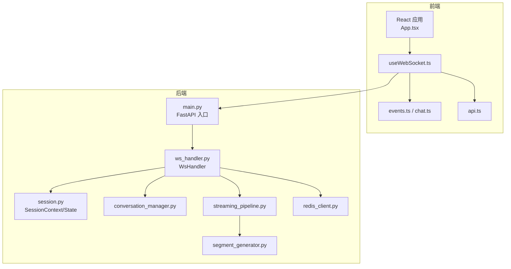
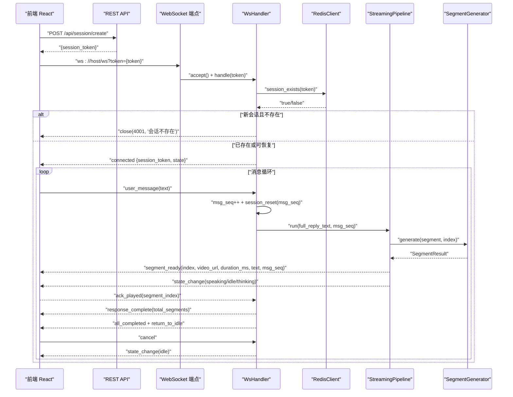
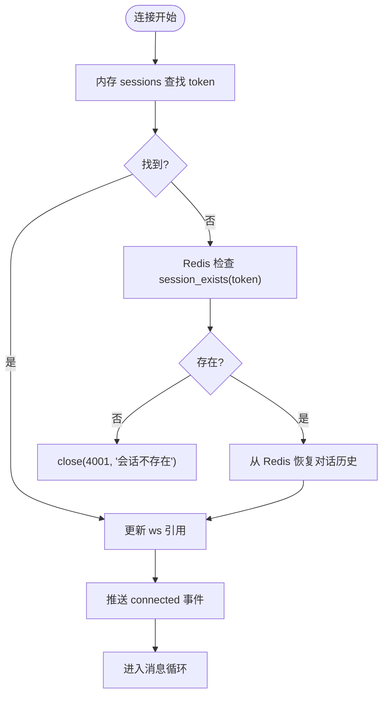
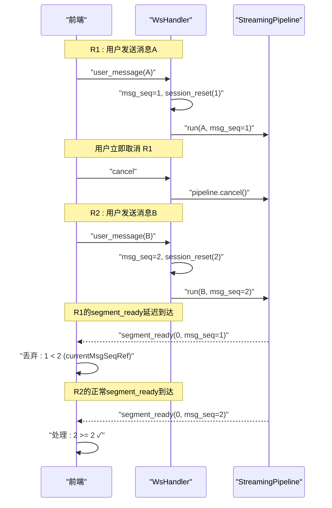
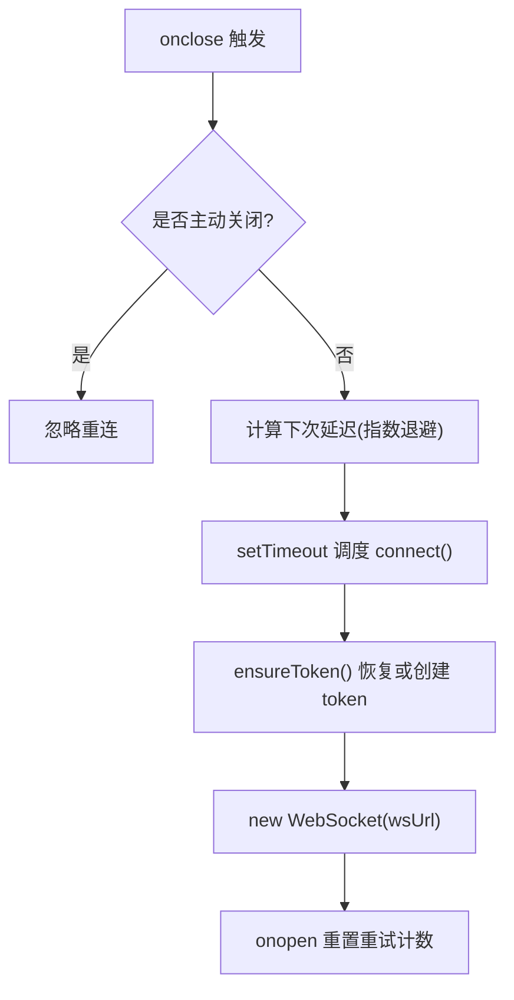
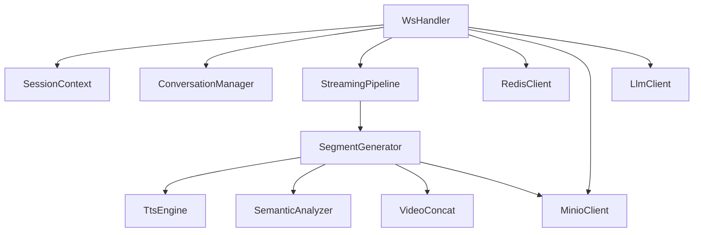

# WebSocket 通信协议

<cite>
**本文引用的文件列表**
- [server/main.py](file://server/main.py)
- [server/api/ws_handler.py](file://server/api/ws_handler.py)
- [server/models/session.py](file://server/models/session.py)
- [server/agent/conversation_manager.py](file://server/agent/conversation_manager.py)
- [server/pipeline/streaming_pipeline.py](file://server/pipeline/streaming_pipeline.py)
- [server/pipeline/segment_generator.py](file://server/pipeline/segment_generator.py)
- [server/services/redis_client.py](file://server/services/redis_client.py)
- [client/src/hooks/useWebSocket.ts](file://client/src/hooks/useWebSocket.ts)
- [client/src/types/events.ts](file://client/src/types/events.ts)
- [client/src/types/chat.ts](file://client/src/types/chat.ts)
- [client/src/components/ChatPanel.tsx](file://client/src/components/ChatPanel.tsx)
- [client/src/App.tsx](file://client/src/App.tsx)
- [client/src/services/api.ts](file://client/src/services/api.ts)
- [config.json](file://config.json)
</cite>

## 更新摘要
**变更内容**
- 新增 V17 消息序列跟踪机制，防止会话重置竞态条件
- 优化流式处理机制，实现立即推送 segment_ready 无需等待 ack
- 新增 response_complete 事件类型，携带总段数信息
- 新增 session_reset 事件，标记新会话开始并携带 msg_seq
- 改进前后端事件处理流程，增强状态同步可靠性

## 目录
1. [简介](#简介)
2. [项目结构](#项目结构)
3. [核心组件](#核心组件)
4. [架构总览](#架构总览)
5. [详细组件分析](#详细组件分析)
6. [依赖关系分析](#依赖关系分析)
7. [性能与优化](#性能与优化)
8. [故障排查指南](#故障排查指南)
9. [结论](#结论)
10. [附录：事件与消息定义、示例与集成建议](#附录事件与消息定义示例与集成建议)

## 简介
本技术文档面向 RealTimeTalk 的 WebSocket 实时通信协议，覆盖连接建立与认证、双向消息格式、事件处理流程、断线重连策略、错误处理与心跳检测（实现现状与建议）、以及前后端交互序列图。同时提供与 React 前端的集成模式、性能优化技巧与安全注意事项，帮助初学者快速上手，也为有经验的开发者提供深入的技术细节。

**最新更新**：V17版本引入了消息序列跟踪机制，通过`msg_seq`字段防止会话重置时的竞态条件；优化了流式处理策略，实现立即推送segment_ready无需等待ack确认；新增response_complete事件类型携带总段数信息，提升状态同步的可靠性。

## 项目结构
后端基于 FastAPI，提供 REST API 与 WebSocket 端点；前端使用 React + TypeScript，通过自定义 Hook 管理 WebSocket 连接、自动重连与事件分发。关键路径如下：
- 服务端入口与路由注册：server/main.py
- WebSocket 处理器：server/api/ws_handler.py
- 会话上下文与状态模型：server/models/session.py
- 对话历史管理与摘要：server/agent/conversation_manager.py
- 流式分段生成与推送：server/pipeline/streaming_pipeline.py
- 单段视频生成（TTS→语义→拼接→上传）：server/pipeline/segment_generator.py
- Redis 持久化客户端：server/services/redis_client.py
- 前端 WebSocket Hook：client/src/hooks/useWebSocket.ts
- 前端事件类型定义：client/src/types/events.ts
- 聊天消息类型：client/src/types/chat.ts
- 聊天面板组件：client/src/components/ChatPanel.tsx
- 主应用组件：client/src/App.tsx
- 前端 REST API 封装：client/src/services/api.ts
- 全局配置：config.json

图表来源
- [server/main.py:146-170](file://server/main.py#L146-L170)
- [server/api/ws_handler.py:31-129](file://server/api/ws_handler.py#L31-L129)
- [server/models/session.py:14-41](file://server/models/session.py#L14-L41)
- [server/agent/conversation_manager.py:21-95](file://server/agent/conversation_manager.py#L21-L95)
- [server/pipeline/streaming_pipeline.py:16-131](file://server/pipeline/streaming_pipeline.py#L16-L131)
- [server/pipeline/segment_generator.py:27-138](file://server/pipeline/segment_generator.py#L27-L138)
- [server/services/redis_client.py:22-122](file://server/services/redis_client.py#L22-L122)
- [client/src/hooks/useWebSocket.ts:34-189](file://client/src/hooks/useWebSocket.ts#L34-L189)
- [client/src/types/events.ts:1-113](file://client/src/types/events.ts#L1-L113)
- [client/src/types/chat.ts:1-11](file://client/src/types/chat.ts#L1-L11)
- [client/src/components/ChatPanel.tsx:17-200](file://client/src/components/ChatPanel.tsx#L17-L200)
- [client/src/App.tsx:1-725](file://client/src/App.tsx#L1-L725)
- [client/src/services/api.ts:1-52](file://client/src/services/api.ts#L1-L52)

章节来源
- [server/main.py:113-191](file://server/main.py#L113-L191)
- [client/src/hooks/useWebSocket.ts:1-190](file://client/src/hooks/useWebSocket.ts#L1-L190)

## 核心组件
- 会话与会话状态
  - SessionContext 保存 token、当前状态、对话管理器、活跃 Pipeline 和 WebSocket 引用。
  - SessionState 枚举包含 idle、thinking、speaking、bridging。
  - **V17新增**：msg_seq 字段用于消息序列跟踪，防止会话重置竞态条件。
- 对话历史管理
  - ConversationManager 维护消息列表、Redis 持久化、Token 溢出智能摘要。
- 流式分段与推送
  - StreamingPipeline 负责分句切段、并行生成、首段立即推送、逐段确认式推送、打字机气泡动画。
  - **V17优化**：所有推送事件携带 msg_seq 字段，客户端据此过滤旧会话残留事件。
  - **V4优化**：立即推送 segment_ready 无需等待 ack，消除串行等待延迟。
- 单段生成器
  - SegmentGenerator 串联 TTS、语义分析、FFmpeg 拼接、MinIO 上传（失败回退本地）。
- Redis 客户端
  - 提供会话状态、历史消息存取、TTL 管理、存在性检查等。
- 前端 WebSocket Hook
  - useWebSocket 负责创建/恢复 session token、建立连接、自动重连（指数退避）、消息发送与事件回调。
- 前端事件处理
  - App.tsx 实现完整的事件处理逻辑，包括 V17 消息序列过滤、V20 response_complete 处理。

章节来源
- [server/models/session.py:14-41](file://server/models/session.py#L14-L41)
- [server/agent/conversation_manager.py:21-139](file://server/agent/conversation_manager.py#L21-L139)
- [server/pipeline/streaming_pipeline.py:16-214](file://server/pipeline/streaming_pipeline.py#L16-L214)
- [server/pipeline/segment_generator.py:27-138](file://server/pipeline/segment_generator.py#L27-L138)
- [server/services/redis_client.py:22-122](file://server/services/redis_client.py#L22-L122)
- [client/src/hooks/useWebSocket.ts:34-189](file://client/src/hooks/useWebSocket.ts#L34-L189)
- [client/src/App.tsx:186-500](file://client/src/App.tsx#L186-L500)

## 架构总览
RealTimeTalk 的实时通信由"REST 创建会话 → WebSocket 认证与双向通信"组成。前端在首次使用时调用 REST 接口创建会话并获取 token，随后以该 token 作为查询参数建立 WebSocket 连接。服务端校验 token 是否存在于 Redis，若存在则恢复会话上下文，否则拒绝连接。连接成功后，服务端推送 connected 事件，随后进入消息循环，根据消息类型进行用户消息处理、播放确认、取消等操作。

**V17重大改进**：引入消息序列跟踪机制，每个 user_message 分配唯一 msg_seq，所有推送事件携带此序号，客户端据此丢弃旧会话残留事件，彻底解决会话重置竞态条件问题。

图表来源
- [server/main.py:146-170](file://server/main.py#L146-L170)
- [server/api/ws_handler.py:49-129](file://server/api/ws_handler.py#L49-L129)
- [server/services/redis_client.py:108-111](file://server/services/redis_client.py#L108-L111)
- [server/pipeline/streaming_pipeline.py:44-131](file://server/pipeline/streaming_pipeline.py#L44-L131)
- [server/pipeline/segment_generator.py:42-138](file://server/pipeline/segment_generator.py#L42-L138)
- [client/src/services/api.ts:31-35](file://client/src/services/api.ts#L31-L35)
- [client/src/hooks/useWebSocket.ts:68-117](file://client/src/hooks/useWebSocket.ts#L68-L117)

## 详细组件分析

### 连接建立与认证机制
- 前端先调用 REST 接口创建会话，获得 session_token，并将其缓存到 sessionStorage。
- 前端构建 wsUrl，携带 token 查询参数发起 WebSocket 连接。
- 服务端接受连接后，WsHandler.handle 执行：
  - 从内存 sessions 查找 token，若不存在则检查 Redis 中是否存在该会话。
  - 若完全不存在，直接关闭连接并返回错误码 4001。
  - 若存在，从 Redis 恢复对话历史，更新内存中的会话上下文。
  - 将 WebSocket 引用写入会话上下文，并推送 connected 事件（包含 session_token 与当前 state）。

图表来源
- [server/api/ws_handler.py:49-95](file://server/api/ws_handler.py#L49-L95)
- [server/services/redis_client.py:108-111](file://server/services/redis_client.py#L108-L111)

章节来源
- [server/main.py:146-170](file://server/main.py#L146-L170)
- [server/api/ws_handler.py:49-129](file://server/api/ws_handler.py#L49-L129)
- [client/src/hooks/useWebSocket.ts:68-117](file://client/src/hooks/useWebSocket.ts#L68-L117)
- [client/src/services/api.ts:31-35](file://client/src/services/api.ts#L31-L35)

### 消息格式定义与事件处理流程
- 客户端消息类型
  - user_message：文本内容，触发 LLM 流式回复与分段生成。
  - ack_played：前端播放某段完成，通知服务端继续推送下一段。
  - cancel：用户中断当前生成流程。
- 服务端事件类型
  - connected：连接成功，附带 session_token 与当前 state。
  - **V17新增**：session_reset：新会话开始，携带新 msg_seq，客户端据此过滤旧事件。
  - state_change：状态变更（thinking/speaking/bridging/idle）。
  - segment_ready：段落就绪，包含 index、video_url、duration_ms、text、msg_seq。
  - bubble_char/bubble_dismiss：打字机效果字符推送与气泡消失。
  - play_analysis：衔接动画提示（如思考手势）。
  - **V20新增**：response_complete：响应完成，携带 total_segments 总段数。
  - all_completed/return_to_idle：全部完成与回到待机。
  - error：错误信息。

**V17消息序列跟踪机制**：
- 每次收到 user_message，服务端自增 msg_seq 并推送 session_reset 事件。
- 所有后续推送事件（segment_ready、state_change等）都携带 msg_seq 字段。
- 客户端记录最新 msg_seq，丢弃 msg_seq < currentMsgSeqRef 的旧事件。
- 有效防止 R1 取消后未发出的 segment_ready 被误认为 R2 的段。

```mermaid
classDiagram
class ClientUserMessage {
+type = "user_message"
+text : string
}
class ClientAckPlayed {
+type = "ack_played"
+segment_index : number
}
class ClientCancel {
+type = "cancel"
}
class ServerConnected {
+type = "connected"
+session_token : string
+state : string
}
class ServerSessionReset {
+type = "session_reset"
+msg_seq : number
}
class ServerStateChange {
+type = "state_change"
+state : "thinking"|"speaking"|"bridging"|"idle"
+msg_seq : number
}
class ServerSegmentReady {
+type = "segment_ready"
+index : number
+video_url : string
+duration_ms : number
+text : string
+msg_seq : number
}
class ServerBubbleChar {
+type = "bubble_char"
+char : string
+segment_index : number
+msg_seq : number
}
class ServerBubbleDismiss {
+type = "bubble_dismiss"
+segment_index : number
+msg_seq : number
}
class ServerPlayAnalysis {
+type = "play_analysis"
+loop : boolean
+msg_seq : number
}
class ServerResponseComplete {
+type = "response_complete"
+total_segments : number
+msg_seq : number
}
class ServerAllCompleted {
+type = "all_completed"
+msg_seq : number
}
class ServerReturnToIdle {
+type = "return_to_idle"
+msg_seq : number
}
class ServerError {
+type = "error"
+message : string
+msg_seq : number
}
```

图表来源
- [client/src/types/events.ts:15-117](file://client/src/types/events.ts#L15-L117)
- [server/api/ws_handler.py:90-120](file://server/api/ws_handler.py#L90-L120)
- [server/pipeline/streaming_pipeline.py:132-168](file://server/pipeline/streaming_pipeline.py#L132-L168)

章节来源
- [client/src/types/events.ts:1-138](file://client/src/types/events.ts#L1-L138)
- [server/api/ws_handler.py:90-120](file://server/api/ws_handler.py#L90-L120)
- [server/pipeline/streaming_pipeline.py:132-168](file://server/pipeline/streaming_pipeline.py#L132-L168)

### 双向通信协议与实时数据推送
- 用户消息处理
  - 收到 user_message 后，服务端立即设置 thinking 状态并推送 play_analysis 与 state_change(thinking)。
  - **V17新增**：自增 msg_seq 并推送 session_reset 事件，标记新会话开始。
  - 启动后台流式任务：LLM 边生成边识别句子边界，满长度即启动一段生成任务。
  - 首段完成后立即推送 segment_ready 与 state_change(speaking)，后续段等待 ack_played 确认后推送。
  - **V4优化**：改为立即推送 segment_ready 无需等待 ack，消除串行等待延迟。
- 播放确认与取消
  - ack_played：前端每播放完一段，发送确认，服务端继续推送下一段。
  - cancel：中断当前 Pipeline，重置状态为 idle。
- **V20新增**：response_complete 事件
  - 所有段推送完毕后发送，携带 total_segments 总段数。
  - 客户端据此确认视频播放列表完整，可在最后一段视频结束后切 idle。

**V17会话重置竞态条件解决方案**：

图表来源
- [server/api/ws_handler.py:130-341](file://server/api/ws_handler.py#L130-L341)
- [server/pipeline/streaming_pipeline.py:44-131](file://server/pipeline/streaming_pipeline.py#L44-L131)
- [server/pipeline/segment_generator.py:42-138](file://server/pipeline/segment_generator.py#L42-L138)
- [client/src/App.tsx:309-318](file://client/src/App.tsx#L309-L318)

章节来源
- [server/api/ws_handler.py:130-341](file://server/api/ws_handler.py#L130-L341)
- [server/pipeline/streaming_pipeline.py:44-131](file://server/pipeline/streaming_pipeline.py#L44-L131)

### 断线重连策略
- 前端使用 useWebSocket Hook 实现指数退避重连：
  - 基础间隔 1s，最大 30s，倍增因子 2。
  - 监听 onclose/onerror，非主动关闭时调度重连。
  - 每次重连前尝试确保 token 有效（从 sessionStorage 恢复或重新创建会话）。
- 服务端侧不主动推送心跳，但可通过 Redis 刷新 TTL 维持会话存活。

图表来源
- [client/src/hooks/useWebSocket.ts:95-135](file://client/src/hooks/useWebSocket.ts#L95-L135)
- [client/src/hooks/useWebSocket.ts:46-65](file://client/src/hooks/useWebSocket.ts#L46-L65)

章节来源
- [client/src/hooks/useWebSocket.ts:95-135](file://client/src/hooks/useWebSocket.ts#L95-L135)
- [server/services/redis_client.py:112-116](file://server/services/redis_client.py#L112-L116)

### 错误处理与异常恢复
- 服务端错误
  - JSON 解析失败：推送 error 事件并继续循环。
  - LLM 调用失败：重置状态为 idle，推送 error 与 state_change。
  - 管道异常：推送 error 与 state_change(idle)。
- 前端错误
  - 连接失败：记录日志并调度重连。
  - 消息解析失败：打印警告并忽略。
  - **V17新增**：旧会话事件过滤：丢弃 msg_seq < currentMsgSeqRef 的事件。

章节来源
- [server/api/ws_handler.py:101-129](file://server/api/ws_handler.py#L101-L129)
- [server/api/ws_handler.py:335-341](file://server/api/ws_handler.py#L335-L341)
- [server/pipeline/streaming_pipeline.py:127-131](file://server/pipeline/streaming_pipeline.py#L127-L131)
- [client/src/hooks/useWebSocket.ts:86-116](file://client/src/hooks/useWebSocket.ts#L86-L116)
- [client/src/App.tsx:313-318](file://client/src/App.tsx#L313-L318)

### 心跳检测实现（现状与建议）
- 现状：代码未实现显式心跳包。
- 建议：
  - 服务端定时向空闲连接发送 ping，客户端响应 pong。
  - 结合 Redis TTL 刷新，避免长时间无活动导致会话过期。
  - 前端在 onclose 时区分网络抖动与服务端主动关闭，避免频繁重连风暴。

[本节为通用建议，不直接分析具体文件]

## 依赖关系分析
- 模块耦合
  - WsHandler 依赖 SessionContext、ConversationManager、StreamingPipeline、RedisClient、MinioClient、LlmClient。
  - StreamingPipeline 依赖 SegmentGenerator、SegmentSplitter。
  - SegmentGenerator 依赖 TtsEngine、SemanticAnalyzer、VideoConcat、MinioClient。
- 外部依赖
  - Redis：会话状态与历史持久化。
  - MinIO：视频片段存储与访问。
  - LLM/TTS：文本生成与语音合成。
  - FFmpeg：视频切片与混音。

图表来源
- [server/api/ws_handler.py:31-47](file://server/api/ws_handler.py#L31-L47)
- [server/pipeline/streaming_pipeline.py:16-43](file://server/pipeline/streaming_pipeline.py#L16-L43)
- [server/pipeline/segment_generator.py:27-41](file://server/pipeline/segment_generator.py#L27-L41)

章节来源
- [server/api/ws_handler.py:31-47](file://server/api/ws_handler.py#L31-L47)
- [server/pipeline/streaming_pipeline.py:16-43](file://server/pipeline/streaming_pipeline.py#L16-L43)
- [server/pipeline/segment_generator.py:27-41](file://server/pipeline/segment_generator.py#L27-L41)

## 性能与优化
- 首段跳过 LLM 语义分析：减少首段延迟，提升用户体验。
- 并行生成多段：利用 asyncio.ensure_future 并发执行各段生成任务。
- **V4优化**：立即推送 segment_ready 无需等待 ack，消除串行等待延迟。
- 打字机动画速率限制：单字间隔 15ms~50ms，总时长不超过视频时长的 60%。
- MinIO 上传失败回退本地：提高鲁棒性。
- **V17优化**：消息序列跟踪避免竞态条件，提升状态同步可靠性。
- **V20优化**：response_complete 事件提供总段数信息，改善状态切换时机。
- 建议：
  - 引入连接池与限流，控制并发段数。
  - 对长文本进行更精细的分句策略，平衡首段速度与完整性。
  - 增加服务端心跳与前端保活机制，降低无效重连。

[本节为通用建议，不直接分析具体文件]

## 故障排查指南
- 常见问题
  - 连接被拒（4001）：token 不存在或未创建会话。检查 REST 接口调用与 Redis 状态。
  - 消息格式错误：JSON 解析失败。检查前端发送的消息结构。
  - 视频无法播放：MinIO 不可达或 presigned URL 失效。检查媒体代理路径与权限。
  - 重连风暴：网络抖动导致频繁断开。调整重连退避策略与上限。
  - **V17新增**：事件丢失或错乱：检查 msg_seq 过滤逻辑是否正确。
- 定位方法
  - 查看服务端日志：关注 LLM 调用、TTS、FFmpeg、MinIO 的错误堆栈。
  - 前端控制台：观察 WebSocket 连接状态与事件分发。
  - Redis 键值：检查 session:{token}:state 与 history 列表。
  - **V17调试**：检查 console.log 输出 `[V17] 丢弃旧会话残留 segment_ready` 日志。

章节来源
- [server/api/ws_handler.py:101-129](file://server/api/ws_handler.py#L101-L129)
- [server/api/ws_handler.py:335-341](file://server/api/ws_handler.py#L335-L341)
- [server/pipeline/streaming_pipeline.py:127-131](file://server/pipeline/streaming_pipeline.py#L127-L131)
- [client/src/hooks/useWebSocket.ts:86-116](file://client/src/hooks/useWebSocket.ts#L86-L116)
- [client/src/App.tsx:313-318](file://client/src/App.tsx#L313-L318)

## 结论
RealTimeTalk 的 WebSocket 协议围绕"REST 创建会话 + WebSocket 双向通信"展开，具备完善的连接认证、流式分段生成与确认式推送机制。V17版本引入的消息序列跟踪机制有效解决了会话重置竞态条件问题，V4优化的立即推送策略消除了串行等待延迟，V20的response_complete事件提升了状态同步的可靠性。前端通过 Hook 管理连接与重连，后端通过 Pipeline 协调多服务协作。建议在现有基础上补充心跳检测、连接保活与更细粒度的错误分类，以提升稳定性与用户体验。

[本节为总结，不直接分析具体文件]

## 附录：事件与消息定义、示例与集成建议

### 事件与消息定义速查
- 客户端消息
  - user_message{text}
  - ack_played{segment_index}
  - cancel{}
- 服务端事件
  - connected{session_token, state}
  - **V17新增**：session_reset{msg_seq}
  - state_change{state, msg_seq}
  - segment_ready{index, video_url, duration_ms, text, msg_seq}
  - bubble_char{char, segment_index, msg_seq}
  - bubble_dismiss{segment_index, msg_seq}
  - play_analysis{loop, msg_seq}
  - **V20新增**：response_complete{total_segments, msg_seq}
  - all_completed{msg_seq}
  - return_to_idle{msg_seq}
  - error{message, msg_seq}

**V17消息序列跟踪字段说明**：
- msg_seq：整数型消息序号，每次 user_message 自增
- 作用：客户端据此丢弃旧会话残留事件，防止竞态条件
- 过滤规则：event.msg_seq < currentMsgSeqRef 时丢弃事件

章节来源
- [client/src/types/events.ts:15-117](file://client/src/types/events.ts#L15-L117)
- [server/api/ws_handler.py:90-120](file://server/api/ws_handler.py#L90-L120)
- [server/pipeline/streaming_pipeline.py:132-168](file://server/pipeline/streaming_pipeline.py#L132-L168)

### 自定义事件与异常处理示例（路径指引）
- 自定义事件扩展
  - 在前端 types/events.ts 中添加新的 ServerEvent 联合类型分支。
  - 在后端 WsHandler 或 StreamingPipeline 中新增推送逻辑，遵循已有事件命名规范。
  - **V17要求**：所有新事件必须携带 msg_seq 字段。
- 异常处理增强
  - 在服务端捕获特定服务异常（如 TTS、FFmpeg），统一转换为 error 事件并重置状态。
  - 在前端 Hook 中增加 onEvent 的类型守卫，针对未知事件类型进行告警与降级。
  - **V17增强**：实现 msg_seq 过滤逻辑，丢弃旧会话残留事件。

章节来源
- [client/src/types/events.ts:83-92](file://client/src/types/events.ts#L83-L92)
- [server/api/ws_handler.py:101-129](file://server/api/ws_handler.py#L101-L129)
- [server/pipeline/streaming_pipeline.py:127-131](file://server/pipeline/streaming_pipeline.py#L127-L131)
- [client/src/App.tsx:313-318](file://client/src/App.tsx#L313-L318)

### 与前端 React 应用的集成模式
- 使用 useWebSocket Hook 统一管理连接、重连与事件分发。
- ChatPanel 组件负责输入与发送，通过 onSend 回调调用 sendMessage。
- App.tsx 实现完整的事件处理逻辑：
  - connected：初始化或恢复会话状态。
  - **V17新增**：session_reset：更新 currentMsgSeqRef，过滤旧事件。
  - state_change：驱动 UI 显示思考/说话/待机状态。
  - segment_ready：加入消息队列并按序播放，携带 msg_seq 过滤。
  - bubble_char/bubble_dismiss：实现打字机效果。
  - **V20新增**：response_complete：记录总段数，优化 idle 切换时机。
  - error：展示错误提示并允许重试。

**V17集成要点**：
- 维护 currentMsgSeqRef 状态，初始值为 0
- 处理 session_reset 事件时更新 currentMsgSeqRef
- 处理所有其他事件前检查 event.msg_seq >= currentMsgSeqRef
- 丢弃不符合条件的旧事件并记录警告日志

章节来源
- [client/src/hooks/useWebSocket.ts:34-189](file://client/src/hooks/useWebSocket.ts#L34-L189)
- [client/src/components/ChatPanel.tsx:17-200](file://client/src/components/ChatPanel.tsx#L17-L200)
- [client/src/types/chat.ts:1-11](file://client/src/types/chat.ts#L1-L11)
- [client/src/App.tsx:186-500](file://client/src/App.tsx#L186-L500)

### 安全考虑
- Token 认证：仅接受已在 Redis 存在的 token，防止伪造连接。
- CORS 配置：生产环境应限制 allow_origins，避免跨域滥用。
- 媒体访问：使用服务端代理路径访问视频片段，避免浏览器直连 MinIO 暴露凭证。
- 密钥管理：配置文件中的 API Key 不应提交至版本库，建议使用环境变量或密钥管理服务。
- **V17安全增强**：消息序列跟踪防止恶意构造的旧事件干扰正常会话。

章节来源
- [server/main.py:120-127](file://server/main.py#L120-L127)
- [server/api/ws_handler.py:57-74](file://server/api/ws_handler.py#L57-L74)
- [server/pipeline/streaming_pipeline.py:132-145](file://server/pipeline/streaming_pipeline.py#L132-L145)
- [config.json:1-39](file://config.json#L1-L39)