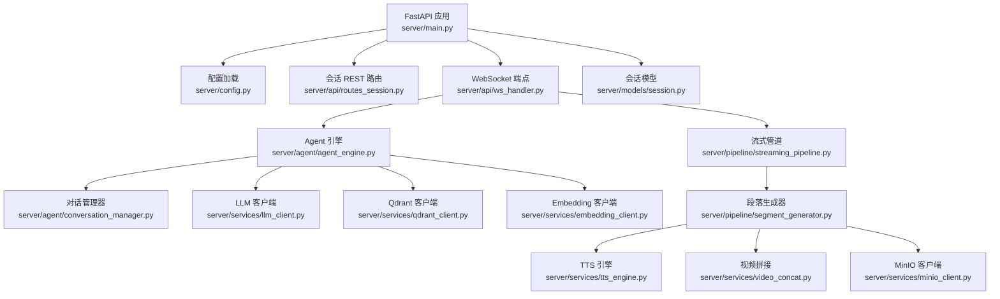
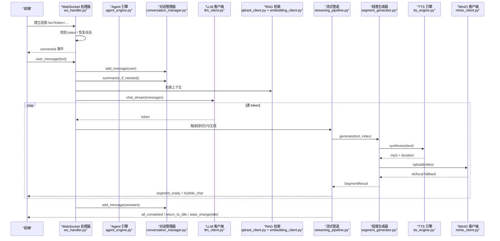
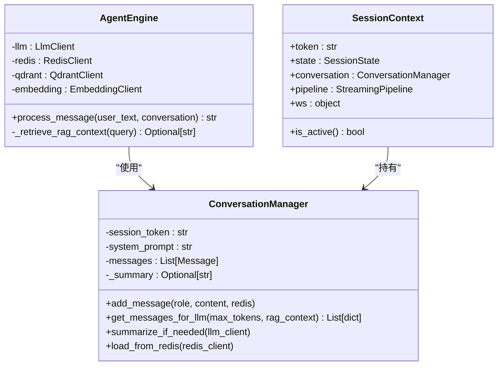
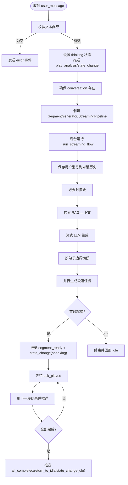
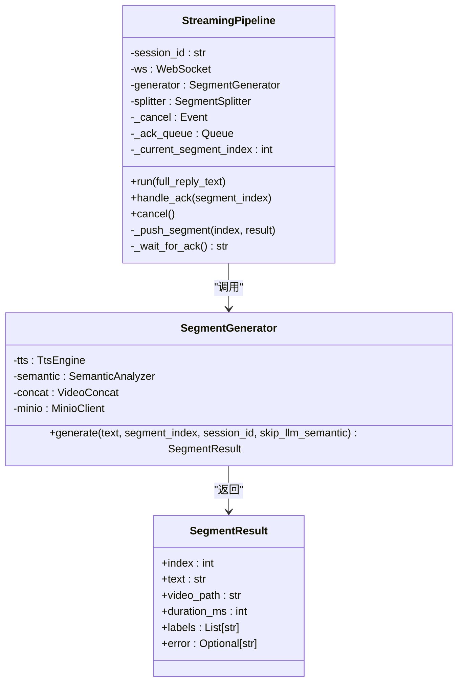
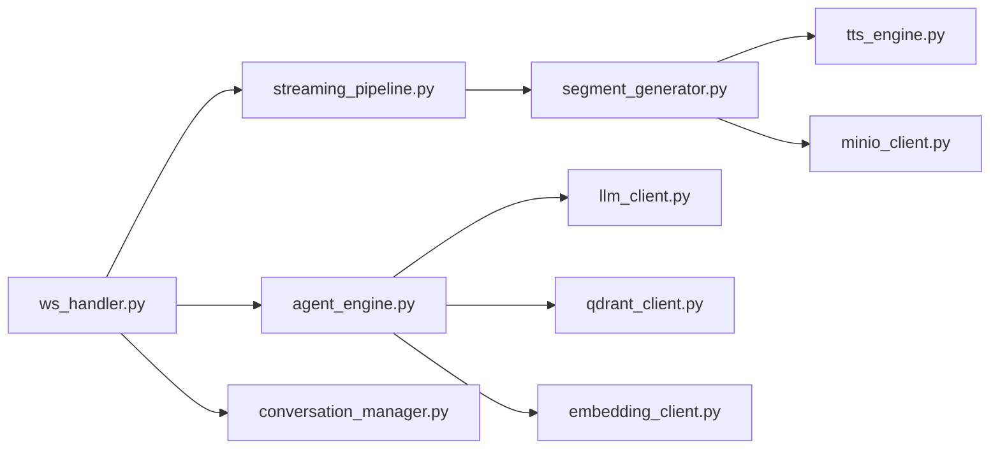

# 后端服务

<cite>
**本文引用的文件**
- [server/main.py](file://server/main.py)
- [server/config.py](file://server/config.py)
- [config.json](file://config.json)
- [server/agent/agent_engine.py](file://server/agent/agent_engine.py)
- [server/agent/conversation_manager.py](file://server/agent/conversation_manager.py)
- [server/api/ws_handler.py](file://server/api/ws_handler.py)
- [server/pipeline/streaming_pipeline.py](file://server/pipeline/streaming_pipeline.py)
- [server/pipeline/segment_generator.py](file://server/pipeline/segment_generator.py)
- [server/services/llm_client.py](file://server/services/llm_client.py)
- [server/services/tts_engine.py](file://server/services/tts_engine.py)
- [server/services/minio_client.py](file://server/services/minio_client.py)
- [server/services/qdrant_client.py](file://server/services/qdrant_client.py)
- [server/services/embedding_client.py](file://server/services/embedding_client.py)
- [server/models/session.py](file://server/models/session.py)
- [server/api/routes_session.py](file://server/api/routes_session.py)
</cite>

## 目录
1. [简介](#简介)
2. [项目结构](#项目结构)
3. [核心组件](#核心组件)
4. [架构总览](#架构总览)
5. [详细组件分析](#详细组件分析)
6. [依赖关系分析](#依赖关系分析)
7. [性能考虑](#性能考虑)
8. [故障排查指南](#故障排查指南)
9. [结论](#结论)
10. [附录](#附录)

## 简介
RealTimeTalk 后端基于 FastAPI，提供实时对话与多媒体播报能力。系统通过 WebSocket 实现低延迟交互，结合流式 LLM、TTS 语音合成、语义驱动的头像视频拼接以及 RAG 检索增强，形成“边生成、边合成、边播放”的端到端体验。会话状态由 Redis 持久化，媒体资源通过 MinIO 对象存储，向量检索使用 Qdrant，嵌入模型通过 DashScope Embedding API 获取。

## 项目结构
后端采用分层与按功能域组织相结合的结构：
- 应用入口与生命周期管理：FastAPI 启动、中间件、路由注册、WebSocket 端点
- 配置管理：JSON + 环境变量合并，Pydantic Settings 校验
- Agent 层：对话引擎、RAG 注入、对话历史管理与摘要
- API 层：REST 路由（会话、知识、媒体等）与 WebSocket 处理器
- Pipeline 层：流式分段、段落生成、确认式推送
- 服务层：LLM/TTS/Embedding/Qdrant/MinIO/Redis 客户端封装
- 数据模型：会话上下文、消息模型等

图表来源
- [server/main.py:114-133](file://server/main.py#L114-L133)
- [server/config.py:148-241](file://server/config.py#L148-L241)
- [server/api/ws_handler.py:31-47](file://server/api/ws_handler.py#L31-L47)
- [server/agent/agent_engine.py:59-73](file://server/agent/agent_engine.py#L59-L73)
- [server/agent/conversation_manager.py:21-31](file://server/agent/conversation_manager.py#L21-L31)
- [server/pipeline/streaming_pipeline.py:16-43](file://server/pipeline/streaming_pipeline.py#L16-L43)
- [server/pipeline/segment_generator.py:27-41](file://server/pipeline/segment_generator.py#L27-L41)
- [server/services/tts_engine.py:38-47](file://server/services/tts_engine.py#L38-L47)
- [server/services/minio_client.py:21-32](file://server/services/minio_client.py#L21-L32)
- [server/services/llm_client.py:23-32](file://server/services/llm_client.py#L23-L32)
- [server/services/qdrant_client.py:26-33](file://server/services/qdrant_client.py#L26-L33)
- [server/services/embedding_client.py:26-37](file://server/services/embedding_client.py#L26-L37)
- [server/models/session.py:14-41](file://server/models/session.py#L14-L41)

章节来源
- [server/main.py:114-133](file://server/main.py#L114-L133)
- [server/config.py:148-241](file://server/config.py#L148-L241)

## 核心组件
- 应用生命周期与中间件：在 lifespan 中初始化 Redis、MinIO、Qdrant、Embedding，并注入到 AgentEngine；注册 CORS 与静态文件挂载；暴露健康检查与健康探针。
- 配置管理：支持 config.json 与 .env 环境变量覆盖，统一输出扁平字典供各模块读取。
- Agent 引擎：封装对话流程，支持 RAG 上下文注入、Markdown 清理、异常透传。
- 对话管理器：维护消息列表、Redis 持久化、Token 溢出智能摘要。
- WebSocket 处理器：连接鉴权、会话恢复、消息分发、错误处理、取消机制。
- 流式管道：首段优先、确认式推送、打字机气泡动画控制。
- 段落生成器：TTS → 语义分析 → FFmpeg 拼接 → MinIO 上传（失败回退本地）。
- 外部服务客户端：LLM（OpenAI 兼容）、TTS（DashScope 多模态接口）、Embedding（DashScope）、Qdrant（HTTP）、MinIO（S3 兼容）。

章节来源
- [server/main.py:42-110](file://server/main.py#L42-L110)
- [server/config.py:73-126](file://server/config.py#L73-L126)
- [server/agent/agent_engine.py:59-121](file://server/agent/agent_engine.py#L59-L121)
- [server/agent/conversation_manager.py:21-95](file://server/agent/conversation_manager.py#L21-L95)
- [server/api/ws_handler.py:49-129](file://server/api/ws_handler.py#L49-L129)
- [server/pipeline/streaming_pipeline.py:44-131](file://server/pipeline/streaming_pipeline.py#L44-L131)
- [server/pipeline/segment_generator.py:42-137](file://server/pipeline/segment_generator.py#L42-L137)
- [server/services/llm_client.py:23-113](file://server/services/llm_client.py#L23-L113)
- [server/services/tts_engine.py:38-167](file://server/services/tts_engine.py#L38-L167)
- [server/services/minio_client.py:21-90](file://server/services/minio_client.py#L21-L90)
- [server/services/qdrant_client.py:26-186](file://server/services/qdrant_client.py#L26-L186)
- [server/services/embedding_client.py:26-135](file://server/services/embedding_client.py#L26-L135)

## 架构总览
整体架构围绕“请求接入 → 会话管理 → 对话与 RAG → 流式生成 → 多媒体合成 → 推送播放”展开。

图表来源
- [server/api/ws_handler.py:130-341](file://server/api/ws_handler.py#L130-L341)
- [server/agent/agent_engine.py:74-121](file://server/agent/agent_engine.py#L74-L121)
- [server/agent/conversation_manager.py:97-135](file://server/agent/conversation_manager.py#L97-L135)
- [server/services/llm_client.py:115-190](file://server/services/llm_client.py#L115-L190)
- [server/services/qdrant_client.py:164-186](file://server/services/qdrant_client.py#L164-L186)
- [server/services/embedding_client.py:47-70](file://server/services/embedding_client.py#L47-L70)
- [server/pipeline/streaming_pipeline.py:44-131](file://server/pipeline/streaming_pipeline.py#L44-L131)
- [server/pipeline/segment_generator.py:42-137](file://server/pipeline/segment_generator.py#L42-L137)
- [server/services/tts_engine.py:49-167](file://server/services/tts_engine.py#L49-L167)
- [server/services/minio_client.py:69-90](file://server/services/minio_client.py#L69-L90)

## 详细组件分析

### FastAPI 应用与生命周期
- 启动阶段：加载配置、连接 Redis、确保 MinIO Bucket、初始化 Qdrant/Embedding、注入 RAG 依赖到 AgentEngine、注册路由。
- 关闭阶段：取消活跃 Pipeline、关闭 WebSocket、释放 Redis 连接。
- 中间件：CORS 允许跨域（开发阶段），静态文件挂载 SPA。
- 健康检查：返回 Redis 可用性与会话数量。

章节来源
- [server/main.py:42-110](file://server/main.py#L42-L110)
- [server/main.py:120-133](file://server/main.py#L120-L133)
- [server/main.py:136-143](file://server/main.py#L136-L143)
- [server/main.py:173-179](file://server/main.py#L173-L179)

### 配置管理
- 优先级：环境变量 > config.json > 默认值。
- 支持字段：LLM、TTS、Avatar、Redis、MinIO、Server、FFmpeg、Qdrant、Embedding、RAG、知识库管理员 Token。
- 懒加载与热重载：get_config/reload_config 提供全局访问与重新加载能力。

章节来源
- [server/config.py:73-126](file://server/config.py#L73-L126)
- [server/config.py:148-241](file://server/config.py#L148-L241)
- [config.json:1-39](file://config.json#L1-39)

### Agent 引擎与对话管理
- AgentEngine.process_message：保存用户消息 → 智能摘要 → 组装 messages（含 RAG 上下文）→ 调用 LLM → 剥离 Markdown → 保存助手回复。
- ConversationManager：维护消息列表、Redis 持久化、Token 估算与摘要阈值控制、过滤语义分析临时消息。
- RAG 注入：根据角色集合映射选择搜索范围，构建上下文文本插入 system prompt 后。

图表来源
- [server/agent/agent_engine.py:59-121](file://server/agent/agent_engine.py#L59-L121)
- [server/agent/conversation_manager.py:21-95](file://server/agent/conversation_manager.py#L21-L95)
- [server/models/session.py:22-41](file://server/models/session.py#L22-L41)

章节来源
- [server/agent/agent_engine.py:74-181](file://server/agent/agent_engine.py#L74-L181)
- [server/agent/conversation_manager.py:33-95](file://server/agent/conversation_manager.py#L33-L95)
- [server/models/session.py:14-41](file://server/models/session.py#L14-L41)

### WebSocket 通信协议与会话管理
- 连接建立：/ws?token=...，校验 token 是否存在于 Redis 或内存，恢复会话上下文，发送 connected 事件。
- 消息类型：
  - user_message：触发流式处理
  - ack_played：前端播放确认，驱动下一段推送
  - cancel：中断当前 Pipeline
- 状态流转：idle → thinking → speaking → idle，配合 play_analysis 过渡动画。
- 错误处理：统一 error 事件 + state_change(idle)，并清理 pipeline。

图表来源
- [server/api/ws_handler.py:130-341](file://server/api/ws_handler.py#L130-L341)
- [server/models/session.py:14-20](file://server/models/session.py#L14-20)

章节来源
- [server/api/ws_handler.py:49-129](file://server/api/ws_handler.py#L49-L129)
- [server/api/ws_handler.py:130-341](file://server/api/ws_handler.py#L130-L341)
- [server/api/ws_handler.py:402-443](file://server/api/ws_handler.py#L402-L443)

### 流式处理管道与段落生成
- StreamingPipeline：首段优先推送，后续段按 ack 推进；支持取消与错误传播；打字机气泡动画按时长与字符数动态计算间隔。
- SegmentGenerator：TTS → 语义分析 → FFmpeg 拼接 → MinIO 上传（失败回退本地路径）；支持 skip_llm_semantic 优化首段。
- SegmentSplitter：按标点与长度阈值进行句子分割，避免 buffer 过大。

图表来源
- [server/pipeline/streaming_pipeline.py:16-131](file://server/pipeline/streaming_pipeline.py#L16-L131)
- [server/pipeline/segment_generator.py:27-137](file://server/pipeline/segment_generator.py#L27-L137)

章节来源
- [server/pipeline/streaming_pipeline.py:44-131](file://server/pipeline/streaming_pipeline.py#L44-L131)
- [server/pipeline/segment_generator.py:42-137](file://server/pipeline/segment_generator.py#L42-L137)

### 外部服务集成与错误处理策略
- LLM 客户端（OpenAI 兼容）：支持 chat 与 chat_stream，内置重试（限流/超时/连接错误），错误解析与状态码分类。
- TTS 引擎（DashScope 多模态接口）：异步任务提交与轮询，长文本拆分与 FFmpeg 拼接，并发信号量限制，错误封装为 TtsError。
- Embedding 客户端（DashScope）：批量嵌入（最多 10 条），顺序保证，错误分类与重试。
- Qdrant 客户端（HTTP）：集合 CRUD、upsert、search/search_multi（并发合并排序）、删除点、清空重建。
- MinIO 客户端（S3 兼容）：连接、Bucket 确保、上传、对象存在性检查、Presigned URL 生成、前缀删除。

章节来源
- [server/services/llm_client.py:23-113](file://server/services/llm_client.py#L23-L113)
- [server/services/llm_client.py:115-190](file://server/services/llm_client.py#L115-L190)
- [server/services/tts_engine.py:38-167](file://server/services/tts_engine.py#L38-L167)
- [server/services/embedding_client.py:26-135](file://server/services/embedding_client.py#L26-L135)
- [server/services/qdrant_client.py:26-186](file://server/services/qdrant_client.py#L26-L186)
- [server/services/minio_client.py:21-90](file://server/services/minio_client.py#L21-L90)

### REST API：会话管理
- POST /api/session/create：创建新会话，写入 Redis 初始状态，返回 session_token。
- GET /api/session/{token}/history：从 Redis 拉取历史消息，过滤内部临时消息。
- DELETE /api/session/{token}：取消 Pipeline、关闭 WebSocket、清理 Redis 与 MinIO 前缀、移除内存上下文。

章节来源
- [server/api/routes_session.py:28-47](file://server/api/routes_session.py#L28-L47)
- [server/api/routes_session.py:50-72](file://server/api/routes_session.py#L50-L72)
- [server/api/routes_session.py:75-122](file://server/api/routes_session.py#L75-L122)

## 依赖关系分析
- 耦合与内聚：
  - ws_handler 聚合 AgentEngine、Pipeline、SegmentGenerator 与外部服务，职责清晰但耦合度较高，适合集中编排。
  - AgentEngine 与 ConversationManager 高内聚，负责对话逻辑与持久化。
  - Pipeline 与 SegmentGenerator 解耦良好，便于替换生成策略。
- 外部依赖：
  - httpx 用于 HTTP 客户端（LLM/TTS/Embedding/Qdrant）。
  - minio 用于对象存储。
  - asyncio 用于并发与协程调度。
- 潜在循环依赖：
  - ws_handler 与 streaming_pipeline 双向引用（ws_handler 创建 pipeline 并调用其方法），需保持单向调用方向以避免循环导入。
- 关键接口契约：
  - LlmClient.chat/chat_stream 返回纯文本或 token 流。
  - TtsEngine.synthesize 返回 (mp3_path, duration_ms)。
  - QdrantClient.search_multi 返回按分数排序的结果列表。
  - MinioClient.upload 返回 object_name 或抛出 MinioClientError。

图表来源
- [server/api/ws_handler.py:31-47](file://server/api/ws_handler.py#L31-L47)
- [server/pipeline/streaming_pipeline.py:16-43](file://server/pipeline/streaming_pipeline.py#L16-L43)
- [server/pipeline/segment_generator.py:27-41](file://server/pipeline/segment_generator.py#L27-L41)
- [server/services/tts_engine.py:38-47](file://server/services/tts_engine.py#L38-L47)
- [server/services/minio_client.py:21-32](file://server/services/minio_client.py#L21-L32)
- [server/agent/agent_engine.py:59-73](file://server/agent/agent_engine.py#L59-L73)
- [server/services/llm_client.py:23-32](file://server/services/llm_client.py#L23-L32)
- [server/services/qdrant_client.py:26-33](file://server/services/qdrant_client.py#L26-L33)
- [server/services/embedding_client.py:26-37](file://server/services/embedding_client.py#L26-L37)
- [server/agent/conversation_manager.py:21-31](file://server/agent/conversation_manager.py#L21-L31)

章节来源
- [server/api/ws_handler.py:31-47](file://server/api/ws_handler.py#L31-L47)
- [server/pipeline/streaming_pipeline.py:16-43](file://server/pipeline/streaming_pipeline.py#L16-L43)
- [server/pipeline/segment_generator.py:27-41](file://server/pipeline/segment_generator.py#L27-L41)
- [server/services/tts_engine.py:38-47](file://server/services/tts_engine.py#L38-L47)
- [server/services/minio_client.py:21-32](file://server/services/minio_client.py#L21-L32)
- [server/agent/agent_engine.py:59-73](file://server/agent/agent_engine.py#L59-L73)
- [server/services/llm_client.py:23-32](file://server/services/llm_client.py#L23-L32)
- [server/services/qdrant_client.py:26-33](file://server/services/qdrant_client.py#L26-L33)
- [server/services/embedding_client.py:26-37](file://server/services/embedding_client.py#L26-L37)
- [server/agent/conversation_manager.py:21-31](file://server/agent/conversation_manager.py#L21-L31)

## 性能考虑
- 流式优先：LLM 流式输出，边接收边切段，首段立即推送，显著降低首帧延迟。
- 并发控制：TTS 使用全局信号量限制并发，避免 429 限流；Qdrant search_multi 并发检索多个集合。
- 文本长度优化：TTS 对长文本自动拆分并拼接，减少单次请求失败风险。
- 记忆压缩：ConversationManager 智能摘要，保留最近消息，降低 LLM 输入成本。
- 网络超时与重试：LLM/Embedding 客户端内置重试与错误分类，提升稳定性。
- 媒体回退：MinIO 上传失败回退本地路径，保障播放连续性。

## 故障排查指南
- 连接问题
  - Redis 不可用：启动时拒绝启动并记录日志；健康检查返回 redis=false。
  - MinIO 不可用：ensure_bucket 失败标记不可用，上传跳过并回退本地。
  - Qdrant 不可用：启动警告但不阻塞服务，RAG 降级为纯 LLM。
- API 错误
  - LLM 401/403：API Key 无效，检查配置；429：限流，客户端已重试；5xx：服务端错误，客户端已重试。
  - TTS 任务失败：查看 task_status 与 message；长文本拆分是否合理。
  - Embedding 维度不匹配：确保 Qdrant 集合 vector_size 与 Embedding 模型一致（1024）。
- 会话与状态
  - 无法重连：确认 token 是否在 Redis 中存在；ws_handler 会尝试恢复。
  - 状态卡住：检查是否有未处理的 Pipeline 或未收到的 ack_played。
- 日志定位
  - 关注各模块 logger 输出，尤其是 RAG 检索、TTS 合成、视频拼接与 MinIO 上传步骤。

章节来源
- [server/main.py:53-88](file://server/main.py#L53-L88)
- [server/services/minio_client.py:48-63](file://server/services/minio_client.py#L48-L63)
- [server/services/llm_client.py:78-113](file://server/services/llm_client.py#L78-L113)
- [server/services/tts_engine.py:100-167](file://server/services/tts_engine.py#L100-L167)
- [server/services/embedding_client.py:84-135](file://server/services/embedding_client.py#L84-L135)
- [server/api/ws_handler.py:402-443](file://server/api/ws_handler.py#L402-L443)

## 结论
RealTimeTalk 后端以 FastAPI 为核心，结合流式 LLM、TTS、语义分析与 RAG，构建了低延迟、高可用的实时对话与多媒体播报系统。通过清晰的组件划分与健壮的错误处理策略，系统在可扩展性与稳定性之间取得平衡。建议在生产环境完善监控与告警，并对关键路径（LLM/TTS/Embedding/Qdrant/MinIO）进行容量规划与压测。

## 附录
- 配置示例参考：config.json 中的 LLM/TTS/Avatar/Redis/MinIO/Server/FFmpeg 字段。
- 常用操作模式：
  - 创建会话 → 建立 WebSocket → 发送 user_message → 接收 segment_ready/bubble_char/all_completed → 可选 cancel。
  - 知识管理：通过 routes_knowledge 与 Qdrant/Embedding 协作进行集合与向量操作（本仓库未在此文档展开）。
- 扩展建议：
  - 增加中间件：鉴权、限流、审计日志。
  - 引入消息队列：将段落生成任务异步化，提高吞吐。
  - 缓存策略：对热门问答与固定片段做缓存，降低 LLM/TTS 调用成本。