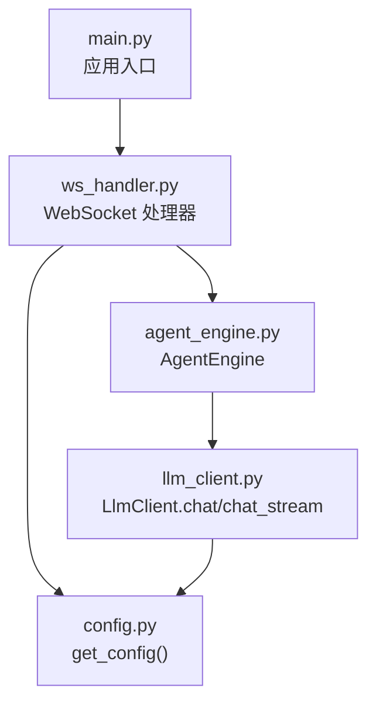
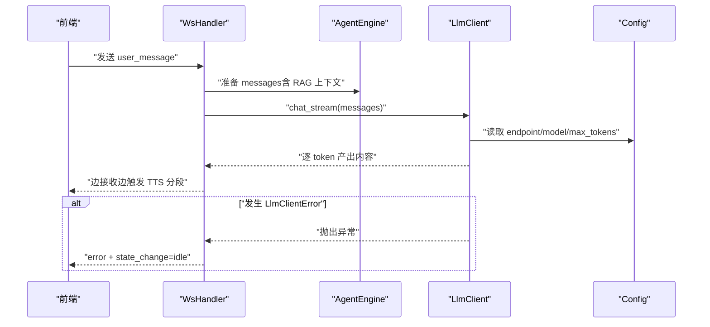
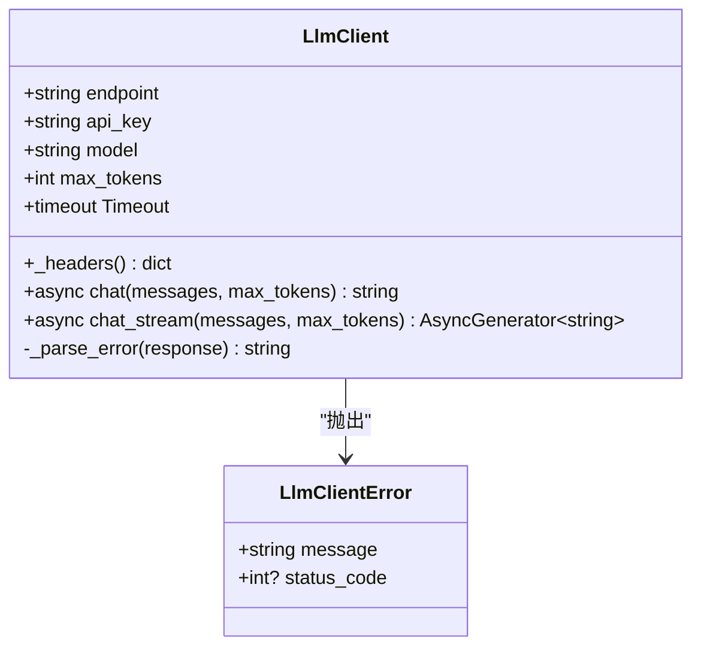
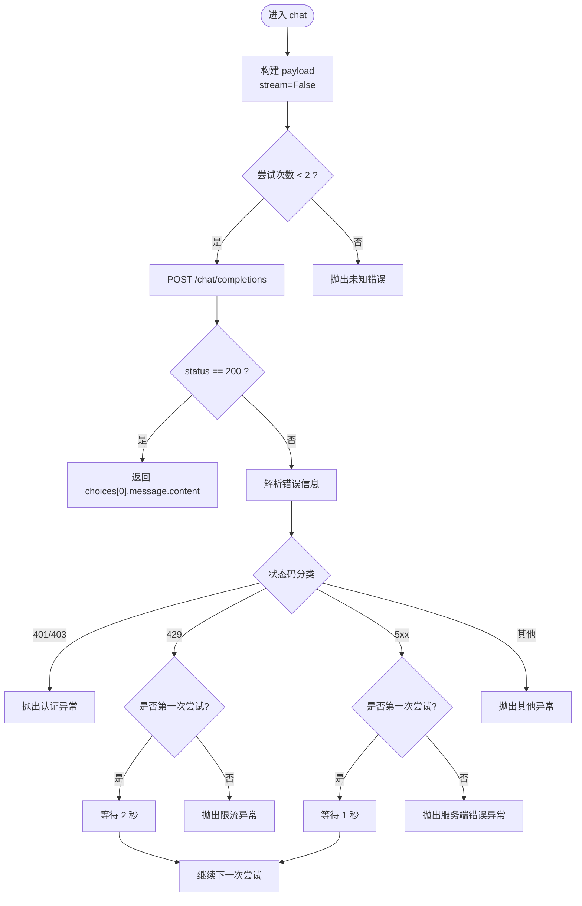
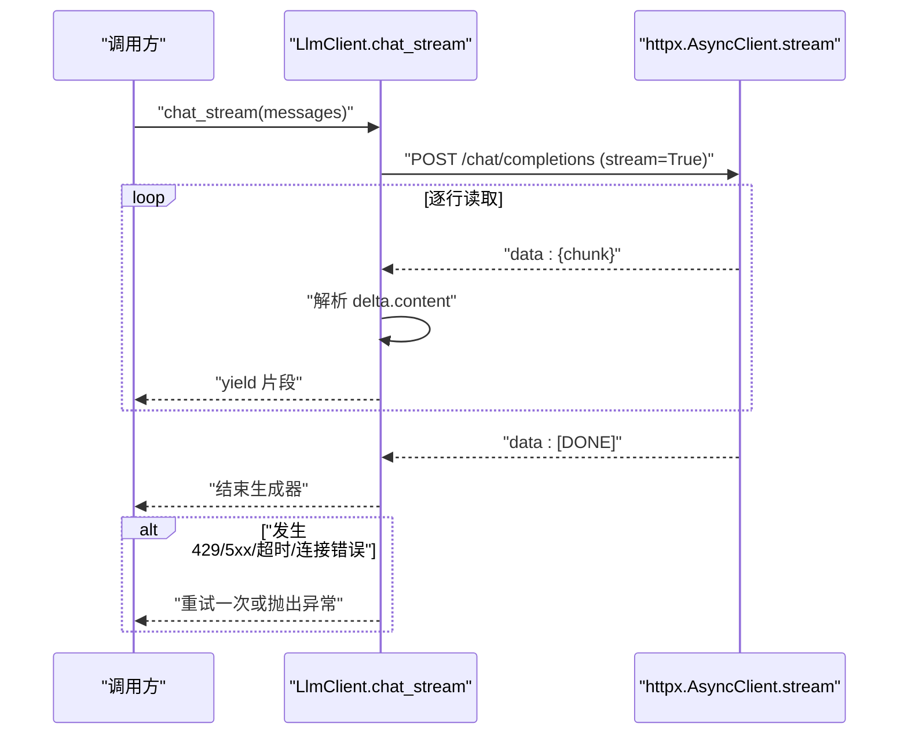
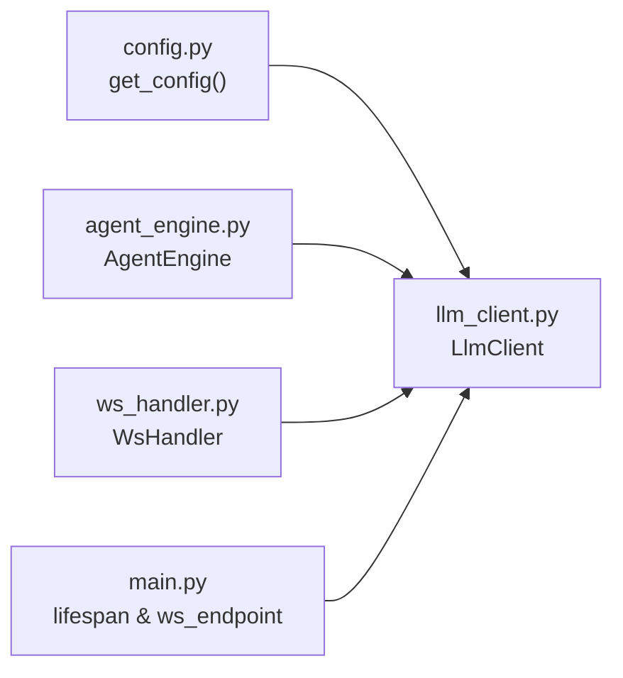

# LLM 服务集成

<cite>
**本文引用的文件**   
- [server/services/llm_client.py](file://server/services/llm_client.py)
- [server/config.py](file://server/config.py)
- [server/agent/agent_engine.py](file://server/agent/agent_engine.py)
- [server/api/ws_handler.py](file://server/api/ws_handler.py)
- [server/main.py](file://server/main.py)
</cite>

## 目录
1. [简介](#简介)
2. [项目结构](#项目结构)
3. [核心组件](#核心组件)
4. [架构总览](#架构总览)
5. [详细组件分析](#详细组件分析)
6. [依赖关系分析](#依赖关系分析)
7. [性能与连接池](#性能与连接池)
8. [故障排查指南](#故障排查指南)
9. [结论](#结论)

## 简介
本技术文档聚焦于 RealTimeTalk 的 LLM 服务集成，围绕 OpenAI 兼容 API 客户端的实现进行深入解析。重点覆盖：
- LlmClient 类的非流式 chat() 与流式 chat_stream() 方法
- 消息格式、参数配置与返回值结构
- 错误处理策略（认证失败、限流 429、服务端错误 500+、超时）
- 重试机制（固定间隔与最大重试次数）
- 调用示例路径（通过上层模块引用）
- 连接池管理、超时配置与性能优化建议
- 常见问题排查（网络、认证、服务降级）

## 项目结构
与 LLM 集成相关的核心代码位于 server 目录下：
- services/llm_client.py：OpenAI 兼容 Chat Completions 客户端实现
- config.py：配置加载与合并（JSON + 环境变量），提供 LLM 相关配置项
- agent/agent_engine.py：对话引擎，封装 RAG 与 LLM 调用流程
- api/ws_handler.py：WebSocket 处理器，驱动流式 LLM 与 TTS 管道
- main.py：应用入口，初始化并注入 LlmClient 到 WebSocket 处理链路

图表来源
- [server/main.py:146-170](file://server/main.py#L146-L170)
- [server/api/ws_handler.py:146-187](file://server/api/ws_handler.py#L146-L187)
- [server/agent/agent_engine.py:74-121](file://server/agent/agent_engine.py#L74-L121)
- [server/services/llm_client.py:23-38](file://server/services/llm_client.py#L23-L38)
- [server/config.py:148-241](file://server/config.py#L148-L241)

章节来源
- [server/main.py:146-170](file://server/main.py#L146-L170)
- [server/api/ws_handler.py:146-187](file://server/api/ws_handler.py#L146-L187)
- [server/agent/agent_engine.py:74-121](file://server/agent/agent_engine.py#L74-L121)
- [server/services/llm_client.py:23-38](file://server/services/llm_client.py#L23-L38)
- [server/config.py:148-241](file://server/config.py#L148-L241)

## 核心组件
- LlmClient：封装 OpenAI 兼容 Chat Completions 请求，支持非流式与流式两种模式
- LlmClientError：自定义异常，携带状态码便于上层区分处理
- AgentEngine：对话编排层，负责消息组装、RAG 上下文注入、LLM 调用与 Markdown 清理
- WsHandler：WebSocket 业务层，驱动流式 LLM 输出并联动 TTS 分段生成与推送
- Config：集中管理 LLM 端点、模型、令牌、最大 token 数等配置

章节来源
- [server/services/llm_client.py:16-38](file://server/services/llm_client.py#L16-L38)
- [server/agent/agent_engine.py:59-121](file://server/agent/agent_engine.py#L59-L121)
- [server/api/ws_handler.py:130-187](file://server/api/ws_handler.py#L130-L187)
- [server/config.py:16-21](file://server/config.py#L16-L21)

## 架构总览
下图展示了从 WebSocket 接入到 LLM 调用的端到端流程，包括流式响应与错误处理分支。

图表来源
- [server/api/ws_handler.py:214-220](file://server/api/ws_handler.py#L214-L220)
- [server/services/llm_client.py:115-190](file://server/services/llm_client.py#L115-L190)
- [server/config.py:188-194](file://server/config.py#L188-L194)

## 详细组件分析

### LlmClient 类设计
- 职责
  - 构造时从配置中读取 endpoint、api_key、model、max_tokens，并设置 httpx.Timeout
  - 提供 _headers() 统一添加 Authorization 与 Content-Type
  - 提供 chat() 非流式接口与 chat_stream() 流式接口
  - 定义 LlmClientError 异常类型，包含 status_code 字段
- 关键属性与方法
  - __init__()：初始化配置与超时
  - _headers()：返回鉴权与内容类型头
  - chat(messages, max_tokens=None)：非流式请求，返回纯文本
  - chat_stream(messages, max_tokens=None)：流式请求，异步生成器产出片段
  - _parse_error(response)：解析错误体中的 message 或回退为文本前缀

图表来源
- [server/services/llm_client.py:16-38](file://server/services/llm_client.py#L16-L38)
- [server/services/llm_client.py:40-113](file://server/services/llm_client.py#L40-L113)
- [server/services/llm_client.py:115-190](file://server/services/llm_client.py#L115-L190)
- [server/services/llm_client.py:192-203](file://server/services/llm_client.py#L192-L203)

章节来源
- [server/services/llm_client.py:16-38](file://server/services/llm_client.py#L16-L38)
- [server/services/llm_client.py:40-113](file://server/services/llm_client.py#L40-L113)
- [server/services/llm_client.py:115-190](file://server/services/llm_client.py#L115-L190)
- [server/services/llm_client.py:192-203](file://server/services/llm_client.py#L192-L203)

### 非流式对话请求 chat()
- 输入
  - messages：标准 OpenAI 风格消息列表，元素形如 {"role": "system/user/assistant", "content": "..."}
  - max_tokens：可选，覆盖默认值
- 输出
  - 字符串：choices[0].message.content 去除首尾空白
- 行为
  - 构建 payload，设置 stream=False
  - 使用 httpx.AsyncClient 发起 POST 请求
  - 成功返回 content；否则根据状态码分类处理
- 错误处理
  - 401/403：直接抛出自定义异常，提示 API Key 无效
  - 429：首次尝试等待后重试一次，再次失败则抛出“请求过于频繁”
  - 5xx：首次尝试等待后重试一次，再次失败则抛出“服务端错误”
  - 其他错误：抛出带状态码的异常
  - 超时与连接异常：捕获并重试一次，最终仍失败则抛出对应异常
  - 未知异常：包装为自定义异常并抛出
- 重试机制
  - 最多 2 次尝试（attempt=0 和 attempt=1）
  - 固定等待时间：429 等待 2 秒，5xx 与超时/连接错误等待 1 秒
  - 未实现指数退避，当前为固定间隔

图表来源
- [server/services/llm_client.py:40-113](file://server/services/llm_client.py#L40-L113)

章节来源
- [server/services/llm_client.py:40-113](file://server/services/llm_client.py#L40-L113)

### 流式对话请求 chat_stream()
- 输入
  - messages：同上
  - max_tokens：可选，覆盖默认值
- 输出
  - 异步生成器：每次 yield 一个文本片段（token 或若干字符）
- 行为
  - 构建 payload，设置 stream=True
  - 使用 client.stream("POST", ...) 建立 SSE 流
  - 按行读取 data: ...，跳过空行与非 data 行
  - 遇到 "[DONE]" 结束
  - 解析 JSON chunk，提取 choices[0].delta.content 并 yield
- 错误处理
  - 非 200：读取错误体，若为 429 且第一次尝试则等待 2 秒后重试，否则抛出异常
  - 超时与连接异常：捕获并重试一次，最终失败抛出对应异常
  - 其他异常：包装为自定义异常并抛出
- 重试机制
  - 最多 2 次尝试
  - 固定等待时间：429 等待 2 秒，超时/连接错误等待 1 秒

图表来源
- [server/services/llm_client.py:115-190](file://server/services/llm_client.py#L115-L190)

章节来源
- [server/services/llm_client.py:115-190](file://server/services/llm_client.py#L115-L190)

### 消息格式与参数说明
- 消息格式
  - role：system、user、assistant
  - content：字符串文本
- 参数
  - model：来自配置 llm.model
  - max_tokens：优先使用传入值，否则使用配置 llm.max_tokens
  - stream：非流式 False，流式 True
- 返回值
  - chat()：字符串
  - chat_stream()：异步生成器，逐片段产出

章节来源
- [server/services/llm_client.py:40-60](file://server/services/llm_client.py#L40-L60)
- [server/services/llm_client.py:115-135](file://server/services/llm_client.py#L115-L135)
- [server/config.py:188-194](file://server/config.py#L188-L194)

### 错误处理与重试策略
- 认证失败（401/403）
  - 立即抛出 LlmClientError，不重试
- 请求限流（429）
  - 首次尝试等待 2 秒后重试一次，再次失败抛出异常
- 服务端错误（5xx）
  - 首次尝试等待 1 秒后重试一次，再次失败抛出异常
- 超时与连接错误
  - 捕获并重试一次，等待 1 秒后继续
- 未知异常
  - 包装为 LlmClientError 并抛出
- 重试控制
  - 固定最大尝试次数 2 次
  - 固定等待时间，未实现指数退避

章节来源
- [server/services/llm_client.py:78-113](file://server/services/llm_client.py#L78-L113)
- [server/services/llm_client.py:143-190](file://server/services/llm_client.py#L143-L190)

### 调用示例路径
- 非流式调用
  - 参考：在对话引擎中调用 LLM 生成回复
  - 路径：[server/agent/agent_engine.py:107-112](file://server/agent/agent_engine.py#L107-L112)
- 流式调用
  - 参考：在 WebSocket 处理器中迭代 chat_stream 生成器
  - 路径：[server/api/ws_handler.py:220-222](file://server/api/ws_handler.py#L220-L222)

章节来源
- [server/agent/agent_engine.py:107-112](file://server/agent/agent_engine.py#L107-L112)
- [server/api/ws_handler.py:220-222](file://server/api/ws_handler.py#L220-L222)

## 依赖关系分析
- 配置依赖
  - LlmClient 通过 get_config() 获取 llm.endpoint、llm.api_key、llm.model、llm.max_tokens
- 上层调用
  - AgentEngine.process_message 调用 LlmClient.chat
  - WsHandler._run_streaming_flow 调用 LlmClient.chat_stream
- 应用生命周期
  - main.py 在 WebSocket 端点创建 LlmClient 实例并注入到 AgentEngine 与 WsHandler

图表来源
- [server/config.py:148-241](file://server/config.py#L148-L241)
- [server/services/llm_client.py:26-32](file://server/services/llm_client.py#L26-L32)
- [server/agent/agent_engine.py:107-112](file://server/agent/agent_engine.py#L107-L112)
- [server/api/ws_handler.py:220-222](file://server/api/ws_handler.py#L220-L222)
- [server/main.py:158-167](file://server/main.py#L158-L167)

章节来源
- [server/config.py:148-241](file://server/config.py#L148-L241)
- [server/services/llm_client.py:26-32](file://server/services/llm_client.py#L26-L32)
- [server/agent/agent_engine.py:107-112](file://server/agent/agent_engine.py#L107-L112)
- [server/api/ws_handler.py:220-222](file://server/api/ws_handler.py#L220-L222)
- [server/main.py:158-167](file://server/main.py#L158-L167)

## 性能与连接池
- 连接池现状
  - 当前实现每次请求使用 httpx.AsyncClient(timeout=self.timeout) 作为上下文管理器，请求结束后自动关闭连接
  - 未复用连接池，存在频繁创建/销毁连接的开销
- 超时配置
  - 总超时 60 秒，连接超时 10 秒
- 优化建议
  - 引入全局 httpx.AsyncClient 单例或连接池，减少握手与 TLS 开销
  - 针对高并发场景调整连接池大小与 keep-alive 策略
  - 对 chat_stream 可考虑增加分片缓冲与背压控制，避免上游阻塞
  - 将固定重试间隔升级为指数退避（例如 1s、2s、4s...）并加入抖动，降低雪崩风险
  - 对 429 响应可解析 Retry-After 头部动态等待（若服务端提供）

章节来源
- [server/services/llm_client.py:67-68](file://server/services/llm_client.py#L67-L68)
- [server/services/llm_client.py:141-142](file://server/services/llm_client.py#L141-L142)
- [server/services/llm_client.py:32](file://server/services/llm_client.py#L32)

## 故障排查指南
- 网络连接问题
  - 现象：连接错误或超时
  - 排查：检查 endpoint 可达性、DNS 解析、防火墙与代理设置；确认 httpx.Timeout 配置合理
  - 相关逻辑：捕获 httpx.ConnectError 与 httpx.TimeoutException 并重试一次
- 认证失败
  - 现象：401/403 错误
  - 排查：校验 api_key 是否正确、是否过期、权限范围是否足够
  - 相关逻辑：直接抛出 LlmClientError，不重试
- 请求限流
  - 现象：429 错误
  - 排查：降低请求频率、扩容配额或升级套餐；关注后端限流策略
  - 相关逻辑：首次等待 2 秒后重试一次，再次失败抛出异常
- 服务端错误
  - 现象：5xx 错误
  - 排查：查看服务端日志、健康检查与依赖服务状态
  - 相关逻辑：首次等待 1 秒后重试一次，再次失败抛出异常
- 服务降级
  - 现象：RAG 检索失败或不可用
  - 排查：确认 Qdrant 与 Embedding 客户端可用；必要时降级为纯 LLM 回复
  - 相关逻辑：在 AgentEngine 与 WsHandler 中捕获异常并记录警告，继续执行

章节来源
- [server/services/llm_client.py:95-113](file://server/services/llm_client.py#L95-L113)
- [server/services/llm_client.py:172-190](file://server/services/llm_client.py#L172-L190)
- [server/agent/agent_engine.py:178-180](file://server/agent/agent_engine.py#L178-L180)
- [server/api/ws_handler.py:398-400](file://server/api/ws_handler.py#L398-L400)

## 结论
RealTimeTalk 的 LLM 集成以 LlmClient 为核心，提供了简洁的非流式与流式接口，并通过上层 AgentEngine 与 WsHandler 完成对话编排与实时推送。当前实现具备基础的重试与错误分类能力，但在连接池复用与退避策略方面仍有优化空间。建议在后续版本引入连接池、指数退避与更细粒度的超时控制，以提升稳定性与吞吐表现。