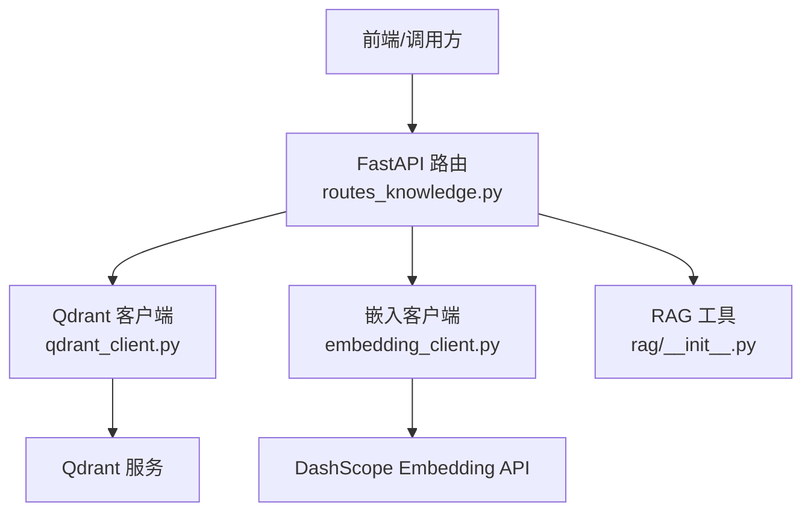
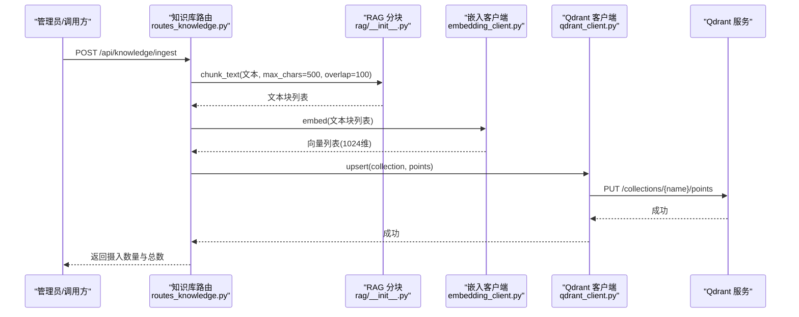
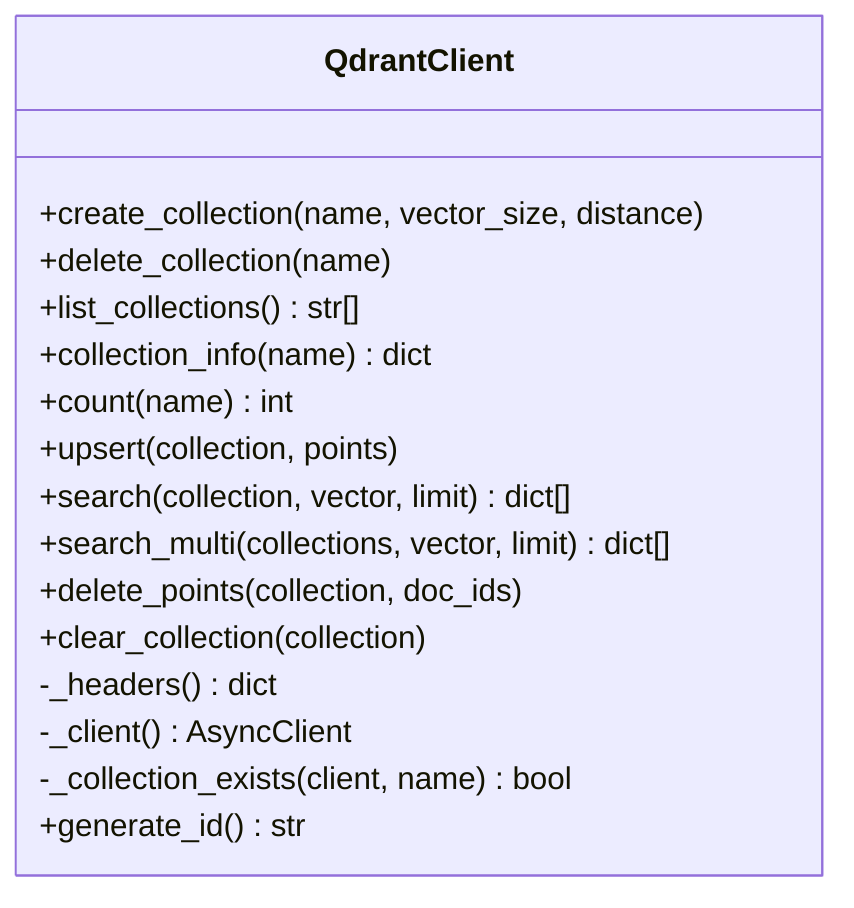
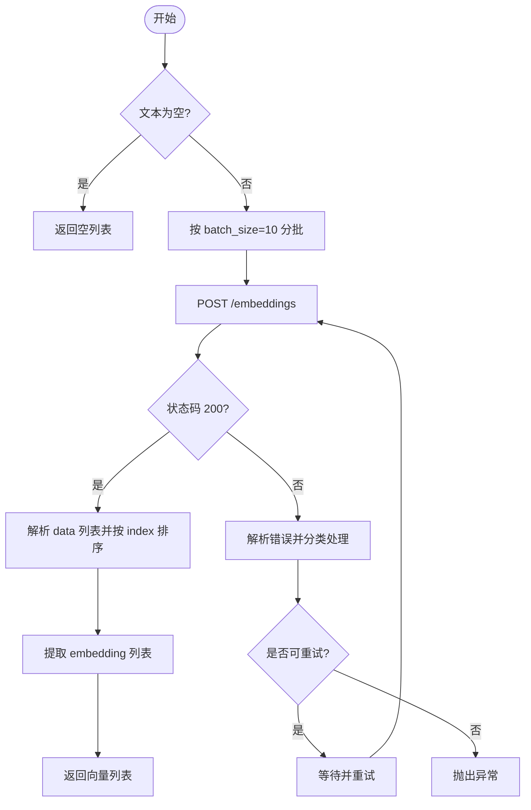
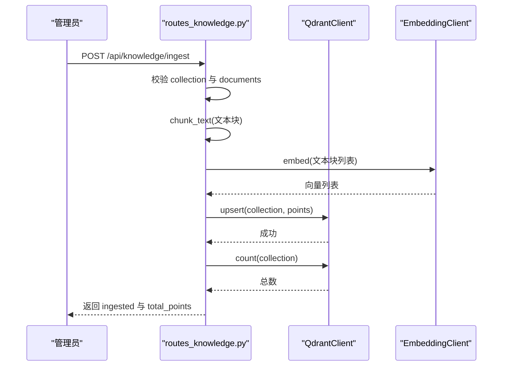
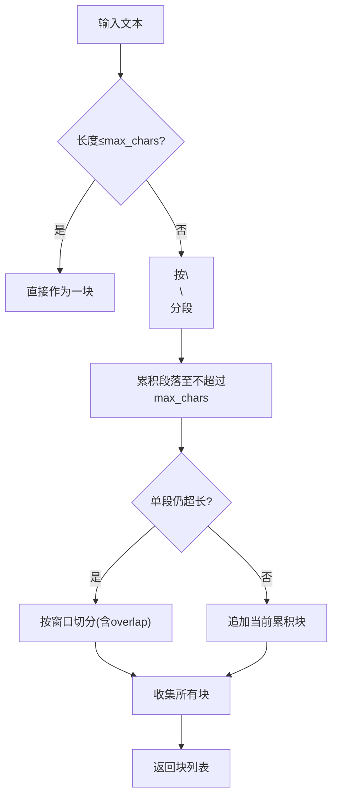
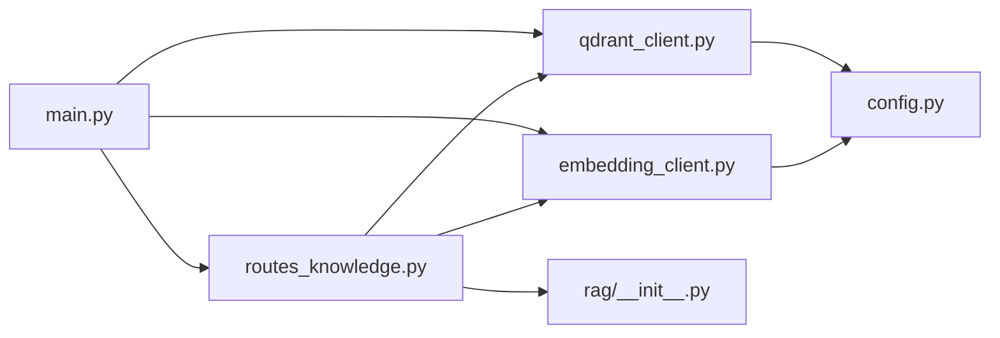

# 向量数据库集成

<cite>
**本文引用的文件**
- [server/services/qdrant_client.py](file://server/services/qdrant_client.py)
- [server/services/embedding_client.py](file://server/services/embedding_client.py)
- [server/api/routes_knowledge.py](file://server/api/routes_knowledge.py)
- [server/rag/__init__.py](file://server/rag/__init__.py)
- [server/config.py](file://server/config.py)
- [server/main.py](file://server/main.py)
- [doc/Qdrant知识库操作指南.md](file://doc/Qdrant知识库操作指南.md)
</cite>

## 目录
1. [简介](#简介)
2. [项目结构](#项目结构)
3. [核心组件](#核心组件)
4. [架构总览](#架构总览)
5. [详细组件分析](#详细组件分析)
6. [依赖关系分析](#依赖关系分析)
7. [性能与优化](#性能与优化)
8. [故障排查指南](#故障排查指南)
9. [结论](#结论)
10. [附录：API 参考与使用示例](#附录api-参考与使用示例)

## 简介
本技术文档聚焦 RealTimeTalk 的向量数据库集成，围绕 Qdrant 客户端实现、集合生命周期管理、向量插入与检索、批量操作、索引策略与检索优化、连接与超时配置、错误处理与监控调试等方面展开。同时提供端到端的使用示例路径，帮助开发者快速完成文档向量化存储与语义检索。

## 项目结构
RealTimeTalk 后端采用 FastAPI 服务，RAG（检索增强生成）流程通过独立的嵌入服务与 Qdrant 向量数据库协作。关键位置如下：
- 服务入口与生命周期初始化：[server/main.py](file://server/main.py)
- Qdrant HTTP 客户端封装：[server/services/qdrant_client.py](file://server/services/qdrant_client.py)
- 文本嵌入客户端（DashScope）：[server/services/embedding_client.py](file://server/services/embedding_client.py)
- 知识库 REST API（集合管理、摄入、统计、搜索）：[server/api/routes_knowledge.py](file://server/api/routes_knowledge.py)
- RAG 工具（分块、上下文构建）：[server/rag/__init__.py](file://server/rag/__init__.py)
- 全局配置加载（Qdrant、Embedding、RAG 等）：[server/config.py](file://server/config.py)
- 用户操作指南（概念与最佳实践）：[doc/Qdrant知识库操作指南.md](file://doc/Qdrant知识库操作指南.md)

图表来源
- [server/main.py:70-87](file://server/main.py#L70-L87)
- [server/api/routes_knowledge.py:134-186](file://server/api/routes_knowledge.py#L134-L186)
- [server/services/qdrant_client.py:26-235](file://server/services/qdrant_client.py#L26-L235)
- [server/services/embedding_client.py:26-149](file://server/services/embedding_client.py#L26-L149)
- [server/rag/__init__.py:10-83](file://server/rag/__init__.py#L10-L83)

章节来源
- [server/main.py:42-110](file://server/main.py#L42-L110)
- [server/api/routes_knowledge.py:1-268](file://server/api/routes_knowledge.py#L1-268)
- [server/services/qdrant_client.py:1-235](file://server/services/qdrant_client.py#L1-L235)
- [server/services/embedding_client.py:1-149](file://server/services/embedding_client.py#L1-L149)
- [server/rag/__init__.py:1-83](file://server/rag/__init__.py#L1-L83)
- [server/config.py:111-138](file://server/config.py#L111-L138)

## 核心组件
- Qdrant 客户端：封装集合管理、点写入、相似度检索、批量删除与清空等能力，基于 httpx 异步请求。
- 嵌入客户端：对接 DashScope text-embedding-v3，支持批量文本到 1024 维向量转换，内置重试与限流处理。
- 知识库路由：提供集合 CRUD、知识摄入（自动分块+批量嵌入+批量 upsert）、统计与调试搜索接口。
- RAG 工具：长文本分块与检索结果上下文构建，过滤低分结果并格式化注入 LLM。
- 配置模块：集中管理 Qdrant、Embedding、RAG 参数，支持环境变量覆盖。

章节来源
- [server/services/qdrant_client.py:26-235](file://server/services/qdrant_client.py#L26-L235)
- [server/services/embedding_client.py:26-149](file://server/services/embedding_client.py#L26-L149)
- [server/api/routes_knowledge.py:134-268](file://server/api/routes_knowledge.py#L134-L268)
- [server/rag/__init__.py:10-83](file://server/rag/__init__.py#L10-L83)
- [server/config.py:111-138](file://server/config.py#L111-L138)

## 架构总览
下图展示从“知识摄入”到“语义检索”的关键数据流与组件交互。

图表来源
- [server/api/routes_knowledge.py:134-186](file://server/api/routes_knowledge.py#L134-L186)
- [server/rag/__init__.py:10-53](file://server/rag/__init__.py#L10-L53)
- [server/services/embedding_client.py:47-70](file://server/services/embedding_client.py#L47-L70)
- [server/services/qdrant_client.py:115-134](file://server/services/qdrant_client.py#L115-L134)

章节来源
- [server/api/routes_knowledge.py:134-186](file://server/api/routes_knowledge.py#L134-L186)
- [server/services/qdrant_client.py:115-134](file://server/services/qdrant_client.py#L115-L134)
- [server/services/embedding_client.py:47-70](file://server/services/embedding_client.py#L47-L70)
- [server/rag/__init__.py:10-53](file://server/rag/__init__.py#L10-L53)

## 详细组件分析

### Qdrant 客户端（集合管理与数据操作）
- 集合管理
  - 创建集合：若已存在则跳过；可指定向量维度与距离度量（默认 Cosine）。
  - 删除集合：物理删除集合及其全部数据。
  - 列出集合：获取所有集合名称。
  - 集合信息：返回点数、向量维度、距离度量等元数据。
  - 计数：精确统计集合中向量数量。
- 数据操作
  - 批量 upsert：构造 points 列表（id、vector、payload），确保集合存在后写入。
  - 单集合搜索：按查询向量返回 top-k，包含 payload。
  - 多集合并发搜索：并发执行 search，合并并按分数降序排序取 top-k。
  - 批量删除点：按 has_id 过滤删除。
  - 清空集合：删除并重建集合以保留定义。
- 内部辅助
  - 鉴权头：可选 api-key 注入。
  - 客户端工厂：httpx.AsyncClient 带超时与鉴权头。
  - 存在性检查：GET /collections/{name} 判断集合是否存在。
  - ID 生成：UUID v4。

图表来源
- [server/services/qdrant_client.py:26-235](file://server/services/qdrant_client.py#L26-L235)

章节来源
- [server/services/qdrant_client.py:26-235](file://server/services/qdrant_client.py#L26-L235)

### 嵌入客户端（DashScope 文本嵌入）
- 功能要点
  - 模型：text-embedding-v3，输出 1024 维向量。
  - 批量处理：单次最多 10 条文本，超过则分批。
  - 重试与限流：对 429/5xx/超时/连接错误进行有限次重试与退避。
  - 错误解析：统一提取错误消息，便于上层处理。
- 数据结构
  - 输入：texts 列表（字符串）。
  - 输出：embeddings 列表（每个为 1024 维浮点数组）。

图表来源
- [server/services/embedding_client.py:47-135](file://server/services/embedding_client.py#L47-L135)

章节来源
- [server/services/embedding_client.py:26-149](file://server/services/embedding_client.py#L26-L149)

### 知识库路由（REST API）
- 集合管理
  - GET /api/knowledge/collections：列出集合及详情。
  - POST /api/knowledge/collections：创建集合（名称规范化）。
  - DELETE /api/knowledge/collections/{name}：删除集合。
- 知识摄入
  - POST /api/knowledge/ingest：自动分块 → 批量嵌入 → 批量 upsert → 统计。
- 统计与清理
  - GET /api/knowledge/stats：整体或单个集合统计。
  - DELETE /api/knowledge/clear：清空集合数据（保留集合定义）。
- 调试搜索
  - GET /api/knowledge/search：单集合或跨集合语义检索。

图表来源
- [server/api/routes_knowledge.py:134-186](file://server/api/routes_knowledge.py#L134-L186)
- [server/services/qdrant_client.py:115-134](file://server/services/qdrant_client.py#L115-L134)
- [server/services/embedding_client.py:47-70](file://server/services/embedding_client.py#L47-L70)

章节来源
- [server/api/routes_knowledge.py:81-268](file://server/api/routes_knowledge.py#L81-L268)

### RAG 工具（分块与上下文构建）
- 文本分块：优先按段落切分，超长段落按窗口滑动切分，支持重叠。
- 上下文构建：过滤低分结果（score≥0.3），格式化注入 LLM。

图表来源
- [server/rag/__init__.py:10-53](file://server/rag/__init__.py#L10-L53)

章节来源
- [server/rag/__init__.py:10-83](file://server/rag/__init__.py#L10-L83)

### 配置与环境变量
- Qdrant 配置项：url、api_key（可选）。
- Embedding 配置项：endpoint、api_key、model。
- RAG 配置项：top_k、role_collections（角色到集合映射）。
- 优先级：config.json < 环境变量（.env）。

章节来源
- [server/config.py:111-138](file://server/config.py#L111-L138)
- [server/config.py:188-239](file://server/config.py#L188-L239)

## 依赖关系分析
- main.py 在应用启动时初始化 Qdrant 与 Embedding 客户端，并将实例注入到知识库路由与 AgentEngine。
- routes_knowledge.py 依赖 qdrant_client 与 embedding_client 完成集合管理与知识摄入。
- rag/__init__.py 被 routes_knowledge.py 用于分块与上下文构建。
- config.py 提供统一的配置访问接口 get_config()。

图表来源
- [server/main.py:70-87](file://server/main.py#L70-L87)
- [server/api/routes_knowledge.py:1-268](file://server/api/routes_knowledge.py#L1-268)
- [server/services/qdrant_client.py:1-235](file://server/services/qdrant_client.py#L1-L235)
- [server/services/embedding_client.py:1-149](file://server/services/embedding_client.py#L1-L149)
- [server/rag/__init__.py:1-83](file://server/rag/__init__.py#L1-L83)
- [server/config.py:1-260](file://server/config.py#L1-L260)

章节来源
- [server/main.py:42-110](file://server/main.py#L42-L110)
- [server/api/routes_knowledge.py:1-268](file://server/api/routes_knowledge.py#L1-268)
- [server/services/qdrant_client.py:1-235](file://server/services/qdrant_client.py#L1-L235)
- [server/services/embedding_client.py:1-149](file://server/services/embedding_client.py#L1-L149)
- [server/rag/__init__.py:1-83](file://server/rag/__init__.py#L1-L83)
- [server/config.py:1-260](file://server/config.py#L1-L260)

## 性能与优化
- 连接池与超时
  - Qdrant 客户端：每次请求新建 httpx.AsyncClient，设置超时（总超时 30s，连接超时 5s）。建议在生产环境复用客户端或使用连接池以提升吞吐。
  - 嵌入客户端：同样使用 httpx.AsyncClient，超时 60s（连接 10s），并对 429/5xx/超时进行重试与退避。
- 批量操作优化
  - 嵌入批大小：官方建议单次最多 10 条文本，代码已实现分批逻辑。
  - Qdrant upsert：一次请求写入多个 points，减少网络往返。
- 检索优化
  - 多集合并发搜索：使用 asyncio.gather 并发执行，合并后排序取 top-k。
  - 过滤低分结果：RAG 上下文构建阶段过滤 score<0.3 的结果，降低噪声。
- 索引策略与距离度量
  - 集合创建时可指定距离度量（默认 Cosine），向量维度固定为 1024（与嵌入模型一致）。
  - 未显式配置索引参数，生产环境可根据数据规模与延迟要求调整索引类型与参数（如 HNSW 配置）。

章节来源
- [server/services/qdrant_client.py:29-33](file://server/services/qdrant_client.py#L29-L33)
- [server/services/embedding_client.py:32-39](file://server/services/embedding_client.py#L32-L39)
- [server/services/qdrant_client.py:164-186](file://server/services/qdrant_client.py#L164-L186)
- [server/rag/__init__.py:56-83](file://server/rag/__init__.py#L56-L83)

## 故障排查指南
- 连接失败
  - Qdrant 不可用：主进程启动时会尝试列出集合，失败仅记录警告，服务仍可启动但 RAG 不可用。需检查 QDRANT_URL 与网络连通性。
  - 嵌入 API 不可用：会触发重试与退避，最终抛出异常。检查 EMBEDDING_ENDPOINT、API Key 与网络。
- 索引损坏或集合不存在
  - 删除集合时报 404：表示集合不存在，需先创建。
  - upsert 前检查集合存在性，避免写入失败。
- 数据一致性
  - 清空集合：采用删除并重建的方式，保证集合定义不变且数据清空。
  - 统计计数：使用 exact=True 获取精确计数，避免近似值带来的不一致。
- 鉴权与 Token
  - 知识库管理接口受 X-Knowledge-Admin-Token 保护，未配置则放行所有请求。请根据安全需求配置 KNOWLEDGE_ADMIN_TOKEN。
- 日志与监控
  - 各客户端均使用 logging 记录关键步骤与错误，建议结合外部日志系统（如 ELK）进行采集与分析。
  - 健康检查端点 /api/health 可用于基础可用性探测。

章节来源
- [server/main.py:70-87](file://server/main.py#L70-L87)
- [server/api/routes_knowledge.py:43-51](file://server/api/routes_knowledge.py#L43-L51)
- [server/services/qdrant_client.py:61-73](file://server/services/qdrant_client.py#L61-L73)
- [server/services/qdrant_client.py:115-134](file://server/services/qdrant_client.py#L115-L134)
- [server/services/qdrant_client.py:206-212](file://server/services/qdrant_client.py#L206-L212)
- [server/services/embedding_client.py:84-135](file://server/services/embedding_client.py#L84-L135)
- [server/main.py:136-143](file://server/main.py#L136-L143)

## 结论
RealTimeTalk 的向量数据库集成通过清晰的客户端封装与 REST 路由，实现了集合管理、批量写入与语义检索的完整链路。配合 RAG 工具的分块与上下文构建，系统在对话场景中能够动态注入相关知识，提升回答质量。生产部署时应关注连接池、批量大小、索引参数与错误重试策略，以获得更稳定的性能与更好的用户体验。

## 附录：API 参考与使用示例

### 集合管理
- 列出集合
  - 方法：GET
  - 路径：/api/knowledge/collections
  - 说明：返回集合名、点数、向量维度、距离度量。
- 创建集合
  - 方法：POST
  - 路径：/api/knowledge/collections
  - 请求体：{ "name": "string", "vector_size": 1024 }
  - 说明：名称会被规范化为小写+下划线。
- 删除集合
  - 方法：DELETE
  - 路径：/api/knowledge/collections/{name}
  - 说明：物理删除集合与数据。

章节来源
- [server/api/routes_knowledge.py:81-128](file://server/api/routes_knowledge.py#L81-L128)

### 知识摄入
- 方法：POST
- 路径：/api/knowledge/ingest
- 请求体：
  - collection: string
  - documents: [{ "text": "string", "source": "string" }]
- 流程：分块 → 批量嵌入 → upsert → 统计
- 响应：包含 ingested 数量与 total_points

章节来源
- [server/api/routes_knowledge.py:134-186](file://server/api/routes_knowledge.py#L134-L186)

### 统计与清理
- 统计
  - 方法：GET
  - 路径：/api/knowledge/stats?collection={name}
  - 说明：不传 collection 返回总体统计。
- 清空
  - 方法：DELETE
  - 路径：/api/knowledge/clear?collection={name}
  - 说明：保留集合定义，删除所有数据。

章节来源
- [server/api/routes_knowledge.py:192-230](file://server/api/routes_knowledge.py#L192-L230)

### 调试搜索
- 方法：GET
- 路径：/api/knowledge/search?q={query}&collection={name}&k={top_k}
- 说明：不传 collection 则跨所有集合搜索。

章节来源
- [server/api/routes_knowledge.py:233-268](file://server/api/routes_knowledge.py#L233-L268)

### 使用示例（路径引用）
- 文档向量化存储
  - 调用摄入接口：[server/api/routes_knowledge.py:134-186](file://server/api/routes_knowledge.py#L134-L186)
  - 分块逻辑：[server/rag/__init__.py:10-53](file://server/rag/__init__.py#L10-L53)
  - 批量嵌入：[server/services/embedding_client.py:47-70](file://server/services/embedding_client.py#L47-L70)
  - 批量 upsert：[server/services/qdrant_client.py:115-134](file://server/services/qdrant_client.py#L115-L134)
- 语义检索
  - 单集合搜索：[server/services/qdrant_client.py:136-162](file://server/services/qdrant_client.py#L136-L162)
  - 多集合并发搜索：[server/services/qdrant_client.py:164-186](file://server/services/qdrant_client.py#L164-L186)
  - 上下文构建与过滤：[server/rag/__init__.py:56-83](file://server/rag/__init__.py#L56-L83)

章节来源
- [server/api/routes_knowledge.py:134-268](file://server/api/routes_knowledge.py#L134-L268)
- [server/services/qdrant_client.py:115-186](file://server/services/qdrant_client.py#L115-L186)
- [server/services/embedding_client.py:47-70](file://server/services/embedding_client.py#L47-L70)
- [server/rag/__init__.py:10-83](file://server/rag/__init__.py#L10-L83)