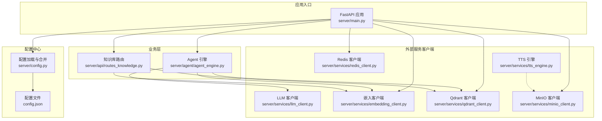
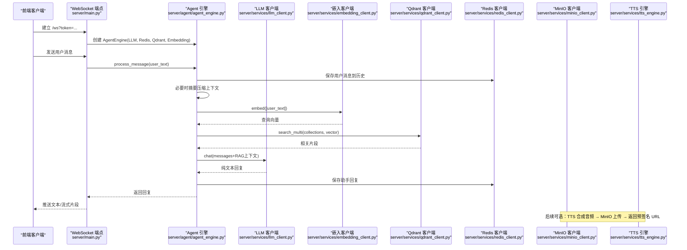
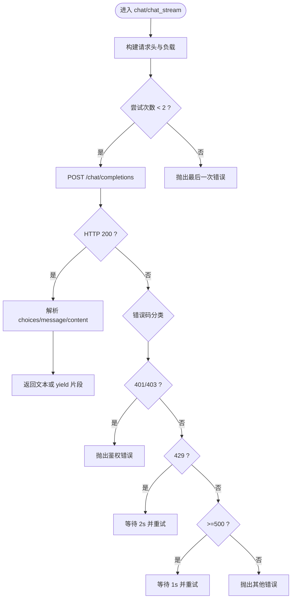
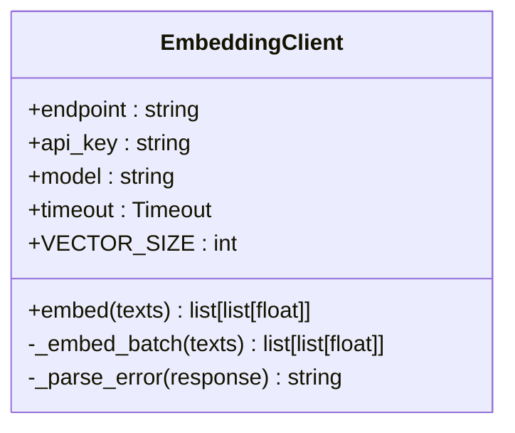
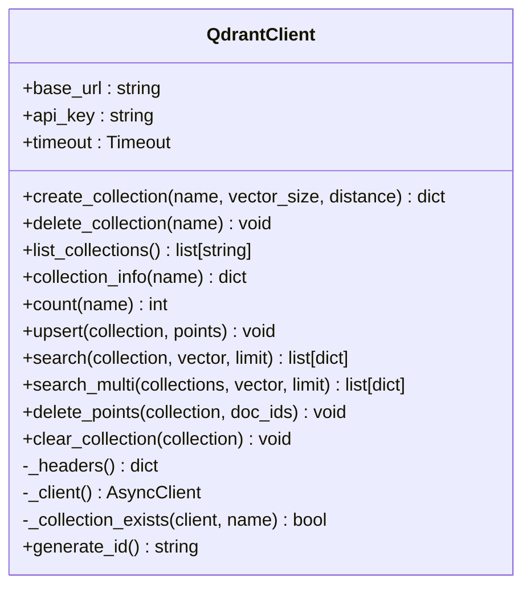
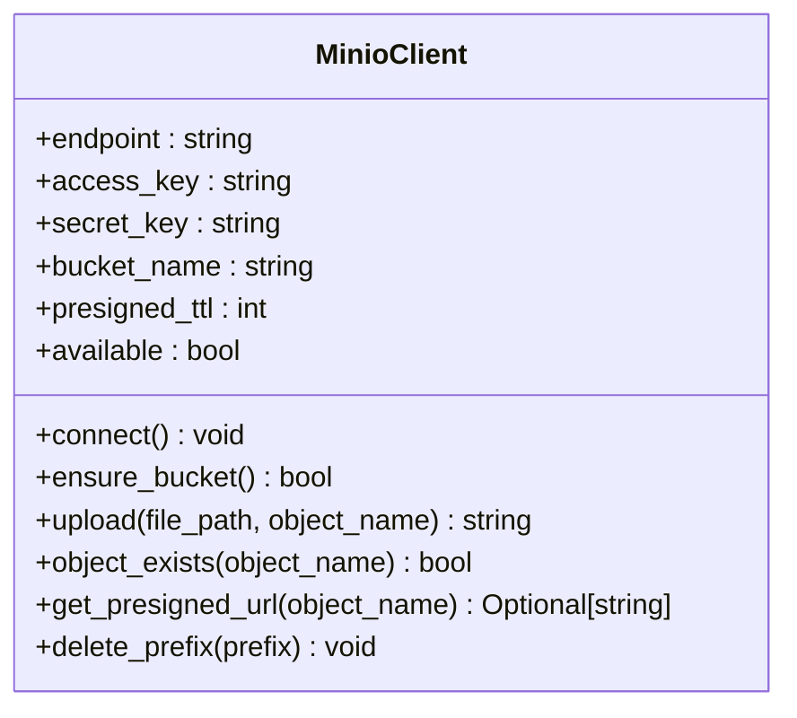
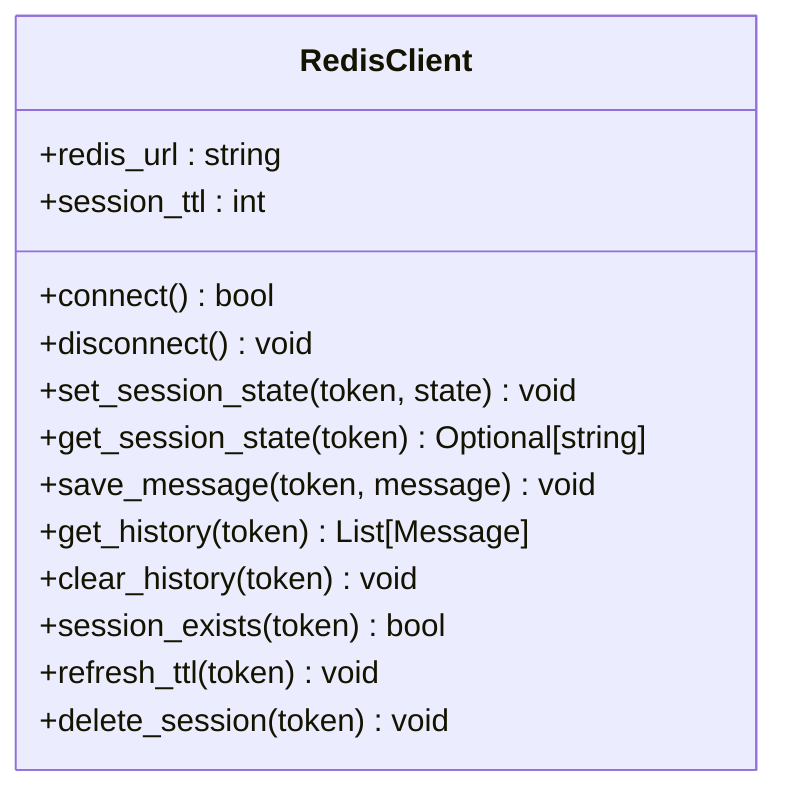
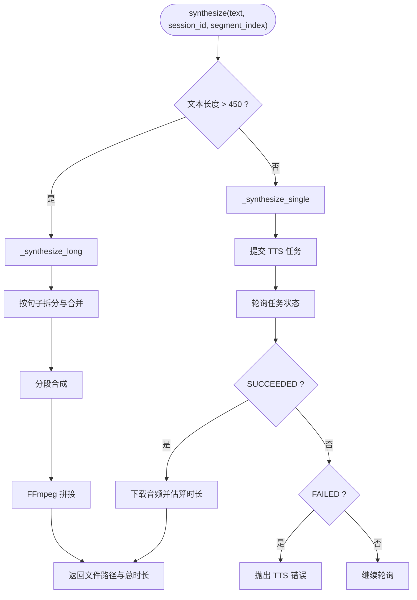
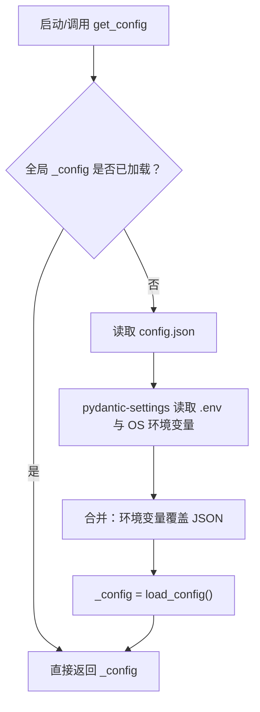
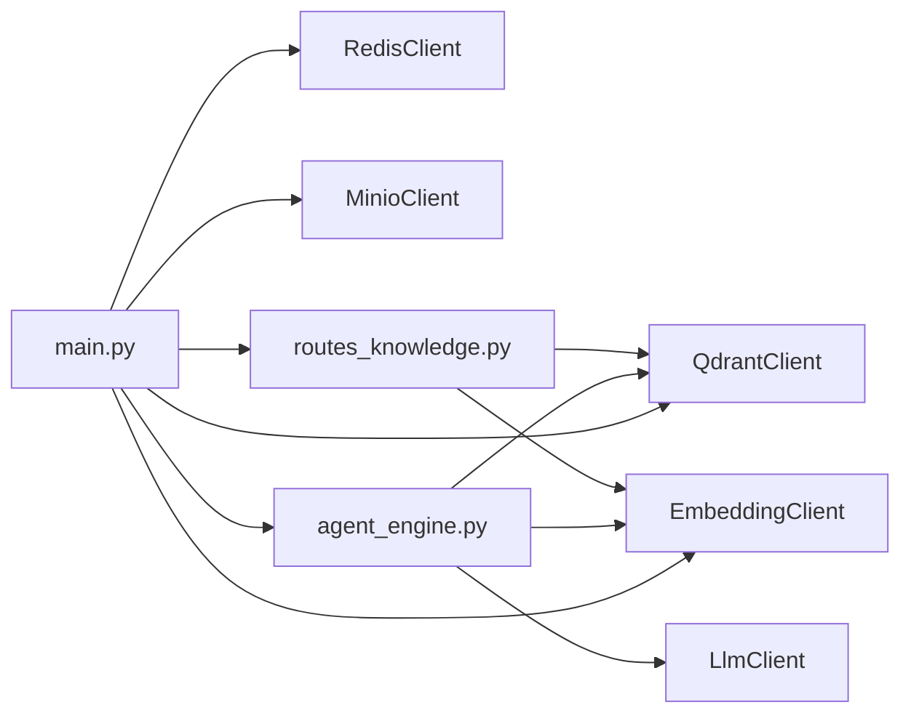

# 外部服务集成

<cite>
**本文引用的文件**   
- [server/main.py](file://server/main.py)
- [server/config.py](file://server/config.py)
- [config.json](file://config.json)
- [server/services/llm_client.py](file://server/services/llm_client.py)
- [server/services/embedding_client.py](file://server/services/embedding_client.py)
- [server/services/qdrant_client.py](file://server/services/qdrant_client.py)
- [server/services/minio_client.py](file://server/services/minio_client.py)
- [server/services/redis_client.py](file://server/services/redis_client.py)
- [server/services/tts_engine.py](file://server/services/tts_engine.py)
- [server/api/routes_knowledge.py](file://server/api/routes_knowledge.py)
- [server/agent/agent_engine.py](file://server/agent/agent_engine.py)
</cite>

## 目录
1. [简介](#简介)
2. [项目结构](#项目结构)
3. [核心组件](#核心组件)
4. [架构总览](#架构总览)
5. [详细组件分析](#详细组件分析)
6. [依赖关系分析](#依赖关系分析)
7. [性能与可靠性](#性能与可靠性)
8. [故障排查指南](#故障排查指南)
9. [结论](#结论)
10. [附录：新增外部服务集成示例](#附录新增外部服务集成示例)

## 简介
本技术文档聚焦 RealTimeTalk 的外部服务集成，涵盖 LLM 服务对接、向量数据库（Qdrant）集成、对象存储（MinIO）、缓存（Redis）、文本嵌入（Embedding）以及语音合成（TTS）。文档将深入解释各服务的客户端封装、连接管理、错误处理策略、API 密钥管理、请求限流与重试机制，并说明配置管理、环境变量注入与动态重载。同时提供具体的代码级参考路径，帮助开发者快速扩展新的外部服务集成。

## 项目结构
RealTimeTalk 后端采用 FastAPI 应用，通过 lifespan 生命周期初始化外部服务客户端，并在路由与 Agent 引擎中按需使用。外部服务客户端均位于 server/services 下，配置集中管理于 server/config.py，并通过 config.json 与环境变量合并加载。

图表来源
- [server/main.py:42-110](file://server/main.py#L42-L110)
- [server/config.py:148-241](file://server/config.py#L148-L241)
- [config.json:1-39](file://config.json#L1-L39)

章节来源
- [server/main.py:1-191](file://server/main.py#L1-L191)
- [server/config.py:1-260](file://server/config.py#L1-L260)
- [config.json:1-39](file://config.json#L1-L39)

## 核心组件
- LLM 客户端：OpenAI 兼容 Chat Completions API，支持同步与流式调用，内置超时、连接错误、限流与服务器错误的重试逻辑。
- 嵌入客户端：DashScope 文本嵌入，批量提交，按 index 排序保证顺序，具备重试与错误解析。
- Qdrant 客户端：集合管理与点数据操作（upsert/search/delete/clear），并发多集合检索与结果合并排序。
- MinIO 客户端：对象上传、存在性检查、预签名 URL 生成、前缀删除；失败时降级为本地返回。
- Redis 客户端：会话状态与对话历史持久化，TTL 自动过期，URL 解析健壮性处理。
- TTS 引擎：DashScope 异步任务提交与轮询，长文本分段合成与 FFmpeg 拼接，全局信号量限制并发。
- 配置系统：JSON 配置 + 环境变量覆盖，懒加载与动态重载能力。

章节来源
- [server/services/llm_client.py:1-204](file://server/services/llm_client.py#L1-L204)
- [server/services/embedding_client.py:1-149](file://server/services/embedding_client.py#L1-L149)
- [server/services/qdrant_client.py:1-235](file://server/services/qdrant_client.py#L1-L235)
- [server/services/minio_client.py:1-139](file://server/services/minio_client.py#L1-L139)
- [server/services/redis_client.py:1-122](file://server/services/redis_client.py#L1-L122)
- [server/services/tts_engine.py:1-234](file://server/services/tts_engine.py#L1-L234)
- [server/config.py:1-260](file://server/config.py#L1-L260)

## 架构总览
下图展示了从 WebSocket 请求到外部服务调用的整体流程，包括 RAG 检索增强与 TTS 语音合成的关键路径。

图表来源
- [server/main.py:146-170](file://server/main.py#L146-L170)
- [server/agent/agent_engine.py:74-121](file://server/agent/agent_engine.py#L74-L121)
- [server/services/llm_client.py:40-113](file://server/services/llm_client.py#L40-L113)
- [server/services/embedding_client.py:47-70](file://server/services/embedding_client.py#L47-L70)
- [server/services/qdrant_client.py:164-186](file://server/services/qdrant_client.py#L164-L186)
- [server/services/redis_client.py:82-100](file://server/services/redis_client.py#L82-L100)
- [server/services/minio_client.py:69-124](file://server/services/minio_client.py#L69-L124)
- [server/services/tts_engine.py:49-76](file://server/services/tts_engine.py#L49-L76)

## 详细组件分析

### LLM 客户端（OpenAI 兼容）
- 功能要点
  - 同步 chat 与流式 chat_stream 两种模式。
  - 统一超时设置（连接与总超时分离）。
  - 错误分类：鉴权失败（401/403）、限流（429）、服务端错误（≥500）、网络异常（超时/连接失败）。
  - 重试策略：对 429 与 5xx 进行最多一次重试，间隔短暂等待；网络异常也重试一次。
  - 错误解析：优先读取 error.message，否则截取响应体。
- 连接池管理
  - 每次请求使用 httpx.AsyncClient 上下文管理器，避免连接泄漏。
- 限流与重试
  - 429 等待 2s 后重试一次；5xx 等待 1s 后重试一次。
- 鉴权
  - Authorization: Bearer {api_key}。

图表来源
- [server/services/llm_client.py:40-113](file://server/services/llm_client.py#L40-L113)
- [server/services/llm_client.py:115-190](file://server/services/llm_client.py#L115-L190)
- [server/services/llm_client.py:192-204](file://server/services/llm_client.py#L192-L204)

章节来源
- [server/services/llm_client.py:1-204](file://server/services/llm_client.py#L1-L204)

### 嵌入客户端（DashScope）
- 功能要点
  - 批量嵌入（默认批大小 10），按 index 排序确保顺序一致。
  - 错误处理与重试策略同 LLM 客户端。
  - 维度固定为 1024（text-embedding-v3）。
- 连接池管理
  - 使用 httpx.AsyncClient 上下文管理器。
- 鉴权
  - Authorization: Bearer {api_key}。

图表来源
- [server/services/embedding_client.py:26-70](file://server/services/embedding_client.py#L26-L70)
- [server/services/embedding_client.py:72-135](file://server/services/embedding_client.py#L72-L135)
- [server/services/embedding_client.py:137-149](file://server/services/embedding_client.py#L137-L149)

章节来源
- [server/services/embedding_client.py:1-149](file://server/services/embedding_client.py#L1-L149)

### Qdrant 客户端（向量数据库）
- 功能要点
  - 集合管理：create/list/info/count/delete/clear。
  - 数据操作：upsert/search/delete_points。
  - 并发搜索：search_multi 并发多个集合，合并并按分数降序取 top_k。
  - 唯一 ID 生成：基于 uuid4。
- 连接池管理
  - 每个方法内部创建 httpx.AsyncClient 上下文，附带 api-key 头。
- 鉴权
  - 可选 api-key 头（当配置非空时附加）。

图表来源
- [server/services/qdrant_client.py:26-112](file://server/services/qdrant_client.py#L26-L112)
- [server/services/qdrant_client.py:115-212](file://server/services/qdrant_client.py#L115-L212)
- [server/services/qdrant_client.py:216-235](file://server/services/qdrant_client.py#L216-L235)

章节来源
- [server/services/qdrant_client.py:1-235](file://server/services/qdrant_client.py#L1-L235)

### MinIO 客户端（对象存储）
- 功能要点
  - 连接初始化与可用性标记。
  - Bucket 存在性检查与自动创建。
  - 上传、存在性检查、预签名 URL 生成、前缀删除。
  - 不可用时降级：跳过上传或返回 None。
- 鉴权
  - access_key/secret_key 用于 S3 兼容认证。
- 安全与稳定性
  - 内网部署不使用 TLS（secure=False）。
  - 预签名 URL 有效期可配置。

图表来源
- [server/services/minio_client.py:21-67](file://server/services/minio_client.py#L21-L67)
- [server/services/minio_client.py:69-139](file://server/services/minio_client.py#L69-L139)

章节来源
- [server/services/minio_client.py:1-139](file://server/services/minio_client.py#L1-L139)

### Redis 客户端（缓存与会话）
- 功能要点
  - 会话状态键与历史列表键命名规范。
  - 会话 TTL 控制（小时转秒）。
  - 历史消息的 rpush/lrange 与 JSON 序列化/反序列化。
  - 会话清理与刷新 TTL。
- 连接管理
  - 手动解析 redis URL，正确处理密码中的特殊字符。
  - ping 验证连接可用性。

图表来源
- [server/services/redis_client.py:22-62](file://server/services/redis_client.py#L22-L62)
- [server/services/redis_client.py:64-122](file://server/services/redis_client.py#L64-L122)

章节来源
- [server/services/redis_client.py:1-122](file://server/services/redis_client.py#L1-L122)

### TTS 引擎（语音合成）
- 功能要点
  - 单段合成（≤450 字）与长文本分段合成（句子边界拆分 + 合并短句）。
  - 异步任务提交与轮询获取结果，下载音频文件并估算时长。
  - FFmpeg 拼接临时片段为最终 MP3，清理临时文件。
  - 全局信号量限制并发（默认 3），避免触发 429 限流。
- 鉴权
  - Authorization: Bearer {api_key}。
- 模型映射
  - voice → model 映射表，默认 qwen3-tts-flash。

图表来源
- [server/services/tts_engine.py:49-76](file://server/services/tts_engine.py#L49-L76)
- [server/services/tts_engine.py:78-167](file://server/services/tts_engine.py#L78-L167)
- [server/services/tts_engine.py:169-226](file://server/services/tts_engine.py#L169-L226)

章节来源
- [server/services/tts_engine.py:1-234](file://server/services/tts_engine.py#L1-L234)

### 配置系统与动态重载
- 优先级
  - 环境变量 > config.json > 默认值。
- 合并策略
  - AppConfig 定义字段与环境变量别名，load_config 合并 JSON 与 pydantic-settings 输出。
- 动态重载
  - reload_config 重置全局 _config，实现运行时重新加载。
- 典型环境变量
  - LLM_ENDPOINT、LLM_API_KEY、LLM_MODEL、LLM_MAX_TOKENS
  - DASHSCOPE_API_KEY、TTS_VOICE、TTS_SPEED
  - REDIS_URL、REDIS_SESSION_TTL_HOURS
  - MINIO_ACCESS_KEY、MINIO_SECRET_KEY、MINIO_ENDPOINT、MINIO_BUCKET、MINIO_PRESIGNED_URL_TTL_SECONDS
  - SERVER_HOST、SERVER_PORT
  - FFMPEG_PATH、FFMPEG_GPU_ENCODER
  - QDRANT_URL、QDRANT_API_KEY
  - EMBEDDING_ENDPOINT、EMBEDDING_MODEL
  - RAG_TOP_K、ROLE_COLLECTIONS
  - KNOWLEDGE_ADMIN_TOKEN

图表来源
- [server/config.py:148-241](file://server/config.py#L148-L241)
- [server/config.py:244-260](file://server/config.py#L244-L260)

章节来源
- [server/config.py:1-260](file://server/config.py#L1-L260)
- [config.json:1-39](file://config.json#L1-L39)

## 依赖关系分析
- 应用入口 main.py 在 lifespan 中初始化 Redis、MinIO、Qdrant、Embedding，并注册知识库路由与注入 AgentEngine 的 RAG 依赖。
- AgentEngine 组合 LlmClient、RedisClient、QdrantClient、EmbeddingClient，负责对话流程与 RAG 检索增强。
- 知识库路由 routes_knowledge.py 暴露集合管理、知识摄入、统计与调试搜索接口，受 Admin Token 保护。

图表来源
- [server/main.py:42-110](file://server/main.py#L42-L110)
- [server/agent/agent_engine.py:18-28](file://server/agent/agent_engine.py#L18-L28)
- [server/api/routes_knowledge.py:27-38](file://server/api/routes_knowledge.py#L27-L38)

章节来源
- [server/main.py:1-191](file://server/main.py#L1-L191)
- [server/agent/agent_engine.py:1-181](file://server/agent/agent_engine.py#L1-L181)
- [server/api/routes_knowledge.py:1-268](file://server/api/routes_knowledge.py#L1-L268)

## 性能与可靠性
- 连接池与资源管理
  - HTTP 客户端：httpx.AsyncClient 以上下文方式创建，避免连接泄漏。
  - Redis：单次连接复用，TTL 控制会话与历史数据的生命周期。
  - MinIO：连接一次性创建，可用性与 bucket 存在性检查。
- 限流与重试
  - LLM/Embedding：对 429 与 5xx 进行一次重试，带短等待。
  - TTS：全局信号量限制并发（默认 3），降低触发限流概率。
- 超时与容错
  - LLM/Embedding：连接与总超时分离，捕获超时与连接错误。
  - MinIO：不可用时降级，不阻断主流程。
  - Redis：连接失败拒绝启动，保障一致性。
- 并发与吞吐
  - Qdrant：search_multi 并发检索多集合，合并后排序取 top_k。
  - TTS：长文本分段并行合成（受信号量限制），FFmpeg 拼接。

[本节为通用指导，无需具体文件引用]

## 故障排查指南
- 网络连接超时
  - 现象：LLM/Embedding/TTS 请求超时。
  - 排查：检查 endpoint、网络连通性、防火墙与代理；确认 httpx.Timeout 参数合理。
  - 参考路径：[server/services/llm_client.py:95-111](file://server/services/llm_client.py#L95-L111)、[server/services/embedding_client.py:117-133](file://server/services/embedding_client.py#L117-L133)、[server/services/tts_engine.py:100-167](file://server/services/tts_engine.py#L100-L167)
- 认证失败
  - 现象：401/403 错误。
  - 排查：校验 API Key 是否正确、是否过期、是否被禁用；确认 Authorization 头格式。
  - 参考路径：[server/services/llm_client.py:79-86](file://server/services/llm_client.py#L79-L86)、[server/services/embedding_client.py:100-106](file://server/services/embedding_client.py#L100-L106)
- 服务限流
  - 现象：429 Too Many Requests。
  - 排查：降低并发、增加重试间隔、调整信号量阈值；观察上游配额。
  - 参考路径：[server/services/llm_client.py:82-86](file://server/services/llm_client.py#L82-L86)、[server/services/tts_engine.py:16-17](file://server/services/tts_engine.py#L16-L17)
- 服务降级
  - 现象：MinIO 不可用导致上传失败。
  - 处理：记录日志并降级为本地返回；前端提示“对象存储不可用”。
  - 参考路径：[server/services/minio_client.py:76-90](file://server/services/minio_client.py#L76-L90)
- Redis 连接失败
  - 现象：服务启动阶段报错并退出。
  - 排查：检查 REDIS_URL、用户名/密码/端口/db；确认 Redis 服务健康。
  - 参考路径：[server/services/redis_client.py:31-50](file://server/services/redis_client.py#L31-L50)、[server/main.py:54-60](file://server/main.py#L54-L60)

章节来源
- [server/services/llm_client.py:79-111](file://server/services/llm_client.py#L79-L111)
- [server/services/embedding_client.py:100-133](file://server/services/embedding_client.py#L100-L133)
- [server/services/tts_engine.py:16-17](file://server/services/tts_engine.py#L16-L17)
- [server/services/minio_client.py:76-90](file://server/services/minio_client.py#L76-L90)
- [server/services/redis_client.py:31-50](file://server/services/redis_client.py#L31-L50)
- [server/main.py:54-60](file://server/main.py#L54-L60)

## 结论
RealTimeTalk 的外部服务集成采用统一的客户端封装与配置管理，具备良好的错误处理、重试与限流策略。通过 lifespan 初始化与依赖注入，实现了高内聚低耦合的服务编排。对于初学者，建议从配置与环境变量入手，逐步理解各客户端的职责与错误处理；对于有经验的开发者，可在现有模式上快速扩展新的外部服务集成，遵循相同的连接管理、鉴权与重试规范。

[本节为总结性内容，无需具体文件引用]

## 附录：新增外部服务集成示例
以下示例展示如何添加一个新的外部服务（例如：OCR 识别服务）到 RealTimeTalk，保持与现有风格一致。

- 步骤一：定义配置项
  - 在 server/config.py 的 AppConfig 中添加新字段与环境变量别名，并在 load_config 的合并字典中加入对应条目。
  - 参考路径：[server/config.py:73-126](file://server/config.py#L73-L126)、[server/config.py:148-241](file://server/config.py#L148-L241)

- 步骤二：创建客户端封装
  - 新建 server/services/ocr_client.py，定义 OCRClientError 与 OCRClient 类。
  - 使用 httpx.AsyncClient 上下文管理连接，设置超时与鉴权头。
  - 实现 retry 与错误解析逻辑，参考 LLM/Embedding 客户端。
  - 参考路径：[server/services/llm_client.py:40-113](file://server/services/llm_client.py#L40-L113)、[server/services/embedding_client.py:72-135](file://server/services/embedding_client.py#L72-L135)

- 步骤三：在应用入口初始化
  - 在 server/main.py 的 lifespan 中实例化 OCRClient，并根据需要注册路由或注入到业务模块。
  - 参考路径：[server/main.py:42-110](file://server/main.py#L42-L110)

- 步骤四：在业务层使用
  - 在需要的地方（如 AgentEngine 或路由）调用 OCRClient，处理成功与失败分支，记录日志并向上抛出自定义错误。
  - 参考路径：[server/agent/agent_engine.py:74-121](file://server/agent/agent_engine.py#L74-L121)

- 步骤五：测试与排障
  - 使用环境变量覆盖配置，验证连接与鉴权。
  - 模拟超时、限流与服务器错误，验证重试与降级行为。
  - 参考路径：[server/services/llm_client.py:95-111](file://server/services/llm_client.py#L95-L111)

章节来源
- [server/config.py:73-126](file://server/config.py#L73-L126)
- [server/config.py:148-241](file://server/config.py#L148-L241)
- [server/main.py:42-110](file://server/main.py#L42-L110)
- [server/agent/agent_engine.py:74-121](file://server/agent/agent_engine.py#L74-L121)
- [server/services/llm_client.py:95-111](file://server/services/llm_client.py#L95-L111)