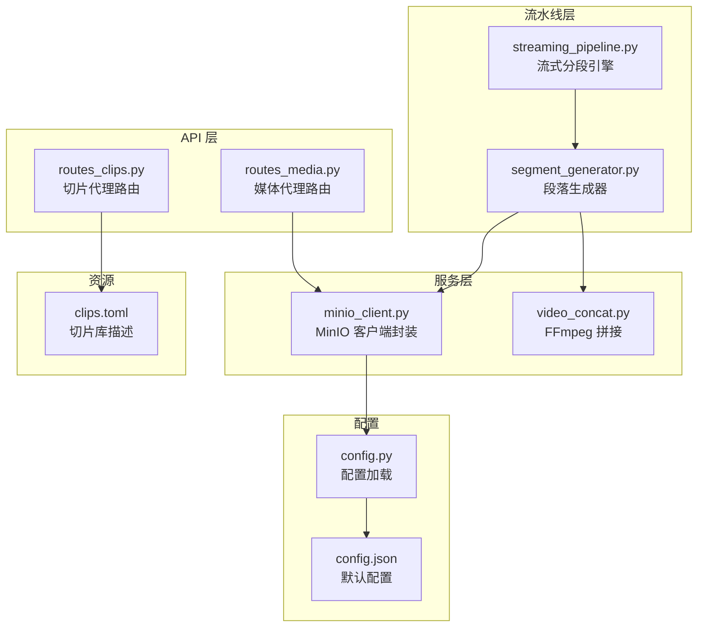
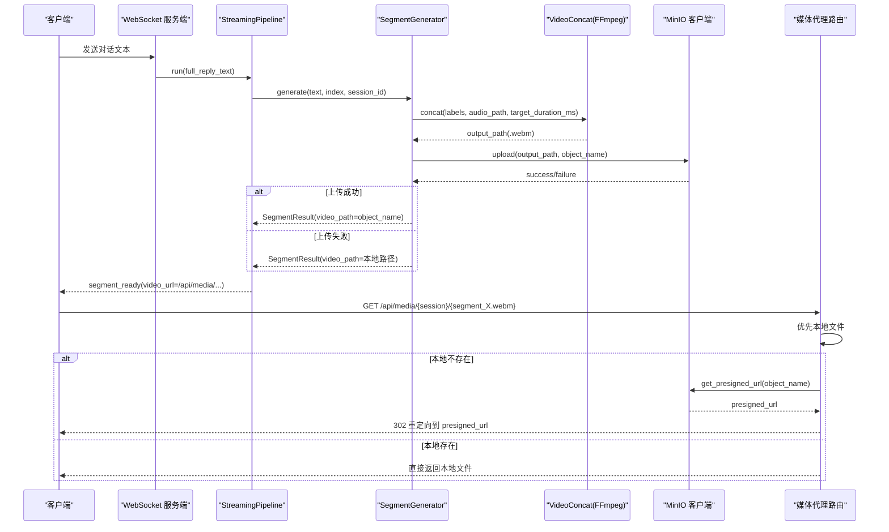
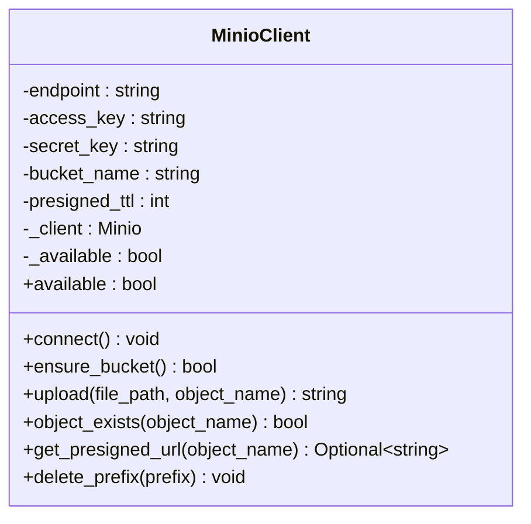
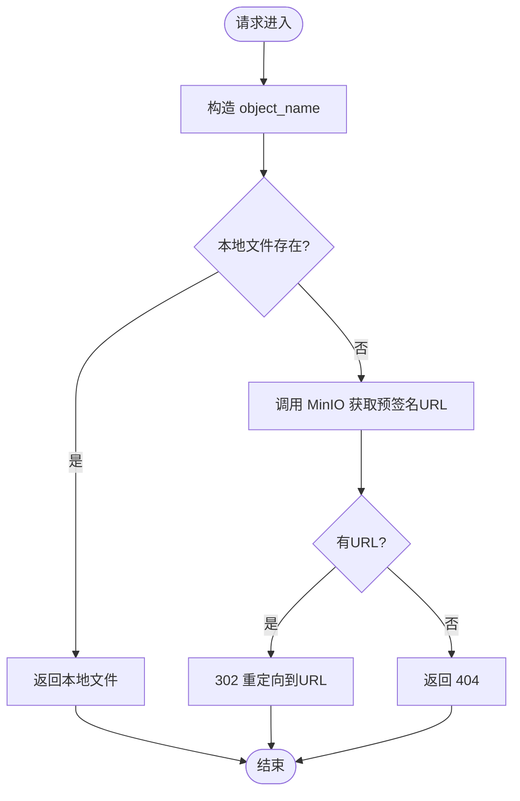
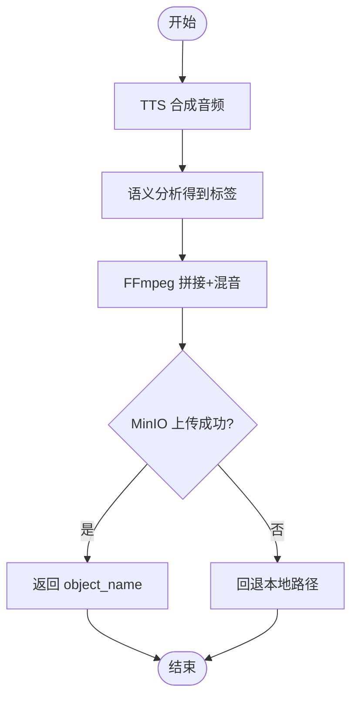
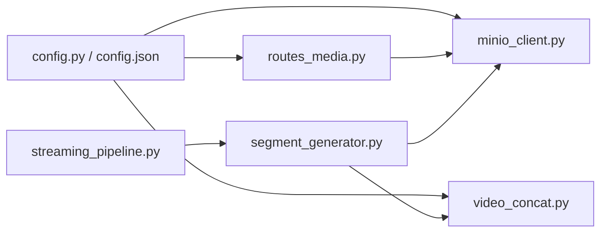

# 对象存储服务集成

<cite>
**本文引用的文件列表**
- [server/services/minio_client.py](file://server/services/minio_client.py)
- [server/api/routes_media.py](file://server/api/routes_media.py)
- [server/config.py](file://server/config.py)
- [config.json](file://config.json)
- [server/pipeline/segment_generator.py](file://server/pipeline/segment_generator.py)
- [server/pipeline/streaming_pipeline.py](file://server/pipeline/streaming_pipeline.py)
- [server/services/video_concat.py](file://server/services/video_concat.py)
- [server/api/routes_clips.py](file://server/api/routes_clips.py)
- [clips/short-hair-teacher-girl/clips.toml](file://clips/short-hair-teacher-girl/clips.toml)
</cite>

## 目录
1. [简介](#简介)
2. [项目结构](#项目结构)
3. [核心组件](#核心组件)
4. [架构总览](#架构总览)
5. [详细组件分析](#详细组件分析)
6. [依赖关系分析](#依赖关系分析)
7. [性能与容量优化](#性能与容量优化)
8. [故障排查指南](#故障排查指南)
9. [结论](#结论)
10. [附录：数字人视频素材存储与检索示例](#附录数字人视频素材存储与检索示例)

## 简介
本技术文档聚焦于 RealTimeTalk 的对象存储服务集成，围绕 MinIO 客户端实现、预签名 URL 生成机制、临时访问权限控制与安全策略、视频片段组织结构与命名规范、元数据管理、错误处理、以及性能调优与成本优化进行系统化说明。同时提供端到端的数据流与调用序列图，帮助读者快速理解从“文本到视频”的流水线如何与对象存储协同工作。

## 项目结构
与对象存储相关的代码主要分布在以下位置：
- 服务层：MinIO 客户端封装、FFmpeg 视频拼接
- API 层：媒体代理路由（本地优先 + MinIO 回退）
- 配置层：MinIO 连接参数、预签名 URL 过期时间等
- 流水线层：段落生成器将生成的视频上传至对象存储
- 切片资源：静态数字人视频切片及描述文件

图表来源
- [server/api/routes_media.py:1-65](file://server/api/routes_media.py#L1-L65)
- [server/services/minio_client.py:1-139](file://server/services/minio_client.py#L1-L139)
- [server/pipeline/segment_generator.py:1-138](file://server/pipeline/segment_generator.py#L1-L138)
- [server/pipeline/streaming_pipeline.py:1-214](file://server/pipeline/streaming_pipeline.py#L1-L214)
- [server/services/video_concat.py:1-174](file://server/services/video_concat.py#L1-L174)
- [server/config.py:1-260](file://server/config.py#L1-L260)
- [config.json:1-39](file://config.json#L1-L39)
- [server/api/routes_clips.py:1-75](file://server/api/routes_clips.py#L1-L75)
- [clips/short-hair-teacher-girl/clips.toml:1-148](file://clips/short-hair-teacher-girl/clips.toml#L1-L148)

章节来源
- [server/api/routes_media.py:1-65](file://server/api/routes_media.py#L1-L65)
- [server/services/minio_client.py:1-139](file://server/services/minio_client.py#L1-L139)
- [server/config.py:1-260](file://server/config.py#L1-L260)
- [config.json:1-39](file://config.json#L1-L39)
- [server/pipeline/segment_generator.py:1-138](file://server/pipeline/segment_generator.py#L1-L138)
- [server/pipeline/streaming_pipeline.py:1-214](file://server/pipeline/streaming_pipeline.py#L1-L214)
- [server/services/video_concat.py:1-174](file://server/services/video_concat.py#L1-L174)
- [server/api/routes_clips.py:1-75](file://server/api/routes_clips.py#L1-L75)
- [clips/short-hair-teacher-girl/clips.toml:1-148](file://clips/short-hair-teacher-girl/clips.toml#L1-L148)

## 核心组件
- MinIO 客户端封装：负责连接、Bucket 存在性检查、上传、对象存在性检查、预签名 URL 生成、前缀批量删除等。
- 媒体代理路由：优先返回本地输出文件，失败时通过 MinIO 预签名 URL 重定向，保证浏览器可直接访问。
- 段落生成器：TTS → 语义分析 → FFmpeg 拼接 → MinIO 上传；上传失败自动回退本地路径。
- 流式分段引擎：并行生成多段，首段就绪即推送，后续按前端确认推进。
- 视频拼接器：基于 FFmpeg concat demuxer 将多个 5 秒切片循环拼接并混入音频。
- 配置系统：支持 JSON 与环境变量合并，MinIO 相关项包括 endpoint、access_key、secret_key、bucket、预签名 TTL 等。

章节来源
- [server/services/minio_client.py:1-139](file://server/services/minio_client.py#L1-L139)
- [server/api/routes_media.py:1-65](file://server/api/routes_media.py#L1-L65)
- [server/pipeline/segment_generator.py:1-138](file://server/pipeline/segment_generator.py#L1-L138)
- [server/pipeline/streaming_pipeline.py:1-214](file://server/pipeline/streaming_pipeline.py#L1-L214)
- [server/services/video_concat.py:1-174](file://server/services/video_concat.py#L1-L174)
- [server/config.py:1-260](file://server/config.py#L1-L260)
- [config.json:1-39](file://config.json#L1-L39)

## 架构总览
下图展示了从“文本到视频”的端到端流程，以及对象存储的参与点。

图表来源
- [server/pipeline/streaming_pipeline.py:44-131](file://server/pipeline/streaming_pipeline.py#L44-L131)
- [server/pipeline/segment_generator.py:42-106](file://server/pipeline/segment_generator.py#L42-L106)
- [server/services/video_concat.py:30-72](file://server/services/video_concat.py#L30-L72)
- [server/services/minio_client.py:69-124](file://server/services/minio_client.py#L69-L124)
- [server/api/routes_media.py:18-64](file://server/api/routes_media.py#L18-L64)

## 详细组件分析

### MinIO 客户端封装
- 连接与可用性
  - 初始化时读取配置，创建 MinIO 客户端实例，设置 secure=False（内网部署）。
  - 提供 available 属性用于快速判断是否可用。
- Bucket 管理
  - ensure_bucket：若 bucket 不存在则创建，记录日志并标记不可用异常场景。
- 文件操作
  - upload：使用 fput_object 上传本地文件到指定 object_name，失败抛出自定义异常。
  - object_exists：stat_object 探测对象是否存在。
  - delete_prefix：列出指定前缀下的所有对象并逐个删除。
- 预签名 URL
  - get_presigned_url：先校验对象存在，再调用 presigned_get_object 生成 GET 链接，过期时间由配置决定。

图表来源
- [server/services/minio_client.py:21-139](file://server/services/minio_client.py#L21-L139)

章节来源
- [server/services/minio_client.py:1-139](file://server/services/minio_client.py#L1-L139)

### 媒体代理路由（本地优先 + MinIO 回退）
- 路由定义：/api/media/{session_token}/{filename:path}
- 处理逻辑：
  - 构造 object_name = sessions/{session_token}/{filename}
  - 优先在 _work/{session_token}/output_{X}.webm 或原始文件名下查找本地文件，直接返回
  - 若本地不存在，尝试通过 MinIO 获取预签名 URL 并重定向
  - 均失败则返回 404

图表来源
- [server/api/routes_media.py:18-64](file://server/api/routes_media.py#L18-L64)

章节来源
- [server/api/routes_media.py:1-65](file://server/api/routes_media.py#L1-L65)

### 段落生成器（TTS → 语义分析 → 拼接 → 上传）
- 输入：文本、段落索引、会话 ID
- 流程：
  - TTS 合成音频并得到时长
  - 语义分析得到标签序列
  - FFmpeg 拼接对应切片并混音，输出 .webm
  - 尝试上传至 MinIO；失败则回退本地路径
- 返回值：包含 video_path（可能是 object_name 或本地路径）、duration_ms、labels 等

图表来源
- [server/pipeline/segment_generator.py:42-106](file://server/pipeline/segment_generator.py#L42-L106)
- [server/services/video_concat.py:30-72](file://server/services/video_concat.py#L30-L72)

章节来源
- [server/pipeline/segment_generator.py:1-138](file://server/pipeline/segment_generator.py#L1-L138)
- [server/services/video_concat.py:1-174](file://server/services/video_concat.py#L1-L174)

### 流式分段引擎（并发与确认式推送）
- 并行生成：使用 asyncio.ensure_future 并行启动各段生成任务
- 首段优先：首段完成后立即推送，降低首帧延迟
- 确认式推进：等待前端 ack_played 后再推送下一段，避免堆积
- 取消机制：支持中断当前 Pipeline

章节来源
- [server/pipeline/streaming_pipeline.py:1-214](file://server/pipeline/streaming_pipeline.py#L1-L214)

### 切片资源与命名规范
- 切片库描述文件 clips.toml 定义了每个切片的文件、标签、优先级、语音提示等
- 切片时长固定为 5 秒，拼接时不足时长会循环最后一个切片填充
- 静态切片通过 /api/clips/{name:path} 提供访问，内部映射到 clips_dir/.webm 或直接子路径

章节来源
- [clips/short-hair-teacher-girl/clips.toml:1-148](file://clips/short-hair-teacher-girl/clips.toml#L1-L148)
- [server/api/routes_clips.py:1-75](file://server/api/routes_clips.py#L1-L75)
- [server/services/video_concat.py:85-114](file://server/services/video_concat.py#L85-L114)

## 依赖关系分析
- 配置依赖
  - MinIO 客户端与媒体路由均依赖配置模块提供的 minio.* 字段
  - 配置来源：config.json 与环境变量合并，环境变量优先
- 运行时依赖
  - FFmpeg 可执行文件路径由配置 ffmpeg.path 指定
  - 网络访问：MinIO 服务地址、端口、凭据由配置提供

图表来源
- [server/config.py:148-241](file://server/config.py#L148-L241)
- [config.json:23-29](file://config.json#L23-L29)
- [server/services/minio_client.py:24-31](file://server/services/minio_client.py#L24-L31)
- [server/services/video_concat.py:23-28](file://server/services/video_concat.py#L23-L28)
- [server/api/routes_media.py:10-11](file://server/api/routes_media.py#L10-L11)
- [server/pipeline/segment_generator.py:27-40](file://server/pipeline/segment_generator.py#L27-L40)
- [server/pipeline/streaming_pipeline.py:16-40](file://server/pipeline/streaming_pipeline.py#L16-L40)

章节来源
- [server/config.py:1-260](file://server/config.py#L1-L260)
- [config.json:1-39](file://config.json#L1-L39)

## 性能与容量优化
- 连接与重试
  - 当前客户端未显式配置连接池与重试策略，建议在生产环境启用底层 SDK 的连接复用与重试，并设置合理的超时与最大连接数
- 缓存策略
  - 媒体代理路由优先本地文件，减少跨网络访问；对于频繁访问的切片，可在 Nginx 或 CDN 层开启缓存
- CDN 集成
  - 预签名 URL 指向 MinIO 直连地址，生产建议将 MinIO 接入 CDN，利用边缘缓存提升下载性能
- 分片与断点续传
  - 当前实现使用单对象上传（fput_object），不支持分片与断点续传；大文件场景建议引入 multipart upload 与 resume 能力
- 生命周期与成本优化
  - 建议在 MinIO 侧配置生命周期策略，对历史会话对象设置过期清理，避免无限增长
- 并发与批处理
  - 流水线已采用并行生成与确认式推进，注意限制并发度以避免后端过载
- 监控与告警
  - 增加上传成功率、预签名 URL 命中率、对象大小分布等指标，辅助容量规划

[本节为通用指导，不直接分析具体文件]

## 故障排查指南
- 网络中断
  - 现象：上传失败、预签名 URL 生成失败
  - 定位：查看 MinIO 客户端日志与 S3Error 信息；检查 endpoint、access_key、secret_key 是否正确
- 权限不足
  - 现象：bucket_exists/make_bucket/remove_object/presigned_get_object 报错
  - 定位：确认 MinIO 用户具备相应桶与对象的读写权限
- 存储空间不足
  - 现象：上传时报错或返回空结果
  - 定位：检查 MinIO 集群磁盘使用率与配额策略
- 本地回退生效
  - 现象：返回本地路径而非 object_name
  - 定位：确认 MinIO 可用性标志与上传异常捕获逻辑

章节来源
- [server/services/minio_client.py:44-63](file://server/services/minio_client.py#L44-L63)
- [server/services/minio_client.py:88-90](file://server/services/minio_client.py#L88-L90)
- [server/services/minio_client.py:122-124](file://server/services/minio_client.py#L122-L124)
- [server/pipeline/segment_generator.py:98-106](file://server/pipeline/segment_generator.py#L98-L106)

## 结论
RealTimeTalk 的对象存储集成以 MinIO 为核心，结合本地优先的媒体代理路由与预签名 URL 机制，实现了高可用的视频片段分发。流水线采用并行生成与确认式推进，兼顾低延迟与稳定性。针对大文件与长期运行场景，建议引入分片上传、断点续传、CDN 加速与生命周期策略，以提升性能与降低成本。

[本节为总结性内容，不直接分析具体文件]

## 附录：数字人视频素材存储与检索示例
- 存储流程（端到端）
  - 文本进入后，分段生成器完成 TTS、语义分析、FFmpeg 拼接，生成 segment_X.webm
  - 尝试上传至 MinIO，object_name 形如 sessions/{session_id}/segment_{X}.webm
  - 上传失败则保留本地 _work/{session_id}/output_{X}.webm
- 检索流程（端到端）
  - 客户端请求 /api/media/{session_id}/segment_{X}.webm
  - 服务器优先返回本地文件；不存在则通过 MinIO 获取预签名 URL 并重定向
- 切片资源访问
  - 静态切片通过 /api/clips/{name:path} 访问，内部映射到 clips_dir/.webm 或直接子路径
- 安全与时效
  - 预签名 URL 有效期由配置 minio.presigned_url_ttl_seconds 控制，默认 600 秒
  - 建议根据业务需求调整 TTL，并在网关层限制来源 IP 与速率

章节来源
- [server/pipeline/segment_generator.py:86-106](file://server/pipeline/segment_generator.py#L86-L106)
- [server/api/routes_media.py:30-64](file://server/api/routes_media.py#L30-L64)
- [server/api/routes_clips.py:17-74](file://server/api/routes_clips.py#L17-L74)
- [server/config.py:210-216](file://server/config.py#L210-L216)
- [config.json:23-29](file://config.json#L23-L29)