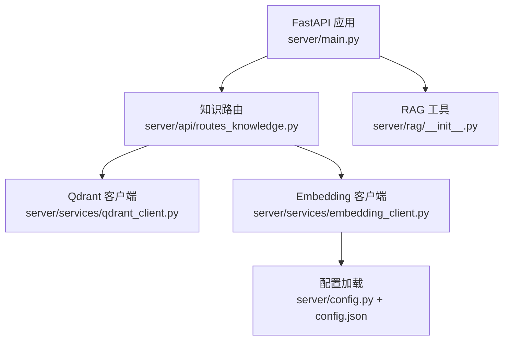
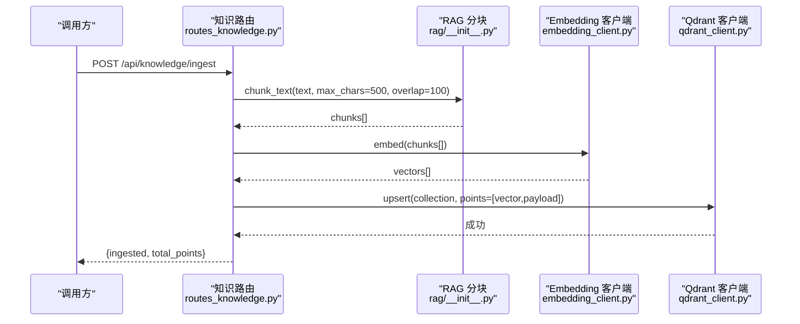
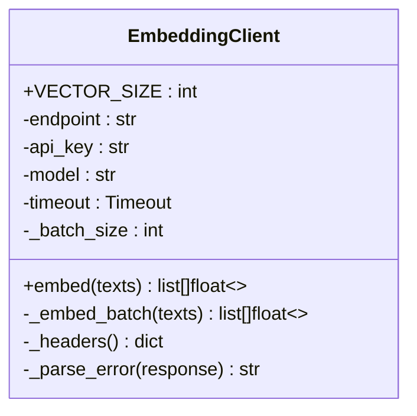
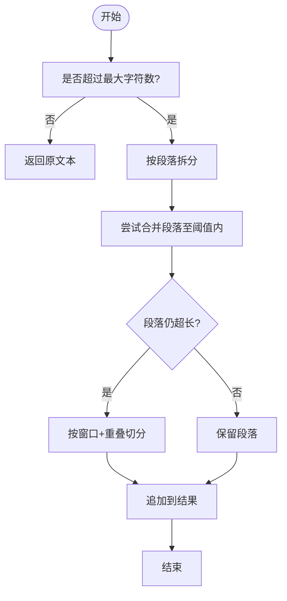
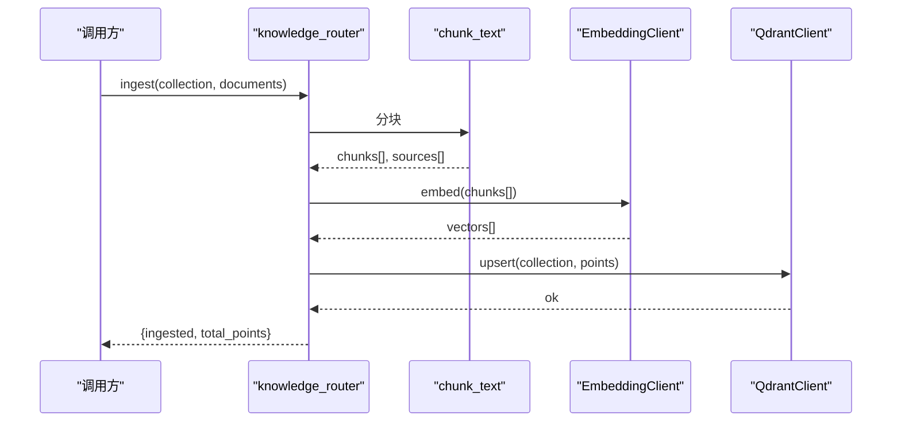
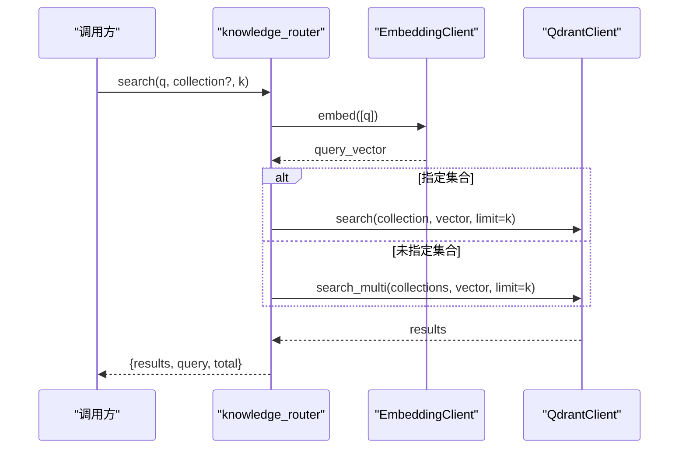
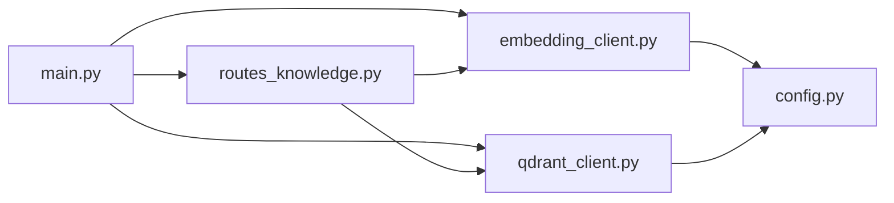

# 嵌入服务集成

<cite>
**本文引用的文件**
- [server/services/embedding_client.py](file://server/services/embedding_client.py)
- [server/config.py](file://server/config.py)
- [config.json](file://config.json)
- [server/api/routes_knowledge.py](file://server/api/routes_knowledge.py)
- [server/rag/__init__.py](file://server/rag/__init__.py)
- [server/services/qdrant_client.py](file://server/services/qdrant_client.py)
- [server/main.py](file://server/main.py)
</cite>

## 目录
1. [简介](#简介)
2. [项目结构](#项目结构)
3. [核心组件](#核心组件)
4. [架构总览](#架构总览)
5. [详细组件分析](#详细组件分析)
6. [依赖关系分析](#依赖关系分析)
7. [性能与优化](#性能与优化)
8. [故障排查指南](#故障排查指南)
9. [结论](#结论)
10. [附录：配置与使用示例](#附录配置与使用示例)

## 简介
本技术文档聚焦于 RealTimeTalk 的文本嵌入服务集成，面向开发者提供从客户端实现、批量处理、模型选择到错误处理的完整说明。文档涵盖以下主题：
- 文本向量化与批量处理流程
- 模型选择策略与配置项（维度、归一化、精度）
- 文本预处理（分块、去噪、长度控制）
- 批量请求优化（分批、重试、结果聚合）
- 知识库文档转向量表示的使用路径
- 模型版本管理、A/B 测试与基准测试方法建议
- 错误处理机制（鉴权失败、超时、连接异常等）
- 模型选择与调优指南

## 项目结构
嵌入相关代码主要分布在服务端 services、api、rag 与配置模块中，并通过 FastAPI 应用生命周期进行初始化与注入。

图表来源
- [server/main.py:70-87](file://server/main.py#L70-L87)
- [server/api/routes_knowledge.py:33-37](file://server/api/routes_knowledge.py#L33-L37)
- [server/services/qdrant_client.py:26-34](file://server/services/qdrant_client.py#L26-L34)
- [server/services/embedding_client.py:26-40](file://server/services/embedding_client.py#L26-L40)
- [server/config.py:148-241](file://server/config.py#L148-L241)
- [config.json:1-39](file://config.json#L1-L39)

章节来源
- [server/main.py:70-87](file://server/main.py#L70-L87)
- [server/api/routes_knowledge.py:33-37](file://server/api/routes_knowledge.py#L33-L37)
- [server/services/qdrant_client.py:26-34](file://server/services/qdrant_client.py#L26-L34)
- [server/services/embedding_client.py:26-40](file://server/services/embedding_client.py#L26-L40)
- [server/config.py:148-241](file://server/config.py#L148-L241)
- [config.json:1-39](file://config.json#L1-L39)

## 核心组件
- EmbeddingClient：封装 DashScope 文本嵌入 HTTP 调用，支持批量输入、自动分批、重试与错误解析。
- QdrantClient：封装 Qdrant REST API，负责集合管理与向量检索。
- RAG 工具：提供文本分块与上下文构建能力。
- 配置系统：统一加载 JSON 与环境变量，提供 embedding 相关配置项。
- 知识路由：暴露入库、搜索、统计等接口，串联分块、嵌入与写入流程。

章节来源
- [server/services/embedding_client.py:26-149](file://server/services/embedding_client.py#L26-L149)
- [server/services/qdrant_client.py:26-235](file://server/services/qdrant_client.py#L26-L235)
- [server/rag/__init__.py:10-83](file://server/rag/__init__.py#L10-L83)
- [server/config.py:62-123](file://server/config.py#L62-L123)
- [server/api/routes_knowledge.py:134-186](file://server/api/routes_knowledge.py#L134-L186)

## 架构总览
下图展示了“知识库入库”的关键调用链：前端或管理员通过 REST 接口提交文档，后端按段落切块，批量调用嵌入服务生成向量，再写入 Qdrant 集合。

图表来源
- [server/api/routes_knowledge.py:134-186](file://server/api/routes_knowledge.py#L134-L186)
- [server/rag/__init__.py:10-53](file://server/rag/__init__.py#L10-L53)
- [server/services/embedding_client.py:47-70](file://server/services/embedding_client.py#L47-L70)
- [server/services/qdrant_client.py:115-134](file://server/services/qdrant_client.py#L115-L134)

## 详细组件分析

### EmbeddingClient（文本嵌入客户端）
- 功能要点
  - 构造时从配置读取 endpoint、api_key、model，并设置 httpx 超时与批大小。
  - embed() 对输入列表进行分批（默认每批最多 10 条），顺序拼接结果。
  - _embed_batch() 发送 POST 到 /embeddings，按 index 排序确保返回顺序一致。
  - 内置重试逻辑：针对 429、5xx、超时、连接错误等进行一次重试；非可重试错误直接抛出。
  - 错误解析：优先从响应体 error.message 提取信息，否则截取响应文本前 300 字符。
- 关键数据结构
  - 输入：texts: list[str]
  - 输出：list[list[float]]，每个向量维度由模型决定（当前常量 VECTOR_SIZE = 1024）
- 复杂度与性能
  - 时间复杂度 O(N)，N 为文本数量；受网络 I/O 影响显著。
  - 空间复杂度 O(N*D)，D 为向量维度。
- 错误处理
  - 自定义异常 EmbeddingClientError，携带 status_code 便于上层区分处理。
  - 覆盖鉴权失败、限流、服务端错误、超时、连接失败等场景。

图表来源
- [server/services/embedding_client.py:26-149](file://server/services/embedding_client.py#L26-L149)

章节来源
- [server/services/embedding_client.py:26-149](file://server/services/embedding_client.py#L26-L149)

### 配置系统（Embedding 配置项）
- 配置来源优先级：环境变量 > config.json > 默认值
- Embedding 相关字段
  - embedding_endpoint：嵌入服务端点
  - embedding_api_key：鉴权密钥
  - embedding_model：模型名称（如 text-embedding-v3）
- 全局 get_config() 懒加载，避免重复 IO

章节来源
- [server/config.py:62-123](file://server/config.py#L62-L123)
- [server/config.py:148-241](file://server/config.py#L148-L241)
- [config.json:1-39](file://config.json#L1-L39)

### 文本预处理（分块与上下文构建）
- 分块策略
  - 优先按段落（双换行）合并，不超过 max_chars（默认 500）。
  - 单段落超长时，按窗口滑动切分，重叠 overlap（默认 100）。
- 上下文构建
  - 将检索结果过滤低分后拼接为提示上下文，供 LLM 使用。

图表来源
- [server/rag/__init__.py:10-53](file://server/rag/__init__.py#L10-L53)

章节来源
- [server/rag/__init__.py:10-83](file://server/rag/__init__.py#L10-L83)

### 知识摄入流程（入库）
- 入口：POST /api/knowledge/ingest
- 步骤
  1) 校验参数（collection、documents）
  2) 调用 RAG 分块
  3) 批量调用 EmbeddingClient.embed()
  4) 组装 points（id、vector、payload）
  5) 调用 QdrantClient.upsert() 写入
  6) 返回 ingested 与 total_points

图表来源
- [server/api/routes_knowledge.py:134-186](file://server/api/routes_knowledge.py#L134-L186)
- [server/rag/__init__.py:10-53](file://server/rag/__init__.py#L10-L53)
- [server/services/embedding_client.py:47-70](file://server/services/embedding_client.py#L47-L70)
- [server/services/qdrant_client.py:115-134](file://server/services/qdrant_client.py#L115-L134)

章节来源
- [server/api/routes_knowledge.py:134-186](file://server/api/routes_knowledge.py#L134-L186)

### 查询与检索流程
- 调试搜索：GET /api/knowledge/search?q=&collection=&k=
- 步骤
  1) 调用 EmbeddingClient.embed([query]) 获取 query_vector
  2) 若指定 collection，则单集检索；否则并发多集检索并合并排序
  3) 格式化返回 score、text、source、collection

图表来源
- [server/api/routes_knowledge.py:233-267](file://server/api/routes_knowledge.py#L233-L267)
- [server/services/qdrant_client.py:164-186](file://server/services/qdrant_client.py#L164-L186)
- [server/services/embedding_client.py:47-70](file://server/services/embedding_client.py#L47-L70)

章节来源
- [server/api/routes_knowledge.py:233-267](file://server/api/routes_knowledge.py#L233-L267)
- [server/services/qdrant_client.py:164-186](file://server/services/qdrant_client.py#L164-L186)

## 依赖关系分析
- 启动期初始化
  - main.py 在 lifespan 中创建 EmbeddingClient 与 QdrantClient，并将实例注入到 knowledge_router 与 AgentEngine。
- 运行时依赖
  - routes_knowledge.py 依赖 qdrant_client 与 embedding_client 完成入库与检索。
  - embedding_client 依赖 config.get_config() 获取 endpoint、api_key、model。
  - qdrant_client 依赖 config.get_config() 获取 url、api_key。

图表来源
- [server/main.py:70-87](file://server/main.py#L70-L87)
- [server/api/routes_knowledge.py:33-37](file://server/api/routes_knowledge.py#L33-L37)
- [server/services/embedding_client.py:32-40](file://server/services/embedding_client.py#L32-L40)
- [server/services/qdrant_client.py:29-34](file://server/services/qdrant_client.py#L29-L34)
- [server/config.py:148-241](file://server/config.py#L148-L241)

章节来源
- [server/main.py:70-87](file://server/main.py#L70-L87)
- [server/api/routes_knowledge.py:33-37](file://server/api/routes_knowledge.py#L33-L37)
- [server/services/embedding_client.py:32-40](file://server/services/embedding_client.py#L32-L40)
- [server/services/qdrant_client.py:29-34](file://server/services/qdrant_client.py#L29-L34)
- [server/config.py:148-241](file://server/config.py#L148-L241)

## 性能与优化
- 批量处理
  - EmbeddingClient 内部按固定批次（默认 10）串行分批，保证顺序与稳定性。
  - 建议在业务层对大批量入库做异步任务调度，避免阻塞主线程。
- 重试与退避
  - 对 429、5xx、超时、连接错误进行一次重试，间隔 1-2 秒。
  - 可根据实际 QPS 限制调整重试次数与退避策略。
- 并行检索
  - QdrantClient.search_multi 并发检索多个集合，合并后排序取 top_k。
- 超时与连接池
  - httpx.Timeout 已设置整体与连接超时，生产环境建议复用 AsyncClient 连接池以降低握手开销。
- 内存与带宽
  - 大文档入库前务必分块，避免单次 payload 过大导致超时或丢包。
- 监控指标建议
  - 记录每次 embed 的耗时、成功率、失败原因分布、平均向量维度一致性。
  - 监控 Qdrant upsert 吞吐与延迟。

[本节为通用指导，不直接分析具体文件]

## 故障排查指南
- 常见错误分类
  - 鉴权失败（401/403）：检查 embedding_api_key 是否正确，且具备对应权限。
  - 限流（429）：降低批量大小或增加重试间隔；评估上游配额。
  - 服务端错误（5xx）：观察服务端日志，必要时重试。
  - 超时/连接失败：检查网络连通性与 endpoint 可达性；适当增大超时。
- 定位步骤
  1) 查看路由层日志，确认入参与分块结果。
  2) 检查 EmbeddingClient 的错误消息与状态码。
  3) 验证 Qdrant 集合是否存在、维度是否匹配。
  4) 复现最小用例：单条文本嵌入 + 单点写入。
- 恢复策略
  - 幂等写入：入库前生成稳定 id，避免重复数据。
  - 断点续传：记录已处理索引，失败后从断点继续。
  - 降级方案：当嵌入服务不可用时，返回友好提示并允许稍后重试。

章节来源
- [server/services/embedding_client.py:99-135](file://server/services/embedding_client.py#L99-L135)
- [server/api/routes_knowledge.py:184-186](file://server/api/routes_knowledge.py#L184-L186)

## 结论
RealTimeTalk 的嵌入服务集成以 EmbeddingClient 为核心，结合 RAG 分块与 Qdrant 向量存储，形成完整的知识库入库与检索链路。通过合理的批量策略、重试机制与错误处理，可在高可用前提下满足实时对话的知识增强需求。后续可在模型版本管理、A/B 测试与基准评测方面进一步完善，以支撑更复杂的业务场景。

[本节为总结性内容，不直接分析具体文件]

## 附录：配置与使用示例

### 配置项说明（嵌入相关）
- embedding_endpoint：嵌入服务端点（例如兼容 OpenAI 格式的 DashScope 端点）
- embedding_api_key：鉴权密钥
- embedding_model：模型名称（如 text-embedding-v3）
- 其他：可通过环境变量覆盖，优先级高于 config.json

章节来源
- [server/config.py:115-123](file://server/config.py#L115-L123)
- [server/config.py:148-241](file://server/config.py#L148-L241)
- [config.json:1-39](file://config.json#L1-L39)

### 使用示例：将知识库文档转换为向量表示
- 步骤
  1) 准备文档列表，包含 text 与 source 字段。
  2) 调用 POST /api/knowledge/ingest，传入 collection 与 documents。
  3) 后端自动分块、批量嵌入、写入 Qdrant。
  4) 返回 ingested 与 total_points 用于确认。
- 参考路径
  - 路由定义与处理：[server/api/routes_knowledge.py:134-186](file://server/api/routes_knowledge.py#L134-L186)
  - 分块函数：[server/rag/__init__.py:10-53](file://server/rag/__init__.py#L10-L53)
  - 嵌入调用：[server/services/embedding_client.py:47-70](file://server/services/embedding_client.py#L47-L70)
  - 写入 Qdrant：[server/services/qdrant_client.py:115-134](file://server/services/qdrant_client.py#L115-L134)

章节来源
- [server/api/routes_knowledge.py:134-186](file://server/api/routes_knowledge.py#L134-L186)
- [server/rag/__init__.py:10-53](file://server/rag/__init__.py#L10-L53)
- [server/services/embedding_client.py:47-70](file://server/services/embedding_client.py#L47-L70)
- [server/services/qdrant_client.py:115-134](file://server/services/qdrant_client.py#L115-L134)

### 模型选择与调优指南
- 维度与归一化
  - 当前客户端常量 VECTOR_SIZE = 1024，需与 Qdrant 集合维度保持一致。
  - 若更换模型，请同步更新集合 vector_size 与客户端常量。
- 精度与召回
  - 根据业务语义粒度调整分块大小与重叠比例，平衡上下文完整性与检索效率。
  - 检索阈值与 top_k 可按场景微调。
- 版本管理与 A/B 测试
  - 通过 embedding_model 配置切换不同模型版本。
  - 建议建立离线评测集，对比不同模型的相似度质量与延迟。
- 基准测试方法
  - 设计固定数据集，测量端到端入库耗时、检索延迟与准确率。
  - 记录资源占用（CPU/GPU/内存）与 QPS，作为容量规划依据。

章节来源
- [server/services/embedding_client.py:29-30](file://server/services/embedding_client.py#L29-L30)
- [server/services/qdrant_client.py:37-59](file://server/services/qdrant_client.py#L37-L59)
- [server/api/routes_knowledge.py:105-117](file://server/api/routes_knowledge.py#L105-L117)