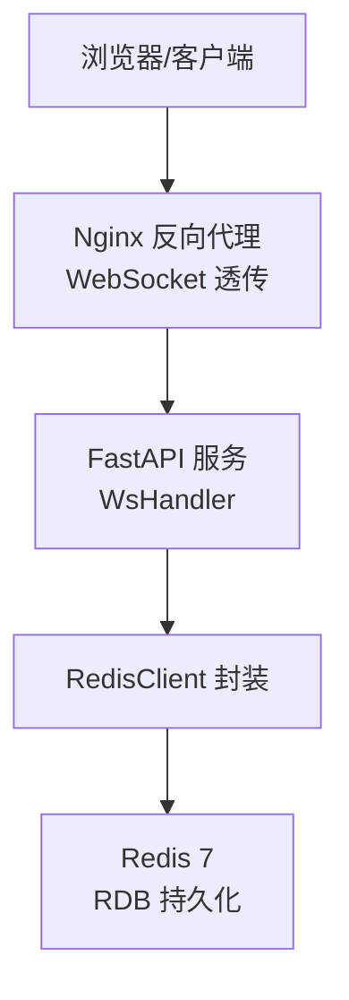
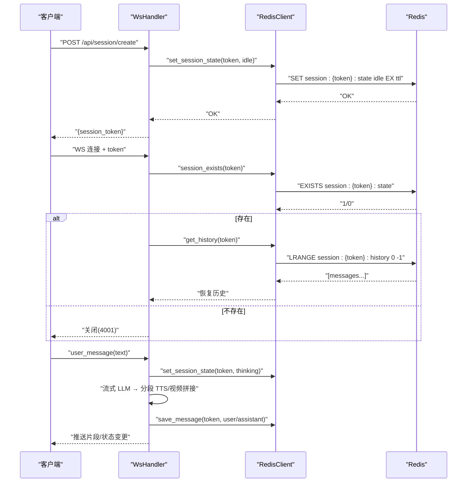
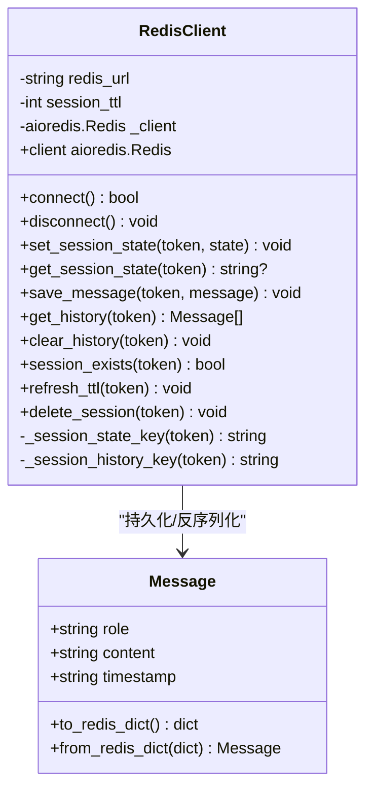
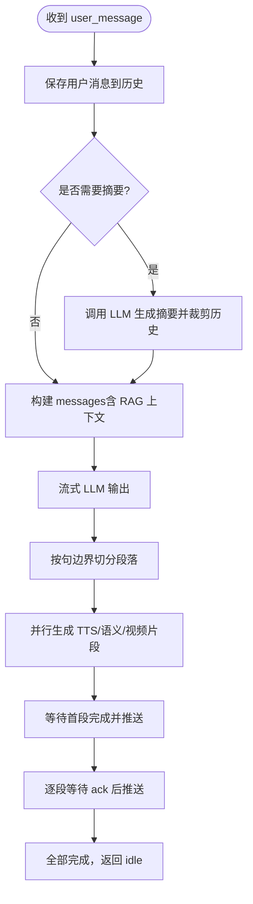
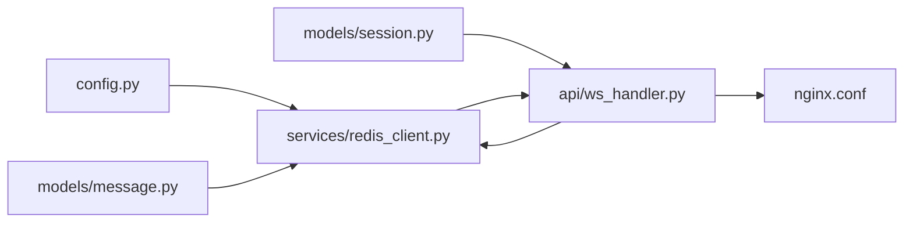

# 缓存服务集成

<cite>
**本文引用的文件**
- [server/services/redis_client.py](file://server/services/redis_client.py)
- [server/api/ws_handler.py](file://server/api/ws_handler.py)
- [server/models/session.py](file://server/models/session.py)
- [server/models/message.py](file://server/models/message.py)
- [server/config.py](file://server/config.py)
- [docker-compose.yml](file://docker-compose.yml)
- [nginx.conf](file://nginx.conf)
- [doc/tech-spec.md](file://doc/tech-spec.md)
</cite>

## 目录
1. [简介](#简介)
2. [项目结构](#项目结构)
3. [核心组件](#核心组件)
4. [架构总览](#架构总览)
5. [详细组件分析](#详细组件分析)
6. [依赖关系分析](#依赖关系分析)
7. [性能与容量规划](#性能与容量规划)
8. [故障排查指南](#故障排查指南)
9. [结论](#结论)
10. [附录](#附录)

## 简介
本技术文档聚焦于 RealTimeTalk 的 Redis 缓存服务集成，围绕会话状态管理、对话历史持久化、键空间设计、TTL 过期策略与清理机制展开。同时说明分布式锁与消息队列在现有实现中的现状与建议方案，并提供连接池配置、集群部署与高可用保障建议、数据持久化（AOF/RDB）策略以及监控与排障方法。

## 项目结构
Redis 相关能力集中在服务端模块中：
- Redis 客户端封装：提供异步连接、会话状态读写、对话历史存取、生命周期管理等 API。
- WebSocket 处理器：在会话建立、重连恢复、状态同步时与 Redis 交互。
- 会话上下文模型：定义会话状态枚举与上下文数据结构。
- 消息模型：定义对话消息结构与序列化/反序列化方法。
- 配置加载：统一从环境变量与配置文件合并生成运行时配置，包含 Redis URL 与会话 TTL。
- 容器编排：通过 docker-compose 启动 Redis 并挂载数据卷以实现 RDB 持久化。
- Nginx 反向代理：转发 WebSocket 请求到后端服务。

图表来源
- [server/api/ws_handler.py:1-120](file://server/api/ws_handler.py#L1-L120)
- [server/services/redis_client.py:1-62](file://server/services/redis_client.py#L1-L62)
- [docker-compose.yml:11-17](file://docker-compose.yml#L11-L17)
- [nginx.conf:45-55](file://nginx.conf#L45-L55)

章节来源
- [server/services/redis_client.py:1-122](file://server/services/redis_client.py#L1-L122)
- [server/api/ws_handler.py:1-120](file://server/api/ws_handler.py#L1-L120)
- [server/models/session.py:1-41](file://server/models/session.py#L1-L41)
- [server/models/message.py:1-33](file://server/models/message.py#L1-L33)
- [server/config.py:1-260](file://server/config.py#L1-L260)
- [docker-compose.yml:1-69](file://docker-compose.yml#L1-L69)
- [nginx.conf:45-55](file://nginx.conf#L45-L55)

## 核心组件
- Redis 客户端封装
  - 异步连接与可用性探测（ping）。
  - 会话状态 key 的 set/get/ex 操作。
  - 对话历史以列表形式追加与读取，附带 TTL 刷新。
  - 会话存在性检查、TTL 刷新、会话删除等生命周期工具。
- WebSocket 处理器
  - 新连接校验与重连恢复：基于 Redis 中的会话状态判断是否可恢复。
  - 会话状态同步：将 thinking/speaking/idle 等状态写入 Redis，供多实例共享。
  - 错误处理与状态重置：异常路径下回写 idle 状态。
- 会话上下文与消息模型
  - 会话状态枚举与上下文对象，承载当前活跃 pipeline、ws 引用等。
  - 消息对象的 JSON 序列化用于 Redis 存储。

章节来源
- [server/services/redis_client.py:22-122](file://server/services/redis_client.py#L22-L122)
- [server/api/ws_handler.py:49-128](file://server/api/ws_handler.py#L49-L128)
- [server/models/session.py:14-41](file://server/models/session.py#L14-L41)
- [server/models/message.py:9-33](file://server/models/message.py#L9-L33)

## 架构总览
下图展示了实时对话流程中与 Redis 的关键交互点：创建会话、状态同步、历史持久化与重连恢复。

图表来源
- [server/api/ws_handler.py:49-128](file://server/api/ws_handler.py#L49-L128)
- [server/services/redis_client.py:64-122](file://server/services/redis_client.py#L64-L122)

## 详细组件分析

### Redis 客户端封装（RedisClient）
- 连接与认证
  - 解析 redis_url，支持用户名、密码、端口与 DB 号；设置 decode_responses=True 与 protocol=2。
  - 使用 ping 验证连通性，失败抛出自定义异常。
- 键空间设计
  - 会话状态：session:{token}:state（字符串，带 TTL）。
  - 对话历史：session:{token}:history（列表，元素为 JSON 序列化的 Message）。
- 会话状态管理
  - set/get/exists/refresh_ttl/delete_session 等方法，统一封装对 state/history 的操作。
- 对话历史持久化
  - save_message：rpush 追加消息，expire 刷新 TTL。
  - get_history：lrange 全量读取并反序列化为 Message 列表。
  - clear_history：删除历史列表。
- 错误处理
  - 未连接时访问 client 属性抛出自定义异常；JSON 解析失败记录警告日志。

图表来源
- [server/services/redis_client.py:22-122](file://server/services/redis_client.py#L22-L122)
- [server/models/message.py:9-33](file://server/models/message.py#L9-L33)

章节来源
- [server/services/redis_client.py:22-122](file://server/services/redis_client.py#L22-L122)
- [server/models/message.py:9-33](file://server/models/message.py#L9-L33)

### WebSocket 处理器（WsHandler）与 Redis 集成
- 连接生命周期
  - 新建连接：若内存无会话，则查询 Redis 是否存在该 token 的 state key；不存在则拒绝连接。
  - 重连恢复：从 Redis 拉取历史并重建 ConversationManager。
- 状态同步
  - 进入思考/说话/空闲等状态时，立即写入 Redis 的 state key，确保多实例一致性。
- 错误与中断
  - 异常或用户取消时，重置状态为 idle 并推送前端状态变更。

图表来源
- [server/api/ws_handler.py:130-341](file://server/api/ws_handler.py#L130-L341)
- [server/services/redis_client.py:82-104](file://server/services/redis_client.py#L82-L104)

章节来源
- [server/api/ws_handler.py:49-128](file://server/api/ws_handler.py#L49-L128)
- [server/api/ws_handler.py:130-341](file://server/api/ws_handler.py#L130-L341)
- [server/services/redis_client.py:82-104](file://server/services/redis_client.py#L82-L104)

### 会话上下文与消息模型
- 会话上下文
  - 包含 token、状态、创建时间、ConversationManager、StreamingPipeline、WebSocket 引用等。
  - 提供 is_active 判断是否处于非 idle 状态。
- 消息模型
  - 提供 to_redis_dict/from_redis_dict 用于 JSON 序列化与反序列化。

章节来源
- [server/models/session.py:14-41](file://server/models/session.py#L14-L41)
- [server/models/message.py:9-33](file://server/models/message.py#L9-L33)

### 配置与环境
- 配置来源与优先级
  - 环境变量优先覆盖 config.json；Redis 相关项包括 url 与会话 TTL（小时）。
- 运行时注入
  - WsHandler 与 RedisClient 均通过全局配置获取 Redis URL 与 TTL。

章节来源
- [server/config.py:73-260](file://server/config.py#L73-L260)
- [server/services/redis_client.py:25-29](file://server/services/redis_client.py#L25-L29)
- [server/api/ws_handler.py:47-47](file://server/api/ws_handler.py#L47-L47)

### 分布式锁（现状与建议）
- 现状
  - 代码库中未发现显式的分布式锁实现。
- 建议方案
  - 使用 SETNX/SET ... NX EX 实现互斥锁，配合 Lua 脚本原子释放，避免死锁。
  - 针对“单实例内同一 token 仅允许一个 Pipeline”的场景，可在内存字典加锁即可；跨实例需引入 Redis 锁。
  - 注意锁粒度与超时时间，避免长事务导致锁竞争。

[本节为概念性内容，不直接分析具体文件]

### 消息队列（现状与建议）
- 现状
  - 未使用独立消息队列；对话历史通过 Redis 列表进行顺序追加与读取，具备简单队列特性。
- 建议方案
  - 对于高吞吐场景，可引入专用 MQ（如 RabbitMQ/Kafka），将“文本→TTS→视频拼接→推送”解耦为任务队列。
  - 若继续使用 Redis，可使用 Streams 或 List+Pub/Sub 组合，提升可靠性与扩展性。

[本节为概念性内容，不直接分析具体文件]

## 依赖关系分析
- 组件耦合
  - WsHandler 依赖 RedisClient 进行状态与历史读写。
  - RedisClient 依赖配置模块获取连接参数与 TTL。
  - 会话上下文与消息模型被 RedisClient 与 WsHandler 共同使用。
- 外部依赖
  - Redis 7（默认 RDB 持久化）。
  - Nginx 负责 WebSocket 代理与长连接超时设置。

图表来源
- [server/config.py:206-239](file://server/config.py#L206-L239)
- [server/services/redis_client.py:25-29](file://server/services/redis_client.py#L25-L29)
- [server/models/message.py:9-33](file://server/models/message.py#L9-L33)
- [server/models/session.py:14-41](file://server/models/session.py#L14-L41)
- [server/api/ws_handler.py:47-47](file://server/api/ws_handler.py#L47-L47)
- [nginx.conf:45-55](file://nginx.conf#L45-L55)

章节来源
- [server/config.py:206-239](file://server/config.py#L206-L239)
- [server/services/redis_client.py:25-29](file://server/services/redis_client.py#L25-L29)
- [server/models/message.py:9-33](file://server/models/message.py#L9-L33)
- [server/models/session.py:14-41](file://server/models/session.py#L14-L41)
- [server/api/ws_handler.py:47-47](file://server/api/ws_handler.py#L47-L47)
- [nginx.conf:45-55](file://nginx.conf#L45-L55)

## 性能与容量规划
- 键空间与内存占用
  - 每个会话两个 key：state（短字符串）、history（列表，元素为 JSON 字符串）。
  - 历史长度受会话 TTL 控制，建议结合业务峰值估算最大历史条目数与平均消息大小。
- TTL 与过期策略
  - 会话 TTL 由配置决定（小时），写入 state/history 时设置过期时间；活跃会话可通过 refresh_ttl 延长。
  - 建议定期刷新活跃会话的 TTL，避免长时间交互导致意外过期。
- 连接池与并发
  - 当前使用单个 aioredis.Redis 实例；在高并发场景建议启用连接池（pool_size、max_idle_time 等），并根据 QPS 调整。
- 集群与高可用
  - 生产环境建议使用 Redis Cluster 或 Sentinel，结合客户端重试与故障转移。
  - 注意跨节点迁移时的 key 分布与热点键问题。
- 持久化策略
  - 默认启用 RDB 快照；如需更强持久性与更细粒度恢复，可开启 AOF（appendonly=yes，fsync 策略按需选择）。
  - 参考技术规格文档中的默认 RDB 策略说明。

章节来源
- [server/services/redis_client.py:72-116](file://server/services/redis_client.py#L72-L116)
- [server/config.py:206-209](file://server/config.py#L206-L209)
- [doc/tech-spec.md:564-564](file://doc/tech-spec.md#L564-L564)

## 故障排查指南
- 连接问题
  - 现象：连接失败或不可用。
  - 排查：确认 REDIS_URL 格式正确（含用户名/密码/端口/DB），网络可达，Redis 服务正常；查看连接日志与 ping 结果。
- 会话无法恢复
  - 现象：重连后无历史或提示会话不存在。
  - 排查：检查 session:{token}:state 是否存在；确认 history 列表未被清理；核对 TTL 是否过短。
- 历史丢失或不完整
  - 现象：重启后部分历史缺失。
  - 排查：确认 RDB/AOF 已启用且数据卷挂载成功；检查 Redis 崩溃前的持久化策略与 fsync 频率。
- 性能瓶颈
  - 现象：延迟升高、CPU/内存占用高。
  - 排查：使用 SLOWLOG 定位慢查询；监控内存使用与碎片率；评估历史列表长度与消息大小；考虑分页读取或滚动窗口。
- WebSocket 断开
  - 现象：客户端频繁断线。
  - 排查：检查 Nginx 的 proxy_read_timeout 与 Upgrade 头设置；确认后端心跳与状态同步逻辑。

章节来源
- [server/services/redis_client.py:31-50](file://server/services/redis_client.py#L31-L50)
- [server/api/ws_handler.py:57-84](file://server/api/ws_handler.py#L57-L84)
- [nginx.conf:45-55](file://nginx.conf#L45-L55)
- [doc/tech-spec.md:564-564](file://doc/tech-spec.md#L564-L564)

## 结论
本项目通过 Redis 实现了轻量级的会话状态管理与对话历史持久化，满足实时对话的基本需求。建议在以下方面持续优化：引入连接池与集群部署以提升可扩展性与高可用；根据业务规模完善分布式锁与消息队列；结合 AOF/RDB 与监控体系保障数据安全与可观测性。

## 附录

### 键空间与数据结构
- 会话状态
  - Key：session:{token}:state
  - 类型：字符串
  - 值：idle/thinking/speaking/bridging
  - TTL：由配置决定（秒）
- 对话历史
  - Key：session:{token}:history
  - 类型：列表
  - 元素：JSON 序列化的 Message（role/content/timestamp）
  - TTL：与 state 一致，写入时刷新

章节来源
- [server/services/redis_client.py:66-104](file://server/services/redis_client.py#L66-L104)
- [server/models/message.py:19-33](file://server/models/message.py#L19-L33)

### 使用示例（路径引用）
- 创建会话并初始化状态
  - 参考：[server/api/routes_session.py:28-47](file://server/api/routes_session.py#L28-L47)
- 重连恢复会话历史
  - 参考：[server/api/ws_handler.py:61-84](file://server/api/ws_handler.py#L61-L84)
- 写入会话状态与历史
  - 参考：[server/services/redis_client.py:72-104](file://server/services/redis_client.py#L72-L104)
- 刷新 TTL 与删除会话
  - 参考：[server/services/redis_client.py:112-122](file://server/services/redis_client.py#L112-L122)

### 部署与持久化
- Docker Compose 中 Redis 服务与数据卷
  - 参考：[docker-compose.yml:11-17](file://docker-compose.yml#L11-L17)
- 默认 RDB 持久化策略说明
  - 参考：[doc/tech-spec.md:564-564](file://doc/tech-spec.md#L564-L564)