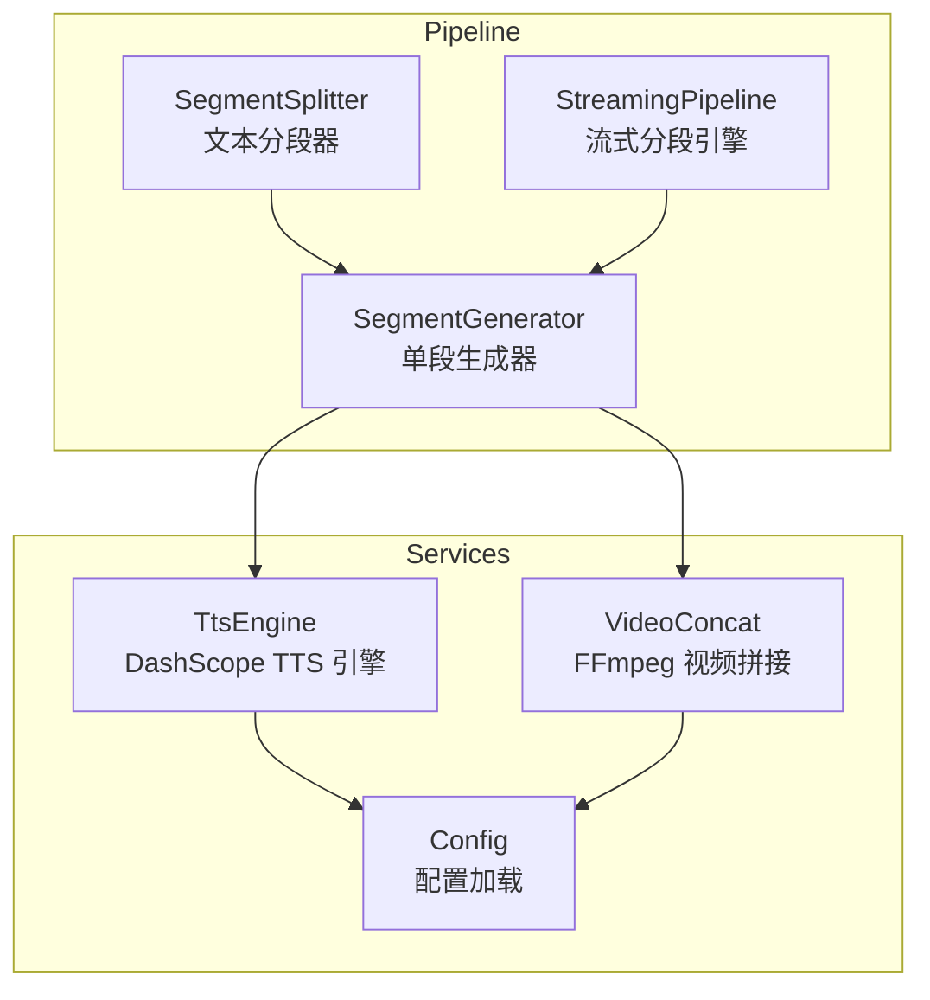
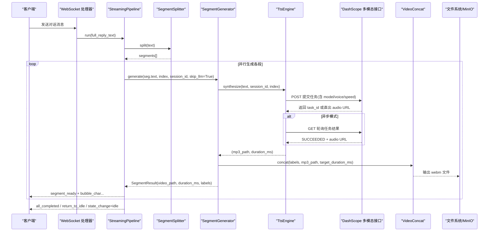
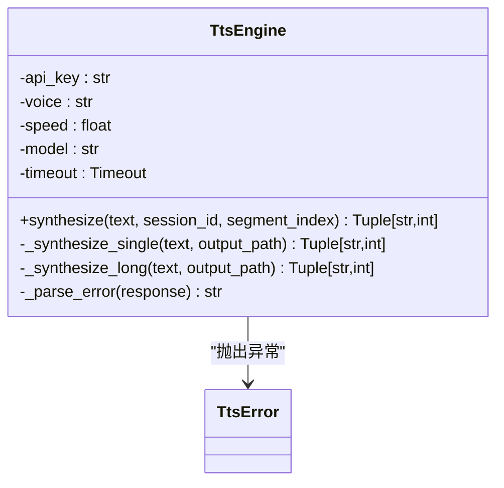
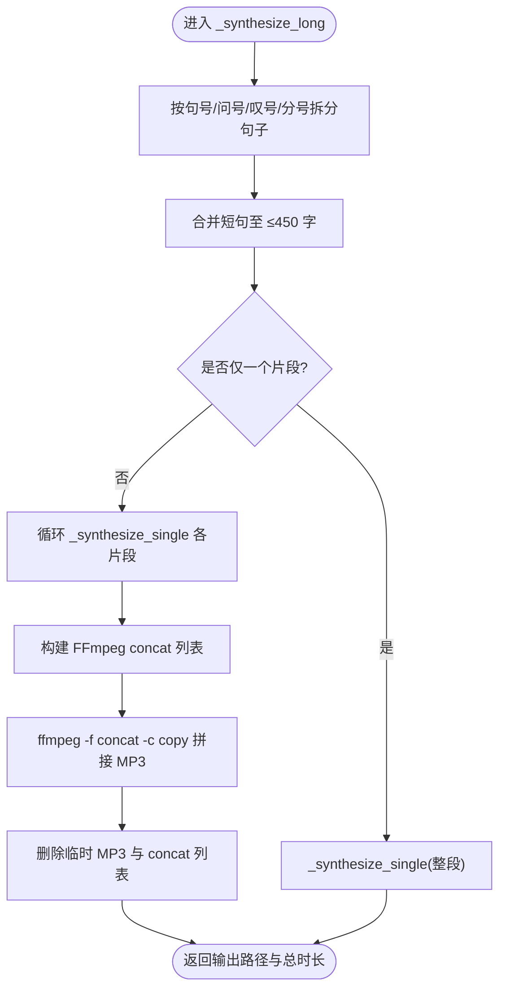
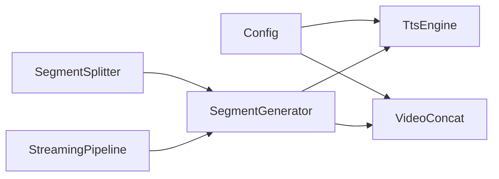

# TTS 语音合成

<cite>
**本文引用的文件列表**
- [tts_engine.py](file://server/services/tts_engine.py)
- [segment_splitter.py](file://server/pipeline/segment_splitter.py)
- [streaming_pipeline.py](file://server/pipeline/streaming_pipeline.py)
- [segment_generator.py](file://server/pipeline/segment_generator.py)
- [video_concat.py](file://server/services/video_concat.py)
- [config.py](file://server/config.py)
- [config.json](file://config.json)
</cite>

## 目录
1. [简介](#简介)
2. [项目结构](#项目结构)
3. [核心组件](#核心组件)
4. [架构总览](#架构总览)
5. [详细组件分析](#详细组件分析)
6. [依赖关系分析](#依赖关系分析)
7. [性能与并发控制](#性能与并发控制)
8. [故障排查指南](#故障排查指南)
9. [结论](#结论)
10. [附录：配置与使用示例](#附录配置与使用示例)

## 简介
本技术文档聚焦于 RealTimeTalk 的 TTS 语音合成模块，围绕 DashScope 多模态生成接口（兼容 Qwen-TTS 与 CosyVoice）的集成实现展开。文档覆盖以下关键点：
- 异步任务提交、结果轮询与错误处理机制
- 长文本分段合成算法（句子边界识别、450 字限制、FFmpeg 拼接）
- 并发控制（信号量限流）与性能优化策略
- 音频格式转换、时长估算与临时文件清理
- API 限流、网络超时与音频质量优化建议
- 面向初学者的调用示例与面向资深开发者的深度解析

## 项目结构
TTS 相关代码主要分布在 services 与 pipeline 两个层次：
- services：封装外部服务与工具能力（如 TTS 引擎、视频拼接）
- pipeline：编排端到端流程（文本切段、并行生成、WebSocket 推送）

图表来源
- [segment_splitter.py:1-95](file://server/pipeline/segment_splitter.py#L1-L95)
- [segment_generator.py:1-138](file://server/pipeline/segment_generator.py#L1-L138)
- [streaming_pipeline.py:1-214](file://server/pipeline/streaming_pipeline.py#L1-L214)
- [tts_engine.py:1-234](file://server/services/tts_engine.py#L1-L234)
- [video_concat.py:1-174](file://server/services/video_concat.py#L1-L174)
- [config.py:1-260](file://server/config.py#L1-L260)

章节来源
- [segment_splitter.py:1-95](file://server/pipeline/segment_splitter.py#L1-L95)
- [segment_generator.py:1-138](file://server/pipeline/segment_generator.py#L1-L138)
- [streaming_pipeline.py:1-214](file://server/pipeline/streaming_pipeline.py#L1-L214)
- [tts_engine.py:1-234](file://server/services/tts_engine.py#L1-L234)
- [video_concat.py:1-174](file://server/services/video_concat.py#L1-L174)
- [config.py:1-260](file://server/config.py#L1-L260)

## 核心组件
- TtsEngine：封装 DashScope 多模态生成接口的调用、异步任务轮询、错误处理、长文本拆分与 FFmpeg 拼接；提供 synthesize 方法作为统一入口。
- SegmentSplitter：按中文标点将文本切分为段落，保证每段以完整句子结尾，并满足最小阈值。
- SegmentGenerator：串联 TTS → 语义分析 → 视频拼接 → 上传 MinIO 的完整链路，返回结构化结果。
- StreamingPipeline：接收完整回复文本，分句切段后并行生成，首段就绪即推送，后续逐段确认式推进，最终回到待机状态。
- VideoConcat：根据标签选择切片、构建 concat 列表、执行 FFmpeg 合并与混音，支持 GPU 编码器检测预留。
- Config：集中管理配置项，支持环境变量与 JSON 合并，TTS 相关字段包括 api_key、voice、speed。

章节来源
- [tts_engine.py:1-234](file://server/services/tts_engine.py#L1-L234)
- [segment_splitter.py:1-95](file://server/pipeline/segment_splitter.py#L1-L95)
- [segment_generator.py:1-138](file://server/pipeline/segment_generator.py#L1-L138)
- [streaming_pipeline.py:1-214](file://server/pipeline/streaming_pipeline.py#L1-L214)
- [video_concat.py:1-174](file://server/services/video_concat.py#L1-L174)
- [config.py:1-260](file://server/config.py#L1-L260)

## 架构总览
下图展示了从文本到音视频输出的整体数据流与控制流，突出 TTS 在其中的位置与关键交互点。

图表来源
- [streaming_pipeline.py:44-131](file://server/pipeline/streaming_pipeline.py#L44-L131)
- [segment_splitter.py:31-76](file://server/pipeline/segment_splitter.py#L31-L76)
- [segment_generator.py:42-137](file://server/pipeline/segment_generator.py#L42-L137)
- [tts_engine.py:49-167](file://server/services/tts_engine.py#L49-L167)
- [video_concat.py:30-72](file://server/services/video_concat.py#L30-L72)

## 详细组件分析

### TtsEngine：DashScope TTS 集成与长文本处理
- 模型与音色映射：通过 VOICE_MODEL_MAP 将不同 voice 绑定至 qwen3-tts-flash 或 cosyvoice-v3-flash。
- 请求头与参数：设置 Authorization、Content-Type、X-DashScope-Async=disable；payload 包含 model、input{text, voice}、parameters{format, sample_rate, speech_rate}。
- 异步任务流程：
  - 提交任务：POST 多模态生成接口，若直接返回 audio URL 则下载并落盘；否则获取 task_id。
  - 轮询结果：GET 任务查询接口，等待 SUCCEEDED 或 FAILED，失败抛出 TtsError。
  - 音频下载：强制 HTTPS 访问 OSS 地址，避免 HTTP 被拒绝。
  - 时长估算：基于文件大小与假设码率（约 128kbps）粗略估算毫秒级时长。
- 长文本处理：
  - 句子边界识别：按“。！？；”拆分，确保每段以完整句子结尾。
  - 450 字限制：超过阈值时拆分为多个 ≤450 字的片段。
  - 分段合成与拼接：依次合成各片段 MP3，再使用 FFmpeg concat demuxer 拼接为单个 MP3，最后清理临时文件。
- 并发控制：全局 asyncio.Semaphore(3) 限制同时发起的 TTS 请求数，避免触发 429 限流。
- 错误处理：对 HTTP 非 200、任务失败、超时等场景均抛出 TtsError，便于上层捕获与回退。

图表来源
- [tts_engine.py:38-234](file://server/services/tts_engine.py#L38-L234)

章节来源
- [tts_engine.py:1-234](file://server/services/tts_engine.py#L1-L234)

#### 长文本分段合成流程图

图表来源
- [tts_engine.py:169-226](file://server/services/tts_engine.py#L169-L226)

### SegmentSplitter：中文文本分段
- 分割规则：以“。！？；”为句子分隔符，保留标点；累计长度达到阈值（默认 50）形成一段；尾部不足阈值的单独成段。
- 返回值：Segment(index, text) 列表，保证每段以完整句子结尾。
- 适用场景：上游 LLM 输出较长时，先进行合理切段，再交由 SegmentGenerator 并行生成。

章节来源
- [segment_splitter.py:1-95](file://server/pipeline/segment_splitter.py#L1-L95)

### SegmentGenerator：单段生成流水线
- 步骤：
  1) TTS 合成：调用 TtsEngine.synthesize，得到 MP3 路径与时长。
  2) 语义分析：调用 SemanticAnalyzer.analyze，得到标签序列（labels）。
  3) 视频拼接：调用 VideoConcat.concat，依据 labels 选择切片并混入音频，输出 webm。
  4) 上传 MinIO：成功则返回 MinIO key，失败回退本地路径。
- 异常处理：捕获 TtsError、VideoConcatError 及通用异常，返回带 error 信息的 SegmentResult。

章节来源
- [segment_generator.py:1-138](file://server/pipeline/segment_generator.py#L1-L138)

### StreamingPipeline：流式分段与推送
- 首段优先：首段完成后立即推送 segment_ready 与打字机气泡，不等后续段。
- 并行生成：所有段使用 asyncio.ensure_future 并行启动，提升吞吐。
- 确认式推进：等待前端 ack_played 后再推送下一段，避免播放拥塞。
- 事件类型：segment_ready、bubble_char、bubble_dismiss、all_completed、return_to_idle、state_change、error。
- 取消机制：支持 cancel() 中断当前 Pipeline。

章节来源
- [streaming_pipeline.py:1-214](file://server/pipeline/streaming_pipeline.py#L1-L214)

### VideoConcat：FFmpeg 视频拼接与混音
- 切片选择：根据 labels 查找对应 .webm 切片文件，缺失则跳过并告警。
- 时长对齐：每个切片固定 5 秒，不足目标时长时循环填充最后一个切片。
- 命令执行：使用 concat demuxer 拷贝视频流，Opus 编码音频流，-shortest 控制输出时长。
- 错误处理：超时、找不到 ffmpeg、非零返回码均抛出 VideoConcatError。

章节来源
- [video_concat.py:1-174](file://server/services/video_concat.py#L1-L174)

### Config：TTS 配置项与环境变量
- TTS 配置键：tts.api_key、tts.voice、tts.speed。
- 环境变量覆盖：DASHSCOPE_API_KEY、TTS_VOICE、TTS_SPEED 可覆盖 config.json。
- 默认值：voice 默认为 Cherry，speed 默认为 1.0。

章节来源
- [config.py:23-27](file://server/config.py#L23-L27)
- [config.py:87-91](file://server/config.py#L87-L91)
- [config.py:195-199](file://server/config.py#L195-L199)
- [config.json:8-12](file://config.json#L8-L12)

## 依赖关系分析
- TtsEngine 依赖 httpx 进行异步 HTTP 请求，依赖 get_config 读取 TTS 配置。
- SegmentGenerator 组合 TtsEngine、SemanticAnalyzer、VideoConcat、MinioClient。
- StreamingPipeline 组合 SegmentSplitter 与 SegmentGenerator，并通过 WebSocket 与前端交互。
- VideoConcat 依赖系统 ffmpeg 可执行文件，通过 subprocess 调用。

图表来源
- [tts_engine.py:1-234](file://server/services/tts_engine.py#L1-L234)
- [segment_generator.py:1-138](file://server/pipeline/segment_generator.py#L1-L138)
- [streaming_pipeline.py:1-214](file://server/pipeline/streaming_pipeline.py#L1-L214)
- [video_concat.py:1-174](file://server/services/video_concat.py#L1-L174)
- [config.py:1-260](file://server/config.py#L1-L260)

## 性能与并发控制
- 并发限流：TtsEngine 使用全局信号量限制并发请求数（默认 3），有效降低 429 限流概率。可根据实际配额调整。
- 首段优先与并行生成：StreamingPipeline 首段完成后立即推送，其余段后台并行生成，显著降低首帧延迟。
- 时长估算：基于文件大小与假设码率估算，快速用于前端节奏控制；如需精确时长，可在后端增加 ffprobe 探测。
- 视频拼接优化：concat demuxer 采用流拷贝（-c:v copy），避免重编码；音频使用 Opus 编码，兼顾体积与质量。
- 临时文件清理：长文本拼接后及时删除中间 MP3 与 concat 列表，减少磁盘占用。

[本节为通用性能讨论，不直接分析具体文件]

## 故障排查指南
- API 限流（429）：
  - 现象：任务提交失败或轮询频繁失败。
  - 排查：检查并发信号量大小与业务峰值；适当降低并发或提高间隔重试。
  - 参考：TtsEngine 中的信号量与错误解析逻辑。
- 网络超时：
  - 现象：HTTP 请求或任务轮询超时。
  - 排查：检查网络连通性与 DashScope 服务状态；增大 httpx.Timeout 或轮询次数。
  - 参考：TtsEngine 的超时设置与轮询循环。
- FFmpeg 不可用：
  - 现象：VideoConcat 报错找不到可执行文件或执行失败。
  - 排查：确认 ffmpeg 已安装且 PATH 正确；检查 concat 列表路径与权限。
  - 参考：VideoConcat 的错误分支。
- 音频质量：
  - 现象：合成声音失真或卡顿。
  - 排查：检查采样率与语速参数；必要时调整 codec 与比特率。
  - 参考：TtsEngine 的 parameters 配置。

章节来源
- [tts_engine.py:100-167](file://server/services/tts_engine.py#L100-L167)
- [video_concat.py:116-149](file://server/services/video_concat.py#L116-L149)

## 结论
RealTimeTalk 的 TTS 模块通过统一的 TtsEngine 抽象了 DashScope 多模态生成接口，结合长文本分段与 FFmpeg 拼接，实现了稳定高效的语音合成。配合 StreamingPipeline 的首段优先与确认式推进，以及全局信号量的并发控制，系统在低延迟与高吞吐之间取得良好平衡。对于生产环境，建议进一步引入精确时长探测、更细粒度的重试与退避策略，以及完善的监控与告警。

[本节为总结性内容，不直接分析具体文件]

## 附录：配置与使用示例

### 配置项说明
- tts.api_key：DashScope API Key，可从环境变量 DASHSCOPE_API_KEY 或 config.json 的 tts.api_key 注入。
- tts.voice：音色名称，影响模型选择（Cherry/Stella → qwen3-tts-flash；longanyang/longxiaoxia → cosyvoice-v3-flash）。
- tts.speed：语速系数，默认 1.0。

章节来源
- [config.py:23-27](file://server/config.py#L23-L27)
- [config.py:87-91](file://server/config.py#L87-L91)
- [config.json:8-12](file://config.json#L8-L12)

### 调用 synthesize 方法示例（路径引用）
- 基本调用：传入待合成文本、会话 ID、段落序号，返回 (mp3 文件路径, 时长毫秒)。
- 长文本自动处理：超过 450 字自动分段合成并拼接。
- 异常处理：捕获 TtsError 进行降级或重试。

章节来源
- [tts_engine.py:49-76](file://server/services/tts_engine.py#L49-L76)
- [tts_engine.py:169-226](file://server/services/tts_engine.py#L169-L226)

### 常见参数与行为
- 模型与音色映射：VOICE_MODEL_MAP 决定 voice 对应的模型。
- 请求头：Authorization、Content-Type、X-DashScope-Async=disable。
- 参数：format=mp3、sample_rate=24000、speech_rate=tts.speed。
- 轮询策略：最多 60 次，每次间隔 1s，SUCCEEDED 返回 audio URL，FAILED 抛出错误。

章节来源
- [tts_engine.py:29-35](file://server/services/tts_engine.py#L29-L35)
- [tts_engine.py:80-98](file://server/services/tts_engine.py#L80-L98)
- [tts_engine.py:128-167](file://server/services/tts_engine.py#L128-L167)

### 长文本分段算法要点
- 句子边界识别：按“。！？；”拆分，确保每段以完整句子结尾。
- 450 字限制：超过阈值时拆分为多个片段，分别合成后拼接。
- FFmpeg 拼接：使用 concat demuxer 将多个 MP3 合并为一个文件，随后清理临时文件。

章节来源
- [tts_engine.py:169-226](file://server/services/tts_engine.py#L169-L226)

### 并发控制与性能优化
- 信号量限流：全局 Semaphore(3) 控制并发 TTS 请求，避免 429。
- 首段优先：StreamingPipeline 首段完成后立即推送，缩短首帧延迟。
- 并行生成：所有段并行启动，充分利用 I/O 并发。
- 视频拼接优化：视频流拷贝，音频 Opus 编码，减少 CPU 开销。

章节来源
- [tts_engine.py:16-17](file://server/services/tts_engine.py#L16-L17)
- [streaming_pipeline.py:66-94](file://server/pipeline/streaming_pipeline.py#L66-L94)
- [video_concat.py:116-149](file://server/services/video_concat.py#L116-L149)

### 音频格式转换、时长估算与临时文件清理
- 格式：输入为 MP3，输出为 WebM（视频）+ Opus 音频。
- 时长估算：基于文件大小与假设码率估算毫秒级时长，用于前端节奏控制。
- 临时文件：长文本拼接后删除中间 MP3 与 concat 列表，避免磁盘泄漏。

章节来源
- [tts_engine.py:154-159](file://server/services/tts_engine.py#L154-L159)
- [tts_engine.py:221-226](file://server/services/tts_engine.py#L221-L226)
- [video_concat.py:116-149](file://server/services/video_concat.py#L116-L149)

### 常见问题与解决方案
- API 限流：降低并发、增加重试与退避、监控 429 指标。
- 网络超时：增大超时时间、检查网络与代理、记录失败日志。
- 音频质量：调整采样率与语速、评估 codec 与比特率、必要时引入 ffprobe 精确时长。

章节来源
- [tts_engine.py:100-167](file://server/services/tts_engine.py#L100-L167)
- [video_concat.py:116-149](file://server/services/video_concat.py#L116-L149)