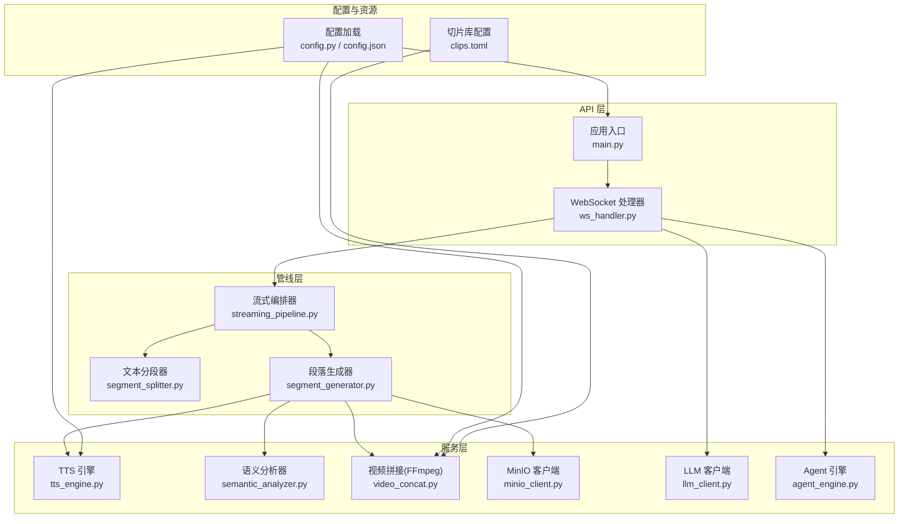
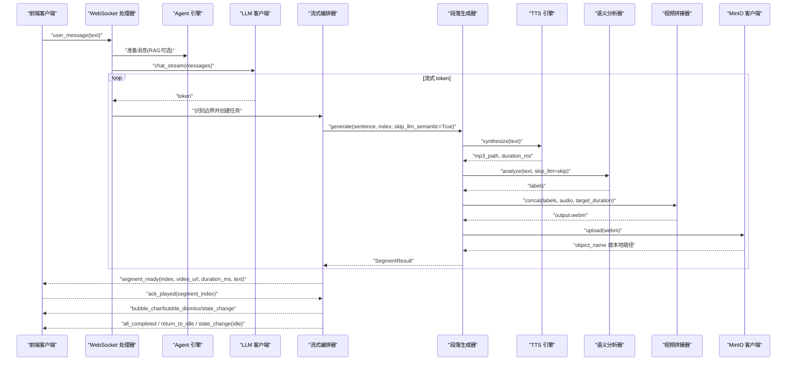
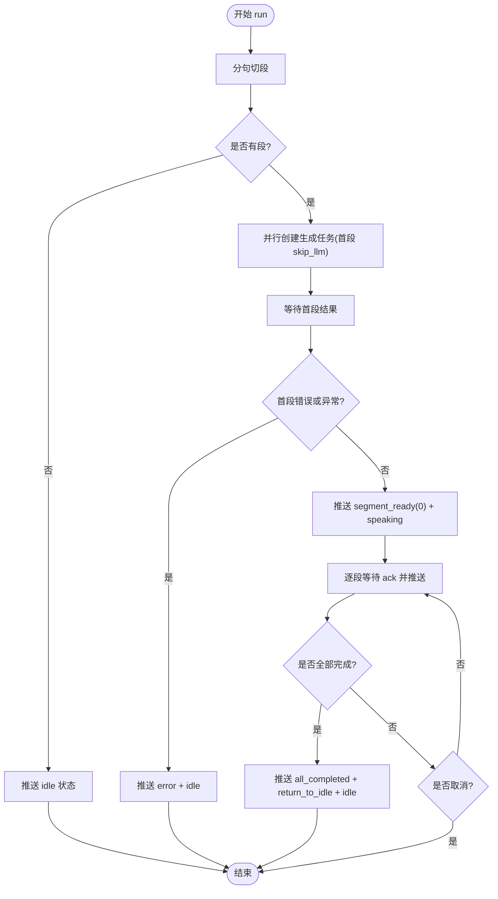
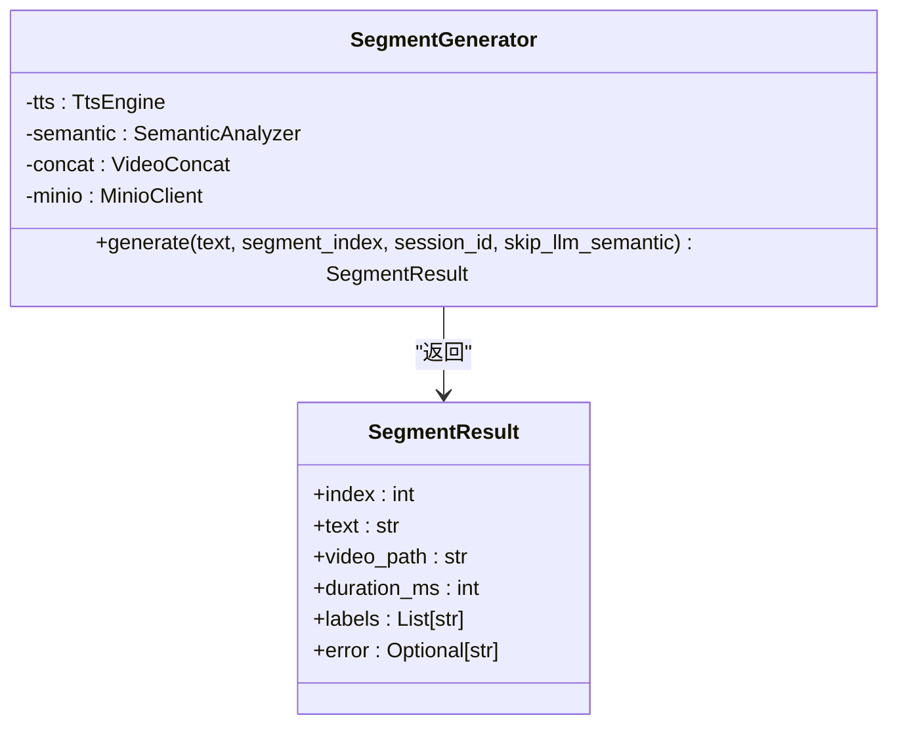
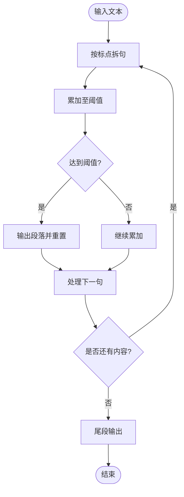
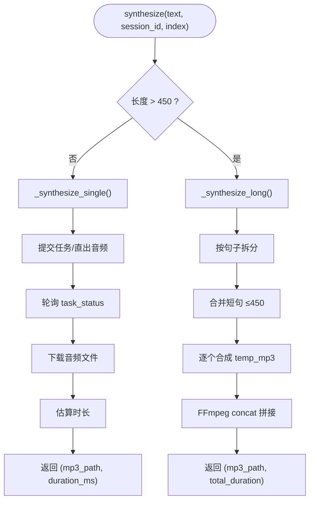
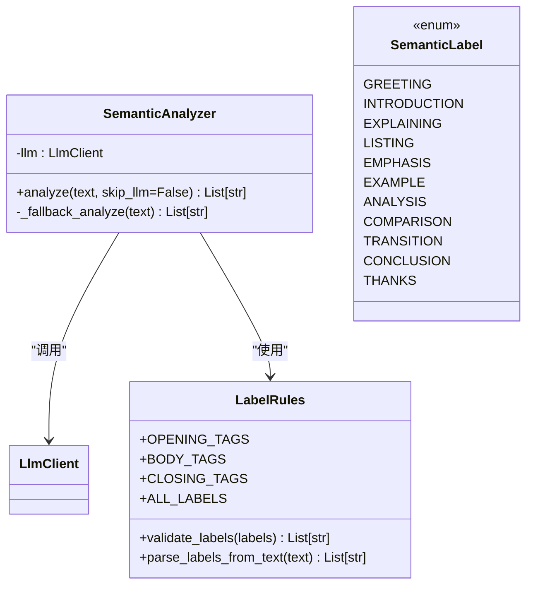
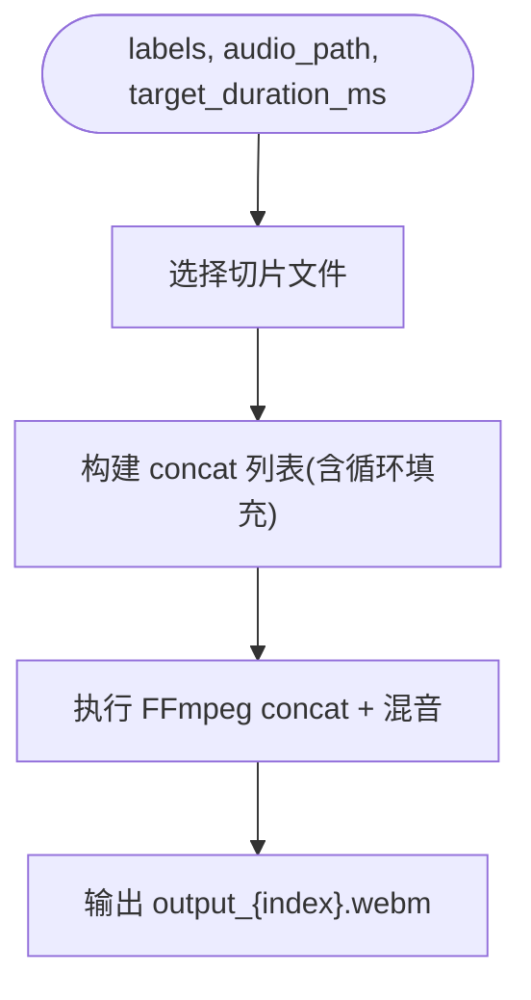
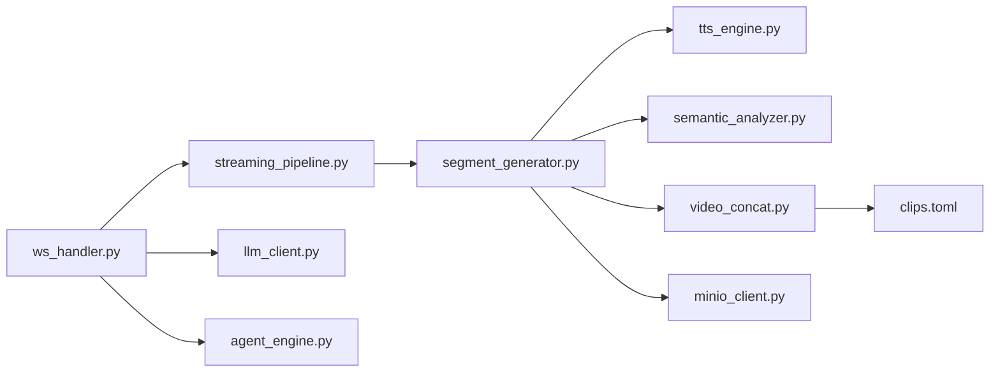

# 多媒体处理流水线

<cite>
**本文引用的文件**   
- [server/main.py](file://server/main.py)
- [server/config.py](file://server/config.py)
- [config.json](file://config.json)
- [server/api/ws_handler.py](file://server/api/ws_handler.py)
- [server/pipeline/streaming_pipeline.py](file://server/pipeline/streaming_pipeline.py)
- [server/pipeline/segment_generator.py](file://server/pipeline/segment_generator.py)
- [server/pipeline/segment_splitter.py](file://server/pipeline/segment_splitter.py)
- [server/services/tts_engine.py](file://server/services/tts_engine.py)
- [server/services/semantic_analyzer.py](file://server/services/semantic_analyzer.py)
- [server/models/semantic_label.py](file://server/models/semantic_label.py)
- [server/services/video_concat.py](file://server/services/video_concat.py)
- [clips/short-hair-teacher-girl/clips.toml](file://clips/short-hair-teacher-girl/clips.toml)
- [server/services/minio_client.py](file://server/services/minio_client.py)
- [server/services/llm_client.py](file://server/services/llm_client.py)
- [server/agent/agent_engine.py](file://server/agent/agent_engine.py)
</cite>

## 目录
1. [简介](#简介)
2. [项目结构](#项目结构)
3. [核心组件](#核心组件)
4. [架构总览](#架构总览)
5. [详细组件分析](#详细组件分析)
6. [依赖关系分析](#依赖关系分析)
7. [性能与优化](#性能与优化)
8. [故障排查指南](#故障排查指南)
9. [结论](#结论)
10. [附录：集成新 TTS 与自定义语义策略](#附录集成新-tts-与自定义语义策略)

## 简介
本技术文档围绕 RealTimeTalk 的多媒体处理流水线，系统性阐述从“文本到音视频”的端到端实现。重点覆盖：
- TTS 语音合成（并发控制、长文本拼接、参数调节）
- 语义分析与标签分类（LLM + 关键词回退、标签过渡规则）
- 视频片段选择与 FFmpeg 拼接（时长对齐、混音、无缝切换）
- WebSocket 流式推送与首段加速（跳过 LLM 语义分析）
- MinIO 对象存储与本地回退
- FFmpeg 工具链与 GPU 编码器检测预留
- 面向初学者的使用指引与面向资深开发者的深度扩展点

## 项目结构
RealTimeTalk 采用分层模块化组织：
- API 层：FastAPI 路由与 WebSocket 处理器
- 管线层：分段器、生成器、流式编排
- 服务层：TTS、语义分析、视频拼接、MinIO、LLM、RAG
- 配置层：环境变量与 JSON 合并加载
- 资源层：角色切片库与配置文件

图表来源
- [server/main.py:114-133](file://server/main.py#L114-L133)
- [server/api/ws_handler.py:31-48](file://server/api/ws_handler.py#L31-L48)
- [server/pipeline/streaming_pipeline.py:16-43](file://server/pipeline/streaming_pipeline.py#L16-L43)
- [server/pipeline/segment_generator.py:27-41](file://server/pipeline/segment_generator.py#L27-L41)
- [server/services/tts_engine.py:38-47](file://server/services/tts_engine.py#L38-L47)
- [server/services/semantic_analyzer.py:35-40](file://server/services/semantic_analyzer.py#L35-L40)
- [server/services/video_concat.py:20-29](file://server/services/video_concat.py#L20-L29)
- [server/services/minio_client.py:21-32](file://server/services/minio_client.py#L21-L32)
- [server/services/llm_client.py:23-32](file://server/services/llm_client.py#L23-L32)
- [server/agent/agent_engine.py:59-73](file://server/agent/agent_engine.py#L59-L73)
- [server/config.py:73-126](file://server/config.py#L73-L126)
- [config.json:1-39](file://config.json#L1-L39)
- [clips/short-hair-teacher-girl/clips.toml:1-148](file://clips/short-hair-teacher-girl/clips.toml#L1-L148)

章节来源
- [server/main.py:114-133](file://server/main.py#L114-L133)
- [server/config.py:148-241](file://server/config.py#L148-L241)
- [config.json:1-39](file://config.json#L1-L39)

## 核心组件
- 流式编排器：负责将完整回复切分为多段，并行生成并逐段确认式推送，首段立即返回以降低首帧延迟。
- 段落生成器：串联 TTS → 语义分析 → 视频拼接 → 上传（MinIO），失败回退本地路径。
- 文本分段器：按中文标点拆分句子，累积至阈值形成段落，保证每段以完整句结束。
- TTS 引擎：DashScope 多模态接口，支持并发限流、长文本分段合成与 FFmpeg 拼接。
- 语义分析器：优先调用 LLM 输出标签序列；失败或首段优化时回退为关键词匹配。
- 视频拼接器：根据标签选择 .webm 切片，构建 concat 列表，循环填充不足时长，混入音频。
- MinIO 客户端：上传与预签名 URL 获取，不可用时回退本地路径。
- LLM 客户端：OpenAI 兼容接口，提供同步与流式两种模式，内置重试与错误解析。
- Agent 引擎：对话上下文管理、Markdown 清理、RAG 检索增强注入。

章节来源
- [server/pipeline/streaming_pipeline.py:16-43](file://server/pipeline/streaming_pipeline.py#L16-L43)
- [server/pipeline/segment_generator.py:27-41](file://server/pipeline/segment_generator.py#L27-L41)
- [server/pipeline/segment_splitter.py:25-30](file://server/pipeline/segment_splitter.py#L25-L30)
- [server/services/tts_engine.py:38-47](file://server/services/tts_engine.py#L38-L47)
- [server/services/semantic_analyzer.py:35-40](file://server/services/semantic_analyzer.py#L35-L40)
- [server/services/video_concat.py:20-29](file://server/services/video_concat.py#L20-L29)
- [server/services/minio_client.py:21-32](file://server/services/minio_client.py#L21-L32)
- [server/services/llm_client.py:23-32](file://server/services/llm_client.py#L23-L32)
- [server/agent/agent_engine.py:59-73](file://server/agent/agent_engine.py#L59-L73)

## 架构总览
下图展示一次用户消息进入后的端到端流程：WebSocket 接收消息 → 流式 LLM 产出文本 → 边收边分段 → 并行生成各段（TTS+语义+拼接+上传）→ 首段就绪即推 → 后续段按 ack 推进 → 全部完成回到待机。

图表来源
- [server/api/ws_handler.py:130-188](file://server/api/ws_handler.py#L130-L188)
- [server/api/ws_handler.py:189-334](file://server/api/ws_handler.py#L189-L334)
- [server/pipeline/streaming_pipeline.py:44-131](file://server/pipeline/streaming_pipeline.py#L44-L131)
- [server/pipeline/segment_generator.py:42-106](file://server/pipeline/segment_generator.py#L42-L106)
- [server/services/tts_engine.py:49-77](file://server/services/tts_engine.py#L49-L77)
- [server/services/semantic_analyzer.py:41-86](file://server/services/semantic_analyzer.py#L41-L86)
- [server/services/video_concat.py:30-72](file://server/services/video_concat.py#L30-L72)
- [server/services/minio_client.py:69-90](file://server/services/minio_client.py#L69-L90)

## 详细组件分析

### 流式编排器（StreamingPipeline）
- 职责：接收完整回复文本，分句切段，并行生成所有段；首段完成后立即推送，后续段等待前端 ack 后推送；异常与取消统一处理。
- 关键优化：首段跳过 LLM 语义分析（关键词回退），显著降低首帧延迟。
- 事件协议：segment_ready、bubble_char、bubble_dismiss、state_change、all_completed、return_to_idle、error。

图表来源
- [server/pipeline/streaming_pipeline.py:44-131](file://server/pipeline/streaming_pipeline.py#L44-L131)
- [server/pipeline/streaming_pipeline.py:132-197](file://server/pipeline/streaming_pipeline.py#L132-L197)

章节来源
- [server/pipeline/streaming_pipeline.py:16-43](file://server/pipeline/streaming_pipeline.py#L16-L43)
- [server/pipeline/streaming_pipeline.py:44-131](file://server/pipeline/streaming_pipeline.py#L44-L131)
- [server/pipeline/streaming_pipeline.py:132-197](file://server/pipeline/streaming_pipeline.py#L132-L197)

### 段落生成器（SegmentGenerator）
- 职责：串联 TTS → 语义分析 → 视频拼接 → MinIO 上传；失败回退本地路径；封装 SegmentResult。
- 数据流：text → mp3_path/duration → labels → output.webm → minio_key/local_path。

图表来源
- [server/pipeline/segment_generator.py:16-25](file://server/pipeline/segment_generator.py#L16-L25)
- [server/pipeline/segment_generator.py:27-41](file://server/pipeline/segment_generator.py#L27-L41)
- [server/pipeline/segment_generator.py:42-106](file://server/pipeline/segment_generator.py#L42-L106)

章节来源
- [server/pipeline/segment_generator.py:27-138](file://server/pipeline/segment_generator.py#L27-L138)

### 文本分段器（SegmentSplitter）
- 算法：按中文句号、叹号、问号、分号拆分句子；累积至阈值（默认 50 字）成段；尾部不足单独成段；确保每段以完整句结尾。
- 复杂度：O(n)，n 为字符数。

图表来源
- [server/pipeline/segment_splitter.py:31-76](file://server/pipeline/segment_splitter.py#L31-L76)

章节来源
- [server/pipeline/segment_splitter.py:25-95](file://server/pipeline/segment_splitter.py#L25-L95)

### TTS 引擎（TtsEngine）
- 能力：DashScope 多模态接口，支持并发限制（信号量）、长文本分段合成与 FFmpeg 拼接、速度/采样率/格式等参数。
- 并发控制：全局信号量限制并发请求，避免 429 限流。
- 长文本处理：按句子边界拆分 ≤450 字段落，分别合成后用 FFmpeg concat 拼接。
- 时长估算：基于文件大小与码率粗略估算，作为目标时长用于视频填充。

图表来源
- [server/services/tts_engine.py:49-77](file://server/services/tts_engine.py#L49-L77)
- [server/services/tts_engine.py:78-167](file://server/services/tts_engine.py#L78-L167)
- [server/services/tts_engine.py:169-226](file://server/services/tts_engine.py#L169-L226)

章节来源
- [server/services/tts_engine.py:38-234](file://server/services/tts_engine.py#L38-L234)

### 语义分析器（SemanticAnalyzer）与标签模型（SemanticLabel）
- 分析流程：优先调用 LLM 输出标签序列；若失败或首段优化则回退为关键词匹配；最终通过 validate_labels 进行顺序重排与合法性校验。
- 标签集合：greeting/introduction/explaining/listing/emphasis/example/analysis/comparison/transition/conclusion/thanks。
- 过渡规则：opening → body → closing 的顺序约束，analysis 可独立保留。

图表来源
- [server/services/semantic_analyzer.py:35-86](file://server/services/semantic_analyzer.py#L35-L86)
- [server/services/semantic_analyzer.py:88-126](file://server/services/semantic_analyzer.py#L88-L126)
- [server/models/semantic_label.py:8-29](file://server/models/semantic_label.py#L8-L29)
- [server/models/semantic_label.py:32-58](file://server/models/semantic_label.py#L32-L58)
- [server/models/semantic_label.py:61-80](file://server/models/semantic_label.py#L61-L80)

章节来源
- [server/services/semantic_analyzer.py:35-126](file://server/services/semantic_analyzer.py#L35-L126)
- [server/models/semantic_label.py:8-80](file://server/models/semantic_label.py#L8-L80)

### 视频拼接器（VideoConcat）与切片库（clips.toml）
- 切片选择：根据标签序列在 clips/.webm 目录下查找对应 .webm 文件。
- 时长对齐：每个切片固定 5 秒；若自然时长不足目标时长，循环最后一个切片填充。
- 混音与编码：使用 FFmpeg concat demuxer 拷贝视频流，音频编码为 Opus，以较短流为准。
- GPU 编码器检测：预留 detect_gpu_encoder，当前 stream copy 无需重编码，但为未来重编码场景预留。

图表来源
- [server/services/video_concat.py:30-72](file://server/services/video_concat.py#L30-L72)
- [server/services/video_concat.py:85-114](file://server/services/video_concat.py#L85-L114)
- [server/services/video_concat.py:116-148](file://server/services/video_concat.py#L116-L148)
- [clips/short-hair-teacher-girl/clips.toml:19-127](file://clips/short-hair-teacher-girl/clips.toml#L19-L127)

章节来源
- [server/services/video_concat.py:20-174](file://server/services/video_concat.py#L20-L174)
- [clips/short-hair-teacher-girl/clips.toml:1-148](file://clips/short-hair-teacher-girl/clips.toml#L1-L148)

### MinIO 客户端与对象访问
- 功能：连接、确保 bucket、上传、对象存在性检查、预签名 URL 生成、前缀删除。
- 回退策略：当 MinIO 不可用或上传失败时，返回本地路径供前端直接访问。

章节来源
- [server/services/minio_client.py:21-139](file://server/services/minio_client.py#L21-L139)

### LLM 客户端与 Agent 引擎
- LLM 客户端：OpenAI 兼容接口，支持同步与流式；内置重试、超时与错误解析。
- Agent 引擎：对话历史管理、Markdown 清理、RAG 检索增强注入（Qdrant + Embedding）。

章节来源
- [server/services/llm_client.py:23-204](file://server/services/llm_client.py#L23-L204)
- [server/agent/agent_engine.py:59-181](file://server/agent/agent_engine.py#L59-L181)

## 依赖关系分析
- 模块耦合：
  - ws_handler 依赖 pipeline、services 与 agent，承担会话生命周期与消息分发。
  - streaming_pipeline 组合 segment_splitter 与 segment_generator，解耦文本切分与生成。
  - segment_generator 聚合 tts、semantic、video_concat、minio，单一职责清晰。
  - video_concat 依赖 ffmpeg 与 clips.toml 的资源映射。
- 外部依赖：
  - DashScope TTS/LLM API、MinIO、Redis、Qdrant、Embedding 服务。
- 潜在环依赖：无直接循环导入；通过构造函数注入依赖，保持松耦合。

图表来源
- [server/api/ws_handler.py:31-48](file://server/api/ws_handler.py#L31-L48)
- [server/pipeline/streaming_pipeline.py:16-43](file://server/pipeline/streaming_pipeline.py#L16-L43)
- [server/pipeline/segment_generator.py:27-41](file://server/pipeline/segment_generator.py#L27-L41)
- [server/services/tts_engine.py:38-47](file://server/services/tts_engine.py#L38-L47)
- [server/services/semantic_analyzer.py:35-40](file://server/services/semantic_analyzer.py#L35-L40)
- [server/services/video_concat.py:20-29](file://server/services/video_concat.py#L20-L29)
- [server/services/minio_client.py:21-32](file://server/services/minio_client.py#L21-L32)
- [server/services/llm_client.py:23-32](file://server/services/llm_client.py#L23-L32)
- [server/agent/agent_engine.py:59-73](file://server/agent/agent_engine.py#L59-L73)
- [clips/short-hair-teacher-girl/clips.toml:1-148](file://clips/short-hair-teacher-girl/clips.toml#L1-L148)

章节来源
- [server/api/ws_handler.py:31-48](file://server/api/ws_handler.py#L31-L48)
- [server/pipeline/streaming_pipeline.py:16-43](file://server/pipeline/streaming_pipeline.py#L16-L43)
- [server/pipeline/segment_generator.py:27-41](file://server/pipeline/segment_generator.py#L27-L41)

## 性能与优化
- 首段加速：首段跳过 LLM 语义分析，使用关键词回退，减少 2-6 秒延迟。
- 并发控制：TTS 全局信号量限制并发，避免 429 限流；长文本分段合成提升吞吐。
- 流式生成：LLM 流式 token 到达即触发段生成，边收边做，缩短端到端时延。
- 视频拼接：使用 concat demuxer 拷贝视频流，避免重编码；Opus 编码音频，短流优先。
- 时长对齐：不足时长循环填充最后切片，保证播放连贯。
- 网络与存储：MinIO 不可用时回退本地路径，保障可用性。
- GPU 加速：detect_gpu_encoder 预留，当前未启用重编码；如需重编码可按需启用 qsv/nvenc。

[本节为通用性能建议，不直接分析具体文件]

## 故障排查指南
- WebSocket 断开或无法连接：
  - 检查健康检查端点与会话创建流程；确认 Redis 可用。
- TTS 失败或超时：
  - 检查 API Key、网络连通性与限流；查看日志中的错误信息；长文本自动分段拼接。
- 语义分析失败：
  - 回退关键词匹配生效；检查 LLM 客户端配置与网络。
- 视频拼接失败：
  - 确认 ffmpeg 路径与环境变量；检查切片文件是否存在；查看 FFmpeg 错误输出。
- MinIO 上传失败：
  - 检查 endpoint、access_key、secret_key、bucket；不可用时自动回退本地路径。
- RAG 检索失败：
  - 检查 Qdrant 与 Embedding 客户端初始化；若无集合或向量维度异常，降级为纯 LLM 回复。

章节来源
- [server/services/tts_engine.py:228-234](file://server/services/tts_engine.py#L228-L234)
- [server/services/semantic_analyzer.py:81-86](file://server/services/semantic_analyzer.py#L81-L86)
- [server/services/video_concat.py:141-148](file://server/services/video_concat.py#L141-L148)
- [server/services/minio_client.py:88-90](file://server/services/minio_client.py#L88-L90)
- [server/api/ws_handler.py:342-400](file://server/api/ws_handler.py#L342-L400)

## 结论
RealTimeTalk 的多媒体流水线通过“流式 LLM + 并行生成 + 首段加速 + 确认式推送”的组合，实现了低延迟、高可用的实时音视频输出。TTS 并发控制与长文本拼接、语义分析的鲁棒回退、视频拼接的时长对齐与混音、以及 MinIO 的回退策略共同保障了系统的稳定性与可扩展性。GPU 编码器检测为未来重编码优化预留了空间。

[本节为总结性内容，不直接分析具体文件]

## 附录：集成新 TTS 与自定义语义策略

### 集成新的 TTS 服务
- 步骤概览：
  - 新增 TTS 客户端类，遵循现有 synthesize(text, session_id, segment_index) 接口约定，返回 (音频文件路径, 时长毫秒)。
  - 在 SegmentGenerator 中替换 TtsEngine 实例为新实现。
  - 如需要，调整长文本分段策略与拼接命令。
- 参考路径：
  - [server/services/tts_engine.py:49-77](file://server/services/tts_engine.py#L49-L77)
  - [server/services/tts_engine.py:169-226](file://server/services/tts_engine.py#L169-L226)
  - [server/pipeline/segment_generator.py:42-106](file://server/pipeline/segment_generator.py#L42-L106)

### 自定义语义分析策略
- 步骤概览：
  - 在 semantic_analyzer.py 中扩展 _fallback_analyze 关键词库或引入更精细的分词/规则引擎。
  - 若需完全替换 LLM 方案，可在 analyze 方法中增加策略开关，优先使用自定义策略。
  - 结合 models/semantic_label.py 的标签枚举与 validate_labels 规则，确保输出合法。
- 参考路径：
  - [server/services/semantic_analyzer.py:88-126](file://server/services/semantic_analyzer.py#L88-L126)
  - [server/models/semantic_label.py:32-58](file://server/models/semantic_label.py#L32-L58)
  - [server/models/semantic_label.py:61-80](file://server/models/semantic_label.py#L61-L80)

### FFmpeg 工具链与 GPU 加速配置
- 基本用法：
  - 设置 ffmpeg 路径与 GPU 编码器（当前为预留检测）。
  - 视频拼接使用 concat demuxer，音频编码为 Opus，短流优先。
- 配置项：
  - ffmpeg.path、ffmpeg.gpu_encoder（环境变量或 config.json）。
- 参考路径：
  - [server/services/video_concat.py:116-148](file://server/services/video_concat.py#L116-L148)
  - [server/services/video_concat.py:151-174](file://server/services/video_concat.py#L151-L174)
  - [server/config.py:107-126](file://server/config.py#L107-L126)
  - [config.json:34-37](file://config.json#L34-L37)

### 音频质量优化与视频流畅性建议
- 音频：
  - 合理设置采样率与码率；长文本分段合成避免单次过长导致抖动。
  - 利用 FFmpeg 拼接时保持编码一致，减少转码开销。
- 视频：
  - 使用 concat demuxer 拷贝视频流，避免重编码带来的卡顿。
  - 通过循环填充最后切片保证时长对齐，减少切换时的黑屏或停顿。
  - 前端按 ack 推进播放，避免队列堆积。

[本节为通用优化建议，不直接分析具体文件]