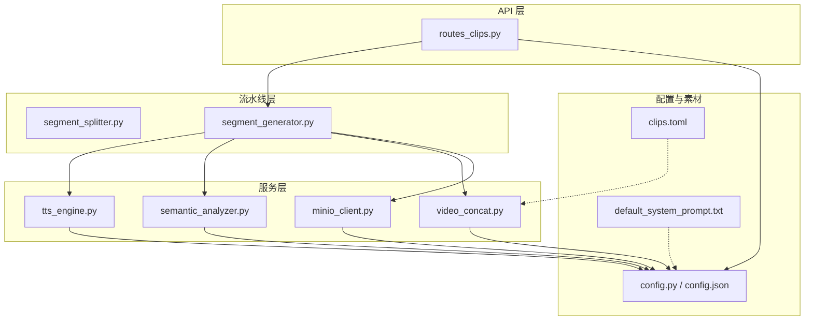
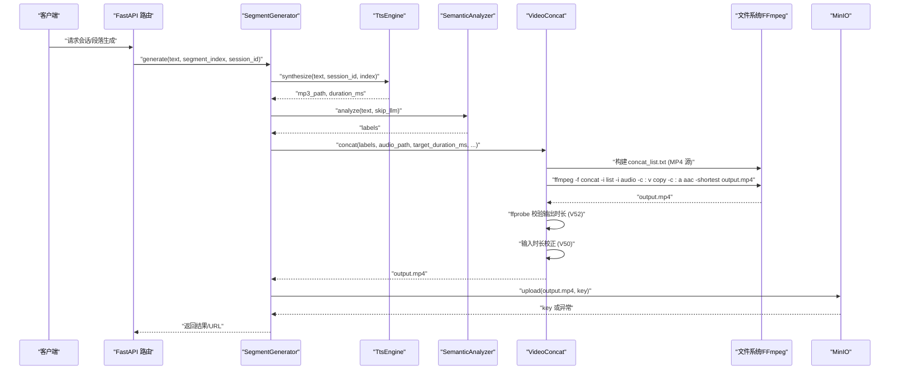
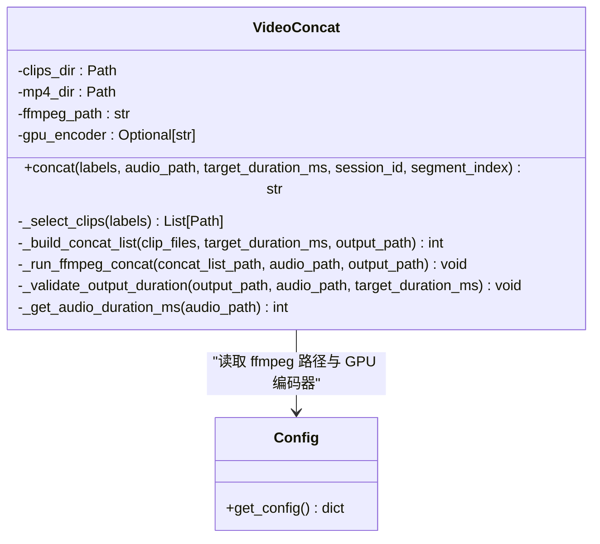
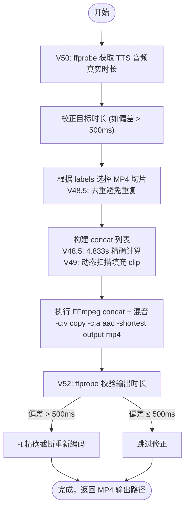
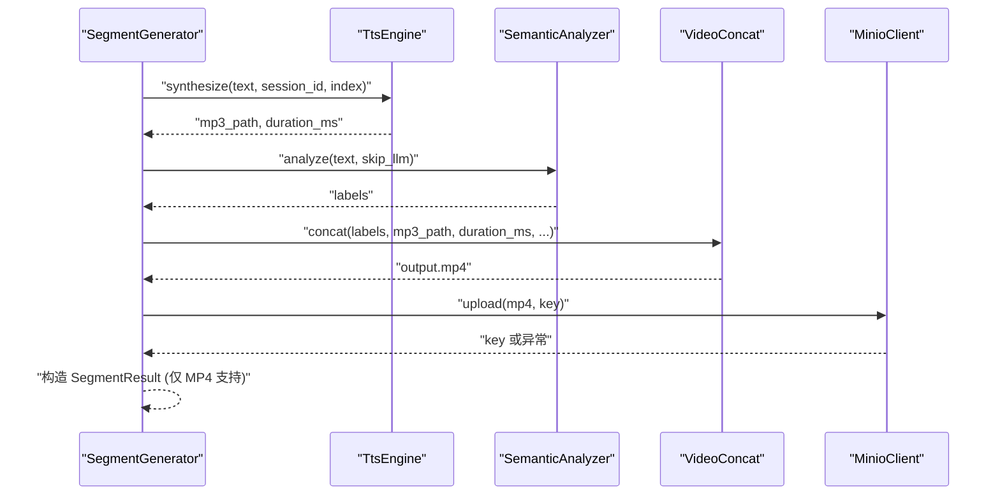
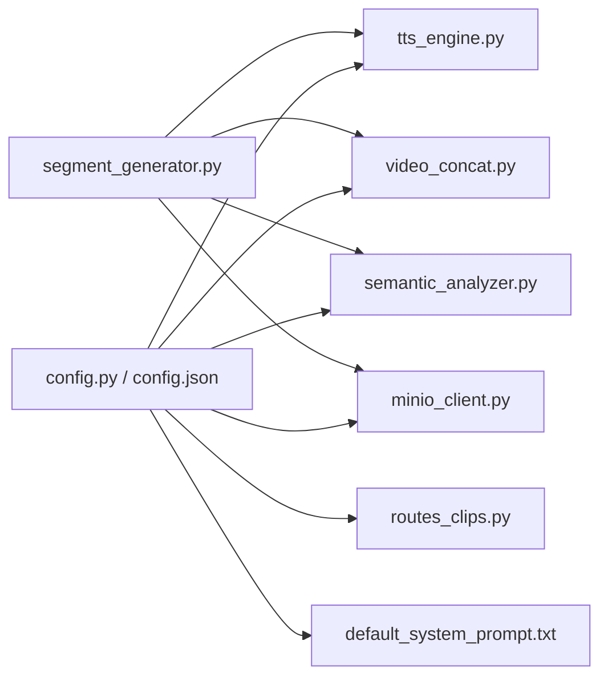

# 视频片段拼接

<cite>
**本文引用的文件**
- [server/services/video_concat.py](file://server/services/video_concat.py)
- [server/pipeline/segment_generator.py](file://server/pipeline/segment_generator.py)
- [server/pipeline/segment_splitter.py](file://server/pipeline/segment_splitter.py)
- [server/api/routes_clips.py](file://server/api/routes_clips.py)
- [server/config.py](file://server/config.py)
- [server/services/tts_engine.py](file://server/services/tts_engine.py)
- [server/services/semantic_analyzer.py](file://server/services/semantic_analyzer.py)
- [server/services/minio_client.py](file://server/services/minio_client.py)
- [config.json](file://config.json)
- [clips/short-hair-teacher-girl/clips.toml](file://clips/short-hair-teacher-girl/clips.toml)
- [server/resources/default_system_prompt.txt](file://server/resources/default_system_prompt.txt)
</cite>

## 更新摘要
**变更内容**
- **重大格式转换**：整个视频拼接管道已简化为仅使用 MP4 格式，提升性能和可靠性
- **音频质量增强**：新增输出后 ffprobe 校验机制，确保音频时长精确匹配，偏差超过 500ms 自动重新编码
- **输入时长校正**：V50 版本增加 TTS 音频真实时长检测，替代估算值消除偏差
- **配置优化**：llm.max_tokens 默认值从 2048 降至 1200，与 system prompt 字数限制协调
- **系统提示改进**：在 default_system_prompt.txt 中添加严格的 1000 字限制要求

## 目录
1. [简介](#简介)
2. [项目结构](#项目结构)
3. [核心组件](#核心组件)
4. [架构总览](#架构总览)
5. [详细组件分析](#详细组件分析)
6. [依赖关系分析](#依赖关系分析)
7. [性能与优化](#性能与优化)
8. [故障排查指南](#故障排查指南)
9. [结论](#结论)
10. [附录：调用示例与配置要点](#附录调用示例与配置要点)

## 简介
本技术文档聚焦 RealTimeTalk 的视频片段拼接模块，围绕 FFmpeg 工具链的集成使用、视频编码与格式转换、无缝拼接策略、时间轴对齐（音画同步）、GPU 加速与并行处理、质量控制与存储优化等方面展开。文档面向初学者提供循序渐进的理解路径，同时为有经验的开发者提供深入的技术细节与可操作建议。

**最新更新**：实现了重大的格式统一和质量改进——整个视频拼接管道现在仅使用 MP4 格式以获得更好的性能和可靠性，新增了输出后 ffprobe 校验确保音频时长精确匹配，并优化了 LLM 回复长度控制以改善用户体验。

## 项目结构
与视频片段拼接相关的代码主要分布在以下位置：
- 服务层：视频拼接、TTS 合成、语义分析、MinIO 上传
- 流水线层：文本分段、段落生成编排
- API 层：切片资源代理路由
- 配置层：全局配置加载与合并
- 素材层：语义化切片库清单

图表来源
- [server/api/routes_clips.py:1-133](file://server/api/routes_clips.py#L1-L133)
- [server/pipeline/segment_generator.py:1-147](file://server/pipeline/segment_generator.py#L1-L147)
- [server/pipeline/segment_splitter.py:1-182](file://server/pipeline/segment_splitter.py#L1-L182)
- [server/services/tts_engine.py:1-239](file://server/services/tts_engine.py#L1-L239)
- [server/services/semantic_analyzer.py:1-142](file://server/services/semantic_analyzer.py#L1-L142)
- [server/services/video_concat.py:1-330](file://server/services/video_concat.py#L1-L330)
- [server/services/minio_client.py:1-139](file://server/services/minio_client.py#L1-L139)
- [server/config.py:1-287](file://server/config.py#L1-L287)
- [config.json:1-47](file://config.json#L1-L47)
- [clips/short-hair-teacher-girl/clips.toml:1-148](file://clips/short-hair-teacher-girl/clips.toml#L1-L148)
- [server/resources/default_system_prompt.txt:1-33](file://server/resources/default_system_prompt.txt#L1-L33)

章节来源
- [server/api/routes_clips.py:1-133](file://server/api/routes_clips.py#L1-L133)
- [server/pipeline/segment_generator.py:1-147](file://server/pipeline/segment_generator.py#L1-L147)
- [server/pipeline/segment_splitter.py:1-182](file://server/pipeline/segment_splitter.py#L1-L182)
- [server/services/video_concat.py:1-330](file://server/services/video_concat.py#L1-L330)
- [server/services/tts_engine.py:1-239](file://server/services/tts_engine.py#L1-L239)
- [server/services/semantic_analyzer.py:1-142](file://server/services/semantic_analyzer.py#L1-L142)
- [server/services/minio_client.py:1-139](file://server/services/minio_client.py#L1-L139)
- [server/config.py:1-287](file://server/config.py#L1-L287)
- [config.json:1-47](file://config.json#L1-L47)
- [clips/short-hair-teacher-girl/clips.toml:1-148](file://clips/short-hair-teacher-girl/clips.toml#L1-L148)
- [server/resources/default_system_prompt.txt:1-33](file://server/resources/default_system_prompt.txt#L1-L33)

## 核心组件
- **视频拼接器 VideoConcat**：基于 FFmpeg concat demuxer 将多个固定时长切片按标签序列拼接，并混入 TTS 音频流；支持 GPU 编码器检测预留。**重大更新**：已完全转换为仅使用 MP4 格式，新增输出后 ffprobe 校验和输入时长校正功能。
- **段落生成器 SegmentGenerator**：编排 TTS → 语义分析 → 视频拼接 → MinIO 上传的完整流程，具备错误回退与结果封装。**已更新**：现在只处理 MP4 格式输出，移除了 webm 支持。
- **文本分段器 SegmentSplitter**：按中文标点阈值切分长文本为多段，控制每段长度以适配后续 TTS 与视频时长。**已增强**：添加相邻段文本去重和诊断日志。
- **TTS 引擎 TtsEngine**：调用 DashScope 多模态接口合成语音，支持长文本拆分与 MP3 拼接，估算时长用于视频对齐。**已优化**：异步子进程处理，提高并发性能。
- **语义分析 SemanticAnalyzer**：通过 LLM 或关键词回退生成标签序列，映射到预置视频切片。**已改进**：单标签时自动追加互补 body 标签。
- **MinIO 客户端 MinioClient**：对象存储上传与临时 URL 生成，失败时回退本地路径。
- **切片资源路由 routes_clips**：对外暴露切片文件的访问接口，支持 .mp4 与 idle 动画。
- **配置系统 config**：统一加载 JSON 与环境变量，提供 ffmpeg 路径、GPU 编码器、MinIO、TTS 等参数。**已更新**：降低默认 max_tokens 至 1200。

章节来源
- [server/services/video_concat.py:1-330](file://server/services/video_concat.py#L1-L330)
- [server/pipeline/segment_generator.py:1-147](file://server/pipeline/segment_generator.py#L1-L147)
- [server/pipeline/segment_splitter.py:1-182](file://server/pipeline/segment_splitter.py#L1-L182)
- [server/services/tts_engine.py:1-239](file://server/services/tts_engine.py#L1-L239)
- [server/services/semantic_analyzer.py:1-142](file://server/services/semantic_analyzer.py#L1-L142)
- [server/services/minio_client.py:1-139](file://server/services/minio_client.py#L1-L139)
- [server/api/routes_clips.py:1-133](file://server/api/routes_clips.py#L1-L133)
- [server/config.py:1-287](file://server/config.py#L1-L287)

## 架构总览
整体数据流从文本到最终视频输出，关键步骤如下：
- 文本分段：根据阈值和中文标点切分为若干段落
- 段落生成：TTS 合成音频 → 语义分析得到标签序列 → 选择对应切片 → FFmpeg 拼接 + 混音 → 上传 MinIO（失败回退本地）
- 资源访问：前端通过 API 获取 .mp4 切片或待机动画

图表来源
- [server/api/routes_clips.py:1-133](file://server/api/routes_clips.py#L1-L133)
- [server/pipeline/segment_generator.py:1-147](file://server/pipeline/segment_generator.py#L1-L147)
- [server/services/tts_engine.py:1-239](file://server/services/tts_engine.py#L1-L239)
- [server/services/semantic_analyzer.py:1-142](file://server/services/semantic_analyzer.py#L1-L142)
- [server/services/video_concat.py:1-330](file://server/services/video_concat.py#L1-L330)
- [server/services/minio_client.py:1-139](file://server/services/minio_client.py#L1-L139)

## 详细组件分析

### 视频拼接器 VideoConcat
职责与关键点：
- 根据标签序列选择对应 .mp4 切片文件（位于 clips_dir/.mp4）
- **重大更新**：已完全转换为仅使用 MP4 格式，移除了 webm 支持以提升性能和可靠性
- **新增功能**：V50 版本增加输入时长校正，使用 ffprobe 获取 TTS MP3 的真实时长替代估算值
- **新增功能**：V52 版本增加输出后 ffprobe 校验，确保音频时长精确匹配，偏差超过 500ms 自动重新截断
- **已优化**：调用 FFmpeg 执行 concat demuxer，视频流拷贝（无重编码），音频编码为 AAC，并以较短流为准进行混音
- **已改进**：异步执行 FFmpeg，设置超时与错误处理
- **已修复**：修正片段时长计算从 5 秒到 4.833 秒，提高时长对齐精度
- **已增强**：提供 GPU 编码器检测函数（当前 stream copy 无需 GPU 编码，预留扩展）

图表来源
- [server/services/video_concat.py:1-330](file://server/services/video_concat.py#L1-L330)
- [server/config.py:1-287](file://server/config.py#L1-L287)

章节来源
- [server/services/video_concat.py:1-330](file://server/services/video_concat.py#L1-L330)
- [server/config.py:1-287](file://server/config.py#L1-L287)

#### 时间轴对齐算法（音画同步）
- **已修正**：每个切片固定时长为 4.833 秒（实际测量值，非之前的 5 秒），自然总时长 = 切片数量 × 单片时长
- **已增强**：若自然时长小于目标时长（来自 TTS 估算的音频时长），计算差值并按单片时长向上取整循环填充最后一个切片
- **已优化**：FFmpeg 使用 -shortest 确保输出以较短流为准，避免音视频错位
- **新增验证**：输出后使用 ffprobe 检查实际音频时长，若偏差 > 500ms，用 -t 精确截断重新编码
- **新增校正**：输入阶段使用 ffprobe 获取 TTS 音频真实时长，替代文件大小估算，消除偏差
- **已改进**：音频编码为 AAC（与 MP4 容器匹配），视频流拷贝，减少重编码带来的时间戳漂移风险

图表来源
- [server/services/video_concat.py:64-68](file://server/services/video_concat.py#L64-L68)
- [server/services/video_concat.py:133-194](file://server/services/video_concat.py#L133-L194)
- [server/services/video_concat.py:271-304](file://server/services/video_concat.py#L271-L304)

章节来源
- [server/services/video_concat.py:64-68](file://server/services/video_concat.py#L64-L68)
- [server/services/video_concat.py:133-194](file://server/services/video_concat.py#L133-L194)
- [server/services/video_concat.py:271-304](file://server/services/video_concat.py#L271-L304)

#### 增强的 Clip 选择算法
**已重大改进**：
- **去重机制**：使用 set 跟踪已选择的 clip，避免同一 clip 多次出现造成视觉重复
- **单 clip 保护**：当只有一个 clip 时，自动补充不同的过渡 clip（transition/introduction/emphasis/listing）
- **智能填充**：优先从不在原始 labels 中的 clip 中选择填充 clip，保证拼接结果只含"原始 N 个 clip + 填充时从未出现过的 clip"
- **动态扫描**：V49 版本动态扫描 .mp4 目录下所有可用 clip，替代硬编码候选列表
- **逆序回退**：如果所有 clip 都在原 labels 中，采用逆序排列确保填充 clip 与开头视觉差异最大化

章节来源
- [server/services/video_concat.py:105-138](file://server/services/video_concat.py#L105-L138)
- [server/services/video_concat.py:170-191](file://server/services/video_concat.py#L170-L191)

#### 诊断日志系统
**新增功能**：
- **V51 详情日志**：记录完整的拼接信息，包括 labels、clips 数量、目标时长、实际时长、会话 ID 等
- **V53 序列日志**：记录实际拼接的 clip 序列，便于问题追踪和分析
- **诊断文件保存**：将 concat 列表副本保存到 /tmp/concat_logs 目录，供事后分析
- **错误诊断**：详细的警告和错误日志，包含具体错误信息和上下文

章节来源
- [server/services/video_concat.py:99-102](file://server/services/video_concat.py#L99-L102)

### 段落生成器 SegmentGenerator
职责与关键点：
- 编排 TTS → 语义分析 → 视频拼接 → MinIO 上传
- 对 TTS 与视频拼接异常进行捕获并返回结构化结果
- 上传失败自动回退本地路径，保证可用性
- **重大更新**：V55 版本完全移除 webm 支持，现在只处理 MP4 格式输出，提升性能和可靠性

图表来源
- [server/pipeline/segment_generator.py:1-147](file://server/pipeline/segment_generator.py#L1-L147)
- [server/services/tts_engine.py:1-239](file://server/services/tts_engine.py#L1-L239)
- [server/services/semantic_analyzer.py:1-142](file://server/services/semantic_analyzer.py#L1-L142)
- [server/services/video_concat.py:1-330](file://server/services/video_concat.py#L1-L330)
- [server/services/minio_client.py:1-139](file://server/services/minio_client.py#L1-L139)

章节来源
- [server/pipeline/segment_generator.py:1-147](file://server/pipeline/segment_generator.py#L1-L147)

### 文本分段器 SegmentSplitter
职责与关键点：
- 按中文标点（句号、感叹号、问号、分号）拆分句子
- 累计至阈值（默认 40 字）形成段落，尾部不足单独成段
- 提供是否触发多段生成的判断函数
- **已增强**：V51 版本添加相邻段文本去重，检测重叠/高度相似并合并
- **已改进**：V53 版本添加诊断日志，输出每段实际文本以便问题追踪

章节来源
- [server/pipeline/segment_splitter.py:1-182](file://server/pipeline/segment_splitter.py#L1-L182)

### TTS 引擎 TtsEngine
职责与关键点：
- 调用 DashScope 多模态接口合成语音，支持同步与异步任务轮询
- 长文本按句子边界拆分后分别合成，再使用 FFmpeg concat 拼接为单个 MP3
- 通过文件大小粗略估算时长（MP3 码率约 128kbps），用于视频时长对齐
- 并发限制信号量避免 API 限流
- **已优化**：V50 版本改用异步 subprocess，避免阻塞 asyncio 事件循环

章节来源
- [server/services/tts_engine.py:1-239](file://server/services/tts_engine.py#L1-L239)

### 语义分析 SemanticAnalyzer
职责与关键点：
- 优先使用 LLM 解析标签序列，失败或首段优化时回退关键词匹配
- 标签集合包括问候、引入、解释、列举、强调、举例、分析、对比、过渡、总结、致谢等
- 输出标签序列用于选择对应视频切片
- **已改进**：V49 版本在单标签时尝试追加互补 body 标签，增加视频剪辑多样性

章节来源
- [server/services/semantic_analyzer.py:1-142](file://server/services/semantic_analyzer.py#L1-L142)

### MinIO 客户端 MinioClient
职责与关键点：
- 连接、创建 bucket、上传对象、生成临时访问 URL
- 不可用时标记状态，上传失败抛出异常供上层回退

章节来源
- [server/services/minio_client.py:1-139](file://server/services/minio_client.py#L1-L139)

### 切片资源路由 routes_clips
职责与关键点：
- 提供 /api/clips/{name:path} 接口，支持 .mp4 与 idle 动画
- 安全检查确保文件在 clips 目录下，防止路径穿越
- 返回 video/mp4 类型并禁用缓存头
- **已更新**：现在优先返回 MP4 格式，提供更好的移动端兼容性

章节来源
- [server/api/routes_clips.py:1-133](file://server/api/routes_clips.py#L1-L133)

### 配置系统 config
职责与关键点：
- 合并 config.json 与 pydantic-settings 环境变量，优先级：环境变量 > JSON
- 提供 ffmpeg.path、ffmpeg.gpu_encoder、MinIO、TTS、LLM 等配置项
- 懒加载全局配置实例，支持热重载
- **已更新**：llm.max_tokens 默认值从 2048 降至 1200，与 system prompt 字数限制呼应

章节来源
- [server/config.py:1-287](file://server/config.py#L1-L287)
- [config.json:1-47](file://config.json#L1-L47)

### 切片库清单 clips.toml
职责与关键点：
- 定义 speaker、base_image、voice、clip_duration 等元信息
- 每个标签对应一个 .webm 文件及提示词、语音提示
- 定义过渡规则与默认序列，指导标签组合与衔接
- **注意**：虽然配置文件仍引用 .webm 文件名，但实际运行时使用的是 .mp4 格式的副本

章节来源
- [clips/short-hair-teacher-girl/clips.toml:1-148](file://clips/short-hair-teacher-girl/clips.toml#L1-L148)

### 系统提示配置
职责与关键点：
- 定义 AI 助手的角色设定和行为准则
- **重大更新**：添加了严格的 1000 字限制要求，确保回复内容完整不截断
- 与 llm.max_tokens 配置协调工作，共同控制回复长度

章节来源
- [server/resources/default_system_prompt.txt:1-33](file://server/resources/default_system_prompt.txt#L1-L33)

## 依赖关系分析
- 低耦合高内聚：各服务类职责清晰，通过构造函数注入依赖
- 外部依赖：FFmpeg 可执行文件、DashScope TTS 接口、MinIO 对象存储
- 配置驱动：所有路径与参数由配置中心统一管理，便于部署与切换

图表来源
- [server/config.py:1-287](file://server/config.py#L1-L287)
- [config.json:1-47](file://config.json#L1-L47)
- [server/services/video_concat.py:1-330](file://server/services/video_concat.py#L1-L330)
- [server/services/tts_engine.py:1-239](file://server/services/tts_engine.py#L1-L239)
- [server/services/semantic_analyzer.py:1-142](file://server/services/semantic_analyzer.py#L1-L142)
- [server/services/minio_client.py:1-139](file://server/services/minio_client.py#L1-L139)
- [server/pipeline/segment_generator.py:1-147](file://server/pipeline/segment_generator.py#L1-L147)
- [server/resources/default_system_prompt.txt:1-33](file://server/resources/default_system_prompt.txt#L1-L33)

章节来源
- [server/config.py:1-287](file://server/config.py#L1-L287)
- [config.json:1-47](file://config.json#L1-L47)
- [server/services/video_concat.py:1-330](file://server/services/video_concat.py#L1-L330)
- [server/services/tts_engine.py:1-239](file://server/services/tts_engine.py#L1-L239)
- [server/services/semantic_analyzer.py:1-142](file://server/services/semantic_analyzer.py#L1-L142)
- [server/services/minio_client.py:1-139](file://server/services/minio_client.py#L1-L139)
- [server/pipeline/segment_generator.py:1-147](file://server/pipeline/segment_generator.py#L1-L147)
- [server/resources/default_system_prompt.txt:1-33](file://server/resources/default_system_prompt.txt#L1-L33)

## 性能与优化
- **帧率与分辨率适配**
  - 当前采用视频流拷贝（-c:v copy），不进行重编码，保持原始帧率与分辨率，避免额外开销与质量损失
  - **重大更新**：已完全转换为仅使用 MP4 格式，移除了 webm 支持，显著提升性能和可靠性
  - 若需统一规格，可在需要重编码的场景下启用 GPU 编码器（如 qsv/nvenc），但需权衡延迟与质量
- **码率优化**
  - 音频编码为 AAC（与 MP4 容器匹配），适合实时场景且体积较小
  - 视频保持原码率，如需压缩可在重编码模式下调整参数（例如 CRF、preset）
- **并行处理**
  - TTS 使用全局信号量限制并发，避免 API 限流
  - FFmpeg 子进程异步执行，避免阻塞事件循环
  - **已优化**：TTS 长文本拼接改用异步 subprocess，提高并发性能
- **内存管理**
  - 工作目录 _work/{session_id} 集中存放中间文件，注意定期清理
  - 长文本 TTS 拼接后及时删除临时文件与 concat 列表
  - **新增**：诊断日志保存到 /tmp/concat_logs，便于问题追踪
- **存储优化**
  - 优先上传 MinIO，失败回退本地路径，兼顾可用性与网络稳定性
  - 切片文件复用，减少重复生成
  - **已改进**：单一 MP4 格式输出，简化存储管理和传输逻辑

章节来源
- [server/services/video_concat.py:203-227](file://server/services/video_concat.py#L203-L227)
- [server/services/tts_engine.py:214-231](file://server/services/tts_engine.py#L214-L231)
- [server/services/minio_client.py:69-90](file://server/services/minio_client.py#L69-90)

## 故障排查指南
常见问题与定位方法：
- **FFmpeg 未找到或执行失败**
  - 检查 ffmpeg.path 配置是否正确，确认可执行文件存在且 PATH 可达
  - 查看日志中的命令与 stderr 输出，定位具体错误码与消息
- **视频拼接超时**
  - 默认超时 60s，若输入过大或磁盘 IO 慢可能导致超时，适当增大超时或优化输入
- **音画不同步**
  - **已解决**：新增输出后 ffprobe 校验，自动修正时长偏差超过 500ms 的情况
  - **已解决**：新增输入时长校正，使用 ffprobe 获取 TTS 音频真实时长替代估算值
  - 确认 -shortest 生效，检查 TTS 时长估算是否准确（MP3 大小估算可能偏差）
  - 校验 concat 列表路径是否为绝对路径，避免相对路径解析错误
- **切片缺失或重复**
  - **已改进**：增强的 clip 选择算法自动去重，避免同一 clip 多次出现
  - 检查 clips_dir/.mp4 下是否存在对应标签的 .mp4 文件
  - 确认 clips.toml 中 clip_duration 与实际文件一致（现为 4.833 秒）
- **MinIO 上传失败**
  - 检查 endpoint、access_key、secret_key、bucket 配置
  - 确认网络连通性与权限，必要时回退本地路径
- **诊断信息收集**
  - **新增**：查看 /tmp/concat_logs 目录下的诊断文件，了解实际的 clip 拼接序列
  - 检查应用日志中的 V50/V51/V52/V53 相关日志条目，获取详细的拼接过程信息
- **格式相关问题**
  - **重大更新**：系统现在只支持 MP4 格式，如有 webm 相关文件请忽略
  - 确认 clips_dir/.mp4 目录中存在正确的 MP4 格式切片文件

章节来源
- [server/services/video_concat.py:271-304](file://server/services/video_concat.py#L271-L304)
- [server/pipeline/segment_generator.py:117-146](file://server/pipeline/segment_generator.py#L117-L146)
- [server/services/tts_engine.py:214-231](file://server/services/tts_engine.py#L214-L231)
- [server/services/minio_client.py:80-90](file://server/services/minio_client.py#L80-L90)

## 结论
RealTimeTalk 的视频片段拼接模块以 FFmpeg concat demuxer 为核心，结合 TTS 时长估算与标签驱动的切片选择，实现了高效、稳定的音画同步与无缝拼接。**最新重大改进**显著提升了系统的可靠性和用户体验：

- **格式统一**：完全转换为仅使用 MP4 格式，移除了复杂的 webm 支持，大幅提升性能和可靠性
- **精度提升**：新增输入时长校正（V50）和输出时长验证（V52），确保音频时长精确匹配
- **质量改善**：增强的 clip 选择算法有效避免重复内容，智能填充机制保证视觉流畅性
- **可观测性增强**：全面的诊断日志系统便于问题追踪和性能分析
- **响应控制**：优化的 LLM 配置和系统提示，严格控制回复长度在 1000 字以内

通过配置驱动与错误回退机制，系统在可用性与性能之间取得良好平衡。未来可在重编码与 GPU 加速方面进一步扩展，以满足更严格的画质与吞吐需求。

## 附录：调用示例与配置要点
- **调用 concat_videos 方法（实际类名为 VideoConcat.concat）**
  - 输入：labels（标签序列）、audio_path（TTS 输出的 MP3 路径）、target_duration_ms（目标时长毫秒）、session_id、segment_index
  - 输出：输出视频文件路径（.mp4）
  - **重大更新**：现在只支持 MP4 格式输出，自动进行时长校正和输出验证
  - 参考实现路径：[server/services/video_concat.py:35-103](file://server/services/video_concat.py#L35-L103)
- **配置编码参数**
  - FFmpeg 路径与 GPU 编码器：见配置项 ffmpeg.path、ffmpeg.gpu_encoder
  - **已更新**：llm.max_tokens 默认值降至 1200，与 system prompt 字数限制协调
  - 参考路径：[server/config.py:241-244](file://server/config.py#L241-L244)、[config.json:6](file://config.json#L6)
- **处理不同格式视频素材**
  - **重大更新**：系统现在只支持 MP4 格式，不再支持 webm
  - 确保 clips_dir/.mp4 目录下存在正确的 MP4 格式切片文件
  - 参考路径：[server/services/video_concat.py:105-138](file://server/services/video_concat.py#L105-L138)
- **GPU 加速与并行处理**
  - GPU 编码器检测函数 detect_gpu_encoder 已预留，当前 stream copy 无需 GPU 编码
  - 若需重编码，可在 FFmpeg 命令中替换 -c:v copy 为 -c:v h264_qsv 或 -c:v h264_nvenc（取决于环境）
  - **已优化**：TTS 长文本处理改用异步 subprocess，提高并发性能
  - 参考路径：[server/services/video_concat.py:307-330](file://server/services/video_concat.py#L307-L330)
- **质量控制与压缩**
  - 当前保持原视频质量（无重编码），音频使用 AAC 编码
  - 如需压缩，可在重编码模式下调整 CRF、preset、profile 等参数
  - 参考路径：[server/services/video_concat.py:203-227](file://server/services/video_concat.py#L203-L227)
- **诊断与调试**
  - **新增**：查看 /tmp/concat_logs 目录获取详细的 clip 拼接序列
  - 检查日志中的 V50/V51/V52/V53 相关条目，了解拼接过程和验证结果
  - 参考路径：[server/services/video_concat.py:99-102](file://server/services/video_concat.py#L99-L102)
- **系统提示配置**
  - **重大更新**：在 default_system_prompt.txt 中添加了严格的 1000 字限制要求
  - 与 llm.max_tokens 配置协调工作，共同控制回复长度
  - 参考路径：[server/resources/default_system_prompt.txt:30-33](file://server/resources/default_system_prompt.txt#L30-L33)

章节来源
- [server/services/video_concat.py:35-103](file://server/services/video_concat.py#L35-L103)
- [server/services/video_concat.py:105-138](file://server/services/video_concat.py#L105-L138)
- [server/services/video_concat.py:203-227](file://server/services/video_concat.py#L203-L227)
- [server/services/video_concat.py:307-330](file://server/services/video_concat.py#L307-L330)
- [server/config.py:241-244](file://server/config.py#L241-L244)
- [config.json:6](file://config.json#L6)
- [server/resources/default_system_prompt.txt:30-33](file://server/resources/default_system_prompt.txt#L30-L33)