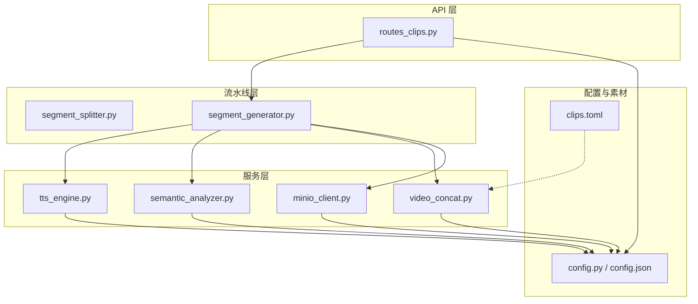
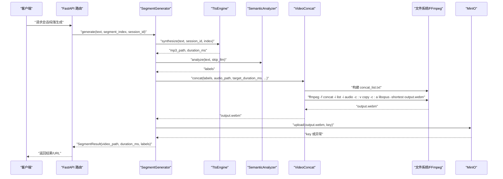
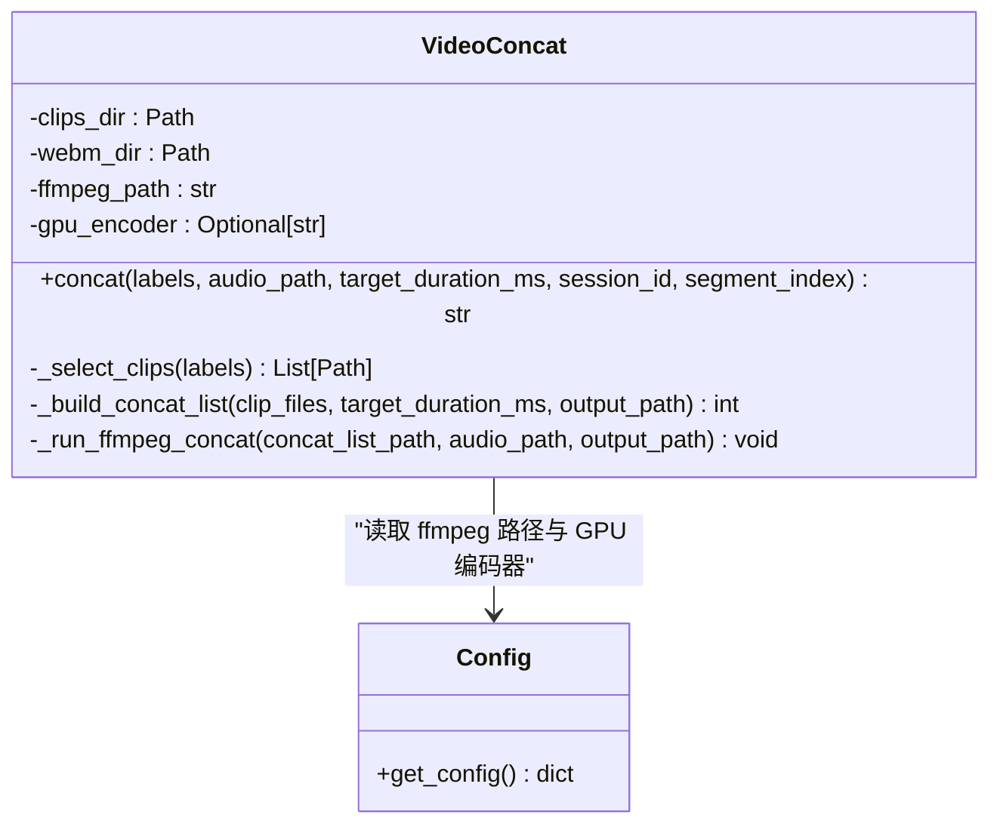
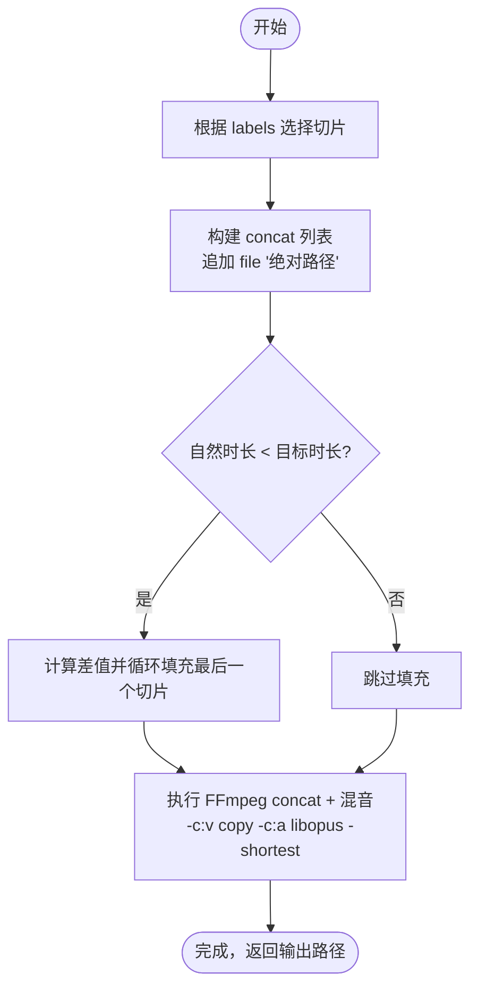
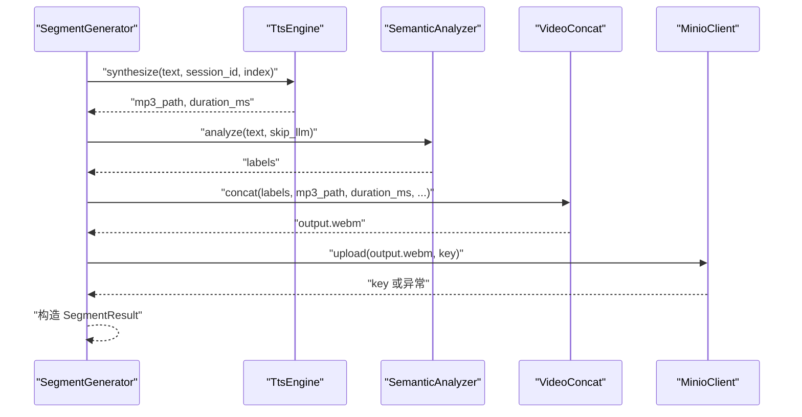
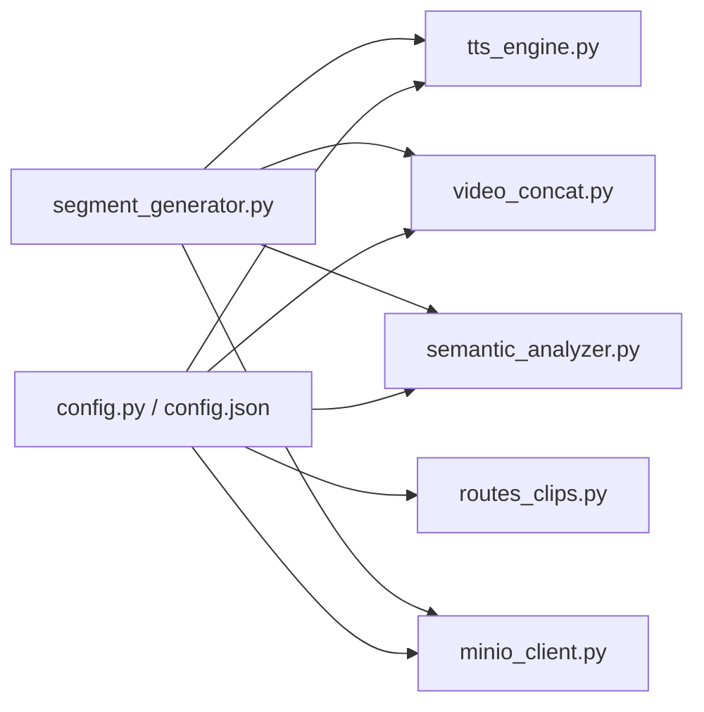

# 视频片段拼接

<cite>
**本文引用的文件**
- [server/services/video_concat.py](file://server/services/video_concat.py)
- [server/pipeline/segment_generator.py](file://server/pipeline/segment_generator.py)
- [server/pipeline/segment_splitter.py](file://server/pipeline/segment_splitter.py)
- [server/api/routes_clips.py](file://server/api/routes_clips.py)
- [server/config.py](file://server/config.py)
- [server/services/tts_engine.py](file://server/services/tts_engine.py)
- [server/services/semantic_analyzer.py](file://server/services/semantic_analyzer.py)
- [server/services/minio_client.py](file://server/services/minio_client.py)
- [config.json](file://config.json)
- [clips/short-hair-teacher-girl/clips.toml](file://clips/short-hair-teacher-girl/clips.toml)
</cite>

## 目录
1. [简介](#简介)
2. [项目结构](#项目结构)
3. [核心组件](#核心组件)
4. [架构总览](#架构总览)
5. [详细组件分析](#详细组件分析)
6. [依赖关系分析](#依赖关系分析)
7. [性能与优化](#性能与优化)
8. [故障排查指南](#故障排查指南)
9. [结论](#结论)
10. [附录：调用示例与配置要点](#附录调用示例与配置要点)

## 简介
本技术文档聚焦 RealTimeTalk 的视频片段拼接模块，围绕 FFmpeg 工具链的集成使用、视频编码与格式转换、无缝拼接策略、时间轴对齐（音画同步）、GPU 加速与并行处理、质量控制与存储优化等方面展开。文档面向初学者提供循序渐进的理解路径，同时为有经验的开发者提供深入的技术细节与可操作建议。

## 项目结构
与视频片段拼接相关的代码主要分布在以下位置：
- 服务层：视频拼接、TTS 合成、语义分析、MinIO 上传
- 流水线层：文本分段、段落生成编排
- API 层：切片资源代理路由
- 配置层：全局配置加载与合并
- 素材层：语义化切片库清单

图表来源
- [server/api/routes_clips.py:1-75](file://server/api/routes_clips.py#L1-L75)
- [server/pipeline/segment_generator.py:1-138](file://server/pipeline/segment_generator.py#L1-L138)
- [server/pipeline/segment_splitter.py:1-95](file://server/pipeline/segment_splitter.py#L1-L95)
- [server/services/tts_engine.py:1-234](file://server/services/tts_engine.py#L1-L234)
- [server/services/semantic_analyzer.py:1-126](file://server/services/semantic_analyzer.py#L1-L126)
- [server/services/video_concat.py:1-174](file://server/services/video_concat.py#L1-L174)
- [server/services/minio_client.py:1-139](file://server/services/minio_client.py#L1-L139)
- [server/config.py:1-260](file://server/config.py#L1-L260)
- [config.json:1-39](file://config.json#L1-L39)
- [clips/short-hair-teacher-girl/clips.toml:1-148](file://clips/short-hair-teacher-girl/clips.toml#L1-L148)

章节来源
- [server/api/routes_clips.py:1-75](file://server/api/routes_clips.py#L1-L75)
- [server/pipeline/segment_generator.py:1-138](file://server/pipeline/segment_generator.py#L1-L138)
- [server/pipeline/segment_splitter.py:1-95](file://server/pipeline/segment_splitter.py#L1-L95)
- [server/services/video_concat.py:1-174](file://server/services/video_concat.py#L1-L174)
- [server/services/tts_engine.py:1-234](file://server/services/tts_engine.py#L1-L234)
- [server/services/semantic_analyzer.py:1-126](file://server/services/semantic_analyzer.py#L1-L126)
- [server/services/minio_client.py:1-139](file://server/services/minio_client.py#L1-L139)
- [server/config.py:1-260](file://server/config.py#L1-L260)
- [config.json:1-39](file://config.json#L1-L39)
- [clips/short-hair-teacher-girl/clips.toml:1-148](file://clips/short-hair-teacher-girl/clips.toml#L1-L148)

## 核心组件
- 视频拼接器 VideoConcat：基于 FFmpeg concat demuxer 将多个固定时长切片按标签序列拼接，并混入 TTS 音频流；支持 GPU 编码器检测预留。
- 段落生成器 SegmentGenerator：编排 TTS → 语义分析 → 视频拼接 → MinIO 上传的完整流程，具备错误回退与结果封装。
- 文本分段器 SegmentSplitter：按中文标点阈值切分长文本为多段，控制每段长度以适配后续 TTS 与视频时长。
- TTS 引擎 TtsEngine：调用 DashScope 多模态接口合成语音，支持长文本拆分与 MP3 拼接，估算时长用于视频对齐。
- 语义分析 SemanticAnalyzer：通过 LLM 或关键词回退生成标签序列，映射到预置视频切片。
- MinIO 客户端 MinioClient：对象存储上传与临时 URL 生成，失败时回退本地路径。
- 切片资源路由 routes_clips：对外暴露切片文件的访问接口，支持 .webm 与 idle 动画。
- 配置系统 config：统一加载 JSON 与环境变量，提供 ffmpeg 路径、GPU 编码器、MinIO、TTS 等参数。

章节来源
- [server/services/video_concat.py:1-174](file://server/services/video_concat.py#L1-L174)
- [server/pipeline/segment_generator.py:1-138](file://server/pipeline/segment_generator.py#L1-L138)
- [server/pipeline/segment_splitter.py:1-95](file://server/pipeline/segment_splitter.py#L1-L95)
- [server/services/tts_engine.py:1-234](file://server/services/tts_engine.py#L1-L234)
- [server/services/semantic_analyzer.py:1-126](file://server/services/semantic_analyzer.py#L1-L126)
- [server/services/minio_client.py:1-139](file://server/services/minio_client.py#L1-L139)
- [server/api/routes_clips.py:1-75](file://server/api/routes_clips.py#L1-L75)
- [server/config.py:1-260](file://server/config.py#L1-L260)

## 架构总览
整体数据流从文本到最终视频输出，关键步骤如下：
- 文本分段：根据阈值和中文标点切分为若干段落
- 段落生成：TTS 合成音频 → 语义分析得到标签序列 → 选择对应切片 → FFmpeg 拼接 + 混音 → 上传 MinIO（失败回退本地）
- 资源访问：前端通过 API 获取 .webm 切片或待机动画

图表来源
- [server/api/routes_clips.py:1-75](file://server/api/routes_clips.py#L1-L75)
- [server/pipeline/segment_generator.py:1-138](file://server/pipeline/segment_generator.py#L1-L138)
- [server/services/tts_engine.py:1-234](file://server/services/tts_engine.py#L1-L234)
- [server/services/semantic_analyzer.py:1-126](file://server/services/semantic_analyzer.py#L1-L126)
- [server/services/video_concat.py:1-174](file://server/services/video_concat.py#L1-L174)
- [server/services/minio_client.py:1-139](file://server/services/minio_client.py#L1-L139)

## 详细组件分析

### 视频拼接器 VideoConcat
职责与关键点：
- 根据标签序列选择对应 .webm 切片文件（位于 clips_dir/.webm）
- 构建 FFmpeg concat 列表，不足目标时长则循环填充最后一个切片
- 调用 FFmpeg 执行 concat demuxer，视频流拷贝（无重编码），音频编码为 Opus，并以较短流为准进行混音
- 异步执行 FFmpeg，设置超时与错误处理
- 提供 GPU 编码器检测函数（当前 stream copy 无需 GPU 编码，预留扩展）

图表来源
- [server/services/video_concat.py:1-174](file://server/services/video_concat.py#L1-L174)
- [server/config.py:1-260](file://server/config.py#L1-L260)

章节来源
- [server/services/video_concat.py:1-174](file://server/services/video_concat.py#L1-L174)
- [server/config.py:1-260](file://server/config.py#L1-L260)

#### 时间轴对齐算法（音画同步）
- 每个切片固定时长（默认 5 秒），自然总时长 = 切片数量 × 单片时长
- 若自然时长小于目标时长（来自 TTS 估算的音频时长），计算差值并按单片时长向上取整循环填充最后一个切片
- FFmpeg 使用 -shortest 确保输出以较短流为准，避免音视频错位
- 音频编码为 Opus，视频流拷贝，减少重编码带来的时间戳漂移风险

图表来源
- [server/services/video_concat.py:85-114](file://server/services/video_concat.py#L85-L114)
- [server/services/video_concat.py:116-149](file://server/services/video_concat.py#L116-L149)

章节来源
- [server/services/video_concat.py:85-114](file://server/services/video_concat.py#L85-L114)
- [server/services/video_concat.py:116-149](file://server/services/video_concat.py#L116-L149)

### 段落生成器 SegmentGenerator
职责与关键点：
- 编排 TTS → 语义分析 → 视频拼接 → MinIO 上传
- 对 TTS 与视频拼接异常进行捕获并返回结构化结果
- 上传失败自动回退本地路径，保证可用性

图表来源
- [server/pipeline/segment_generator.py:1-138](file://server/pipeline/segment_generator.py#L1-L138)
- [server/services/tts_engine.py:1-234](file://server/services/tts_engine.py#L1-L234)
- [server/services/semantic_analyzer.py:1-126](file://server/services/semantic_analyzer.py#L1-L126)
- [server/services/video_concat.py:1-174](file://server/services/video_concat.py#L1-L174)
- [server/services/minio_client.py:1-139](file://server/services/minio_client.py#L1-L139)

章节来源
- [server/pipeline/segment_generator.py:1-138](file://server/pipeline/segment_generator.py#L1-L138)

### 文本分段器 SegmentSplitter
职责与关键点：
- 按中文标点（句号、感叹号、问号、分号）拆分句子
- 累计至阈值（默认 50 字）形成段落，尾部不足单独成段
- 提供是否触发多段生成的判断函数

章节来源
- [server/pipeline/segment_splitter.py:1-95](file://server/pipeline/segment_splitter.py#L1-L95)

### TTS 引擎 TtsEngine
职责与关键点：
- 调用 DashScope 多模态接口合成语音，支持同步与异步任务轮询
- 长文本按句子边界拆分后分别合成，再使用 FFmpeg concat 拼接为单个 MP3
- 通过文件大小粗略估算时长（MP3 码率约 128kbps），用于视频时长对齐
- 并发限制信号量避免 API 限流

章节来源
- [server/services/tts_engine.py:1-234](file://server/services/tts_engine.py#L1-L234)

### 语义分析 SemanticAnalyzer
职责与关键点：
- 优先使用 LLM 解析标签序列，失败或首段优化时回退关键词匹配
- 标签集合包括问候、引入、解释、列举、强调、举例、分析、对比、过渡、总结、致谢等
- 输出标签序列用于选择对应视频切片

章节来源
- [server/services/semantic_analyzer.py:1-126](file://server/services/semantic_analyzer.py#L1-L126)

### MinIO 客户端 MinioClient
职责与关键点：
- 连接、创建 bucket、上传对象、生成临时访问 URL
- 不可用时标记状态，上传失败抛出异常供上层回退

章节来源
- [server/services/minio_client.py:1-139](file://server/services/minio_client.py#L1-L139)

### 切片资源路由 routes_clips
职责与关键点：
- 提供 /api/clips/{name:path} 接口，支持 .webm 与 idle 动画
- 安全检查确保文件在 clips 目录下，防止路径穿越
- 返回 video/webm 类型并禁用缓存头

章节来源
- [server/api/routes_clips.py:1-75](file://server/api/routes_clips.py#L1-L75)

### 配置系统 config
职责与关键点：
- 合并 config.json 与 pydantic-settings 环境变量，优先级：环境变量 > JSON
- 提供 ffmpeg.path、ffmpeg.gpu_encoder、MinIO、TTS、LLM 等配置项
- 懒加载全局配置实例，支持热重载

章节来源
- [server/config.py:1-260](file://server/config.py#L1-L260)
- [config.json:1-39](file://config.json#L1-L39)

### 切片库清单 clips.toml
职责与关键点：
- 定义 speaker、base_image、voice、clip_duration 等元信息
- 每个标签对应一个 .webm 文件及提示词、语音提示
- 定义过渡规则与默认序列，指导标签组合与衔接

章节来源
- [clips/short-hair-teacher-girl/clips.toml:1-148](file://clips/short-hair-teacher-girl/clips.toml#L1-L148)

## 依赖关系分析
- 低耦合高内聚：各服务类职责清晰，通过构造函数注入依赖
- 外部依赖：FFmpeg 可执行文件、DashScope TTS 接口、MinIO 对象存储
- 配置驱动：所有路径与参数由配置中心统一管理，便于部署与切换

图表来源
- [server/config.py:1-260](file://server/config.py#L1-L260)
- [config.json:1-39](file://config.json#L1-L39)
- [server/services/video_concat.py:1-174](file://server/services/video_concat.py#L1-L174)
- [server/services/tts_engine.py:1-234](file://server/services/tts_engine.py#L1-L234)
- [server/services/semantic_analyzer.py:1-126](file://server/services/semantic_analyzer.py#L1-L126)
- [server/services/minio_client.py:1-139](file://server/services/minio_client.py#L1-L139)
- [server/pipeline/segment_generator.py:1-138](file://server/pipeline/segment_generator.py#L1-L138)

章节来源
- [server/config.py:1-260](file://server/config.py#L1-L260)
- [config.json:1-39](file://config.json#L1-L39)
- [server/services/video_concat.py:1-174](file://server/services/video_concat.py#L1-L174)
- [server/services/tts_engine.py:1-234](file://server/services/tts_engine.py#L1-L234)
- [server/services/semantic_analyzer.py:1-126](file://server/services/semantic_analyzer.py#L1-L126)
- [server/services/minio_client.py:1-139](file://server/services/minio_client.py#L1-L139)
- [server/pipeline/segment_generator.py:1-138](file://server/pipeline/segment_generator.py#L1-L138)

## 性能与优化
- 帧率与分辨率适配
  - 当前采用视频流拷贝（-c:v copy），不进行重编码，保持原始帧率与分辨率，避免额外开销与质量损失
  - 若需统一规格，可在需要重编码的场景下启用 GPU 编码器（如 qsv/nvenc），但需权衡延迟与质量
- 码率优化
  - 音频编码为 Opus，适合实时场景且体积较小
  - 视频保持原码率，如需压缩可在重编码模式下调整参数（例如 CRF、preset）
- 并行处理
  - TTS 使用全局信号量限制并发，避免 API 限流
  - FFmpeg 子进程异步执行，避免阻塞事件循环
- 内存管理
  - 工作目录 _work/{session_id} 集中存放中间文件，注意定期清理
  - 长文本 TTS 拼接后及时删除临时文件与 concat 列表
- 存储优化
  - 优先上传 MinIO，失败回退本地路径，兼顾可用性与网络稳定性
  - 切片文件复用，减少重复生成

章节来源
- [server/services/video_concat.py:116-149](file://server/services/video_concat.py#L116-L149)
- [server/services/tts_engine.py:169-226](file://server/services/tts_engine.py#L169-L226)
- [server/services/minio_client.py:69-90](file://server/services/minio_client.py#L69-L90)

## 故障排查指南
常见问题与定位方法：
- FFmpeg 未找到或执行失败
  - 检查 ffmpeg.path 配置是否正确，确认可执行文件存在且 PATH 可达
  - 查看日志中的命令与 stderr 输出，定位具体错误码与消息
- 视频拼接超时
  - 默认超时 120s，若输入过大或磁盘 IO 慢可能导致超时，适当增大超时或优化输入
- 音画不同步
  - 确认 -shortest 生效，检查 TTS 时长估算是否准确（MP3 大小估算可能偏差）
  - 校验 concat 列表路径是否为绝对路径，避免相对路径解析错误
- 切片缺失
  - 检查 clips_dir/.webm 下是否存在对应标签的 .webm 文件
  - 确认 clips.toml 中 clip_duration 与实际文件一致（默认 5 秒）
- MinIO 上传失败
  - 检查 endpoint、access_key、secret_key、bucket 配置
  - 确认网络连通性与权限，必要时回退本地路径

章节来源
- [server/services/video_concat.py:133-149](file://server/services/video_concat.py#L133-L149)
- [server/pipeline/segment_generator.py:98-106](file://server/pipeline/segment_generator.py#L98-L106)
- [server/services/tts_engine.py:154-167](file://server/services/tts_engine.py#L154-L167)
- [server/services/minio_client.py:80-90](file://server/services/minio_client.py#L80-L90)

## 结论
RealTimeTalk 的视频片段拼接模块以 FFmpeg concat demuxer 为核心，结合 TTS 时长估算与标签驱动的切片选择，实现了高效、稳定的音画同步与无缝拼接。通过配置驱动与错误回退机制，系统在可用性与性能之间取得良好平衡。未来可在重编码与 GPU 加速方面进一步扩展，以满足更严格的画质与吞吐需求。

## 附录：调用示例与配置要点
- 调用 concat_videos 方法（实际类名为 VideoConcat.concat）
  - 输入：labels（标签序列）、audio_path（TTS 输出的 MP3 路径）、target_duration_ms（目标时长毫秒）、session_id、segment_index
  - 输出：输出视频文件路径（.webm）
  - 参考实现路径：[server/services/video_concat.py:30-72](file://server/services/video_concat.py#L30-L72)
- 配置编码参数
  - FFmpeg 路径与 GPU 编码器：见配置项 ffmpeg.path、ffmpeg.gpu_encoder
  - 参考路径：[server/config.py:221-224](file://server/config.py#L221-L224)、[config.json:34-37](file://config.json#L34-L37)
- 处理不同格式视频素材
  - 当前假设切片为 .webm，若需支持其他容器，可在选择切片逻辑中增加格式兼容与转码分支
  - 参考路径：[server/services/video_concat.py:74-83](file://server/services/video_concat.py#L74-L83)
- GPU 加速与并行处理
  - GPU 编码器检测函数 detect_gpu_encoder 已预留，当前 stream copy 无需 GPU 编码
  - 若需重编码，可在 FFmpeg 命令中替换 -c:v copy 为 -c:v h264_qsv 或 -c:v h264_nvenc（取决于环境）
  - 参考路径：[server/services/video_concat.py:151-174](file://server/services/video_concat.py#L151-L174)
- 质量控制与压缩
  - 当前保持原视频质量（无重编码），音频使用 Opus 编码
  - 如需压缩，可在重编码模式下调整 CRF、preset、profile 等参数
  - 参考路径：[server/services/video_concat.py:116-129](file://server/services/video_concat.py#L116-L129)

章节来源
- [server/services/video_concat.py:30-72](file://server/services/video_concat.py#L30-L72)
- [server/services/video_concat.py:74-83](file://server/services/video_concat.py#L74-L83)
- [server/services/video_concat.py:116-129](file://server/services/video_concat.py#L116-L129)
- [server/services/video_concat.py:151-174](file://server/services/video_concat.py#L151-L174)
- [server/config.py:221-224](file://server/config.py#L221-L224)
- [config.json:34-37](file://config.json#L34-L37)