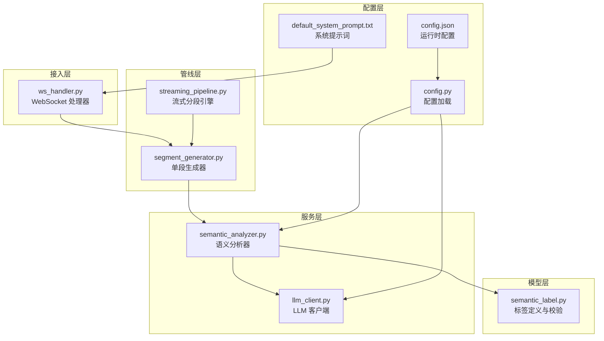
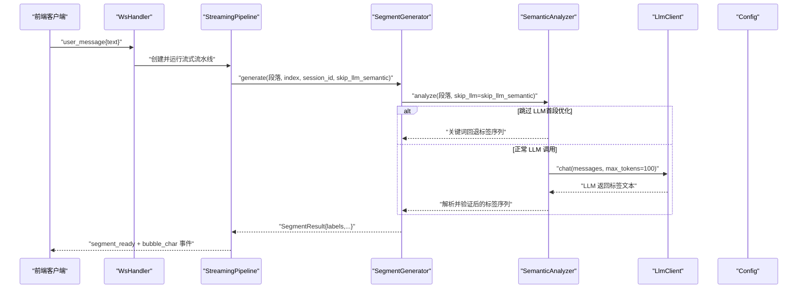
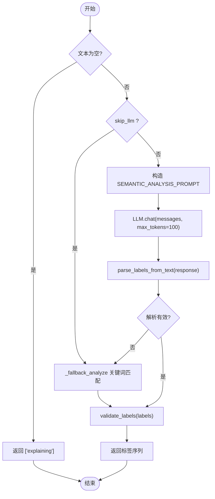
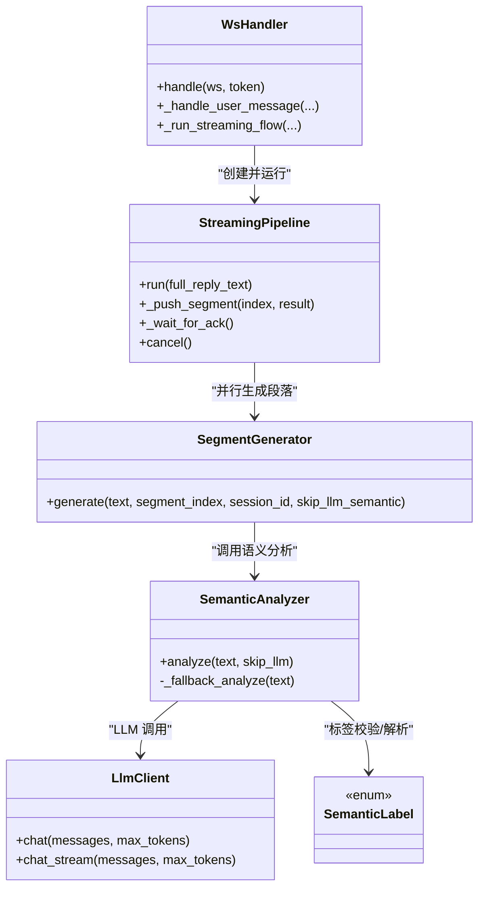

# 语义分析模块

<cite>
**本文引用的文件**
- [server/services/semantic_analyzer.py](file://server/services/semantic_analyzer.py)
- [server/models/semantic_label.py](file://server/models/semantic_label.py)
- [server/services/llm_client.py](file://server/services/llm_client.py)
- [server/pipeline/segment_generator.py](file://server/pipeline/segment_generator.py)
- [server/pipeline/streaming_pipeline.py](file://server/pipeline/streaming_pipeline.py)
- [server/api/ws_handler.py](file://server/api/ws_handler.py)
- [server/config.py](file://server/config.py)
- [server/resources/default_system_prompt.txt](file://server/resources/default_system_prompt.txt)
- [config.json](file://config.json)
</cite>

## 目录
1. [简介](#简介)
2. [项目结构](#项目结构)
3. [核心组件](#核心组件)
4. [架构总览](#架构总览)
5. [详细组件分析](#详细组件分析)
6. [依赖关系分析](#依赖关系分析)
7. [性能与实时性](#性能与实时性)
8. [故障排查指南](#故障排查指南)
9. [结论](#结论)
10. [附录：扩展与最佳实践](#附录扩展与最佳实践)

## 简介
本技术文档聚焦 RealTimeTalk 的“语义分析模块”，围绕文本语义理解、标签体系设计与实现、与 LLM 的集成方式，以及多语言支持、实时分析与批量处理等主题展开。当前仓库中的语义分析以“结构化标签序列”为核心目标，通过 LLM 提示词工程与关键词回退策略相结合，输出用于驱动虚拟人视频拼接与口型动画的标签序列（如 opening/body/closing 三类）。

需要特别说明的是：当前代码未实现显式的“情感识别（开心、悲伤、惊讶等）”“说话意图（询问、陈述、命令等）”“对话角色识别”等高级语义能力；这些能力可通过扩展标签体系与提示词工程逐步引入。

## 项目结构
语义分析相关的关键位置如下：
- 服务层：语义分析器、LLM 客户端
- 模型层：语义标签枚举与过渡规则
- 管线层：段落生成器、流式分段引擎
- 接入层：WebSocket 处理器（在用户消息流中触发语义分析）
- 配置层：系统提示词与全局配置

图表来源
- [server/api/ws_handler.py:130-188](file://server/api/ws_handler.py#L130-L188)
- [server/pipeline/segment_generator.py:42-138](file://server/pipeline/segment_generator.py#L42-L138)
- [server/pipeline/streaming_pipeline.py:44-131](file://server/pipeline/streaming_pipeline.py#L44-L131)
- [server/services/semantic_analyzer.py:35-86](file://server/services/semantic_analyzer.py#L35-L86)
- [server/services/llm_client.py:23-113](file://server/services/llm_client.py#L23-L113)
- [server/models/semantic_label.py:8-58](file://server/models/semantic_label.py#L8-L58)
- [server/config.py:148-241](file://server/config.py#L148-L241)
- [server/resources/default_system_prompt.txt:1-29](file://server/resources/default_system_prompt.txt#L1-L29)
- [config.json:1-39](file://config.json#L1-L39)

章节来源
- [server/api/ws_handler.py:130-188](file://server/api/ws_handler.py#L130-L188)
- [server/pipeline/segment_generator.py:42-138](file://server/pipeline/segment_generator.py#L42-L138)
- [server/pipeline/streaming_pipeline.py:44-131](file://server/pipeline/streaming_pipeline.py#L44-L131)
- [server/services/semantic_analyzer.py:35-86](file://server/services/semantic_analyzer.py#L35-L86)
- [server/services/llm_client.py:23-113](file://server/services/llm_client.py#L23-L113)
- [server/models/semantic_label.py:8-58](file://server/models/semantic_label.py#L8-L58)
- [server/config.py:148-241](file://server/config.py#L148-L241)
- [server/resources/default_system_prompt.txt:1-29](file://server/resources/default_system_prompt.txt#L1-L29)
- [config.json:1-39](file://config.json#L1-L39)

## 核心组件
- 语义分析器（SemanticAnalyzer）
  - 职责：接收一段文本，返回有序标签序列；优先调用 LLM，失败或首段优化时回退到关键词匹配。
  - 关键方法：analyze(text, skip_llm=False)。
- 标签模型（SemanticLabel + 工具函数）
  - 职责：定义合法标签集合与 opening/body/closing 分类，提供 validate_labels 与 parse_labels_from_text。
- LLM 客户端（LlmClient）
  - 职责：封装 OpenAI 兼容 Chat Completions API，支持非流式与流式两种模式，内置重试与错误解析。
- 段落生成器（SegmentGenerator）
  - 职责：串联 TTS → 语义分析 → FFmpeg 拼接 → MinIO 上传；将语义标签用于视频片段选择与混音。
- 流式分段引擎（StreamingPipeline）
  - 职责：按句切分、并行生成段落、首段就绪即推送、后续逐段确认式推送。
- WebSocket 处理器（WsHandler）
  - 职责：在用户消息进入后，构建 SegmentGenerator 并启动流式处理流程。

章节来源
- [server/services/semantic_analyzer.py:35-86](file://server/services/semantic_analyzer.py#L35-L86)
- [server/models/semantic_label.py:8-58](file://server/models/semantic_label.py#L8-L58)
- [server/services/llm_client.py:23-113](file://server/services/llm_client.py#L23-L113)
- [server/pipeline/segment_generator.py:42-138](file://server/pipeline/segment_generator.py#L42-L138)
- [server/pipeline/streaming_pipeline.py:44-131](file://server/pipeline/streaming_pipeline.py#L44-L131)
- [server/api/ws_handler.py:130-188](file://server/api/ws_handler.py#L130-L188)

## 架构总览
下图展示了从用户消息到语义分析再到视频生成的端到端流程，突出语义分析在其中的作用点。

图表来源
- [server/api/ws_handler.py:130-188](file://server/api/ws_handler.py#L130-L188)
- [server/pipeline/streaming_pipeline.py:44-131](file://server/pipeline/streaming_pipeline.py#L44-L131)
- [server/pipeline/segment_generator.py:42-138](file://server/pipeline/segment_generator.py#L42-L138)
- [server/services/semantic_analyzer.py:41-86](file://server/services/semantic_analyzer.py#L41-L86)
- [server/services/llm_client.py:40-113](file://server/services/llm_client.py#L40-L113)
- [server/config.py:148-241](file://server/config.py#L148-L241)

## 详细组件分析

### 语义分析器（SemanticAnalyzer）
- 设计要点
  - 双路径策略：优先 LLM 提示词分析，失败或首段优化时使用关键词回退。
  - 标签顺序约束：opening → body → closing，由 validate_labels 保证。
  - 空文本兜底：默认返回 explaining。
- 关键流程
  - analyze(text, skip_llm=False)
    - 若 skip_llm=True：直接走 _fallback_analyze。
    - 否则构造 SEMANTIC_ANALYSIS_PROMPT，调用 LLM.chat，解析返回为标签列表，再经 validate_labels 重排。
    - 异常捕获：LlmClientError 或其他异常均回退至关键词方案。
  - _fallback_analyze(text)
    - 基于中文关键词集合进行简单匹配，覆盖 opening/body/closing 三类标签。
- 可扩展点
  - 新增标签：在 semantic_label.py 的枚举与 OPENING_TAGS/BODY_TAGS/CLOSING_TAGS 中添加，并在 _fallback_analyze 补充关键词。
  - 调整提示词：修改 SEMANTIC_ANALYSIS_PROMPT，增强对特定领域或风格的引导。

图表来源
- [server/services/semantic_analyzer.py:41-86](file://server/services/semantic_analyzer.py#L41-L86)
- [server/services/semantic_analyzer.py:88-126](file://server/services/semantic_analyzer.py#L88-L126)
- [server/models/semantic_label.py:32-58](file://server/models/semantic_label.py#L32-L58)
- [server/models/semantic_label.py:61-80](file://server/models/semantic_label.py#L61-L80)

章节来源
- [server/services/semantic_analyzer.py:35-86](file://server/services/semantic_analyzer.py#L35-L86)
- [server/services/semantic_analyzer.py:88-126](file://server/services/semantic_analyzer.py#L88-L126)
- [server/models/semantic_label.py:8-58](file://server/models/semantic_label.py#L8-L58)
- [server/models/semantic_label.py:61-80](file://server/models/semantic_label.py#L61-L80)

### 标签体系与过渡规则（SemanticLabel）
- 标签集合
  - 包含 greeting、introduction、explaining、listing、emphasis、example、analysis、comparison、transition、conclusion、thanks 共 11 类。
- 分类与顺序
  - opening: {"greeting", "introduction"}
  - body: {"explaining", "listing", "emphasis", "example", "analysis", "comparison"}
  - closing: {"transition", "conclusion", "thanks"}
- 校验与重排
  - validate_labels 会过滤非法标签并按 opening → body → closing 顺序重组，确保分析结果符合结构约束。
- 解析器
  - parse_labels_from_text 支持逗号、空格分隔，忽略无关内容，提取已知标签。

章节来源
- [server/models/semantic_label.py:8-58](file://server/models/semantic_label.py#L8-L58)
- [server/models/semantic_label.py:61-80](file://server/models/semantic_label.py#L61-L80)

### LLM 客户端（LlmClient）
- 功能
  - chat：非流式请求，返回纯文本。
  - chat_stream：流式请求，逐 token 产出。
- 健壮性
  - 超时、连接错误、限流（429）、服务端错误（5xx）均有重试与等待逻辑。
  - 错误信息解析统一封装，便于上层定位问题。
- 配置来源
  - endpoint、api_key、model、max_tokens 来自 get_config()，最终来源于 config.json 与环境变量合并。

章节来源
- [server/services/llm_client.py:23-113](file://server/services/llm_client.py#L23-L113)
- [server/services/llm_client.py:115-190](file://server/services/llm_client.py#L115-L190)
- [server/config.py:148-241](file://server/config.py#L148-L241)
- [config.json:1-39](file://config.json#L1-L39)

### 段落生成器（SegmentGenerator）
- 流程
  - TTS 合成音频 → 语义分析得到 labels → FFmpeg 拼接视频 → 上传 MinIO（失败回退本地）。
- 语义分析集成
  - generate(text, segment_index, session_id, skip_llm_semantic=False) 中调用 SemanticAnalyzer.analyze。
  - 首段优化：skip_llm_semantic=True 可跳过 LLM，使用关键词回退，显著降低首段延迟。
- 输出
  - SegmentResult 包含 index、text、video_path、duration_ms、labels、error。

章节来源
- [server/pipeline/segment_generator.py:42-138](file://server/pipeline/segment_generator.py#L42-L138)

### 流式分段引擎（StreamingPipeline）
- 流程
  - 分句切段 → 并行生成所有段 → 首段就绪立即推送 → 后续段按 ack 推进。
- 语义分析策略
  - 默认对所有段设置 skip_llm_semantic=True，避免首段之外的额外 LLM 开销，提升整体吞吐。
- 事件
  - segment_ready、bubble_char、bubble_dismiss、state_change、all_completed 等。

章节来源
- [server/pipeline/streaming_pipeline.py:44-131](file://server/pipeline/streaming_pipeline.py#L44-L131)
- [server/pipeline/streaming_pipeline.py:132-214](file://server/pipeline/streaming_pipeline.py#L132-L214)

### WebSocket 处理器（WsHandler）
- 入口
  - handle_user_message 中创建 SegmentGenerator、StreamingPipeline，并后台启动流式处理。
- 语义分析参与点
  - 在生成每个段落时，传入 skip_llm_semantic=True，使语义分析快速回退，保障低延迟。
- 状态管理
  - thinking/speaking/idle 状态切换，配合前端播放确认机制。

章节来源
- [server/api/ws_handler.py:130-188](file://server/api/ws_handler.py#L130-L188)
- [server/api/ws_handler.py:189-341](file://server/api/ws_handler.py#L189-L341)

## 依赖关系分析
- 组件耦合
  - WsHandler 依赖 StreamingPipeline 与 SegmentGenerator。
  - SegmentGenerator 依赖 SemanticAnalyzer、TtsEngine、VideoConcat、MinioClient。
  - SemanticAnalyzer 依赖 LlmClient 与 semantic_label 工具。
  - LlmClient 依赖 config.get_config。
- 外部依赖
  - LLM 服务（OpenAI 兼容接口），MinIO 对象存储，FFmpeg 媒体处理。
- 潜在循环依赖
  - 当前未见循环导入；各模块职责清晰，分层明确。

图表来源
- [server/api/ws_handler.py:130-188](file://server/api/ws_handler.py#L130-L188)
- [server/pipeline/streaming_pipeline.py:44-131](file://server/pipeline/streaming_pipeline.py#L44-L131)
- [server/pipeline/segment_generator.py:42-138](file://server/pipeline/segment_generator.py#L42-L138)
- [server/services/semantic_analyzer.py:35-86](file://server/services/semantic_analyzer.py#L35-L86)
- [server/services/llm_client.py:23-113](file://server/services/llm_client.py#L23-L113)
- [server/models/semantic_label.py:8-58](file://server/models/semantic_label.py#L8-L58)

章节来源
- [server/api/ws_handler.py:130-188](file://server/api/ws_handler.py#L130-L188)
- [server/pipeline/streaming_pipeline.py:44-131](file://server/pipeline/streaming_pipeline.py#L44-L131)
- [server/pipeline/segment_generator.py:42-138](file://server/pipeline/segment_generator.py#L42-L138)
- [server/services/semantic_analyzer.py:35-86](file://server/services/semantic_analyzer.py#L35-L86)
- [server/services/llm_client.py:23-113](file://server/services/llm_client.py#L23-L113)
- [server/models/semantic_label.py:8-58](file://server/models/semantic_label.py#L8-L58)

## 性能与实时性
- 首段优化
  - 首段语义分析跳过 LLM，采用关键词回退，减少 2-6 秒延迟，显著提升首帧响应速度。
- 并行化
  - 流式分段引擎并行生成多个段落，首段就绪即推送，后续段按 ack 推进，兼顾低延迟与高吞吐。
- 网络与 I/O
  - LLM 客户端内置重试与超时控制；MinIO 上传失败自动回退本地路径，提高鲁棒性。
- 建议
  - 在高并发场景下，可考虑缓存常用关键词映射表，进一步降低 CPU 开销。
  - 针对长回复，合理调整句子边界检测阈值，避免过短段落导致频繁切换。

[本节为通用性能讨论，不直接分析具体文件]

## 故障排查指南
- LLM 调用失败
  - 现象：语义分析返回异常或回退到关键词匹配。
  - 排查：检查 LlmClientError 日志、API Key、endpoint、max_tokens 配置；确认网络连通性与限流情况。
- 标签解析失败
  - 现象：LLM 返回文本无法解析为合法标签。
  - 排查：查看 parse_labels_from_text 行为，必要时调整 SEMANTIC_ANALYSIS_PROMPT 以规范输出格式。
- 首段卡顿
  - 现象：首段迟迟未推送。
  - 排查：确认 skip_llm_semantic 是否生效；检查 TTS 与 FFmpeg 执行耗时；观察 Pipeline 的 ack 队列是否阻塞。
- MinIO 上传失败
  - 现象：视频路径回退到本地。
  - 排查：检查 MinIO 凭据与桶权限；确认 presigned URL 可达性。

章节来源
- [server/services/llm_client.py:62-113](file://server/services/llm_client.py#L62-L113)
- [server/services/semantic_analyzer.py:60-86](file://server/services/semantic_analyzer.py#L60-L86)
- [server/pipeline/segment_generator.py:86-138](file://server/pipeline/segment_generator.py#L86-L138)
- [server/pipeline/streaming_pipeline.py:172-214](file://server/pipeline/streaming_pipeline.py#L172-L214)

## 结论
当前语义分析模块以“结构化标签序列”为核心，结合 LLM 提示词与关键词回退策略，在保证低延迟的同时具备较好的鲁棒性。标签体系遵循 opening/body/closing 三段式结构，便于下游视频拼接与动画驱动。未来可在不破坏现有架构的前提下，扩展更丰富的语义维度（如情感、意图、角色），并通过提示词工程与规则库协同提升准确率。

[本节为总结性内容，不直接分析具体文件]

## 附录：扩展与最佳实践

### 如何调用 analyze_semantics（语义分析）
- 典型调用路径
  - 在段落生成阶段，SegmentGenerator.generate 内部调用 SemanticAnalyzer.analyze。
  - 如需独立调用，可直接实例化 SemanticAnalyzer(self.llm)，然后调用 analyze(text, skip_llm=False/True)。
- 示例参考路径
  - [server/pipeline/segment_generator.py:70-73](file://server/pipeline/segment_generator.py#L70-L73)
  - [server/services/semantic_analyzer.py:41-86](file://server/services/semantic_analyzer.py#L41-L86)

章节来源
- [server/pipeline/segment_generator.py:70-73](file://server/pipeline/segment_generator.py#L70-L73)
- [server/services/semantic_analyzer.py:41-86](file://server/services/semantic_analyzer.py#L41-L86)

### 自定义标签规则与扩展新类别
- 步骤
  - 在 semantic_label.py 的 SemanticLabel 枚举中添加新标签名。
  - 将新标签归入 OPENING_TAGS/BODY_TAGS/CLOSING_TAGS 之一。
  - 在 SemanticAnalyzer._fallback_analyze 中补充对应关键词集合。
  - 可选：更新 SEMANTIC_ANALYSIS_PROMPT，引导 LLM 输出新标签。
- 示例参考路径
  - [server/models/semantic_label.py:8-26](file://server/models/semantic_label.py#L8-L26)
  - [server/services/semantic_analyzer.py:88-126](file://server/services/semantic_analyzer.py#L88-L126)
  - [server/services/semantic_analyzer.py:12-32](file://server/services/semantic_analyzer.py#L12-L32)

章节来源
- [server/models/semantic_label.py:8-26](file://server/models/semantic_label.py#L8-L26)
- [server/services/semantic_analyzer.py:88-126](file://server/services/semantic_analyzer.py#L88-L126)
- [server/services/semantic_analyzer.py:12-32](file://server/services/semantic_analyzer.py#L12-L32)

### 与 LLM 集成的方式（提示词工程与上下文理解）
- 提示词工程
  - SEMANTIC_ANALYSIS_PROMPT 明确限定标签集合与输出格式，并要求遵循 opening/body/closing 的顺序。
- 上下文理解
  - 当前语义分析仅针对单段文本；如需上下文感知，可在上游聚合历史消息作为 prompt 的一部分。
- 配置与系统提示词
  - system_prompt 与 LLM 配置通过 config.py 与 config.json 注入，便于在不同环境切换。
- 示例参考路径
  - [server/services/semantic_analyzer.py:12-32](file://server/services/semantic_analyzer.py#L12-L32)
  - [server/config.py:148-241](file://server/config.py#L148-L241)
  - [server/resources/default_system_prompt.txt:1-29](file://server/resources/default_system_prompt.txt#L1-L29)
  - [config.json:1-39](file://config.json#L1-L39)

章节来源
- [server/services/semantic_analyzer.py:12-32](file://server/services/semantic_analyzer.py#L12-L32)
- [server/config.py:148-241](file://server/config.py#L148-L241)
- [server/resources/default_system_prompt.txt:1-29](file://server/resources/default_system_prompt.txt#L1-L29)
- [config.json:1-39](file://config.json#L1-L39)

### 多语言支持与实时分析
- 多语言支持
  - 关键词回退目前主要面向中文；如需英文或多语言，需在 _fallback_analyze 中增加相应语言的关键词集合。
- 实时分析
  - 流式分段引擎在收到 LLM 流式 token 后即切段并启动生成任务，语义分析首段跳过 LLM，确保低延迟。
- 示例参考路径
  - [server/services/semantic_analyzer.py:88-126](file://server/services/semantic_analyzer.py#L88-L126)
  - [server/pipeline/streaming_pipeline.py:44-131](file://server/pipeline/streaming_pipeline.py#L44-L131)

章节来源
- [server/services/semantic_analyzer.py:88-126](file://server/services/semantic_analyzer.py#L88-L126)
- [server/pipeline/streaming_pipeline.py:44-131](file://server/pipeline/streaming_pipeline.py#L44-L131)

### 批量处理实现细节
- 当前仓库未提供独立的批量语义分析 API；但可在业务层复用 SemanticAnalyzer.analyze 对多条文本进行批处理。
- 建议
  - 使用异步并发（如 asyncio.gather）批量调用 analyze，注意限制并发度以避免 LLM 限流。
  - 对每条文本单独设置 skip_llm 策略，平衡准确性与延迟。

[本节为概念性说明，不直接分析具体文件]

### 解决语义歧义、误判率与性能优化
- 语义歧义
  - 通过 refine 提示词，提供更明确的判别条件与示例；在 validate_labels 中加入更多顺序约束。
- 误判率
  - 扩大关键词库，覆盖常见表达变体；对高频误判样本进行回归测试与规则迭代。
- 性能优化
  - 保持首段 skip_llm；对长文本进行预切分，减少单次分析长度；缓存热点关键词映射。
- 示例参考路径
  - [server/services/semantic_analyzer.py:12-32](file://server/services/semantic_analyzer.py#L12-L32)
  - [server/models/semantic_label.py:32-58](file://server/models/semantic_label.py#L32-L58)
  - [server/services/semantic_analyzer.py:88-126](file://server/services/semantic_analyzer.py#L88-L126)

章节来源
- [server/services/semantic_analyzer.py:12-32](file://server/services/semantic_analyzer.py#L12-L32)
- [server/models/semantic_label.py:32-58](file://server/models/semantic_label.py#L32-L58)
- [server/services/semantic_analyzer.py:88-126](file://server/services/semantic_analyzer.py#L88-L126)