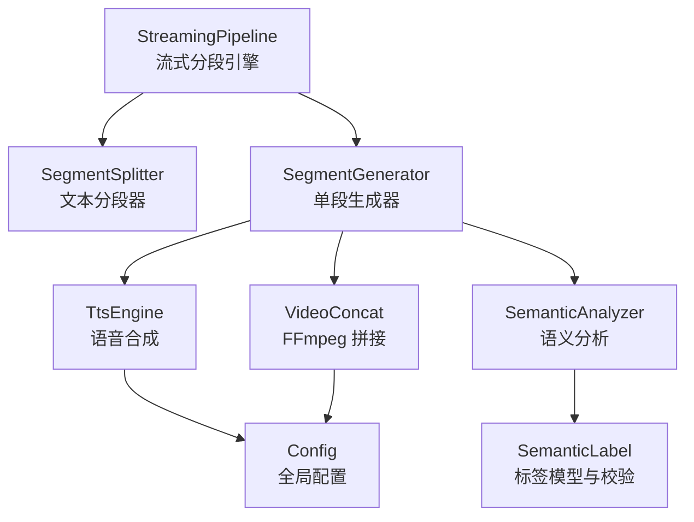
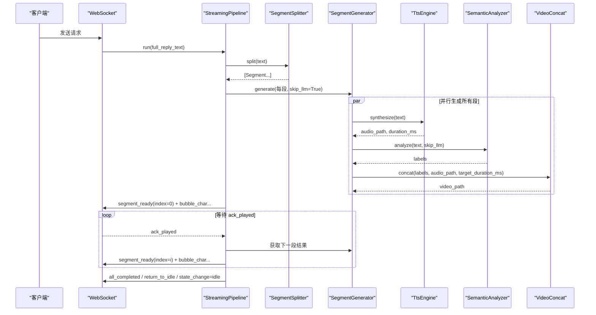
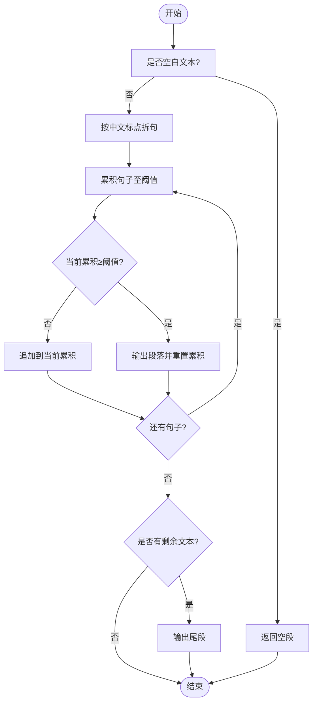
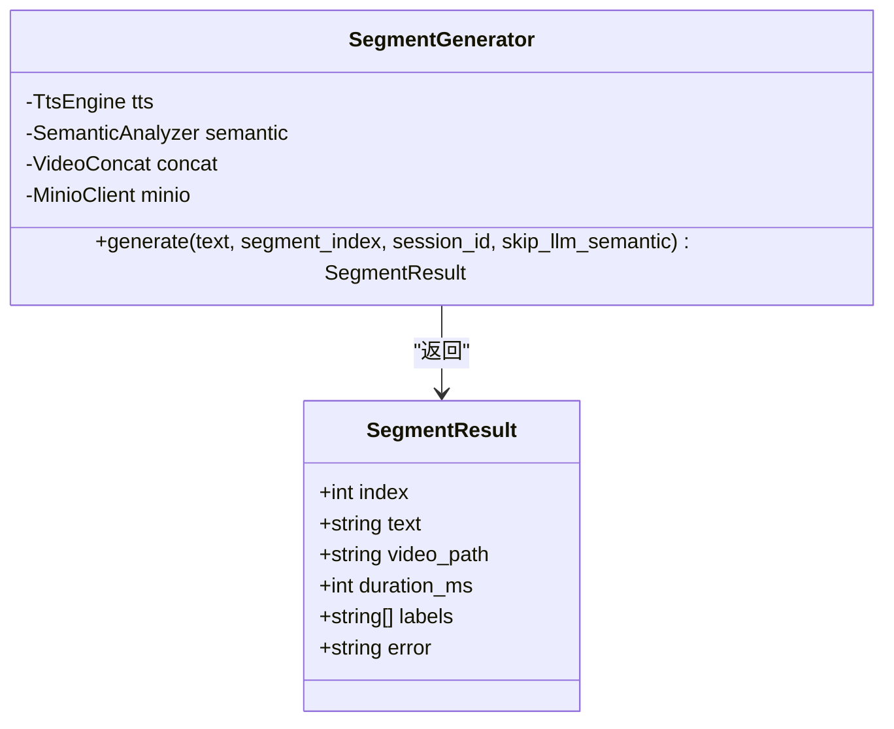
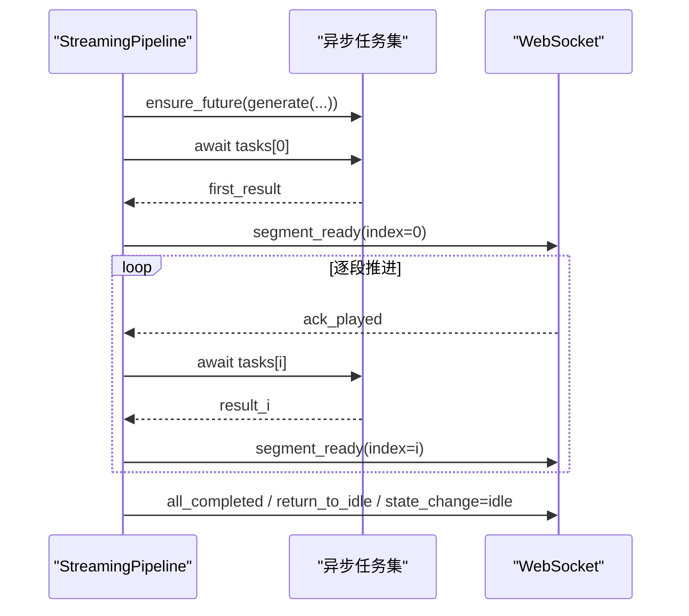
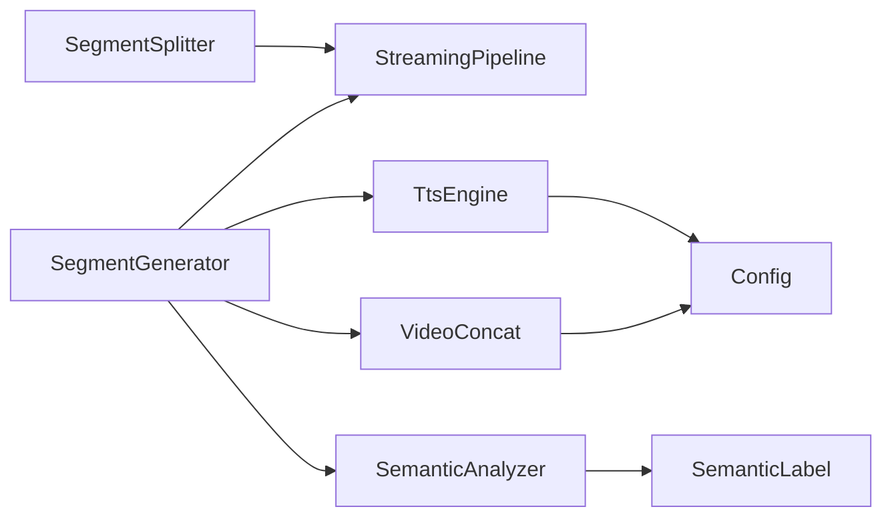

# 文本分段器

<cite>
**本文引用的文件**   
- [segment_splitter.py](file://server/pipeline/segment_splitter.py)
- [segment_generator.py](file://server/pipeline/segment_generator.py)
- [streaming_pipeline.py](file://server/pipeline/streaming_pipeline.py)
- [tts_engine.py](file://server/services/tts_engine.py)
- [semantic_analyzer.py](file://server/services/semantic_analyzer.py)
- [video_concat.py](file://server/services/video_concat.py)
- [semantic_label.py](file://server/models/semantic_label.py)
- [config.py](file://server/config.py)
</cite>

## 目录
1. [简介](#简介)
2. [项目结构](#项目结构)
3. [核心组件](#核心组件)
4. [架构总览](#架构总览)
5. [详细组件分析](#详细组件分析)
6. [依赖关系分析](#依赖关系分析)
7. [性能与内存考量](#性能与内存考量)
8. [故障排查指南](#故障排查指南)
9. [结论](#结论)
10. [附录：配置与使用示例](#附录配置与使用示例)

## 简介
本技术文档聚焦 RealTimeTalk 的“文本分段器”子系统，系统性阐述分句切段算法、中文标点处理规则、多语言支持策略、Segment 数据结构设计、边界检测逻辑与长度控制机制。同时说明长文本、特殊字符与异常输入的处理方式，给出分段参数配置与优化建议，并解释与流式管道的集成方式及性能考虑。目标是让初学者快速上手，也为有经验的开发者提供深入的技术细节。

## 项目结构
与文本分段相关的核心代码位于 server/pipeline 与相关服务模块中：
- 分段器：按中文句子分隔符拆分文本，并按阈值合并为段落
- 单段生成器：将段落送入 TTS → 语义分析 → FFmpeg 拼接 → MinIO 上传
- 流式管道：并行生成各段，首段就绪即推送，后续逐段确认式推进
- 辅助服务：TTS 引擎（含长文本拆分）、语义分析器（LLM 或关键词回退）、视频拼接器、标签模型与配置加载

图表来源
- [streaming_pipeline.py:1-214](file://server/pipeline/streaming_pipeline.py#L1-L214)
- [segment_splitter.py:1-95](file://server/pipeline/segment_splitter.py#L1-L95)
- [segment_generator.py:1-138](file://server/pipeline/segment_generator.py#L1-L138)
- [tts_engine.py:1-234](file://server/services/tts_engine.py#L1-L234)
- [semantic_analyzer.py:1-126](file://server/services/semantic_analyzer.py#L1-L126)
- [video_concat.py:1-174](file://server/services/video_concat.py#L1-L174)
- [semantic_label.py:1-80](file://server/models/semantic_label.py#L1-L80)
- [config.py:1-260](file://server/config.py#L1-L260)

章节来源
- [segment_splitter.py:1-95](file://server/pipeline/segment_splitter.py#L1-L95)
- [segment_generator.py:1-138](file://server/pipeline/segment_generator.py#L1-L138)
- [streaming_pipeline.py:1-214](file://server/pipeline/streaming_pipeline.py#L1-L214)

## 核心组件
- Segment 数据结构：用于承载每个段落的索引与文本内容
- SegmentSplitter：实现中文分句与段落合并的核心算法
- SegmentGenerator：封装单段从文本到视频的完整流程
- StreamingPipeline：编排分段与生成任务，负责并发、首段优先与前端交互
- 辅助能力：TtsEngine 长文本拆分、SemanticAnalyzer 标签生成、VideoConcat 切片拼接

章节来源
- [segment_splitter.py:18-23](file://server/pipeline/segment_splitter.py#L18-L23)
- [segment_splitter.py:25-95](file://server/pipeline/segment_splitter.py#L25-L95)
- [segment_generator.py:16-138](file://server/pipeline/segment_generator.py#L16-L138)
- [streaming_pipeline.py:16-214](file://server/pipeline/streaming_pipeline.py#L16-L214)

## 架构总览
下图展示了从完整回复文本到最终视频段的端到端流程，包括分段、并行生成、首段即时推送与后续确认式推进。

图表来源
- [streaming_pipeline.py:44-131](file://server/pipeline/streaming_pipeline.py#L44-L131)
- [segment_generator.py:42-138](file://server/pipeline/segment_generator.py#L42-L138)
- [tts_engine.py:49-226](file://server/services/tts_engine.py#L49-L226)
- [semantic_analyzer.py:41-126](file://server/services/semantic_analyzer.py#L41-L126)
- [video_concat.py:30-149](file://server/services/video_concat.py#L30-L149)

## 详细组件分析

### 文本分段器 SegmentSplitter
- 分句策略：以中文句号、感叹号、问号、分号作为句子边界，保留标点于句末
- 段落合并：累计句子长度达到阈值时切分为一段；尾部不足阈值的单独成段
- 边界保护：确保每段以完整句子结尾，避免截断语义
- 空文本处理：返回仅包含空字符串的单段，便于上层统一处理
- 长度控制：默认阈值 50 字，可通过构造参数调整

图表来源
- [segment_splitter.py:31-76](file://server/pipeline/segment_splitter.py#L31-L76)
- [segment_splitter.py:78-89](file://server/pipeline/segment_splitter.py#L78-L89)

章节来源
- [segment_splitter.py:11-15](file://server/pipeline/segment_splitter.py#L11-L15)
- [segment_splitter.py:18-23](file://server/pipeline/segment_splitter.py#L18-L23)
- [segment_splitter.py:25-95](file://server/pipeline/segment_splitter.py#L25-L95)

#### 中文文本分割策略与标点符号处理规则
- 支持的句子分隔符：句号、感叹号、问号、分号
- 标点保留：标点附在句末，保证语义完整性
- 非标准标点：未覆盖的英文标点或其他语言标点不会触发切分，需扩展分隔符集合

#### 多语言支持
- 当前实现针对中文标点进行切分，对英文等其它语言的句子边界识别有限
- 如需增强多语言支持，可扩展分隔符集合或使用更通用的 NLP 分句库

#### 长度控制机制
- 通过 threshold 控制段落最小长度，默认 50 字
- 当累积长度达到阈值时立即切段，避免过长段落影响首段延迟

#### 边界检测逻辑
- 仅在检测到句子分隔符时切分，确保不破坏语义
- 尾部不足阈值的文本仍会作为独立段落输出，防止丢失内容

#### 异常输入与鲁棒性
- 空白文本直接返回空段，避免上层崩溃
- 无分隔符的整段文本会被整体作为一段返回，保障可用性

#### 复杂度分析
- 时间复杂度：O(n)，n 为文本长度（逐字符扫描）
- 空间复杂度：O(n)，存储句子列表与累积文本

章节来源
- [segment_splitter.py:31-76](file://server/pipeline/segment_splitter.py#L31-L76)
- [segment_splitter.py:78-89](file://server/pipeline/segment_splitter.py#L78-L89)

### Segment 数据结构设计
- 字段：index（段落序号）、text（段落文本）
- 用途：贯穿分段、生成与推送全流程，保持上下文一致性

章节来源
- [segment_splitter.py:18-23](file://server/pipeline/segment_splitter.py#L18-L23)

### 单段生成器 SegmentGenerator
- 流程：TTS 合成 → 语义分析 → FFmpeg 拼接 → MinIO 上传（失败回退本地）
- 错误处理：捕获 TTS 与视频拼接异常，返回带 error 的结果对象
- 首段优化：skip_llm_semantic=True 跳过 LLM 调用，使用关键词回退，显著降低首段延迟

图表来源
- [segment_generator.py:16-138](file://server/pipeline/segment_generator.py#L16-L138)

章节来源
- [segment_generator.py:42-138](file://server/pipeline/segment_generator.py#L42-L138)

### 流式管道 StreamingPipeline
- 并行生成：使用 asyncio.ensure_future 启动所有段的任务，首段完成后立即推送
- 首段优先：首段跳过 LLM 语义分析，减少首段延迟
- 确认式推进：等待前端 ack_played 后再推送下一段，避免拥塞
- 打字机效果：按字符推送气泡事件，间隔受视频时长限制
- 取消与错误：支持 cancel 信号与错误事件推送，保证健壮性

图表来源
- [streaming_pipeline.py:44-131](file://server/pipeline/streaming_pipeline.py#L44-L131)
- [streaming_pipeline.py:132-197](file://server/pipeline/streaming_pipeline.py#L132-L197)

章节来源
- [streaming_pipeline.py:16-214](file://server/pipeline/streaming_pipeline.py#L16-L214)

### TTS 引擎长文本处理
- 长文本判定：超过 450 字时自动拆分
- 拆分策略：按中文句子边界切分，再合并短句以满足 ≤450 字限制
- 拼接策略：分别合成后使用 FFmpeg concat 合并为一个 MP3 文件
- 时长估算：基于文件大小粗略估算音频时长，用于视频对齐

章节来源
- [tts_engine.py:72-76](file://server/services/tts_engine.py#L72-L76)
- [tts_engine.py:169-226](file://server/services/tts_engine.py#L169-L226)

### 语义分析与标签模型
- 语义分析：优先 LLM 解析，失败则回退关键词匹配
- 标签验证：强制 opening → body → closing 顺序，过滤非法标签
- 首段优化：skip_llm 时使用关键词回退，节省 2-6 秒

章节来源
- [semantic_analyzer.py:41-126](file://server/services/semantic_analyzer.py#L41-L126)
- [semantic_label.py:32-80](file://server/models/semantic_label.py#L32-L80)

### 视频拼接 VideoConcat
- 切片选择：根据标签序列选择对应 .webm 片段
- 时长对齐：若自然时长不足目标时长，循环填充最后一个切片
- 混音输出：使用 FFmpeg concat demuxer 与 Opus 编码输出 .webm

章节来源
- [video_concat.py:30-149](file://server/services/video_concat.py#L30-L149)

## 依赖关系分析
- 低耦合高内聚：分段器仅依赖基础类型与日志；生成器组合多个服务；管道编排任务
- 外部依赖：TTS 服务、LLM 服务、FFmpeg、MinIO 存储
- 潜在风险：FFmpeg 路径与 GPU 编码器配置、网络超时与限流、磁盘 I/O 瓶颈

图表来源
- [segment_splitter.py:1-95](file://server/pipeline/segment_splitter.py#L1-L95)
- [segment_generator.py:1-138](file://server/pipeline/segment_generator.py#L1-L138)
- [streaming_pipeline.py:1-214](file://server/pipeline/streaming_pipeline.py#L1-L214)
- [tts_engine.py:1-234](file://server/services/tts_engine.py#L1-L234)
- [semantic_analyzer.py:1-126](file://server/services/semantic_analyzer.py#L1-L126)
- [video_concat.py:1-174](file://server/services/video_concat.py#L1-L174)
- [semantic_label.py:1-80](file://server/models/semantic_label.py#L1-L80)
- [config.py:1-260](file://server/config.py#L1-L260)

章节来源
- [config.py:148-260](file://server/config.py#L148-L260)

## 性能与内存考量
- 首段延迟优化：首段跳过 LLM 语义分析，显著缩短首段响应时间
- 并发控制：TTS 使用全局信号量限制并发，避免 API 限流
- 文本长度控制：分段阈值与 TTS 长文本拆分共同控制单次处理规模
- 内存占用：逐段处理与临时文件清理，避免长时间驻留大对象
- I/O 与网络：MinIO 上传失败回退本地，提升容错；FFmpeg 执行超时保护

章节来源
- [streaming_pipeline.py:66-94](file://server/pipeline/streaming_pipeline.py#L66-L94)
- [tts_engine.py:16-17](file://server/services/tts_engine.py#L16-L17)
- [tts_engine.py:169-226](file://server/services/tts_engine.py#L169-L226)
- [segment_generator.py:86-106](file://server/pipeline/segment_generator.py#L86-L106)
- [video_concat.py:116-149](file://server/services/video_concat.py#L116-L149)

## 故障排查指南
- 分段为空或异常：检查输入是否为空白文本；确认分隔符集合是否覆盖实际标点
- 首段延迟过高：确认是否启用 skip_llm_semantic；检查 LLM 服务可用性与超时设置
- TTS 失败或限流：查看全局信号量并发数；检查 API Key 与网络连通性；关注 429 限流
- 视频拼接失败：确认 FFmpeg 可执行路径与环境变量；检查切片文件是否存在；查看 stderr 日志
- MinIO 上传失败：检查凭证与桶权限；确认 presigned URL 可达性；回退本地路径是否正常

章节来源
- [segment_splitter.py:47-48](file://server/pipeline/segment_splitter.py#L47-L48)
- [segment_generator.py:108-137](file://server/pipeline/segment_generator.py#L108-L137)
- [tts_engine.py:100-167](file://server/services/tts_engine.py#L100-L167)
- [video_concat.py:133-149](file://server/services/video_concat.py#L133-L149)

## 结论
RealTimeTalk 的文本分段器采用简洁高效的中文分句与阈值合并策略，结合流式管道的并行生成与首段优先推送，实现了低延迟与高吞吐的视频化对话体验。通过 TTS 长文本拆分、语义分析回退与视频拼接容错，系统在准确性、边界处理与内存使用方面具备良好鲁棒性。建议在多语言场景下扩展分句策略，并根据业务需求调优分段阈值与并发参数。

## 附录：配置与使用示例
- 分段阈值配置：通过 SegmentSplitter 构造参数调整 threshold，默认 50 字
- 首段优化：在生成器调用时传入 skip_llm_semantic=True，跳过 LLM 语义分析
- 长文本处理：TTS 内部自动拆分与拼接，无需额外配置
- 环境变量与 JSON 配置：通过 config.py 加载，优先级为环境变量 > config.json

章节来源
- [segment_splitter.py:28-29](file://server/pipeline/segment_splitter.py#L28-L29)
- [segment_generator.py:42-63](file://server/pipeline/segment_generator.py#L42-L63)
- [tts_engine.py:169-226](file://server/services/tts_engine.py#L169-L226)
- [config.py:148-260](file://server/config.py#L148-L260)