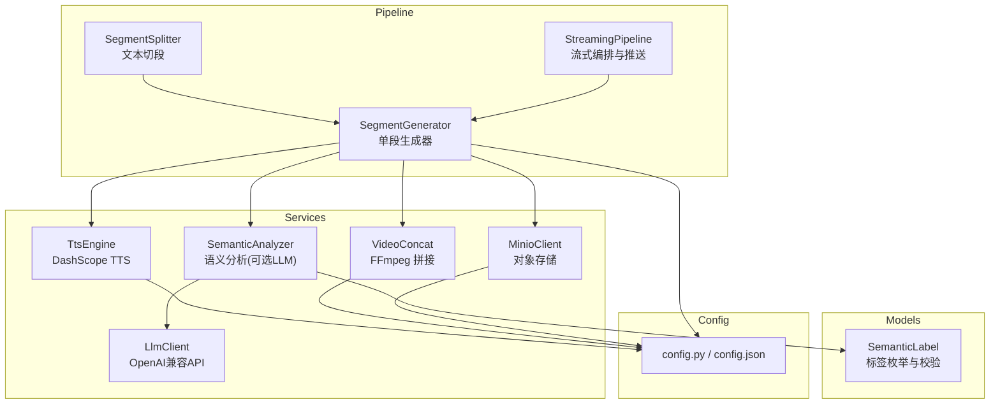
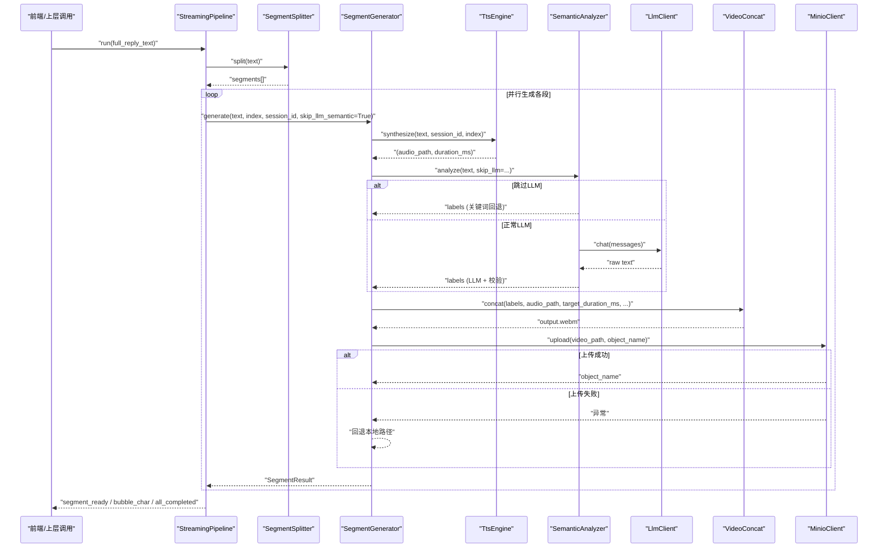
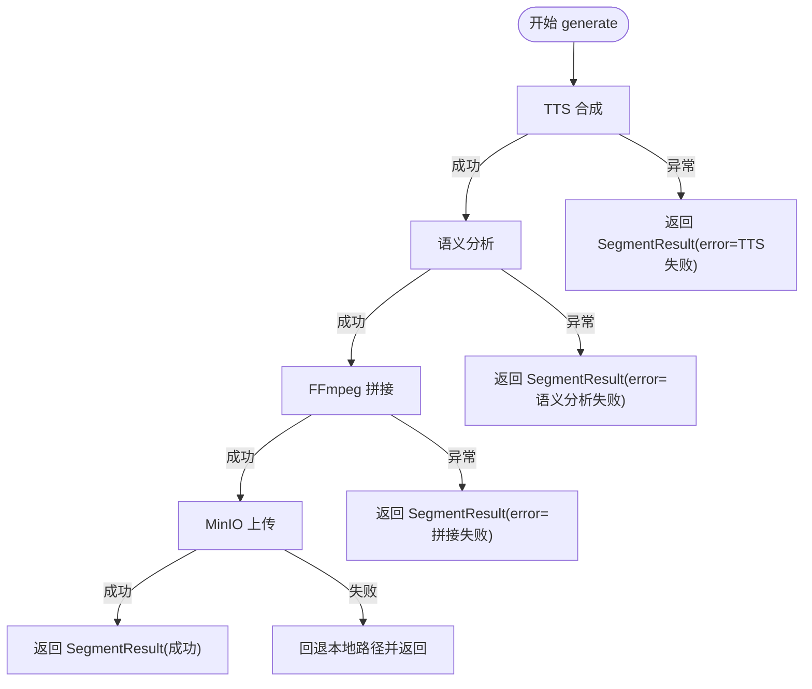
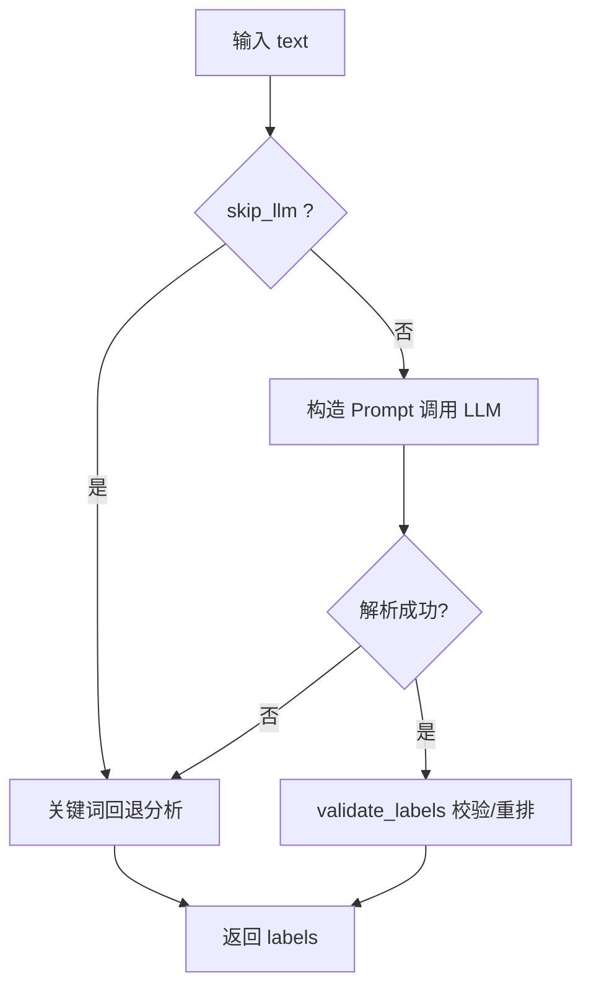
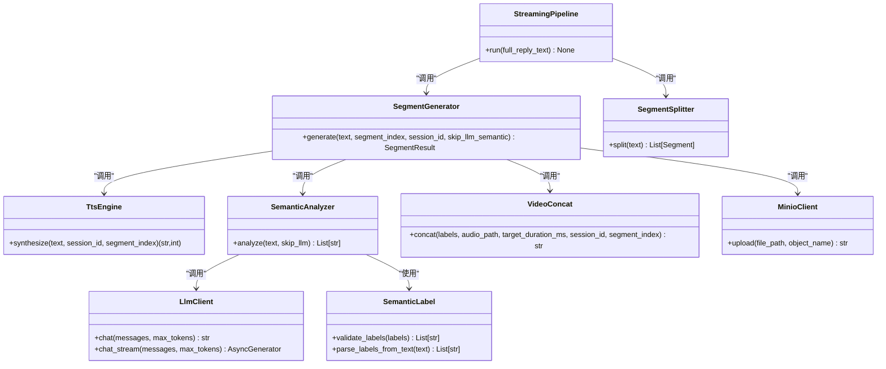

# 段落生成器

<cite>
**本文引用的文件**
- [segment_generator.py](file://server/pipeline/segment_generator.py)
- [tts_engine.py](file://server/services/tts_engine.py)
- [semantic_analyzer.py](file://server/services/semantic_analyzer.py)
- [video_concat.py](file://server/services/video_concat.py)
- [minio_client.py](file://server/services/minio_client.py)
- [llm_client.py](file://server/services/llm_client.py)
- [semantic_label.py](file://server/models/semantic_label.py)
- [streaming_pipeline.py](file://server/pipeline/streaming_pipeline.py)
- [segment_splitter.py](file://server/pipeline/segment_splitter.py)
- [config.py](file://server/config.py)
- [config.json](file://config.json)
</cite>

## 目录
1. [简介](#简介)
2. [项目结构](#项目结构)
3. [核心组件](#核心组件)
4. [架构总览](#架构总览)
5. [详细组件分析](#详细组件分析)
6. [依赖关系分析](#依赖关系分析)
7. [性能与优化](#性能与优化)
8. [故障排查指南](#故障排查指南)
9. [结论](#结论)
10. [附录：扩展与自定义示例](#附录扩展与自定义示例)

## 简介
本技术文档聚焦于 RealTimeTalk 的“段落生成器”，深入解释单段内容从文本到最终可播放视频的完整流程，包括 TTS 语音合成、语义分析与视频片段拼接的协调机制。文档覆盖 SegmentResult 数据结构、生成状态管理、错误处理策略、skip_llm_semantic 优化模式的工作原理与性能收益，以及与外部服务（TTS 引擎、语义分析器、MinIO 存储）的交互模式和超时处理。同时提供并发安全、资源管理与故障恢复的实践建议，并给出扩展新步骤和自定义处理逻辑的具体方法。

## 项目结构
RealTimeTalk 后端采用分层与按功能域组织的方式：
- pipeline：编排与流式推送（分段、生成、推送）
- services：对外部服务的封装（TTS、LLM、视频拼接、MinIO）
- models：领域模型与规则（语义标签枚举与校验）
- config：配置加载与环境变量覆盖

图表来源
- [segment_generator.py:1-138](file://server/pipeline/segment_generator.py#L1-L138)
- [streaming_pipeline.py:1-214](file://server/pipeline/streaming_pipeline.py#L1-L214)
- [segment_splitter.py:1-95](file://server/pipeline/segment_splitter.py#L1-L95)
- [tts_engine.py:1-234](file://server/services/tts_engine.py#L1-L234)
- [semantic_analyzer.py:1-126](file://server/services/semantic_analyzer.py#L1-L126)
- [video_concat.py:1-174](file://server/services/video_concat.py#L1-L174)
- [minio_client.py:1-139](file://server/services/minio_client.py#L1-L139)
- [llm_client.py:1-204](file://server/services/llm_client.py#L1-L204)
- [semantic_label.py:1-80](file://server/models/semantic_label.py#L1-L80)
- [config.py:1-260](file://server/config.py#L1-L260)
- [config.json:1-39](file://config.json#L1-L39)

章节来源
- [segment_generator.py:1-138](file://server/pipeline/segment_generator.py#L1-L138)
- [streaming_pipeline.py:1-214](file://server/pipeline/streaming_pipeline.py#L1-L214)
- [segment_splitter.py:1-95](file://server/pipeline/segment_splitter.py#L1-L95)
- [tts_engine.py:1-234](file://server/services/tts_engine.py#L1-L234)
- [semantic_analyzer.py:1-126](file://server/services/semantic_analyzer.py#L1-L126)
- [video_concat.py:1-174](file://server/services/video_concat.py#L1-L174)
- [minio_client.py:1-139](file://server/services/minio_client.py#L1-L139)
- [llm_client.py:1-204](file://server/services/llm_client.py#L1-L204)
- [semantic_label.py:1-80](file://server/models/semantic_label.py#L1-L80)
- [config.py:1-260](file://server/config.py#L1-L260)
- [config.json:1-39](file://config.json#L1-L39)

## 核心组件
- SegmentGenerator：单段生成器，串联 TTS → 语义分析 → FFmpeg 拼接 → MinIO 上传，返回 SegmentResult。
- SegmentResult：包含 index、text、video_path、duration_ms、labels、error 等字段，用于描述一段生成的结果。
- StreamingPipeline：接收完整回复文本，分句切段后并行生成各段，首段就绪即推送到前端，后续段按确认式推进。
- TtsEngine：调用 DashScope 多模态接口进行语音合成，支持长文本拆分与合并，限制并发避免限流。
- SemanticAnalyzer：通过 LLM 或关键词回退方案输出标签序列，支持 skip_llm 首段优化。
- VideoConcat：根据标签选择切片，构建 concat 列表，使用 FFmpeg 将视频切片与音频混音为 .webm。
- MinioClient：封装上传、存在性检查、预签名 URL 生成等操作，具备可用性检测与降级能力。
- LlmClient：OpenAI 兼容 API 客户端，支持非流式与流式对话，内置重试与错误解析。
- SemanticLabel：定义 11 种语义标签及 opening/body/closing 过渡规则，提供解析与校验函数。
- SegmentSplitter：按中文标点切分为句子，再聚合为段落，保证每段以完整句子结尾。
- Config：统一配置加载，环境变量优先覆盖 JSON 配置。

章节来源
- [segment_generator.py:16-138](file://server/pipeline/segment_generator.py#L16-L138)
- [streaming_pipeline.py:16-214](file://server/pipeline/streaming_pipeline.py#L16-L214)
- [tts_engine.py:38-234](file://server/services/tts_engine.py#L38-L234)
- [semantic_analyzer.py:35-126](file://server/services/semantic_analyzer.py#L35-L126)
- [video_concat.py:20-174](file://server/services/video_concat.py#L20-L174)
- [minio_client.py:21-139](file://server/services/minio_client.py#L21-L139)
- [llm_client.py:23-204](file://server/services/llm_client.py#L23-L204)
- [semantic_label.py:8-80](file://server/models/semantic_label.py#L8-L80)
- [segment_splitter.py:25-95](file://server/pipeline/segment_splitter.py#L25-L95)
- [config.py:73-260](file://server/config.py#L73-L260)

## 架构总览
下图展示了单段生成的端到端流程以及关键的外部服务交互点。

图表来源
- [streaming_pipeline.py:44-131](file://server/pipeline/streaming_pipeline.py#L44-L131)
- [segment_splitter.py:31-76](file://server/pipeline/segment_splitter.py#L31-L76)
- [segment_generator.py:42-138](file://server/pipeline/segment_generator.py#L42-L138)
- [tts_engine.py:49-167](file://server/services/tts_engine.py#L49-L167)
- [semantic_analyzer.py:41-86](file://server/services/semantic_analyzer.py#L41-L86)
- [llm_client.py:40-113](file://server/services/llm_client.py#L40-L113)
- [video_concat.py:30-72](file://server/services/video_concat.py#L30-L72)
- [minio_client.py:69-90](file://server/services/minio_client.py#L69-L90)

## 详细组件分析

### SegmentResult 数据结构与状态管理
- 字段说明
  - index：段落序号
  - text：该段文本
  - video_path：MinIO object name 或本地路径（上传失败时回退）
  - duration_ms：音频时长估算（毫秒）
  - labels：语义标签序列
  - error：错误信息（当某一步骤失败时填充）
- 状态流转
  - 成功：video_path 指向可用资源（优先 MinIO），error 为空
  - 失败：video_path 为空，error 包含具体错误原因（如 TTS 失败、拼接失败、未知异常）
- 并发与线程安全
  - SegmentResult 为不可变数据类，由异步任务产出，无共享可变状态，天然线程安全
- 典型用法
  - 在 StreamingPipeline 中，首段完成后立即推送 segment_ready；若 result.error 非空则推送 error 并回到 idle

章节来源
- [segment_generator.py:16-25](file://server/pipeline/segment_generator.py#L16-L25)
- [segment_generator.py:108-137](file://server/pipeline/segment_generator.py#L108-L137)
- [streaming_pipeline.py:86-131](file://server/pipeline/streaming_pipeline.py#L86-L131)

### SegmentGenerator 单段生成流程
- 流程步骤
  1) TTS 合成：调用 TtsEngine.synthesize，返回音频路径与时长
  2) 语义分析：调用 SemanticAnalyzer.analyze，支持 skip_llm 首段优化
  3) 视频拼接：调用 VideoConcat.concat，基于标签选择切片并混入音频
  4) 上传 MinIO：尝试上传，失败则回退本地路径
- 错误处理
  - 捕获 TtsError、VideoConcatError 与通用异常，构造带 error 的 SegmentResult
  - MinIO 上传异常记录警告并回退本地路径，确保下游仍可播放
- 日志与可观测性
  - 每个阶段均有日志输出，便于定位问题

图表来源
- [segment_generator.py:42-138](file://server/pipeline/segment_generator.py#L42-L138)

章节来源
- [segment_generator.py:42-138](file://server/pipeline/segment_generator.py#L42-L138)

### TtsEngine 语音合成与并发控制
- 并发限制
  - 使用全局信号量限制并发请求数，避免触发 DashScope 429 限流
- 长文本处理
  - 超过阈值时按句子边界拆分，分别合成后再用 FFmpeg 拼接为单个 MP3
- 超时与错误
  - 提交任务后轮询结果，设置最大等待次数；下载音频失败抛出 TtsError
  - 同步返回路径直接估算时长，异步返回通过 task_status 判断成功/失败
- 外部依赖
  - httpx 异步 HTTP 客户端，DashScope 多模态生成接口

章节来源
- [tts_engine.py:16-17](file://server/services/tts_engine.py#L16-L17)
- [tts_engine.py:49-167](file://server/services/tts_engine.py#L49-L167)
- [tts_engine.py:169-226](file://server/services/tts_engine.py#L169-L226)

### SemanticAnalyzer 语义分析与 skip_llm_semantic 优化
- 正常模式
  - 构造 Prompt 调用 LLM，解析返回文本为标签序列，并进行 validate_labels 校验与重排
- 首段优化（skip_llm_semantic）
  - 跳过 LLM 调用，直接使用关键词匹配快速回退，节省 2-6 秒首段延迟
- 容错与降级
  - LLM 调用失败或解析失败均回退到关键词方案，确保稳定产出标签
- 标签规则
  - 遵循 opening → body → closing 的顺序约束，保证动画切换合理

图表来源
- [semantic_analyzer.py:41-86](file://server/services/semantic_analyzer.py#L41-L86)
- [semantic_analyzer.py:88-126](file://server/services/semantic_analyzer.py#L88-L126)
- [semantic_label.py:32-58](file://server/models/semantic_label.py#L32-L58)

章节来源
- [semantic_analyzer.py:41-86](file://server/services/semantic_analyzer.py#L41-L86)
- [semantic_analyzer.py:88-126](file://server/services/semantic_analyzer.py#L88-L126)
- [semantic_label.py:8-80](file://server/models/semantic_label.py#L8-L80)

### VideoConcat 视频切片拼接与混音
- 切片选择
  - 根据 labels 从 clips/.webm 目录中选择对应标签的切片文件
- 时长对齐
  - 每个切片固定时长，不足目标时长时循环最后一个切片填充
- FFmpeg 执行
  - 使用 concat demuxer 与音频混音，输出 .webm；设置超时与错误码处理
- 资源清理
  - 拼接完成后删除临时 concat 列表文件

章节来源
- [video_concat.py:30-72](file://server/services/video_concat.py#L30-L72)
- [video_concat.py:74-114](file://server/services/video_concat.py#L74-L114)
- [video_concat.py:116-149](file://server/services/video_concat.py#L116-L149)

### MinioClient 对象存储交互与降级
- 连接与可用性
  - 初始化时创建客户端，标记 availability；bucket 不存在则自动创建
- 上传与回退
  - 上传失败抛出 MinioClientError；SegmentGenerator 捕获后回退本地路径
- 预签名 URL
  - 生成 GET 访问链接，支持过期时间配置

章节来源
- [minio_client.py:21-67](file://server/services/minio_client.py#L21-L67)
- [minio_client.py:69-90](file://server/services/minio_client.py#L69-L90)
- [minio_client.py:102-124](file://server/services/minio_client.py#L102-L124)

### LlmClient 外部 LLM 服务交互
- 非流式与流式
  - chat 返回纯文本；chat_stream 逐 token 产出
- 重试与错误
  - 对 429、5xx、超时、连接错误进行重试与延时；错误消息解析统一化
- 配置
  - endpoint、api_key、model、max_tokens 来自配置中心

章节来源
- [llm_client.py:23-113](file://server/services/llm_client.py#L23-L113)
- [llm_client.py:115-190](file://server/services/llm_client.py#L115-L190)
- [llm_client.py:192-204](file://server/services/llm_client.py#L192-L204)

### StreamingPipeline 流式编排与推送
- 并行生成
  - 所有段并行启动生成任务，首段完成后立即推送，后续段按 ack 推进
- 打字机效果
  - 按字符推送 bubble_char，间隔受视频时长与长度限制
- 取消与错误
  - 支持 cancel 事件，遇到错误推送 error 并回到 idle

章节来源
- [streaming_pipeline.py:44-131](file://server/pipeline/streaming_pipeline.py#L44-L131)
- [streaming_pipeline.py:132-197](file://server/pipeline/streaming_pipeline.py#L132-L197)
- [streaming_pipeline.py:199-214](file://server/pipeline/streaming_pipeline.py#L199-L214)

### SegmentSplitter 文本切段
- 算法要点
  - 按中文标点拆句，累积至阈值形成段落，尾部不足单独成段
- 输出
  - 每段包含 index 与 text，保证以完整句子结尾

章节来源
- [segment_splitter.py:25-76](file://server/pipeline/segment_splitter.py#L25-L76)

### 配置系统
- 优先级
  - 环境变量 > config.json；支持嵌套路径取值与默认值
- 主要模块
  - llm、tts、avatar、redis、minio、server、ffmpeg、qdrant、embedding、rag 等

章节来源
- [config.py:148-241](file://server/config.py#L148-L241)
- [config.json:1-39](file://config.json#L1-L39)

## 依赖关系分析
- 组件耦合
  - SegmentGenerator 强依赖 TtsEngine、SemanticAnalyzer、VideoConcat、MinioClient
  - SemanticAnalyzer 依赖 LlmClient 与 SemanticLabel
  - StreamingPipeline 依赖 SegmentSplitter 与 SegmentGenerator
- 外部依赖
  - httpx（HTTP 客户端）、FFmpeg（媒体处理）、MinIO（对象存储）、DashScope（TTS/LLM）
- 潜在环路与风险
  - 当前无循环依赖；注意 TTS 与 LLM 的并发与限流策略，避免雪崩

图表来源
- [segment_generator.py:27-41](file://server/pipeline/segment_generator.py#L27-L41)
- [tts_engine.py:38-47](file://server/services/tts_engine.py#L38-L47)
- [semantic_analyzer.py:35-39](file://server/services/semantic_analyzer.py#L35-L39)
- [video_concat.py:20-28](file://server/services/video_concat.py#L20-L28)
- [minio_client.py:21-32](file://server/services/minio_client.py#L21-L32)
- [llm_client.py:23-32](file://server/services/llm_client.py#L23-L32)
- [semantic_label.py:8-29](file://server/models/semantic_label.py#L8-L29)
- [streaming_pipeline.py:16-43](file://server/pipeline/streaming_pipeline.py#L16-L43)
- [segment_splitter.py:25-29](file://server/pipeline/segment_splitter.py#L25-L29)

章节来源
- [segment_generator.py:27-41](file://server/pipeline/segment_generator.py#L27-L41)
- [semantic_analyzer.py:35-39](file://server/services/semantic_analyzer.py#L35-L39)
- [streaming_pipeline.py:16-43](file://server/pipeline/streaming_pipeline.py#L16-L43)

## 性能与优化
- skip_llm_semantic 优化
  - 首段跳过 LLM 语义分析，使用关键词回退，显著降低首段延迟（约 2-6 秒）
  - 在 StreamingPipeline 中默认对所有段启用关键词回退，进一步减少 LLM 调用开销
- 并发控制
  - TTS 使用全局信号量限制并发，避免 429 限流
  - 段落生成任务并行启动，首段就绪即推送，提升整体响应速度
- 资源管理
  - FFmpeg 命令设置超时，避免长时间阻塞
  - 临时文件（concat 列表、分段 MP3）在完成后清理，防止磁盘占用
- 网络与 I/O
  - 使用 httpx 异步客户端，减少阻塞
  - MinIO 上传失败回退本地路径，保障播放连续性

章节来源
- [streaming_pipeline.py:66-76](file://server/pipeline/streaming_pipeline.py#L66-L76)
- [tts_engine.py:16-17](file://server/services/tts_engine.py#L16-L17)
- [video_concat.py:133-149](file://server/services/video_concat.py#L133-L149)
- [segment_generator.py:86-106](file://server/pipeline/segment_generator.py#L86-L106)

## 故障排查指南
- TTS 失败
  - 现象：SegmentResult.error 包含 “TTS 失败”
  - 排查：检查 API Key、网络连通性、DashScope 任务状态与音频下载 URL
  - 参考实现
    - [tts_engine.py:100-167](file://server/services/tts_engine.py#L100-L167)
    - [segment_generator.py:108-117](file://server/pipeline/segment_generator.py#L108-L117)
- 语义分析失败
  - 现象：LLM 调用异常或解析失败，自动回退关键词方案
  - 排查：检查 LLM endpoint、API Key、Prompt 格式与返回内容
  - 参考实现
    - [semantic_analyzer.py:60-86](file://server/services/semantic_analyzer.py#L60-L86)
    - [llm_client.py:64-113](file://server/services/llm_client.py#L64-L113)
- 视频拼接失败
  - 现象：SegmentResult.error 包含 “视频拼接失败”
  - 排查：确认 FFmpeg 路径、切片文件是否存在、concat 列表是否正确
  - 参考实现
    - [video_concat.py:116-149](file://server/services/video_concat.py#L116-L149)
    - [segment_generator.py:118-127](file://server/pipeline/segment_generator.py#L118-L127)
- MinIO 上传失败
  - 现象：上传异常，回退本地路径
  - 排查：检查 MinIO 连接、Bucket 权限、对象名冲突
  - 参考实现
    - [minio_client.py:69-90](file://server/services/minio_client.py#L69-L90)
    - [segment_generator.py:88-106](file://server/pipeline/segment_generator.py#L88-L106)
- WebSocket 推送失败
  - 现象：推送错误或断开
  - 排查：检查前端连接状态与事件类型
  - 参考实现
    - [streaming_pipeline.py:185-197](file://server/pipeline/streaming_pipeline.py#L185-L197)

章节来源
- [tts_engine.py:100-167](file://server/services/tts_engine.py#L100-L167)
- [semantic_analyzer.py:60-86](file://server/services/semantic_analyzer.py#L60-L86)
- [video_concat.py:116-149](file://server/services/video_concat.py#L116-L149)
- [minio_client.py:69-90](file://server/services/minio_client.py#L69-L90)
- [segment_generator.py:88-127](file://server/pipeline/segment_generator.py#L88-L127)
- [streaming_pipeline.py:185-197](file://server/pipeline/streaming_pipeline.py#L185-L197)

## 结论
RealTimeTalk 的段落生成器通过清晰的流水线设计实现了高可用的单段内容生成：TTS 合成、语义分析、视频拼接与对象存储上传各司其职，配合 skip_llm_semantic 优化与并发控制，显著提升首段响应速度与整体吞吐。完善的错误处理与降级策略保障了系统在外部服务不稳定时的鲁棒性。对于初学者，可按本文档逐步理解各组件职责与数据流；对于有经验的开发者，可通过扩展新的生成步骤与自定义处理逻辑进一步增强系统能力。

## 附录：扩展与自定义示例

### 新增一个生成步骤（例如：转场特效插入）
- 思路
  - 在 SegmentGenerator.generate 中，在视频拼接前后插入新步骤
  - 新建服务类（如 TransitionEffect），封装特效处理逻辑
  - 在 VideoConcat 之前或之后调用新服务，更新 SegmentResult
- 参考位置
  - [segment_generator.py:75-84](file://server/pipeline/segment_generator.py#L75-L84)
  - [segment_generator.py:86-106](file://server/pipeline/segment_generator.py#L86-L106)

### 自定义语义分析策略
- 思路
  - 在 SemanticAnalyzer.analyze 中增加新的分支（如基于规则引擎或向量相似度）
  - 保持返回类型为 List[str]，并确保 validate_labels 校验通过
- 参考位置
  - [semantic_analyzer.py:41-86](file://server/services/semantic_analyzer.py#L41-L86)
  - [semantic_label.py:32-58](file://server/models/semantic_label.py#L32-L58)

### 替换 TTS 引擎
- 思路
  - 实现新的 TtsEngine 子类或替换现有 synthesize 行为
  - 保持返回 (audio_path, duration_ms)，并抛出 TtsError 以保持一致的错误处理
- 参考位置
  - [tts_engine.py:49-167](file://server/services/tts_engine.py#L49-L167)
  - [segment_generator.py:64-68](file://server/pipeline/segment_generator.py#L64-L68)

### 调整并发与超时
- 思路
  - 调整 TTS 信号量上限或 LLM 重试策略
  - 修改 FFmpeg 超时时间与错误码处理
- 参考位置
  - [tts_engine.py:16-17](file://server/services/tts_engine.py#L16-L17)
  - [llm_client.py:64-113](file://server/services/llm_client.py#L64-L113)
  - [video_concat.py:133-149](file://server/services/video_concat.py#L133-L149)

### 接入新的存储服务（替代 MinIO）
- 思路
  - 实现新的 StorageClient，提供 upload 与 available 属性
  - 在 SegmentGenerator 中替换 MinioClient 实例，保持错误回退逻辑一致
- 参考位置
  - [minio_client.py:69-90](file://server/services/minio_client.py#L69-L90)
  - [segment_generator.py:86-106](file://server/pipeline/segment_generator.py#L86-L106)