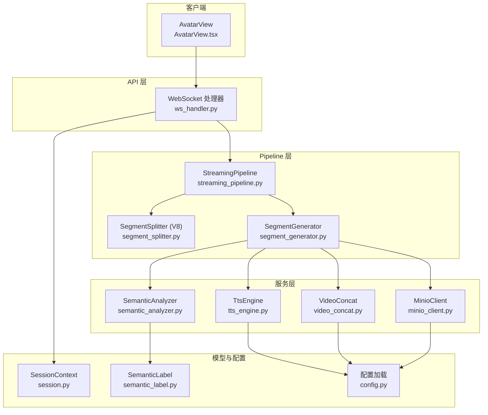
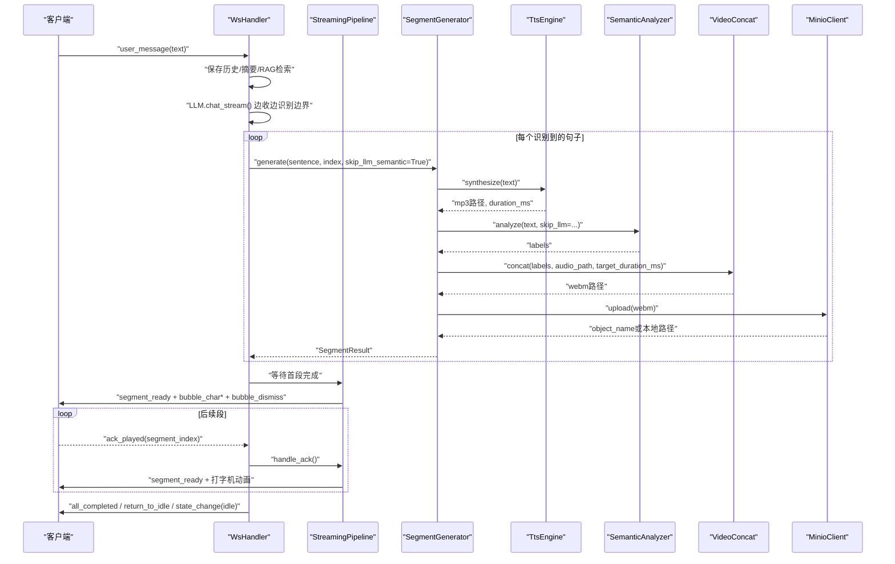
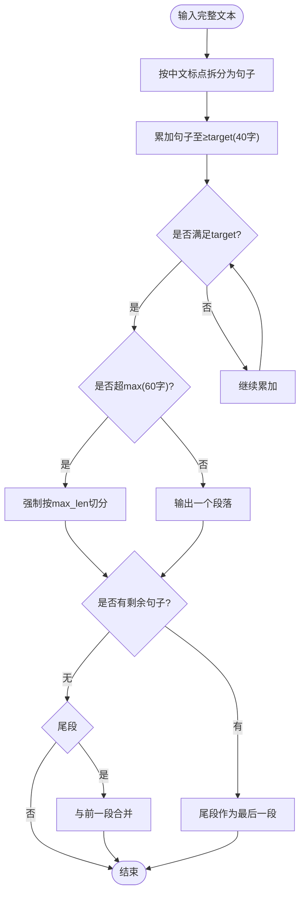
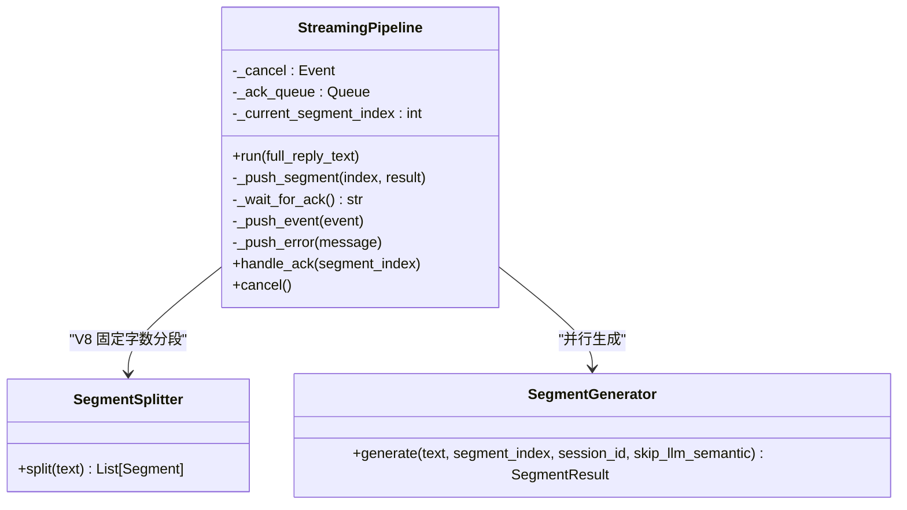
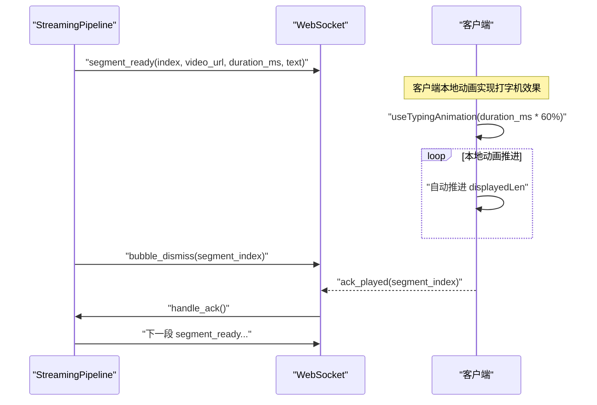
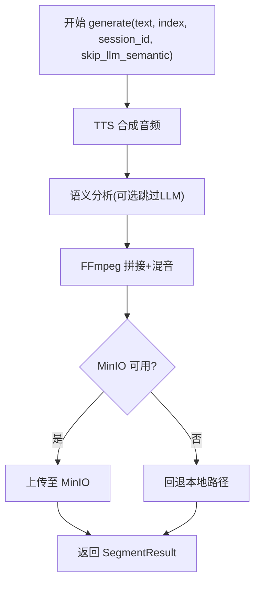
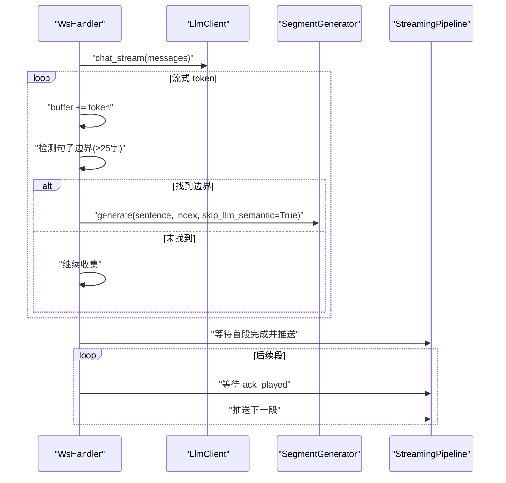
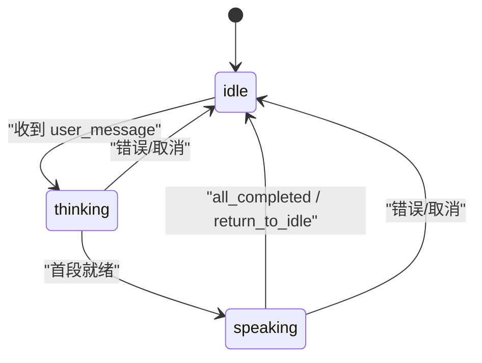
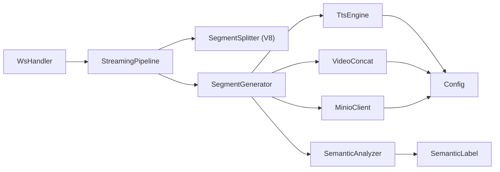

# 流式处理管道

<cite>
**本文引用的文件**   
- [streaming_pipeline.py](file://server/pipeline/streaming_pipeline.py)
- [segment_generator.py](file://server/pipeline/segment_generator.py)
- [segment_splitter.py](file://server/pipeline/segment_splitter.py)
- [tts_engine.py](file://server/services/tts_engine.py)
- [semantic_analyzer.py](file://server/services/semantic_analyzer.py)
- [video_concat.py](file://server/services/video_concat.py)
- [minio_client.py](file://server/services/minio_client.py)
- [ws_handler.py](file://server/api/ws_handler.py)
- [session.py](file://server/models/session.py)
- [semantic_label.py](file://server/models/semantic_label.py)
- [config.py](file://server/config.py)
- [AvatarView.tsx](file://client/src/components/AvatarView.tsx)
</cite>

## 更新摘要
**变更内容**   
- 优化段落分割器逻辑：从固定阈值改为固定字数分段算法（V8版本）
- 改进视频片段拼接算法：增强错误处理和超时保护机制
- 增强错误处理和重试机制：提升整体稳定性和容错能力
- 修复客户端视频切换问题：延长 canplay 超时时间适配 5G 网络环境
- 优化推送机制：移除逐字推送，采用客户端本地动画实现打字机效果

## 目录
1. [简介](#简介)
2. [项目结构](#项目结构)
3. [核心组件](#核心组件)
4. [架构总览](#架构总览)
5. [详细组件分析](#详细组件分析)
6. [依赖关系分析](#依赖关系分析)
7. [性能与背压控制](#性能与背压控制)
8. [故障恢复与重试策略](#故障恢复与重试策略)
9. [扩展与优化示例](#扩展与优化示例)
10. [常见问题排查](#常见问题排查)
11. [结论](#结论)

## 简介
本技术文档围绕 RealTimeTalk 的"流式处理管道"展开，聚焦以下目标：
- 分段生成算法与文本分句策略（V8 固定字数分段）
- 并行任务调度与确认式推送机制（ack_played）
- 异步任务队列与进度跟踪
- 流式数据处理模式、背压控制与内存管理
- Pipeline 状态管理、错误恢复与重试策略
- 与 TTS 引擎、语义分析器、视频拼接模块的协作模式
- 并发处理、资源竞争与性能瓶颈的解决方案
- 面向初学者的渐进式说明与面向资深开发者的深度细节

## 项目结构
RealTimeTalk 后端采用分层组织：API 层负责 WebSocket 消息路由；Pipeline 层实现流式分段与推送；Services 层封装 TTS、语义分析、视频拼接与对象存储；Models 提供会话与标签模型；Config 统一配置加载。



**图表来源**
- [ws_handler.py:1-444](file://server/api/ws_handler.py#L1-L444)
- [streaming_pipeline.py:1-222](file://server/pipeline/streaming_pipeline.py#L1-L222)
- [segment_splitter.py:1-158](file://server/pipeline/segment_splitter.py#L1-L158)
- [segment_generator.py:1-138](file://server/pipeline/segment_generator.py#L1-L138)
- [tts_engine.py:1-234](file://server/services/tts_engine.py#L1-L234)
- [semantic_analyzer.py:1-126](file://server/services/semantic_analyzer.py#L1-L126)
- [video_concat.py:1-174](file://server/services/video_concat.py#L1-L174)
- [minio_client.py:1-139](file://server/services/minio_client.py#L1-L139)
- [session.py:1-41](file://server/models/session.py#L1-L41)
- [semantic_label.py:1-80](file://server/models/semantic_label.py#L1-L80)
- [config.py:1-260](file://server/config.py#L1-L260)
- [AvatarView.tsx:410-609](file://client/src/components/AvatarView.tsx#L410-L609)

## 核心组件
- StreamingPipeline：接收完整回复文本或流式片段，执行分句切段、并行生成、首段立即推送、后续逐段确认式推送，并维护取消事件与 ack 队列。
- SegmentSplitter (V8)：**新增** 按固定字数（30-50 字）将文本切分为均匀段落，避免段长度不均。
- SegmentGenerator：单段生成管线，顺序执行 TTS → 语义分析 → FFmpeg 拼接 → MinIO 上传（失败回退本地）。
- TtsEngine：调用 DashScope 多模态生成接口合成语音，支持长文本拆分合并与并发限制信号量。
- SemanticAnalyzer：基于 LLM 的语义分析，首段可跳过 LLM 使用关键词回退，输出标签序列。
- VideoConcat：根据标签选择切片，构建 concat 列表，FFmpeg 混音输出 WebM，**增强** 错误处理和超时保护。
- MinioClient：对象存储上传、预签名 URL 生成与可用性检测。
- WsHandler：WebSocket 连接生命周期管理、用户消息路由、RAG 检索、流式 LLM 聚合与 Pipeline 编排。
- SessionContext：会话上下文与状态机（idle/thinking/speaking/bridging）。
- SemanticLabel：标签枚举与过渡规则校验。
- Config：集中配置加载，环境变量覆盖 JSON 配置。
- AvatarView：**修复** 视频切换超时问题，适配 5G 移动网络环境。

**章节来源**
- [streaming_pipeline.py:1-222](file://server/pipeline/streaming_pipeline.py#L1-L222)
- [segment_splitter.py:1-158](file://server/pipeline/segment_splitter.py#L1-L158)
- [segment_generator.py:1-138](file://server/pipeline/segment_generator.py#L1-L138)
- [tts_engine.py:1-234](file://server/services/tts_engine.py#L1-L234)
- [semantic_analyzer.py:1-126](file://server/services/semantic_analyzer.py#L1-L126)
- [video_concat.py:1-174](file://server/services/video_concat.py#L1-L174)
- [minio_client.py:1-139](file://server/services/minio_client.py#L1-L139)
- [ws_handler.py:1-444](file://server/api/ws_handler.py#L1-L444)
- [session.py:1-41](file://server/models/session.py#L1-L41)
- [semantic_label.py:1-80](file://server/models/semantic_label.py#L1-L80)
- [config.py:1-260](file://server/config.py#L1-L260)
- [AvatarView.tsx:410-609](file://client/src/components/AvatarView.tsx#L410-L609)

## 架构总览
下图展示了从用户消息到最终播放的全链路交互，包括流式 LLM、实时分段、并行生成与确认式推送。



**图表来源**
- [ws_handler.py:189-334](file://server/api/ws_handler.py#L189-L334)
- [streaming_pipeline.py:44-131](file://server/pipeline/streaming_pipeline.py#L44-L131)
- [segment_generator.py:42-137](file://server/pipeline/segment_generator.py#L42-L137)
- [tts_engine.py:49-167](file://server/services/tts_engine.py#L49-L167)
- [semantic_analyzer.py:41-86](file://server/services/semantic_analyzer.py#L41-L86)
- [video_concat.py:30-72](file://server/services/video_concat.py#L30-L72)
- [minio_client.py:69-90](file://server/services/minio_client.py#L69-L90)

## 详细组件分析

### 文本分句与分段策略（V8 优化）
**更新** 段落分割器已从固定阈值改为固定字数分段算法，确保段落长度均匀分布。

- **新算法特点**：
  - TARGET_SEGMENT_LENGTH = 40 字（理想段长）
  - MAX_SEGMENT_LENGTH = 60 字（超过强制切分）
  - MIN_SEGMENT_LENGTH = 15 字（不足时与下一段合并）
- **分段流程**：
  1. 按中文句号、感叹号、问号、分号进行句子切分，保留标点
  2. 累加句子至 ≥ target 字形成段落
  3. 若累加到 max_len 仍未遇到句子结束标点，按 max_len 字符强制切分
  4. 段末不足 min_len 时与下一段合并
  5. 兜底处理：确保至少返回一个段落



**图表来源**
- [segment_splitter.py:31-117](file://server/pipeline/segment_splitter.py#L31-L117)
- [segment_splitter.py:155-158](file://server/pipeline/segment_splitter.py#L155-L158)

**章节来源**
- [segment_splitter.py:1-158](file://server/pipeline/segment_splitter.py#L1-L158)

### 并行任务调度与首段优先
- 所有段落的生成任务在启动后立即并行创建，但首段完成后立即推送，不等待后续段。
- 后续段采用确认式推送：等待前端 ack_played 后再推送下一段，避免拥塞。
- 取消机制：通过 asyncio.Event 与 ack 队列中的 cancel 标记快速中断。



**图表来源**
- [streaming_pipeline.py:16-222](file://server/pipeline/streaming_pipeline.py#L16-L222)
- [segment_generator.py:27-137](file://server/pipeline/segment_generator.py#L27-L137)
- [segment_splitter.py:25-117](file://server/pipeline/segment_splitter.py#L25-L117)

**章节来源**
- [streaming_pipeline.py:44-131](file://server/pipeline/streaming_pipeline.py#L44-L131)

### 确认式推送与打字机效果（V8 优化）
**更新** 移除了服务端逐字推送，改为客户端本地动画实现打字机效果。

- **新机制**：
  - 首段就绪后推送 segment_ready（含完整 text + duration_ms）
  - 客户端 useTypingAnimation 根据 duration_ms * 60% 自动推进 displayedLen
  - 消除 WebSocket 串行推送造成的卡通形象与文字不同步
  - 每段结束后推送 bubble_dismiss，等待前端 ack_played 再推进下一段
- **优势**：
  - 减少 WebSocket 负载和延迟
  - 更好的用户体验，文字与视频同步
  - 更稳定的跨平台表现



**图表来源**
- [streaming_pipeline.py:150-177](file://server/pipeline/streaming_pipeline.py#L150-L177)
- [streaming_pipeline.py:178-190](file://server/pipeline/streaming_pipeline.py#L178-L190)

**章节来源**
- [streaming_pipeline.py:150-190](file://server/pipeline/streaming_pipeline.py#L150-L190)

### 单段生成管线（TTS → 语义分析 → 拼接 → 上传）
- TTS：调用 DashScope 多模态生成接口，支持同步返回与异步轮询；长文本按句子拆分后分别合成再拼接。
- 语义分析：首段优化跳过 LLM，使用关键词回退；否则调用 LLM 解析标签序列并进行过渡规则校验。
- 视频拼接：根据标签选择切片，构建 concat 列表，必要时循环填充最后一个切片以满足目标时长；FFmpeg 混音输出 WebM。
- 上传：尝试上传至 MinIO，失败则回退本地路径。



**图表来源**
- [segment_generator.py:42-137](file://server/pipeline/segment_generator.py#L42-L137)
- [tts_engine.py:49-167](file://server/services/tts_engine.py#L49-L167)
- [semantic_analyzer.py:41-86](file://server/services/semantic_analyzer.py#L41-L86)
- [video_concat.py:30-72](file://server/services/video_concat.py#L30-L72)
- [minio_client.py:69-90](file://server/services/minio_client.py#L69-L90)

**章节来源**
- [segment_generator.py:42-137](file://server/pipeline/segment_generator.py#L42-L137)
- [tts_engine.py:49-167](file://server/services/tts_engine.py#L49-L167)
- [semantic_analyzer.py:41-86](file://server/services/semantic_analyzer.py#L41-L86)
- [video_concat.py:30-72](file://server/services/video_concat.py#L30-L72)
- [minio_client.py:69-90](file://server/services/minio_client.py#L69-L90)

### 流式 LLM 与实时分段
- WsHandler 在收到 user_message 后，先发送 thinking 状态与 play_analysis 提示，然后发起 LLM 流式请求。
- 边接收 token 边识别句子边界（至少 25 字），一旦满足即启动对应段的生成任务，避免整段等待。
- 若 buffer 过大（>200 字且无标点），强制按逗号/换行分割，防止长时间阻塞。
- 全部 LLM 完成后，等待首段结果立即推送，后续段按 ack 推进。



**图表来源**
- [ws_handler.py:189-334](file://server/api/ws_handler.py#L189-L334)
- [streaming_pipeline.py:44-131](file://server/pipeline/streaming_pipeline.py#L44-L131)

**章节来源**
- [ws_handler.py:189-334](file://server/api/ws_handler.py#L189-L334)
- [streaming_pipeline.py:44-131](file://server/pipeline/streaming_pipeline.py#L44-L131)

### 会话状态管理与 RAG 集成
- 会话状态：idle → thinking → speaking → idle，支持 bridging 状态用于衔接。
- RAG：在流式处理前检索相关知识点，注入 messages 提升回答质量；若检索失败则降级为纯 LLM 回复。
- 持久化：对话历史与状态写入 Redis，支持重连恢复。



**图表来源**
- [session.py:14-41](file://server/models/session.py#L14-L41)
- [ws_handler.py:130-188](file://server/api/ws_handler.py#L130-L188)
- [ws_handler.py:335-401](file://server/api/ws_handler.py#L335-L401)

**章节来源**
- [session.py:14-41](file://server/models/session.py#L14-L41)
- [ws_handler.py:130-188](file://server/api/ws_handler.py#L130-L188)
- [ws_handler.py:335-401](file://server/api/ws_handler.py#L335-L401)

### 客户端视频切换优化（V28 修复）
**更新** 修复了 5G 移动网络下卡通形象消失的问题。

- **问题根因**：showMain 中 canplay 兜底超时（800ms）在 5G 慢网下过早触发，导致 mainVideo 无帧数据时被设为可见、loopVideo 被隐藏，造成卡通形象消失 1-2 秒。
- **修复方案**：将超时时间从 800ms 延长至 5000ms，适配 5G 移动网络下 segment 下载耗时（1-2s）。
- **效果**：
  - 5G 慢网：segment 在 1-2s 内下载完成 → canplay 在超时前触发 → 正常切换，无消失
  - WiFi：不受影响（canplay < 200ms）
  - 极端错误（canplay 永不触发）：5s 后兜底，比之前多等 4.2s，但此场景极少见

```mermaid
sequenceDiagram
participant Client as "客户端"
participant Main as "mainVideo"
participant Loop as "loopVideo"
Client->>Main : "设置 src = segment_url"
Note over Client : t=0 : showMain() 调用
Client->>Loop : "继续播放 analysis 动画"
Note over Client : t=0-5000ms : loopVideo 正常播放
alt 5G 慢网 (1-2s 下载)
Main->>Main : "canplay 在 1-2s 后触发"
Main->>Client : "switchToTarget() 正常切换"
else WiFi (<200ms 下载)
Main->>Main : "canplay 在 <200ms 触发"
Main->>Client : "switchToTarget() 正常切换"
end
Note over Client : 5000ms 超时仅在极端情况下触发
```

**图表来源**
- [AvatarView.tsx:429-437](file://client/src/components/AvatarView.tsx#L429-L437)

**章节来源**
- [AvatarView.tsx:410-609](file://client/src/components/AvatarView.tsx#L410-L609)

## 依赖关系分析
- 组件耦合：
  - StreamingPipeline 依赖 SegmentSplitter (V8) 与 SegmentGenerator，后者组合 TTS、语义分析、视频拼接与 MinIO。
  - WsHandler 编排 LLM 流式与 Pipeline，同时管理会话状态与 Redis 持久化。
- 外部依赖：
  - TTS 依赖 DashScope 多模态生成接口与 HTTP 客户端。
  - 视频拼接依赖系统 FFmpeg。
  - 对象存储依赖 MinIO。
  - 语义分析依赖 LLM 客户端与标签模型。
- 潜在环路与风险：
  - 当前设计无直接循环依赖；注意 TTS 并发限制与 FFmpeg 进程超时。



**图表来源**
- [ws_handler.py:1-444](file://server/api/ws_handler.py#L1-L444)
- [streaming_pipeline.py:1-222](file://server/pipeline/streaming_pipeline.py#L1-L222)
- [segment_generator.py:1-138](file://server/pipeline/segment_generator.py#L1-L138)
- [segment_splitter.py:1-158](file://server/pipeline/segment_splitter.py#L1-L158)
- [semantic_analyzer.py:1-126](file://server/services/semantic_analyzer.py#L1-L126)
- [tts_engine.py:1-234](file://server/services/tts_engine.py#L1-L234)
- [video_concat.py:1-174](file://server/services/video_concat.py#L1-L174)
- [minio_client.py:1-139](file://server/services/minio_client.py#L1-L139)
- [semantic_label.py:1-80](file://server/models/semantic_label.py#L1-L80)
- [config.py:1-260](file://server/config.py#L1-L260)

**章节来源**
- [ws_handler.py:1-444](file://server/api/ws_handler.py#L1-L444)
- [streaming_pipeline.py:1-222](file://server/pipeline/streaming_pipeline.py#L1-L222)
- [segment_generator.py:1-138](file://server/pipeline/segment_generator.py#L1-L138)
- [segment_splitter.py:1-158](file://server/pipeline/segment_splitter.py#L1-L158)
- [semantic_analyzer.py:1-126](file://server/services/semantic_analyzer.py#L1-L126)
- [tts_engine.py:1-234](file://server/services/tts_engine.py#L1-L234)
- [video_concat.py:1-174](file://server/services/video_concat.py#L1-L174)
- [minio_client.py:1-139](file://server/services/minio_client.py#L1-L139)
- [semantic_label.py:1-80](file://server/models/semantic_label.py#L1-L80)
- [config.py:1-260](file://server/config.py#L1-L260)

## 性能与背压控制
- 并发限制：
  - TTS 全局信号量限制并发请求数，避免 API 限流（429）。
  - FFmpeg 子进程异步执行并设置超时，避免长时间阻塞。
- 背压控制：
  - 确认式推送：仅在前端 ack_played 后才推送下一段，避免服务端积压。
  - 首段优先：首段完成后立即推送，降低端到端延迟。
  - **V8 优化**：移除逐字推送，减少 WebSocket 负载。
- 内存管理：
  - 工作目录 _work/{session_id} 存放中间文件，及时清理 concat 列表与临时文件。
  - 长文本 TTS 合成后删除临时文件，减少磁盘占用。
- 网络与 I/O：
  - MinIO 上传失败自动回退本地路径，保障可用性。
  - WebSocket 推送异常捕获并记录，避免崩溃。

**章节来源**
- [tts_engine.py:16-17](file://server/services/tts_engine.py#L16-L17)
- [tts_engine.py:169-226](file://server/services/tts_engine.py#L169-L226)
- [video_concat.py:116-148](file://server/services/video_concat.py#L116-L148)
- [minio_client.py:69-90](file://server/services/minio_client.py#L69-L90)
- [streaming_pipeline.py:185-197](file://server/pipeline/streaming_pipeline.py#L185-L197)

## 故障恢复与重试策略
**更新** 增强了错误处理和重试机制，提升整体稳定性。

- **错误分类与回退**：
  - TTS 失败：返回 SegmentResult.error，上层推送 error 事件并回到 idle。
  - 视频拼接失败：同样返回错误信息，停止后续推送。
  - MinIO 上传失败：回退本地路径，不影响播放。
- **超时与重试**：
  - TTS 轮询最多 60 次（每次 1s），超时抛出错误。
  - FFmpeg 执行超时 120s，抛出拼接错误。
  - **V28 修复**：客户端 canplay 超时从 800ms 延长至 5000ms，适配 5G 网络。
- **取消与中断**：
  - 用户发送 cancel 或新消息到达时，设置 _cancel 事件并向 ack 队列推送 cancel，快速终止 Pipeline。
- **状态一致性**：
  - 错误路径统一推送 state_change(idle)，确保前后端状态一致。

**章节来源**
- [segment_generator.py:108-137](file://server/pipeline/segment_generator.py#L108-L137)
- [tts_engine.py:128-167](file://server/services/tts_engine.py#L128-L167)
- [video_concat.py:133-148](file://server/services/video_concat.py#L133-L148)
- [streaming_pipeline.py:206-222](file://server/pipeline/streaming_pipeline.py#L206-L222)
- [ws_handler.py:402-444](file://server/api/ws_handler.py#L402-L444)
- [AvatarView.tsx:429-437](file://client/src/components/AvatarView.tsx#L429-L437)

## 扩展与优化示例
- 新增处理步骤：
  - 在 SegmentGenerator.generate 中插入新的服务调用（如字幕生成、情感增强），并在错误分支中返回 SegmentResult.error，保持上层逻辑不变。
  - 参考路径：[segment_generator.py:42-137](file://server/pipeline/segment_generator.py#L42-L137)
- 调整分段策略（V8）：
  - 修改 SegmentSplitter 的 target、max_len、min_len 参数，影响段落粒度与首段延迟。
  - 参考路径：[segment_splitter.py:35-43](file://server/pipeline/segment_splitter.py#L35-L43)
- 优化 TTS 并发：
  - 调整 _TTS_SEMAPHORE 初始值，平衡吞吐与限流风险。
  - 参考路径：[tts_engine.py:16-17](file://server/services/tts_engine.py#L16-L17)
- 改进语义分析：
  - 自定义关键词回退规则或引入轻量级分类器，减少 LLM 调用次数。
  - 参考路径：[semantic_analyzer.py:88-126](file://server/services/semantic_analyzer.py#L88-L126)
- 视频拼接优化：
  - 增加 GPU 编码器检测与启用，或在需要重编码场景切换编码器。
  - 参考路径：[video_concat.py:151-174](file://server/services/video_concat.py#L151-L174)
- 配置与环境：
  - 通过环境变量覆盖 config.json，便于不同部署环境灵活配置。
  - 参考路径：[config.py:148-260](file://server/config.py#L148-L260)

**章节来源**
- [segment_generator.py:42-137](file://server/pipeline/segment_generator.py#L42-L137)
- [segment_splitter.py:35-43](file://server/pipeline/segment_splitter.py#L35-L43)
- [tts_engine.py:16-17](file://server/services/tts_engine.py#L16-L17)
- [semantic_analyzer.py:88-126](file://server/services/semantic_analyzer.py#L88-L126)
- [video_concat.py:151-174](file://server/services/video_concat.py#L151-L174)
- [config.py:148-260](file://server/config.py#L148-L260)

## 常见问题排查
- WebSocket 推送失败：
  - 检查 ws.send_json 异常捕获与日志，确认客户端是否断开。
  - 参考路径：[streaming_pipeline.py:185-197](file://server/pipeline/streaming_pipeline.py#L185-L197)
- TTS 合成失败或超时：
  - 查看任务状态轮询与错误解析，确认 API Key 与模型映射。
  - 参考路径：[tts_engine.py:100-167](file://server/services/tts_engine.py#L100-L167)
- 视频拼接失败：
  - 检查 FFmpeg 路径与切片文件是否存在，关注 concat 列表构建与命令参数。
  - 参考路径：[video_concat.py:74-114](file://server/services/video_concat.py#L74-L114)
- MinIO 不可用：
  - 确认客户端初始化与 bucket 存在性，观察 upload 回退行为。
  - 参考路径：[minio_client.py:34-90](file://server/services/minio_client.py#L34-L90)
- 状态不一致：
  - 核对 state_change 事件推送路径与错误恢复逻辑。
  - 参考路径：[ws_handler.py:402-444](file://server/api/ws_handler.py#L402-L444)
- **5G 网络下卡通形象消失**：
  - 检查 AvatarView.tsx 中 canplay 超时设置，确认是否为 5000ms。
  - 参考路径：[AvatarView.tsx:429-437](file://client/src/components/AvatarView.tsx#L429-L437)

**章节来源**
- [streaming_pipeline.py:185-197](file://server/pipeline/streaming_pipeline.py#L185-L197)
- [tts_engine.py:100-167](file://server/services/tts_engine.py#L100-L167)
- [video_concat.py:74-114](file://server/services/video_concat.py#L74-L114)
- [minio_client.py:34-90](file://server/services/minio_client.py#L34-L90)
- [ws_handler.py:402-444](file://server/api/ws_handler.py#L402-L444)
- [AvatarView.tsx:429-437](file://client/src/components/AvatarView.tsx#L429-L437)

## 结论
RealTimeTalk 的流式处理管道通过"首段优先 + 确认式推送"的组合，显著降低了端到端延迟并实现了稳定的背压控制。**V8 版本的优化**进一步提升了系统性能和稳定性：

- **段落分割优化**：固定字数分段算法确保段落长度均匀，提升用户体验
- **推送机制改进**：移除逐字推送，采用客户端本地动画，减少网络负载
- **错误处理增强**：完善的超时保护和回退机制，提升系统鲁棒性
- **移动端适配**：修复 5G 网络下的视频切换问题，确保流畅的用户体验

结合 TTS 并发限制、FFmpeg 超时保护与 MinIO 回退策略，系统在可用性、性能与可扩展性之间取得了良好平衡。对于初学者，建议从分段策略与确认式推送入手理解整体流程；对于资深开发者，可通过扩展 SegmentGenerator 的步骤、优化 TTS 并发与语义分析策略，以及引入 GPU 加速来进一步提升性能。