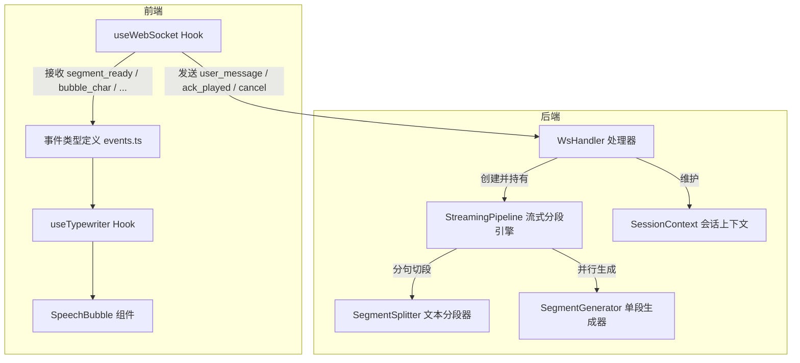
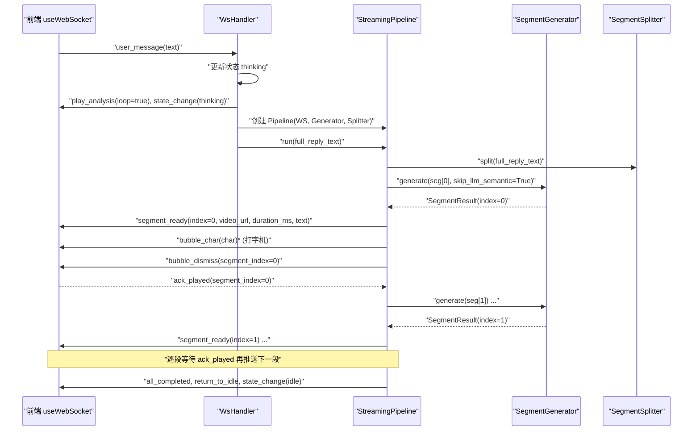
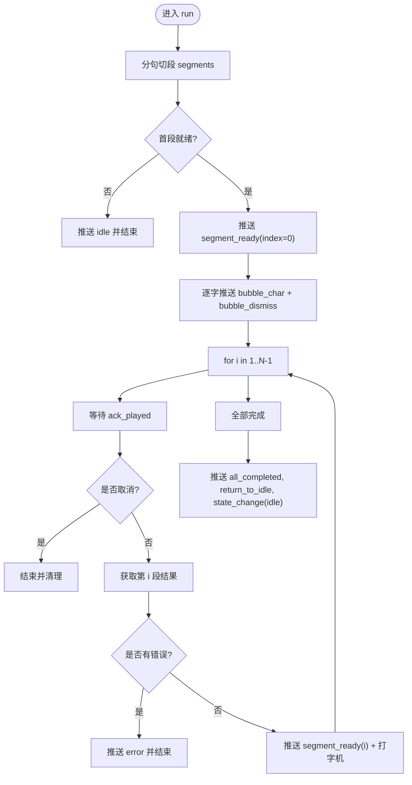
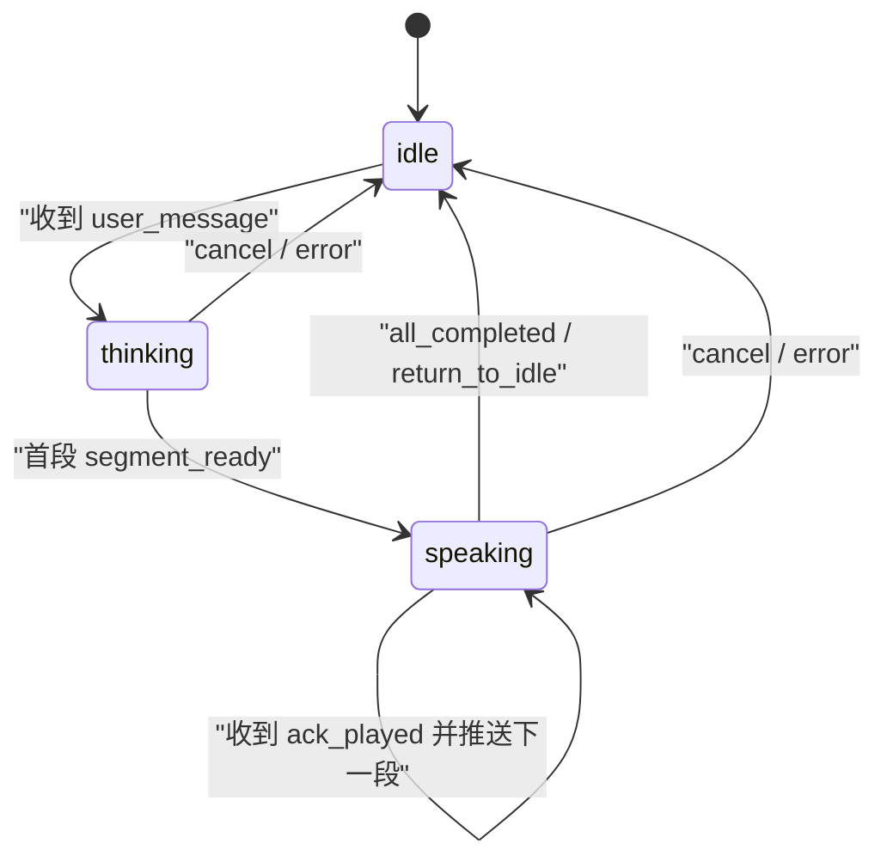
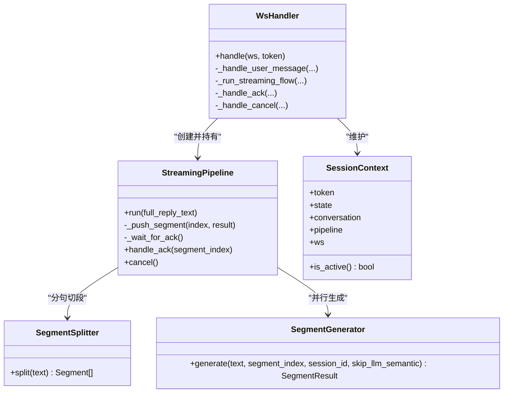

# 流式控制机制

<cite>
**本文引用的文件**   
- [server/pipeline/streaming_pipeline.py](file://server/pipeline/streaming_pipeline.py)
- [server/api/ws_handler.py](file://server/api/ws_handler.py)
- [client/src/hooks/useWebSocket.ts](file://client/src/hooks/useWebSocket.ts)
- [client/src/types/events.ts](file://client/src/types/events.ts)
- [client/src/hooks/useTypewriter.ts](file://client/src/hooks/useTypewriter.ts)
- [client/src/components/SpeechBubble.tsx](file://client/src/components/SpeechBubble.tsx)
- [server/pipeline/segment_splitter.py](file://server/pipeline/segment_splitter.py)
- [server/pipeline/segment_generator.py](file://server/pipeline/segment_generator.py)
- [server/models/session.py](file://server/models/session.py)
</cite>

## 目录
1. [简介](#简介)
2. [项目结构](#项目结构)
3. [核心组件](#核心组件)
4. [架构总览](#架构总览)
5. [详细组件分析](#详细组件分析)
6. [依赖关系分析](#依赖关系分析)
7. [性能与背压](#性能与背压)
8. [故障排查指南](#故障排查指南)
9. [结论](#结论)
10. [附录：扩展新事件类型示例](#附录扩展新事件类型示例)

## 简介
本技术文档聚焦 RealTimeTalk 的“确认式推送”流式控制机制，围绕以下目标展开：
- 解释 ack_played 机制、背压控制与流量管理
- 文档化 Pipeline 状态机设计、事件序列图与异步任务调度策略
- 说明首段立即推送优化、打字机效果实现与气泡动画同步
- 提供扩展新事件类型的具体路径与最佳实践
- 阐述取消机制、错误恢复与连接断线处理策略
- 解决并发竞争、队列溢出与内存泄漏问题

## 项目结构
RealTimeTalk 采用前后端分离架构。服务端基于 FastAPI + asyncio，负责 LLM 流式输出、TTS 合成、语义分析、视频拼接与 MinIO 上传；客户端通过 WebSocket 接收事件并驱动 UI（头像动画、对话气泡、打字机效果）。

图表来源
- [server/api/ws_handler.py:130-188](file://server/api/ws_handler.py#L130-L188)
- [server/pipeline/streaming_pipeline.py:16-43](file://server/pipeline/streaming_pipeline.py#L16-L43)
- [server/pipeline/segment_splitter.py:25-76](file://server/pipeline/segment_splitter.py#L25-L76)
- [server/pipeline/segment_generator.py:27-48](file://server/pipeline/segment_generator.py#L27-L48)
- [client/src/hooks/useWebSocket.ts:34-117](file://client/src/hooks/useWebSocket.ts#L34-L117)
- [client/src/types/events.ts:33-92](file://client/src/types/events.ts#L33-L92)

章节来源
- [server/api/ws_handler.py:130-188](file://server/api/ws_handler.py#L130-L188)
- [server/pipeline/streaming_pipeline.py:16-43](file://server/pipeline/streaming_pipeline.py#L16-L43)
- [server/pipeline/segment_splitter.py:25-76](file://server/pipeline/segment_splitter.py#L25-L76)
- [server/pipeline/segment_generator.py:27-48](file://server/pipeline/segment_generator.py#L27-L48)
- [client/src/hooks/useWebSocket.ts:34-117](file://client/src/hooks/useWebSocket.ts#L34-L117)
- [client/src/types/events.ts:33-92](file://client/src/types/events.ts#L33-L92)

## 核心组件
- WsHandler：WebSocket 连接生命周期管理、消息路由、会话上下文维护、错误与中断处理
- StreamingPipeline：确认式推送的核心，负责首段立即推送、逐段等待 ack_played、打字机气泡推送、完成收尾
- SegmentSplitter：按中文标点将完整回复切分为段落
- SegmentGenerator：单段生成管线（TTS → 语义分析 → FFmpeg 拼接 → MinIO 上传）
- useWebSocket：前端连接管理、自动重连、消息收发封装
- useTypewriter：打字机动画状态管理
- SpeechBubble：气泡显示与淡出动画
- SessionContext：会话状态与活跃 Pipeline 引用

章节来源
- [server/api/ws_handler.py:31-129](file://server/api/ws_handler.py#L31-L129)
- [server/pipeline/streaming_pipeline.py:16-43](file://server/pipeline/streaming_pipeline.py#L16-L43)
- [server/pipeline/segment_splitter.py:25-76](file://server/pipeline/segment_splitter.py#L25-L76)
- [server/pipeline/segment_generator.py:27-48](file://server/pipeline/segment_generator.py#L27-L48)
- [client/src/hooks/useWebSocket.ts:34-117](file://client/src/hooks/useWebSocket.ts#L34-L117)
- [client/src/hooks/useTypewriter.ts:29-76](file://client/src/hooks/useTypewriter.ts#L29-L76)
- [client/src/components/SpeechBubble.tsx:23-58](file://client/src/components/SpeechBubble.tsx#L23-L58)
- [server/models/session.py:22-41](file://server/models/session.py#L22-L41)

## 架构总览
确认式推送协议的关键在于“先推首段，后续每段必须收到 ack_played 才继续”。该机制天然形成背压，避免前端过载或网络拥塞。

图表来源
- [server/api/ws_handler.py:130-188](file://server/api/ws_handler.py#L130-L188)
- [server/api/ws_handler.py:189-341](file://server/api/ws_handler.py#L189-L341)
- [server/pipeline/streaming_pipeline.py:44-131](file://server/pipeline/streaming_pipeline.py#L44-L131)
- [server/pipeline/segment_splitter.py:31-76](file://server/pipeline/segment_splitter.py#L31-L76)
- [server/pipeline/segment_generator.py:42-106](file://server/pipeline/segment_generator.py#L42-L106)
- [client/src/hooks/useWebSocket.ts:147-157](file://client/src/hooks/useWebSocket.ts#L147-L157)

## 详细组件分析

### StreamingPipeline 确认式推送与背压
- 首段立即推送：在首个 SegmentResult 就绪后立刻推送 segment_ready，同时触发打字机气泡，显著降低首帧延迟
- 逐段确认式推送：从 index=1 开始，每次推送前等待 ack_played，未收到则不推进，形成背压
- 打字机气泡：按字符推送 bubble_char，间隔受 duration_ms 限制，最后推送 bubble_dismiss
- 取消机制：支持外部 cancel，内部通过 Event 和 Queue 信号快速退出
- 错误处理：对异常与 SegmentResult.error 统一转为 error 事件并回到 idle

图表来源
- [server/pipeline/streaming_pipeline.py:44-131](file://server/pipeline/streaming_pipeline.py#L44-L131)
- [server/pipeline/streaming_pipeline.py:132-171](file://server/pipeline/streaming_pipeline.py#L132-L171)
- [server/pipeline/streaming_pipeline.py:172-184](file://server/pipeline/streaming_pipeline.py#L172-L184)
- [server/pipeline/streaming_pipeline.py:199-213](file://server/pipeline/streaming_pipeline.py#L199-L213)

章节来源
- [server/pipeline/streaming_pipeline.py:44-131](file://server/pipeline/streaming_pipeline.py#L44-L131)
- [server/pipeline/streaming_pipeline.py:132-171](file://server/pipeline/streaming_pipeline.py#L132-L171)
- [server/pipeline/streaming_pipeline.py:172-184](file://server/pipeline/streaming_pipeline.py#L172-L184)
- [server/pipeline/streaming_pipeline.py:199-213](file://server/pipeline/streaming_pipeline.py#L199-L213)

### WsHandler 消息路由与会话上下文
- 用户消息处理：若存在活跃 Pipeline 先取消，更新状态为 thinking，立即推送 play_analysis 与 state_change
- 后台流式流程：LLM 边生成边识别句子边界，启动多段生成任务；首段完成后交由 Pipeline 进行确认式推送
- ack_played 处理：转发到当前 Pipeline 的 handle_ack，用于推进背压
- cancel 处理：取消 Pipeline，重置状态为 idle，推送状态变更
- 错误恢复：捕获 LLM 调用异常等，统一重置状态并推送错误

章节来源
- [server/api/ws_handler.py:130-188](file://server/api/ws_handler.py#L130-L188)
- [server/api/ws_handler.py:189-341](file://server/api/ws_handler.py#L189-L341)
- [server/api/ws_handler.py:415-443](file://server/api/ws_handler.py#L415-L443)

### SegmentSplitter 文本分段器
- 以中文句号、叹号、问号、分号为句子分隔符
- 累积至阈值（默认 50 字）形成一段，尾部不足阈值单独成段
- 保证每段以完整句子结尾，提升可读性与 TTS 自然度

章节来源
- [server/pipeline/segment_splitter.py:25-76](file://server/pipeline/segment_splitter.py#L25-L76)

### SegmentGenerator 单段生成器
- 流程：TTS 合成 → 语义分析（可跳过 LLM，使用关键词回退）→ FFmpeg 拼接 → MinIO 上传（失败回退本地）
- 返回 SegmentResult，包含 index、text、video_path、duration_ms、labels 及可选 error
- 首段优化：skip_llm_semantic=True 时跳过 LLM 语义分析，减少首段延迟

章节来源
- [server/pipeline/segment_generator.py:27-106](file://server/pipeline/segment_generator.py#L27-L106)

### 前端事件与打字机动画
- useWebSocket：建立连接、自动重连、发送 user_message/ack_played/cancel，接收服务端事件并回调
- events.ts：统一定义客户端与服务端事件类型，便于类型安全处理
- useTypewriter：维护 displayText、isComplete、shouldDismiss，提供 addChar/dismiss/reset
- SpeechBubble：半透明毛玻璃气泡，打字光标闪烁，完成 2s 后 0.5s 淡出消失

章节来源
- [client/src/hooks/useWebSocket.ts:34-117](file://client/src/hooks/useWebSocket.ts#L34-L117)
- [client/src/hooks/useWebSocket.ts:147-157](file://client/src/hooks/useWebSocket.ts#L147-L157)
- [client/src/types/events.ts:33-92](file://client/src/types/events.ts#L33-L92)
- [client/src/hooks/useTypewriter.ts:29-76](file://client/src/hooks/useTypewriter.ts#L29-L76)
- [client/src/components/SpeechBubble.tsx:23-58](file://client/src/components/SpeechBubble.tsx#L23-L58)

### 会话状态机
- 状态枚举：idle、thinking、speaking、bridging
- SessionContext 保存 token、state、conversation、pipeline、ws 引用
- is_active 判断非 idle 即活跃

图表来源
- [server/models/session.py:14-41](file://server/models/session.py#L14-L41)
- [server/api/ws_handler.py:130-188](file://server/api/ws_handler.py#L130-L188)
- [server/pipeline/streaming_pipeline.py:121-131](file://server/pipeline/streaming_pipeline.py#L121-L131)

## 依赖关系分析
- WsHandler 依赖 StreamingPipeline、SegmentSplitter、SegmentGenerator、TtsEngine、SemanticAnalyzer、VideoConcat、MinioClient、RedisClient、LlmClient
- StreamingPipeline 依赖 SegmentSplitter、SegmentGenerator，并通过 WebSocket 向前端推送事件
- 前端 useWebSocket 依赖事件类型定义，useTypewriter 与 SpeechBubble 协作实现打字机与气泡动画

图表来源
- [server/api/ws_handler.py:31-129](file://server/api/ws_handler.py#L31-L129)
- [server/pipeline/streaming_pipeline.py:16-43](file://server/pipeline/streaming_pipeline.py#L16-L43)
- [server/pipeline/segment_splitter.py:25-76](file://server/pipeline/segment_splitter.py#L25-L76)
- [server/pipeline/segment_generator.py:27-48](file://server/pipeline/segment_generator.py#L27-L48)
- [server/models/session.py:22-41](file://server/models/session.py#L22-L41)

章节来源
- [server/api/ws_handler.py:31-129](file://server/api/ws_handler.py#L31-L129)
- [server/pipeline/streaming_pipeline.py:16-43](file://server/pipeline/streaming_pipeline.py#L16-L43)
- [server/pipeline/segment_splitter.py:25-76](file://server/pipeline/segment_splitter.py#L25-L76)
- [server/pipeline/segment_generator.py:27-48](file://server/pipeline/segment_generator.py#L27-L48)
- [server/models/session.py:22-41](file://server/models/session.py#L22-L41)

## 性能与背压
- 首段立即推送：首段跳过 LLM 语义分析，直接走关键词回退，显著降低首帧延迟
- 背压控制：ack_played 作为消费侧反馈，确保服务端仅在客户端准备好时才推送下一段，避免队列堆积
- 并发策略：所有段并行生成（asyncio.ensure_future），但推送顺序受 ack 控制，兼顾吞吐与稳定性
- 打字机节奏：根据 duration_ms 计算最大打字时间（不超过视频时长 60%），单字间隔 15ms~50ms，避免过快导致视觉抖动
- 资源释放：取消时设置 _cancel Event 并向 ack_queue 写入 cancel，尽快退出等待循环，防止任务悬挂

章节来源
- [server/pipeline/streaming_pipeline.py:44-131](file://server/pipeline/streaming_pipeline.py#L44-L131)
- [server/pipeline/streaming_pipeline.py:132-171](file://server/pipeline/streaming_pipeline.py#L132-L171)
- [server/pipeline/streaming_pipeline.py:199-213](file://server/pipeline/streaming_pipeline.py#L199-L213)

## 故障排查指南
- 连接断开与重连
  - 前端 useWebSocket 实现指数退避重连（1s→2s→4s→...，上限 30s）
  - 断线时清除 wsRef，触发 onDisconnect 回调，由上层决定是否重建 UI 状态
- 错误恢复
  - 服务端捕获 LLM 调用异常、TTS/拼接/MinIO 异常，统一推送 error 并回到 idle
  - 前端收到 error 后可提示用户重试
- 取消机制
  - 用户发送 cancel 或新消息覆盖旧 Pipeline，服务端设置 _cancel 并写入 cancel 信号，快速退出等待
- 并发竞争
  - 使用 asyncio.Event 与 Queue 进行线程安全的取消与确认信号传递
  - 注意 handle_ack 中 put_nowait 可能抛 QueueFull，已做忽略处理，避免阻塞
- 队列溢出与内存泄漏
  - ack_queue 无界，建议在上层监控队列长度并在极端情况下丢弃多余 ack
  - 断线后保留会话上下文供重连恢复，但需定期清理长时间空闲会话（结合 Redis TTL）

章节来源
- [client/src/hooks/useWebSocket.ts:119-135](file://client/src/hooks/useWebSocket.ts#L119-L135)
- [server/api/ws_handler.py:335-341](file://server/api/ws_handler.py#L335-L341)
- [server/pipeline/streaming_pipeline.py:199-213](file://server/pipeline/streaming_pipeline.py#L199-L213)

## 结论
RealTimeTalk 的确认式推送机制通过 ack_played 实现了稳健的背压控制，配合首段立即推送与打字机气泡，提供了低延迟且流畅的用户体验。Pipeline 的状态机清晰、错误恢复完善，前端重连与取消机制健全。建议在大规模场景下进一步引入 ack 队列长度监控与限流策略，以应对极端负载。

## 附录：扩展新事件类型示例
以下示例展示如何在前端与后端协同扩展一个新的事件类型（例如新增“进度提示”事件 progress_hint）：

- 前端类型定义（events.ts）
  - 新增 ServerProgressHint 接口，加入 ServerEvent 联合类型
  - 在 useWebSocket 的 onmessage 回调中，onEvent 会透传该事件给上层处理逻辑

- 前端处理（useTypewriter 或业务 Hook）
  - 监听 progress_hint 事件，更新 UI 进度条或提示信息

- 后端推送（streaming_pipeline.py）
  - 在合适时机（如段生成阶段）调用 _push_event({"type": "progress_hint", "percent": ...})
  - 确保事件结构与前端类型一致

- 取消与错误兼容
  - 保持现有 error 与 cancel 行为不变，新事件不影响主流程

章节来源
- [client/src/types/events.ts:33-92](file://client/src/types/events.ts#L33-L92)
- [client/src/hooks/useWebSocket.ts:86-93](file://client/src/hooks/useWebSocket.ts#L86-93)
- [server/pipeline/streaming_pipeline.py:185-197](file://server/pipeline/streaming_pipeline.py#L185-L197)