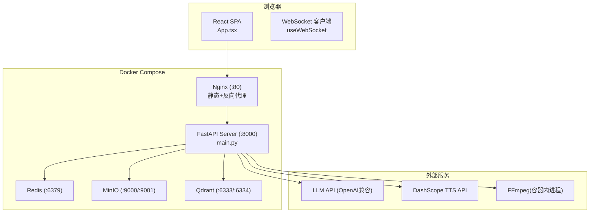
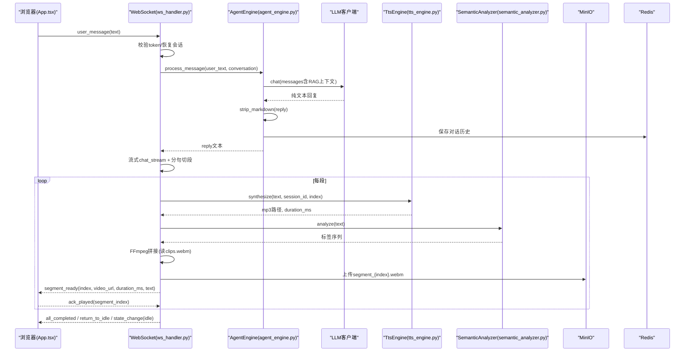
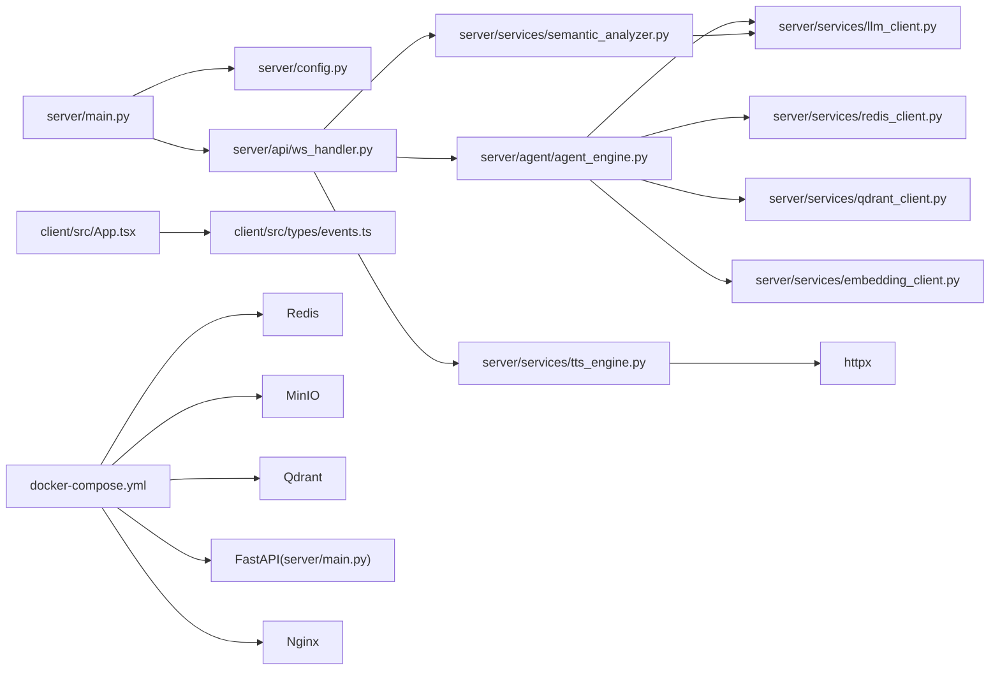

# 开发指南

<cite>
**本文引用的文件**   
- [server/main.py](file://server/main.py)
- [server/config.py](file://server/config.py)
- [server/agent/agent_engine.py](file://server/agent/agent_engine.py)
- [server/services/tts_engine.py](file://server/services/tts_engine.py)
- [server/services/semantic_analyzer.py](file://server/services/semantic_analyzer.py)
- [server/api/ws_handler.py](file://server/api/ws_handler.py)
- [client/src/App.tsx](file://client/src/App.tsx)
- [client/src/types/events.ts](file://client/src/types/events.ts)
- [client/tsconfig.json](file://client/tsconfig.json)
- [client/package.json](file://client/package.json)
- [docker-compose.yml](file://docker-compose.yml)
- [Dockerfile](file://Dockerfile)
- [config.json](file://config.json)
- [clips/short-hair-teacher-girl/clips.toml](file://clips/short-hair-teacher-girl/clips.toml)
</cite>

## 目录
1. [简介](#简介)
2. [项目结构](#项目结构)
3. [核心组件](#核心组件)
4. [架构总览](#架构总览)
5. [详细组件分析](#详细组件分析)
6. [依赖关系分析](#依赖关系分析)
7. [性能与扩展性](#性能与扩展性)
8. [测试指南](#测试指南)
9. [编码规范与代码风格](#编码规范与代码风格)
10. [提交与分支管理](#提交与分支管理)
11. [开发环境与调试](#开发环境与调试)
12. [新增虚拟形象](#新增虚拟形象)
13. [集成新 TTS 服务](#集成新-tts-服务)
14. [自定义语义分析策略](#自定义语义分析策略)
15. [故障排查](#故障排查)
16. [结论](#结论)

## 简介
本指南面向 RealTimeTalk 项目的贡献者与开发者，覆盖从环境搭建、运行调试到功能扩展的全流程。重点包括：
- 本地与容器化部署步骤
- Python 与 TypeScript 编码规范
- WebSocket 实时通信与流式分段生成机制
- 单元测试、集成测试与性能测试实践
- 新增虚拟形象、接入新 TTS 服务、定制语义分析策略
- 开发工具推荐、IDE 配置与调试技巧
- 贡献流程与代码审查标准

## 项目结构
RealTimeTalk 采用前后端分离架构：
- 后端：FastAPI + Uvicorn，提供 REST API 与 WebSocket 实时通道；通过 Redis 持久化会话历史，MinIO 存储音视频产物，Qdrant 支持 RAG 检索增强。
- 前端：React + Vite + TypeScript，负责形象视频播放、打字机气泡、输入交互与 WebSocket 事件处理。
- 资源：虚拟形象切片库（WebM VP9 Alpha）与过渡规则由 clips.toml 描述。

图表来源
- [server/main.py:114-177](file://server/main.py#L114-L177)
- [docker-compose.yml:1-69](file://docker-compose.yml#L1-L69)

章节来源
- [server/main.py:1-191](file://server/main.py#L1-L191)
- [docker-compose.yml:1-69](file://docker-compose.yml#L1-L69)

## 核心组件
- 应用生命周期与路由注册：在 FastAPI lifespan 中初始化 Redis、MinIO、Qdrant、Embedding，并注入 AgentEngine 的 RAG 依赖。
- 配置系统：支持 config.json 与环境变量合并，环境变量优先级更高。
- WebSocket 处理器：维护会话上下文、流式 LLM 调用、分段生成与确认式推送。
- Agent 引擎：对话生成、RAG 检索增强、Markdown 清理。
- TTS 引擎：DashScope 多模态接口，并发限制与长文本拼接。
- 语义分析器：基于 LLM 或关键词回退的标签序列生成。
- 前端状态机：Idle → Thinking → Speaking/Bridging → Idle，配合 segment_ready 与 ack 控制。

章节来源
- [server/main.py:42-110](file://server/main.py#L42-L110)
- [server/config.py:148-260](file://server/config.py#L148-L260)
- [server/api/ws_handler.py:31-188](file://server/api/ws_handler.py#L31-L188)
- [server/agent/agent_engine.py:59-121](file://server/agent/agent_engine.py#L59-L121)
- [server/services/tts_engine.py:38-77](file://server/services/tts_engine.py#L38-L77)
- [server/services/semantic_analyzer.py:35-86](file://server/services/semantic_analyzer.py#L35-L86)
- [client/src/App.tsx:60-183](file://client/src/App.tsx#L60-L183)

## 架构总览
下图展示一次完整对话的数据流：用户消息进入后，服务端进行会话恢复、RAG 检索、流式 LLM 生成、边生成分段、TTS 合成、语义分析与 FFmpeg 拼接，随后通过 MinIO 上传并逐段推送至前端，前端按 ack 推进播放。

图表来源
- [server/api/ws_handler.py:189-334](file://server/api/ws_handler.py#L189-L334)
- [server/agent/agent_engine.py:74-121](file://server/agent/agent_engine.py#L74-L121)
- [server/services/tts_engine.py:49-77](file://server/services/tts_engine.py#L49-L77)
- [server/services/semantic_analyzer.py:41-86](file://server/services/semantic_analyzer.py#L41-L86)

## 详细组件分析

### 应用启动与生命周期
- 加载配置：优先使用环境变量覆盖 config.json。
- 初始化外部依赖：Redis 必须可用；Qdrant 失败仅降级 RAG 功能；MinIO 自动确保 bucket 存在。
- 注册路由与健康检查：REST 路由挂载于 /api/*，静态文件挂载于根路径（SPA 模式）。
- WebSocket 端点：/ws?token=...，创建 WsHandler 并处理连接生命周期。

章节来源
- [server/main.py:42-110](file://server/main.py#L42-L110)
- [server/main.py:114-177](file://server/main.py#L114-L177)
- [server/config.py:148-260](file://server/config.py#L148-L260)

### WebSocket 处理器与会话管理
- 会话恢复：根据 token 从 Redis 恢复对话历史，重建 ConversationManager。
- 消息分发：user_message、ack_played、cancel 三种消息类型。
- 流式处理：streaming chat 边接收边切段，立即并行生成段任务，首段就绪即推送，后续按 ack 推进。
- 错误与中断：统一错误事件推送，取消正在进行的 Pipeline 并清理状态。

章节来源
- [server/api/ws_handler.py:49-188](file://server/api/ws_handler.py#L49-L188)
- [server/api/ws_handler.py:189-334](file://server/api/ws_handler.py#L189-L334)
- [server/api/ws_handler.py:402-444](file://server/api/ws_handler.py#L402-L444)

### Agent 引擎与 RAG 增强
- 对话流程：保存用户消息 → 智能摘要 → 组装 messages → RAG 检索 → LLM 调用 → Markdown 清理 → 保存助手回复。
- RAG 检索：根据 role_collections 决定搜索范围，嵌入查询向量后返回 top_k 结果，构建上下文注入 prompt。

章节来源
- [server/agent/agent_engine.py:59-121](file://server/agent/agent_engine.py#L59-L121)
- [server/agent/agent_engine.py:123-181](file://server/agent/agent_engine.py#L123-L181)

### TTS 引擎（DashScope）
- 并发控制：全局信号量限制并发请求，避免限流。
- 短文本合成：直接提交任务并轮询结果，下载音频文件并估算时长。
- 长文本处理：按句子边界拆分段落，分别合成后使用 FFmpeg 拼接为单 MP3。
- 错误处理：解析 API 错误信息并抛出 TtsError。

章节来源
- [server/services/tts_engine.py:38-77](file://server/services/tts_engine.py#L38-L77)
- [server/services/tts_engine.py:78-167](file://server/services/tts_engine.py#L78-L167)
- [server/services/tts_engine.py:169-226](file://server/services/tts_engine.py#L169-L226)
- [server/services/tts_engine.py:228-234](file://server/services/tts_engine.py#L228-L234)

### 语义分析器
- LLM 驱动：发送结构化 Prompt，解析标签序列，若失败则回退关键词匹配。
- 首段优化：skip_llm 时直接使用关键词回退，减少延迟。
- 标签验证：保证输出符合 opening/body/closing 顺序约束。

章节来源
- [server/services/semantic_analyzer.py:35-86](file://server/services/semantic_analyzer.py#L35-L86)
- [server/services/semantic_analyzer.py:88-126](file://server/services/semantic_analyzer.py#L88-L126)

### 前端状态机与事件处理
- 状态流转：Idle → Thinking → Speaking/Bridging → Idle。
- 事件处理：connected、state_change、segment_ready、bubble_char/dismiss、play_analysis、all_completed、return_to_idle、error。
- 播放控制：video ended 触发 ack，末段完成后回到 idle 循环待机动画。

章节来源
- [client/src/App.tsx:60-183](file://client/src/App.tsx#L60-L183)
- [client/src/App.tsx:194-220](file://client/src/App.tsx#L194-L220)
- [client/src/types/events.ts:7-92](file://client/src/types/events.ts#L7-L92)

### 虚拟形象与切片库
- 切片描述：clips.toml 定义每个语义标签对应的 WebM 文件、提示词与语音提示。
- 过渡规则：neutral/opening/body/closing 分类与默认序列建议。
- 运行时读取：VideoConcat 依据 labels 选择 .webm 片段并通过 FFmpeg 拼接。

章节来源
- [clips/short-hair-teacher-girl/clips.toml:1-148](file://clips/short-hair-teacher-girl/clips.toml#L1-L148)

## 依赖关系分析
- 后端依赖：fastapi、uvicorn、websockets、httpx、redis、minio、pydantic、pydantic-settings、qdrant-client。
- 前端依赖：react、react-dom、vite、typescript。
- 容器编排：Redis、MinIO、Qdrant、FastAPI、Nginx 服务通过 docker-compose 编排。

图表来源
- [server/main.py:1-191](file://server/main.py#L1-L191)
- [server/api/ws_handler.py:1-444](file://server/api/ws_handler.py#L1-L444)
- [server/agent/agent_engine.py:1-181](file://server/agent/agent_engine.py#L1-L181)
- [server/services/tts_engine.py:1-234](file://server/services/tts_engine.py#L1-L234)
- [server/services/semantic_analyzer.py:1-126](file://server/services/semantic_analyzer.py#L1-L126)
- [client/src/App.tsx:1-326](file://client/src/App.tsx#L1-L326)
- [client/src/types/events.ts:1-113](file://client/src/types/events.ts#L1-L113)
- [docker-compose.yml:1-69](file://docker-compose.yml#L1-L69)

章节来源
- [server/requirements.txt:1-14](file://server/requirements.txt#L1-L14)
- [client/package.json:1-24](file://client/package.json#L1-L24)
- [docker-compose.yml:1-69](file://docker-compose.yml#L1-L69)

## 性能与扩展性
- 并发控制：TTS 使用全局信号量限制并发，避免 API 限流。
- 流式处理：LLM 流式响应边接收边切段，降低首帧延迟。
- 并行生成：各段 TTS、语义分析、FFmpeg 拼接并行执行，提升吞吐。
- 确认式推送：前端 ack 控制下一段推送，避免拥塞。
- 资源清理：Pipeline 取消与临时文件清理，防止内存泄漏。

[本节为通用指导，不直接分析具体文件]

## 测试指南
- 单元测试
  - 后端：对 TtsEngine.synthesize 的异常分支、SemanticAnalyzer._fallback_analyze 的关键词匹配逻辑、AgentEngine.strip_markdown 的正则清理进行断言。
  - 前端：对 useWebSocket 的事件派发与 App 的状态机转换进行模拟。
- 集成测试
  - 端到端：通过 docker-compose up 启动全栈，使用自动化脚本发送 user_message，校验 segment_ready 事件序列与最终 idle 状态。
  - 外部服务：Mock LLM/TTS/Qdrant/MinIO 以隔离外部依赖。
- 性能测试
  - 压测：并发发起多条对话，观察 TTS 并发限制与 FFmpeg 拼接耗时。
  - 指标：首段延迟、端到端时延、CPU/GPU 占用、网络带宽。

[本节为通用指导，不直接分析具体文件]

## 编码规范与代码风格
- Python
  - 使用 Pydantic 模型与 Settings 进行配置校验。
  - 异步函数使用 async/await，避免阻塞 IO。
  - 日志记录关键路径与异常堆栈，便于定位问题。
  - 错误类型分层：业务异常（如 TtsError、LlmClientError）与基础设施异常分离。
- TypeScript
  - 严格模式开启，明确事件类型与接口定义。
  - 组件职责单一，状态集中管理，避免副作用散落。
  - 使用枚举与联合类型表达状态机与消息协议。

章节来源
- [server/config.py:16-126](file://server/config.py#L16-L126)
- [server/services/tts_engine.py:20-23](file://server/services/tts_engine.py#L20-L23)
- [client/src/types/events.ts:7-92](file://client/src/types/events.ts#L7-L92)
- [client/tsconfig.json:1-22](file://client/tsconfig.json#L1-L22)

## 提交与分支管理
- 分支策略
  - main：稳定版本
  - develop：集成开发
  - feature/*：新功能
  - fix/*：缺陷修复
  - release/*：发布准备
- 提交规范
  - 类型：feat、fix、docs、style、refactor、test、chore
  - 主题：简短清晰，动词开头
  - 正文：说明动机、影响范围、测试方法
- 代码审查
  - 至少一名 reviewer
  - 关注可维护性、错误处理、性能与安全性
  - 变更需附带测试用例或验证步骤

[本节为通用指导，不直接分析具体文件]

## 开发环境与调试
- 本地运行（容器）
  - 安装 Docker 与 Docker Compose
  - 复制配置文件：cp config.json config.json.bak，按需修改
  - 启动服务：docker compose up -d
  - 访问：浏览器打开 http://localhost
- 本地运行（开发）
  - 后端：pip install -r server/requirements.txt，设置环境变量或 .env，运行 uvicorn server.main:app --reload
  - 前端：cd client && npm install && npm run dev
- 调试技巧
  - 后端：启用 uvicorn reload，查看日志输出，使用 pdb 或 IDE 断点
  - 前端：Chrome DevTools Network 面板查看 WebSocket 事件，Console 打印状态变化
  - 容器：docker compose logs -f server/nginx/redis/minio/qdrant

章节来源
- [Dockerfile:1-22](file://Dockerfile#L1-L22)
- [docker-compose.yml:1-69](file://docker-compose.yml#L1-L69)
- [server/main.py:182-191](file://server/main.py#L182-L191)
- [client/package.json:6-10](file://client/package.json#L6-L10)

## 新增虚拟形象
- 准备素材
  - 生成 11 个语义标签的 WebM VP9 Alpha 切片，确保首尾帧一致以实现无缝循环
  - 准备待机动画 idle_breathing.webm
- 更新配置
  - 在 config.json 的 avatar 字段指定新的 speaker、clips_dir 与 idle_animation
  - 在 clips.toml 中定义新形象的切片映射与过渡规则
- 验证
  - 重启服务，发送消息，观察 segment_ready 事件与视频播放是否匹配预期

章节来源
- [config.json:13-17](file://config.json#L13-L17)
- [clips/short-hair-teacher-girl/clips.toml:1-148](file://clips/short-hair-teacher-girl/clips.toml#L1-L148)

## 集成新 TTS 服务
- 设计目标
  - 保持 TtsEngine 接口不变，替换内部实现
  - 支持并发限制、长文本拼接与错误处理
- 实施步骤
  - 新增 TTS 客户端类，封装 HTTP 调用与任务轮询
  - 在 ws_handler 与 pipeline 中复用 SegmentGenerator 的 generate 流程
  - 更新 config.json 的 tts 字段与服务端配置加载逻辑
- 验证
  - 发送不同长度文本，检查 MP3 合成与拼接结果
  - 模拟 API 限流与超时，验证重试与错误上报

章节来源
- [server/services/tts_engine.py:38-77](file://server/services/tts_engine.py#L38-L77)
- [server/services/tts_engine.py:169-226](file://server/services/tts_engine.py#L169-L226)
- [server/config.py:87-91](file://server/config.py#L87-L91)

## 自定义语义分析策略
- 设计目标
  - 保留 SemanticAnalyzer.analyze 接口，支持多种策略
- 实施步骤
  - 新增策略类（如规则引擎、轻量模型），实现 analyze 方法
  - 在 ws_handler 中根据配置选择策略实例
  - 更新 clips.toml 的 tags 与 transitions 以适配新标签体系
- 验证
  - 对比不同策略的输出标签序列，评估准确性与延迟

章节来源
- [server/services/semantic_analyzer.py:35-86](file://server/services/semantic_analyzer.py#L35-L86)
- [clips/short-hair-teacher-girl/clips.toml:133-148](file://clips/short-hair-teacher-girl/clips.toml#L133-L148)

## 故障排查
- 常见问题
  - Redis 不可用：服务拒绝启动，检查 REDIS_URL 与网络连通性
  - Qdrant 连接失败：RAG 功能降级，不影响基础对话
  - TTS 合成超时：检查 DashScope API 状态与并发限制
  - FFmpeg 缺失：容器镜像已安装，本地运行需确保 ffmpeg 在 PATH
- 诊断步骤
  - 查看服务日志：docker compose logs -f
  - 健康检查：GET /api/health，确认 redis 与 sessions 状态
  - 前端事件：Network 面板过滤 ws，检查事件序列与错误消息

章节来源
- [server/main.py:54-77](file://server/main.py#L54-L77)
- [server/main.py:136-143](file://server/main.py#L136-L143)
- [server/services/tts_engine.py:161-167](file://server/services/tts_engine.py#L161-L167)

## 结论
RealTimeTalk 通过流式分段与确认式推送实现了低延迟的实时对话体验。遵循本指南的环境搭建、编码规范与扩展实践，可快速迭代功能并保障系统稳定性。建议在新特性开发前完善测试用例与文档，确保变更可追溯、可验证。