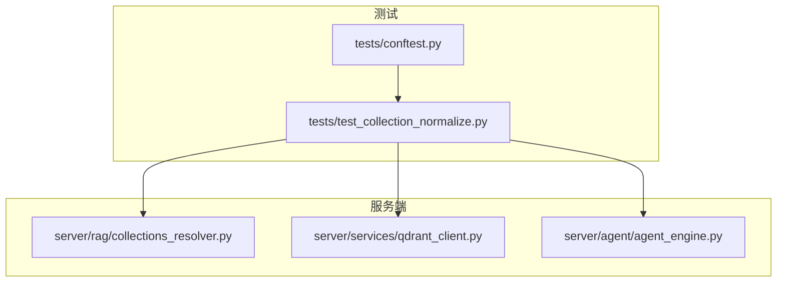
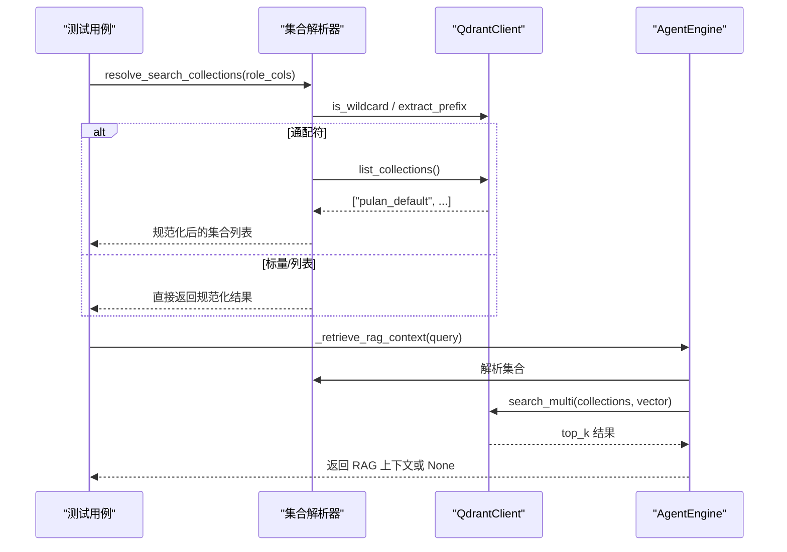
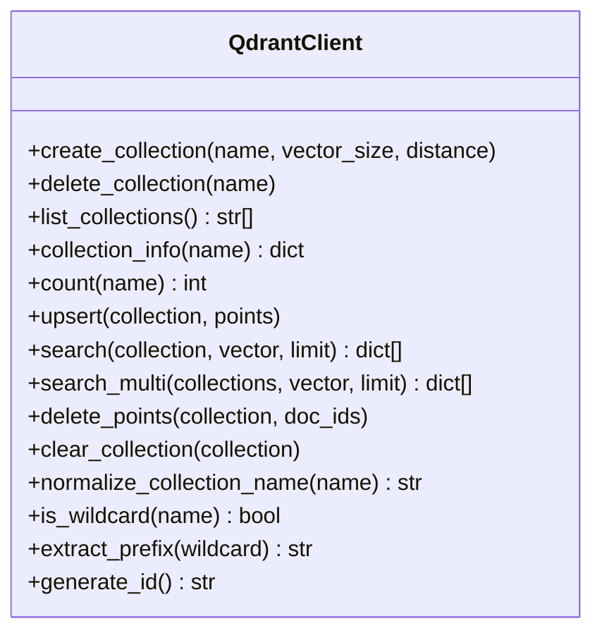
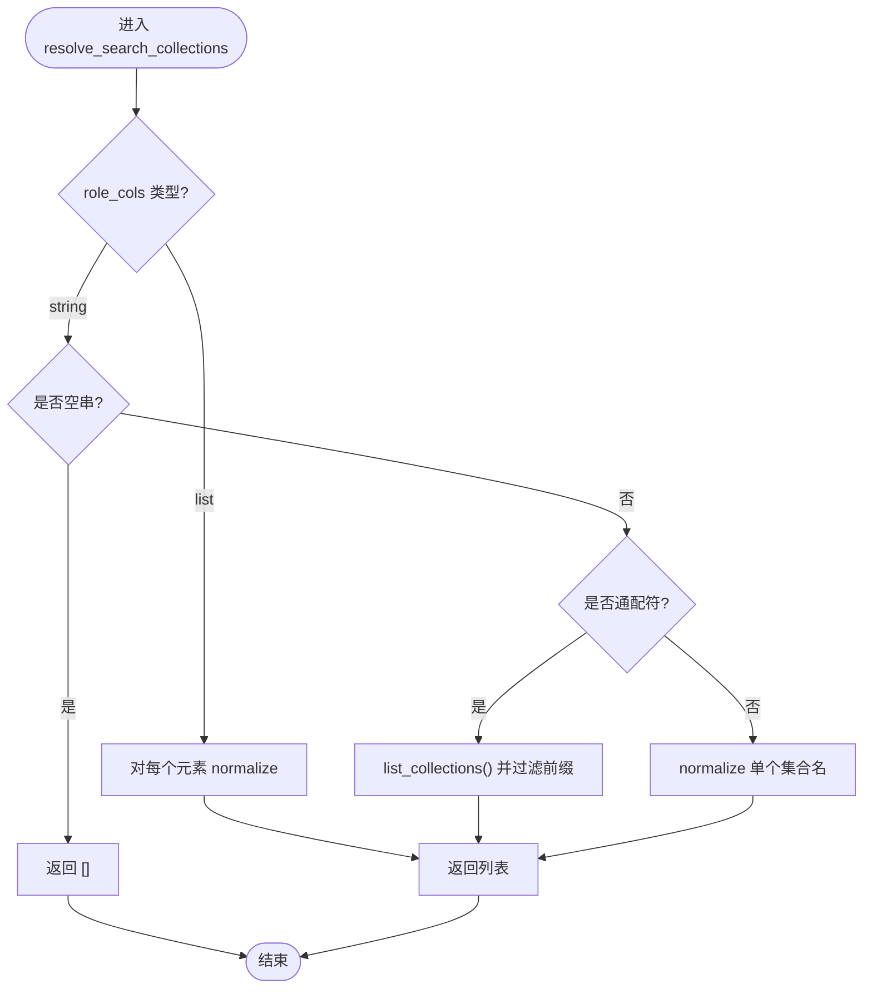
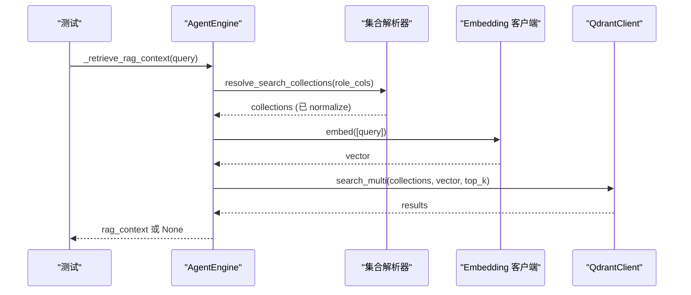
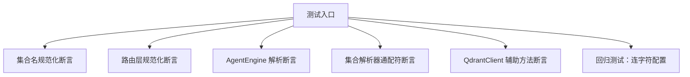
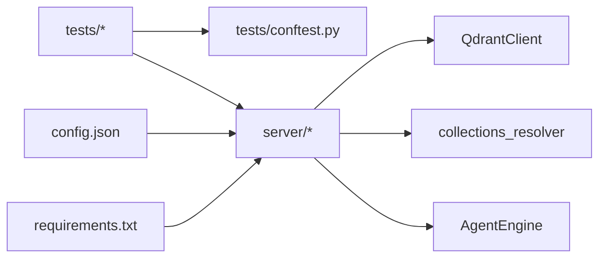

# 测试基础设施

<cite>
**本文引用的文件**   
- [tests/conftest.py](file://tests/conftest.py)
- [tests/test_collection_normalize.py](file://tests/test_collection_normalize.py)
- [server/rag/collections_resolver.py](file://server/rag/collections_resolver.py)
- [server/services/qdrant_client.py](file://server/services/qdrant_client.py)
- [server/agent/agent_engine.py](file://server/agent/agent_engine.py)
- [doc/test-spec.md](file://doc/test-spec.md)
- [config.json](file://config.json)
- [server/requirements.txt](file://server/requirements.txt)
</cite>

## 目录
1. [简介](#简介)
2. [项目结构](#项目结构)
3. [核心组件](#核心组件)
4. [架构总览](#架构总览)
5. [详细组件分析](#详细组件分析)
6. [依赖关系分析](#依赖关系分析)
7. [性能考虑](#性能考虑)
8. [故障排查指南](#故障排查指南)
9. [结论](#结论)
10. [附录](#附录)

## 简介
本文件聚焦于“实时对话”项目的测试基础设施，围绕后端 Python 侧的单元测试与回归测试展开，重点覆盖：
- Qdrant 集合名规范化（连字符、空格、大小写等）在写入与读取路径的一致性保障
- RAG 检索集合解析器对通配符与精确集合名的统一处理
- Agent 引擎在角色集合配置下的检索行为验证
- 基于 unittest 的可独立运行测试套件，不强制依赖 pytest 发现机制
- 与测试规范文档对齐的功能与接口测试范围说明

## 项目结构
测试相关代码主要位于 tests 目录，配合 server 包中的服务与工具模块进行断言。关键组织方式如下：
- tests/conftest.py：将项目根加入 sys.path，使测试可直接 import server.*
- tests/test_collection_normalize.py：集中化的单元测试与回归用例，覆盖集合名规范化、路由层、Agent 引擎与集合解析器
- server/rag/collections_resolver.py：集合解析器，支持 "*"、"pulan_*"、标量与列表四种语义
- server/services/qdrant_client.py：Qdrant HTTP 客户端，提供集合名规范化与通配符辅助方法
- server/agent/agent_engine.py：Agent 引擎，调用集合解析器并执行 RAG 检索
- doc/test-spec.md：端到端测试规范，定义 REST/WebSocket/前端状态机/流式分段等测试范围
- config.json：运行时配置（LLM/TTS/Redis/MinIO/FFmpeg/ASR），为测试环境约定提供参考
- server/requirements.txt：服务端依赖清单，包含 FastAPI、httpx、redis、minio、qdrant-client 等

**图示来源** 
- [tests/conftest.py:1-11](file://tests/conftest.py#L1-L11)
- [tests/test_collection_normalize.py:1-510](file://tests/test_collection_normalize.py#L1-L510)
- [server/rag/collections_resolver.py:1-79](file://server/rag/collections_resolver.py#L1-L79)
- [server/services/qdrant_client.py:1-257](file://server/services/qdrant_client.py#L1-L257)
- [server/agent/agent_engine.py:1-178](file://server/agent/agent_engine.py#L1-L178)

**章节来源**
- [tests/conftest.py:1-11](file://tests/conftest.py#L1-L11)
- [tests/test_collection_normalize.py:1-510](file://tests/test_collection_normalize.py#L1-L510)
- [server/rag/collections_resolver.py:1-79](file://server/rag/collections_resolver.py#L1-L79)
- [server/services/qdrant_client.py:1-257](file://server/services/qdrant_client.py#L1-L257)
- [server/agent/agent_engine.py:1-178](file://server/agent/agent_engine.py#L1-L178)
- [doc/test-spec.md:1-800](file://doc/test-spec.md#L1-L800)
- [config.json:1-47](file://config.json#L1-L47)
- [server/requirements.txt:1-14](file://server/requirements.txt#L1-L14)

## 核心组件
- 集合名规范化（QdrantClient.normalize_collection_name）
  - 作用：统一集合名为小写、下划线分隔，避免“pulan-default vs pulan_default”漂移问题
  - 使用点：写入端（create/upsert）、读取端（search/search_multi）、路由层（ingest/stats/clear）
- 集合解析器（resolve_search_collections）
  - 语义：支持 "*"（全部）、"pulan_*"（前缀过滤）、标量（单集合）、列表（多集合）
  - 输出：已 normalize 的集合名列表
- Agent 引擎（AgentEngine._retrieve_rag_context）
  - 流程：读取 role_collections → 解析集合 → 嵌入查询 → 并发检索 → 构建上下文
- 测试夹具（conftest.py）
  - 作用：将项目根加入 sys.path，确保 tests 可直接 import server.*

**章节来源**
- [server/services/qdrant_client.py:231-251](file://server/services/qdrant_client.py#L231-L251)
- [server/rag/collections_resolver.py:24-79](file://server/rag/collections_resolver.py#L24-L79)
- [server/agent/agent_engine.py:125-178](file://server/agent/agent_engine.py#L125-L178)
- [tests/conftest.py:1-11](file://tests/conftest.py#L1-L11)

## 架构总览
下图展示测试如何驱动服务端关键路径，确保集合名规范化与集合解析的正确性。

**图示来源** 
- [server/rag/collections_resolver.py:24-79](file://server/rag/collections_resolver.py#L24-L79)
- [server/services/qdrant_client.py:74-83](file://server/services/qdrant_client.py#L74-L83)
- [server/agent/agent_engine.py:125-178](file://server/agent/agent_engine.py#L125-L178)

## 详细组件分析

### Qdrant 客户端与集合名规范化
- 关键点
  - normalize_collection_name：统一名称为小写下划线
  - is_wildcard / extract_prefix：用于通配符识别与前缀提取
  - search_multi：并发检索多个集合，合并后按分数排序
- 复杂度与性能
  - search_multi 并发度等于集合数量；当集合较多时需关注网络与 I/O 开销
  - 规范化操作为 O(n) 字符串处理，成本极低
- 错误处理
  - 集合不存在、HTTP 非 2xx 均抛出 QdrantClientError，便于上层捕获与降级

**图示来源** 
- [server/services/qdrant_client.py:26-257](file://server/services/qdrant_client.py#L26-L257)

**章节来源**
- [server/services/qdrant_client.py:231-251](file://server/services/qdrant_client.py#L231-L251)
- [server/services/qdrant_client.py:164-186](file://server/services/qdrant_client.py#L164-L186)

### 集合解析器（collections_resolver）
- 功能
  - 统一处理 ROLE_COLLECTIONS 中角色值到实际检索集合列表的转换
  - 支持 "*"、"pulan_*"、标量、列表四种语义，并对所有集合名进行 normalize
- 行为要点
  - 空字符串/None/非字符串 → 返回空列表
  - 通配符需调用 list_collections 并按前缀过滤
  - 标量与列表直接 normalize 后返回

**图示来源** 
- [server/rag/collections_resolver.py:24-79](file://server/rag/collections_resolver.py#L24-L79)

**章节来源**
- [server/rag/collections_resolver.py:24-79](file://server/rag/collections_resolver.py#L24-L79)

### Agent 引擎（RAG 检索路径）
- 流程
  - 读取 role_collections（支持 JSON 字符串或对象）
  - 通过集合解析器得到 collections
  - 调用 embedding 生成向量，再调用 qdrant.search_multi 检索
  - 构建 RAG 上下文并注入 LLM 消息
- 异常与降级
  - 任何异常都会记录警告并返回 None，保证纯 LLM 回复可用

**图示来源** 
- [server/agent/agent_engine.py:125-178](file://server/agent/agent_engine.py#L125-L178)
- [server/rag/collections_resolver.py:24-79](file://server/rag/collections_resolver.py#L24-L79)

**章节来源**
- [server/agent/agent_engine.py:125-178](file://server/agent/agent_engine.py#L125-L178)

### 测试套件与用例设计
- conftest.py
  - 将项目根加入 sys.path，使 tests 可直接 import server.*
- test_collection_normalize.py
  - 覆盖 normalize_collection_name 的所有等价类
  - 覆盖 routes_knowledge 的 5 个入口的规范化行为（通过 FastAPI TestClient）
  - 覆盖 AgentEngine 的 role_collections 解析路径（含连字符、混合分隔符、标量）
  - 覆盖集合解析器的通配符语义（"*"、"pulan_*"、标量、列表）
  - 覆盖 QdrantClient.is_wildcard 与 extract_prefix 静态方法
  - 回归测试：模拟真实事故场景，确保 "pulan-default" 配置下也能工作

**图示来源** 
- [tests/test_collection_normalize.py:1-510](file://tests/test_collection_normalize.py#L1-L510)

**章节来源**
- [tests/conftest.py:1-11](file://tests/conftest.py#L1-L11)
- [tests/test_collection_normalize.py:1-510](file://tests/test_collection_normalize.py#L1-L510)

### 概念总览（非代码映射）
- 测试策略
  - 以 unittest 为主，避免强依赖 pytest discover
  - 通过 Mock/AsyncMock 隔离外部依赖（Qdrant、Embedding、LLM、Redis、MinIO）
  - 结合 FastAPI TestClient 对 API 路由进行集成级断言
- 覆盖率目标
  - 参考测试规范文档，追求功能及接口测试覆盖率 100%

[无需图示来源，因为该图为概念性流程图]

## 依赖关系分析
- 测试与服务的耦合
  - 测试直接 import server.*，依赖 conftest.py 的路径设置
  - 测试通过 Mock 隔离外部依赖，降低环境要求
- 外部依赖
  - FastAPI、httpx、redis、minio、qdrant-client 等由 requirements.txt 管理
  - 配置项来自 config.json（如 Redis、MinIO、FFmpeg、ASR）

**图示来源** 
- [tests/conftest.py:1-11](file://tests/conftest.py#L1-L11)
- [server/requirements.txt:1-14](file://server/requirements.txt#L1-L14)
- [config.json:1-47](file://config.json#L1-L47)

**章节来源**
- [server/requirements.txt:1-14](file://server/requirements.txt#L1-L14)
- [config.json:1-47](file://config.json#L1-L47)

## 性能考虑
- 集合解析与规范化
  - 字符串规范化为 O(n)，开销可忽略
  - 通配符模式会触发 list_collections，应评估集合规模
- 并发检索
  - search_multi 并发度等于集合数，需注意网络与 I/O 瓶颈
  - 建议在生产环境中限制 top_k 与集合数量，避免过度并发

[本节为通用指导，不直接分析具体文件]

## 故障排查指南
- 常见问题
  - 集合名不一致导致 404：确认写入与读取均调用 normalize_collection_name
  - 通配符未命中：检查 is_wildcard 与 extract_prefix 是否正确识别
  - RAG 无结果：确认 role_collections 配置与 Qdrant 集合名一致
- 定位手段
  - 查看日志中的 WARNING/ERROR 信息（如 RAG 检索失败、集合不存在）
  - 使用 FastAPI TestClient 快速验证路由层行为
  - 通过 AsyncMock 断言底层调用参数是否符合预期

**章节来源**
- [server/services/qdrant_client.py:19-24](file://server/services/qdrant_client.py#L19-L24)
- [server/agent/agent_engine.py:175-178](file://server/agent/agent_engine.py#L175-L178)

## 结论
本项目测试基础设施以 unittest 为核心，围绕 Qdrant 集合名规范化与集合解析器展开，覆盖了从路由层到 Agent 引擎的关键路径。通过 Mock 与 FastAPI TestClient，测试可在本地快速运行，有效防止历史问题复现，并为后续扩展提供稳定保障。

## 附录
- 测试规范文档摘要
  - REST API：Session CRUD、Clips 代理、Media 代理
  - WebSocket：连接/断开、事件与消息协议
  - 前端状态机：Idle → Input → Thinking → Speaking/Bridging → Idle
  - 流式分段：分段策略、并行生成、确认式推送、中断处理
  - 会话隔离：Token 生命周期、Redis 持久化
  - 异常处理：LLM/TTS/FFmpeg/MinIO/Redis/WebSocket 故障
  - 输入校验：空消息、超长输入、特殊字符
  - 非功能需求：首字延迟、分段衔接、断线重连、配置优先级

**章节来源**
- [doc/test-spec.md:1-800](file://doc/test-spec.md#L1-L800)