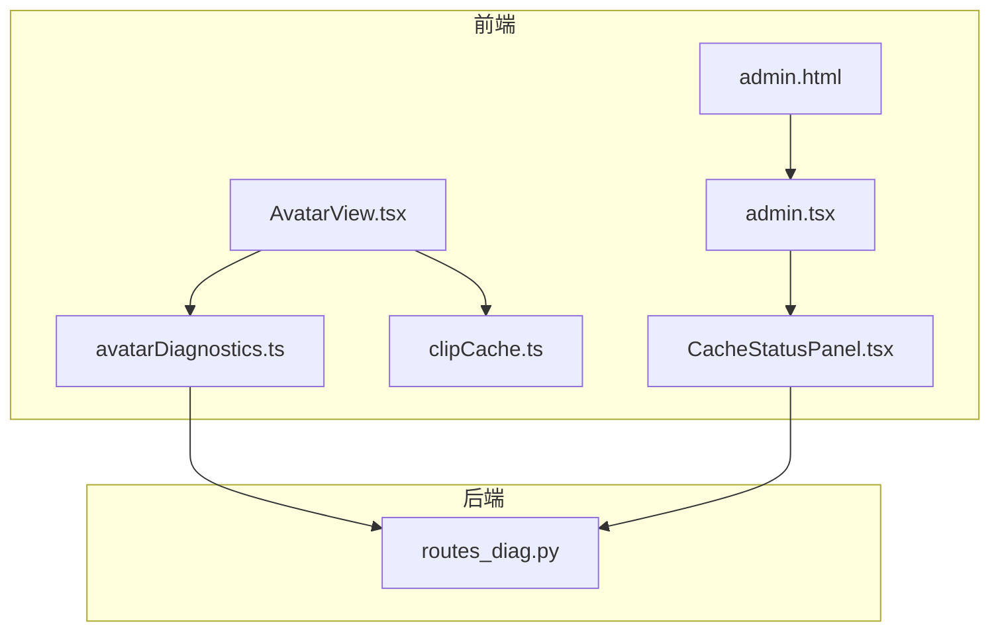
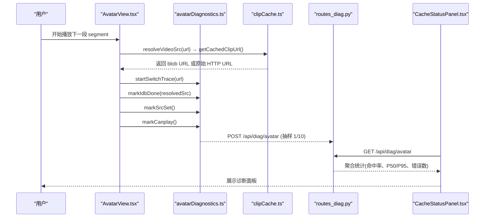
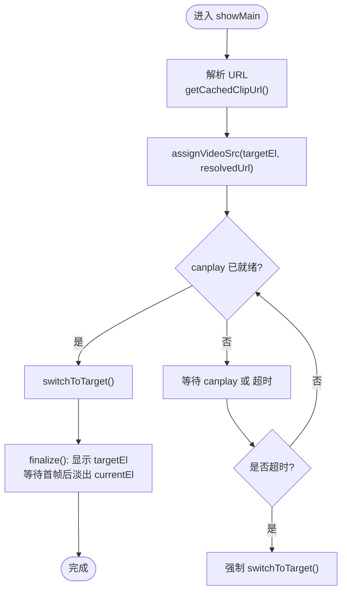
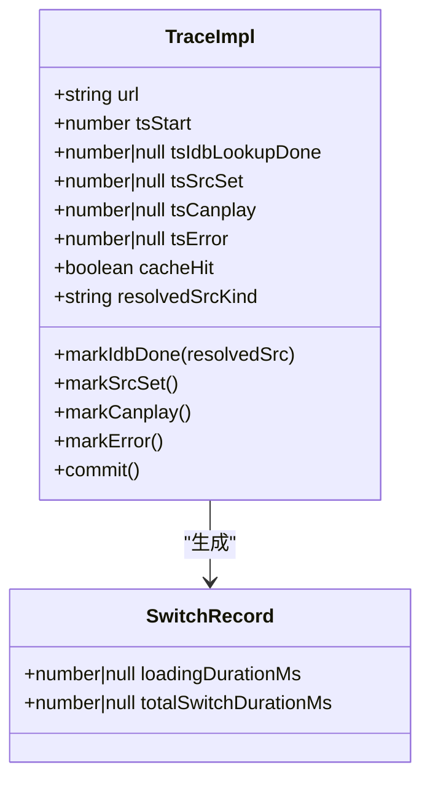
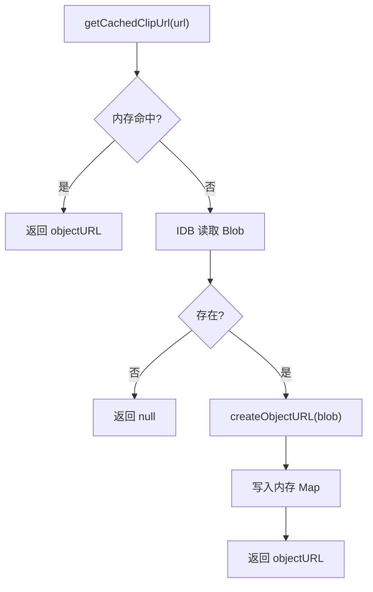
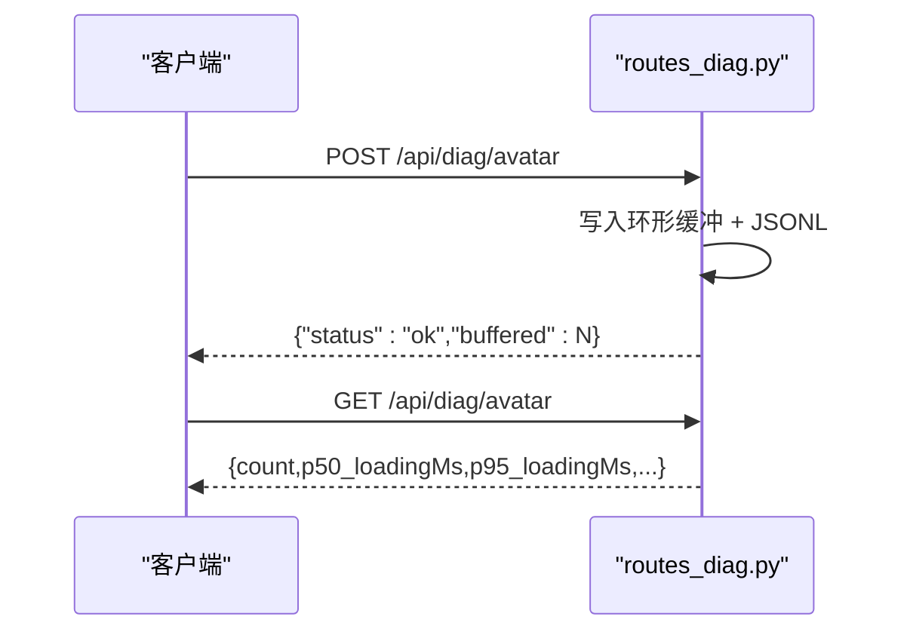
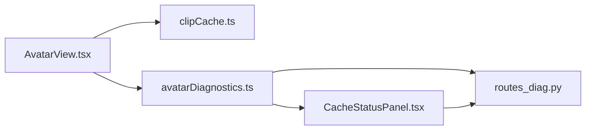

# 诊断工具集

<cite>
**本文引用的文件列表**
- [AvatarView.tsx](file://client/src/components/AvatarView.tsx)
- [avatarDiagnostics.ts](file://client/src/services/avatarDiagnostics.ts)
- [clipCache.ts](file://client/src/services/clipCache.ts)
- [CacheStatusPanel.tsx](file://client/src/components/CacheStatusPanel.tsx)
- [routes_diag.py](file://server/api/routes_diag.py)
- [admin.html](file://client/admin.html)
- [admin.tsx](file://client/src/admin.tsx)
</cite>

## 目录
1. [简介](#简介)
2. [项目结构](#项目结构)
3. [核心组件](#核心组件)
4. [架构总览](#架构总览)
5. [详细组件分析](#详细组件分析)
6. [依赖关系分析](#依赖关系分析)
7. [性能与体验优化](#性能与体验优化)
8. [故障排查指南](#故障排查指南)
9. [结论](#结论)
10. [附录](#附录)

## 简介
本文件聚焦“诊断工具集”，围绕实时对话前端中卡通形象视频切换的稳定性、缓存命中率与段间切换延迟进行端到端观测与可视化。该工具集包含：
- 客户端埋点与统计（段间切换耗时、缓存命中、错误）
- 服务端聚合接口（环形缓冲 + JSONL 持久化）
- 管理后台面板（本地与服务端指标展示）
- 视频切换关键路径修复（showMain 兜底超时适配 5G 慢网）

## 项目结构
与诊断相关的代码主要分布在以下位置：
- 前端组件与埋点：
  - client/src/components/AvatarView.tsx：双 video 切换逻辑、事件埋点、错误回退
  - client/src/services/avatarDiagnostics.ts：段间切换追踪器、抽样上报
  - client/src/services/clipCache.ts：IndexedDB + 内存 objectURL 两级缓存
  - client/src/components/CacheStatusPanel.tsx：管理面板中的诊断 UI
  - client/admin.html、client/src/admin.tsx：管理页面入口与挂载
- 后端聚合：
  - server/api/routes_diag.py：接收并聚合诊断数据，提供查询与清空接口

图表来源
- [AvatarView.tsx:1-1214](file://client/src/components/AvatarView.tsx#L1-L1214)
- [avatarDiagnostics.ts:1-187](file://client/src/services/avatarDiagnostics.ts#L1-L187)
- [clipCache.ts:1-307](file://client/src/services/clipCache.ts#L1-L307)
- [CacheStatusPanel.tsx:1-329](file://client/src/components/CacheStatusPanel.tsx#L1-L329)
- [routes_diag.py:1-124](file://server/api/routes_diag.py#L1-L124)
- [admin.html:1-44](file://client/admin.html#L1-L44)
- [admin.tsx:1-13](file://client/src/admin.tsx#L1-L13)

章节来源
- [AvatarView.tsx:1-1214](file://client/src/components/AvatarView.tsx#L1-L1214)
- [avatarDiagnostics.ts:1-187](file://client/src/services/avatarDiagnostics.ts#L1-L187)
- [clipCache.ts:1-307](file://client/src/services/clipCache.ts#L1-L307)
- [CacheStatusPanel.tsx:1-329](file://client/src/components/CacheStatusPanel.tsx#L1-L329)
- [routes_diag.py:1-124](file://server/api/routes_diag.py#L1-L124)
- [admin.html:1-44](file://client/admin.html#L1-L44)
- [admin.tsx:1-13](file://client/src/admin.tsx#L1-L13)

## 核心组件
- AvatarView：负责主/循环两个 <video> 的叠加切换、预加载、预热、错误回退，并在关键节点派发自定义事件用于埋点。
- avatarDiagnostics：封装一次段间切换的生命周期埋点，计算 loadingDurationMs 与 totalSwitchDurationMs，支持本地环缓冲与抽样上报。
- clipCache：实现 IndexedDB 持久化缓存与内存 objectURL 缓存，提供预热、并行预取、统计与清理能力。
- CacheStatusPanel：在管理页内展示本地缓存状态、SW 状态、客户端最近 P50/P95 与服务端聚合结果。
- routes_diag：FastAPI 路由，维护内存环形缓冲与 JSONL 日志，提供 GET/POST/DELETE 聚合接口。

章节来源
- [AvatarView.tsx:1-1214](file://client/src/components/AvatarView.tsx#L1-L1214)
- [avatarDiagnostics.ts:1-187](file://client/src/services/avatarDiagnostics.ts#L1-L187)
- [clipCache.ts:1-307](file://client/src/services/clipCache.ts#L1-L307)
- [CacheStatusPanel.tsx:1-329](file://client/src/components/CacheStatusPanel.tsx#L1-L329)
- [routes_diag.py:1-124](file://server/api/routes_diag.py#L1-L124)

## 架构总览
诊断链路从前端 AvatarView 触发，经埋点服务记录时间戳，抽样上报到后端聚合，再由管理面板拉取并展示。

图表来源
- [AvatarView.tsx:254-438](file://client/src/components/AvatarView.tsx#L254-L438)
- [avatarDiagnostics.ts:157-159](file://client/src/services/avatarDiagnostics.ts#L157-L159)
- [avatarDiagnostics.ts:139-153](file://client/src/services/avatarDiagnostics.ts#L139-L153)
- [clipCache.ts:91-108](file://client/src/services/clipCache.ts#L91-L108)
- [routes_diag.py:54-70](file://server/api/routes_diag.py#L54-L70)
- [routes_diag.py:73-116](file://server/api/routes_diag.py#L73-L116)
- [CacheStatusPanel.tsx:109-122](file://client/src/components/CacheStatusPanel.tsx#L109-L122)

## 详细组件分析

### AvatarView 诊断与视频切换
- 双 video 叠加策略：主视频与循环视频通过 opacity 过渡避免黑闪；segment 播放期间使用 loopVideo 作为目标元素，结束后切回 idle/analysis。
- canplay 与首帧渲染：优先 requestVideoFrameCallback，其次 playing 事件 + 微等待，最后硬超时兜底，确保旧帧不被过早隐藏。
- showMain 兜底超时修复：将原 800ms 延长至 5000ms，适配 5G 慢网下 segment 下载耗时，避免 mainVideo 无帧时提前可见导致形象消失。
- 错误回退：mainVideo 对象 URL 失效回退到原始 HTTP URL；loopVideo 失败尝试 mp4 fallback（仅一次）。
- 埋点事件：在 src-set、canplay 等关键点派发 CustomEvent，供外部监听与调试。

图表来源
- [AvatarView.tsx:254-438](file://client/src/components/AvatarView.tsx#L254-L438)
- [AvatarView.tsx:429-437](file://client/src/components/AvatarView.tsx#L429-L437)

章节来源
- [AvatarView.tsx:254-438](file://client/src/components/AvatarView.tsx#L254-L438)
- [AvatarView.tsx:429-437](file://client/src/components/AvatarView.tsx#L429-L437)

### avatarDiagnostics 埋点模型与上报
- TraceImpl 生命周期：start → markIdbDone → markSrcSet → markCanplay/markError → commit。
- 指标计算：loadingDurationMs = tsCanplay - tsSrcSet；totalSwitchDurationMs = tsCanplay - tsStart。
- 本地存储：内存环缓冲（最多 200 条），并通过 window 事件广播。
- 抽样上报：约 10% 概率 POST 到 /api/diag/avatar，使用 keepalive 降低阻塞。

图表来源
- [avatarDiagnostics.ts:54-155](file://client/src/services/avatarDiagnostics.ts#L54-L155)
- [avatarDiagnostics.ts:31-34](file://client/src/services/avatarDiagnostics.ts#L31-L34)

章节来源
- [avatarDiagnostics.ts:54-155](file://client/src/services/avatarDiagnostics.ts#L54-L155)
- [avatarDiagnostics.ts:157-159](file://client/src/services/avatarDiagnostics.ts#L157-L159)
- [avatarDiagnostics.ts:139-153](file://client/src/services/avatarDiagnostics.ts#L139-L153)

### clipCache 两级缓存与预热
- L1 内存 Map：objectURL 直接命中，同步 <1ms。
- L2 IndexedDB：按 url 键值存储 Blob，读取后创建 objectURL 并写入内存 Map。
- 预热 warmupMemoryCache：批量遍历 IDB，预先填充内存 Map，消除首次切换开销。
- 并行预取 prefetchClips：并发度 4，完成后自动调用 warmupMemoryCache。
- 统计 getClipCacheStats：返回记录数、字节数、内存缓存条目数。

图表来源
- [clipCache.ts:91-108](file://client/src/services/clipCache.ts#L91-L108)
- [clipCache.ts:144-172](file://client/src/services/clipCache.ts#L144-L172)
- [clipCache.ts:182-227](file://client/src/services/clipCache.ts#L182-L227)
- [clipCache.ts:230-259](file://client/src/services/clipCache.ts#L230-L259)

章节来源
- [clipCache.ts:91-108](file://client/src/services/clipCache.ts#L91-L108)
- [clipCache.ts:144-172](file://client/src/services/clipCache.ts#L144-L172)
- [clipCache.ts:182-227](file://client/src/services/clipCache.ts#L182-L227)
- [clipCache.ts:230-259](file://client/src/services/clipCache.ts#L230-L259)

### CacheStatusPanel 管理面板
- 本地缓存：定时刷新 IndexedDB 记录数、占用字节、内存 objectURL 数量与 URL 列表。
- Service Worker：检测注册与激活状态，监听控制器变更。
- 客户端延迟分布：订阅 avatar-diag 事件，计算 P50/P95 与命中率。
- 服务端聚合：定时拉取 /api/diag/avatar，展示全局样本数、命中率、P50/P95 与错误数。

章节来源
- [CacheStatusPanel.tsx:43-122](file://client/src/components/CacheStatusPanel.tsx#L43-L122)
- [CacheStatusPanel.tsx:124-329](file://client/src/components/CacheStatusPanel.tsx#L124-L329)

### routes_diag 服务端聚合
- 数据结构 SwitchRecordIn：包含各阶段时间戳、缓存命中、源类型、耗时等字段。
- POST /api/diag/avatar：追加到内存环形缓冲（最近 1000 条）并写入 JSONL 文件。
- GET /api/diag/avatar：计算 p50/p95 的 loadingMs 与 totalMs、命中率、错误数、源类型分布。
- DELETE /api/diag/avatar：清空内存缓冲（不清文件）。

图表来源
- [routes_diag.py:30-44](file://server/api/routes_diag.py#L30-L44)
- [routes_diag.py:54-70](file://server/api/routes_diag.py#L54-L70)
- [routes_diag.py:73-116](file://server/api/routes_diag.py#L73-L116)
- [routes_diag.py:119-124](file://server/api/routes_diag.py#L119-L124)

章节来源
- [routes_diag.py:30-44](file://server/api/routes_diag.py#L30-L44)
- [routes_diag.py:54-70](file://server/api/routes_diag.py#L54-L70)
- [routes_diag.py:73-116](file://server/api/routes_diag.py#L73-L116)
- [routes_diag.py:119-124](file://server/api/routes_diag.py#L119-L124)

### 管理页面入口
- admin.html：提供基础 HTML 结构与元信息。
- admin.tsx：挂载 AdminPage 组件，AdminPage 中包含 CacheStatusPanel 的诊断区域。

章节来源
- [admin.html:1-44](file://client/admin.html#L1-L44)
- [admin.tsx:1-13](file://client/src/admin.tsx#L1-L13)
- [AdminPage.tsx:368-392](file://client/src/components/AdminPage.tsx#L368-L392)

## 依赖关系分析
- AvatarView 依赖 clipCache 获取缓存 URL，并在 src-set/canplay 等时机派发事件供 avatarDiagnostics 收集。
- avatarDiagnostics 以 10% 概率向 routes_diag 上报，同时通过 window 事件通知 CacheStatusPanel 更新本地统计。
- CacheStatusPanel 同时拉取本地统计与服务端聚合，形成“设备级 + 全局”的双视角诊断。
- routes_diag 使用内存环形缓冲与 JSONL 文件，兼顾低延迟查询与长期可追溯性。

图表来源
- [AvatarView.tsx:254-438](file://client/src/components/AvatarView.tsx#L254-L438)
- [avatarDiagnostics.ts:139-153](file://client/src/services/avatarDiagnostics.ts#L139-L153)
- [CacheStatusPanel.tsx:109-122](file://client/src/components/CacheStatusPanel.tsx#L109-L122)
- [routes_diag.py:54-70](file://server/api/routes_diag.py#L54-L70)

章节来源
- [AvatarView.tsx:254-438](file://client/src/components/AvatarView.tsx#L254-L438)
- [avatarDiagnostics.ts:139-153](file://client/src/services/avatarDiagnostics.ts#L139-L153)
- [CacheStatusPanel.tsx:109-122](file://client/src/components/CacheStatusPanel.tsx#L109-L122)
- [routes_diag.py:54-70](file://server/api/routes_diag.py#L54-L70)

## 性能与体验优化
- 5G 慢网适配：showMain 兜底超时从 800ms 提升至 5000ms，避免 mainVideo 无帧时提前可见导致的形象消失。
- 首帧渲染保障：requestVideoFrameCallback + playing 事件 + 硬超时组合，确保旧帧不被过早隐藏。
- 两级缓存：内存 objectURL 与 IndexedDB 结合，预热减少首次切换开销。
- 抽样上报：10% 采样降低网络与存储压力，同时保留足够代表性。

[本节为通用指导，不直接分析具体文件]

## 故障排查指南
- 现象：5G 移动网络下开始说话时卡通形象短暂消失
  - 根因：showMain 的 canplay 兜底超时过短，mainVideo 无帧被设为可见，随后 loopVideo 被隐藏，造成两者都不可见的窗口期。
  - 定位：查看 AvatarView.tsx 中 showMain 的 setTimeout 超时配置。
  - 修复：将超时从 800ms 延长至 5000ms，使 canplay 在超时前自然触发完成正常切换。
- 现象：移动端 X5 内核解码停顿导致白闪
  - 根因：playing 回调时首帧可能尚未渲染，快速淡出旧帧会露出空白。
  - 定位：检查 finalize 中的首帧等待与硬超时分支。
  - 修复：统一走首帧等待路径，最长等待覆盖 5G 慢解码场景。
- 现象：idle→analysis 同文件重复加载导致空白帧
  - 根因：比较 getAttribute('src') 返回 blob URL 与新 HTTP URL 永远不匹配，触发不必要的 src 切换。
  - 定位：检查 showLoop 中的路径比较逻辑。
  - 修复：使用 loopOriginalUrlRef 记录原始 HTTP URL 进行比较，避免误判。
- 现象：对象 URL 失效导致 mainVideo 无法播放
  - 根因：blob URL 过期或被回收。
  - 定位：检查 handleMainError 的回退逻辑。
  - 修复：回退到原始 HTTP URL 并重试一次。

章节来源
- [AvatarView.tsx:429-437](file://client/src/components/AvatarView.tsx#L429-L437)
- [AvatarView.tsx:285-354](file://client/src/components/AvatarView.tsx#L285-L354)
- [AvatarView.tsx:537-546](file://client/src/components/AvatarView.tsx#L537-L546)
- [AvatarView.tsx:205-223](file://client/src/components/AvatarView.tsx#L205-L223)

## 结论
诊断工具集通过前端埋点、两级缓存与后端聚合，形成了完整的“设备级 + 全局”监控闭环。针对 5G 慢网的 showMain 超时修复显著降低了形象消失的概率，配合首帧渲染保障与错误回退机制，整体用户体验更加稳定。管理面板提供了直观的指标展示，便于快速定位问题与评估优化效果。

[本节为总结性内容，不直接分析具体文件]

## 附录
- 验证方式：部署后在手机微信端禁用 WiFi 用 5G 打开 pulan.smartmoves.com.cn，发送消息观察 avatar 是否还会在开始说话时消失。
- 可选增强（不在本次范围）：
  - 在超时回调中增加 readyState >= 2 检查，渐进式等待
  - 服务端提前推送第一段 URL（segment_pending）让客户端提前预加载

[本节为补充说明，不直接分析具体文件]