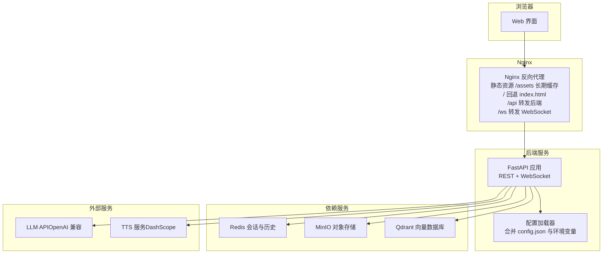
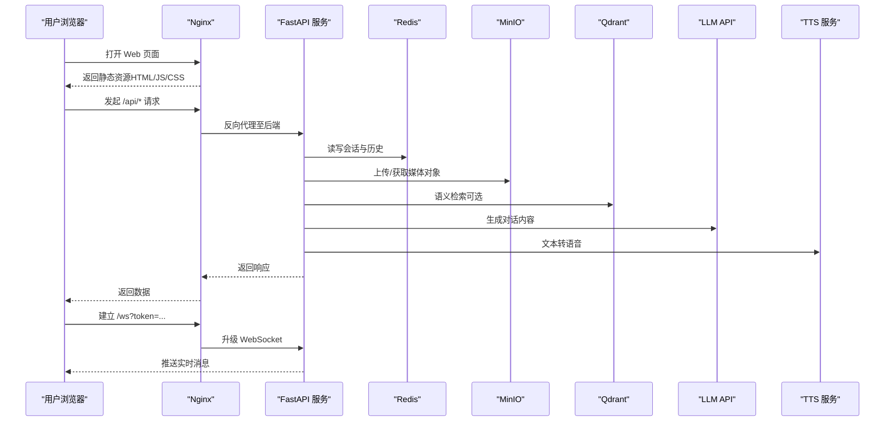
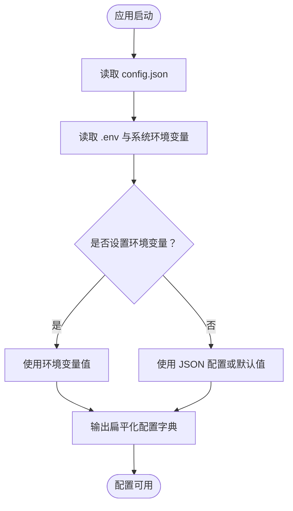
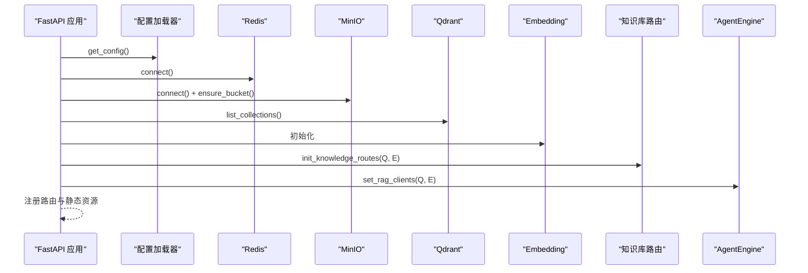
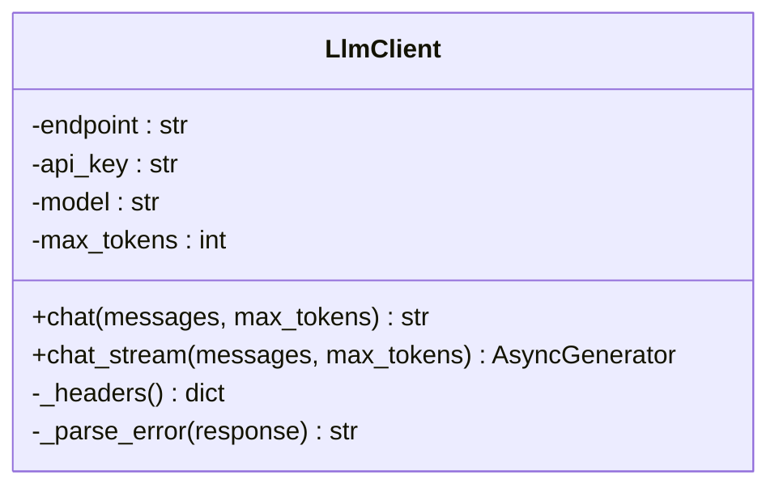
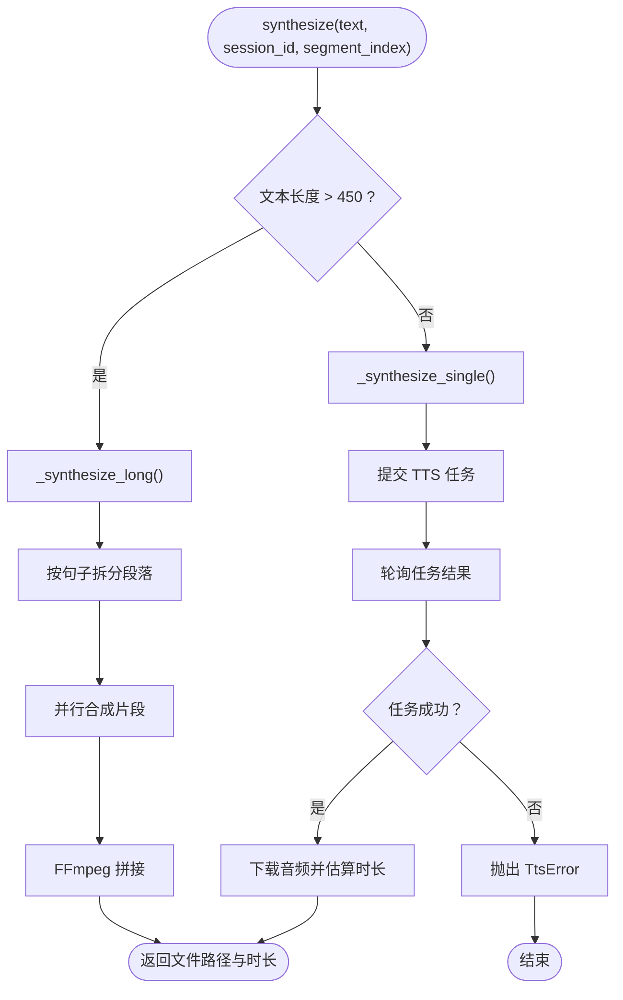
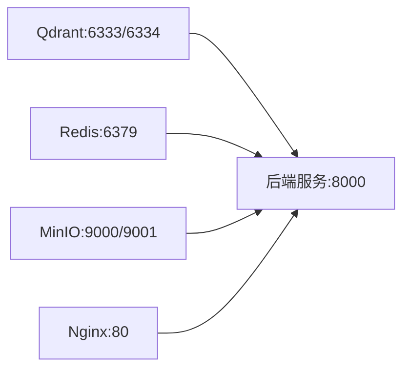

# 快速开始

<cite>
**本文引用的文件列表**
- [docker-compose.yml](file://docker-compose.yml)
- [Dockerfile](file://Dockerfile)
- [config.json](file://config.json)
- [server/config.py](file://server/config.py)
- [server/main.py](file://server/main.py)
- [nginx.conf](file://nginx.conf)
- [client/package.json](file://client/package.json)
- [server/services/llm_client.py](file://server/services/llm_client.py)
- [server/services/tts_engine.py](file://server/services/tts_engine.py)
- [server/services/redis_client.py](file://server/services/redis_client.py)
- [server/services/minio_client.py](file://server/services/minio_client.py)
- [server/services/qdrant_client.py](file://server/services/qdrant_client.py)
</cite>

## 目录
1. [简介](#简介)
2. [项目结构](#项目结构)
3. [核心组件](#核心组件)
4. [架构总览](#架构总览)
5. [详细组件分析](#详细组件分析)
6. [依赖关系分析](#依赖关系分析)
7. [性能与扩展建议](#性能与扩展建议)
8. [故障排查指南](#故障排查指南)
9. [结论](#结论)
10. [附录：环境变量与配置示例](#附录环境变量与配置示例)

## 简介
RealTimeTalk 是一个支持实时对话、语音合成与数字人视频播放的 Web 应用。后端基于 FastAPI，提供 REST API 与 WebSocket 接口；前端为 React + Vite 构建的静态站点，通过 Nginx 反向代理对外提供服务。系统依赖 Redis（会话与历史）、MinIO（对象存储）、Qdrant（向量检索）以及外部 LLM/TTS 服务。

本指南面向新手，目标是在 10 分钟内完成从克隆到访问 Web 界面的全流程，并覆盖 Docker Compose 部署与本地开发两种模式，同时给出关键依赖与外部服务的接入说明。

## 项目结构
仓库采用前后端分离与多服务编排的结构：
- server：FastAPI 后端，包含路由、模型、服务客户端与配置加载
- client：React + Vite 前端，构建产物由 Nginx 托管
- docker-compose.yml：一键拉起 Qdrant、Redis、MinIO、后端与 Nginx
- config.json：默认配置（可被环境变量覆盖）
- nginx.conf：静态资源缓存、API 与 WebSocket 反向代理

图表来源
- [docker-compose.yml:1-69](file://docker-compose.yml#L1-L69)
- [nginx.conf:1-58](file://nginx.conf#L1-L58)
- [server/main.py:114-178](file://server/main.py#L114-L178)
- [server/config.py:148-241](file://server/config.py#L148-L241)

章节来源
- [docker-compose.yml:1-69](file://docker-compose.yml#L1-L69)
- [Dockerfile:1-22](file://Dockerfile#L1-L22)
- [nginx.conf:1-58](file://nginx.conf#L1-L58)
- [client/package.json:1-24](file://client/package.json#L1-L24)

## 核心组件
- 配置加载器：优先使用环境变量，其次读取 config.json，最终输出扁平化配置供各模块使用
- 后端入口：初始化生命周期、注册路由、挂载静态资源、暴露健康检查与 WebSocket
- 服务客户端：Redis、MinIO、Qdrant、LLM、TTS 等封装，统一错误处理与重试策略
- 前端与 Nginx：Vite 构建产物由 Nginx 托管，静态资源开启强缓存，API 与 WS 走反向代理

章节来源
- [server/config.py:148-241](file://server/config.py#L148-L241)
- [server/main.py:42-111](file://server/main.py#L42-L111)
- [server/main.py:136-178](file://server/main.py#L136-L178)
- [server/services/redis_client.py:22-62](file://server/services/redis_client.py#L22-L62)
- [server/services/minio_client.py:21-67](file://server/services/minio_client.py#L21-L67)
- [server/services/qdrant_client.py:26-84](file://server/services/qdrant_client.py#L26-L84)
- [server/services/llm_client.py:23-38](file://server/services/llm_client.py#L23-L38)
- [server/services/tts_engine.py:38-47](file://server/services/tts_engine.py#L38-L47)

## 架构总览
下图展示了从浏览器到后端再到依赖服务的完整调用链路，包括 WebSocket 实时通信路径。

图表来源
- [nginx.conf:35-55](file://nginx.conf#L35-L55)
- [server/main.py:146-170](file://server/main.py#L146-L170)
- [server/services/redis_client.py:31-50](file://server/services/redis_client.py#L31-L50)
- [server/services/minio_client.py:69-90](file://server/services/minio_client.py#L69-L90)
- [server/services/qdrant_client.py:136-162](file://server/services/qdrant_client.py#L136-L162)
- [server/services/llm_client.py:40-113](file://server/services/llm_client.py#L40-L113)
- [server/services/tts_engine.py:49-167](file://server/services/tts_engine.py#L49-L167)

## 详细组件分析

### 配置加载与优先级
- 优先级：环境变量 > config.json
- 支持字段：LLM、TTS、Redis、MinIO、Server、FFmpeg、Qdrant、Embedding、RAG、知识库管理员令牌等
- 启动时懒加载，全局单例，支持热重载

图表来源
- [server/config.py:148-241](file://server/config.py#L148-L241)

章节来源
- [server/config.py:148-241](file://server/config.py#L148-L241)

### 后端启动流程
- 生命周期中依次连接 Redis、初始化 MinIO 并确保 Bucket、初始化 Qdrant 与 Embedding、注入 RAG 依赖、注册路由、挂载静态资源
- 健康检查端点用于验证服务就绪状态
- WebSocket 端点根据 token 建立会话上下文

图表来源
- [server/main.py:42-111](file://server/main.py#L42-L111)
- [server/main.py:129-178](file://server/main.py#L129-L178)

章节来源
- [server/main.py:42-111](file://server/main.py#L42-L111)
- [server/main.py:136-178](file://server/main.py#L136-L178)

### LLM 客户端（OpenAI 兼容）
- 支持非流式与流式对话
- 内置重试与限流处理（429），超时与连接异常兜底
- 错误解析统一封装

图表来源
- [server/services/llm_client.py:23-38](file://server/services/llm_client.py#L23-L38)
- [server/services/llm_client.py:40-113](file://server/services/llm_client.py#L40-L113)
- [server/services/llm_client.py:115-190](file://server/services/llm_client.py#L115-L190)

章节来源
- [server/services/llm_client.py:23-38](file://server/services/llm_client.py#L23-L38)
- [server/services/llm_client.py:40-113](file://server/services/llm_client.py#L40-L113)
- [server/services/llm_client.py:115-190](file://server/services/llm_client.py#L115-L190)

### TTS 引擎（DashScope）
- 并发限制信号量避免触发 429
- 长文本自动分段合成并使用 FFmpeg 拼接
- 异步任务轮询与同步直出兼容

图表来源
- [server/services/tts_engine.py:49-76](file://server/services/tts_engine.py#L49-L76)
- [server/services/tts_engine.py:78-167](file://server/services/tts_engine.py#L78-L167)
- [server/services/tts_engine.py:169-226](file://server/services/tts_engine.py#L169-L226)

章节来源
- [server/services/tts_engine.py:38-47](file://server/services/tts_engine.py#L38-L47)
- [server/services/tts_engine.py:49-76](file://server/services/tts_engine.py#L49-L76)
- [server/services/tts_engine.py:78-167](file://server/services/tts_engine.py#L78-L167)
- [server/services/tts_engine.py:169-226](file://server/services/tts_engine.py#L169-L226)

### Redis 客户端
- 会话状态与历史持久化
- TTL 管理与会话清理
- URL 解析兼容密码特殊字符

章节来源
- [server/services/redis_client.py:22-62](file://server/services/redis_client.py#L22-L62)
- [server/services/redis_client.py:64-122](file://server/services/redis_client.py#L64-L122)

### MinIO 客户端
- 自动创建 Bucket
- 上传、存在性检查、预签名 URL 生成
- 前缀批量删除

章节来源
- [server/services/minio_client.py:21-67](file://server/services/minio_client.py#L21-L67)
- [server/services/minio_client.py:69-139](file://server/services/minio_client.py#L69-L139)

### Qdrant 客户端
- 集合管理（创建/删除/信息/计数）
- 向量 upsert、搜索、多集合并发搜索
- 按 ID 删除与清空重建

章节来源
- [server/services/qdrant_client.py:26-84](file://server/services/qdrant_client.py#L26-L84)
- [server/services/qdrant_client.py:115-186](file://server/services/qdrant_client.py#L115-L186)
- [server/services/qdrant_client.py:188-212](file://server/services/qdrant_client.py#L188-L212)

## 依赖关系分析
- 容器编排：Qdrant、Redis、MinIO、后端服务、Nginx 通过 docker-compose 统一管理
- 端口映射：Qdrant(6333/6334)、Redis(6379)、MinIO(9000/9001)、后端(8000)、Nginx(80)
- 卷挂载：qdrant_data、redis_data、minio_data 持久化；config.json、clips、resources 只读挂载
- 依赖顺序：后端依赖 Redis、MinIO、Qdrant 先启动；Nginx 依赖后端

图表来源
- [docker-compose.yml:1-69](file://docker-compose.yml#L1-L69)

章节来源
- [docker-compose.yml:1-69](file://docker-compose.yml#L1-L69)

## 性能与扩展建议
- TTS 并发控制：已内置信号量限制并发数，避免触发外部服务限流
- 长文本合成：自动分段与 FFmpeg 拼接，减少单次请求失败风险
- 静态资源缓存：Nginx 对 /assets 启用长期缓存，提升首屏与二次访问速度
- 会话 TTL：可通过环境变量调整 Redis 会话过期时间，平衡内存占用与用户体验
- 向量检索：Qdrant 集合维度与距离度量可按需调整，以匹配 Embedding 模型输出

[本节为通用建议，不直接分析具体文件]

## 故障排查指南
- 健康检查
  - 访问 http://localhost/api/health 确认服务状态与活跃会话数
- 依赖连通性
  - Redis：检查 6379 端口可达性与认证参数
  - MinIO：控制台 9001 登录，确认 bucket 存在且凭据正确
  - Qdrant：检查 6333/6334 端口，确认集合是否存在
- 外部服务
  - LLM：确认 endpoint、api_key、model 配置有效，网络可达
  - TTS：确认 api_key 与 voice 映射模型可用，注意 429 限流
- 日志定位
  - 后端启动日志会打印配置摘要与各依赖连接结果
  - 若 Qdrant 不可用，服务仍可启动但 RAG 功能不可用

章节来源
- [server/main.py:136-143](file://server/main.py#L136-L143)
- [server/main.py:53-88](file://server/main.py#L53-L88)
- [server/services/redis_client.py:31-50](file://server/services/redis_client.py#L31-L50)
- [server/services/minio_client.py:48-63](file://server/services/minio_client.py#L48-L63)
- [server/services/qdrant_client.py:74-84](file://server/services/qdrant_client.py#L74-L84)
- [server/services/llm_client.py:62-113](file://server/services/llm_client.py#L62-L113)
- [server/services/tts_engine.py:70-76](file://server/services/tts_engine.py#L70-L76)

## 结论
通过 Docker Compose 一键拉起依赖服务与后端，配合 Nginx 即可在本地快速体验 RealTimeTalk 的实时对话与语音合成能力。对于生产环境，建议将敏感配置迁移至环境变量或密钥管理系统，并根据业务规模调整并发与缓存策略。

[本节为总结，不直接分析具体文件]

## 附录：环境变量与配置示例

### 一键启动（Docker Compose）
- 前置条件：安装 Docker 与 Docker Compose
- 步骤
  - 克隆仓库
  - 准备配置文件：复制根目录 config.json 并按需修改（也可仅通过环境变量覆盖）
  - 启动服务：执行 docker compose up -d
  - 访问地址：http://localhost（Nginx 80 端口）
- 说明
  - 后端镜像内已安装 ffmpeg，用于 TTS 长文本拼接
  - 静态资源由 Nginx 提供，API 与 WebSocket 经 Nginx 反向代理到后端

章节来源
- [docker-compose.yml:1-69](file://docker-compose.yml#L1-L69)
- [Dockerfile:1-22](file://Dockerfile#L1-L22)
- [nginx.conf:1-58](file://nginx.conf#L1-L58)

### 本地开发环境搭建
- 后端
  - 安装 Python 3.11+，进入 server 目录安装依赖
  - 准备 .env 或修改 config.json，确保 Redis、MinIO、Qdrant 地址与凭据正确
  - 运行 uvicorn server.main:app --host 0.0.0.0 --port 8000
- 前端
  - 进入 client 目录，安装依赖后执行 npm run build 生成 dist
  - 将 dist 复制到后端静态目录或通过 Nginx 指向该目录
- 依赖服务
  - 本地运行 Redis、MinIO、Qdrant（或使用 docker compose 单独拉起）

章节来源
- [server/main.py:182-191](file://server/main.py#L182-L191)
- [client/package.json:6-9](file://client/package.json#L6-L9)
- [nginx.conf:35-55](file://nginx.conf#L35-L55)

### 依赖服务配置要点
- Redis
  - 连接地址与端口、数据库编号、密码（如有）
  - 会话 TTL（小时）
- MinIO
  - endpoint、access_key、secret_key、bucket、预签名 URL 有效期
- Qdrant
  - url、api_key（如需鉴权）
- LLM
  - endpoint（OpenAI 兼容）、api_key、model、max_tokens
- TTS
  - api_key、voice、speed（voice 与模型映射见实现）

章节来源
- [server/config.py:82-126](file://server/config.py#L82-L126)
- [server/config.py:188-239](file://server/config.py#L188-L239)
- [config.json:1-39](file://config.json#L1-L39)

### 环境变量参考（节选）
- LLM_ENDPOINT、LLM_API_KEY、LLM_MODEL、LLM_MAX_TOKENS
- DASHSCOPE_API_KEY、TTS_VOICE、TTS_SPEED
- REDIS_URL、REDIS_SESSION_TTL_HOURS
- MINIO_ENDPOINT、MINIO_ACCESS_KEY、MINIO_SECRET_KEY、MINIO_BUCKET、MINIO_PRESIGNED_URL_TTL_SECONDS
- SERVER_HOST、SERVER_PORT
- FFMPEG_PATH、FFMPEG_GPU_ENCODER
- QDRANT_URL、QDRANT_API_KEY
- EMBEDDING_ENDPOINT、EMBEDDING_MODEL
- RAG_TOP_K、ROLE_COLLECTIONS
- KNOWLEDGE_ADMIN_TOKEN

章节来源
- [server/config.py:82-126](file://server/config.py#L82-L126)

### 常见问题速查
- 无法访问 Web 界面
  - 确认 Nginx 80 端口未被占用，静态目录已挂载或已构建 dist
- 对话无回复
  - 检查 LLM endpoint 与 api_key，查看后端日志中的连接与错误信息
- 语音无声或报错
  - 检查 TTS api_key 与 voice 配置，关注 429 限流与 FFmpeg 可用性
- 知识库检索失败
  - 确认 Qdrant 服务可达与集合存在，必要时重新创建集合

章节来源
- [server/main.py:136-143](file://server/main.py#L136-L143)
- [server/services/llm_client.py:62-113](file://server/services/llm_client.py#L62-L113)
- [server/services/tts_engine.py:70-76](file://server/services/tts_engine.py#L70-L76)
- [server/services/qdrant_client.py:74-84](file://server/services/qdrant_client.py#L74-L84)