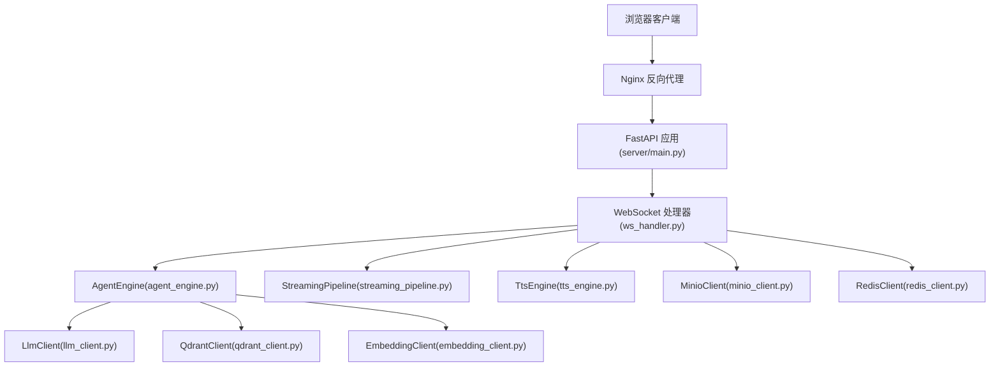
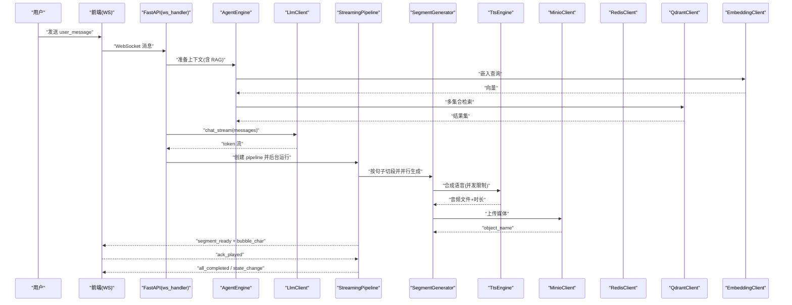
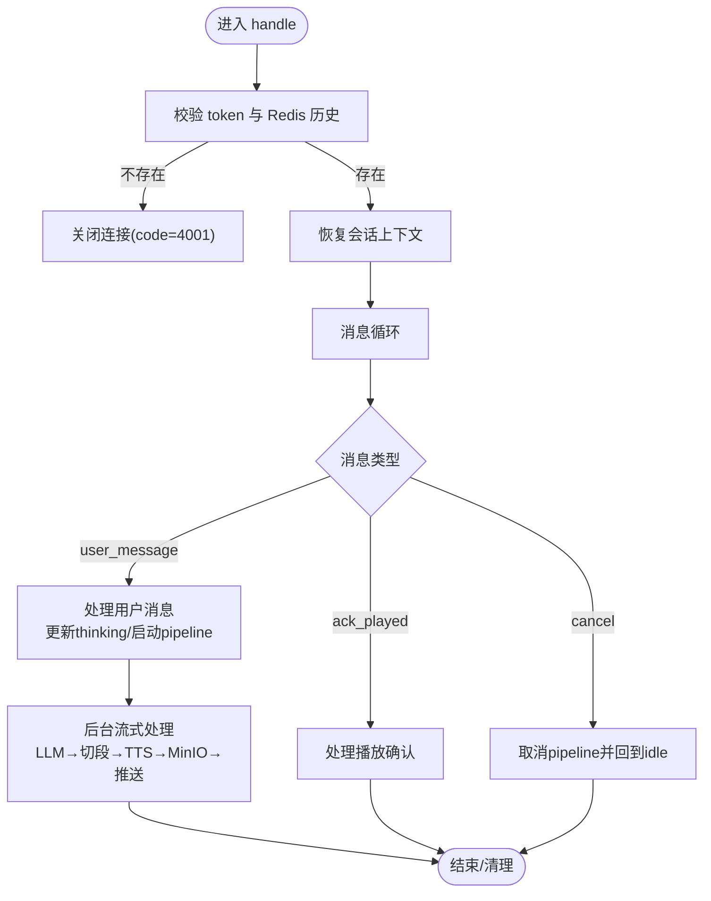
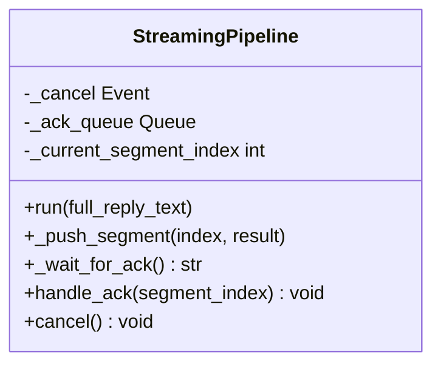
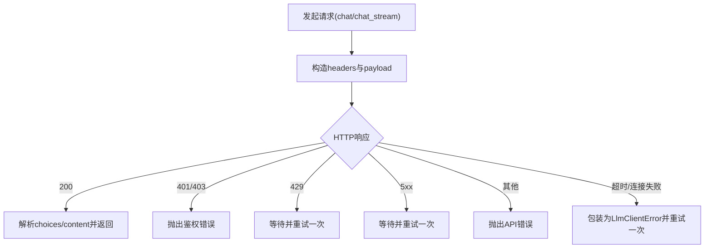
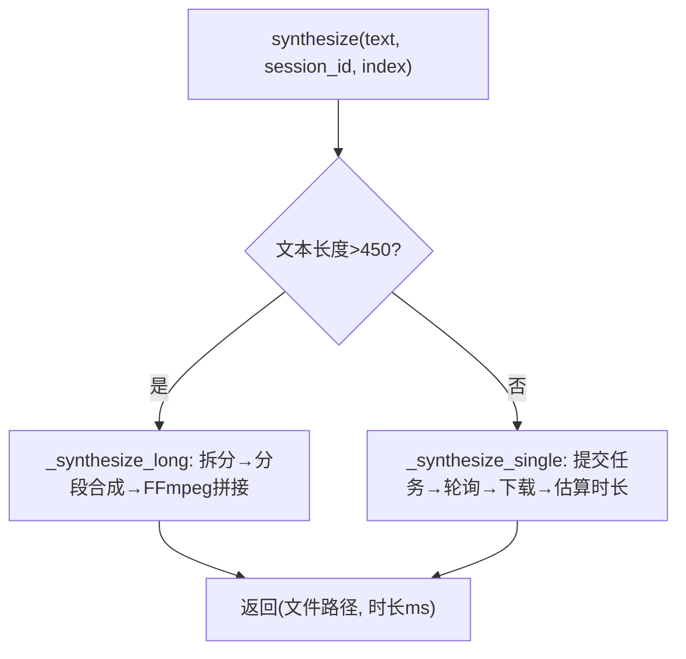
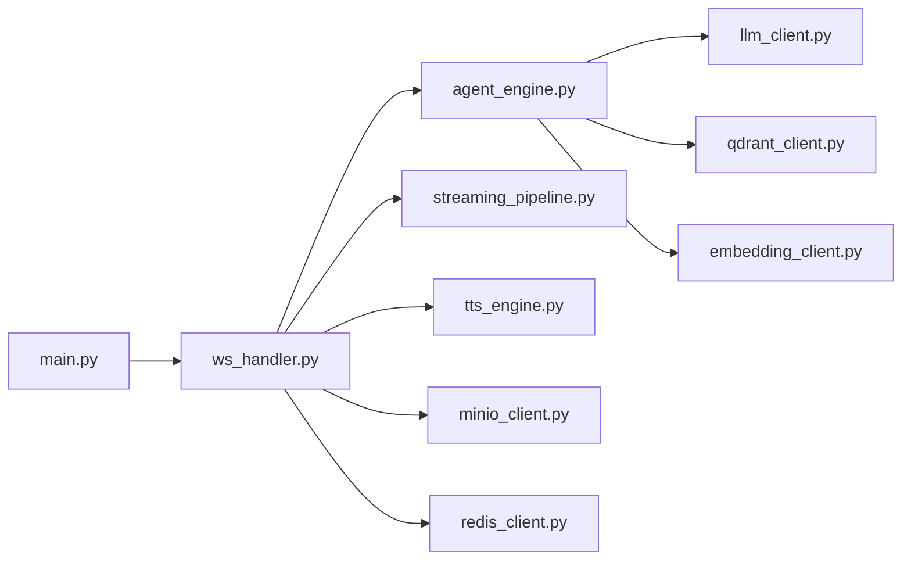

# 故障排查

<cite>
**本文引用的文件**   
- [server/main.py](file://server/main.py)
- [server/config.py](file://server/config.py)
- [config.json](file://config.json)
- [docker-compose.yml](file://docker-compose.yml)
- [Dockerfile](file://Dockerfile)
- [server/services/redis_client.py](file://server/services/redis_client.py)
- [server/services/minio_client.py](file://server/services/minio_client.py)
- [server/services/qdrant_client.py](file://server/services/qdrant_client.py)
- [server/services/llm_client.py](file://server/services/llm_client.py)
- [server/services/tts_engine.py](file://server/services/tts_engine.py)
- [server/api/ws_handler.py](file://server/api/ws_handler.py)
- [server/pipeline/streaming_pipeline.py](file://server/pipeline/streaming_pipeline.py)
- [server/agent/agent_engine.py](file://server/agent/agent_engine.py)
- [client/src/components/ErrorBubble.tsx](file://client/src/components/ErrorBubble.tsx)
- [doc/tech-spec.md](file://doc/tech-spec.md)
- [doc/test-spec.md](file://doc/test-spec.md)
</cite>

## 目录
1. [简介](#简介)
2. [项目结构](#项目结构)
3. [核心组件](#核心组件)
4. [架构总览](#架构总览)
5. [详细组件分析](#详细组件分析)
6. [依赖关系分析](#依赖关系分析)
7. [性能与容量规划](#性能与容量规划)
8. [监控与告警配置](#监控与告警配置)
9. [日志分析与错误码说明](#日志分析与错误码说明)
10. [常见问题与解决方案](#常见问题与解决方案)
11. [生产环境故障恢复与应急预案](#生产环境故障恢复与应急预案)
12. [结论](#结论)

## 简介
本指南面向 RealTimeTalk 系统的运维与研发人员，提供从网络、AI 服务调用、媒体处理到性能瓶颈的全链路故障排查方法。内容覆盖：
- 常见问题的诊断步骤与修复建议
- 日志分析方法、错误码含义与调试工具使用
- 内存泄漏检测、CPU 使用率分析、数据库连接池问题定位技巧
- 监控系统配置与告警设置
- 生产环境的故障恢复流程与应急预案
- 性能优化建议与容量规划指导

## 项目结构
RealTimeTalk 采用 FastAPI 作为后端入口，WebSocket 承载实时交互；通过 Redis 管理会话状态与历史，MinIO 存储媒体对象，Qdrant 提供向量检索（RAG），LLM/TTS 为外部 AI 服务；前端通过 Nginx 静态资源托管并反向代理 API。

图示来源
- [server/main.py:114-178](file://server/main.py#L114-L178)
- [server/api/ws_handler.py:31-170](file://server/api/ws_handler.py#L31-L170)
- [server/agent/agent_engine.py:59-121](file://server/agent/agent_engine.py#L59-L121)
- [server/pipeline/streaming_pipeline.py:16-131](file://server/pipeline/streaming_pipeline.py#L16-L131)
- [server/services/llm_client.py:23-113](file://server/services/llm_client.py#L23-L113)
- [server/services/tts_engine.py:38-167](file://server/services/tts_engine.py#L38-L167)
- [server/services/minio_client.py:21-139](file://server/services/minio_client.py#L21-L139)
- [server/services/redis_client.py:22-122](file://server/services/redis_client.py#L22-L122)
- [server/services/qdrant_client.py:26-235](file://server/services/qdrant_client.py#L26-L235)

章节来源
- [server/main.py:1-191](file://server/main.py#L1-L191)
- [docker-compose.yml:1-69](file://docker-compose.yml#L1-L69)
- [Dockerfile:1-22](file://Dockerfile#L1-L22)

## 核心组件
- 应用生命周期与启动检查：在 lifespan 中初始化 Redis、MinIO、Qdrant、Embedding，注册路由，暴露健康检查与健康探针。
- WebSocket 实时流：ws_handler 负责会话校验、消息分发、流式 LLM 与分段生成、ack 控制、错误推送与状态同步。
- 流式分段引擎：streaming_pipeline 负责分句切段、首段优先推送、逐段确认式推进、打字机气泡动画。
- 外部服务封装：
  - LLM：OpenAI 兼容接口，支持非流式与流式，内置重试与限流处理。
  - TTS：DashScope 多模态生成接口，并发信号量限流，长文本拆分拼接。
  - Redis：会话状态与对话历史持久化，TTL 管理。
  - MinIO：媒体上传、存在性检查、预签名 URL 生成。
  - Qdrant：集合管理与向量检索，支持多集合并发搜索。
- 配置系统：环境变量与 config.json 合并，支持运行时重载。

章节来源
- [server/main.py:42-111](file://server/main.py#L42-L111)
- [server/api/ws_handler.py:49-129](file://server/api/ws_handler.py#L49-L129)
- [server/pipeline/streaming_pipeline.py:44-131](file://server/pipeline/streaming_pipeline.py#L44-L131)
- [server/services/llm_client.py:23-113](file://server/services/llm_client.py#L23-L113)
- [server/services/tts_engine.py:38-167](file://server/services/tts_engine.py#L38-L167)
- [server/services/redis_client.py:22-122](file://server/services/redis_client.py#L22-L122)
- [server/services/minio_client.py:21-139](file://server/services/minio_client.py#L21-L139)
- [server/services/qdrant_client.py:26-235](file://server/services/qdrant_client.py#L26-L235)
- [server/config.py:148-260](file://server/config.py#L148-L260)

## 架构总览
下图展示一次用户消息的端到端处理流程，包括 RAG 检索、流式 LLM、分段生成与 TTS、MinIO 存储与推送。

图示来源
- [server/api/ws_handler.py:130-341](file://server/api/ws_handler.py#L130-L341)
- [server/pipeline/streaming_pipeline.py:44-131](file://server/pipeline/streaming_pipeline.py#L44-L131)
- [server/services/llm_client.py:115-190](file://server/services/llm_client.py#L115-L190)
- [server/services/tts_engine.py:49-167](file://server/services/tts_engine.py#L49-L167)
- [server/services/minio_client.py:69-124](file://server/services/minio_client.py#L69-L124)
- [server/services/qdrant_client.py:164-186](file://server/services/qdrant_client.py#L164-L186)
- [server/services/embedding_client.py:107-148](file://server/services/embedding_client.py#L107-L148)

## 详细组件分析

### WebSocket 处理器（ws_handler）
- 职责：会话校验与恢复、消息类型分发、流式 LLM 驱动、分段生成调度、错误与状态事件推送。
- 关键路径：
  - 新会话校验：若 Redis 无历史则拒绝连接并返回错误码。
  - 用户消息处理：更新状态为 thinking，立即推送思考动画，后台执行流式处理。
  - 流式处理：保存用户消息、摘要压缩、RAG 检索、流式 LLM、边接收边切段、并行生成、首段优先推送、逐段 ack 推进。
  - 错误处理：捕获 LLM 异常与通用异常，重置状态并推送 error。
- 排障要点：
  - 关注“会话不存在”“消息格式错误”“LLM 流式调用失败”等日志关键字。
  - 检查 Redis 会话状态 key 是否存在与 TTL 是否合理。
  - 观察 segment_ready 与 ack_played 的时序，避免积压或死锁。

图示来源
- [server/api/ws_handler.py:49-129](file://server/api/ws_handler.py#L49-L129)
- [server/api/ws_handler.py:130-341](file://server/api/ws_handler.py#L130-L341)

章节来源
- [server/api/ws_handler.py:49-129](file://server/api/ws_handler.py#L49-L129)
- [server/api/ws_handler.py:130-341](file://server/api/ws_handler.py#L130-L341)

### 流式分段引擎（streaming_pipeline）
- 职责：分句切段、首段优先推送、逐段确认式推进、打字机气泡动画、取消与错误处理。
- 关键逻辑：
  - 首段完成后立即推送 segment_ready 与 speaking 状态，后续段等待 ack 再推。
  - 每段推送后触发 bubble_char 逐字动画，并在完成后 dismiss。
  - 支持 cancel 事件中断流水线。
- 排障要点：
  - 若出现“只推首段不继续”，检查 ack 队列与前端 ack_played 是否正常。
  - 若打字机卡顿，检查 char_interval 计算与 WebSocket 推送延迟。

图示来源
- [server/pipeline/streaming_pipeline.py:16-131](file://server/pipeline/streaming_pipeline.py#L16-L131)
- [server/pipeline/streaming_pipeline.py:132-214](file://server/pipeline/streaming_pipeline.py#L132-L214)

章节来源
- [server/pipeline/streaming_pipeline.py:44-131](file://server/pipeline/streaming_pipeline.py#L44-L131)
- [server/pipeline/streaming_pipeline.py:132-214](file://server/pipeline/streaming_pipeline.py#L132-L214)

### LLM 客户端（llm_client）
- 职责：OpenAI 兼容 chat/completions 接口，支持非流式与流式，内置重试与限流处理。
- 错误处理：
  - 401/403：鉴权失败，直接抛出错误。
  - 429：限流，短暂等待后重试一次。
  - 5xx：服务端错误，重试一次。
  - 超时/连接失败：统一包装为 LlmClientError。
- 排障要点：
  - 检查 endpoint、api_key、model 配置是否正确。
  - 关注重试次数与 sleep 间隔，避免雪崩。

图示来源
- [server/services/llm_client.py:40-113](file://server/services/llm_client.py#L40-L113)
- [server/services/llm_client.py:115-190](file://server/services/llm_client.py#L115-L190)

章节来源
- [server/services/llm_client.py:23-113](file://server/services/llm_client.py#L23-L113)
- [server/services/llm_client.py:115-190](file://server/services/llm_client.py#L115-L190)

### TTS 引擎（tts_engine）
- 职责：DashScope 多模态生成接口，支持异步任务轮询与同步直返，长文本拆分拼接。
- 并发控制：全局信号量限制并发数，避免 429 限流。
- 错误处理：任务提交失败、未返回 task_id、下载失败、合成失败、超时等。
- 排障要点：
  - 检查 api_key、voice、speed 配置。
  - 关注任务状态 SUCCEEDED/FAILED/PENDING/RUNNING 的轮询逻辑。
  - 长文本拼接依赖 FFmpeg，确保容器内安装正确。

图示来源
- [server/services/tts_engine.py:49-167](file://server/services/tts_engine.py#L49-L167)
- [server/services/tts_engine.py:169-226](file://server/services/tts_engine.py#L169-L226)

章节来源
- [server/services/tts_engine.py:38-167](file://server/services/tts_engine.py#L38-L167)
- [server/services/tts_engine.py:169-226](file://server/services/tts_engine.py#L169-L226)

### Redis 客户端（redis_client）
- 职责：会话状态与对话历史持久化，TTL 管理，键空间设计。
- 键模式：
  - session:{token}:state
  - session:{token}:history
- 排障要点：
  - 连接失败时服务启动即终止，需检查 REDIS_URL 与网络连通性。
  - 历史解析失败会记录警告，注意 JSON 序列化一致性。

章节来源
- [server/services/redis_client.py:22-122](file://server/services/redis_client.py#L22-L122)

### MinIO 客户端（minio_client）
- 职责：Bucket 自动创建、对象上传、存在性检查、预签名 URL 生成、前缀批量删除。
- 排障要点：
  - 客户端不可用时标记 _available=False，上传将跳过并返回 object_name。
  - 预签名 URL 受 TTL 限制，注意过期时间。

章节来源
- [server/services/minio_client.py:21-139](file://server/services/minio_client.py#L21-L139)

### Qdrant 客户端（qdrant_client）
- 职责：集合管理、向量 upsert、单集合/多集合检索、统计与清空重建。
- 排障要点：
  - 集合不存在时 upsert 会抛错，需在写入前确保集合存在。
  - 多集合并发检索失败会记录警告并忽略该集合。

章节来源
- [server/services/qdrant_client.py:26-235](file://server/services/qdrant_client.py#L26-L235)

### Agent 引擎（agent_engine）
- 职责：对话流程编排，RAG 注入，Markdown 剥离，纯文本输出。
- 排障要点：
  - RAG 客户端未注入时会跳过检索并降级为纯 LLM 回复。
  - 检索失败会记录警告并降级。

章节来源
- [server/agent/agent_engine.py:59-121](file://server/agent/agent_engine.py#L59-L121)
- [server/agent/agent_engine.py:123-181](file://server/agent/agent_engine.py#L123-L181)

### 配置系统（config.py）
- 优先级：环境变量 > config.json > 默认值。
- 排障要点：
  - 检查 config.json 与 .env 中的关键项（如 LLM_ENDPOINT、DASHSCOPE_API_KEY、REDIS_URL、MINIO_ENDPOINT）。
  - 服务启动时打印已加载配置，便于核对。

章节来源
- [server/config.py:148-260](file://server/config.py#L148-L260)
- [config.json:1-39](file://config.json#L1-L39)

## 依赖关系分析
- 外部依赖：
  - Redis：会话与历史，强依赖，启动失败即退出。
  - MinIO：媒体存储，弱依赖，不可用回退本地路径。
  - Qdrant：RAG 检索，弱依赖，不可用降级为纯 LLM。
  - LLM/TTS：外部 AI 服务，具备重试与限流保护。
- 内部耦合：
  - ws_handler 依赖 agent、pipeline、各服务客户端。
  - streaming_pipeline 依赖 segment_generator/splitter 与 ws。
  - agent_engine 依赖 llm、redis、可选 qdrant/embedding。

图示来源
- [server/main.py:114-178](file://server/main.py#L114-L178)
- [server/api/ws_handler.py:31-170](file://server/api/ws_handler.py#L31-L170)
- [server/agent/agent_engine.py:59-121](file://server/agent/agent_engine.py#L59-L121)
- [server/pipeline/streaming_pipeline.py:16-131](file://server/pipeline/streaming_pipeline.py#L16-L131)

章节来源
- [server/main.py:114-178](file://server/main.py#L114-L178)
- [server/api/ws_handler.py:31-170](file://server/api/ws_handler.py#L31-L170)

## 性能与容量规划
- 并发与限流：
  - TTS 使用全局信号量限制并发，避免 429 限流。建议根据配额调整信号量上限。
  - LLM 流式请求具备重试与限流等待，避免雪崩。
- 媒体处理：
  - 长文本 TTS 拆分拼接依赖 FFmpeg，确保容器内安装且 GPU 编码器可用时可加速。
- 存储与缓存：
  - Redis 会话 TTL 合理设置，避免历史膨胀。
  - MinIO 预签名 URL TTL 与前端播放策略匹配。
- 容量规划：
  - 根据峰值并发会话数评估 TTS 并发与 LLM 配额。
  - 预估媒体文件大小与 MinIO 存储空间增长。
  - Qdrant 集合规模与向量维度影响检索性能。

[本节为通用指导，无需特定文件引用]

## 监控与告警配置
- 健康检查：
  - 提供 /api/health 端点，返回服务状态、Redis 可用性与会话数量。
- 关键指标建议：
  - WebSocket 连接数、断线重连次数、消息吞吐、错误率。
  - LLM/TTS 调用成功率、平均耗时、限流次数。
  - Redis 连接池大小、命中率、慢查询。
  - MinIO 上传成功率、对象大小分布。
  - Qdrant 集合点数、检索耗时。
- 告警阈值示例：
  - LLM/TTS 错误率 > 5% 持续 5 分钟。
  - WebSocket 断线重连次数突增。
  - Redis 连接失败或慢操作增多。
  - MinIO 上传失败率上升。
  - Qdrant 检索超时或失败。

章节来源
- [server/main.py:136-143](file://server/main.py#L136-L143)

## 日志分析与错误码说明
- 日志级别与模块：
  - main、ws_handler、llm_client、tts_engine、redis_client、minio_client、qdrant_client、streaming_pipeline 等模块均记录关键路径日志。
- 常见错误码与含义：
  - WebSocket 关闭码 4000：服务未就绪（Redis/MinIO 未初始化完成）。
  - WebSocket 关闭码 4001：会话不存在，请先创建会话。
  - LLM/TTS 错误：包含状态码与错误信息，如鉴权失败、限流、服务端错误、超时。
  - MinIO 错误：上传失败、对象不存在、预签名 URL 生成失败。
  - Qdrant 错误：集合不存在、检索失败、删除失败。
- 前端错误提示：
  - ErrorBubble 组件用于显示错误消息并自动淡出。

章节来源
- [server/main.py:146-170](file://server/main.py#L146-L170)
- [server/api/ws_handler.py:57-73](file://server/api/ws_handler.py#L57-L73)
- [server/services/llm_client.py:78-113](file://server/services/llm_client.py#L78-L113)
- [server/services/tts_engine.py:100-167](file://server/services/tts_engine.py#L100-L167)
- [server/services/minio_client.py:80-124](file://server/services/minio_client.py#L80-L124)
- [server/services/qdrant_client.py:54-112](file://server/services/qdrant_client.py#L54-L112)
- [client/src/components/ErrorBubble.tsx:1-69](file://client/src/components/ErrorBubble.tsx#L1-L69)

## 常见问题与解决方案

### 网络连接问题
- 症状：服务启动失败、WebSocket 连接被拒、外部 API 调用失败。
- 诊断步骤：
  - 检查 /api/health 返回状态与 Redis 可用性。
  - 验证 REDIS_URL、MINIO_ENDPOINT、LLM_ENDPOINT、DASHSCOPE_API_KEY 等配置。
  - 查看 Docker 网络与端口映射，确认服务间可达。
- 解决方案：
  - 修正配置文件与环境变量，重启服务。
  - 检查防火墙与安全组规则，放行必要端口。
  - 对于外部 API，确认域名解析与证书有效性。

章节来源
- [server/main.py:42-111](file://server/main.py#L42-L111)
- [docker-compose.yml:32-52](file://docker-compose.yml#L32-L52)
- [config.json:1-39](file://config.json#L1-L39)

### AI 服务调用失败（LLM/TTS）
- 症状：LLM 返回鉴权失败、限流、服务端错误；TTS 任务失败或超时。
- 诊断步骤：
  - 查看 LLM/TTS 客户端日志中的错误信息与状态码。
  - 检查 API Key 与模型名称配置。
  - 观察重试与限流等待行为。
- 解决方案：
  - 更新正确的 API Key 与模型名。
  - 调整并发与重试策略，避免超限。
  - 对 429 限流场景增加退避与排队机制。

章节来源
- [server/services/llm_client.py:78-113](file://server/services/llm_client.py#L78-L113)
- [server/services/tts_engine.py:100-167](file://server/services/tts_engine.py#L100-L167)

### 媒体处理错误（TTS/FFmpeg/MinIO）
- 症状：TTS 合成失败、视频无法生成或上传失败。
- 诊断步骤：
  - 检查 TTS 任务状态与错误消息。
  - 确认 FFmpeg 在容器内可用且路径正确。
  - 查看 MinIO Bucket 权限与对象存在性。
- 解决方案：
  - 修复 TTS 参数与配额。
  - 重新安装或挂载 FFmpeg。
  - 修正 MinIO 访问密钥与 Bucket 策略。

章节来源
- [server/services/tts_engine.py:169-226](file://server/services/tts_engine.py#L169-L226)
- [Dockerfile:1-22](file://Dockerfile#L1-L22)
- [server/services/minio_client.py:48-63](file://server/services/minio_client.py#L48-L63)

### 性能瓶颈分析
- 症状：首段延迟高、打字机卡顿、整体吞吐低。
- 诊断步骤：
  - 分析 ws_handler 与 streaming_pipeline 的日志，定位耗时环节。
  - 监控 LLM/TTS 调用耗时与重试次数。
  - 检查 Redis 慢查询与 MinIO 上传耗时。
- 解决方案：
  - 调整 TTS 并发信号量与 LLM 超时。
  - 优化分句切段策略与首段优先推送。
  - 启用 GPU 编码器加速视频处理。

章节来源
- [server/api/ws_handler.py:189-341](file://server/api/ws_handler.py#L189-L341)
- [server/pipeline/streaming_pipeline.py:44-131](file://server/pipeline/streaming_pipeline.py#L44-L131)
- [server/services/tts_engine.py:38-167](file://server/services/tts_engine.py#L38-L167)

### 内存泄漏检测
- 现象：进程内存持续增长，GC 回收效果不佳。
- 排查方法：
  - 使用 Python 内存分析工具（如 tracemalloc、memory_profiler）定位大对象。
  - 检查 WebSocket 连接与 Pipeline 生命周期，确保断开后及时清理。
  - 审查 Redis 历史列表长度与 TTL 设置，避免无限增长。
- 修复建议：
  - 在 finally 块中显式释放资源与取消任务。
  - 定期清理临时文件与工作目录。

[本节为通用指导，无需特定文件引用]

### CPU 使用率分析
- 现象：CPU 占用过高，响应延迟增大。
- 排查方法：
  - 使用 top/htop 或 cgroup 监控定位热点线程。
  - 分析 TTS 拼接与 LLM 流式处理的 CPU 密集部分。
- 修复建议：
  - 调整并发度与批处理大小。
  - 启用 GPU 编码器减少 CPU 压力。

[本节为通用指导，无需特定文件引用]

### 数据库连接池问题（Redis）
- 现象：连接失败、慢查询、TTL 失效。
- 排查方法：
  - 检查 Redis 连接池大小与空闲连接数。
  - 查看会话状态与历史键的 TTL 是否刷新。
- 修复建议：
  - 调整连接池参数与超时时间。
  - 确保每次活跃操作后刷新 TTL。

章节来源
- [server/services/redis_client.py:64-122](file://server/services/redis_client.py#L64-L122)

## 生产环境故障恢复与应急预案
- 快速恢复：
  - 重启服务以重建连接与清理僵尸任务。
  - 切换备用 API Key 或模型，绕过限流或鉴权问题。
  - 禁用 RAG 功能，降级为纯 LLM 回复。
- 数据恢复：
  - 利用 Redis 持久化恢复最近会话历史。
  - 从 MinIO 备份恢复媒体对象。
- 扩容与降级：
  - 横向扩展服务实例，配合负载均衡。
  - 降低 TTS 并发与 LLM 并发，保障核心功能可用。

章节来源
- [server/main.py:42-111](file://server/main.py#L42-L111)
- [doc/tech-spec.md:555-569](file://doc/tech-spec.md#L555-L569)

## 结论
通过本指南的系统化排查方法与可视化流程图，可快速定位 RealTimeTalk 在网络、AI 服务、媒体处理与性能方面的常见问题。结合监控告警与应急预案，能有效提升生产环境的稳定性与可恢复性。建议持续优化并发策略、资源分配与错误处理，以提升用户体验与系统韧性。