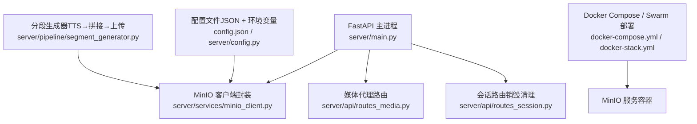
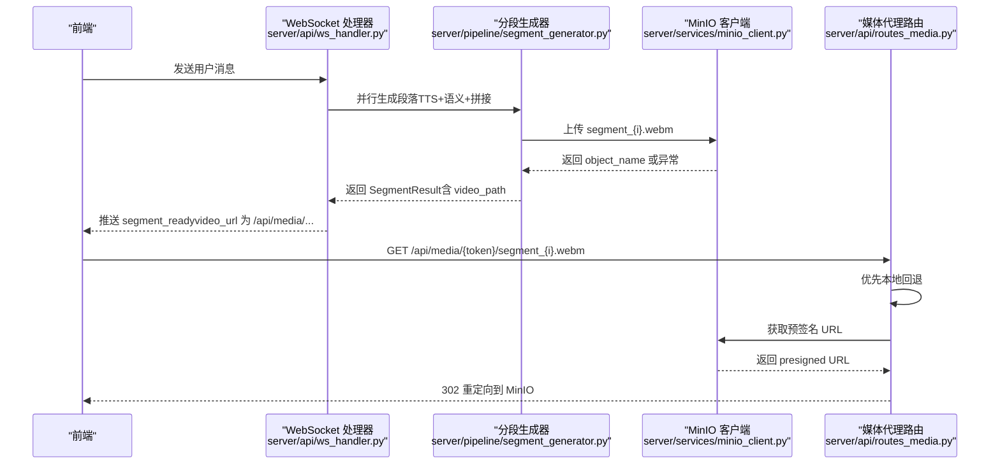
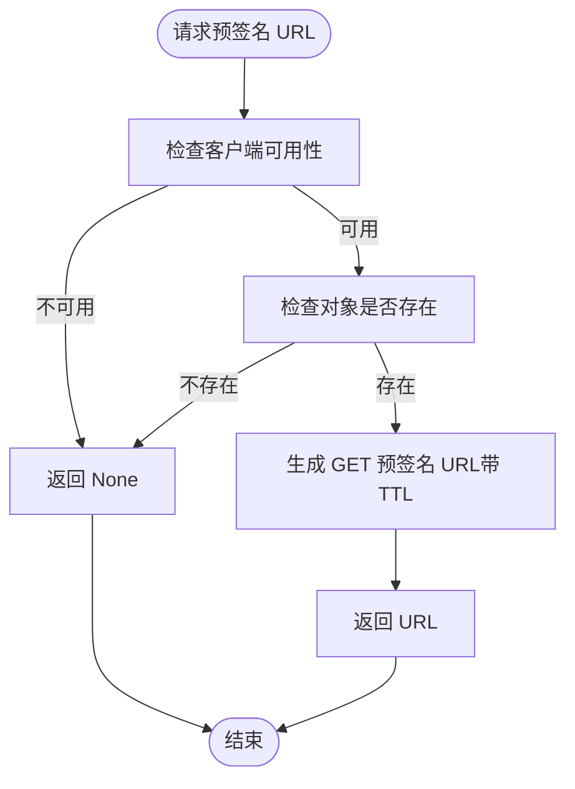
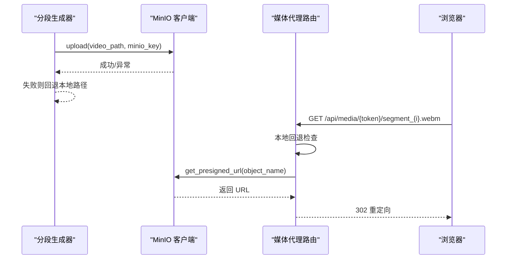

# MinIO 对象存储

<cite>
**本文引用的文件列表**
- [server/services/minio_client.py](file://server/services/minio_client.py)
- [server/config.py](file://server/config.py)
- [server/api/routes_media.py](file://server/api/routes_media.py)
- [server/api/routes_session.py](file://server/api/routes_session.py)
- [server/pipeline/segment_generator.py](file://server/pipeline/segment_generator.py)
- [server/main.py](file://server/main.py)
- [docker-compose.yml](file://docker-compose.yml)
- [docker-stack.yml](file://docker-stack.yml)
- [config.json](file://config.json)
</cite>

## 目录
1. [简介](#简介)
2. [项目结构](#项目结构)
3. [核心组件](#核心组件)
4. [架构总览](#架构总览)
5. [详细组件分析](#详细组件分析)
6. [依赖关系分析](#依赖关系分析)
7. [性能与优化建议](#性能与优化建议)
8. [故障排查指南](#故障排查指南)
9. [结论](#结论)
10. [附录：使用示例与最佳实践](#附录使用示例与最佳实践)

## 简介
本文件面向 RealTimeTalk 系统的 MinIO 对象存储实现，系统化说明以下方面：
- 桶（bucket）命名规范、目录层次结构与文件命名约定
- 预签名 URL 机制的实现（生成、有效期与安全访问控制）
- 媒体文件的上传、下载与管理操作策略（视频片段、音频、静态资源）
- 文件生命周期管理（自动清理、版本控制与备份策略）
- 大文件分片上传、断点续传与并发处理方案
- 客户端使用示例（基于现有代码路径）
- 权限配置、访问密钥管理与安全最佳实践
- 性能优化建议（连接池、缓存、CDN 集成）

## 项目结构
RealTimeTalk 在应用启动时初始化 MinIO 客户端并保证桶存在；在流式对话中，每个会话的媒体段以“sessions/{session_token}/segment_{index}.webm”的对象名上传至 MinIO；读取端通过 REST API 优先本地回退，再尝试 MinIO 预签名 URL 重定向。



图表来源
- [server/main.py:62-66](file://server/main.py#L62-L66)
- [server/services/minio_client.py:24-47](file://server/services/minio_client.py#L24-L47)
- [server/api/routes_media.py:18-64](file://server/api/routes_media.py#L18-L64)
- [server/api/routes_session.py:111-119](file://server/api/routes_session.py#L111-L119)
- [server/pipeline/segment_generator.py:86-106](file://server/pipeline/segment_generator.py#L86-L106)
- [docker-compose.yml:19-30](file://docker-compose.yml#L19-L30)
- [docker-stack.yml:14-31](file://docker-stack.yml#L14-L31)
- [config.json:23-29](file://config.json#L23-L29)
- [server/config.py:210-216](file://server/config.py#L210-L216)

章节来源
- [server/main.py:62-66](file://server/main.py#L62-L66)
- [server/services/minio_client.py:24-47](file://server/services/minio_client.py#L24-L47)
- [server/api/routes_media.py:18-64](file://server/api/routes_media.py#L18-L64)
- [server/api/routes_session.py:111-119](file://server/api/routes_session.py#L111-L119)
- [server/pipeline/segment_generator.py:86-106](file://server/pipeline/segment_generator.py#L86-L106)
- [docker-compose.yml:19-30](file://docker-compose.yml#L19-L30)
- [docker-stack.yml:14-31](file://docker-stack.yml#L14-L31)
- [config.json:23-29](file://config.json#L23-L29)
- [server/config.py:210-216](file://server/config.py#L210-L216)

## 核心组件
- MinIO 客户端封装：提供连接、桶检查、上传、对象存在性检查、预签名 URL 生成、按前缀删除等能力。
- 媒体代理路由：对外暴露 GET /api/media/{session_token}/{filename}，优先本地回退，再尝试 MinIO 预签名 URL 重定向。
- 分段生成器：将 TTS 合成与 FFmpeg 拼接后的视频片段上传到 MinIO，失败则回退本地路径。
- 会话路由：销毁会话时异步清理 MinIO 对应前缀下的所有对象。
- 配置系统：从 config.json 与环境变量合并加载 MinIO 相关参数（endpoint、access_key、secret_key、bucket、presigned_url_ttl_seconds）。
- 部署编排：Docker Compose 与 Docker Swarm 均包含 MinIO 服务定义与数据卷挂载。

章节来源
- [server/services/minio_client.py:21-139](file://server/services/minio_client.py#L21-L139)
- [server/api/routes_media.py:18-64](file://server/api/routes_media.py#L18-L64)
- [server/pipeline/segment_generator.py:27-138](file://server/pipeline/segment_generator.py#L27-L138)
- [server/api/routes_session.py:75-123](file://server/api/routes_session.py#L75-L123)
- [server/config.py:40-46](file://server/config.py#L40-L46)
- [server/config.py:210-216](file://server/config.py#L210-L216)
- [docker-compose.yml:19-30](file://docker-compose.yml#L19-L30)
- [docker-stack.yml:14-31](file://docker-stack.yml#L14-L31)

## 架构总览
下图展示了从用户消息到媒体段落生成、上传与播放的整体流程，以及 MinIO 在其中的角色。



图表来源
- [server/api/ws_handler.py:169-187](file://server/api/ws_handler.py#L169-L187)
- [server/pipeline/segment_generator.py:86-106](file://server/pipeline/segment_generator.py#L86-L106)
- [server/services/minio_client.py:102-124](file://server/services/minio_client.py#L102-L124)
- [server/api/routes_media.py:18-64](file://server/api/routes_media.py#L18-L64)

## 详细组件分析

### 1) 文件组织结构设计
- 桶（bucket）命名规范
  - 默认桶名为 realtimetalk，可通过环境变量 MINIO_BUCKET 或 config.json 覆盖。
- 目录层次结构
  - 采用“会话隔离”的前缀：sessions/{session_token}/
  - 每个会话下存放该会话产生的媒体段：segment_{index}.webm
- 文件命名约定
  - 统一使用 segment_{index}.webm 作为对象名，index 自增，便于顺序播放与确认式推送。

章节来源
- [server/config.py:40-46](file://server/config.py#L40-L46)
- [server/config.py:210-216](file://server/config.py#L210-L216)
- [server/pipeline/segment_generator.py:86-97](file://server/pipeline/segment_generator.py#L86-L97)
- [server/api/routes_media.py:30](file://server/api/routes_media.py#L30)

### 2) 预签名 URL 机制
- 生成流程
  - 先校验对象是否存在，不存在直接返回空。
  - 调用底层 SDK 生成 GET 预签名 URL，有效期由配置项 presigned_url_ttl_seconds 决定。
- 有效期设置
  - 默认 600 秒，可通过环境变量 MINIO_PRESIGNED_URL_TTL_SECONDS 或 config.json 调整。
- 安全访问控制
  - 仅支持 GET 访问，URL 具备时效性，过期后不可用。
  - 服务端不暴露 MinIO 直连地址给浏览器，而是通过 302 重定向，避免跨域与网络可达性问题。



图表来源
- [server/services/minio_client.py:102-124](file://server/services/minio_client.py#L102-L124)
- [server/config.py:210-216](file://server/config.py#L210-L216)

章节来源
- [server/services/minio_client.py:102-124](file://server/services/minio_client.py#L102-L124)
- [server/config.py:210-216](file://server/config.py#L210-L216)

### 3) 媒体文件上传、下载与管理
- 上传
  - 分段生成器在完成 TTS 与 FFmpeg 拼接后，将视频片段上传至 MinIO，对象名为 sessions/{session_token}/segment_{index}.webm。
  - 若上传失败，回退到本地路径，确保播放链路不断。
- 下载
  - 媒体代理路由优先从本地 _work/{session_token}/ 目录回退，找不到再尝试 MinIO 预签名 URL 并重定向。
- 管理
  - 会话销毁时，按前缀 sessions/{token}/ 批量删除对象，释放存储空间。



图表来源
- [server/pipeline/segment_generator.py:86-106](file://server/pipeline/segment_generator.py#L86-L106)
- [server/api/routes_media.py:18-64](file://server/api/routes_media.py#L18-L64)
- [server/api/routes_session.py:111-119](file://server/api/routes_session.py#L111-L119)

章节来源
- [server/pipeline/segment_generator.py:86-106](file://server/pipeline/segment_generator.py#L86-L106)
- [server/api/routes_media.py:18-64](file://server/api/routes_media.py#L18-L64)
- [server/api/routes_session.py:111-119](file://server/api/routes_session.py#L111-L119)

### 4) 文件生命周期管理
- 自动清理
  - 会话销毁接口会调用 delete_prefix(sessions/{token}/)，删除该会话所有媒体对象。
- 版本控制
  - 当前未启用版本控制；如需保留历史版本，可在 MinIO 侧开启桶版本控制并在业务层维护版本号。
- 备份策略
  - 生产环境建议对 MinIO 数据卷进行定期快照或异地复制；结合对象生命周期规则（如归档/冷存储）降低成本。

章节来源
- [server/api/routes_session.py:111-119](file://server/api/routes_session.py#L111-L119)

### 5) 大文件分片上传、断点续传与并发处理
- 现状
  - 当前上传使用单对象上传（fput_object），适用于短视频片段。
- 扩展方案（建议）
  - 分片上传：使用 multipart_upload 系列 API 将大文件切分为多个 Part 并发上传，最后完成合并。
  - 断点续传：记录已上传 Part 清单与偏移量，失败重试时跳过已完成部分。
  - 并发控制：限制并发 Part 数量，避免打满带宽或 I/O。
  - 进度上报：通过回调或中间状态向业务层反馈上传进度。
- 注意
  - 需评估 MinIO 集群与网络吞吐，合理设置超时与重试策略。

[本节为通用方案建议，不直接分析具体源码]

### 6) 客户端使用示例（基于仓库代码）
- 初始化与连接
  - 参考：[server/services/minio_client.py:24-47](file://server/services/minio_client.py#L24-L47)
- 确保桶存在
  - 参考：[server/services/minio_client.py:48-63](file://server/services/minio_client.py#L48-L63)
- 上传对象
  - 参考：[server/services/minio_client.py:69-90](file://server/services/minio_client.py#L69-L90)
- 检查对象存在
  - 参考：[server/services/minio_client.py:92-100](file://server/services/minio_client.py#L92-L100)
- 生成预签名 URL
  - 参考：[server/services/minio_client.py:102-124](file://server/services/minio_client.py#L102-L124)
- 删除前缀下所有对象
  - 参考：[server/services/minio_client.py:126-138](file://server/services/minio_client.py#L126-L138)
- 媒体下载（代理路由）
  - 参考：[server/api/routes_media.py:18-64](file://server/api/routes_media.py#L18-L64)
- 会话销毁清理
  - 参考：[server/api/routes_session.py:111-119](file://server/api/routes_session.py#L111-L119)

章节来源
- [server/services/minio_client.py:24-138](file://server/services/minio_client.py#L24-L138)
- [server/api/routes_media.py:18-64](file://server/api/routes_media.py#L18-L64)
- [server/api/routes_session.py:111-119](file://server/api/routes_session.py#L111-L119)

## 依赖关系分析
- 配置依赖
  - MinIO 客户端从全局配置读取 endpoint、access_key、secret_key、bucket、presigned_url_ttl_seconds。
- 运行时依赖
  - 主进程启动时创建 MinIO 客户端并 ensure_bucket。
  - 分段生成器依赖 MinIO 客户端进行上传。
  - 媒体代理路由依赖 MinIO 客户端生成预签名 URL。
  - 会话路由依赖 MinIO 客户端执行按前缀删除。

```mermaid
classDiagram
class MinioClient {
+connect()
+ensure_bucket() bool
+upload(file_path, object_name) str
+object_exists(object_name) bool
+get_presigned_url(object_name) Optional[str]
+delete_prefix(prefix) void
}
class SegmentGenerator {
+generate(text, index, session_id) SegmentResult
}
class MediaRouter {
+GET /api/media/{token}/{filename}
}
class SessionRouter {
+DELETE /api/session/{token}
}
SegmentGenerator --> MinioClient : "上传"
MediaRouter --> MinioClient : "预签名 URL"
SessionRouter --> MinioClient : "按前缀删除"
```

图表来源
- [server/services/minio_client.py:21-139](file://server/services/minio_client.py#L21-L139)
- [server/pipeline/segment_generator.py:27-138](file://server/pipeline/segment_generator.py#L27-L138)
- [server/api/routes_media.py:18-64](file://server/api/routes_media.py#L18-L64)
- [server/api/routes_session.py:75-123](file://server/api/routes_session.py#L75-L123)

章节来源
- [server/services/minio_client.py:21-139](file://server/services/minio_client.py#L21-L139)
- [server/pipeline/segment_generator.py:27-138](file://server/pipeline/segment_generator.py#L27-L138)
- [server/api/routes_media.py:18-64](file://server/api/routes_media.py#L18-L64)
- [server/api/routes_session.py:75-123](file://server/api/routes_session.py#L75-L123)

## 性能与优化建议
- 连接与重试
  - 复用 MinIO 客户端实例，避免频繁创建连接；必要时增加重试与超时参数。
- 并发上传
  - 对于较大视频片段，可引入分片上传并发策略，提升吞吐。
- 缓存策略
  - 对热点静态资源（如头像、动画循环）可考虑 CDN 缓存；动态生成的媒体段通过预签名 URL 短期缓存。
- CDN 集成
  - 将 MinIO 接入 CDN，利用边缘节点加速全球访问；注意预签名 URL 的鉴权与缓存键设计。
- 存储分层
  - 对历史媒体段设置生命周期规则，将冷数据迁移到低成本存储层级。

[本节为通用建议，不直接分析具体源码]

## 故障排查指南
- 客户端创建失败
  - 现象：日志输出“MinIO 客户端创建失败”，availability 置为 False。
  - 排查：检查 endpoint、access_key、secret_key 是否正确；网络连通性与防火墙策略。
- Bucket 操作失败
  - 现象：ensure_bucket 抛出 S3Error。
  - 排查：确认权限与桶名是否冲突；检查 MinIO 控制台权限策略。
- 上传失败
  - 现象：上传抛出异常，分段生成器回退本地路径。
  - 排查：检查磁盘空间、临时文件路径、MinIO 服务状态与网络。
- 预签名 URL 生成失败
  - 现象：返回 None 或异常。
  - 排查：确认对象存在、TTL 配置合理、时间同步正常。
- 删除前缀失败
  - 现象：警告日志提示删除失败。
  - 排查：检查权限与对象前缀是否正确；确认 MinIO 服务可用。

章节来源
- [server/services/minio_client.py:34-63](file://server/services/minio_client.py#L34-L63)
- [server/services/minio_client.py:69-90](file://server/services/minio_client.py#L69-L90)
- [server/services/minio_client.py:102-124](file://server/services/minio_client.py#L102-L124)
- [server/services/minio_client.py:126-138](file://server/services/minio_client.py#L126-L138)

## 结论
RealTimeTalk 的 MinIO 集成以“会话隔离”为核心，采用简洁可靠的对象命名与上传策略，并通过媒体代理路由与预签名 URL 实现安全的媒体访问。当前实现满足短视频段的实时播放需求；在生产环境中，建议进一步引入分片上传、版本控制、生命周期管理与 CDN 加速，以提升可靠性与性能。

[本节为总结性内容，不直接分析具体源码]

## 附录：使用示例与最佳实践

### 配置与环境变量
- 关键配置项
  - endpoint、access_key、secret_key、bucket、presigned_url_ttl_seconds
- 配置来源优先级
  - 环境变量 > config.json > 默认值
- 示例位置
  - JSON 配置：[config.json:23-29](file://config.json#L23-L29)
  - 配置加载与合并：[server/config.py:210-216](file://server/config.py#L210-L216)

章节来源
- [config.json:23-29](file://config.json#L23-L29)
- [server/config.py:210-216](file://server/config.py#L210-L216)

### 部署与运行
- Docker Compose
  - MinIO 服务端口 9000（API）、9001（控制台），数据卷 minio_data 持久化。
  - 参考：[docker-compose.yml:19-30](file://docker-compose.yml#L19-L30)
- Docker Swarm
  - 服务定义与网络、卷配置，确保 server 服务能访问 minio 服务。
  - 参考：[docker-stack.yml:14-31](file://docker-stack.yml#L14-L31)

章节来源
- [docker-compose.yml:19-30](file://docker-compose.yml#L19-L30)
- [docker-stack.yml:14-31](file://docker-stack.yml#L14-L31)

### 安全与权限
- 访问密钥管理
  - 使用环境变量注入敏感信息，避免硬编码；生产环境建议使用外部密钥管理服务。
- 最小权限原则
  - 为服务账号授予必要的桶读写权限；预签名 URL 仅允许 GET。
- 网络安全
  - 内网部署默认关闭 TLS（secure=False），生产环境建议启用 HTTPS 与反向代理。

章节来源
- [server/services/minio_client.py:34-47](file://server/services/minio_client.py#L34-L47)
- [server/config.py:210-216](file://server/config.py#L210-L216)

### 客户端使用要点
- 初始化与连接
  - 参考：[server/services/minio_client.py:24-47](file://server/services/minio_client.py#L24-L47)
- 上传与回退
  - 参考：[server/pipeline/segment_generator.py:86-106](file://server/pipeline/segment_generator.py#L86-L106)
- 下载与重定向
  - 参考：[server/api/routes_media.py:18-64](file://server/api/routes_media.py#L18-L64)
- 清理与生命周期
  - 参考：[server/api/routes_session.py:111-119](file://server/api/routes_session.py#L111-L119)

章节来源
- [server/services/minio_client.py:24-47](file://server/services/minio_client.py#L24-L47)
- [server/pipeline/segment_generator.py:86-106](file://server/pipeline/segment_generator.py#L86-L106)
- [server/api/routes_media.py:18-64](file://server/api/routes_media.py#L18-L64)
- [server/api/routes_session.py:111-119](file://server/api/routes_session.py#L111-L119)