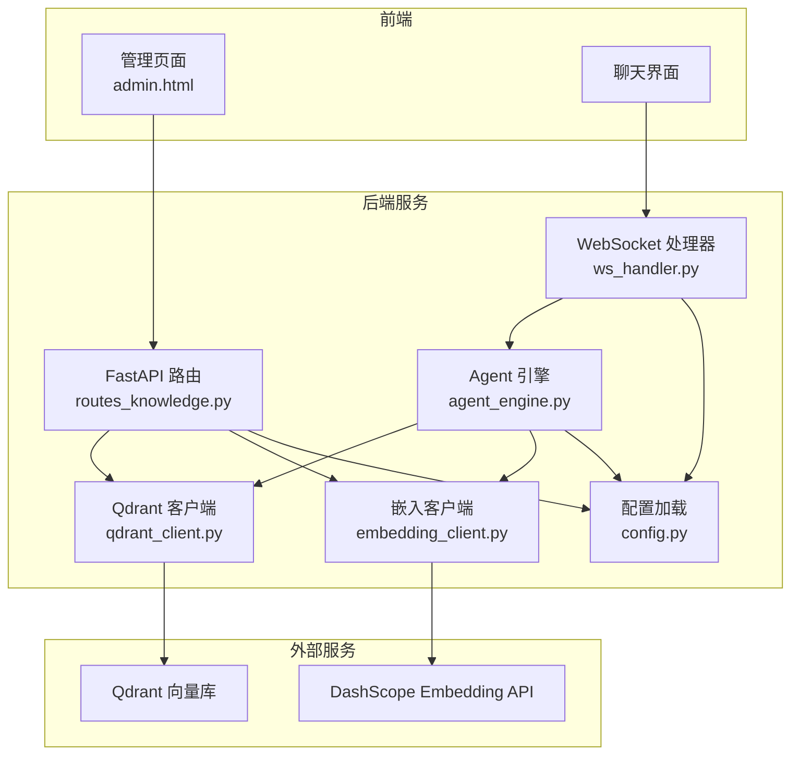
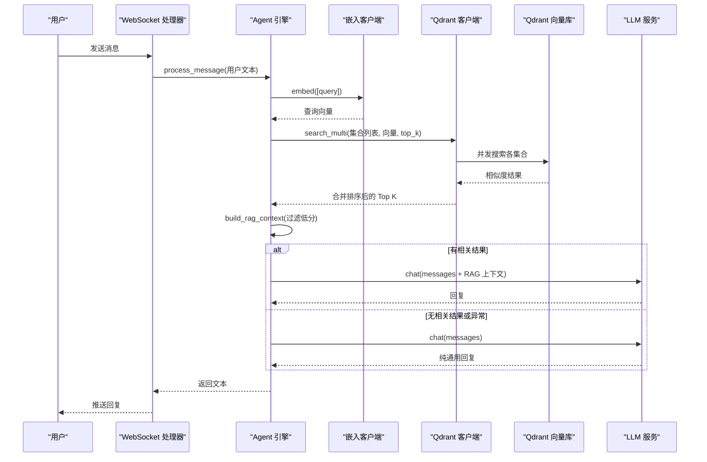
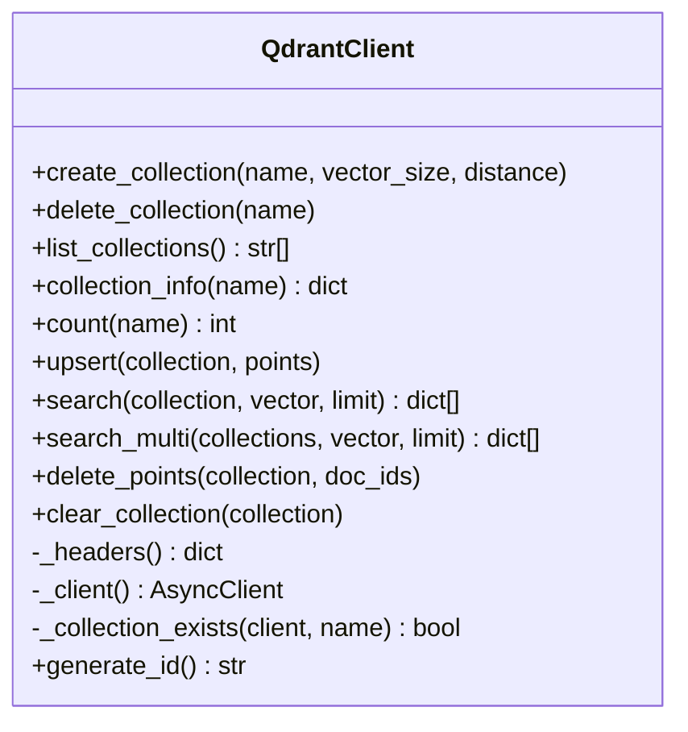
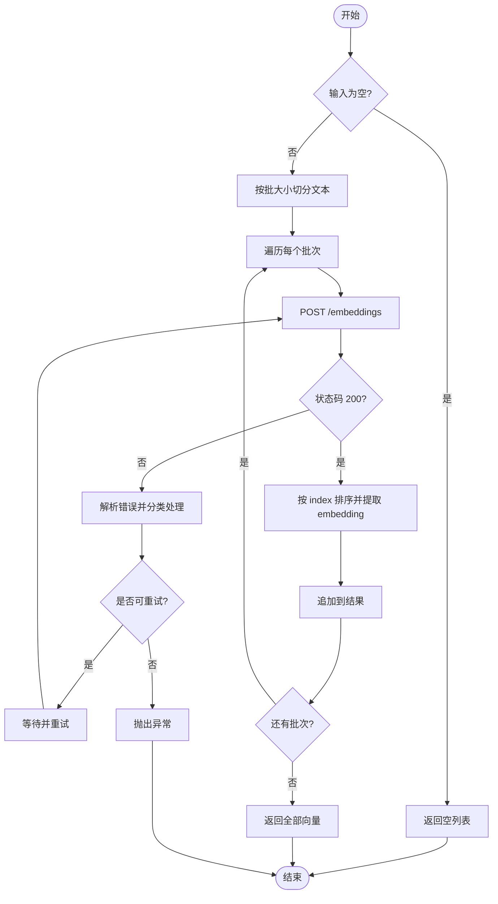
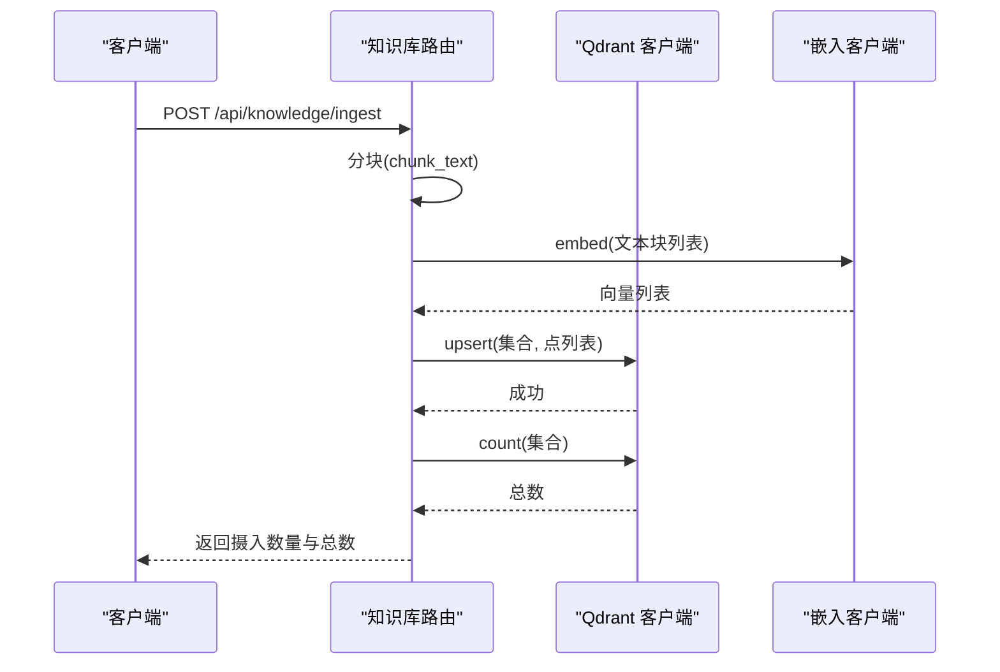
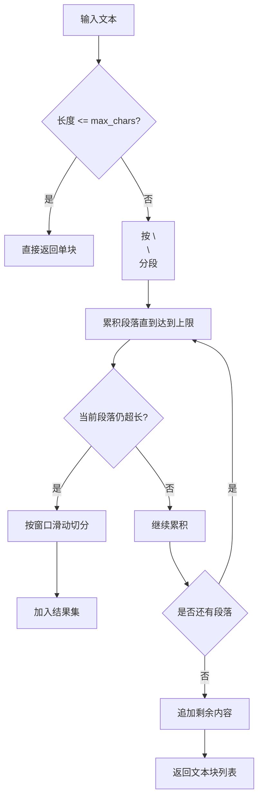
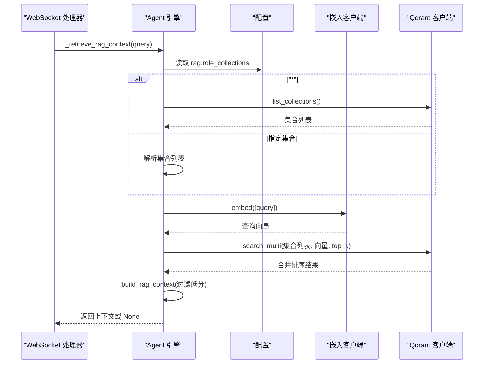
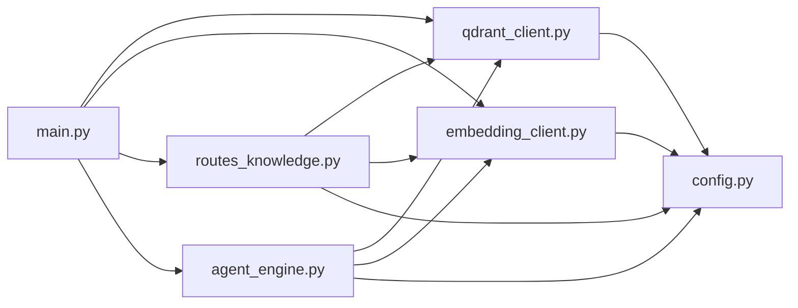

# Qdrant 向量数据库

<cite>
**本文引用的文件**
- [server/services/qdrant_client.py](file://server/services/qdrant_client.py)
- [server/api/routes_knowledge.py](file://server/api/routes_knowledge.py)
- [server/rag/__init__.py](file://server/rag/__init__.py)
- [server/services/embedding_client.py](file://server/services/embedding_client.py)
- [server/main.py](file://server/main.py)
- [server/config.py](file://server/config.py)
- [doc/Qdrant知识库操作指南.md](file://doc/Qdrant知识库操作指南.md)
- [server/agent/agent_engine.py](file://server/agent/agent_engine.py)
- [server/api/ws_handler.py](file://server/api/ws_handler.py)
</cite>

## 目录
1. [简介](#简介)
2. [项目结构](#项目结构)
3. [核心组件](#核心组件)
4. [架构总览](#架构总览)
5. [详细组件分析](#详细组件分析)
6. [依赖关系分析](#依赖关系分析)
7. [性能与优化](#性能与优化)
8. [故障排查](#故障排查)
9. [结论](#结论)
10. [附录：API 与配置参考](#附录api-与配置参考)

## 简介
本文件面向 RealTimeTalk 系统中的 Qdrant 向量数据库集成，系统性说明集合结构设计、索引策略、RAG 检索增强生成流程、集合管理、批量数据导入/更新/删除、错误处理与重试机制、以及监控指标收集建议。文档同时提供代码级图示与路径引用，便于开发者快速定位实现细节。

## 项目结构
RealTimeTalk 后端通过 FastAPI 暴露 REST API，结合 WebSocket 进行实时对话。Qdrant 作为向量存储，配合嵌入服务（DashScope text-embedding-v3）完成文本到向量的转换；Agent 引擎在对话时自动触发 RAG 检索并注入上下文。

图表来源
- [server/main.py:70-87](file://server/main.py#L70-L87)
- [server/api/routes_knowledge.py:24-38](file://server/api/routes_knowledge.py#L24-L38)
- [server/agent/agent_engine.py:18-28](file://server/agent/agent_engine.py#L18-L28)
- [server/services/qdrant_client.py:26-34](file://server/services/qdrant_client.py#L26-L34)
- [server/services/embedding_client.py:26-40](file://server/services/embedding_client.py#L26-L40)
- [server/config.py:225-238](file://server/config.py#L225-L238)

章节来源
- [server/main.py:70-87](file://server/main.py#L70-L87)
- [server/api/routes_knowledge.py:24-38](file://server/api/routes_knowledge.py#L24-L38)
- [server/agent/agent_engine.py:18-28](file://server/agent/agent_engine.py#L18-L28)
- [server/services/qdrant_client.py:26-34](file://server/services/qdrant_client.py#L26-L34)
- [server/services/embedding_client.py:26-40](file://server/services/embedding_client.py#L26-L40)
- [server/config.py:225-238](file://server/config.py#L225-L238)

## 核心组件
- Qdrant 客户端：封装集合管理与点数据操作（创建/删除/列表/统计、upsert、搜索、批量合并搜索、清空）。
- 嵌入客户端：调用 DashScope text-embedding-v3 将文本转为 1024 维向量，支持分批与重试。
- 知识库路由：提供集合管理、知识摄入、统计、清空、调试搜索等 REST 接口，含 Admin Token 鉴权。
- RAG 模块：文本分块与上下文构建，过滤低分结果，拼接为 LLM 可消费的 system 提示。
- Agent 引擎：在对话中按角色映射选择集合范围，执行 RAG 检索并注入上下文。
- 配置系统：集中管理 Qdrant、Embedding、RAG 等参数，支持环境变量覆盖。

章节来源
- [server/services/qdrant_client.py:26-235](file://server/services/qdrant_client.py#L26-L235)
- [server/services/embedding_client.py:26-149](file://server/services/embedding_client.py#L26-L149)
- [server/api/routes_knowledge.py:24-268](file://server/api/routes_knowledge.py#L24-L268)
- [server/rag/__init__.py:10-83](file://server/rag/__init__.py#L10-L83)
- [server/agent/agent_engine.py:59-181](file://server/agent/agent_engine.py#L59-L181)
- [server/config.py:111-138](file://server/config.py#L111-L138)

## 架构总览
下图展示从用户提问到返回回答的端到端流程，包括 RAG 检索与降级策略。

图表来源
- [server/api/ws_handler.py:350-400](file://server/api/ws_handler.py#L350-L400)
- [server/agent/agent_engine.py:123-181](file://server/agent/agent_engine.py#L123-L181)
- [server/services/qdrant_client.py:164-186](file://server/services/qdrant_client.py#L164-L186)
- [server/services/embedding_client.py:47-70](file://server/services/embedding_client.py#L47-L70)
- [server/rag/__init__.py:56-83](file://server/rag/__init__.py#L56-L83)

## 详细组件分析

### Qdrant 客户端（集合与点数据）
- 集合管理
  - 创建：若已存在则跳过，记录维度与距离度量。
  - 删除：不存在时抛出 404 错误。
  - 列表：返回所有集合名称。
  - 信息：返回 points_count、vector_size、distance。
  - 计数：精确统计集合点数。
- 点数据操作
  - upsert：批量写入，包含 id、vector、payload（text、source）。
  - search：单集合语义检索，返回 id、score、payload。
  - search_multi：并发多集合检索，合并后按分数降序取 top_k。
  - delete_points：按 has_id 条件批量删除。
  - clear_collection：删除并重建集合以清空数据。
- 内部辅助
  - 请求头：可选 api-key 鉴权。
  - 连接：httpx.AsyncClient 带超时。
  - ID 生成：UUID。

图表来源
- [server/services/qdrant_client.py:26-235](file://server/services/qdrant_client.py#L26-L235)

章节来源
- [server/services/qdrant_client.py:37-112](file://server/services/qdrant_client.py#L37-L112)
- [server/services/qdrant_client.py:115-213](file://server/services/qdrant_client.py#L115-L213)
- [server/services/qdrant_client.py:216-235](file://server/services/qdrant_client.py#L216-L235)

### 嵌入客户端（DashScope text-embedding-v3）
- 模型与维度：text-embedding-v3，固定 1024 维。
- 批量处理：默认批大小 10，超过则分批调用。
- 重试与限流：对 429/5xx/超时/连接错误进行最多两次重试，间隔短暂等待。
- 错误解析：统一包装为自定义异常，携带状态码。

图表来源
- [server/services/embedding_client.py:47-135](file://server/services/embedding_client.py#L47-L135)

章节来源
- [server/services/embedding_client.py:26-149](file://server/services/embedding_client.py#L26-L149)

### 知识库路由（REST API）
- 鉴权：X-Knowledge-Admin-Token 头校验，未配置时放行。
- 集合管理：GET/POST/DELETE /collections。
- 知识摄入：POST /ingest，自动分块（max_chars=500，overlap=100），批量嵌入，upsert 写入。
- 统计：GET /stats，支持按集合或全局统计。
- 清空：DELETE /clear?collection=...。
- 调试搜索：GET /search?q=...&collection=&k=...，支持跨集合并发检索。

图表来源
- [server/api/routes_knowledge.py:134-186](file://server/api/routes_knowledge.py#L134-L186)
- [server/rag/__init__.py:10-53](file://server/rag/__init__.py#L10-L53)
- [server/services/qdrant_client.py:115-134](file://server/services/qdrant_client.py#L115-L134)
- [server/services/embedding_client.py:47-70](file://server/services/embedding_client.py#L47-L70)

章节来源
- [server/api/routes_knowledge.py:40-128](file://server/api/routes_knowledge.py#L40-L128)
- [server/api/routes_knowledge.py:134-268](file://server/api/routes_knowledge.py#L134-L268)

### RAG 模块（分块与上下文构建）
- chunk_text：优先按段落切分，超长段落按窗口滑动切分，保留重叠以保证语义连续。
- build_rag_context：过滤低分结果（score < 0.3），格式化参考条目，供 LLM 使用。

图表来源
- [server/rag/__init__.py:10-53](file://server/rag/__init__.py#L10-L53)

章节来源
- [server/rag/__init__.py:10-83](file://server/rag/__init__.py#L10-L83)

### Agent 引擎（RAG 集成）
- 注入依赖：main.py 启动时将 Qdrant 与 Embedding 客户端注入到 Agent。
- 检索流程：根据 role_collections 决定搜索范围（"*" 表示全部集合），嵌入查询向量，并发检索，构建上下文。
- 降级策略：当无集合、无结果、异常或低分时，回退为纯 LLM 回复。

图表来源
- [server/agent/agent_engine.py:123-181](file://server/agent/agent_engine.py#L123-L181)
- [server/api/ws_handler.py:350-400](file://server/api/ws_handler.py#L350-L400)
- [server/config.py:234-238](file://server/config.py#L234-L238)

章节来源
- [server/agent/agent_engine.py:59-181](file://server/agent/agent_engine.py#L59-L181)
- [server/api/ws_handler.py:350-400](file://server/api/ws_handler.py#L350-L400)

## 依赖关系分析
- main.py 在应用生命周期中初始化 Qdrant 与 Embedding 客户端，并将它们注入到知识库路由与 Agent 引擎。
- 配置系统提供 qdrant、embedding、rag 等键值，支持环境变量覆盖。
- 路由层负责鉴权与业务编排，底层客户端负责网络交互与错误处理。

图表来源
- [server/main.py:70-87](file://server/main.py#L70-L87)
- [server/api/routes_knowledge.py:24-38](file://server/api/routes_knowledge.py#L24-L38)
- [server/agent/agent_engine.py:18-28](file://server/agent/agent_engine.py#L18-L28)
- [server/config.py:225-238](file://server/config.py#L225-L238)

章节来源
- [server/main.py:70-87](file://server/main.py#L70-L87)
- [server/config.py:225-238](file://server/config.py#L225-L238)

## 性能与优化
- 向量维度与索引
  - 维度：1024（由 text-embedding-v3 固定）。
  - 距离度量：Cosine（默认）。
  - 索引类型：当前实现未显式配置 hnsw_index 参数，可通过 Qdrant 原生 API 扩展。
- 批量处理
  - 嵌入批大小：10（官方建议），可在高吞吐场景下评估增大批大小与并发度。
  - upsert 批量：一次请求写入多个点，减少往返开销。
- 检索优化
  - 多集合并发检索：search_multi 使用 asyncio.gather 并行，降低整体延迟。
  - 结果过滤：build_rag_context 过滤低分（score < 0.3），避免无关上下文污染。
- 超时与重试
  - Qdrant 客户端：httpx 超时 30s（连接 5s）。
  - 嵌入客户端：httpx 超时 60s（连接 10s），对 429/5xx/超时/连接错误进行最多两次重试。
- 监控指标建议
  - 集合维度：points_count、vector_size、distance。
  - 检索指标：top_k、top score、耗时（可在路由层增加计时与日志）。
  - 嵌入指标：批大小、成功率、失败原因分布。
  - 健康检查：/api/health 返回 Redis 与会话数，可扩展 Qdrant/Embedding 连通性探测。

章节来源
- [server/services/qdrant_client.py:37-112](file://server/services/qdrant_client.py#L37-L112)
- [server/services/qdrant_client.py:164-186](file://server/services/qdrant_client.py#L164-L186)
- [server/services/embedding_client.py:38-40](file://server/services/embedding_client.py#L38-L40)
- [server/services/embedding_client.py:84-135](file://server/services/embedding_client.py#L84-L135)
- [server/rag/__init__.py:56-83](file://server/rag/__init__.py#L56-L83)
- [server/main.py:136-143](file://server/main.py#L136-L143)

## 故障排查
- 常见错误
  - 集合不存在：delete/clear/search 前需确保集合存在，否则抛出 404。
  - 嵌入 API Key 无效：401/403 直接报错，不重试。
  - 请求过于频繁：429 触发一次重试，仍失败则上报。
  - 服务端错误：5xx 触发一次重试，仍失败则上报。
  - 连接/超时：连接错误或超时触发一次重试，仍失败则上报。
- 降级策略
  - 无集合或检索结果为空：走纯 LLM 回复。
  - 最高分数低于阈值：视为不相关，走纯 LLM 回复。
  - 客户端未注入：跳过 RAG，走纯 LLM 回复。
- 诊断步骤
  - 使用 /api/knowledge/stats 查看集合与点数。
  - 使用 /api/knowledge/search 验证检索效果与分数。
  - 检查日志中的“RAG 跳过”、“检索无结果”、“RAG 检索失败”等关键信息。

章节来源
- [server/services/qdrant_client.py:61-112](file://server/services/qdrant_client.py#L61-L112)
- [server/services/embedding_client.py:99-135](file://server/services/embedding_client.py#L99-L135)
- [server/agent/agent_engine.py:131-181](file://server/agent/agent_engine.py#L131-L181)
- [server/api/ws_handler.py:350-400](file://server/api/ws_handler.py#L350-L400)

## 结论
RealTimeTalk 的 Qdrant 集成采用简洁清晰的客户端封装与分层设计：路由层负责鉴权与编排，Agent 引擎负责 RAG 流程控制，Qdrant 与 Embedding 客户端专注网络交互与错误处理。通过批量嵌入、并发检索与低分过滤，系统在保证可用性的同时兼顾了性能与稳定性。建议在后续版本中引入更细粒度的索引配置与监控埋点，进一步提升检索质量与运维可观测性。

## 附录：API 与配置参考

### 集合数据结构与元数据
- 集合字段
  - name：集合名（规范化为小写+下划线）。
  - points_count：向量点数。
  - vector_size：向量维度（1024）。
  - distance：距离度量（Cosine）。
- 点数据 payload
  - text：知识正文片段。
  - source：来源标识（如文件名或主题）。

章节来源
- [server/services/qdrant_client.py:85-102](file://server/services/qdrant_client.py#L85-L102)
- [server/api/routes_knowledge.py:163-174](file://server/api/routes_knowledge.py#L163-L174)

### 索引策略与参数
- 距离度量：Cosine（默认）。
- 索引类型：当前未显式配置 hnsw_index，可通过 Qdrant 原生 API 扩展。
- 向量维度：1024（text-embedding-v3）。

章节来源
- [server/services/qdrant_client.py:37-59](file://server/services/qdrant_client.py#L37-L59)
- [server/services/embedding_client.py:29-31](file://server/services/embedding_client.py#L29-L31)

### RAG 集成模式
- 查询向量化：使用 EmbeddingClient.embed 将问题转为 1024 维向量。
- 相似度搜索：QdrantClient.search/search_multi 返回 score 与 payload。
- 结果过滤：build_rag_context 过滤 score < 0.3 的结果，构建 system 上下文。

章节来源
- [server/rag/__init__.py:56-83](file://server/rag/__init__.py#L56-L83)
- [server/services/qdrant_client.py:136-186](file://server/services/qdrant_client.py#L136-L186)
- [server/services/embedding_client.py:47-70](file://server/services/embedding_client.py#L47-L70)

### 集合管理操作
- 创建：POST /api/knowledge/collections
- 删除：DELETE /api/knowledge/collections/{name}
- 列表：GET /api/knowledge/collections
- 统计：GET /api/knowledge/stats

章节来源
- [server/api/routes_knowledge.py:81-128](file://server/api/routes_knowledge.py#L81-L128)
- [server/api/routes_knowledge.py:192-217](file://server/api/routes_knowledge.py#L192-L217)

### 批量导入、更新与删除
- 批量导入：POST /api/knowledge/ingest（自动分块→嵌入→upsert）
- 更新：通过 upsert 覆盖同名 id 的点数据（当前摄入逻辑使用随机 id，如需更新需传入稳定 id）
- 删除：DELETE /api/knowledge/clear?collection=...（清空集合）

章节来源
- [server/api/routes_knowledge.py:134-186](file://server/api/routes_knowledge.py#L134-L186)
- [server/services/qdrant_client.py:115-134](file://server/services/qdrant_client.py#L115-L134)
- [server/api/routes_knowledge.py:220-230](file://server/api/routes_knowledge.py#L220-L230)

### 代码示例路径（检索与问答）
- 检索示例（调试用）：GET /api/knowledge/search?q=...&collection=&k=...
- 问答集成（RAG）：AgentEngine._retrieve_rag_context → search_multi → build_rag_context

章节来源
- [server/api/routes_knowledge.py:233-268](file://server/api/routes_knowledge.py#L233-L268)
- [server/agent/agent_engine.py:123-181](file://server/agent/agent_engine.py#L123-L181)

### 嵌入模型选择与批量优化
- 模型：text-embedding-v3（1024 维）
- 批大小：10（可调整）
- 重试：429/5xx/超时/连接错误最多重试一次

章节来源
- [server/services/embedding_client.py:29-40](file://server/services/embedding_client.py#L29-L40)
- [server/services/embedding_client.py:84-135](file://server/services/embedding_client.py#L84-L135)

### 查询性能调优
- 并发检索：search_multi 使用 asyncio.gather
- 结果限制：top_k 可调（默认 5）
- 低分过滤：score >= 0.3 才纳入上下文

章节来源
- [server/services/qdrant_client.py:164-186](file://server/services/qdrant_client.py#L164-L186)
- [server/rag/__init__.py:56-83](file://server/rag/__init__.py#L56-L83)

### 错误处理与重试机制
- Qdrant 客户端：针对非 200 响应抛出 QdrantClientError，包含状态码。
- 嵌入客户端：区分鉴权错误、限流、服务端错误、超时/连接错误，并进行有限次重试。

章节来源
- [server/services/qdrant_client.py:54-72](file://server/services/qdrant_client.py#L54-L72)
- [server/services/embedding_client.py:99-135](file://server/services/embedding_client.py#L99-L135)

### 监控指标收集
- 集合统计：points_count、vector_size、distance
- 检索指标：top_k、top score、结果条数
- 健康检查：/api/health（可扩展 Qdrant/Embedding 连通性探测）

章节来源
- [server/services/qdrant_client.py:85-112](file://server/services/qdrant_client.py#L85-L112)
- [server/api/routes_knowledge.py:192-217](file://server/api/routes_knowledge.py#L192-L217)
- [server/main.py:136-143](file://server/main.py#L136-L143)

### 配置项与环境变量
- Qdrant
  - qdrant.url：Qdrant 服务地址
  - qdrant.api_key：可选 API Key
- Embedding
  - embedding.endpoint：嵌入服务地址
  - embedding.api_key：API Key
  - embedding.model：text-embedding-v3
- RAG
  - rag.top_k：返回条数
  - rag.role_collections：角色-集合映射（JSON 字符串）

章节来源
- [server/config.py:111-138](file://server/config.py#L111-L138)
- [server/config.py:225-238](file://server/config.py#L225-L238)

### 操作指南与最佳实践
- 集合命名规范：小写+下划线，避免特殊字符
- 知识编写建议：聚焦单一主题，完整陈述句，300-500 字
- 集合组织建议：按主题分类，定期清理过时内容
- 验证知识生效：先搜索再对话，确认命中与分数

章节来源
- [doc/Qdrant知识库操作指南.md:174-213](file://doc/Qdrant知识库操作指南.md#L174-L213)