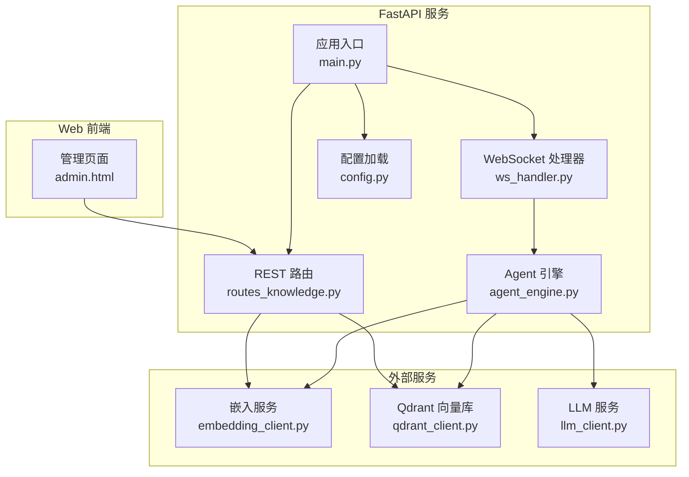
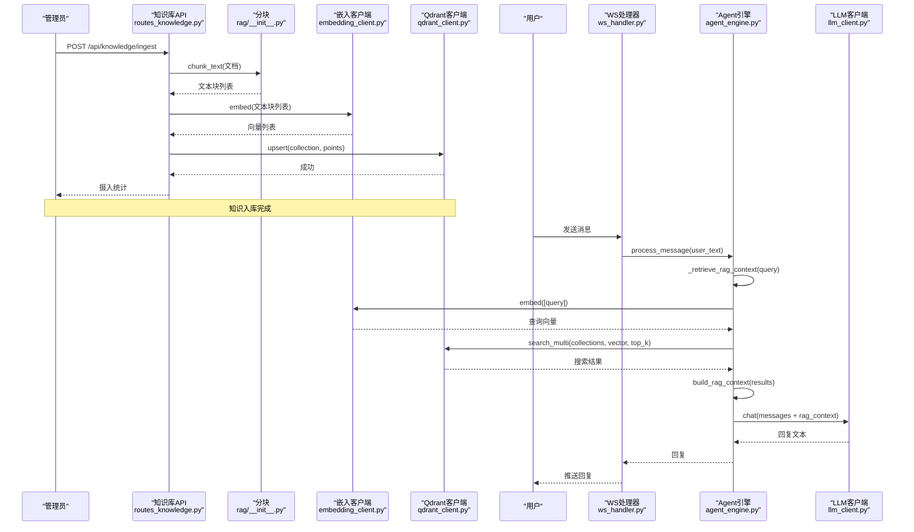
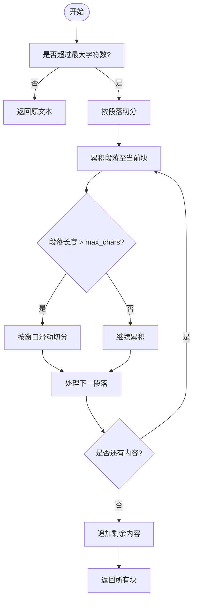
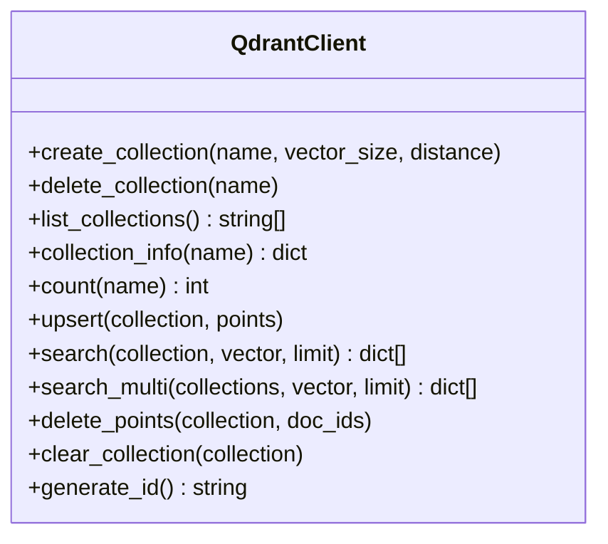
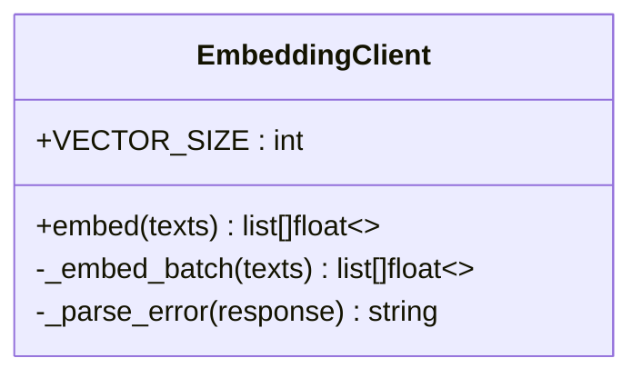
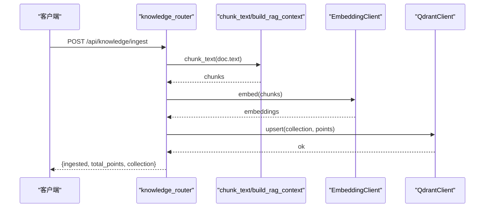
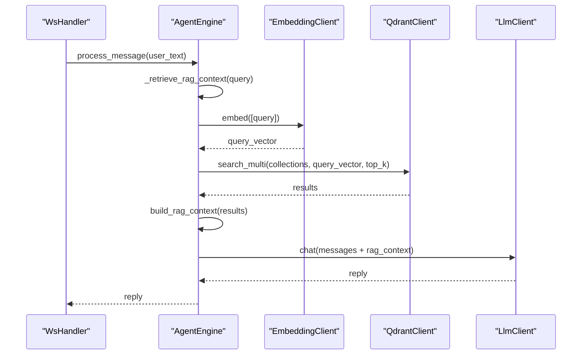
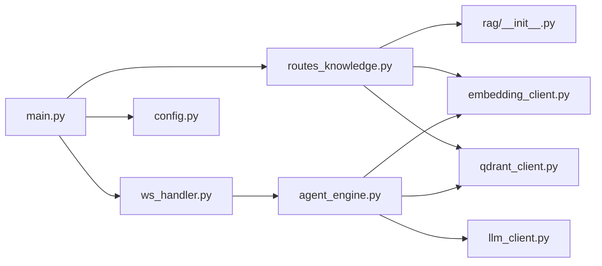

# RAG 集成

<cite>
**本文引用的文件**   
- [server/rag/__init__.py](file://server/rag/__init__.py)
- [server/services/qdrant_client.py](file://server/services/qdrant_client.py)
- [server/services/embedding_client.py](file://server/services/embedding_client.py)
- [server/api/routes_knowledge.py](file://server/api/routes_knowledge.py)
- [server/agent/agent_engine.py](file://server/agent/agent_engine.py)
- [server/api/ws_handler.py](file://server/api/ws_handler.py)
- [server/config.py](file://server/config.py)
- [server/main.py](file://server/main.py)
- [doc/Qdrant知识库操作指南.md](file://doc/Qdrant知识库操作指南.md)
</cite>

## 目录
1. [简介](#简介)
2. [项目结构](#项目结构)
3. [核心组件](#核心组件)
4. [架构总览](#架构总览)
5. [详细组件分析](#详细组件分析)
6. [依赖关系分析](#依赖关系分析)
7. [性能与优化](#性能与优化)
8. [故障排查](#故障排查)
9. [结论](#结论)
10. [附录：API 与配置参考](#附录api-与配置参考)

## 简介
本文件面向 RealTimeTalk 系统的 Qdrant RAG（检索增强生成）集成，系统性阐述知识文档向量化、相似度检索与上下文组装的实现模式；说明向量嵌入模型的接入流程（文本预处理、嵌入生成、向量存储）；文档化检索增强逻辑（查询向量化、相似度阈值过滤、结果重排序）；提供基于知识的问答与智能对话增强的使用示例路径；并给出检索效果评估、召回率优化与响应时间控制建议；最后覆盖知识库更新策略、增量索引构建与版本管理，以及与 LLM 服务的协作模式、提示词工程与上下文窗口优化。

## 项目结构
RAG 相关代码主要分布在以下模块：
- 检索增强工具：server/rag/__init__.py（分块、上下文组装）
- 向量数据库客户端：server/services/qdrant_client.py（集合管理、点写入、语义检索）
- 嵌入服务客户端：server/services/embedding_client.py（DashScope text-embedding-v3）
- 知识库管理 API：server/api/routes_knowledge.py（集合 CRUD、知识摄入、统计、调试搜索）
- 对话引擎与 RAG 注入：server/agent/agent_engine.py、server/api/ws_handler.py
- 配置加载：server/config.py（含 RAG 配置项）
- 应用启动与依赖注入：server/main.py
- 用户操作指南：doc/Qdrant知识库操作指南.md

图表来源
- [server/api/routes_knowledge.py:1-268](file://server/api/routes_knowledge.py#L1-L268)
- [server/api/ws_handler.py:340-400](file://server/api/ws_handler.py#L340-L400)
- [server/agent/agent_engine.py:123-181](file://server/agent/agent_engine.py#L123-L181)
- [server/services/qdrant_client.py:1-235](file://server/services/qdrant_client.py#L1-L235)
- [server/services/embedding_client.py:1-149](file://server/services/embedding_client.py#L1-L149)
- [server/config.py:188-239](file://server/config.py#L188-L239)
- [server/main.py:70-87](file://server/main.py#L70-L87)

章节来源
- [server/api/routes_knowledge.py:1-268](file://server/api/routes_knowledge.py#L1-L268)
- [server/api/ws_handler.py:340-400](file://server/api/ws_handler.py#L340-L400)
- [server/agent/agent_engine.py:1-181](file://server/agent/agent_engine.py#L1-L181)
- [server/services/qdrant_client.py:1-235](file://server/services/qdrant_client.py#L1-L235)
- [server/services/embedding_client.py:1-149](file://server/services/embedding_client.py#L1-L149)
- [server/config.py:1-260](file://server/config.py#L1-L260)
- [server/main.py:1-191](file://server/main.py#L1-L191)
- [doc/Qdrant知识库操作指南.md:1-213](file://doc/Qdrant知识库操作指南.md#L1-L213)

## 核心组件
- 文本分块与上下文组装（server/rag/__init__.py）
  - chunk_text：按段落或固定窗口切分长文本，支持重叠以保留上下文连续性。
  - build_rag_context：将检索结果过滤低分后拼接为可注入 LLM 的上下文字符串。
- 向量数据库客户端（server/services/qdrant_client.py）
  - 集合管理：创建、删除、列出、信息获取、清空重建。
  - 数据操作：批量 upsert、单集合 search、多集合并发 search_multi、按 ID 删除点。
- 嵌入客户端（server/services/embedding_client.py）
  - 调用 DashScope text-embedding-v3，支持批处理与重试，返回 1024 维向量。
- 知识库管理 API（server/api/routes_knowledge.py）
  - 集合管理、知识摄入（自动分块+嵌入+upsert）、统计、清空、调试搜索。
- 对话引擎与 RAG 注入（server/agent/agent_engine.py, server/api/ws_handler.py）
  - 在消息处理前执行 RAG 检索，根据角色-集合映射选择搜索范围，合并排序后注入上下文。
- 配置与启动（server/config.py, server/main.py）
  - 集中加载配置（含 RAG top_k、role_collections），在 lifespan 中初始化客户端并注入到 Agent。

章节来源
- [server/rag/__init__.py:1-83](file://server/rag/__init__.py#L1-L83)
- [server/services/qdrant_client.py:1-235](file://server/services/qdrant_client.py#L1-L235)
- [server/services/embedding_client.py:1-149](file://server/services/embedding_client.py#L1-L149)
- [server/api/routes_knowledge.py:1-268](file://server/api/routes_knowledge.py#L1-L268)
- [server/agent/agent_engine.py:1-181](file://server/agent/agent_engine.py#L1-L181)
- [server/api/ws_handler.py:340-400](file://server/api/ws_handler.py#L340-L400)
- [server/config.py:1-260](file://server/config.py#L1-L260)
- [server/main.py:1-191](file://server/main.py#L1-L191)

## 架构总览
RAG 在系统中的整体工作流如下：
- 知识摄入：管理员通过 REST API 提交文档 → 自动分块 → 批量嵌入 → 写入 Qdrant。
- 对话检索：用户提问 → 查询向量化 → 按角色映射选择集合 → 并发检索 → 合并排序 → 过滤低分 → 构建上下文 → 注入系统消息 → LLM 生成回答。
- 降级策略：当无集合、无结果、分数过低或服务异常时，跳过 RAG，直接走纯 LLM 回复。

图表来源
- [server/api/routes_knowledge.py:134-186](file://server/api/routes_knowledge.py#L134-L186)
- [server/rag/__init__.py:10-83](file://server/rag/__init__.py#L10-L83)
- [server/services/embedding_client.py:47-135](file://server/services/embedding_client.py#L47-L135)
- [server/services/qdrant_client.py:115-186](file://server/services/qdrant_client.py#L115-L186)
- [server/agent/agent_engine.py:74-121](file://server/agent/agent_engine.py#L74-L121)
- [server/agent/agent_engine.py:123-181](file://server/agent/agent_engine.py#L123-L181)
- [server/api/ws_handler.py:342-400](file://server/api/ws_handler.py#L342-L400)

## 详细组件分析

### 文本分块与上下文组装（server/rag/__init__.py）
- 分块策略
  - 优先按段落（\n\n）聚合，若单段落超过阈值则按固定窗口滑动切分，设置重叠字符数以保持语义连贯。
- 上下文组装
  - 对检索结果进行分数阈值过滤（score >= 0.3），将高相关片段编号并附加来源信息，形成可直接注入 system/user 上下文的字符串。

图表来源
- [server/rag/__init__.py:10-53](file://server/rag/__init__.py#L10-L53)

章节来源
- [server/rag/__init__.py:10-83](file://server/rag/__init__.py#L10-L83)

### 向量数据库客户端（server/services/qdrant_client.py）
- 集合管理
  - create_collection：检查存在性后创建，记录维度与距离度量。
  - delete_collection/clear_collection：删除或清空重建集合。
  - list_collections/collection_info/count：元信息与统计。
- 数据操作
  - upsert：批量写入点，包含 id、vector、payload（text、source）。
  - search：单集合语义检索，返回 score、payload。
  - search_multi：并发检索多个集合，合并并按分数降序取 top_k。
  - delete_points：按文档 ID 批量删除。

图表来源
- [server/services/qdrant_client.py:26-235](file://server/services/qdrant_client.py#L26-L235)

章节来源
- [server/services/qdrant_client.py:1-235](file://server/services/qdrant_client.py#L1-L235)

### 嵌入客户端（server/services/embedding_client.py）
- 模型与维度
  - 使用 DashScope text-embedding-v3，输出 1024 维向量。
- 批处理与重试
  - 默认批次大小 10，内部实现分批调用；对 429/5xx/超时/连接错误进行重试与退避。
- 错误解析
  - 统一解析服务端错误消息，便于上层定位问题。

图表来源
- [server/services/embedding_client.py:26-149](file://server/services/embedding_client.py#L26-L149)

章节来源
- [server/services/embedding_client.py:1-149](file://server/services/embedding_client.py#L1-L149)

### 知识库管理 API（server/api/routes_knowledge.py）
- 鉴权
  - 通过请求头 X-Knowledge-Admin-Token 校验，未配置 token 时放行。
- 集合管理
  - GET/POST/DELETE /api/knowledge/collections
- 知识摄入
  - POST /api/knowledge/ingest：自动分块 → 批量嵌入 → upsert → 统计返回。
- 统计与清理
  - GET /api/knowledge/stats：按集合或全局统计。
  - DELETE /api/knowledge/clear：清空指定集合。
- 调试搜索
  - GET /api/knowledge/search：可选指定集合或跨集合检索，返回 Top K 结果摘要。

图表来源
- [server/api/routes_knowledge.py:134-186](file://server/api/routes_knowledge.py#L134-L186)
- [server/rag/__init__.py:10-83](file://server/rag/__init__.py#L10-L83)
- [server/services/embedding_client.py:47-135](file://server/services/embedding_client.py#L47-L135)
- [server/services/qdrant_client.py:115-186](file://server/services/qdrant_client.py#L115-L186)

章节来源
- [server/api/routes_knowledge.py:1-268](file://server/api/routes_knowledge.py#L1-L268)

### 对话引擎与 RAG 注入（server/agent/agent_engine.py, server/api/ws_handler.py）
- 注入时机
  - 在 process_message 中，先保存用户消息，再执行 RAG 检索，若得到上下文则替换 messages 中的 system 部分，随后调用 LLM。
- 检索流程
  - 读取 role_collections 配置，确定搜索集合（“*”表示全部，否则为指定列表）。
  - 调用 embedding_client.embed([query]) 获取查询向量。
  - 调用 qdrant_client.search_multi 并发检索，合并排序后取 top_k。
  - 使用 build_rag_context 过滤低分并组装上下文。
- 降级策略
  - 当客户端未注入、无集合、无结果或检索异常时，返回 None，走纯 LLM 回复。

图表来源
- [server/agent/agent_engine.py:74-121](file://server/agent/agent_engine.py#L74-L121)
- [server/agent/agent_engine.py:123-181](file://server/agent/agent_engine.py#L123-L181)
- [server/api/ws_handler.py:342-400](file://server/api/ws_handler.py#L342-L400)
- [server/services/embedding_client.py:47-135](file://server/services/embedding_client.py#L47-L135)
- [server/services/qdrant_client.py:164-186](file://server/services/qdrant_client.py#L164-L186)

章节来源
- [server/agent/agent_engine.py:1-181](file://server/agent/agent_engine.py#L1-L181)
- [server/api/ws_handler.py:340-400](file://server/api/ws_handler.py#L340-L400)

### 配置与启动（server/config.py, server/main.py）
- 配置项
  - rag.top_k：检索返回条数。
  - rag.role_collections：角色到集合映射（JSON 字符串），如 {"普兰": "*"}。
  - knowledge_admin_token：知识库管理接口鉴权 Token。
- 启动流程
  - lifespan 中初始化 Redis、MinIO、Qdrant、Embedding 客户端。
  - 初始化知识库路由并注入 RAG 依赖到 AgentEngine。

章节来源
- [server/config.py:188-239](file://server/config.py#L188-L239)
- [server/main.py:70-87](file://server/main.py#L70-L87)

## 依赖关系分析
- 耦合与内聚
  - routes_knowledge 与 rag、embedding_client、qdrant_client 解耦良好，职责清晰。
  - agent_engine 与 ws_handler 均复用相同的 RAG 检索逻辑，避免重复实现。
- 外部依赖
  - Qdrant HTTP API、DashScope Embedding API、OpenAI 兼容 LLM API。
- 潜在循环依赖
  - 未发现循环导入；依赖方向为 API → 服务层 → 外部服务。

图表来源
- [server/api/routes_knowledge.py:1-268](file://server/api/routes_knowledge.py#L1-L268)
- [server/rag/__init__.py:1-83](file://server/rag/__init__.py#L1-L83)
- [server/services/embedding_client.py:1-149](file://server/services/embedding_client.py#L1-L149)
- [server/services/qdrant_client.py:1-235](file://server/services/qdrant_client.py#L1-L235)
- [server/agent/agent_engine.py:1-181](file://server/agent/agent_engine.py#L1-L181)
- [server/api/ws_handler.py:340-400](file://server/api/ws_handler.py#L340-L400)
- [server/main.py:70-87](file://server/main.py#L70-L87)
- [server/config.py:188-239](file://server/config.py#L188-L239)

章节来源
- [server/api/routes_knowledge.py:1-268](file://server/api/routes_knowledge.py#L1-L268)
- [server/rag/__init__.py:1-83](file://server/rag/__init__.py#L1-L83)
- [server/services/embedding_client.py:1-149](file://server/services/embedding_client.py#L1-L149)
- [server/services/qdrant_client.py:1-235](file://server/services/qdrant_client.py#L1-L235)
- [server/agent/agent_engine.py:1-181](file://server/agent/agent_engine.py#L1-L181)
- [server/api/ws_handler.py:340-400](file://server/api/ws_handler.py#L340-L400)
- [server/main.py:1-191](file://server/main.py#L1-L191)
- [server/config.py:1-260](file://server/config.py#L1-L260)

## 性能与优化
- 检索效率
  - 使用 search_multi 并发检索多个集合，减少端到端延迟。
  - 合理设置 top_k，平衡召回与上下文长度。
- 嵌入吞吐
  - 利用 batch_size=10 提升吞吐，避免单次过大导致超时。
- 阈值与重排序
  - 在 build_rag_context 中过滤低分结果（score < 0.3），降低无关上下文干扰。
  - 可在上层增加二次重排（如 BM25 融合或交叉编码器打分）以提升相关性。
- 响应时间控制
  - 为嵌入与检索设置合理的超时与重试策略，避免级联失败。
  - 对大文档摄入采用异步任务队列，避免阻塞主线程。
- 上下文窗口优化
  - 限制注入上下文长度，必要时截断或摘要，确保不超出 LLM 上下文窗口。
- 评估指标
  - 召回率：Top-K 命中目标文档的比例。
  - 精确率：Top-K 中相关结果占比。
  - MRR/NDCG：排序质量评估。
  - 端到端延迟：从用户输入到首 token 的时间。

[本节为通用指导，无需特定文件引用]

## 故障排查
- 常见问题
  - 添加知识后对话未生效：确认集合存在、知识已摄入、角色-集合映射正确。
  - 搜索结果分数偏低：语义匹配不足，建议优化知识编写或调整阈值。
  - 同时使用多个集合：ROLE_COLLECTIONS 设为 "*" 或指定列表。
  - 删除集合不可恢复：物理删除，需提前备份。
- 日志与降级
  - 当 Qdrant/Embedding 不可用或检索异常时，系统会降级为纯 LLM 回复，并在日志中记录警告。
- 调试手段
  - 使用 /api/knowledge/search 验证检索效果与分数分布。
  - 查看 /api/knowledge/stats 了解集合规模与点数。

章节来源
- [doc/Qdrant知识库操作指南.md:196-213](file://doc/Qdrant知识库操作指南.md#L196-L213)
- [server/api/routes_knowledge.py:233-268](file://server/api/routes_knowledge.py#L233-L268)
- [server/agent/agent_engine.py:178-181](file://server/agent/agent_engine.py#L178-L181)
- [server/api/ws_handler.py:398-400](file://server/api/ws_handler.py#L398-L400)

## 结论
RealTimeTalk 的 RAG 集成通过清晰的模块化设计实现了知识摄入、语义检索与上下文注入的完整链路。借助 Qdrant 的高性能向量检索与 DashScope 的稳定嵌入服务，系统在保障实时性的同时提供了良好的可维护性与可扩展性。配合合理的阈值过滤、并发检索与降级策略，能够在复杂场景下保持稳定的问答质量与用户体验。

[本节为总结，无需特定文件引用]

## 附录：API 与配置参考

### 知识库管理 API
- 集合管理
  - GET /api/knowledge/collections
  - POST /api/knowledge/collections
  - DELETE /api/knowledge/collections/{name}
- 知识摄入
  - POST /api/knowledge/ingest
- 统计与清理
  - GET /api/knowledge/stats
  - DELETE /api/knowledge/clear
- 调试搜索
  - GET /api/knowledge/search?q=&collection=&k=

章节来源
- [server/api/routes_knowledge.py:81-128](file://server/api/routes_knowledge.py#L81-L128)
- [server/api/routes_knowledge.py:134-186](file://server/api/routes_knowledge.py#L134-L186)
- [server/api/routes_knowledge.py:192-230](file://server/api/routes_knowledge.py#L192-L230)
- [server/api/routes_knowledge.py:233-268](file://server/api/routes_knowledge.py#L233-L268)

### 配置项（RAG 相关）
- rag.top_k：检索返回条数（默认 5）
- rag.role_collections：角色到集合映射（JSON 字符串，默认 {"普兰": "pulan_default"}）
- knowledge_admin_token：知识库管理接口鉴权 Token

章节来源
- [server/config.py:234-239](file://server/config.py#L234-L239)
- [server/config.py:120-126](file://server/config.py#L120-L126)

### 使用示例（基于代码路径）
- 基于知识的问答系统
  - 知识摄入：参考 [server/api/routes_knowledge.py:134-186](file://server/api/routes_knowledge.py#L134-L186)
  - 检索增强：参考 [server/agent/agent_engine.py:123-181](file://server/agent/agent_engine.py#L123-L181)
  - 上下文组装：参考 [server/rag/__init__.py:56-83](file://server/rag/__init__.py#L56-L83)
- 智能对话增强
  - WebSocket 流程：参考 [server/api/ws_handler.py:342-400](file://server/api/ws_handler.py#L342-L400)
  - 降级策略：参考 [server/agent/agent_engine.py:178-181](file://server/agent/agent_engine.py#L178-L181)