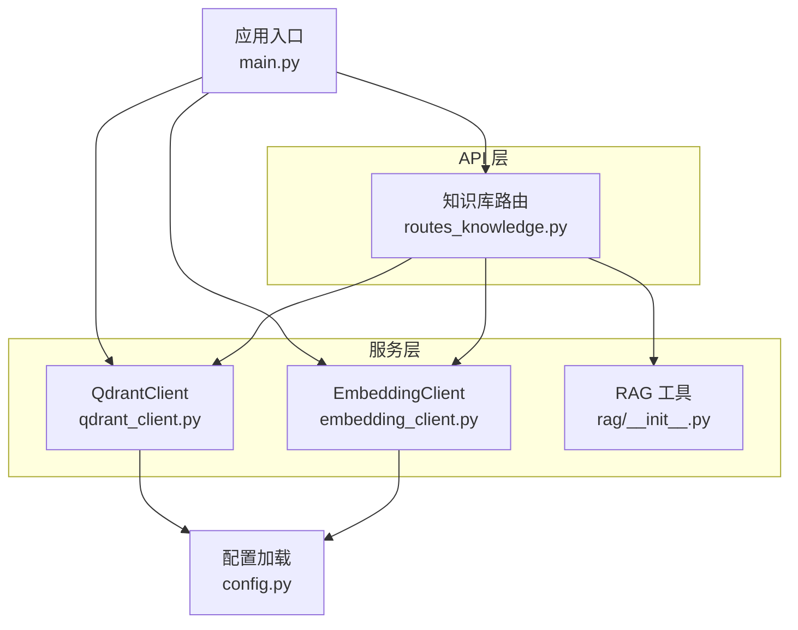
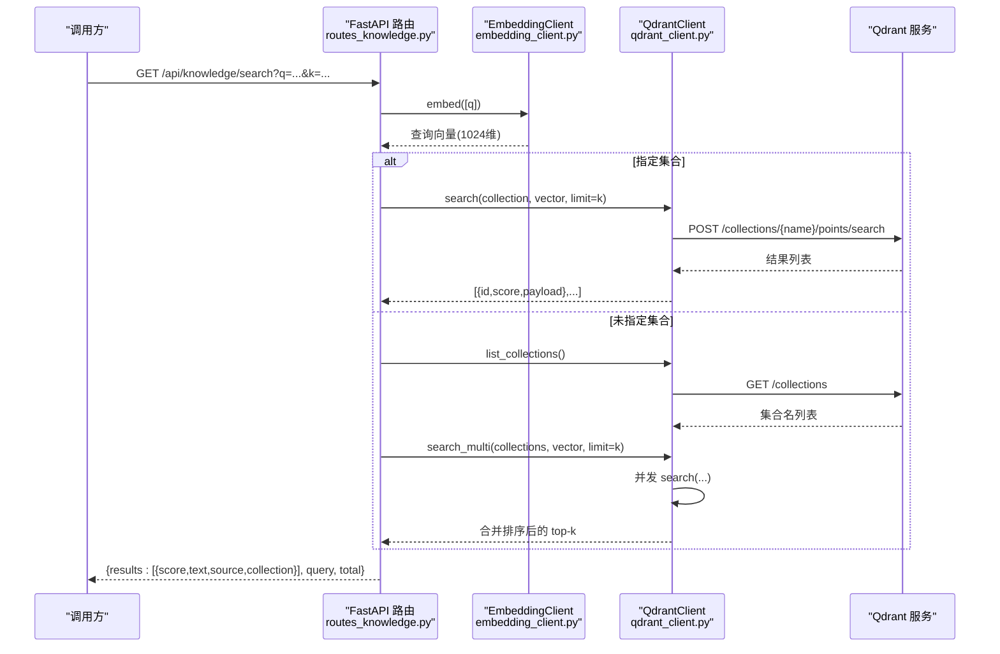
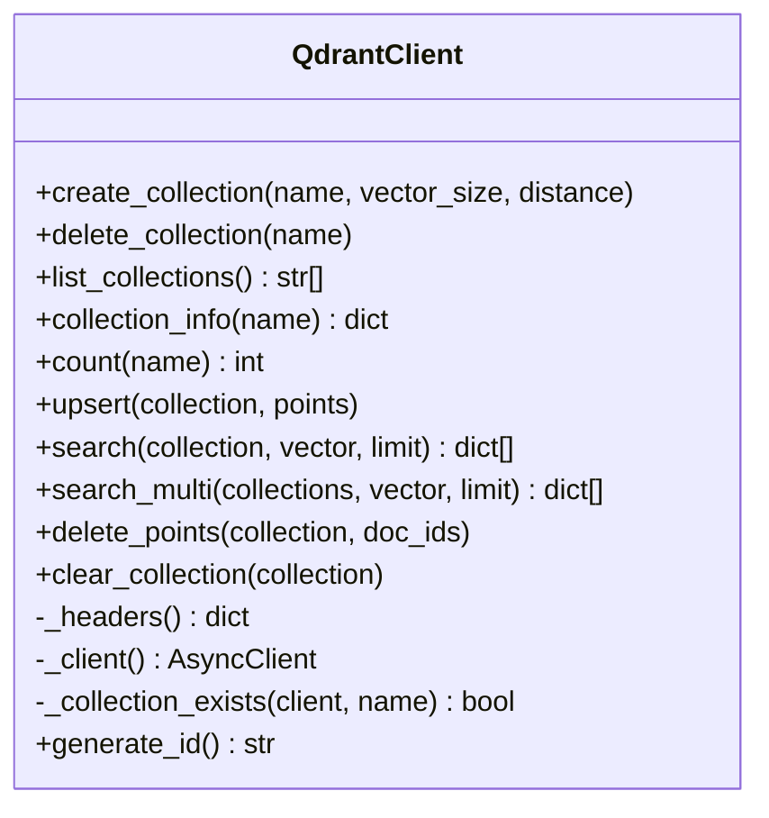
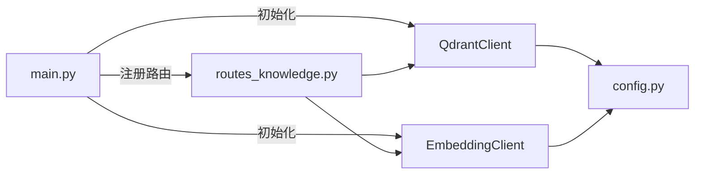

# 向量搜索检索

<cite>
**本文引用的文件**   
- [server/services/qdrant_client.py](file://server/services/qdrant_client.py)
- [server/api/routes_knowledge.py](file://server/api/routes_knowledge.py)
- [server/rag/__init__.py](file://server/rag/__init__.py)
- [server/services/embedding_client.py](file://server/services/embedding_client.py)
- [server/config.py](file://server/config.py)
- [server/main.py](file://server/main.py)
- [doc/Qdrant知识库操作指南.md](file://doc/Qdrant知识库操作指南.md)
</cite>

## 目录
1. [简介](#简介)
2. [项目结构](#项目结构)
3. [核心组件](#核心组件)
4. [架构总览](#架构总览)
5. [详细组件分析](#详细组件分析)
6. [依赖关系分析](#依赖关系分析)
7. [性能与优化](#性能与优化)
8. [故障排查](#故障排查)
9. [结论](#结论)
10. [附录：API 与参数说明](#附录api-与参数说明)

## 简介
本文件面向 RealTimeTalk 系统中的 Qdrant 向量检索能力，聚焦以下目标：
- 解释相似度搜索算法与分数含义（余弦距离、排序机制）
- 详解 search 方法参数配置（limit、with_payload、过滤条件扩展点）
- 提供语义搜索、多集合并发搜索（search_multi）及结果合并排序的示例路径
- 给出索引配置、查询向量化与缓存等性能优化策略
- 覆盖搜索结果后处理（去重、相关性评分、上下文提取）
- 说明不同距离度量选择与适用场景，以及精度评估指标建议

## 项目结构
与向量检索相关的代码主要分布在服务层与 API 路由层：
- Qdrant HTTP 客户端封装：创建集合、写入向量、单集合/多集合检索、删除与清空
- 嵌入客户端：文本到向量转换（DashScope text-embedding-v3，维度 1024）
- 知识库 REST 接口：集合管理、知识摄入、统计、调试搜索
- RAG 模块：文本分块与上下文构建
- 配置与启动：Qdrant/Embedding 配置注入、应用生命周期初始化

图表来源
- [server/services/qdrant_client.py:1-235](file://server/services/qdrant_client.py#L1-L235)
- [server/services/embedding_client.py:1-149](file://server/services/embedding_client.py#L1-L149)
- [server/api/routes_knowledge.py:1-268](file://server/api/routes_knowledge.py#L1-L268)
- [server/rag/__init__.py:1-83](file://server/rag/__init__.py#L1-L83)
- [server/config.py:1-260](file://server/config.py#L1-L260)
- [server/main.py:1-191](file://server/main.py#L1-L191)

章节来源
- [server/services/qdrant_client.py:1-235](file://server/services/qdrant_client.py#L1-L235)
- [server/api/routes_knowledge.py:1-268](file://server/api/routes_knowledge.py#L1-L268)
- [server/rag/__init__.py:1-83](file://server/rag/__init__.py#L1-L83)
- [server/services/embedding_client.py:1-149](file://server/services/embedding_client.py#L1-L149)
- [server/config.py:1-260](file://server/config.py#L1-L260)
- [server/main.py:1-191](file://server/main.py#L1-L191)

## 核心组件
- QdrantClient：异步 HTTP 客户端，封装集合管理与检索。默认使用 Cosine 距离；支持 upsert、search、search_multi、delete_points、clear_collection 等。
- EmbeddingClient：调用 DashScope embedding API，批量将文本转为 1024 维向量，具备重试与限流处理。
- 知识库路由：提供集合 CRUD、知识摄入（自动分块+嵌入+upsert）、统计、调试搜索等 REST 端点。
- RAG 工具：文本分块与从检索结果构建 LLM 上下文字符串，内置低分过滤阈值。

章节来源
- [server/services/qdrant_client.py:26-235](file://server/services/qdrant_client.py#L26-L235)
- [server/services/embedding_client.py:26-149](file://server/services/embedding_client.py#L26-L149)
- [server/api/routes_knowledge.py:134-268](file://server/api/routes_knowledge.py#L134-L268)
- [server/rag/__init__.py:10-83](file://server/rag/__init__.py#L10-L83)

## 架构总览
下图展示一次“调试搜索”请求在系统内的完整调用链：前端/调用方 → FastAPI 路由 → 嵌入客户端 → Qdrant 检索 → 返回并格式化结果。

图表来源
- [server/api/routes_knowledge.py:233-268](file://server/api/routes_knowledge.py#L233-L268)
- [server/services/embedding_client.py:47-70](file://server/services/embedding_client.py#L47-L70)
- [server/services/qdrant_client.py:136-186](file://server/services/qdrant_client.py#L136-L186)

## 详细组件分析

### QdrantClient 类图与关键流程
该类是向量检索的核心封装，负责集合生命周期与检索。

图表来源
- [server/services/qdrant_client.py:26-235](file://server/services/qdrant_client.py#L26-L235)

#### 相似度搜索与排序机制
- 距离度量：集合创建时指定距离为 Cosine（默认）。Cosine 相似度越高，向量方向越一致；Qdrant 返回的 score 表示相似度值，越大越相关。
- 排序规则：search 返回按相似度降序排列的前 k 条；search_multi 对多个集合的结果进行合并后再按 score 降序取前 k。
- 分数含义：在 Cosine 设置下，score 通常位于 0~1 区间，数值越高代表语义越接近。

章节来源
- [server/services/qdrant_client.py:37-59](file://server/services/qdrant_client.py#L37-L59)
- [server/services/qdrant_client.py:136-186](file://server/services/qdrant_client.py#L136-L186)

#### search 方法参数与行为
- collection：目标集合名称
- vector：查询向量（由 EmbeddingClient 生成，维度需与集合一致）
- limit：返回条数上限
- with_payload：当前实现固定为 True，返回 payload 字段（包含 text、source 等）
- 返回值：[{id, score, payload}, ...]

章节来源
- [server/services/qdrant_client.py:136-162](file://server/services/qdrant_client.py#L136-L162)

#### search_multi 并发与合并
- 并发策略：基于 asyncio.gather 并行发起各集合的 search 请求
- 异常容错：单个集合失败不影响其他集合，记录警告并跳过
- 合并排序：将所有集合结果拼接后按 score 降序排序，再截取前 limit 条
- 标注来源：为每条结果附加 collection 字段，便于追踪来源

章节来源
- [server/services/qdrant_client.py:164-186](file://server/services/qdrant_client.py#L164-L186)

#### 过滤条件扩展点
- 当前 search 未传入 filter 参数；如需按元数据过滤，可在构造 payload 时增加 filter 字段（例如 must/should/must_not 组合），以匹配 Qdrant 过滤语法。
- 参考 delete_points 中使用的 has_id 过滤模式，可借鉴其 filter 结构用于检索时的条件限定。

章节来源
- [server/services/qdrant_client.py:188-204](file://server/services/qdrant_client.py#L188-L204)

### EmbeddingClient 文本向量化
- 模型与维度：text-embedding-v3，输出 1024 维向量
- 批处理：内部按批次调用，避免单次过长导致超时或限流
- 错误处理：针对 401/403/429/5xx 等状态码进行区分与重试
- 超时与连接错误：统一捕获并重试一次

章节来源
- [server/services/embedding_client.py:26-149](file://server/services/embedding_client.py#L26-L149)

### 知识库路由（REST）
- 集合管理：列出、创建、删除集合
- 知识摄入：自动分块（最大 500 字符，重叠 100 字符）→ 批量嵌入 → upsert 写入 Qdrant
- 统计：按集合或全局统计点数
- 调试搜索：GET /api/knowledge/search，支持指定集合或不指定（跨所有集合）

章节来源
- [server/api/routes_knowledge.py:81-128](file://server/api/routes_knowledge.py#L81-L128)
- [server/api/routes_knowledge.py:134-186](file://server/api/routes_knowledge.py#L134-L186)
- [server/api/routes_knowledge.py:192-230](file://server/api/routes_knowledge.py#L192-L230)
- [server/api/routes_knowledge.py:233-268](file://server/api/routes_knowledge.py#L233-L268)

### RAG 上下文构建与后处理
- 文本分块：chunk_text 支持段落优先切分，超长段落按窗口滑动切分，保证语义连续性
- 上下文构建：build_rag_context 会过滤低分结果（score < 0.3），并将高相关片段组织为提示词上下文
- 去重与相关性：当前实现未做显式去重，但可通过业务层对 id 或 payload 指纹去重；相关性通过 score 阈值控制

章节来源
- [server/rag/__init__.py:10-53](file://server/rag/__init__.py#L10-L53)
- [server/rag/__init__.py:56-83](file://server/rag/__init__.py#L56-L83)

## 依赖关系分析
- main.py 在应用启动时初始化 QdrantClient 与 EmbeddingClient，并将实例注入到知识库路由与 AgentEngine
- routes_knowledge.py 依赖 QdrantClient 与 EmbeddingClient 完成摄入与检索
- config.py 提供统一的配置加载，环境变量优先级高于 JSON 配置

图表来源
- [server/main.py:70-87](file://server/main.py#L70-L87)
- [server/api/routes_knowledge.py:33-38](file://server/api/routes_knowledge.py#L33-L38)
- [server/config.py:148-260](file://server/config.py#L148-L260)

章节来源
- [server/main.py:1-191](file://server/main.py#L1-L191)
- [server/api/routes_knowledge.py:1-268](file://server/api/routes_knowledge.py#L1-L268)
- [server/config.py:1-260](file://server/config.py#L1-L260)

## 性能与优化
- 索引与集合配置
  - 向量维度必须与嵌入模型一致（1024）
  - 距离度量选择 Cosine 适合语义相似度；若关注绝对距离差异，可考虑 Euclidean（需在集合创建时指定）
- 查询向量化
  - 使用 EmbeddingClient 的批量嵌入能力，减少网络往返
  - 合理设置 timeout，避免长尾请求阻塞
- 并发检索
  - 使用 search_multi 并发访问多个集合，显著降低端到端延迟
- 结果裁剪
  - 合理设置 limit，避免返回过多无关结果
  - 在业务层结合 score 阈值过滤（如 < 0.3 视为不相关）
- 缓存机制（建议）
  - 对高频查询向量或查询文本进行本地缓存（如 Redis），命中则直接返回历史结果
  - 对热门集合的元数据（集合信息、计数）也可缓存
- 写入优化
  - 批量 upsert，减少请求次数
  - 控制分块大小与重叠，平衡检索精度与存储开销

[本节为通用指导，无需特定文件引用]

## 故障排查
- 集合不存在
  - 现象：upsert 或 search 报 404
  - 处理：先调用 create_collection 确保集合存在
- 向量维度不匹配
  - 现象：服务端报错或检索结果为空
  - 处理：确认集合 vector_size 与嵌入模型输出维度一致（1024）
- 鉴权失败
  - 现象：401/403
  - 处理：检查 embedding api_key 与 qdrant api-key 配置
- 限流与超时
  - 现象：429 或 TimeoutException
  - 处理：等待重试或降低并发度；调整 timeout
- 低分结果
  - 现象：score 普遍偏低
  - 处理：优化知识编写（主题集中、完整陈述句、长度适中）；必要时调低阈值或更换距离度量

章节来源
- [server/services/qdrant_client.py:115-134](file://server/services/qdrant_client.py#L115-L134)
- [server/services/embedding_client.py:84-135](file://server/services/embedding_client.py#L84-L135)
- [doc/Qdrant知识库操作指南.md:196-213](file://doc/Qdrant知识库操作指南.md#L196-L213)

## 结论
RealTimeTalk 的向量检索以 Qdrant 为核心，配合 DashScope 嵌入模型实现语义搜索。系统已提供集合管理、知识摄入、调试搜索等完整链路，并通过 search_multi 实现多集合并发检索与合并排序。通过合理的索引配置、查询向量化与缓存策略，可进一步提升检索性能与稳定性。后续可按需扩展过滤条件、去重逻辑与更精细的相关性评分策略。

[本节为总结，无需特定文件引用]

## 附录：API 与参数说明

### 调试搜索接口
- 端点：GET /api/knowledge/search
- 参数：
  - q：搜索查询文本（必填）
  - collection：指定集合（可选，不指定则跨所有集合）
  - k：返回条数（默认 5，范围 1~20）
- 响应：
  - results：[{score, text, source, collection}]
  - query：原始查询
  - total：结果数量

章节来源
- [server/api/routes_knowledge.py:233-268](file://server/api/routes_knowledge.py#L233-L268)

### QdrantClient.search 参数
- collection：集合名
- vector：查询向量（1024 维）
- limit：返回条数
- with_payload：是否返回 payload（当前固定为 True）
- 返回：[{id, score, payload}, ...]

章节来源
- [server/services/qdrant_client.py:136-162](file://server/services/qdrant_client.py#L136-L162)

### QdrantClient.search_multi 行为
- 输入：collections（集合名列表）、vector、limit
- 行为：并发检索各集合，合并结果并按 score 降序排序，取前 limit 条
- 返回：[{id, score, payload, collection}, ...]

章节来源
- [server/services/qdrant_client.py:164-186](file://server/services/qdrant_client.py#L164-L186)

### 过滤条件扩展（建议）
- 在 search 的 payload 中增加 filter 字段，使用 must/should/must_not 组合条件
- 可参考 delete_points 中的 has_id 用法，构造等价的检索过滤

章节来源
- [server/services/qdrant_client.py:188-204](file://server/services/qdrant_client.py#L188-L204)

### 距离度量与适用场景
- Cosine：适合语义相似度比较，方向一致性更重要；当前默认
- Euclidean：适合关注绝对距离的场景；需在集合创建时指定
- 选择依据：根据嵌入模型特性与应用需求决定

章节来源
- [server/services/qdrant_client.py:37-59](file://server/services/qdrant_client.py#L37-L59)

### 结果后处理建议
- 去重：按 id 或 payload 指纹去重，避免重复条目
- 相关性评分：结合 score 阈值（如 ≥ 0.3）过滤低相关结果
- 上下文提取：使用 build_rag_context 将高相关片段组织为 LLM 上下文

章节来源
- [server/rag/__init__.py:56-83](file://server/rag/__init__.py#L56-L83)

### 代码示例路径（无代码内容）
- 语义搜索（单集合）
  - 参考：[server/api/routes_knowledge.py:233-268](file://server/api/routes_knowledge.py#L233-L268)
- 多集合并发搜索（search_multi）
  - 参考：[server/services/qdrant_client.py:164-186](file://server/services/qdrant_client.py#L164-L186)
- 结果合并排序
  - 参考：[server/services/qdrant_client.py:185-186](file://server/services/qdrant_client.py#L185-L186)
- 查询向量化
  - 参考：[server/services/embedding_client.py:47-70](file://server/services/embedding_client.py#L47-L70)
- 上下文构建
  - 参考：[server/rag/__init__.py:56-83](file://server/rag/__init__.py#L56-L83)