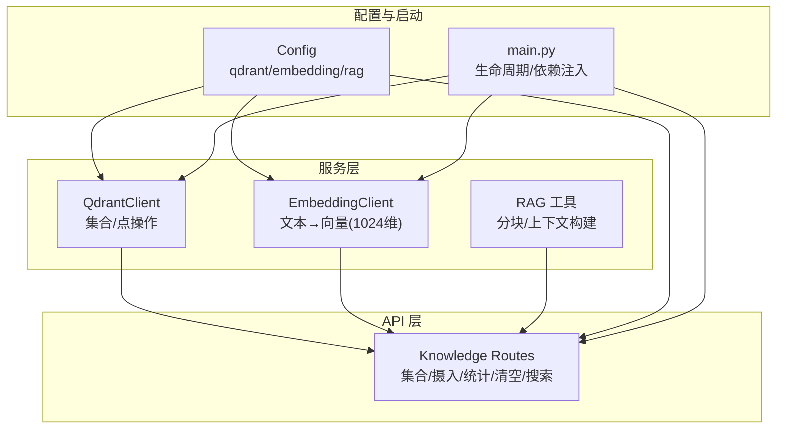
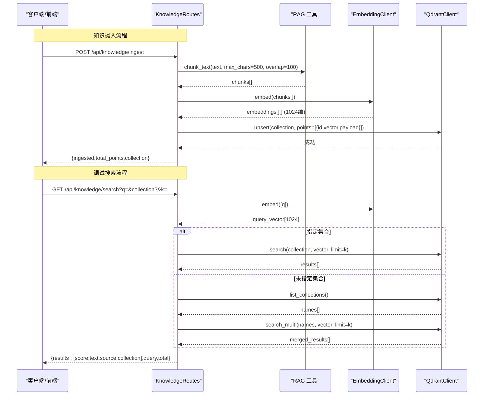
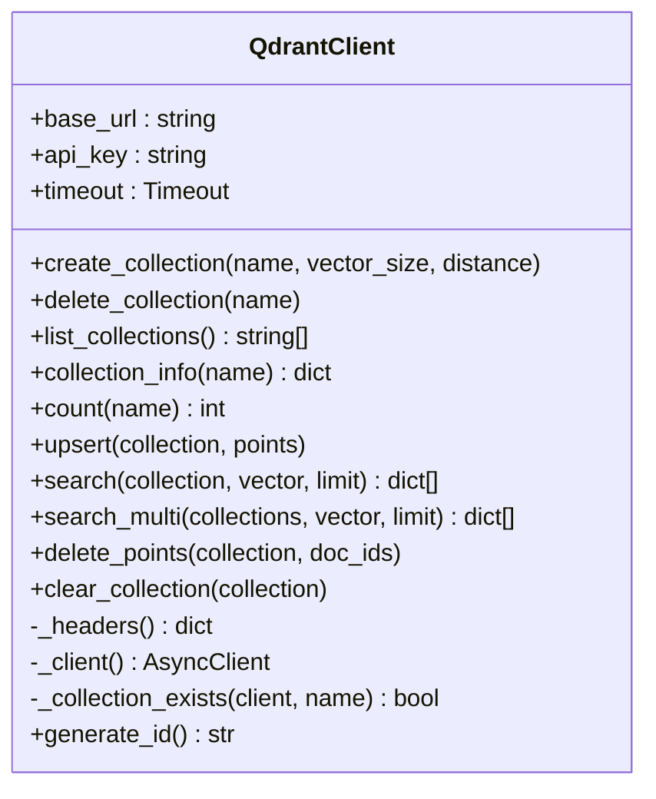
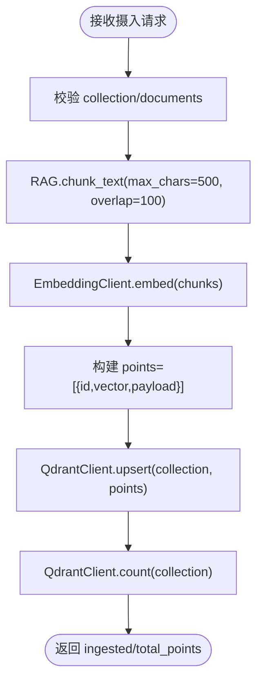
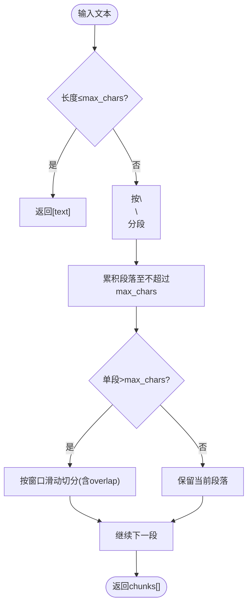
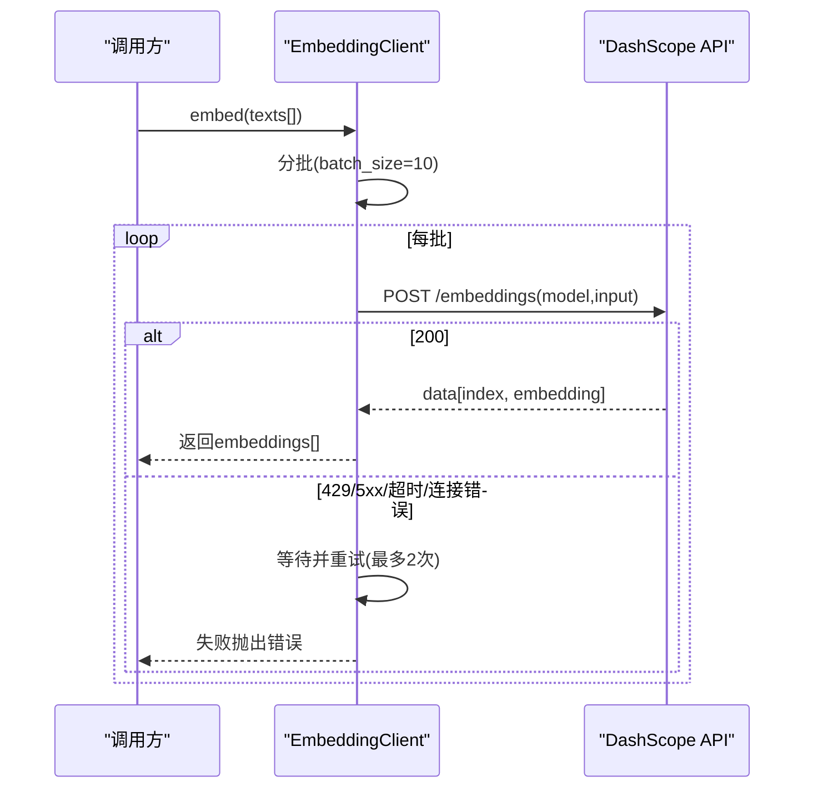
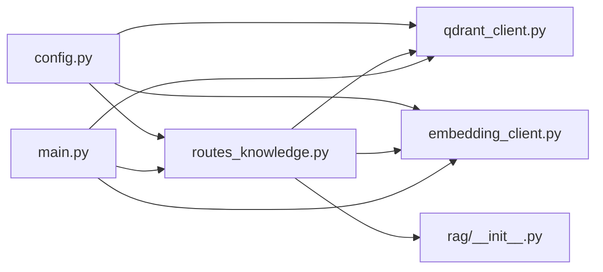

# 向量操作

<cite>
**本文引用的文件**   
- [server/services/qdrant_client.py](file://server/services/qdrant_client.py)
- [server/api/routes_knowledge.py](file://server/api/routes_knowledge.py)
- [server/rag/__init__.py](file://server/rag/__init__.py)
- [server/services/embedding_client.py](file://server/services/embedding_client.py)
- [server/config.py](file://server/config.py)
- [doc/Qdrant知识库操作指南.md](file://doc/Qdrant知识库操作指南.md)
- [server/main.py](file://server/main.py)
</cite>

## 目录
1. [简介](#简介)
2. [项目结构](#项目结构)
3. [核心组件](#核心组件)
4. [架构总览](#架构总览)
5. [详细组件分析](#详细组件分析)
6. [依赖关系分析](#依赖关系分析)
7. [性能与优化](#性能与优化)
8. [故障排查](#故障排查)
9. [结论](#结论)
10. [附录：API 参考与示例路径](#附录api-参考与示例路径)

## 简介
本文件面向 RealTimeTalk 系统中的 Qdrant 向量操作，聚焦以下目标：
- 向量的批量写入（upsert）、搜索检索、删除操作
- 向量数据结构：点 ID、向量数组、负载数据（payload）的组织方式
- 相似度搜索算法：余弦距离计算、结果排序与限制返回数量
- 代码级示例路径：插入、语义搜索、多集合并发搜索
- 数据格式校验、批量处理优化与性能调优策略
- 错误处理机制、重试逻辑与异常恢复
- 嵌入模型集成、数据预处理与后处理流程

## 项目结构
RealTimeTalk 的向量能力由“服务层客户端 + API 路由 + RAG 工具”共同组成：
- Qdrant 客户端：封装 HTTP 调用、集合管理、点写入/搜索/删除等
- 知识管理 API：提供集合管理、知识摄入、统计、清空、调试搜索等 REST 接口
- RAG 模块：文本分块与上下文构建
- Embedding 客户端：将文本转为向量（DashScope text-embedding-v3，1024 维）
- 配置中心：集中加载 Qdrant、Embedding、RAG 等配置项
- 应用入口：初始化客户端并注入到路由与 Agent 引擎

图表来源
- [server/services/qdrant_client.py:1-235](file://server/services/qdrant_client.py#L1-L235)
- [server/api/routes_knowledge.py:1-268](file://server/api/routes_knowledge.py#L1-L268)
- [server/rag/__init__.py:1-83](file://server/rag/__init__.py#L1-L83)
- [server/services/embedding_client.py:1-149](file://server/services/embedding_client.py#L1-L149)
- [server/config.py:1-260](file://server/config.py#L1-L260)
- [server/main.py:1-191](file://server/main.py#L1-L191)

章节来源
- [server/main.py:42-90](file://server/main.py#L42-L90)
- [server/config.py:111-138](file://server/config.py#L111-L138)

## 核心组件
- QdrantClient：异步 HTTP 客户端，负责集合 CRUD、点 upsert/search/delete、计数、清空重建等。默认使用 Cosine 距离，支持 api-key 鉴权。
- EmbeddingClient：调用 DashScope text-embedding-v3，输出 1024 维向量；内置批处理与重试逻辑。
- Knowledge Routes：REST 接口暴露集合管理、知识摄入（自动分块+批量嵌入+批量 upsert）、统计、清空、调试搜索。
- RAG 工具：chunk_text 实现段落优先、窗口滑动的分块；build_rag_context 过滤低分结果并拼接为 LLM 上下文。
- Config：集中加载 qdrant、embedding、rag 等配置，环境变量优先级高于 config.json。
- main.py：在应用生命周期中初始化客户端、注册路由、注入依赖。

章节来源
- [server/services/qdrant_client.py:26-235](file://server/services/qdrant_client.py#L26-L235)
- [server/services/embedding_client.py:26-149](file://server/services/embedding_client.py#L26-L149)
- [server/api/routes_knowledge.py:33-268](file://server/api/routes_knowledge.py#L33-L268)
- [server/rag/__init__.py:10-83](file://server/rag/__init__.py#L10-L83)
- [server/config.py:111-138](file://server/config.py#L111-L138)
- [server/main.py:70-87](file://server/main.py#L70-L87)

## 架构总览
下图展示从“知识摄入/搜索请求”到“向量存储/检索”的端到端流程。

图表来源
- [server/api/routes_knowledge.py:134-186](file://server/api/routes_knowledge.py#L134-L186)
- [server/api/routes_knowledge.py:233-267](file://server/api/routes_knowledge.py#L233-L267)
- [server/rag/__init__.py:10-53](file://server/rag/__init__.py#L10-L53)
- [server/services/embedding_client.py:47-70](file://server/services/embedding_client.py#L47-L70)
- [server/services/qdrant_client.py:115-186](file://server/services/qdrant_client.py#L115-L186)

## 详细组件分析

### Qdrant 客户端（集合与点操作）
- 集合管理
  - create_collection：若已存在则跳过创建；默认向量维度 1024，距离 Cosine
  - delete_collection：不存在时抛出 404 错误
  - list_collections/collection_info/count：获取集合列表、详情、点数
- 点操作
  - upsert：批量写入 points=[{id, vector, payload}]
  - search：按向量检索，返回 id/score/payload，默认 with_payload=True
  - search_multi：并发搜索多个集合，合并后按 score 降序取 top_k
  - delete_points：按 has_id 过滤器批量删除
  - clear_collection：删除并重建集合以清空数据
- 内部辅助
  - _headers/_client：httpx.AsyncClient 带超时与 api-key 头
  - _collection_exists：检查集合是否存在
  - generate_id：生成唯一文档 ID

图表来源
- [server/services/qdrant_client.py:26-235](file://server/services/qdrant_client.py#L26-L235)

章节来源
- [server/services/qdrant_client.py:37-112](file://server/services/qdrant_client.py#L37-L112)
- [server/services/qdrant_client.py:115-212](file://server/services/qdrant_client.py#L115-L212)
- [server/services/qdrant_client.py:216-235](file://server/services/qdrant_client.py#L216-L235)

### 知识管理 API（摄入、统计、清空、搜索）
- 鉴权：X-Knowledge-Admin-Token 头，空配置时放行
- 集合管理：GET/POST/DELETE /collections
- 知识摄入：POST /ingest
  - 自动分块：超过 500 字符按段落或窗口切分
  - 批量嵌入：调用 EmbeddingClient.embed
  - 批量 upsert：构造 points=[{id,vector,payload}]
  - 统计：返回 ingested 与 total_points
- 统计：GET /stats（可指定 collection）
- 清空：DELETE /clear?collection=
- 调试搜索：GET /search?q=&collection?&k=
  - 单集合：直接 search
  - 全集合：list_collections → search_multi

图表来源
- [server/api/routes_knowledge.py:134-186](file://server/api/routes_knowledge.py#L134-L186)
- [server/rag/__init__.py:10-53](file://server/rag/__init__.py#L10-L53)
- [server/services/embedding_client.py:47-70](file://server/services/embedding_client.py#L47-L70)
- [server/services/qdrant_client.py:115-134](file://server/services/qdrant_client.py#L115-L134)

章节来源
- [server/api/routes_knowledge.py:40-128](file://server/api/routes_knowledge.py#L40-L128)
- [server/api/routes_knowledge.py:134-186](file://server/api/routes_knowledge.py#L134-L186)
- [server/api/routes_knowledge.py:192-230](file://server/api/routes_knowledge.py#L192-L230)
- [server/api/routes_knowledge.py:233-267](file://server/api/routes_knowledge.py#L233-L267)

### RAG 工具（分块与上下文构建）
- chunk_text：优先按段落切分，超长段落按固定窗口滑动切分，保证重叠连续性
- build_rag_context：过滤低分结果（score≥0.3），拼接为 LLM 可注入的上下文字符串

图表来源
- [server/rag/__init__.py:10-53](file://server/rag/__init__.py#L10-L53)

章节来源
- [server/rag/__init__.py:10-53](file://server/rag/__init__.py#L10-L53)
- [server/rag/__init__.py:56-83](file://server/rag/__init__.py#L56-L83)

### 嵌入客户端（DashScope text-embedding-v3）
- 模型：text-embedding-v3，向量维度 1024
- 批处理：单次最多 10 条文本，超出则分批
- 重试与限流：对 429/5xx/超时/连接错误进行指数退避式重试（最多 2 次）
- 错误解析：统一包装为 EmbeddingClientError，包含状态码

图表来源
- [server/services/embedding_client.py:47-135](file://server/services/embedding_client.py#L47-L135)

章节来源
- [server/services/embedding_client.py:26-149](file://server/services/embedding_client.py#L26-L149)

### 配置与启动
- 配置项
  - qdrant.url / qdrant.api_key
  - embedding.endpoint / embedding.api_key / embedding.model
  - rag.top_k / rag.role_collections
- 启动流程
  - 初始化 Redis/MinIO/Qdrant/Embedding 客户端
  - 注册知识管理路由
  - 将 Qdrant/Embedding 注入到 AgentEngine（用于对话中的 RAG）

章节来源
- [server/config.py:111-138](file://server/config.py#L111-L138)
- [server/config.py:225-238](file://server/config.py#L225-L238)
- [server/main.py:70-87](file://server/main.py#L70-L87)

## 依赖关系分析
- QdrantClient 依赖 httpx.AsyncClient 与配置中心
- KnowledgeRoutes 依赖 QdrantClient、EmbeddingClient、RAG 工具
- EmbeddingClient 依赖 httpx.AsyncClient 与配置中心
- main.py 在生命周期中初始化并注入各客户端

图表来源
- [server/config.py:111-138](file://server/config.py#L111-L138)
- [server/services/qdrant_client.py:1-20](file://server/services/qdrant_client.py#L1-L20)
- [server/services/embedding_client.py:1-20](file://server/services/embedding_client.py#L1-L20)
- [server/api/routes_knowledge.py:1-25](file://server/api/routes_knowledge.py#L1-L25)
- [server/main.py:70-87](file://server/main.py#L70-L87)

章节来源
- [server/main.py:70-87](file://server/main.py#L70-L87)
- [server/api/routes_knowledge.py:1-25](file://server/api/routes_knowledge.py#L1-L25)

## 性能与优化
- 批量写入优化
  - 使用 upsert 一次性提交 points 列表，减少网络往返
  - 结合 RAG 的分块策略，避免单条过大导致嵌入/传输开销
- 并发检索优化
  - search_multi 使用 asyncio.gather 并发查询多个集合，再合并排序
- 向量维度与距离
  - 默认 1024 维，Cosine 距离；确保集合创建与嵌入维度一致
- 分页与限制
  - search 的 limit 控制返回数量，避免大结果集影响延迟
- 资源与超时
  - QdrantClient 设置 httpx 超时；EmbeddingClient 针对 429/5xx/超时进行重试
- 清理与重建
  - clear_collection 通过删除并重建快速清空集合，适合测试与回滚场景

章节来源
- [server/services/qdrant_client.py:115-186](file://server/services/qdrant_client.py#L115-L186)
- [server/services/qdrant_client.py:206-212](file://server/services/qdrant_client.py#L206-L212)
- [server/services/embedding_client.py:82-135](file://server/services/embedding_client.py#L82-L135)

## 故障排查
- 常见错误类型
  - QdrantClientError：集合不存在、upsert/search/delete 失败、集合信息获取失败等
  - EmbeddingClientError：API Key 无效、请求过于频繁、服务端错误、超时/连接异常
- 典型症状与定位
  - 摄入失败：检查集合是否存在、vector_size 是否与嵌入维度一致、网络连通性
  - 搜索无结果：确认集合有数据、查询向量维度正确、top_k 合理
  - 分数过低：RAG 上下文构建会过滤 score<0.3 的结果，必要时调整阈值或优化知识内容
- 恢复策略
  - 重试：EmbeddingClient 对 429/5xx/超时进行最多 2 次重试
  - 降级：当 Qdrant 不可用时，系统仍可启动，RAG 功能暂不可用（见 main.py 启动日志）
  - 清理重建：clear_collection 快速重置集合状态

章节来源
- [server/services/qdrant_client.py:19-24](file://server/services/qdrant_client.py#L19-L24)
- [server/services/qdrant_client.py:115-212](file://server/services/qdrant_client.py#L115-L212)
- [server/services/embedding_client.py:19-24](file://server/services/embedding_client.py#L19-L24)
- [server/services/embedding_client.py:82-135](file://server/services/embedding_client.py#L82-L135)
- [server/main.py:70-77](file://server/main.py#L70-L77)

## 结论
RealTimeTalk 的向量子系统围绕 Qdrant 客户端与 Embedding 客户端构建，配合 RAG 工具形成完整的“分块→嵌入→入库→检索→上下文注入”链路。通过批量 upsert、并发多集合搜索、合理的超时与重试策略，系统在可用性、可扩展性与性能之间取得平衡。建议在生产环境关注集合维度一致性、批量大小与并发度、以及检索阈值的调优。

## 附录：API 参考与示例路径
- 集合管理
  - 列出集合：GET /api/knowledge/collections
    - 示例路径：[server/api/routes_knowledge.py:81-102](file://server/api/routes_knowledge.py#L81-L102)
  - 创建集合：POST /api/knowledge/collections
    - 示例路径：[server/api/routes_knowledge.py:105-117](file://server/api/routes_knowledge.py#L105-L117)
  - 删除集合：DELETE /api/knowledge/collections/{name}
    - 示例路径：[server/api/routes_knowledge.py:120-128](file://server/api/routes_knowledge.py#L120-L128)
- 知识摄入
  - 摄入文档：POST /api/knowledge/ingest
    - 示例路径：[server/api/routes_knowledge.py:134-186](file://server/api/routes_knowledge.py#L134-L186)
- 统计与清空
  - 统计：GET /api/knowledge/stats
    - 示例路径：[server/api/routes_knowledge.py:192-217](file://server/api/routes_knowledge.py#L192-L217)
  - 清空集合：DELETE /api/knowledge/clear?collection=
    - 示例路径：[server/api/routes_knowledge.py:220-230](file://server/api/routes_knowledge.py#L220-L230)
- 调试搜索
  - 语义搜索：GET /api/knowledge/search?q=&collection?&k=
    - 示例路径：[server/api/routes_knowledge.py:233-267](file://server/api/routes_knowledge.py#L233-L267)

- 向量数据结构说明
  - 点结构：{id: str, vector: list[float], payload: dict}
    - 参考路径：[server/services/qdrant_client.py:115-134](file://server/services/qdrant_client.py#L115-L134)
  - 负载字段：payload.text、payload.source
    - 参考路径：[server/api/routes_knowledge.py:164-173](file://server/api/routes_knowledge.py#L164-L173)

- 相似度搜索算法
  - 距离度量：Cosine（集合创建时指定）
    - 参考路径：[server/services/qdrant_client.py:37-59](file://server/services/qdrant_client.py#L37-L59)
  - 结果排序与限制：按 score 降序，limit 控制返回数量
    - 参考路径：[server/services/qdrant_client.py:136-162](file://server/services/qdrant_client.py#L136-L162)
    - 参考路径：[server/services/qdrant_client.py:164-186](file://server/services/qdrant_client.py#L164-L186)

- 多集合并发搜索
  - 并发任务与合并排序
    - 参考路径：[server/services/qdrant_client.py:164-186](file://server/services/qdrant_client.py#L164-L186)
    - 参考路径：[server/api/routes_knowledge.py:246-252](file://server/api/routes_knowledge.py#L246-L252)

- 删除操作
  - 按 ID 批量删除
    - 参考路径：[server/services/qdrant_client.py:188-204](file://server/services/qdrant_client.py#L188-L204)

- 错误处理与重试
  - Qdrant 错误类与常见错误码
    - 参考路径：[server/services/qdrant_client.py:19-24](file://server/services/qdrant_client.py#L19-L24)
    - 参考路径：[server/services/qdrant_client.py:115-212](file://server/services/qdrant_client.py#L115-L212)
  - Embedding 错误与重试
    - 参考路径：[server/services/embedding_client.py:19-24](file://server/services/embedding_client.py#L19-L24)
    - 参考路径：[server/services/embedding_client.py:82-135](file://server/services/embedding_client.py#L82-L135)

- 嵌入模型与维度
  - 模型与维度：text-embedding-v3，1024 维
    - 参考路径：[server/services/embedding_client.py:29-31](file://server/services/embedding_client.py#L29-L31)
    - 参考路径：[server/config.py:115-118](file://server/config.py#L115-L118)

- 用户指南与最佳实践
  - 知识库操作指南（界面、角色-集合映射、RAG 流程、常见问题）
    - 参考路径：[doc/Qdrant知识库操作指南.md:1-213](file://doc/Qdrant知识库操作指南.md#L1-L213)