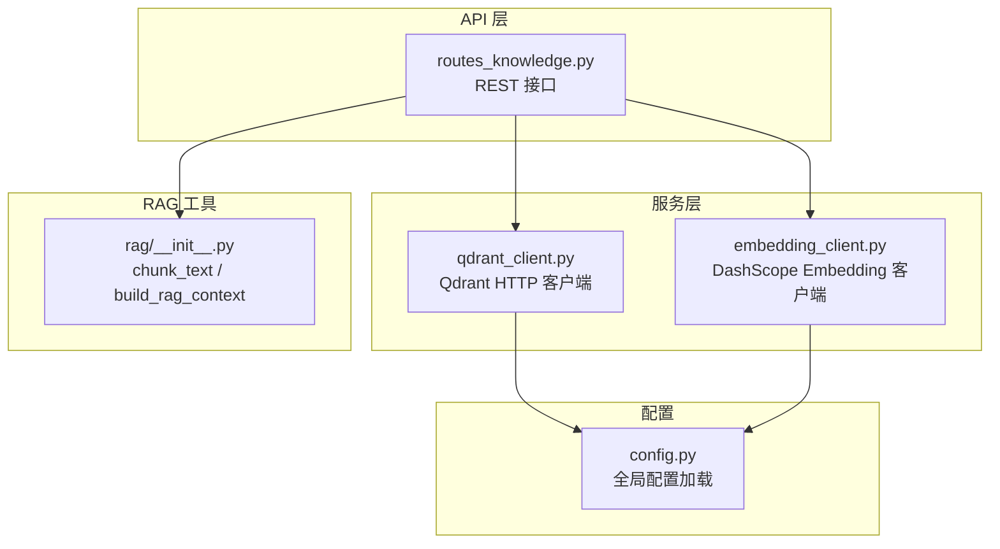
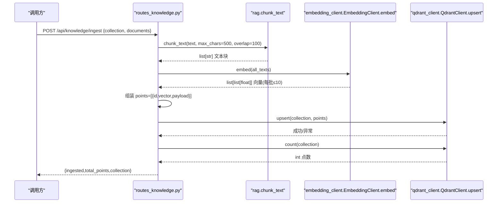
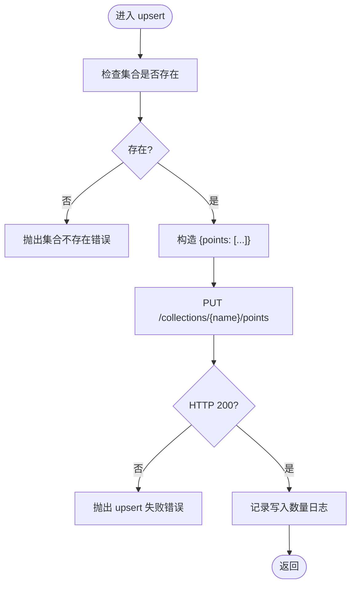
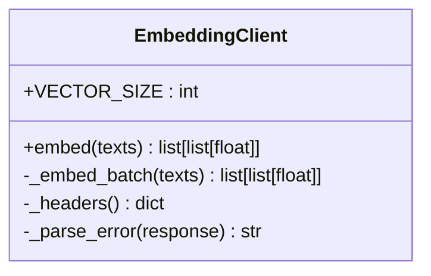
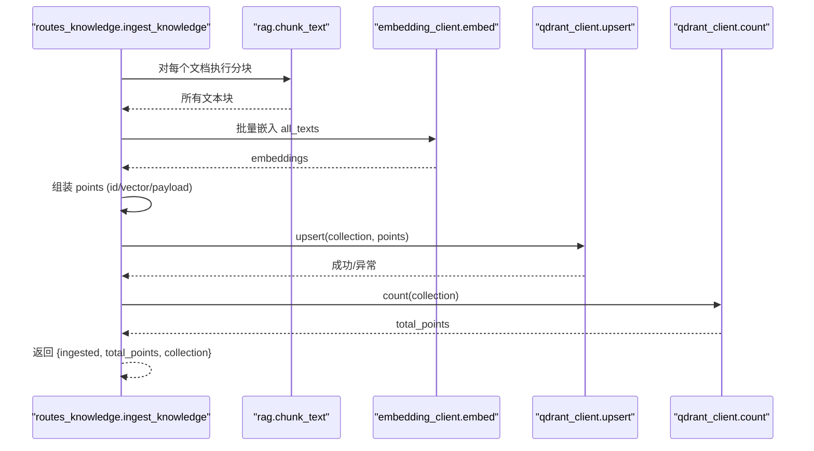
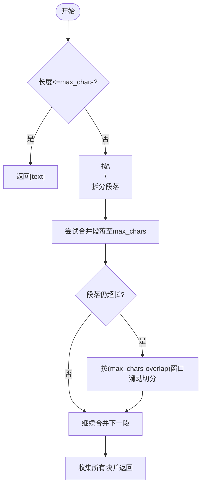
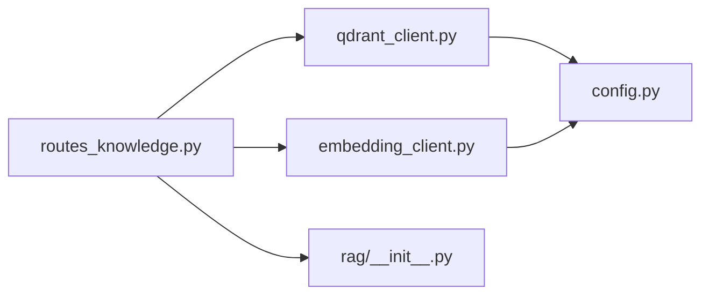

# 批量向量操作

<cite>
**本文引用的文件**
- [server/services/qdrant_client.py](file://server/services/qdrant_client.py)
- [server/api/routes_knowledge.py](file://server/api/routes_knowledge.py)
- [server/services/embedding_client.py](file://server/services/embedding_client.py)
- [server/rag/__init__.py](file://server/rag/__init__.py)
- [server/config.py](file://server/config.py)
- [doc/Qdrant知识库操作指南.md](file://doc/Qdrant知识库操作指南.md)
</cite>

## 目录
1. [简介](#简介)
2. [项目结构](#项目结构)
3. [核心组件](#核心组件)
4. [架构总览](#架构总览)
5. [详细组件分析](#详细组件分析)
6. [依赖关系分析](#依赖关系分析)
7. [性能与优化](#性能与优化)
8. [监控、日志与排障](#监控日志与排障)
9. [结论](#结论)
10. [附录：API 与数据模型](#附录api-与数据模型)

## 简介
本文件面向 RealTimeTalk 系统中的 Qdrant 批量向量写入（upsert）能力，围绕以下目标展开：
- 解释 upsert 批量写入的调用路径、点数据结构（id、vector、payload）格式与校验规则
- 给出批量插入的性能优化策略（批次大小、并发控制、内存管理）
- 提供构建批量数据、处理响应与错误重试的实践建议
- 说明向量数据预处理流程（归一化、维度检查、类型转换）
- 覆盖监控指标、日志记录与性能分析方法
- 对比单条与批量操作的差异及适用场景，并总结大数据量处理最佳实践

## 项目结构
RealTimeTalk 的知识库与向量检索相关代码主要分布在如下模块：
- API 层：知识摄入、集合管理、统计与调试搜索
- 服务层：Qdrant HTTP 客户端、Embedding 客户端
- RAG 工具：文本分块与上下文构建
- 配置：Qdrant、Embedding、RAG 等参数加载

图表来源
- [server/api/routes_knowledge.py:134-186](file://server/api/routes_knowledge.py#L134-L186)
- [server/services/qdrant_client.py:115-134](file://server/services/qdrant_client.py#L115-L134)
- [server/services/embedding_client.py:47-70](file://server/services/embedding_client.py#L47-L70)
- [server/rag/__init__.py:10-53](file://server/rag/__init__.py#L10-L53)
- [server/config.py:225-238](file://server/config.py#L225-L238)

章节来源
- [server/api/routes_knowledge.py:1-268](file://server/api/routes_knowledge.py#L1-L268)
- [server/services/qdrant_client.py:1-235](file://server/services/qdrant_client.py#L1-L235)
- [server/services/embedding_client.py:1-149](file://server/services/embedding_client.py#L1-L149)
- [server/rag/__init__.py:1-83](file://server/rag/__init__.py#L1-L83)
- [server/config.py:1-260](file://server/config.py#L1-L260)

## 核心组件
- QdrantClient：封装 Qdrant REST API，提供集合管理与 upsert/search/delete 等操作。upsert 支持批量写入 points 列表。
- EmbeddingClient：封装 DashScope text-embedding-v3 嵌入 API，内置批处理（默认每批最多 10 条），具备超时与限流重试。
- routes_knowledge：暴露 /api/knowledge/ingest 等接口，串联“分块→嵌入→批量 upsert”的完整链路。
- rag.chunk_text：长文本按段落或窗口切分为多个小块，便于后续向量化入库。
- config：集中加载 Qdrant、Embedding、RAG 等配置项。

章节来源
- [server/services/qdrant_client.py:115-134](file://server/services/qdrant_client.py#L115-L134)
- [server/services/embedding_client.py:47-70](file://server/services/embedding_client.py#L47-L70)
- [server/api/routes_knowledge.py:134-186](file://server/api/routes_knowledge.py#L134-L186)
- [server/rag/__init__.py:10-53](file://server/rag/__init__.py#L10-L53)
- [server/config.py:225-238](file://server/config.py#L225-L238)

## 架构总览
下图展示了从“知识摄入请求”到“批量 upsert 完成”的端到端流程，包括分块、批量嵌入、构造 points、批量写入与统计。

图表来源
- [server/api/routes_knowledge.py:134-186](file://server/api/routes_knowledge.py#L134-L186)
- [server/rag/__init__.py:10-53](file://server/rag/__init__.py#L10-L53)
- [server/services/embedding_client.py:47-70](file://server/services/embedding_client.py#L47-L70)
- [server/services/qdrant_client.py:115-134](file://server/services/qdrant_client.py#L115-L134)

## 详细组件分析

### QdrantClient 批量 upsert
- 入口方法：upsert(collection, points)
- 行为要点：
  - 自动校验集合是否存在，不存在则抛出错误
  - 将 points 列表整体提交至 Qdrant REST 接口
  - 成功后记录日志，包含写入点数
- 点数据结构约定（由调用方保证）：
  - id: 字符串唯一标识
  - vector: 浮点数组，维度需与集合定义一致
  - payload: 任意 JSON 对象（如 text、source 等）

图表来源
- [server/services/qdrant_client.py:115-134](file://server/services/qdrant_client.py#L115-L134)

章节来源
- [server/services/qdrant_client.py:115-134](file://server/services/qdrant_client.py#L115-L134)

### EmbeddingClient 批量嵌入
- 入口方法：embed(texts)
- 批处理策略：
  - 内部按固定 batch_size（默认 10）分批调用外部嵌入 API
  - 对 429/5xx/超时/连接错误进行有限次重试（指数退避或固定等待）
- 输出：与输入 texts 一一对应的向量列表，每个向量维度为 1024（text-embedding-v3）

图表来源
- [server/services/embedding_client.py:26-149](file://server/services/embedding_client.py#L26-L149)

章节来源
- [server/services/embedding_client.py:47-70](file://server/services/embedding_client.py#L47-L70)
- [server/services/embedding_client.py:72-135](file://server/services/embedding_client.py#L72-L135)

### 知识摄入路由（分块→嵌入→批量 upsert）
- 入口：POST /api/knowledge/ingest
- 流程：
  1) 校验 collection 与 documents 非空
  2) 使用 rag.chunk_text 将长文本切分为多个块
  3) 调用 embedding_client.embed 批量生成向量
  4) 组装 points 列表（id 由 QdrantClient.generate_id 生成；payload 包含 text/source）
  5) 调用 qdrant_client.upsert 批量写入
  6) 调用 qdrant_client.count 获取总数并返回

图表来源
- [server/api/routes_knowledge.py:134-186](file://server/api/routes_knowledge.py#L134-L186)
- [server/rag/__init__.py:10-53](file://server/rag/__init__.py#L10-L53)
- [server/services/embedding_client.py:47-70](file://server/services/embedding_client.py#L47-L70)
- [server/services/qdrant_client.py:115-134](file://server/services/qdrant_client.py#L115-L134)

章节来源
- [server/api/routes_knowledge.py:134-186](file://server/api/routes_knowledge.py#L134-L186)

### 文本分块（RAG）
- 算法要点：
  - 优先按段落（\n\n）合并，不超过 max_chars
  - 若单段落超长，按字符窗口滑动切分，保留 overlap
- 返回值：文本块列表，供后续批量嵌入

图表来源
- [server/rag/__init__.py:10-53](file://server/rag/__init__.py#L10-L53)

章节来源
- [server/rag/__init__.py:10-53](file://server/rag/__init__.py#L10-L53)

## 依赖关系分析
- API 层依赖服务层：
  - routes_knowledge → qdrant_client（集合管理、upsert、count）
  - routes_knowledge → embedding_client（批量嵌入）
  - routes_knowledge → rag（文本分块）
- 服务层依赖配置：
  - qdrant_client → config（读取 qdrant.url、qdrant.api_key）
  - embedding_client → config（读取 embedding.endpoint、api_key、model）

图表来源
- [server/api/routes_knowledge.py:1-268](file://server/api/routes_knowledge.py#L1-L268)
- [server/services/qdrant_client.py:1-235](file://server/services/qdrant_client.py#L1-L235)
- [server/services/embedding_client.py:1-149](file://server/services/embedding_client.py#L1-L149)
- [server/rag/__init__.py:1-83](file://server/rag/__init__.py#L1-L83)
- [server/config.py:1-260](file://server/config.py#L1-L260)

章节来源
- [server/api/routes_knowledge.py:1-268](file://server/api/routes_knowledge.py#L1-L268)
- [server/services/qdrant_client.py:1-235](file://server/services/qdrant_client.py#L1-L235)
- [server/services/embedding_client.py:1-149](file://server/services/embedding_client.py#L1-L149)
- [server/rag/__init__.py:1-83](file://server/rag/__init__.py#L1-L83)
- [server/config.py:1-260](file://server/config.py#L1-L260)

## 性能与优化

### 1) 点数据结构与验证规则
- id：字符串，建议使用唯一 ID（可参考 QdrantClient.generate_id 的实现思路）
- vector：浮点数组，维度必须与集合定义一致（例如 1024）
- payload：JSON 对象，建议包含可读字段（如 text、source），便于检索结果展示与溯源
- 校验建议：
  - 在组装 points 前统一校验 vector 长度与类型
  - 确保 payload 中关键字段存在且非空（如 text）
  - 避免 payload 过大导致网络与存储开销上升

章节来源
- [server/api/routes_knowledge.py:163-174](file://server/api/routes_knowledge.py#L163-L174)
- [server/services/qdrant_client.py:115-134](file://server/services/qdrant_client.py#L115-L134)

### 2) 批量写入批次大小调优
- 当前实现：
  - embedding_client 默认每批最多 10 条文本（受外部 API 限制）
  - qdrant_client.upsert 接受整个 points 列表，未做内部二次分片
- 建议：
  - 当 points 总量较大时，可在调用 upsert 前按合理阈值（如 500~2000）再次分片，降低单次请求体大小与内存峰值
  - 结合网络带宽与 Qdrant 节点负载动态调整批次大小

章节来源
- [server/services/embedding_client.py:38-40](file://server/services/embedding_client.py#L38-L40)
- [server/services/qdrant_client.py:115-134](file://server/services/qdrant_client.py#L115-L134)

### 3) 并发控制
- 当前实现：
  - embedding_client 串行分批（for 循环逐批调用）
  - qdrant_client.upsert 单次同步写入
- 建议：
  - 对超大批次可采用异步并发写入（注意限流与背压），或使用消息队列缓冲
  - 对多集合写入可使用类似 search_multi 的并发模式，但需控制并发度与错误隔离

章节来源
- [server/services/embedding_client.py:63-70](file://server/services/embedding_client.py#L63-L70)
- [server/services/qdrant_client.py:164-186](file://server/services/qdrant_client.py#L164-L186)

### 4) 内存管理
- 风险点：
  - 一次性构建超大 points 列表可能导致内存峰值升高
  - 大 payload 会放大序列化与传输成本
- 建议：
  - 采用流式/分页方式分批构建与写入
  - 对 payload 中的大字段（如全文）考虑仅存摘要或外置索引，检索时再按需拉取

章节来源
- [server/api/routes_knowledge.py:163-174](file://server/api/routes_knowledge.py#L163-L174)

### 5) 向量数据预处理流程
- 归一化：
  - 若外部嵌入模型返回 L2 归一化向量，可直接入库；否则建议在入库前进行 L2 归一化以提升余弦相似度稳定性
- 维度检查：
  - 严格校验 vector 长度与集合定义的 vector_size 一致（如 1024）
- 类型转换：
  - 确保 vector 元素为 float，避免整型或字符串混入
- 缺失值处理：
  - 过滤含 NaN/Inf 的向量，必要时回退或告警

章节来源
- [server/services/embedding_client.py:29-30](file://server/services/embedding_client.py#L29-L30)
- [server/services/qdrant_client.py:37-59](file://server/services/qdrant_client.py#L37-L59)

### 6) 错误重试机制
- 现有重试：
  - embedding_client 对 429/5xx/超时/连接错误进行有限次重试
- 建议补充：
  - 对 qdrant_client.upsert 增加幂等重试（基于 id 去重）
  - 对部分失败的批次进行细粒度重试与补偿

章节来源
- [server/services/embedding_client.py:84-135](file://server/services/embedding_client.py#L84-L135)
- [server/services/qdrant_client.py:115-134](file://server/services/qdrant_client.py#L115-L134)

### 7) 单条 vs 批量：差异与适用场景
- 单条写入：
  - 适合实时增量更新、低吞吐场景
  - 延迟较低，但吞吐受限
- 批量写入：
  - 适合离线导入、批量更新、高吞吐场景
  - 通过减少握手与序列化开销提升吞吐
- 建议：
  - 在线热路径尽量走批量（小批高频）
  - 离线任务可更大批次+并发，配合限速与监控

章节来源
- [server/services/qdrant_client.py:115-134](file://server/services/qdrant_client.py#L115-L134)

### 8) 大数据量处理最佳实践
- 分片策略：按固定大小分片写入，避免单次请求过大
- 顺序与幂等：为每条数据分配稳定 id，支持重复写入不产生重复
- 背压与限流：根据下游 Qdrant 状态与外部 API 配额动态调整
- 断点续传：记录已处理偏移量，失败后可从断点恢复
- 资源隔离：将嵌入与写入解耦，分别独立扩缩容

[本节为通用指导，无需源码引用]

## 监控、日志与排障

### 关键指标
- 写入吞吐：每秒写入点数、平均批次大小
- 延迟：P50/P95/P99 写入耗时
- 错误率：upsert 失败次数、分类（鉴权、限流、服务端错误）
- 资源占用：内存峰值、网络带宽
- 上游依赖：嵌入 API 成功率、平均耗时、重试次数

### 日志记录
- 写入成功：记录集合名、写入点数
- 写入失败：记录状态码、错误摘要（截断）
- 嵌入过程：记录批次大小、是否重试、错误信息

章节来源
- [server/services/qdrant_client.py:134](file://server/services/qdrant_client.py#L134)
- [server/services/embedding_client.py:96](file://server/services/embedding_client.py#L96)

### 常见问题定位
- 集合不存在：确认先创建集合或在上游逻辑中自动创建
- 维度不一致：核对集合 vector_size 与向量维度
- 鉴权失败：检查 Qdrant API Key 与 Embedding API Key
- 限流/超时：观察重试计数与后端健康状态，适当降速

章节来源
- [server/services/qdrant_client.py:124-133](file://server/services/qdrant_client.py#L124-L133)
- [server/services/embedding_client.py:100-135](file://server/services/embedding_client.py#L100-L135)

## 结论
RealTimeTalk 的批量向量写入以“分块→批量嵌入→批量 upsert”为主线，具备较好的可扩展性。通过合理的批次大小、并发控制与内存管理，并结合完善的错误重试与监控日志，可在保障稳定性的同时获得更高的吞吐。对于大规模数据，建议引入分片、幂等与断点续传等工程化手段，进一步提升鲁棒性与可维护性。

[本节为总结，无需源码引用]

## 附录：API 与数据模型

### 知识摄入接口
- 路径：POST /api/knowledge/ingest
- 认证：X-Knowledge-Admin-Token（若配置）
- 请求体：
  - collection: 字符串
  - documents: 数组，每项包含 text、source
- 响应：
  - ingested: 本次写入点数
  - total_points: 集合当前总点数
  - collection: 集合名称

章节来源
- [server/api/routes_knowledge.py:134-186](file://server/api/routes_knowledge.py#L134-L186)

### 点数据结构（用于 upsert）
- id: 字符串
- vector: 浮点数组（维度与集合一致）
- payload: 对象（建议包含 text、source 等）

章节来源
- [server/api/routes_knowledge.py:163-174](file://server/api/routes_knowledge.py#L163-L174)

### 配置项（节选）
- qdrant.url、qdrant.api_key
- embedding.endpoint、embedding.api_key、embedding.model
- rag.top_k、rag.role_collections

章节来源
- [server/config.py:225-238](file://server/config.py#L225-L238)

### 用户文档参考
- 知识库操作指南（概念、界面、最佳实践）

章节来源
- [doc/Qdrant知识库操作指南.md:1-213](file://doc/Qdrant知识库操作指南.md#L1-L213)