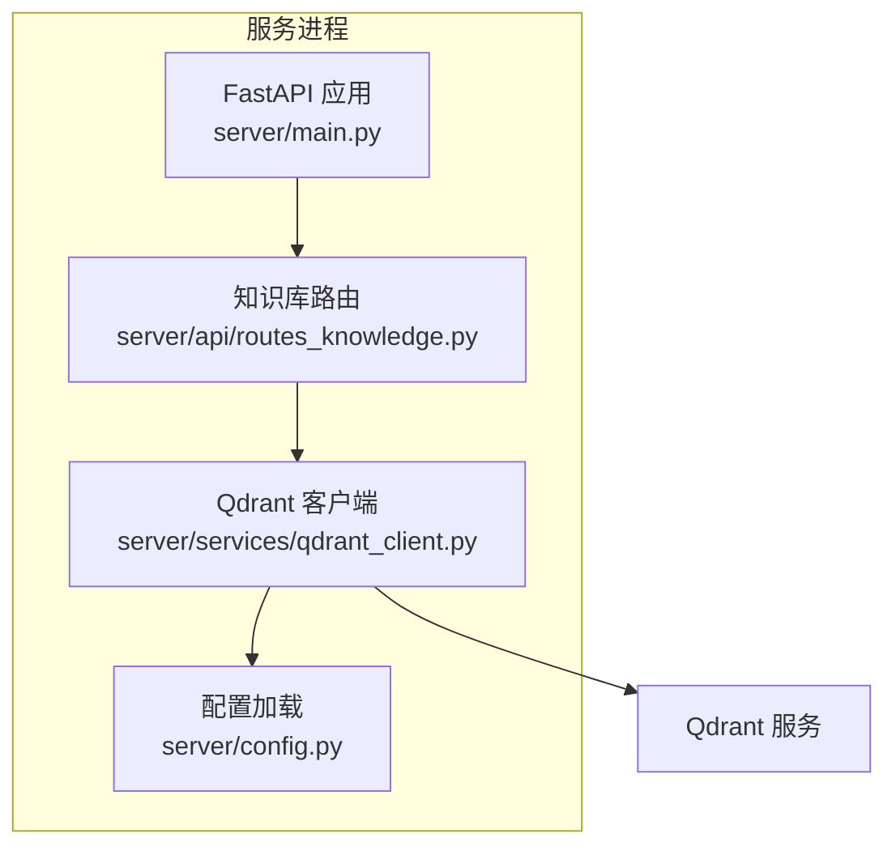
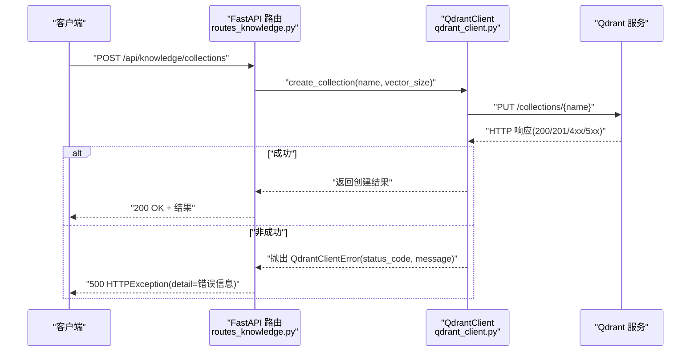
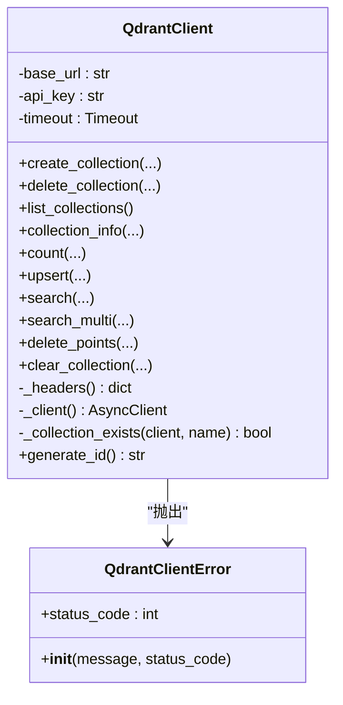
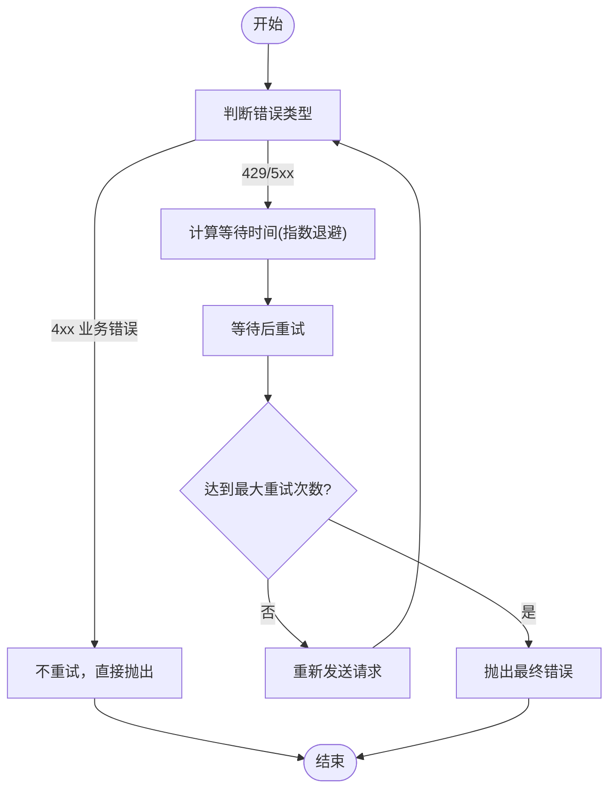
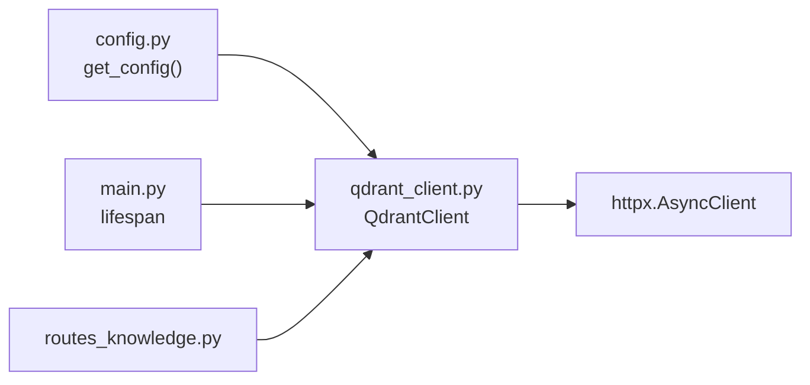

# 错误处理与重试

<cite>
**本文引用的文件**
- [server/services/qdrant_client.py](file://server/services/qdrant_client.py)
- [server/main.py](file://server/main.py)
- [server/api/routes_knowledge.py](file://server/api/routes_knowledge.py)
- [server/config.py](file://server/config.py)
- [doc/Qdrant知识库操作指南.md](file://doc/Qdrant知识库操作指南.md)
</cite>

## 目录
1. [简介](#简介)
2. [项目结构](#项目结构)
3. [核心组件](#核心组件)
4. [架构总览](#架构总览)
5. [详细组件分析](#详细组件分析)
6. [依赖关系分析](#依赖关系分析)
7. [性能考量](#性能考量)
8. [故障排查指南](#故障排查指南)
9. [结论](#结论)
10. [附录](#附录)

## 简介
本文件面向 RealTimeTalk 系统中的 Qdrant 客户端，聚焦于错误处理与重试机制的设计与实践。文档将深入解析自定义异常类 QdrantClientError 的设计（错误码映射、错误信息封装、调试信息收集），并说明网络请求的错误处理策略（超时设置、连接池管理、重试逻辑）。同时提供不同错误类型的处理示例路径，涵盖指数退避、熔断器模式与降级策略的落地建议；并给出日志记录规范、监控告警集成思路以及分布式环境下的错误传播与一致性保证方案。

## 项目结构
RealTimeTalk 后端服务通过 FastAPI 暴露 REST/WS 接口，Qdrant 作为向量数据库用于 RAG 检索。Qdrant 客户端位于 services 层，负责 HTTP 调用、错误封装与业务语义化异常抛出；main.py 在应用生命周期中初始化客户端并进行健康检查；routes_knowledge.py 提供知识管理 API，并在上层捕获异常转换为 HTTP 响应。

图表来源
- [server/main.py:70-87](file://server/main.py#L70-L87)
- [server/api/routes_knowledge.py:33-37](file://server/api/routes_knowledge.py#L33-L37)
- [server/services/qdrant_client.py:26-34](file://server/services/qdrant_client.py#L26-L34)
- [server/config.py:225-228](file://server/config.py#L225-L228)

章节来源
- [server/main.py:1-191](file://server/main.py#L1-L191)
- [server/api/routes_knowledge.py:1-268](file://server/api/routes_knowledge.py#L1-L268)
- [server/services/qdrant_client.py:1-235](file://server/services/qdrant_client.py#L1-L235)
- [server/config.py:1-260](file://server/config.py#L1-L260)

## 核心组件
- QdrantClientError：统一异常类型，携带状态码与人类可读消息，便于上层按错误码分类处理。
- QdrantClient：异步 HTTP 客户端封装，使用 httpx.AsyncClient，内置超时与鉴权头注入；对每个方法返回结果进行状态码校验并抛出 QdrantClientError。
- 启动期健康检查：main.py 在 lifespan 中尝试列出集合，失败仅记录警告并继续启动，RAG 功能降级为纯 LLM 回复。
- 知识库路由：routes_knowledge.py 将底层异常转换为 HTTPException，对外暴露统一的 5xx 错误响应。

章节来源
- [server/services/qdrant_client.py:19-24](file://server/services/qdrant_client.py#L19-L24)
- [server/services/qdrant_client.py:26-34](file://server/services/qdrant_client.py#L26-L34)
- [server/main.py:70-87](file://server/main.py#L70-L87)
- [server/api/routes_knowledge.py:82-102](file://server/api/routes_knowledge.py#L82-L102)

## 架构总览
下图展示从 Web 请求到 Qdrant 的完整链路，以及错误在各层的传播方式。

图表来源
- [server/api/routes_knowledge.py:105-117](file://server/api/routes_knowledge.py#L105-L117)
- [server/services/qdrant_client.py:37-59](file://server/services/qdrant_client.py#L37-L59)

## 详细组件分析

### 自定义异常 QdrantClientError 设计
- 错误码映射：所有 HTTP 非 2xx 响应均被转换为 QdrantClientError，并保留原始 status_code，便于上层按 404/429/5xx 等分类处理。
- 错误信息封装：消息包含简要描述与部分响应体（截断），利于快速定位问题。
- 调试信息收集：结合 Python logging 输出上下文（集合名、维度、距离等），辅助排障。

图表来源
- [server/services/qdrant_client.py:19-24](file://server/services/qdrant_client.py#L19-L24)
- [server/services/qdrant_client.py:26-235](file://server/services/qdrant_client.py#L26-L235)

章节来源
- [server/services/qdrant_client.py:19-24](file://server/services/qdrant_client.py#L19-L24)
- [server/services/qdrant_client.py:37-59](file://server/services/qdrant_client.py#L37-L59)
- [server/services/qdrant_client.py:61-73](file://server/services/qdrant_client.py#L61-L73)
- [server/services/qdrant_client.py:74-83](file://server/services/qdrant_client.py#L74-L83)
- [server/services/qdrant_client.py:85-102](file://server/services/qdrant_client.py#L85-L102)
- [server/services/qdrant_client.py:104-111](file://server/services/qdrant_client.py#L104-L111)
- [server/services/qdrant_client.py:115-134](file://server/services/qdrant_client.py#L115-L134)
- [server/services/qdrant_client.py:136-162](file://server/services/qdrant_client.py#L136-L162)
- [server/services/qdrant_client.py:164-186](file://server/services/qdrant_client.py#L164-L186)
- [server/services/qdrant_client.py:188-204](file://server/services/qdrant_client.py#L188-L204)
- [server/services/qdrant_client.py:206-212](file://server/services/qdrant_client.py#L206-L212)
- [server/services/qdrant_client.py:216-229](file://server/services/qdrant_client.py#L216-L229)

### 网络请求错误处理策略
- 超时设置：httpx.Timeout(30.0, connect=5.0)，整体 30s，连接 5s，避免长时间阻塞。
- 连接池管理：每次调用通过 _client() 创建新的 AsyncClient 实例，未复用连接池；在高并发场景下可能带来额外开销。
- 重试逻辑：当前实现未内置重试；建议在外部包装或引入通用重试装饰器，针对可重试错误（如 429、5xx）执行指数退避。

章节来源
- [server/services/qdrant_client.py:33](file://server/services/qdrant_client.py#L33)
- [server/services/qdrant_client.py:223-225](file://server/services/qdrant_client.py#L223-L225)

### 重试与退避（建议实现）
- 指数退避：首次等待 1s，随后每次翻倍（1→2→4→8…），最大等待时间上限与最大重试次数可配置。
- 可重试判定：仅对瞬时错误（429、5xx）重试；4xx 业务错误（如 404）不重试。
- 幂等性：优先对 GET/DELETE 等幂等方法启用重试；写入操作需评估幂等性与副作用。

[本节为概念性流程图，无需图表来源]

### 熔断器模式与降级策略（建议实现）
- 熔断器：统计单位时间内的失败率与慢调用比例，超过阈值则进入“打开”状态，快速失败；半开状态下试探少量请求以恢复。
- 降级：当 Qdrant 不可用时，RAG 流程自动降级为纯 LLM 回答，确保用户体验不受影响。

章节来源
- [doc/Qdrant知识库操作指南.md:163-171](file://doc/Qdrant知识库操作指南.md#L163-L171)

### 错误处理示例（代码片段路径）
- 网络连接失败：参考 upsert/search/delete_points 中对非 200 响应的处理与异常抛出位置。
  - [server/services/qdrant_client.py:115-134](file://server/services/qdrant_client.py#L115-L134)
  - [server/services/qdrant_client.py:136-162](file://server/services/qdrant_client.py#L136-L162)
  - [server/services/qdrant_client.py:188-204](file://server/services/qdrant_client.py#L188-L204)
- API 限流（429）：当前未区分 429，可在外层重试逻辑中识别并重试。
- 数据验证错误（4xx）：例如集合不存在（404）在 delete_collection/collection_info 中有明确分支。
  - [server/services/qdrant_client.py:61-73](file://server/services/qdrant_client.py#L61-L73)
  - [server/services/qdrant_client.py:85-102](file://server/services/qdrant_client.py#L85-L102)
- 业务逻辑异常：如集合不存在时 upsert 提前返回错误。
  - [server/services/qdrant_client.py:115-134](file://server/services/qdrant_client.py#L115-L134)

章节来源
- [server/services/qdrant_client.py:61-73](file://server/services/qdrant_client.py#L61-L73)
- [server/services/qdrant_client.py:85-102](file://server/services/qdrant_client.py#L85-L102)
- [server/services/qdrant_client.py:115-134](file://server/services/qdrant_client.py#L115-L134)
- [server/services/qdrant_client.py:136-162](file://server/services/qdrant_client.py#L136-L162)
- [server/services/qdrant_client.py:188-204](file://server/services/qdrant_client.py#L188-L204)

### 日志记录规范
- 关键节点：集合创建/删除、upsert 数量、搜索合并排序等均有 INFO 级别日志。
- 错误日志：上层路由捕获异常并记录 ERROR，附带错误详情。
- 建议：在 QdrantClient 内部增加结构化日志字段（如 collection、vector_size、distance、request_id），便于追踪。

章节来源
- [server/services/qdrant_client.py:50-58](file://server/services/qdrant_client.py#L50-L58)
- [server/services/qdrant_client.py:134](file://server/services/qdrant_client.py#L134)
- [server/api/routes_knowledge.py:115-117](file://server/api/routes_knowledge.py#L115-L117)
- [server/api/routes_knowledge.py:184-186](file://server/api/routes_knowledge.py#L184-L186)

### 监控告警集成（建议）
- 指标采集：Qdrant 调用成功率、P95/P99 延迟、错误码分布、重试次数、熔断器状态。
- 告警规则：连续 N 次 429/5xx、平均延迟超阈值、熔断器打开持续一段时间。
- 工具建议：Prometheus + Grafana 可视化，结合 Alertmanager 推送告警。

[本节为通用建议，无需图表来源]

### 分布式环境下的错误传播与一致性
- 错误传播：QdrantClientError 向上冒泡至路由层，转为 HTTPException；WebSocket 场景中由上层处理器捕获并推送 error 事件。
- 一致性保证：
  - 幂等写入：为点分配唯一 id（generate_id），重复 upsert 不会导致重复数据。
  - 事务边界：Qdrant 单集合内 upsert 具备原子性；跨集合操作需在应用层协调。
  - 补偿机制：若写入失败，上层应回滚相关状态或触发重试/补偿任务。

章节来源
- [server/services/qdrant_client.py:231-234](file://server/services/qdrant_client.py#L231-L234)
- [server/api/routes_knowledge.py:164-174](file://server/api/routes_knowledge.py#L164-L174)

## 依赖关系分析
- QdrantClient 依赖配置模块获取 qdrant.url 与 api_key，并通过 httpx 发起 HTTP 请求。
- main.py 在启动阶段初始化 QdrantClient 并执行 list_collections 健康检查，失败不影响服务启动。
- routes_knowledge.py 依赖 QdrantClient 完成集合管理与知识摄入。

图表来源
- [server/config.py:225-228](file://server/config.py#L225-L228)
- [server/main.py:70-87](file://server/main.py#L70-L87)
- [server/api/routes_knowledge.py:33-37](file://server/api/routes_knowledge.py#L33-L37)
- [server/services/qdrant_client.py:223-225](file://server/services/qdrant_client.py#L223-L225)

章节来源
- [server/config.py:1-260](file://server/config.py#L1-L260)
- [server/main.py:1-191](file://server/main.py#L1-L191)
- [server/api/routes_knowledge.py:1-268](file://server/api/routes_knowledge.py#L1-L268)
- [server/services/qdrant_client.py:1-235](file://server/services/qdrant_client.py#L1-L235)

## 性能考量
- 连接池：当前每次请求新建 AsyncClient，未复用连接池，可能导致连接建立开销增大。建议改为全局共享 AsyncClient 或使用连接池参数优化。
- 并发搜索：search_multi 使用 asyncio.gather 并发检索多个集合，需注意总体超时与错误隔离。
- 超时与重试：合理设置超时与重试次数，避免雪崩效应；配合熔断器保护下游。

章节来源
- [server/services/qdrant_client.py:164-186](file://server/services/qdrant_client.py#L164-L186)
- [server/services/qdrant_client.py:223-225](file://server/services/qdrant_client.py#L223-L225)

## 故障排查指南
- 启动期 Qdrant 不可用：查看 main.py 中的警告日志，确认 RAG 是否降级为纯 LLM。
  - [server/main.py:70-87](file://server/main.py#L70-L87)
- 集合不存在：delete_collection/collection_info/upsert 会抛出 404，检查集合创建流程与名称规范化。
  - [server/services/qdrant_client.py:61-73](file://server/services/qdrant_client.py#L61-L73)
  - [server/services/qdrant_client.py:85-102](file://server/services/qdrant_client.py#L85-L102)
  - [server/services/qdrant_client.py:115-134](file://server/services/qdrant_client.py#L115-L134)
- 写入失败：upsert 非 200 响应，检查 payload 结构与集合维度匹配。
  - [server/services/qdrant_client.py:115-134](file://server/services/qdrant_client.py#L115-L134)
- 搜索失败：search 非 200 响应，检查查询向量维度与 limit 参数。
  - [server/services/qdrant_client.py:136-162](file://server/services/qdrant_client.py#L136-L162)
- 路由层错误：routes_knowledge.py 捕获异常并返回 500，关注日志中的 detail。
  - [server/api/routes_knowledge.py:115-117](file://server/api/routes_knowledge.py#L115-L117)
  - [server/api/routes_knowledge.py:184-186](file://server/api/routes_knowledge.py#L184-L186)

章节来源
- [server/main.py:70-87](file://server/main.py#L70-L87)
- [server/services/qdrant_client.py:61-73](file://server/services/qdrant_client.py#L61-L73)
- [server/services/qdrant_client.py:85-102](file://server/services/qdrant_client.py#L85-L102)
- [server/services/qdrant_client.py:115-134](file://server/services/qdrant_client.py#L115-L134)
- [server/services/qdrant_client.py:136-162](file://server/services/qdrant_client.py#L136-L162)
- [server/api/routes_knowledge.py:115-117](file://server/api/routes_knowledge.py#L115-L117)
- [server/api/routes_knowledge.py:184-186](file://server/api/routes_knowledge.py#L184-L186)

## 结论
当前 Qdrant 客户端实现了基础错误封装与日志记录，支持健康检查与降级策略。为提升稳定性与可观测性，建议引入统一的重试与指数退避、熔断器与连接池优化，并完善结构化日志与监控指标，从而在分布式环境下提供更强的容错能力与一致保障。

## 附录
- 配置项：qdrant.url 与 qdrant.api_key 来自配置模块，可通过环境变量覆盖。
  - [server/config.py:225-228](file://server/config.py#L225-L228)
- 降级策略：当 Qdrant 不可用时，系统自动走纯 LLM 回复。
  - [doc/Qdrant知识库操作指南.md:163-171](file://doc/Qdrant知识库操作指南.md#L163-L171)